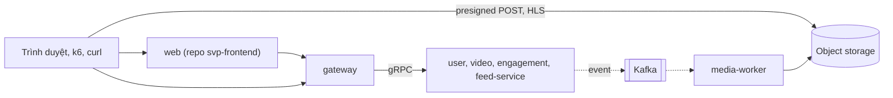

# svp-backend

Backend của nền tảng video ngắn mini: sáu service Go (upload, transcode HLS, feed, like, lượt xem), chart Helm, stack compose, cluster k3d và CI.



Nét liền là gọi đồng bộ, nét đứt là event. Sơ đồ đủ container, luồng upload, feed, like ở [`docs/architecture.md`](docs/architecture.md).

## Mục lục

- [Bối cảnh](#bối-cảnh)
- [Cài đặt](#cài-đặt)
- [Sử dụng](#sử-dụng)
- [Chạy ở đâu](#chạy-ở-đâu)
- [Bản đồ thư mục](#bản-đồ-thư-mục)
- [Đọc tiếp](#đọc-tiếp)
- [Đóng góp](#đóng-góp)
- [Giấy phép](#giấy-phép)

## Bối cảnh

Repo là lab học DevOps và Solution Architect: làm xuyên suốt từ thiết kế, code, hạ tầng, quan sát, độ tin cậy tới cloud; mỗi bước lớn
kết thúc bằng hệ thống chạy được, có số đo và có ADR cho các quyết định. Thiết kế và lý do ở [`docs/architecture.md`](docs/architecture.md).
Repo là [`anhnvcoder/svp-backend`](https://github.com/anhnvcoder/svp-backend), đổi tên từ `short-video-platform` ([ADR-0036](docs/adr/0036-repo-rename.md)).

Hệ thống chia ba repo ([ADR-0033](docs/adr/0033-svp-web-repo.md), [ADR-0025](docs/adr/0025-gitops-config-repo.md)):

| Repo | Chứa gì |
| --- | --- |
| [`svp-backend`](https://github.com/anhnvcoder/svp-backend) (repo này) | Code backend, test, Dockerfile, chart Helm (`deploy/helm/`), stack compose, cluster k3d, CI build, quét, ký sáu image Go. |
| [`svp-frontend`](https://github.com/anhnvcoder/svp-frontend) | Web client (Next.js và BFF): mã, test, CI và image web. Nói chuyện với backend qua hợp đồng REST `services/gateway/openapi.yaml` có version, phát hành có chữ ký thành `ghcr.io/anhnvcoder/svp-backend/api/gateway:<version>`; `make api-contract-check` kiểm luật version ở PR. |
| [`svp-gitops`](https://github.com/anhnvcoder/svp-gitops) | Môi trường nào chạy bản nào: `base/` (values gốc), `envs/stg/`, `envs/prd/` (overlay, `charts.yaml`, digest đang chạy), `argocd/`. Bản phát hành tới stg bằng PR do GitHub App mở, tự merge khi check `gitops-ok` xanh; tới prd bằng PR chép cả bộ đã chạy ở stg, qua environment `promote-prd` có người duyệt. Push vào `main` của repo này không đổi cluster nào. |

## Cài đặt

Cần sẵn trên máy:

- Docker, và Go theo version ghim trong `go.mod`.
- Postgres native trên máy (`127.0.0.1:5432`) và Redis native `127.0.0.1:6379` chỉ cho `make test` (Redis db 15) và `make dev` của web
  (Redis db 9). Postgres, Kafka và Valkey của stack là container của compose. Database và db Valkey riêng của từng service ở
  [`AGENTS.md`](AGENTS.md).
- Công cụ dòng lệnh: `curl`, `jq`, `openssl` (`make env` sinh mật khẩu và CA local), `ffmpeg` (`make smoke` sinh video thử và gọi API).
- Bản clone `svp-gitops` ở `../gitops` (hay `SVP_GITOPS_DIR`): `make up` đọc từ đó digest của web client, kéo ẩn danh từ GHCR; đường
  dev của cluster (`make k8s-up`, `make helm-check`) cũng đọc `base/` ở đó.
- Bản clone `svp-frontend` ở `../frontend` (hay `SVP_WEB_DIR`) chỉ khi cần mã web: `make up WEB_FROM=clone`, `make web-e2e`, Lighthouse.

```sh
git clone https://github.com/anhnvcoder/svp-gitops.git ../gitops
git clone https://github.com/anhnvcoder/svp-frontend.git ../frontend   # only when you need the web code
```

## Sử dụng

Chạy thử từng bước, kèm đọc một trace: [`docs/tutorials/first-run.md`](docs/tutorials/first-run.md). Phần nhanh, từ gốc repo:

```sh
make help        # liệt kê mọi target
make env         # tạo .env (mode 600) với secret ngẫu nhiên, CA local và cert của Postgres, Kafka, Valkey (.local/ca/); không bao giờ in giá trị
make up          # dựng Postgres (TLS) và tạo role/database trong nó, rồi Kafka (SASL_SSL 9096), Valkey (TLS), object storage, các service, web
make smoke       # luồng đầu-cuối qua gateway: đăng ký, upload tới READY, phát HLS, feed, like, follow
```

Mở `http://localhost:3001` (dùng đúng `localhost`, không dùng `127.0.0.1`: object store chỉ nhận CORS từ `localhost`). Gateway ở
`http://127.0.0.1:8080`. `make down` gỡ stack và giữ volume. Muốn xem telemetry (Grafana, Alertmanager, GlitchTip) thì
`make up OBS=lgtm`; chỉ chạy một bộ observability một lúc vì máy 16 GB RAM không đủ cho hai bộ.

Object store là service `s3` (compose và k3d): một endpoint tương thích S3 API (RustFS, [ADR-0022](docs/adr/0022-local-object-store-minio-replacement.md));
code gọi nó qua `internal/objstore`. Kiểm tra (`make check`, `make vulncheck`, `make fuzz`, `make dast`, `make grype`) và mọi lệnh khác
ở [`docs/reference/`](docs/reference/).

PostgreSQL 17 (TLS, client kiểm cert server bằng `sslmode=verify-full`), Kafka (`apache/kafka`, SCRAM-SHA-512 trên TLS) và Valkey (TLS, user
theo db và tiền tố khoá) chạy cùng phần mềm, major và xác thực với RDS, MSK và ElastiCache của stg, prd
([ADR-0057](docs/adr/0057-postgres17-verify-full.md), [ADR-0053](docs/adr/0053-msk-elasticache-valkey.md)). Script chạm Kafka, Valkey đi qua CLI
vận hành `deploy/ops/` (`svp-kafka`, `svp-valkey`), chạm Postgres qua `docker compose … exec postgres psql` của Makefile, đều chạy trong
container; mô tả ở [`reference/compose.md`](docs/reference/compose.md).

## Chạy ở đâu

Cùng một hệ thống chạy ở ba nơi; chi tiết và lý do khác nhau ở [`docs/explanation/deployment.md`](docs/explanation/deployment.md).
Compose và k3d không chạy cùng lúc: mỗi bên từ chối khi bên kia đang chạy.

| Nơi | Dùng để | Lệnh vào | Tài liệu |
| --- | --- | --- | --- |
| Compose trên máy | Đường dev chính, smoke, diễn tập | `make up`, `make smoke` | [`reference/compose.md`](docs/reference/compose.md) |
| Cluster k3d | Cùng chart như cloud: Envoy Gateway, NetworkPolicy, canary, Kyverno; `make k8s-gitops-up` chạy như stg qua Argo CD | `make k8s-up`, `make k8s-gitops-up`, `make k8s-smoke` | [`reference/k8s.md`](docs/reference/k8s.md) |
| EKS stg, prd trên AWS | Môi trường thật, dựng bằng Terraform của [`svp-infra`](https://github.com/anhnvcoder/svp-infra) (cluster rồi Argo CD và root), dựng và xoá trong mỗi buổi; người học chạy | `make eks-secrets`, `make eks-glitchtip-init`, `make eks-smoke` | [`reference/eks.md`](docs/reference/eks.md) |

## Bản đồ thư mục

| Thư mục | Chứa gì, khi nào cần mở |
| --- | --- |
| `services/` | Sáu service Go, mỗi service một thư mục. Mở khi sửa logic nghiệp vụ. |
| `services/gateway/` | Biên REST/JSON: route, auth, rate limit, retry và circuit breaker tới gRPC, `openapi.yaml`. |
| `services/user-service/` | Đăng ký, đăng nhập, JWT, refresh token, hồ sơ, follow (database `svp_user`). |
| `services/video-service/` | Metadata video, presigned POST, `CompleteUpload`, job dọn upload bỏ dở (database `svp_video`). |
| `services/media-worker/` | Consumer transcode bằng ffmpeg ra HLS, không có database. |
| `services/engagement-service/` | Like, unlike, lượt xem gom theo lô (database `svp_engagement`). |
| `services/feed-service/` | Feed following (fan-out on write), feed khám phá có cache (database `svp_feed`). |
| `internal/` | Thư viện dùng chung: kết nối Postgres và retry, Kafka, outbox, Redis (Valkey), telemetry, gRPC, env. |
| `proto/` | Contract `.proto` của gRPC và event, quản lý bằng buf. Sửa ở đây rồi chạy `make generate`. |
| `gen/` | Code Go sinh từ `proto/`; commit cùng thay đổi, không sửa tay. Code sinh từ SQL (sqlc) ở `services/*/internal/store`. |
| `tools/` | Công cụ nhỏ: `jwtkey` (khoá JWT), `vulngate` (gate của `make vulncheck`). |
| `deploy/compose/` | Stack compose `make up`, `local-ca.sh` (CA local), script smoke và diễn tập. |
| `deploy/docker/` | Dockerfile của service Go và media-worker (Dockerfile web ở gốc `svp-frontend`). |
| `deploy/postgres/`, `deploy/s3/` | Bootstrap database; bucket, user, policy và CORS của object storage. |
| `deploy/kafka/`, `deploy/valkey/`, `deploy/ops/` | Broker `apache/kafka` (cấu hình, script init topic, user, ACL), aclfile của Valkey, CLI vận hành `svp-kafka`, `svp-valkey`. |
| `deploy/observability/` | Collector, Prometheus và rule SLO, Alertmanager, Grafana LGTM, GlitchTip, Elastic (so sánh). |
| `deploy/k8s/` | Cluster k3d: `helmfile.yaml.gotmpl` cùng glue `install.sh` (đường dev), `gitops.sh`, `secrets.sh` và `rotate.sh` (xoay credential, Reloader restart), `k8s.mk`, PSA, `drills/` (Chainsaw), `cloud/` (kiểm tĩnh Job k6). Values, overlay và digest của các môi trường ở `svp-gitops`. |
| `deploy/helm/` | Chart Helm: `svp-service` (chung cho mọi service), `svp-cluster`, `svp-data`, `svp-observability`, `svp-policy` (Kyverno). |
| `deploy/k6/`, `deploy/dast/` | Kịch bản tải k6 theo SLO; DAST của gateway theo `openapi.yaml` bằng Schemathesis (`make dast`). |
| `deploy/ci/` | Script của pipeline: build, quét, ký, attest, guard promote sang `svp-gitops`, check của `svp-gitops`; `verify/` là trình tự của `verify.yml`. Phần lớn logic CI ở đây, không ở YAML. |
| `.githooks/` | Git hook `pre-commit` (gofmt, golangci-lint, buf lint, gitleaks); bật bằng `make hooks`. |
| `.github/workflows/` | `ci.yml`, `images.yml`, `scorecard.yml`, `pr-title.yml`, `verify.yml`; cách đọc một lượt chạy ở [`docs/ci-cd.md`](docs/ci-cd.md). |
| `docs/` | Tài liệu theo Diátaxis: mục lục ở [`docs/README.md`](docs/README.md). |

## Đọc tiếp

Mục lục đủ ở [`docs/README.md`](docs/README.md), theo bốn loại [Diátaxis](https://diataxis.fr):

- **Tutorial:** [`docs/tutorials/first-run.md`](docs/tutorials/first-run.md): dựng stack, chạy luồng đầu-cuối, đọc một trace.
- **How-to:** [`docs/runbooks/`](docs/runbooks/): một runbook cho mỗi cảnh báo mức page và các quy trình tay. Mở khi có cảnh báo.
- **Reference:** [`docs/reference/`](docs/reference/): lệnh `make`, biến môi trường, compose, k3d, EKS, CI, contract, quy ước test.
- **Explanation:** [`docs/architecture.md`](docs/architecture.md), [`docs/explanation/`](docs/explanation/), [`docs/threat-model.md`](docs/threat-model.md)
  và [`docs/adr/`](docs/adr/). ADR 0001 (ranh giới service) và 0003 (outbox, event) là nền của gần như mọi thứ khác.

## Đóng góp

Quy ước chung (ngôn ngữ, tài liệu, ADR, Git, repo public) ở
[`CONTRIBUTING.md`](https://github.com/anhnvcoder/.github/blob/main/CONTRIBUTING.md) của `anhnvcoder/.github`; luật riêng của repo, luật
an toàn cloud và database ở [`AGENTS.md`](AGENTS.md). Mọi thay đổi vào `main` đi qua pull request có `ci-ok` và `images-ok` xanh.

## Giấy phép

[Apache-2.0](LICENSE).
