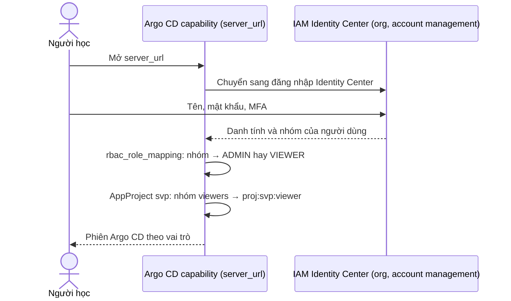

# Phụ lục ADR-0065: Argo CD trên eks chuyển sang EKS Capability cho Argo CD: AWS chạy và giữ HA, đăng nhập qua IAM Identity Center với vai trò theo nhóm, không tài khoản local; hiện thực ở thay đổi riêng, tới đó giữ Argo CD tự cài

Phụ lục của [ADR-0065](../0065-argocd-eks-capability.md): phương án, luồng đăng nhập, kiểm SSO và break-glass, quyền, chi phí, bảng control Security
Hub, bảng luồng SCP, RCP và nguồn, xếp theo §. Mọi nguồn đọc ngày 2026-11-13. Đường dẫn `aws/...` không kèm repo là của `svp-infra`; `argocd/...`,
`base/...`, `platforms/...` là của `svp-gitops` ở `3be1674`.

## Phương án

| Câu hỏi | Phương án | Trạng thái ngành | Được | Mất | Nguồn |
| --- | --- | --- | --- | --- | --- |
| Cách chạy Argo CD và SSO | **(A) EKS Capability cho Argo CD** | Mới nổi: dịch vụ managed của AWS, có trong Price List mọi region thương mại có EKS | Không pod Argo CD trên node; HA, vá, nâng cấp do AWS; đăng nhập Identity Center sẵn, vai trò theo nhóm; tới được cluster có API private không cần mạng riêng | Không CMP, UI extension, SSO khác; timeout sync cố định 120 s; đích là ARN cluster; phiên bản do AWS chọn; tính tiền theo giờ và theo Application | [N1], [N2], [N10], [N16] |
| | (B) Tự cài, HA của chart, `oidc.config` tới Cognito user pool làm SP SAML của Identity Center | Hiện hành (OIDC thẳng, không Dex) | Không Dex; ACS là `https://<domain>/saml2/idpresponse` của Cognito; 50 MAU federated miễn phí mỗi tháng | Thêm user pool, app client, domain Cognito; Argo CD cần nhóm là mảng, thuộc tính custom của Cognito là chuỗi: có thể cần Lambda pre-token (chưa kiểm); HA tự giữ như (C) | [N7], [N17] |
| | (C) Tự cài, HA của chart, Dex SAML với Identity Center | Legacy: connector "unmaintained", đang xét deprecate | Theo đúng trang Identity Center của Argo CD; $0 dịch vụ AWS | Connector có thể bị vượt xác thực [N5]; bản sửa `goxmldsig` v1.5.0 có, PR thay chưa merge [N18]; redis-ha cần ≥ 3 node khác nhau [N6], dex-server một replica (DB trong bộ nhớ) [N6] | [N4], [N5], [N6], [N18] |
| | (D) Giữ hiện trạng: một replica, `admin`, port-forward | Không đạt cho production | Không đổi gì | Mất node là dừng đồng bộ; tài khoản dùng chung; không MFA, không vai trò | — |
| Đường vào UI (A) | **Endpoint công khai của capability, đăng nhập Identity Center** | Hiện hành cho dịch vụ managed (như AMG) | Không mạng riêng; MFA và thu hồi của Identity Center | UI có địa chỉ công khai | [N13] |
| | Endpoint VPC `eks-capabilities` (`vpceIds`) | Hiện hành khi có VPN, Direct Connect | UI chỉ trong VPC | Không endpoint policy; người học cần đường mạng vào VPC (chỉ có SSM) | [N13] |
| Quyền của capability trên cluster (A) | **`AmazonEKSClusterAdminPolicy` phạm vi cluster, giới hạn bằng AppProject** | Hiện hành cho Argo CD quản cả nền tảng | Cài được CRD, ClusterRole, webhook; như controller tự cài | Tài liệu khuyên không dùng ở production | [N9] |
| | `AmazonEKSEditPolicy` theo namespace + ClusterRole đọc | Hiện hành cho Argo CD chỉ cài ứng dụng | Quyền hẹp | Không cài được nền tảng (CRD, ClusterRoleBinding) | [N9] |
| Quyền đọc Application của nhóm viewers (A) | **`VIEWER` toàn cục + project role `viewer` của AppProject `svp`, `groups` điền lúc bootstrap** | Hiện hành: RBAC hai tầng của Argo CD | Viewers thấy Application, không sync; id nhóm ngoài git | `gitops-bridge` sửa AppProject trước khi áp | [N12] |
| | Chỉ `VIEWER` toàn cục | Không đạt | Không thêm gì | Viewers không thấy Application nào | [N12] |
| | `groups` ghi thẳng trong `argocd/project.yaml` | Hiện hành ở repo riêng tư (ví dụ của AWS) | AppProject áp nguyên văn | Id nhóm Identity Center vào repo công khai | [N12] |
| Secret của Notifications (A) | **Giữ ExternalSecret `argocd-notifications-secret`, `$<khoá>` đọc Secret đó** | Hiện hành: Secret tuỳ chọn cùng namespace | Entry JSON, chuyển đổi (chọn trường, giải base64) và test hiện có giữ nguyên; role không cần IAM | Credential nằm trong Secret của cluster như hiện nay | [N15] |
| | Giá trị khoá là ARN Secrets Manager | Hiện hành cho secret một giá trị | Credential không vào cluster | ARN đổi thành cả SecretString, không chọn trường JSON: phải tách entry mỗi giá trị, khoá PEM lưu nhiều dòng; role cần `secretsmanager:GetSecretValue` | [N15] |

## §1. Cách chạy

- Resource `aws_eks_capability`: `capability_name`, `cluster_name`, `role_arn`, `type = "ARGOCD"`, `delete_propagation_policy = "RETAIN"` (giá trị
  duy nhất); khối `configuration.argo_cd` gồm `aws_idc` (`idc_instance_arn`, `idc_region`), `namespace`, `network_access` (`vpce_ids`),
  `rbac_role_mapping` (`role`, `identity { id, type = SSO_USER | SSO_GROUP }`); xuất `server_url`. Có từ provider 6.25.0 (2025-12-04) [N8];
  lock của `aws/envs/stg` đang 6.71.0.
- Mỗi cluster một capability mỗi loại; namespace chính không đổi được sau khi tạo [N1], [N14].
- Capability role: trust `capabilities.eks.amazonaws.com` (`sts:AssumeRole`, `sts:TagSession`), cùng account với cluster; Argo CD không cần quyền IAM
  nào mặc định, chỉ thêm khi dùng Secrets Manager hay CodeConnections [N19]. Lab không dùng cả hai (§5): role chỉ có trust.
- Repo công khai không cần policy nào ngoài trust [N9]; `svp-gitops` công khai.

## §2. Đăng nhập và vai trò

### Luồng đăng nhập



Identity Center xác thực; capability đổi nhóm thành vai trò toàn cục theo `rbac_role_mapping`, không đọc `argocd-rbac-cm` [N2], rồi cộng
project role của AppProject có `groups` chứa id nhóm [N12]. Tối đa 1 000 danh tính (người hay nhóm) mỗi capability [N11].

| Nhóm Identity Center | Vai trò toàn cục | Project role của AppProject `svp` | Quyền [N12] |
| --- | --- | --- | --- |
| `svp-platform-admins` | `ADMIN` | Không cần | Mọi Application, mọi project và cài đặt |
| `svp-platform-viewers` | `VIEWER` | `viewer`: `applications, get, svp/*` | Xem cài đặt, project và Application của `svp`; không sync, không sửa |
| — | `EDITOR` | — | Không gán: `EDITOR` sửa AppProject, project role mà không thấy Application; AppProject `svp` chỉ đổi qua bootstrap |

Trang considerations tóm tắt `VIEWER` là "Read-only access to applications" [N11]; trang quyền nói rõ "EDITOR and VIEWER users cannot see or
manage Applications by default—they need project roles to access project-scoped resources" [N12]. ADR theo trang quyền; §6 kiểm.

Role thêm vào AppProject `svp` của `argocd/project.yaml`, `groups` để rỗng:

```yaml
  roles:
    - name: viewer
      description: Read-only view of the Applications of project svp
      policies:
        - p, proj:svp:viewer, applications, get, svp/*, allow
      groups: []
```

`groups` nhận id nhóm Identity Center, không nhận tên nhóm [N12]. Id sinh ở `aws/org/identity-center.tf` (output), người học ghi vào
`<env>.auto.tfvars` không commit; repo công khai không giữ id. Module `gitops-bridge` đã giải mã `argocd/project.yaml` thành từng AppProject trước
khi áp (`app_projects_release`): nó thay `groups` của role `viewer` bằng `[var.platform_viewer_group_id]`, validation đòi role đó có trong file.
Root tạo capability đọc thêm `platform_admin_group_id` cho `rbac_role_mapping`. k3d (`deploy/k8s/gitops.sh`) áp file như viết: role không nhóm,
không ai nhận nó; đăng nhập k3d vẫn là `admin`.

### Thứ tự kiểm SSO và vì sao không có bước tắt `admin`

Tắt `admin` theo bốn bước (bật SSO, kiểm, PR tắt `admin.enabled`, kiểm lại) chỉ cần với Argo CD tự cài, phương án (B), (C). Capability không có đăng nhập
local [N10]; tài khoản `admin` của nó chỉ dùng tạo token API, tối đa 5 token, mỗi token tối đa 12 giờ [N12]: thay đổi hiện thực không tạo token nào.
Env dựng lại mỗi buổi nên không có chuyển đổi tại chỗ. Thứ tự trong buổi:

1. Terraform tạo capability với `rbac_role_mapping` của hai nhóm (cùng `apply` với cluster).
2. Bootstrap áp AppProject `svp` (role `viewer` mang id nhóm viewers), tạo Secret cluster `in-cluster` và root Application; chờ `svp-root` Healthy.
3. Kiểm thành công: thành viên `svp-platform-admins` đăng nhập, thấy `svp-root`, bấm sync được; thành viên `svp-platform-viewers` thấy `svp-root`
   nhờ project role `viewer`, sync bị từ chối.
4. Kiểm thất bại: người dùng Identity Center ngoài hai nhóm không vào được; không form đăng nhập `admin`.

### Break-glass

| Hỏng | Đường | Ai |
| --- | --- | --- |
| Sai `rbac_role_mapping`, người học mất vai trò | Sửa biến, `terraform apply` root env (hay `aws eks update-capability`); Argo CD vẫn đồng bộ trong lúc đó | `SvpAdmin` của account env |
| Sai `groups` của role `viewer`, viewers không thấy Application | Sửa `platform_viewer_group_id`, `terraform apply` root `aws/gitops/<env>`; admin vẫn thấy mọi Application | `SvpAdmin` |
| Cần thao tác cluster khi UI không vào được | `kubectl` qua tunnel SSM của bastion với access entry của `SvpAdmin`: sửa, xoá Application, xem trạng thái sync | `SvpAdmin` |
| Identity Center không đăng nhập được | Không vào được cả UI lẫn account: root tập trung và break-glass của [0059](../0059-org-structure-guardrails.md) §7 | Người học |

## §3. Đường vào UI

Địa chỉ ví dụ của tài liệu: `https://<tên>-<id>-<account>.eks-capabilities.<region>.amazonaws.com`; công khai mặc định; truy cập riêng bật bằng
`vpceIds` của endpoint `com.amazonaws.<region>.eks-capabilities`, AWS chưa hỗ trợ endpoint policy cho dịch vụ này [N13]. Không thêm endpoint đó vào
danh sách của [0064](../0064-interface-endpoints.md).

## §4. Quyền trên cluster

- Access entry cho capability role tự tạo khi tạo capability, không kèm quyền Kubernetes [N9], [N10].
- `AmazonEKSClusterAdminPolicy` tương đương `system:masters`; tài liệu ghi "should not be used in production" và khuyên `AmazonEKSEditPolicy`
  theo namespace cộng ClusterRole đọc toàn cluster gắn cho nhóm `eks-access-entry:<ARN role>` [N9].
- Lý do chấp nhận: Argo CD của lab cài nền tảng; `clusterResourceWhitelist` của AppProject `svp` cho `Namespace`, CRD, `ClusterRole`,
  `ClusterRoleBinding`… Ai tạo được ClusterRoleBinding thì tự gán được mọi quyền, nên quyền hẹp hơn cluster-admin không giữ được gì. Controller tự
  cài hiện nay có cùng quyền: ClusterRole mặc định của chart `argo-cd` 10.11.7 là `*` trên mọi API group, resource, verb
  (`templates/argocd-application-controller/clusterrole.yaml`, `controller.clusterRoleRules.enabled` không bật). Giới hạn thật là AppProject (danh
  sách namespace đích, loại cluster-scoped) và review PR của `svp-gitops`.

## §5. Manifest của `svp-gitops`

| Chỗ | Hiện trạng | Với capability | Nguồn |
| --- | --- | --- | --- |
| Đích Application (`argocd/root`, `argocd/apps`), `destinations` của AppProject | `server: https://kubernetes.default.svc` | `name: in-cluster`, Secret cluster tên `in-cluster` mang ARN cluster; capability không tự đăng ký cluster cục bộ | [N9] |
| Health Lua (`Application`, `Alertmanager`, `ImageValidatingPolicy`) | `resource.customizations.health.*` trong `configs.cm` | Cùng khoá; `useOpenLibs` luôn tắt; Lua hiện có không gọi `os`, `io` | [N14] |
| ApplicationSet `svp-bootstrap` | Controller một replica ở eks | Có; generator `plugin`, `pullRequest`, `scmProvider` chỉ bị chặn ở namespace thêm | [N14] |
| Notifications | Values chart, ExternalSecret `argocd-notifications-secret` | ConfigMap `argocd-notifications-cm` mang nhãn `eks.amazonaws.com/managed-notifications: "enabled"`; `github`, `telegram` được hỗ trợ, `webhook` bị bỏ; `$<khoá>` đọc Secret `argocd-notifications-secret` cùng namespace, giá trị không phải ARN dùng nguyên văn | [N15] |
| Secret `argocd-notifications-secret` | ExternalSecret của `svp-cluster` (`externalSecrets.argocdNotifications`) chọn bốn trường của entry JSON `svp/<env>/argocd-notifications` (`aws_put_entry` của `deploy/k8s/lib.sh` ghi), giải base64 khoá riêng | Giữ nguyên. Không đặt ARN làm giá trị: capability thay ARN bằng cả SecretString, không cú pháp chọn trường JSON, nên `github-appID`, `github-privateKey`, `telegram-token` đều nhận cả JSON | [N15] |
| `AppProject` `svp` | Không `roles` | Thêm role `viewer` (§2); `groups` điền lúc bootstrap; `spec.sourceNamespaces: [argocd]` (bắt buộc cho AppProject tự định nghĩa) | [N12], [N20] |
| `timeout.reconciliation` 60 s | `configs.cm` | Kiểm khoá này có nhận không (§6) | [N14] |
| Release Argo CD | `argocd/bootstrap.json`, `base/argo-cd.yaml`, `platforms/eks/argo-cd.yaml` | eks không cài; k3d giữ | — |

## §6. Điều thay đổi hiện thực phải kiểm trước

| Điểm | Đã biết | Kiểm bằng | Trượt thì |
| --- | --- | --- | --- |
| Region `ap-southeast-1` | "available in all AWS commercial Regions where Amazon EKS is available" [N20]; Price List có SKU `APS1-AmazonEKSCapabilities-ArgoCD-*` [N16] | Tạo capability ở sandbox | (C) bằng ADR mới |
| Identity Center của org, account management, region khác | API có `idcRegion` [N8], [N13]; tài liệu không nói org instance dùng từ account thành viên | Tạo capability ở account thành viên trỏ instance của org | Như trên |
| Argo Rollouts | Không trang nào nhắc | Health `Rollout` của gateway, web; canary đi hết bước | Health Lua cho `Rollout` (không `useOpenLibs`) |
| Health Lua không `useOpenLibs` | Lua không gọi `os`, `io` | `argocd/root/application-health-test.sh` hiện chạy với Argo CD tự cài; kiểm wave chờ đúng trên capability | Viết lại Lua |
| Timeout sync 120 s | Cố định [N2] | Sync wave của `svp-data` (PostSync `pg-bootstrap`) và nền tảng lúc dựng | Chia wave; không được thì (C) |
| Bootstrap | `gitops-bridge` cài Helm release, Secret cluster, root | `make test` của module với `aws_eks_capability` mock | — |
| Project role `viewer` | `VIEWER` cần project role, `groups` là id nhóm [N12]; trang considerations tóm tắt khác [N11] | Thành viên viewers thấy `svp-root`, sync bị từ chối (§2 bước 3) | Sửa policy của role theo thông báo từ chối |
| Notifications `github` với GitHub App | `github` trong danh sách 16 dịch vụ; trang không có ví dụ trường `appID`, `installationID`, `privateKey` [N15] | Commit status `argocd/<env>` trên `svp-gitops` sau khi root Healthy; event `NotificationSecretRejected` vắng | Không dịch vụ thay trong danh sách (`webhook` bị bỏ): (C) bằng ADR mới |
| Khoá PEM nhiều dòng trong Secret | Giá trị không phải ARN dùng nguyên văn [N15] | Như dòng trên | Như dòng trên |
| `argocdUrl` của Notifications | Tài liệu không nói | Commit status có link tới `server_url` | Giữ không link như hiện nay |
| `timeout.reconciliation` | Tài liệu không nói | Push lên `svp-gitops` được thấy trong ~120 s | Webhook GitHub tới `server_url` |

## §8. Chi phí

### Bảng giá

| Mục | Giá (USD) | Nguồn |
| --- | --- | --- |
| Argo CD capability | 0,03642 mỗi giờ (`APS1-AmazonEKSCapabilities-ArgoCD-Hours:perCapability`) | [N16] |
| Argo CD Application | 0,001803 mỗi Application-giờ (`APS1-AmazonEKSCapabilities-ArgoCD-CR-Hours:perCustomResource`); mỗi Application tính theo cluster đích, Application do ApplicationSet sinh tính từng cái | [N16], [N21] |

### Mỗi buổi

Số Application trên eks ở `3be1674`: 25 component của `argocd/apps/components.json` chạy ở eks (27 trừ `cloudnative-pg`, `plugin-barman-cloud`
chỉ k3d) cộng `svp-root`, `svp-apps` = 27. Buổi 4 giờ, mỗi env:

| Khoản | stg | prd |
| --- | --- | --- |
| Capability: 4 × 0,03642 | 0,15 | 0,15 |
| Application: 27 × 4 × 0,001803 | 0,19 | 0,19 |
| **Cộng (khi hiện thực)** | **~0,34** | **~0,34** |
| **Thay đổi này** (chưa hiện thực) | **0** | **0** |

Lúc không buổi: $0 (capability gỡ cùng cluster ở root env). Chạy liên tục 730 giờ (tham khảo cho production thật): ~$26,6 capability + ~$35,5
Application ≈ $62 mỗi tháng mỗi env. (C) không có khoản dịch vụ AWS nhưng thêm pod HA (redis-ha ba replica, hai replica server, repo-server) lên
node; không tính vì không chọn.

Dòng cho bảng tổng của run ở phụ lục [0063](0063-managed-observability.md): Argo CD $0 mỗi buổi stg, prd và $0/tháng lúc không buổi (chưa hiện
thực); ~$0,34 mỗi buổi mỗi env khi hiện thực.

## Bảng control Security Hub

Control của Security Hub CSPM có thể áp lên tài nguyên mới khi hiện thực [N22], [N23]. Trang control EKS không có control nào cho capability.

| Control | Tiêu đề (tóm tắt) | Kết quả | Lý do |
| --- | --- | --- | --- |
| IAM.1 | Policy IAM không cho `*` quản trị đầy đủ | Không áp | Capability role chỉ có trust, không policy do khách hàng tạo (§1, §5) |
| IAM.21 | Policy do khách hàng tạo không cho hành động wildcard theo dịch vụ | Không áp | Như trên |
| EKS.1 | Endpoint cluster không công khai | Không đổi | Capability tới API private do AWS nối [N2]; không mở endpoint công khai của cluster |
| EKS.2, EKS.8 | Phiên bản Kubernetes được hỗ trợ; audit log | Không đổi | Thuộc cluster, không thuộc quyết định này |
| EKS.6 | Cluster có tag | Không đổi | Capability nhận `default_tags`; không control riêng |

## Bảng luồng SCP, RCP

Đối chiếu với SCP và RCP `svp-data-perimeter` của [0059](../0059-org-structure-guardrails.md) §3, §4, §6. Capability ở `ap-southeast-1`, trong
region `svp-deny-other-regions` cho phép; không SCP nào chặn `eks:CreateCapability`, `DeleteCapability`; tên role không bắt đầu `svp-security-`
(`svp-protect-baseline`); tag policy `svp-tags` ép `eks:ALL_SUPPORTED`: capability mang `default_tags` đúng giá trị.

| Luồng | Principal | Tài nguyên | Qua nhờ |
| --- | --- | --- | --- |
| Terraform tạo, gỡ capability, role, access policy | `SvpAdmin` của env | EKS, IAM | Ngoài phạm vi RCP; SCP không chặn |
| EKS assume capability role | Dịch vụ `capabilities.eks.amazonaws.com` | STS, role của env | Miễn principal dịch vụ (`aws:PrincipalIsAWSService`); hành động cho tài nguyên trong org |
| External Secrets đọc entry Notifications (như hiện nay) | Role Pod Identity của External Secrets | Secrets Manager của env | Principal trong org (`aws:PrincipalOrgID`) |
| Capability tới API cluster, đọc Secret `argocd-notifications-secret` | Capability role (access entry) | EKS | Ngoài phạm vi RCP; đường do AWS nối |
| Người học đăng nhập UI | Phiên Identity Center | Identity Center (management) | SCP không áp lên management; ngoài phạm vi RCP |
| Capability đọc GitHub, gửi GitHub, Telegram | Capability | Ngoài AWS | Không qua NAT của VPC |

Không luồng nào cần ngoại lệ SCP hay RCP.

## Nguồn

- [N1] Amazon EKS, Argo CD capability: <https://docs.aws.amazon.com/eks/latest/userguide/argocd.html>
- [N2] Amazon EKS, Argo CD capability so với Argo CD tự quản: <https://docs.aws.amazon.com/eks/latest/userguide/argocd-comparison.html>
- [N3] IAM Identity Center, customer managed applications:
  <https://docs.aws.amazon.com/singlesignon/latest/userguide/customermanagedapps.html>
- [N4] Argo CD, Operator Manual, Identity Center (AWS SSO):
  <https://argo-cd.readthedocs.io/en/stable/operator-manual/user-management/identity-center/>
- [N5] Dex, SAML 2.0 connector: <https://dexidp.io/docs/connectors/saml/>
- [N6] Argo CD, Operator Manual, High Availability: <https://argo-cd.readthedocs.io/en/stable/operator-manual/high_availability/>
- [N7] Amazon Cognito, SAML identity providers trong user pool:
  <https://docs.aws.amazon.com/cognito/latest/developerguide/cognito-user-pools-saml-idp.html>
- [N8] Terraform AWS provider, `aws_eks_capability` (thêm ở 6.25.0, CHANGELOG #45326):
  <https://registry.terraform.io/providers/hashicorp/aws/latest/docs/resources/eks_capability>
- [N9] Amazon EKS, đăng ký cluster cho Argo CD: <https://docs.aws.amazon.com/eks/latest/userguide/argocd-register-clusters.html>
- [N10] Amazon EKS, tạo Argo CD capability: <https://docs.aws.amazon.com/eks/latest/userguide/create-argocd-capability.html>
- [N11] Amazon EKS, Argo CD considerations (vai trò, giới hạn danh tính):
  <https://docs.aws.amazon.com/eks/latest/userguide/argocd-considerations.html>
- [N12] Amazon EKS, quyền của Argo CD capability (vai trò toàn cục, project role, tài khoản `admin`, token):
  <https://docs.aws.amazon.com/eks/latest/userguide/argocd-permissions.html>
- [N13] Amazon EKS, truy cập riêng tới Argo CD capability: <https://docs.aws.amazon.com/eks/latest/userguide/argocd-private-access.html>
- [N14] Amazon EKS, cấu hình Argo CD capability: <https://docs.aws.amazon.com/eks/latest/userguide/argocd-configure-settings.html>
- [N15] Amazon EKS, Notifications của Argo CD capability: <https://docs.aws.amazon.com/eks/latest/userguide/argocd-notifications.html>
- [N16] AWS Price List API, `AmazonEKS` `ap-southeast-1` (phát hành 2026-11-11):
  <https://pricing.us-east-1.amazonaws.com/offers/v1.0/aws/AmazonEKS/current/ap-southeast-1/index.json>
- [N17] Amazon Cognito, giá (50 MAU federated miễn phí mỗi tháng): <https://aws.amazon.com/cognito/pricing/>
- [N18] Dex, discussion "Proposal: deprecate the SAML connector": <https://github.com/dexidp/dex/discussions/1884>
- [N19] Amazon EKS, IAM role của capability: <https://docs.aws.amazon.com/eks/latest/userguide/capability-role.html>
- [N20] Amazon EKS, AppProject với Argo CD capability (`sourceNamespaces`): <https://docs.aws.amazon.com/eks/latest/userguide/argocd-projects.html>
- [N20] Amazon EKS, Capabilities: <https://docs.aws.amazon.com/eks/latest/userguide/capabilities.html>
- [N21] Amazon EKS, giá: <https://aws.amazon.com/eks/pricing/>
- [N22] Security Hub CSPM, control EKS: <https://docs.aws.amazon.com/securityhub/latest/userguide/eks-controls.html>
- [N23] Security Hub CSPM, control IAM: <https://docs.aws.amazon.com/securityhub/latest/userguide/iam-controls.html>
