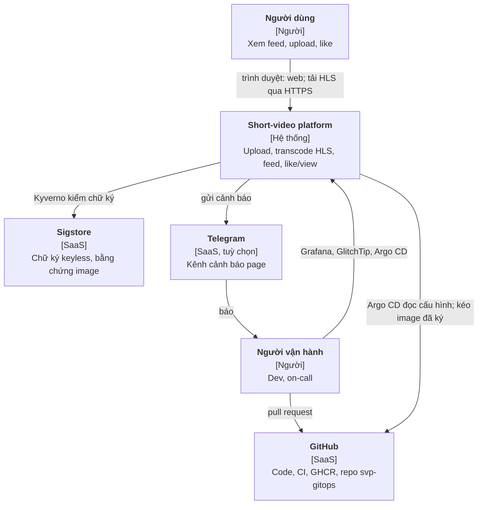
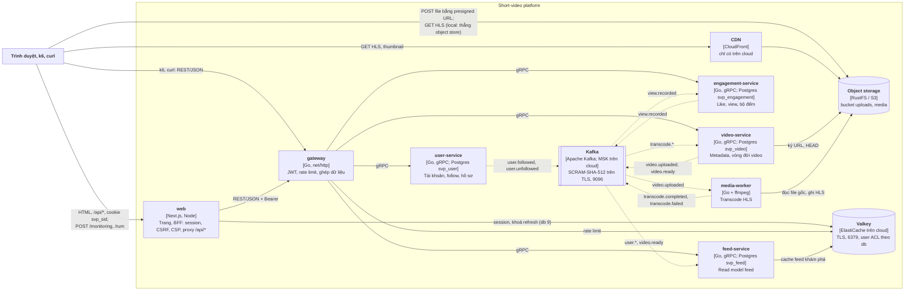
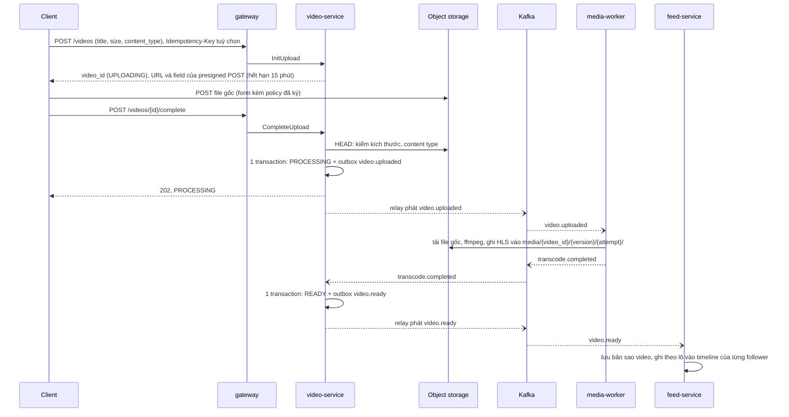
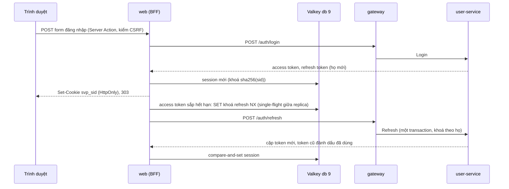
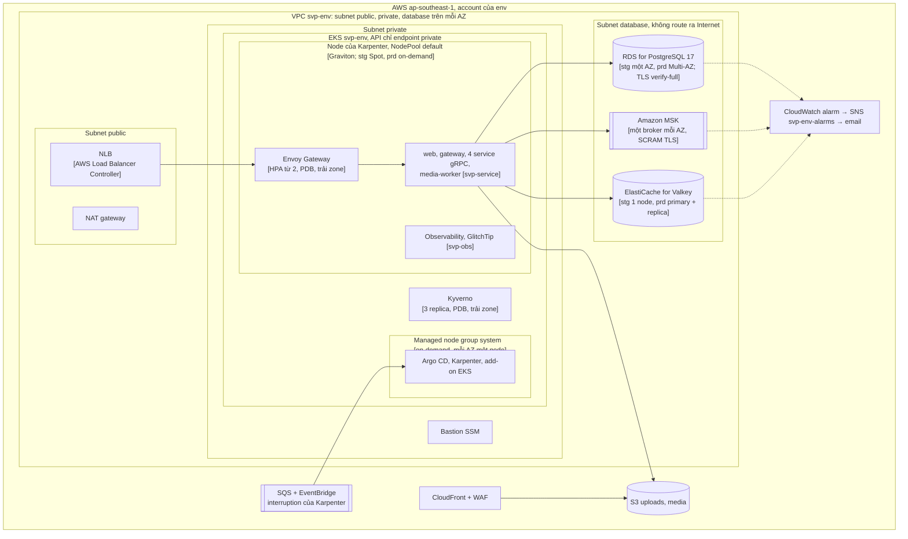

# Kiến trúc short-video platform

Tổng quan hiện trạng của hệ thống theo [arc42](https://arc42.org/overview) rút gọn, sơ đồ theo [C4 model](https://c4model.com)
viết bằng Mermaid. Mỗi mục tóm tắt và trỏ tới trang chi tiết; lý do của từng quyết định nằm ở ADR trong [`adr/`](adr/).

## 1. Mục tiêu và phạm vi

Nền tảng video ngắn: người dùng upload video, hệ thống transcode ra HLS và đưa vào feed của người theo dõi; người xem phát video,
like và để lại lượt xem. Hệ thống chạy được trên máy (compose, cluster k3d) và trên AWS (EKS), cùng image, cùng chart.

| Mã | Chức năng |
| --- | --- |
| F1 | Đăng ký, đăng nhập bằng email + mật khẩu, nhận JWT |
| F2 | Follow, unfollow người dùng khác |
| F3 | Upload video tối đa 3 phút; hệ thống transcode ra HLS; trạng thái `UPLOADING → PROCESSING → READY` hoặc `FAILED` |
| F4 | Phát video bằng HLS, tự đổi chất lượng theo mạng |
| F5 | Feed "đang theo dõi": video mới nhất của người mình follow, phân trang bằng cursor |
| F6 | Feed "khám phá": video mới nhất toàn hệ thống, cho người chưa follow ai |
| F7 | Like, unlike; ghi lượt xem; hiện số lượt xem, số like và mình đã like chưa |

**Web client** (repo `svp-frontend`, [ADR-0016](adr/0016-web-client.md), [ADR-0018](adr/0018-web-profiles-public-video-upload.md)):
Next.js phục vụ F1–F7, thêm hồ sơ tối thiểu (handle không đổi, tên hiển thị đổi được), video theo tác giả, "Video của tôi" và
trang chia sẻ `/v/:id` mở được khi chưa đăng nhập. Web là BFF: trình duyệt chỉ gọi API qua web (file video thì tải lên và phát thẳng
với object storage), token không tới trình duyệt. k6 và curl gọi thẳng gateway.

**Ngoài phạm vi:** app di động, comment, tìm kiếm, gợi ý bằng ML, thông báo, xoá/sửa video, kiểm duyệt nội dung. Thêm thì viết ADR.

## 2. Ràng buộc và yêu cầu phi chức năng

**Ràng buộc:**

- Service viết bằng Go, ưu tiên thư viện chuẩn; một Go module cho cả repo ([ADR-0007](adr/0007-go-monorepo-toolchain-and-stage1-scope.md)).
- Mỗi service một database riêng, không service nào đọc database của service khác ([ADR-0001](adr/0001-service-boundaries-and-data-ownership.md)).
- Local trước, cloud sau: máy 16 GB RAM chạy compose hoặc k3d, không cả hai cùng lúc; tài nguyên cloud dựng và xoá trong cùng buổi.
- Repo công khai: không bí mật, account ID hay tên miền thật trong git; image chỉ build, ký và đẩy trong CI.
- Đường chính (stg, prd, CI) dùng công cụ chuẩn ngành; bản tự làm ở repo `svp-labs` ([ADR-0037](adr/0037-mainpath-standard-tools.md)).

**Yêu cầu phi chức năng** (hệ thống dùng event nên dữ liệu nhất quán sau cùng; "Độ tươi" và "Nhất quán" ghi rõ chấp nhận trễ bao
nhiêu; SLO và cảnh báo ở [`explanation/reliability.md`](explanation/reliability.md#slo)):

| Mảng | Yêu cầu | Đo ở đâu |
| --- | --- | --- |
| Độ trễ | Feed p99 < 150 ms tại 1.000 req/s | SLO `feed-latency` (bucket 150 ms của `http_server_request_duration_seconds` ở gateway); k6 theo SLO, 1.000 req/s bằng Job k6 trong cluster cloud |
| Sẵn sàng | Khởi tạo upload 99,9%; đọc feed 99,9%; trang web 99,9% | SLO `upload-init-availability`, `feed-availability` (5xx ở gateway), `web-availability` (5xx của server web) |
| Xử lý video | Video 1 phút sẵn sàng phát p95 < 2 phút kể từ lúc upload xong | SLO `video-ready-latency` (`svp_video_ready_duration_seconds`, `FAILED` luôn tính xấu); `measure-ready` của bài lab `drills/` của `svp-labs` |
| Độ tươi | Video `READY` xuất hiện trong feed follower p95 < 10 s | Histogram `svp_feed_freshness_seconds` trên dashboard; `measure-freshness` của bài lab `drills/` của `svp-labs` |
| Bền dữ liệu | Video đã `CompleteUpload` thì không mất; event không mất; database phục hồi được từ backup | Diễn tập kill worker; backup Postgres và diễn tập khôi phục đo RTO, RPO ([`explanation/reliability.md`](explanation/reliability.md#backup-và-phục-hồi-postgres)) |
| Đúng đắn | Event gửi trùng không làm sai bộ đếm, không transcode hai lần ra kết quả khác | Test nhận cùng event hai lần ở mỗi consumer |
| Nhất quán | Số lượt xem trễ tối đa ~1 phút; like của chính mình thấy ngay | — |
| Vận hành | Mọi request có `trace_id`; deploy không downtime; cảnh báo theo SLO | Trace OpenTelemetry, log có `trace_id`; canary; burn rate qua Alertmanager, runbook cho mọi cảnh báo page |
| Chi phí | Local trước; tài nguyên cloud dựng và xoá trong cùng buổi | Budget alert |

**Quy mô:** với 100k DAU, feed chỉ ~21 req/s lúc cao điểm; 1.000 req/s là mục tiêu tải có chủ ý cho k6. Tiền nằm ở egress
(~1,1 PB/tháng) nên CDN bắt buộc; ghi nóng nằm ở lượt xem (~10.000 event/s ở mục tiêu tải) nên gom ghi theo lô; transcode ít nhưng
nặng và dồn cục. Giả định và bảng tính: [`explanation/capacity.md`](explanation/capacity.md).

## 3. Ngữ cảnh

Bộ quan sát (Grafana LGTM, GlitchTip) tự host bên trong hệ thống; trên AWS có thêm RDS, MSK, ElastiCache, S3, CloudFront, và CloudWatch
alarm của dịch vụ dữ liệu báo người vận hành qua email, độc lập với cluster ([mục 7](#7-triển-khai)).

## 4. Chiến lược giải pháp

| Quyết định | Vì sao |
| --- | --- |
| Sáu service theo ranh giới nghiệp vụ, mỗi service một database | [ADR-0001](adr/0001-service-boundaries-and-data-ownership.md) |
| REST/JSON ở biên (gateway), gRPC bên trong, contract quản lý bằng `buf`, ID là UUIDv7 | [ADR-0002](adr/0002-sync-rest-edge-grpc-internal.md), [ADR-0006](adr/0006-contract-ids-and-event-envelope.md) |
| Event qua Kafka, transactional outbox, at-least-once + consumer idempotent + DLQ; lượt xem gom theo lô, offset trong Postgres | [ADR-0003](adr/0003-async-events-outbox.md), [ADR-0009](adr/0009-engagement-feed-stage2b.md), [ADR-0045](adr/0045-bounded-batch-retry.md) |
| Upload thẳng lên object storage bằng presigned POST, transcode bất đồng bộ ra HLS, output bất biến theo version | [ADR-0004](adr/0004-direct-upload-and-hls.md), [ADR-0029](adr/0029-immutable-media-versions.md) |
| Feed dựng sẵn khi ghi (fan-out on write), Redis chỉ cache trang đầu feed khám phá | [ADR-0005](adr/0005-feed-fan-out-on-write.md), [ADR-0010](adr/0010-redis-ratelimit-cache-resilience-stage2c.md) |
| Rate limit GCRA bằng Redis, retry và circuit breaker cho lời gọi gRPC ở gateway | [ADR-0010](adr/0010-redis-ratelimit-cache-resilience-stage2c.md) |
| JWT ký ở user-service, kiểm ở gateway và ở mỗi service; refresh token xoay; session BFF ở Redis | [ADR-0016](adr/0016-web-client.md), [ADR-0042](adr/0042-caller-identity-grpc.md), [ADR-0046](adr/0046-web-session-lifetime.md) |
| Web client Next.js ở repo riêng, hợp đồng REST có version | [ADR-0016](adr/0016-web-client.md), [ADR-0033](adr/0033-svp-web-repo.md) |
| OpenTelemetry qua Collector tới Grafana LGTM, GlitchTip cho lỗi, SLO bằng Sloth | [ADR-0011](adr/0011-observability-stage3.md), [ADR-0012](adr/0012-elastic-vs-grafana-stage3.md) |
| Cùng chart chạy trên k3d và EKS, Envoy Gateway, dữ liệu trong cluster (trên AWS: RDS, S3, MSK, ElastiCache managed) | [ADR-0014](adr/0014-kubernetes-local-stage4.md), [ADR-0034](adr/0034-aws-stage7.md) |
| Kafka và Valkey managed ở stg, prd (Amazon MSK, ElastiCache for Valkey, ở subnet database không route ra Internet); compose, k3d chạy cùng phần mềm, cùng xác thực, TLS, cổng; mỗi client một user ACL | [ADR-0053](adr/0053-msk-elasticache-valkey.md), [ADR-0054](adr/0054-data-subnet-tier.md) |
| PostgreSQL 17 ở RDS, CloudNativePG, compose; mọi client kiểm cert server bằng `sslmode=verify-full`; RDS lớp production ở prd, CMK riêng, tham số ghi log; không proxy kết nối | [ADR-0057](adr/0057-postgres17-verify-full.md) |
| Node EKS do Karpenter tạo trên nhóm node hệ thống on-demand; Envoy, Kyverno chạy HA, trải theo zone; add-on và AMI ghim version | [ADR-0056](adr/0056-eks-platform-ha.md) |
| stg chạy cùng dịch vụ, cấu hình, xác thực, giám sát với prd, chỉ giảm dự phòng, cỡ, số lượng, retention; mỗi khác biệt là dữ liệu có lý do | [ADR-0055](adr/0055-environment-matrix.md), [`explanation/environments.md`](explanation/environments.md) |
| CloudWatch alarm cho RDS, MSK, ElastiCache gửi SNS tới email, sống độc lập với cluster | [ADR-0058](adr/0058-managed-data-operations.md) |
| Build một lần, ký keyless, Kyverno chỉ nhận image đã ký; mọi env chạy cùng digest qua `svp-gitops` và Argo CD; secret từ kho ngoài git bằng External Secrets Operator | [ADR-0015](adr/0015-cicd-devsecops-stage5.md), [ADR-0024](adr/0024-multi-environment.md), [ADR-0025](adr/0025-gitops-config-repo.md), [ADR-0026](adr/0026-secrets-gitops.md), [ADR-0040](adr/0040-sigstore-bundle-actions-attest.md) |

## 5. Khối

Mức container của C4. Nét liền là gọi đồng bộ, nét đứt là event qua Kafka.

Mỗi service chỉ đọc ghi database của mình; event về một thực thể chỉ do service sở hữu thực thể đó phát
([ADR-0001](adr/0001-service-boundaries-and-data-ownership.md)). gateway và media-worker không có database; feed-service giữ bản
sao follow và video `READY` dựng từ event; hồ sơ công khai không phát event, gateway ghép lúc đọc.

| Event | Phát | Key (partition) | Nhận | Để làm gì |
| --- | --- | --- | --- | --- |
| `user.followed` | user-service (outbox) | `follower_id` | feed-service | Thêm cạnh vào bản sao, đưa video gần đây của người được follow vào timeline |
| `user.unfollowed` | user-service (outbox) | `follower_id` | feed-service | Xoá cạnh, bỏ video của người đó khỏi timeline |
| `video.uploaded` | video-service (outbox) | `video_id` | media-worker | Bắt đầu transcode |
| `transcode.completed` | media-worker | `video_id` | video-service | Báo kết quả: các bản HLS, thời lượng, thumbnail |
| `transcode.failed` | media-worker | `video_id` | video-service | Báo lỗi; video-service chuyển `FAILED` và dọn file (bước bù của saga) |
| `video.ready` | video-service (outbox) | `video_id` | feed-service | Video phát hành, kèm đủ metadata để feed không phải gọi lại |
| `view.recorded` | engagement-service (produce thẳng) | `video_id` | engagement-service | Hàng đệm cho lượt xem; consumer gom theo lô rồi cộng vào bộ đếm |

`video.ready` do video-service phát vì nó sở hữu video; media-worker chỉ báo kết quả job. Không có `video.failed`, `like.toggled`
vì chưa service nào cần nhận ([ADR-0003](adr/0003-async-events-outbox.md)). Schema ở [`proto/`](../proto/), topic và envelope ở
[`reference/contracts.md`](reference/contracts.md#topic).

## 6. Runtime

### 6.1 Upload tới khi vào feed

Saga dạng choreography: mỗi service nghe event rồi làm phần của mình. Transcode lỗi thì media-worker phát `transcode.failed`,
video-service chuyển `FAILED` và xoá file dở dang. Mọi bước chịu được event trùng: media-worker ghi output theo version (`event_id`
của `video.uploaded`), master tạo một lần bằng `If-None-Match: *` ([ADR-0029](adr/0029-immutable-media-versions.md));
video-service chỉ chuyển trạng thái một chiều; feed-service ghi timeline với khoá chính chống trùng.

Với `S3_CREDENTIALS=container`, `internal/objstore` giữ hai cache credential riêng: một ký lời gọi tới storage, một ký form
presigned (client chỉ để ký, có cache riêng, thay credential sớm hơn nhiều so với cache của lời gọi). Mỗi cache lấy credential
một lần mỗi vòng đời credential. Cửa sổ làm mới của form để mỗi form được ký bằng credential sống lâu hơn nó, miễn là endpoint
cấp credential còn hạn dài hơn cửa sổ đó; cache của lời gọi dùng cửa sổ ngắn hơn, vì cửa sổ dài của form sẽ bỏ một credential
còn dùng được và biến một lần làm mới lỗi thành lời gọi lỗi sớm 20 phút.

Thumbnail là poster trang hiện trước khung hình đầu tiên, và ở feed nó là lần vẽ lớn nhất của trang, nên media-worker chặn cạnh
ngắn của nó ở 720 px: nặng khoảng nửa một khung 1080 px. Poster phủ một cột dọc, vì vậy chiều cao quyết định độ nét: poster dọc
(720x1280) gần vừa một cột điện thoại ở tỉ lệ 1,75x; poster ngang (1280x720) bị phóng khoảng 1,8x ở đó và 2,2x trên màn hình
desktop 2x. Poster giữ nguyên như vậy cho tới khi có khung hình đầu, mà trình phát web lấy từ bản thấp nhất (360 px), nên còn
mềm hơn.

### 6.2 Đọc feed

Gateway kiểm JWT và rate limit, lấy trang video kèm object key và page token từ feed-service, rồi gọi song song `GetStats` của
engagement-service và `GetProfiles` của user-service, mỗi lời gọi timeout 100 ms, không retry. Hai service đó chậm hay lỗi thì feed
vẫn trả về, chỉ thiếu `stats` hay `author` (graceful degradation, [ADR-0018](adr/0018-web-profiles-public-video-upload.md) §5);
danh sách video theo tác giả và trang một video ghép cùng cách. Chống quá tải và lỗi lan ([ADR-0010](adr/0010-redis-ratelimit-cache-resilience-stage2c.md)):

- **Rate limit** GCRA theo lớp route; Redis lỗi thì lớp `read`, `write` mở, các lớp còn lại đóng mềm bằng bộ đếm trong bộ nhớ
  (ngưỡng từng lớp ở [`reference/contracts.md`](reference/contracts.md#rest-ở-gateway)).
- **Cache khám phá:** chỉ trang đầu, TTL 5 s, không xoá chủ động; Redis lỗi hay quá 50 ms thì đọc Postgres, không báo lỗi.
- **Retry và circuit breaker** ở gateway, một breaker mỗi service đích: lời gọi idempotent thử lại khi `UNAVAILABLE` trong hạn
  3 s; breaker mở thì lỗi ngay không gọi mạng (feed trả trang không `stats`, like trả 503). `GetStats`, `GetProfiles` không
  retry và `DEADLINE_EXCEEDED` của chúng không mở breaker.

### 6.3 Ghi lượt xem

`POST /videos/{id}/views`: engagement-service phát `view.recorded` lên Kafka (`acks=all`) rồi trả 202, không chạm database.
Consumer của nó gom lô tối đa 5.000 record hoặc 1 s, cộng dồn theo `video_id`, ghi cả lô bằng một câu `INSERT ... ON CONFLICT DO
UPDATE` vào `view_counts`. Bảng `consumer_offsets` giữ offset từng partition, cập nhật trong cùng transaction với bộ đếm, nên lô giao
lại chỉ cộng phần chưa cộng ([ADR-0009](adr/0009-engagement-feed-stage2b.md)). Lỗi tạm thời thử lại trong ngân sách 5 phút rồi
chép lô sang `engagement.views.v1.dlq` ([ADR-0045](adr/0045-bounded-batch-retry.md), [runbook](runbooks/kafka-dlq-records.md)).
Like đi đường đồng bộ: bảng `likes` và `like_counts` đổi trong cùng transaction, nên like của chính mình thấy ngay.

### 6.4 Xác thực

user-service cấp JWT ký bằng khoá riêng; gateway kiểm chữ ký bằng khoá công khai, rồi chuyển tiếp chính access token xuống service
trong gRPC metadata `authorization`; mỗi service kiểm lại bằng `JWT_VERIFY_KEYS` và lấy người gọi từ `sub`
([ADR-0042](adr/0042-caller-identity-grpc.md)). Login trả thêm refresh token mờ (user-service chỉ lưu SHA-256), xoay mỗi lần dùng;
trình lại token đã dùng thì cả họ bị thu hồi ([ADR-0016](adr/0016-web-client.md)). Session của web có idle và absolute timeout
([ADR-0046](adr/0046-web-session-lifetime.md)).

Refresh không rõ kết quả thì BFF giữ session và không thử lại trong request đó. Access token đã cấp sống tới hết hạn (JWT-3 của
[`threat-model.md`](threat-model.md#41-jwt-và-đăng-nhập)).

## 7. Triển khai

| Nơi | Dùng để | Dữ liệu | Chi tiết |
| --- | --- | --- | --- |
| Compose trên máy | Đường dev chính, smoke, diễn tập | Postgres, Kafka, Valkey, RustFS trong compose | [Compose](explanation/deployment.md#compose) |
| Cluster k3d | Cùng chart như cloud: Envoy Gateway, NetworkPolicy, canary, Kyverno, đường GitOps | CloudNativePG, Kafka, Valkey, RustFS trong cluster | [k3d](explanation/deployment.md#kubernetes-cục-bộ-k3d) |
| EKS trên AWS | stg và prd, dựng bằng Terraform của `svp-infra`; khác biệt stg/prd ở [`explanation/environments.md`](explanation/environments.md) | RDS for PostgreSQL, Amazon MSK, ElastiCache for Valkey ở subnet database; S3 + CloudFront | [AWS](explanation/deployment.md#aws) |

**Postgres, Kafka và Valkey ở mọi nơi** ([ADR-0053](adr/0053-msk-elasticache-valkey.md), [ADR-0057](adr/0057-postgres17-verify-full.md)):
stg, prd dùng dịch vụ managed, compose và k3d chạy cùng phần mềm và cùng đường code của client; chỗ local khác chỉ là dữ liệu cấu hình, không
nhánh `if` theo môi trường.

| | Compose | k3d | stg, prd (EKS) |
| --- | --- | --- | --- |
| Kafka | Service `kafka` (image `apache/kafka`, một tiến trình KRaft), `kafka:9096` | StatefulSet `kafka` của chart `svp-data` (`kafka.mode: cluster`), `kafka.svp-data.svc.cluster.local:9096` | Amazon MSK provisioned, broker ở subnet database, số broker bằng số AZ (stg 2, prd 3); chart `svp-data` ở `kafka.mode: external`, địa chỉ `cluster.kafkaBrokers` |
| Valkey | Container `valkey`, `valkey:6379`, không publish cổng | Deployment `valkey` của `svp-data`, `valkey.svp-data.svc.cluster.local:6379` | ElastiCache for Valkey, cluster mode tắt (stg 1 node, prd primary + replica khác AZ), `cluster.valkeyHost` |
| Topic, user, ACL | Container `kafka-init` (cả user: broker giữ credential) | Job `kafka-init` (cả user) | Job `kafka-init` (topic, ACL); user là secret `AmazonMSK_*` do Terraform gắn vào cluster |
| CA của TLS Kafka, Valkey | CA local của `make env` | CA local, nạp thành Secret | CA công khai của Amazon trong root hệ thống |
| Postgres (TLS `verify-full`) | Container `postgres`, `postgres:5432`, cert server của CA local | CNPG `svp-pg`, `svp-pg-rw.svp-data:5432`, cert server của CA local (Secret `pg-tls`) | RDS for PostgreSQL, địa chỉ RDS `cluster.rdsAddress`, CA là bundle của RDS (Secret `rds-ca`) |

- Client Kafka nói SASL_SSL, SCRAM-SHA-512, cổng 9096 ở mọi nơi; mỗi service một user, ACL literal chỉ cho topic và group của nó.
  Replication theo broker: local 1, stg 2 (min ISR 1), prd 3 (min ISR 2).
- Client Valkey dùng `rediss://<user>:<mật khẩu>@<host>:6379/<db>`; mỗi client một user ACL chỉ được db và tiền tố khoá của mình
  (gateway db 10 `svp:gw:*`, feed-service db 14 `svp:feed:*`, web db 9 `svp:web:*`), user `default` tắt.
- Script, drill, runbook chạm Kafka và Valkey chỉ qua **CLI vận hành** `/opt/svp/bin/svp-kafka`, `/opt/svp/bin/svp-valkey`: trong container
  `kafka`, `valkey` của compose, trong Deployment `svp-ops` (namespace `svp-data`) ở k3d và EKS.
- Trên AWS, RDS, MSK và ElastiCache nằm ở subnet database, route table không có `0.0.0.0/0`; egress 5432, 9096, 6379 của pod chỉ tới dải
  của subnet đó (`cluster.dbCidrs`, [ADR-0054](adr/0054-data-subnet-tier.md)).

### 7.1 Triển khai trên EKS

Mức triển khai của C4 cho một env `svp-<env>` (stg và prd cùng hình, khác số AZ, cỡ và số lượng). Hộp lồng nhau là nơi chạy (deployment
node); tên khớp tài nguyên của `svp-infra` và chart.

Kyverno và controller nền tảng khác xếp ở node nào còn chỗ; chỉ những gì phải chạy trước khi Karpenter có node mới cần nhóm hệ thống. Luồng
co giãn node, chuỗi TLS tới Postgres: [`explanation/deployment.md`](explanation/deployment.md#karpenter-node-theo-pod-đang-chờ); failover
của RDS, Valkey và hành vi của service: [`explanation/reliability.md`](explanation/reliability.md).

Image đi từ CI tới cluster qua `svp-gitops` và Argo CD ([`explanation/delivery.md`](explanation/delivery.md)). Sơ đồ AWS sinh từ
spec của `svp-infra`: [stg](https://github.com/anhnvcoder/svp-infra/blob/main/docs/diagrams/svp-aws-stg.png),
[prd](https://github.com/anhnvcoder/svp-infra/blob/main/docs/diagrams/svp-aws-prd.png),
[luồng](https://github.com/anhnvcoder/svp-infra/blob/main/docs/diagrams/svp-aws-flows.png).

## 8. Khái niệm xuyên suốt

- **Contract:** [`proto/`](../proto/), REST ở [`services/gateway/openapi.yaml`](../services/gateway/openapi.yaml); topic, page token,
  mã lỗi gRPC sang HTTP, route: [`reference/contracts.md`](reference/contracts.md).
- **Idempotency:** mọi consumer chịu được event trùng; `POST /videos` nhận `Idempotency-Key` ([ADR-0043](adr/0043-idempotency-key.md)).
- **Quan sát:** OpenTelemetry Collector, lỗi ở GlitchTip, RUM của web: [`explanation/observability.md`](explanation/observability.md).
- **Bảo mật:** [`threat-model.md`](threat-model.md); chuỗi cung ứng: [`explanation/delivery.md`](explanation/delivery.md#cicd-và-chuỗi-cung-ứng).
- **Độ tin cậy:** SLO, tải, backup, probe ([ADR-0044](adr/0044-grpc-readiness.md)): [`explanation/reliability.md`](explanation/reliability.md),
  [`runbooks/`](runbooks/).

## 9. Quyết định

Danh sách ADR, trạng thái và tóm tắt một dòng: [`adr/README.md`](adr/README.md).

## 10. Rủi ro và nợ kỹ thuật

Danh sách đầy đủ kèm lý do chấp nhận và điều kiện xem lại: [mục 6 của `threat-model.md`](threat-model.md#6-rủi-ro-chấp-nhận).

- **Chưa đo trên cloud:** k6 1.000 req/s, chaos trên EKS, diễn tập phục hồi RDS, hạn 50 ms của Valkey
  ([`explanation/reliability.md`](explanation/reliability.md#chưa-đo-trên-cloud)); NFR độ trễ chưa có số đo ở tải mục tiêu.
- **Không có mTLS giữa gateway và service gRPC:** token chuyển tiếp đi plaintext trong cluster, NetworkPolicy là lớp chặn duy nhất;
  Istio ambient là phương án tuỳ chọn, chưa dựng (IN-2, IN-3, [mục 4.5](threat-model.md#45-mức-tin-cậy-giữa-các-service)).
- **Độ tươi feed chưa thành SLO:** local quá ít event để burn rate có nghĩa; chỉ có histogram trên dashboard.
- **Kyverno một replica ở k3d:** nó chết thì webhook từ chối mọi pod `svp` mới tới khi nó lên lại (SC-1, SC-7); trên EKS ba replica có PDB
  và trải zone ([ADR-0056](adr/0056-eks-platform-ha.md) §5).
- **Lab local:** backup trên k3d cùng ổ với dữ liệu, không mã hoá lúc nghỉ (BAK-1); RustFS là dự án trẻ, nhiều advisory.
- **Like, lượt xem cho `video_id` không tồn tại** làm `svp_engagement` phình dần: chặn cần bản sao video ở engagement-service (RL-6).
- **Không có cổng tự động "bộ prd = bộ stg đã kiểm"** khi promote (GIT-4); build provenance đạt SLSA Build L2, không L3.

## 11. Câu hỏi mở

- **Vì sao lệnh GET cache khám phá thỉnh thoảng quá hạn 50 ms trên Valkey local**, và hạn đó có giữ được trên cloud không: chưa
  kết luận; dấu hiệu và cách đọc ở [`runbooks/explore-cache-redis-timeout.md`](runbooks/explore-cache-redis-timeout.md).
