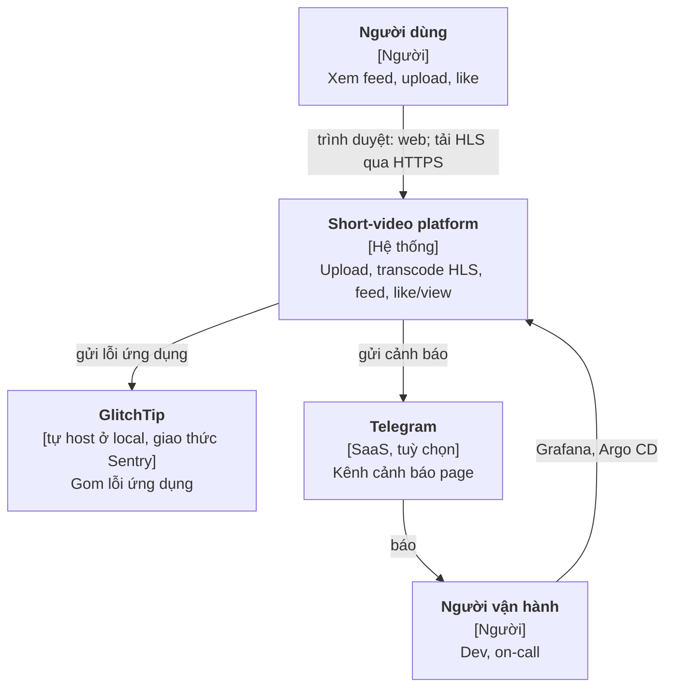
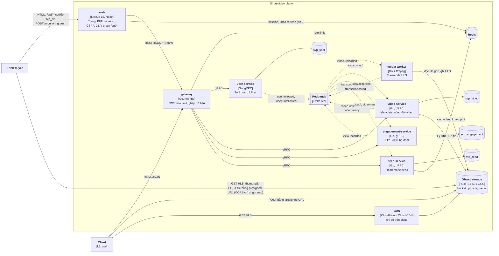
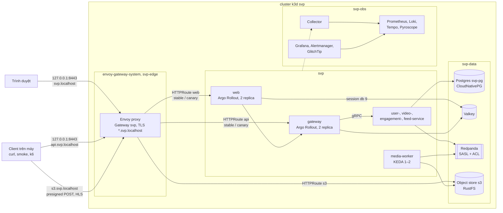
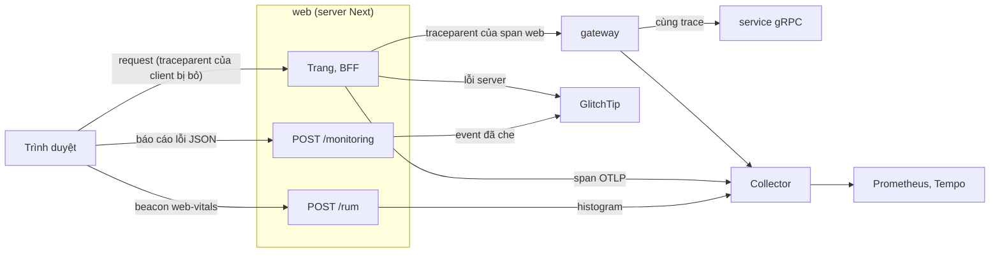
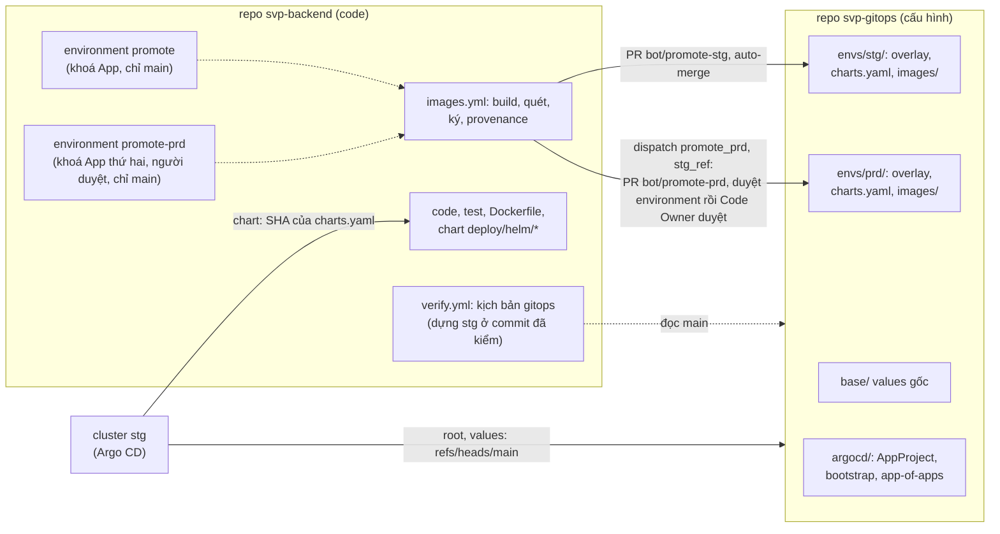
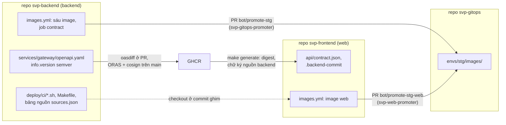
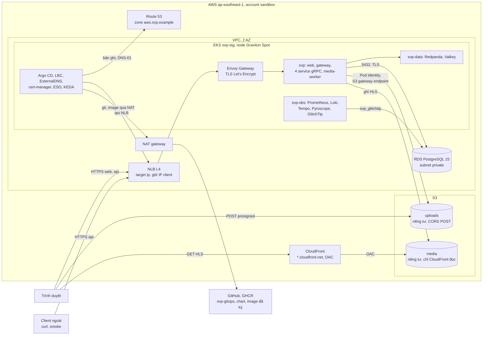
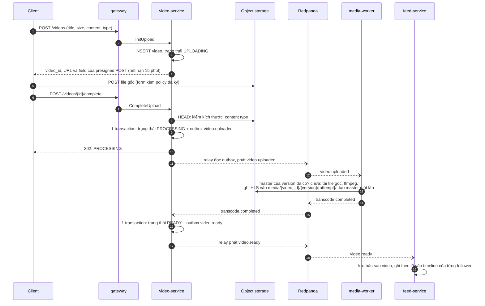
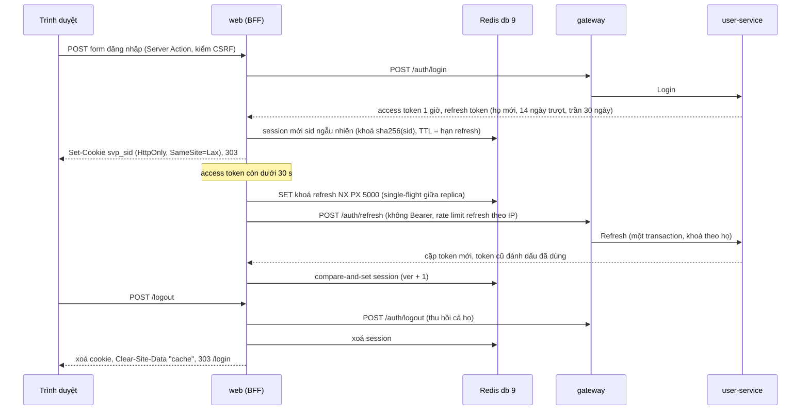

# Kiến trúc short-video platform

> Trạng thái: giai đoạn 0, 1, 2 (2026-10-11), 3 (2026-10-17) và 4 (2026-10-20) xong; giai đoạn 5 (CI/CD và chuỗi cung ứng,
> [§5.2](#52-cicd-và-chuỗi-cung-ứng-giai-đoạn-5)) đang làm: phần chạy được trên máy đã kiểm ngày 2026-10-21, phần chạy
> trên GitHub và cluster GitOps kiểm sau push. Giai đoạn 5b (web client, [ADR-0016](adr/0016-web-client.md)): phần A
> (đăng nhập, feed, like, follow trên compose) và phần B (upload, hồ sơ, trang chia sẻ công khai,
> [ADR-0018](adr/0018-web-profiles-public-video-upload.md)) đã kiểm trên máy ngày 2026-10-22; phần C (web trên k3d ở
> `https://svp.localhost:8443`, image `web` thứ bảy của pipeline, lỗi, trace và RUM của web,
> [ADR-0019](adr/0019-web-k3d-supply-chain-observability.md), [§5.3](#53-quan-sát-web-giai-đoạn-5b-phần-c)) đã kiểm trên máy
> ngày 2026-10-24, phần cần cluster GitOps và RAM lớn hơn dời giai đoạn 6b. Giai đoạn 6 (reliability,
> [ADR-0020](adr/0020-reliability-stage6.md), [§5.4](#54-reliability-giai-đoạn-6)): phần local (k6 theo SLO, SLO web, backup và
> diễn tập phục hồi Postgres trên k3d, runbook, game day, RFC) đã kiểm trên máy ngày 2026-10-24; phần đo thật dời giai đoạn 6b
> và 7; giai đoạn 6b phần 2 (2026-10-25) đổi object store local từ MinIO sang RustFS
> ([ADR-0022](adr/0022-local-object-store-minio-replacement.md)); giai đoạn 6b phần 3 (2026-10-26 đến 2026-10-28) chạy đường
> GitOps (vai stg, [ADR-0024](adr/0024-multi-environment.md)), canary web, k6 thu nhỏ, Velero và Chaos Mesh trên runner
> ([ADR-0021](adr/0021-deferred-verification-stage6b.md)); phần 4 (2026-10-29 đến 2026-10-30) tách cấu hình triển khai sang repo
> `svp-gitops` ([§5.5](#55-hai-repo-code-và-cấu-hình-triển-khai-giai-đoạn-6b-phần-4)), phần 4b (2026-10-30 đến 2026-10-31) tách web
> client sang repo `svp-frontend` với hợp đồng REST có version ([§5.6](#56-ba-repo-và-hợp-đồng-api-giai-đoạn-6b-phần-4b)); ngày 2026-10-31 repo code
> đổi tên `svp-backend`, repo web `svp-frontend` ([ADR-0036](adr/0036-repo-rename.md)). Giai đoạn 7 (biến thể AWS,
> [ADR-0034](adr/0034-aws-stage7.md), [§5.7](#57-biến-thể-aws-giai-đoạn-7)) thiết kế ngày 2026-10-31, chưa dựng. ADR 0001–0020, contract ở [`proto/`](../proto/)
> ([§8](#8-contract)), threat model ở [`threat-model.md`](threat-model.md). `make up` chạy luồng đồng bộ (đăng ký, đăng
> nhập, tạo và đọc video, follow), luồng upload bất đồng bộ (presigned POST lên object store, outbox → Redpanda, media-worker
> transcode ra HLS, video `READY` hoặc `FAILED`, job dọn upload bỏ dở), luồng feed (follow qua outbox, feed-service
> fan-out on write, feed following và khám phá có cache trang đầu trong Redis, like, lượt xem gom theo lô ở
> engagement-service), rate limit ở gateway bằng Redis, retry và circuit breaker cho lời gọi gRPC của gateway. Mọi
> service đẩy trace, metric, log qua OpenTelemetry tới Collector; `make up OBS=lgtm` thêm Grafana LGTM, Alertmanager và
> GlitchTip với SLO, cảnh báo burn rate và dashboard ([ADR-0011](adr/0011-observability-stage3.md),
> [§5](#5-c4-mức-container)). `make k8s-up` chạy cùng hệ thống trên cluster k3d với dữ liệu trong cluster, Envoy Gateway,
> observability tách thành từng thành phần, canary của gateway và từ giai đoạn 5b web ([ADR-0014](adr/0014-kubernetes-local-stage4.md),
> [§5.1](#51-triển-khai-trên-k3d-giai-đoạn-4)). Phần còn lại của tài liệu (CDN, cloud) là thiết kế đích.

Tài liệu này mô tả hệ thống sẽ được xây và lý do. Mỗi quyết định lớn có một ADR trong [`adr/`](adr/); ở đây chỉ tóm tắt
và trỏ tới.

## 1. Phạm vi

**Chức năng (MVP):**

| Mã | Chức năng |
| --- | --- |
| F1 | Đăng ký, đăng nhập bằng email + mật khẩu, nhận JWT |
| F2 | Follow, unfollow người dùng khác |
| F3 | Upload video tối đa 3 phút; hệ thống transcode ra HLS; trạng thái `UPLOADING → PROCESSING → READY` hoặc `FAILED` |
| F4 | Phát video bằng HLS, tự đổi chất lượng theo mạng |
| F5 | Feed "đang theo dõi": video mới nhất của người mình follow, phân trang bằng cursor |
| F6 | Feed "khám phá": video mới nhất toàn hệ thống, cho người chưa follow ai |
| F7 | Like, unlike; ghi lượt xem; hiện số lượt xem, số like và mình đã like chưa |

**Web client** (từ giai đoạn 5b, [ADR-0016](adr/0016-web-client.md); từ giai đoạn 6b phần 4b ở repo riêng `svp-frontend`,
[§5.6](#56-ba-repo-và-hợp-đồng-api-giai-đoạn-6b-phần-4b)): Next.js phục vụ F1–F7 trong trình
duyệt; phần A có đăng ký, đăng nhập, feed dọc phát HLS, like, lượt xem, follow; phần B
([ADR-0018](adr/0018-web-profiles-public-video-upload.md)) thêm hồ sơ tối thiểu (handle không đổi, tên hiển thị đổi được),
danh sách video theo tác giả và "Video của tôi" có trạng thái, upload từ trình duyệt, trang chia sẻ `/v/:id` mở được khi
chưa đăng nhập. Web là BFF: trình duyệt chỉ gọi API qua web (riêng file video thì tải lên và phát thẳng với object
storage), token không bao giờ tới trình duyệt. k6 và curl vẫn gọi
thẳng gateway.

**Ngoài phạm vi:** app di động, comment, tìm kiếm, gợi ý bằng ML, thông báo, xoá/sửa video, kiểm duyệt nội dung. Thêm sau
thì viết ADR.

## 2. Yêu cầu phi chức năng

| Mảng | Yêu cầu | Đo ở đâu |
| --- | --- | --- |
| Độ trễ | Feed p99 < 150 ms tại 1.000 req/s | SLO `feed-latency`: 99% request GET feed ở gateway nằm trong bucket 150 ms của `http_server_request_duration_seconds`, cảnh báo burn rate (giai đoạn 3); kịch bản k6 theo SLO (giai đoạn 6; lượt local ~24 req/s chỉ kiểm kịch bản), 1.000 req/s bằng Job k6 trong cluster cloud (giai đoạn 7) |
| Sẵn sàng | Khởi tạo upload thành công 99,9%; đọc feed 99,9%; trang web 99,9% | SLO `upload-init-availability`, `feed-availability`: tỉ lệ 5xx trên tổng request ở gateway, cảnh báo burn rate qua Alertmanager (giai đoạn 3); SLO `web-availability`: tỉ lệ 5xx trên mọi response của server web (giai đoạn 6) |
| Xử lý video | Video 1 phút sẵn sàng phát p95 < 2 phút kể từ lúc upload xong | Từ `CompleteUpload` tới `READY`: `make measure-ready`; SLO `video-ready-latency`, 95% mẫu `svp_video_ready_duration_seconds` của video-service trong bucket 120 s, `FAILED` luôn tính xấu (giai đoạn 3) |
| Độ tươi | Video `READY` xuất hiện trong feed follower p95 < 10 s | Từ `video.ready` tới dòng timeline cuối cùng: `make measure-freshness`; histogram `svp_feed_freshness_seconds` trên dashboard, chưa thành SLO vì local quá ít event |
| Bền dữ liệu | Video đã `CompleteUpload` thành công thì không mất; event không mất; database phục hồi được từ backup | Diễn tập kill worker (giai đoạn 2); backup Postgres và diễn tập khôi phục đo RTO, RPO trên k3d (bài lab `drills/` của `svp-labs`, [ADR-0039](adr/0039-mainpath-drills-scan-gate-sourcemaps.md); giai đoạn 6, [§5.4](#54-reliability-giai-đoạn-6)) |
| Đúng đắn | Event gửi trùng không làm sai bộ đếm, không transcode hai lần ra kết quả khác | Test gửi trùng (giai đoạn 2) |
| Nhất quán | Số lượt xem trễ tối đa ~1 phút; like của chính mình thấy ngay | — |
| Vận hành | Mọi request có `trace_id`; deploy không downtime; cảnh báo theo SLO | Giai đoạn 3: trace OpenTelemetry mở ở gateway, log có `trace_id`, cảnh báo burn rate của 4 SLO cùng cảnh báo lag, vòng nền, DLQ, breaker, rate limit dự phòng; `make drill-alert-to-sentry`. Deploy không downtime ở giai đoạn 4. Giai đoạn 6: 6 SLO (thêm `web-availability`, `web-inp`), runbook cho mọi cảnh báo page, game day |
| Chi phí | Local trước; tài nguyên cloud dựng và xoá trong cùng buổi | Budget alert |

Hai dòng "Độ tươi" và "Nhất quán" không có trong plan gốc; người học đã duyệt ngày 2026-10-11. Hệ thống dùng event nên
dữ liệu nhất quán sau cùng, phải ghi rõ chấp nhận trễ bao nhiêu thì mới thiết kế và đo được.

## 3. Ước lượng quy mô

### 3.1 Giả định

Ba số đầu có trong plan; các số còn lại là giả định của bản thiết kế này, sai thì sửa ở đây rồi tính lại.

| | Giả định |
| --- | --- |
| P1 | 100k người dùng hoạt động mỗi ngày (DAU) |
| P2 | Feed 1.000 request/giây lúc cao điểm |
| P3 | 1.000 video upload mỗi ngày, mỗi video tối đa 3 phút |
| A1 | Mỗi DAU xem 60 video/ngày, trung bình 20 s/video (20 phút/ngày) |
| A2 | Một trang feed 10 video, nên mỗi DAU gọi feed 6 lần/ngày |
| A3 | Cao điểm = 3 × trung bình |
| A4 | 5% lượt xem có like |
| A5 | Video trung bình 60 s; file gốc quay 1080p khoảng 10 Mbps, tức 75 MB |
| A6 | HLS 3 bản: 360p 0,8 Mbps + 720p 2,5 Mbps + 1080p 5 Mbps = 8,3 Mbps (62 MB cho video 60 s); người xem nhận trung bình 2,5 Mbps |
| A7 | 1 triệu tài khoản, mỗi tài khoản follow trung bình 50 người; video upload được fan-out tới trung bình 2.000 follower; tài khoản lớn nhất 200k follower |
| A8 | Một worker 2 vCPU transcode video 60 s ra 3 bản mất khoảng 60 s. Đo 2026-10-11 (local M2, worker giới hạn 2 CPU, preset `veryfast`, video tổng hợp 60 s 1080p `testsrc2`, `make measure-ready N=5`): `CompleteUpload` → `READY` p50 46,8 s, max 47,6 s, gồm tải file gốc, transcode, ghi HLS và hai chặng event |

P1 dùng để ước lượng dung lượng, băng thông, chi phí; P2 là mục tiêu tải cho k6, không suy ra từ P1 (xem 3.3).

Một ngày có 86.400 giây.

### 3.2 Kết quả

| Đại lượng | Cách tính | Kết quả |
| --- | --- | --- |
| Request feed | 100k × 6 / 86.400 | ~7 req/s trung bình, **~21 req/s** cao điểm |
| Lượt xem | 100k × 60 / 86.400 | ~70/s trung bình, ~210/s cao điểm |
| Lượt xem ở mục tiêu tải | 1.000 req/s × 10 video | **~10.000 event/s** |
| Like | 5% × 6 triệu = 300k/ngày | ~10/s cao điểm |
| Upload | 1.000 / 24 × 3 | ~125 video/giờ, khoảng **2 video/phút** cao điểm |
| Băng thông upload | 1.000 × 75 MB = 75 GB/ngày | ~7 Mbps trung bình, ~21 Mbps cao điểm |
| Transcode | 2 video/phút × 60 s/video | ~2 worker bận lúc cao điểm; cần **≥ 3** để chờ ít và giữ p95 < 2 phút; ban đêm gần 0 |
| Lưu trữ video | (75 + 62) MB × 1.000 | ~137 GB/ngày ≈ 4 TB/tháng ≈ **50 TB/năm** (giữ cả file gốc) |
| Egress phát video | 6 triệu × 20 s × 2,5 Mbps | ~37,5 TB/ngày ≈ **1,1 PB/tháng**; ~3,5 Gbps trung bình, ~10 Gbps cao điểm |
| Postgres: follow | 1 triệu × 50 cạnh, ~160 B/cạnh kể cả 2 index | ~8 GB, lưu 2 nơi (user-service và bản sao ở feed-service) |
| Postgres: timeline | 1.000 × 2.000 = 2 triệu dòng/ngày, giữ 30 ngày, ~110 B/dòng | 60 triệu dòng ≈ 7 GB |
| Postgres: video, like | video ~1 KB/dòng; like 300k dòng/ngày | video không đáng kể; like ~15 GB/năm |
| Redpanda: lượt xem | 6 triệu × ~200 B, giữ 7 ngày | ~8 GB |

### 3.3 Rút ra gì

1. **Hai giả định gốc không khớp nhau, và đã chốt cách dùng.** 100k DAU chỉ sinh ~21 req/s feed lúc cao điểm; 1.000 req/s
   tương ứng khoảng 5 triệu DAU với cùng hành vi. P1 (100k DAU) là giả định để ước lượng dung lượng, băng thông, chi phí;
   P2 (1.000 req/s) là **mục tiêu tải** cho k6, khoảng 50 lần cao điểm thật, đặt ra có chủ ý: ở 21 req/s một Postgres
   không cache cũng thừa sức, sẽ không còn gì để học về cache, singleflight, đo p99, gom ghi lượt xem. Không nâng DAU lên
   ~5 triệu cho khớp, vì khi đó egress phình lên ~55 PB/tháng (1,1 PB × 50) và mô hình chi phí ở giai đoạn 9 mất ý nghĩa. Hệ quả:
   ở mục tiêu tải có ~10.000 event lượt xem/giây, lab `hot-counter` đo ở mức này. Các con số còn lại tính theo 100k DAU.
2. **Tiền nằm ở egress, không nằm ở service.** Dữ liệu phát ra mỗi tháng (1,1 PB) lớn gấp khoảng 275 lần dữ liệu lưu
   thêm (4 TB). CDN là bắt buộc; thứ đáng tối ưu nhất là bitrate ladder và tỉ lệ cache hit của CDN, không phải code Go.
   Feed vuốt thường tải trước vài video kế tiếp, nên egress thật còn cao hơn. Quy ra USD để giai đoạn 9.
3. **Đọc metadata nhỏ.** Ngay ở 1.000 req/s, Postgres có index đúng vẫn chịu được. Cache dùng để chống **key nóng**
   (feed khám phá: mọi người đọc cùng một danh sách), không phải vì tổng tải ([ADR-0005](adr/0005-feed-fan-out-on-write.md)).
4. **Ghi nóng nằm ở lượt xem.** ~10.000 event/s ở mục tiêu tải, dồn vào vài video viral: cập nhật từng dòng sẽ tranh
   khoá trên cùng một row. Cần gom ghi theo lô; lab `hot-counter` chọn cách cụ thể.
5. **Transcode ít nhưng nặng và dồn cục.** Tách worker riêng, scale theo độ trễ hàng chờ (KEDA ở giai đoạn 4)
   ([ADR-0001](adr/0001-service-boundaries-and-data-ownership.md)).
6. **Upload nhỏ về băng thông nhưng mỗi kết nối kéo dài.** Không cho file đi qua service; client đẩy thẳng lên object
   storage ([ADR-0004](adr/0004-direct-upload-and-hls.md)).

## 4. C4 mức context



## 5. C4 mức container

Nét liền là gọi đồng bộ, nét đứt là event qua Redpanda.



Local: Postgres và Redis native trên máy (mỗi service một database, xem [`AGENTS.md`](../AGENTS.md) mục "Database và Redis"), object store RustFS
thay S3, không có CDN (client đọc thẳng store). Redpanda và object store chạy trong compose profile `core`
([ADR-0008](adr/0008-async-upload-pipeline-stage2a.md), store theo [ADR-0022](adr/0022-local-object-store-minio-replacement.md)):

- **Object store `s3`** (RustFS ghim version và digest, non-root, root fs chỉ đọc, console tắt; ADR-0022): `s3` là endpoint
  tương thích S3 API (không phải AWS S3), hiện chạy RustFS (trước là MinIO); code dùng `internal/objstore`. Hai bucket
  `uploads` (riêng tư) và `media` (ẩn danh chỉ đọc từng object, không liệt kê được); video-service và media-worker mỗi bên một
  user với policy theo tiền tố key; root chỉ ở container store và job init `s3-init` (`deploy/s3/init.sh`, chạy lại mỗi
  `make up`, idempotent). Client upload và đọc HLS qua `127.0.0.1:9000`. CORS theo bucket do `s3-init` đặt, chỉ nhận origin của
  web (`http://localhost:3001`, `web-dev` `http://localhost:3002`): `POST` vào `uploads`, `GET`/`HEAD` ở `media`; bucket khác
  không có header CORS (threat model WEB-10); web đặt `MEDIA_ORIGIN` và `UPLOAD_ORIGIN` là `http://127.0.0.1:9000`. Compose có
  thêm user thử `svp-objstore-probe` chỉ cho bucket `objstore-probe` của test tích hợp. MinIO (image Chainguard, store đến giai
  đoạn 6b) là đường quay lại: dữ liệu cũ ở volume `svp_minio-data`, chép hai chiều bằng `make object-store-copy TO=s3|minio`.
- **Redpanda:** một broker; topic và `.dlq` do container init tạo, broker tắt tự tạo topic. Trong compose là
  `redpanda:9092`, từ máy host là `127.0.0.1:19092`.
- **engagement-service và feed-service** ([ADR-0009](adr/0009-engagement-feed-stage2b.md) mục 12): gRPC ở `:9103` và
  `:9104` chỉ trong mạng compose, không publish ra máy (gateway gọi `engagement-service:9103`, `feed-service:9104`); mỗi
  service `mem_limit` 256 MB, database riêng `svp_engagement`, `svp_feed`. Đo 2026-10-11: lúc nghỉ 9–23 MiB mỗi service;
  feed-service đỉnh 82 MiB khi nạp 200.000 follow.
- **Redis** ([ADR-0010](adr/0010-redis-ratelimit-cache-resilience-stage2c.md) mục 1): bản native `127.0.0.1:6379` dùng
  chung với dự án khác, không có container; compose trỏ `REDIS_URL` tới `host.docker.internal:6379/<db>`. Gateway dùng
  db 10, tiền tố khoá `svp:gw:` (rate limit, `svp:gw:rl:<lớp>:<định danh>`); web db 9, tiền tố `svp:web:` (session, khoá
  single-flight của refresh); feed-service db 14, tiền tố `svp:feed:`
  (cache trang đầu feed khám phá); test db 15, mỗi test một tiền tố `svp:test:<hex>:`. Mọi khoá có TTL (Redis local
  `maxmemory 0`, `noeviction`). Client có timeout ngắn (dial 100 ms, đọc/ghi 50 ms); service khởi động và vẫn ready khi
  Redis lỗi, vì mọi chỗ dùng Redis đều có đường lui ([§7.2](#72-đọc-feed), [§8.5](#85-rest-ở-gateway)). Đo 2026-10-11 sau
  mọi diễn tập: Redis native dùng 6,9 MB (gồm cả dữ liệu dự án khác), db 10 còn 15 khoá (trung bình 96 B), db 14
  trống.
- **web** ([ADR-0016](adr/0016-web-client.md) §5–7): Next.js standalone trong image distroless, publish
  `127.0.0.1:3001`, origin `http://localhost:3001`; gọi duy nhất `http://gateway:8080`; session ở Redis native db 9 (tiền
  tố `svp:web:`, khoá là `sha256(sid)`). Container chỉ đọc, bỏ mọi capability, non-root, 256 MB, 64 pid. Nằm trong mạng
  compose riêng `web` chỉ chung với gateway (không tới service gRPC, Redpanda, object store theo tên compose), nhưng có
  `host.docker.internal` để tới Redis của máy, nên vẫn tới mọi cổng publish trên loopback của máy (threat model WEB-13,
  chấp nhận ở compose). Từ giai đoạn 5b phần C ([ADR-0019](adr/0019-web-k3d-supply-chain-observability.md)): `otelcol` và `glitchtip` (profile `obs`) cũng nằm trong mạng `web`
  để web gửi OTLP và lỗi; gateway compose bật `TRUST_TRACE_CONTEXT` ([§5.3](#53-quan-sát-web-giai-đoạn-5b-phần-c)).
- **Mạng riêng của media-worker:** worker chạy ffmpeg trên file người dùng tải lên, nên chỉ nằm trong mạng compose `worker`
  (`internal`, không route ra ngoài) cùng Redpanda, object store `s3` và Collector `otelcol`; nó không tới được gateway, các service
  gRPC, Postgres hay internet. Container chỉ đọc, bỏ mọi capability, giới hạn 2 CPU, 2 GB.
- **Observability** ([ADR-0011](adr/0011-observability-stage3.md), so sánh Elastic ở
  [ADR-0012](adr/0012-elastic-vs-grafana-stage3.md)): mọi service đẩy trace, metric (mỗi 15 s) và log qua OTLP/gRPC tới
  Collector `otelcol` (`otel/opentelemetry-collector-contrib`, nằm ở cả mạng `default` và `worker`, cổng 4317 không
  publish; memory limiter, xoá attribute nhạy cảm, batch, scrape lag Redpanda). Không service nào mở `/metrics` hay pprof.
  Profile `obs` (`make up OBS=lgtm`) thêm `lgtm` (Grafana `127.0.0.1:3000` cùng Prometheus giữ 30 ngày, Loki, Tempo,
  Pyroscope; 5 service đẩy profile tới `lgtm:4040`, media-worker không), `alertmanager` (`127.0.0.1:9093`, gửi
  `severity=page` tới Telegram khi `.env` có bot) và `glitchtip` (`127.0.0.1:8000`, tracker lỗi qua giao thức Sentry,
  database `svp_glitchtip` trên Postgres native). Không có profile `obs`, DNS `otelcol` không tồn tại: SDK bỏ export,
  service vẫn chạy. Đo 2026-10-17 (`docker stats` lúc nghỉ): `otelcol` 64–255 MiB / 256 MiB (trung vị 246 và 255,3 ở hai
  lượt đo), `lgtm` 730–750 MiB lúc nghỉ, 1 203 MiB sau smoke trên stack cuối và 1 245 MiB sau mọi diễn tập / 1 536 MiB,
  `alertmanager` 17–42 MiB / 64 MiB, `glitchtip` 185–232 MiB / 512 MiB; cả `core` + `obs` 1,71–2,61 GiB (2,60 GiB sau một
  smoke trên stack cuối, 2,22 GiB nghỉ và 2,61 GiB lúc smoke ở lượt so với Elastic). Overhead của SDK trên 6 service so với tắt telemetry: khoảng +50 MiB RAM và +2% một lõi
  CPU dưới tải smoke, p50/p95 trang khám phá +12/+12 ms (số đo và cách đo ở
  [plan](../plans/261004-devops-sa-roadmap/plan.md), Tiến độ giai đoạn 3). Profile `obs-elastic` (Elasticsearch, Kibana
  `127.0.0.1:5601`, APM Server, `otelcol-elastic` cùng alias `otelcol`) chỉ để so sánh, không chạy cùng `obs`.

### 5.1 Triển khai trên k3d (giai đoạn 4)

Cùng 6 service (từ giai đoạn 5b phần C thêm web, [ADR-0019](adr/0019-web-k3d-supply-chain-observability.md)), cùng image và cùng biến môi trường như compose, chạy trên cluster k3d `svp` (1 server + 1 agent, k3s
v1.36.5, node arm64) theo [ADR-0014](adr/0014-kubernetes-local-stage4.md). Compose vẫn là đường dev chính; hai đường không
chạy cùng lúc (máy 16 GB). Cổng chỉ trên `127.0.0.1`: API 6550, HTTPS 8443, registry 5111. Lệnh ở
[`reference/k8s.md`](reference/k8s.md).



- **Namespace:** `svp` (6 service và web), `svp-data` (Postgres, Valkey, Redpanda, object store `s3`), `svp-obs` (observability, GlitchTip),
  `svp-edge` (`Gateway`, chứng chỉ wildcard); công cụ ở `cert-manager`, `envoy-gateway-system`, `cnpg-system`, `keda`,
  `argo-rollouts`, `kyverno` (giai đoạn 5) và `argocd` (chỉ đường GitOps). Mọi namespace trừ `kube-system` chạy Pod
  Security `restricted`; bốn
  namespace của project có NetworkPolicy chặn mặc định hai chiều, mỗi luồng ở bảng ADR-0014 §3 một policy theo label pod
  (threat model FF-5, IN-2).
- **Luồng vào:** client gọi `https://api.svp.localhost:8443` (tên `*.localhost` phân giải về loopback), qua load balancer
  của k3d và `svclb` tới Envoy proxy do Envoy Gateway dựng từ `Gateway` `svp`; TLS dùng chứng chỉ wildcard do cert-manager
  ký bằng CA local (`make k8s-ca` xuất CA ra `.k8s/ca.crt`). HTTPRoute `api` chia traffic giữa Service `gateway` và
  `gateway-canary`; HTTPRoute `s3` (`s3.svp.localhost`) đưa presigned POST và GET HLS tới object store `s3`, nên URL ký có host công khai
  thay `127.0.0.1:9000`. Từ giai đoạn 5b phần C, trình duyệt mở web ở `https://svp.localhost:8443`: listener `https-apex` của
  Gateway với chứng chỉ riêng chỉ có tên `svp.localhost` (wildcard không phủ tên gốc; chứng chỉ chung cho cả hai tên làm trình
  duyệt gộp kết nối HTTP/2 của `s3` vào listener khác), HTTPRoute `web` tới Service `web:3001`; mọi route của chart service bỏ
  `traceparent`, `tracestate`, `baggage`, `sentry-trace` của client. Object store chỉ nhận CORS từ `https://svp.localhost:8443`, theo bucket như compose. Gateway
  tin đúng một hop `X-Forwarded-For` từ dải pod `10.42.0.0/16` (threat model RL-1); mọi
  client trên máy đi ra cùng địa chỉ node nên rơi vào tối đa hai bucket rate limit (ADR-0014 §9).
- **Dữ liệu trong cluster** (ADR-0014 §4, §5), không đụng Postgres/Redis native: Postgres `svp-pg` một instance do
  CloudNativePG quản, cùng tên database `svp_<svc>` và cặp role migrator/app như compose, đăng nhập `scram-sha-256`;
  Valkey không persistence, gateway db 10, feed-service db 14, web db 9 (session, từ giai đoạn 5b phần C); Redpanda một broker, SASL SCRAM mỗi service một user, ACL
  theo bảng của ADR-0014 §5 (compose không SASL); object store `s3` (StatefulSet một replica, `s3.svp-data:9000`) cùng
  bucket, user, policy và script init như compose, không user thử. Cluster tạo khi store còn là MinIO bị `make k8s-up` từ chối
  (dựng lại cluster, không nâng tại chỗ). Mật khẩu sinh bằng
  `make env`, đưa vào Secret bằng `deploy/k8s/secrets.sh`, không nằm trong git. Trên đường GitOps từ giai đoạn 6b phần 4
  ([ADR-0026](adr/0026-secrets-gitops.md)) `secrets.sh` chỉ ghi nguồn vào namespace `svp-secrets`; External Secrets Operator
  (component `external-secrets`, wave 0, chỉ đường GitOps) dựng 28 Secret từ ExternalSecret của chart `svp-cluster`, mỗi namespace
  một SecretStore chỉ đọc đúng entry của nó; prd sẽ đọc AWS Secrets Manager (giai đoạn 7). Repo chỉ có tên Secret, key và nguồn.
- **Workload** (ADR-0014 §10): một chart chung `deploy/helm/svp-service` cho 6 service và web (probe, `requests`/`limits`,
  securityContext `restricted`, không token ServiceAccount); gateway 2 replica có PDB và HPA theo CPU, feed-service luôn 2
  replica (HPA 2–2) có PDB, ưu tiên trải hai node ([ADR-0031](adr/0031-chaos-findings-feed-engagement-tempo.md) §1), web 2 replica cố định có PDB, trải hai node, chờ 5 s trước khi tắt (server Next thoát ngay khi nhận SIGTERM),
  NetworkPolicy chỉ nhận từ Envoy và chỉ ra gateway, Valkey, Collector, GlitchTip (threat model WEB-13); media-worker 1–2
  replica do KEDA scale theo lag của group `media-worker` (topic vẫn 3 partition; 3 worker
  cùng transcode làm Docker VM hết CPU và k3s server chết, [ADR-0017](adr/0017-gitops-capacity-media-worker-max2.md)).
  Node bão hoà CPU thì probe 1 s của service cùng node có thể quá hạn và pod bị restart (thấy ở lượt kiểm cuối, plan Tiến
  độ giai đoạn 4).
- **Observability** (ADR-0014 §11): cùng SDK và cùng file của giai đoạn 3 (rule, dashboard, SLO dùng lại bằng symlink),
  nhưng tách thành thành phần riêng: Collector (OTLP 4317, đẩy metric sang Prometheus bằng OTLP, log sang Loki, trace sang
  Tempo, scrape `/public_metrics` của Redpanda), kube-prometheus-stack (Prometheus, Alertmanager gửi Telegram, Grafana),
  Loki, Tempo có metrics-generator, Pyroscope, GlitchTip trên database `svp_glitchtip` của `svp-pg`. Không UI nào có route
  hay cổng node: chỉ `make k8s-ui-*` (port-forward trên `127.0.0.1`), Grafana và GlitchTip có đăng nhập.
- **Cài đặt và GitOps** (ADR-0014 §7, §12; từ giai đoạn 6b phần 4 ở repo `svp-gitops`, [§5.5](#55-hai-repo-code-và-cấu-hình-triển-khai-giai-đoạn-6b-phần-4)):
  `argocd/apps/components.json` của `svp-gitops` liệt kê 25 thành phần theo wave 0–7
  (cert-manager, Envoy Gateway, External Secrets Operator (chỉ đường GitOps cài); namespace, CA, policy; operator và Kyverno;
  backend dữ liệu, observability, plugin Barman Cloud và policy image `svp-policy`; chart dữ liệu; chart observability; Collector; 6 service và web, web đứng sau gateway). Đường dev `make k8s-up` cài file đó bằng
  Helm từ bản clone `svp-gitops` cạnh repo (values `base/`), image tag `dev-<image ID>` build từ working tree vào registry k3d
  (môi trường dev); đường GitOps `make k8s-gitops-up` dựng cluster mới đóng vai stg (`base/` cộng overlay `envs/stg/`,
  [ADR-0024](adr/0024-multi-environment.md)) mà Argo CD (app-of-apps, root `svp-root` với giá trị `env`, AppProject `svp`)
  đồng bộ từ GitHub qua HTTPS ẩn danh (không deploy key, từ 2026-10-28), image kéo từ GHCR theo digest mà PR promote ghi vào
  `envs/stg/images/` (giai đoạn 5, [§5.2](#52-cicd-và-chuỗi-cung-ứng-giai-đoạn-5)); overlay prd chỉ render và kiểm tĩnh tới giai đoạn 7.
- **Canary của gateway** (ADR-0014 §13): Argo Rollouts đổi trọng số HTTPRoute `api` qua plugin Gateway API: 25% → 60 s →
  50% → 60 s → bước phân tích chặn → 100%. Phân tích đọc metric Envoy của backend canary trong Prometheus: tỉ lệ 5xx < 1%
  và p99 < 150 ms (SLO feed), cần ít nhất 30 response không phải 4xx mỗi phút; hỏng hay Prometheus không trả lời thì
  abort, route về 100/0, pod stable không bị đụng. Web có canary cùng bước trên HTTPRoute `web`, p99 < 500 ms. Điều hướng
  gặp bản build khác thì Next tự tải lại trang (so build ID của payload RSC); `deploymentId` theo commit thay build ID ngẫu
  nhiên đó bằng một id đã biết, dùng làm khoá tải lại, `release` và `service.version`. Server Action tới bản khác (409) và
  chunk lệch (404, gồm chunk hls.js mà player bắt lỗi) thì một helper dùng chung tải lại trang một lần cho mỗi bản build,
  gọi từ error boundary, `unhandledrejection` và nhánh `catch` của `loadHls()` trong player pool (ADR-0019 §3). Chunk tải
  lười thứ hai, `web-vitals` của RUM, 404 thì lỗi bị nuốt: không tải lại, không báo lỗi, chỉ mất số đo của lần tải đó.
- **Client Kafka** ([ADR-0013](adr/0013-kafka-metadata-min-age.md)): mọi client franz-go đặt `MetadataMinAge` 1 s, nên
  produce có hạn trả về gần hạn hơn khi kết nối tới broker chết giữa chừng; áp cho cả compose và k3d.
- **Chi phí:** RAM của cả cluster lúc nghỉ 5,9–6,8 GiB theo `docker stats` (gồm ~1–2 GiB page cache; phần anon ~3,9 GiB),
  đỉnh ~8 GiB khi media-worker scale lên, so với 1,7–2,6 GiB của compose `core` + `obs`; số đo, thời gian dựng và kết quả
  diễn tập ở [plan](../plans/261004-devops-sa-roadmap/plan.md), Tiến độ giai đoạn 4.

### 5.2 CI/CD và chuỗi cung ứng (giai đoạn 5)

Image phát hành không còn build trên máy: GitHub Actions build, quét, ký và đẩy lên GHCR; một PR ghi digest vào values (từ
giai đoạn 6b phần 4 là PR trong repo `svp-gitops`, [§5.5](#55-hai-repo-code-và-cấu-hình-triển-khai-giai-đoạn-6b-phần-4));
Argo CD đồng bộ; Kyverno chỉ cho pod của `svp` chạy image đã ký và sạch. Thiết kế và lý do ở
[ADR-0015](adr/0015-cicd-devsecops-stage5.md); lệnh ở [`reference/ci.md`](reference/ci.md), [`reference/k8s.md`](reference/k8s.md). Đường dev `make k8s-up`
giữ image `dev-*` chưa ký trong registry k3d, policy chạy Audit.

```mermaid
flowchart LR
    dev["Người học<br/>nhánh, PR"]
    renovate["App Renovate<br/>PR dependency"]
    subgraph gh["GitHub: repo public"]
        pr["Pull request"]
        checks["ci.yml: make check, generate-check,<br/>buf, config, gitleaks<br/>images.yml: build-nopush"]
        main["main<br/>ruleset: ci-ok, images-ok"]
        build["images.yml trên main<br/>build amd64 + arm64 → trivy<br/>→ push → index → ký, attest"]
        promote["job promote<br/>(token App)"]
        rescan["rescan hằng ngày"]
    end
    gitops["repo svp-gitops<br/>PR bot/promote-stg,<br/>gitops-ok, auto-merge"]
    ghcr[("GHCR<br/>image theo digest,<br/>Sigstore bundle")]
    sigstore["Sigstore công khai<br/>Fulcio, Rekor, TUF"]
    subgraph cluster["cluster GitOps svp"]
        argo["Argo CD<br/>poll git"]
        kyv["Kyverno svp-images<br/>Enforce, chỉ ns svp"]
        app["Pod của svp<br/>canary gateway"]
    end
    dev --> pr
    renovate --> pr
    pr --> checks
    checks -->|"xanh, merge"| main
    main --> build
    build -->|"push, Sigstore bundle"| ghcr
    build -->|"OIDC → chứng chỉ, log ký"| sigstore
    build --> promote
    promote -->|"envs/stg/images/, charts.yaml"| gitops
    rescan -->|"attestation vuln mới"| ghcr
    gitops -->|"image.digest"| argo
    main -->|"chart ở SHA của charts.yaml"| argo
    argo -->|"tạo pod"| kyv
    kyv -->|"chữ ký, attestation"| ghcr
    kyv -->|"khoá tin cậy TUF"| sigstore
    kyv -->|"nhận"| app
    app -->|"kéo theo digest"| ghcr
```



- **Hai workflow** (ADR-0015 §1, §2): `ci.yml` chạy đủ mục Kiểm tra (Go test trên Postgres và Redis là service
  container, lệch code sinh, `buf breaking`, cấu hình, chart, digest bên thứ ba, gitleaks toàn lịch sử; từ giai đoạn 6b thêm cổng
  CRITICAL cho lockfile npm của web, ở job `web` tới giai đoạn 6b phần 4b, rồi ở CI của `svp-frontend`); `images.yml`
  build image. Mỗi file một check tổng (`ci-ok`, `images-ok`), là hai check bắt buộc của ruleset `main`. Từ giai đoạn 6b có
  workflow thứ ba `verify.yml` ngoài check bắt buộc (§5.4, [ADR-0021](adr/0021-deferred-verification-stage6b.md)); logic của cả
  ba nằm ở `Makefile` và `deploy/ci/`, script có sẵn chạm nền tảng CI qua adapter `deploy/ci/platform.sh`
  ([ADR-0023](adr/0023-ci-platform-neutral.md)), đã đóng băng: không thêm hàm `ci_*`, script mới gọi `gh` trực tiếp
  ([ADR-0037](adr/0037-mainpath-standard-tools.md) §2). Luồng và job của từng workflow cho người mới: [`ci-cd.md`](ci-cd.md). Mọi action ghim
  SHA commit và chỉ là action của GitHub hay của chính nhà cung cấp công cụ; trivy, syft chạy bằng image ghim digest.
  Mọi job của lượt PR, kể cả PR từ fork, chỉ có `contents: read` và không secret; quyền ghi (`packages`, `id-token`,
  `contents`, `pull-requests`, `security-events`) chỉ ở job chạy trên `main` với code đã qua PR.
- **Build** (§3, §4, §6): chỉ service có thay đổi so với lần push `main` thành công cuối (tập đường dẫn `image_paths` của
  `deploy/k8s/lib.sh`; đổi đường build, quét, ký thì cả sáu; từ giai đoạn 5b phần C `web` là image thứ bảy, build từ context
  `web/`, trivy quét cả gói npm của `node_modules`, ADR-0019 §1; từ giai đoạn 6b phần 4b image `web` build, ký, promote ở CI của
  `svp-frontend` bằng cùng script, §5.6). Mỗi service build native trên runner amd64 và arm64, trivy
  quét tar cục bộ của từng kiến trúc: bí mật (mọi severity) và lỗ hổng CRITICAL chặn **trước** push, HIGH chỉ báo
  (SARIF lên tab Security của `main`); ngoại lệ chỉ qua `.trivyignore.yaml` có lý do, tối đa 30 ngày. Push đúng image đã
  quét (so config digest), rồi ghép index đa kiến trúc `ghcr.io/anhnvcoder/svp-backend/<svc>:<12 hex commit>`.
- **Ký và attestation** (§7): cosign keyless bằng OIDC của GitHub (chứng chỉ Fulcio, ghi Rekor; không khoá dài hạn), ký
  digest index với identity `images.yml@refs/heads/main`; attestation `vuln` trên index gộp kết quả quét hai nền tảng,
  SBOM SPDX của syft trên từng manifest con. Rescan hằng ngày quét lại mọi digest đang phát hành bằng DB mới và thay
  attestation `vuln` (rescan attest bundle mới rồi gỡ bundle `vuln` cũ). Chữ ký và attestation ở định dạng Sigstore bundle
  ([ADR-0040](adr/0040-sigstore-bundle-actions-attest.md)); định dạng cũ (`.sig`, `.att`) chỉ còn cho bản phát hành cũ tới khi stg, prd
  hết digest cũ. Index của bản phát hành mang thêm attestation build provenance SLSA v1 do `actions/attest` sinh (workflow, ref,
  commit, lượt chạy), mức SLSA Build L2 (không L3).
- **Promote** (§9; từ giai đoạn 6b phần 4 theo [ADR-0025](adr/0025-gitops-config-repo.md) §2, §6, [§5.5](#55-hai-repo-code-và-cấu-hình-triển-khai-giai-đoạn-6b-phần-4)):
  job `promote` dựng lại nhánh `bot/promote-stg` từ `main` của repo `svp-gitops` bằng token GitHub App, ghi `repository`, `tag`,
  `digest` của mọi service đã ký mà stg chưa chạy (không bao giờ ghi lùi) vào `envs/stg/images/<svc>.yaml` cùng commit chart vào
  `envs/stg/charts.yaml`, mở hay cập nhật một PR cuộn và bật auto-merge; PR tự merge khi `gitops-ok` xanh; Argo CD poll thấy
  commit, sync, gateway đi canary như giai đoạn 4. Rollback stg là PR revert trong `svp-gitops`.
- **Admission** (§8): Kyverno 1.19.1 (admission controller 1 replica + reports controller), một `ImageValidatingPolicy`
  `svp-images` cho Pod ở namespace `svp`, kiểm theo thứ tự: prefix GHCR của repo và có digest (không gọi mạng), chữ ký
  đúng identity, attestation `vuln` đúng identity, đủ hai nền tảng, không CRITICAL, không quá 72 giờ; khi bật
  `requireProvenance` (overlay `envs/<env>/svp-policy.yaml` của `svp-gitops`, bật ở stg và prd từ khi tách repo) thêm provenance đúng identity, đúng
  `builder.id`, repository, ref, và `verify-release.sh` đối chiếu commit của nó với chứng chỉ. Đường GitOps Enforce
  (`Deny`, webhook `Fail`: Kyverno chết hay Sigstore, GHCR không tới được thì pod `svp` mới bị từ chối); đường dev Audit.
  Namespace khác không qua webhook. Image bên thứ ba (operator, dữ liệu, observability, Argo CD, Kyverno) ghim digest, kiểm
  tĩnh trong CI bằng bước 4 của `deploy/ci/gitops-check.sh` (`make helm-check`, check của `svp-gitops`), chưa kiểm chữ ký nhà cung cấp.
- **Renovate** (§10): App Mend cho repo này và `svp-gitops`, mở PR hằng tuần cho Go module, action (SHA), base image, công cụ của
  `Makefile` (repo này), chart upstream, image ghim trong `base/`, commit checker (`svp-gitops`, bỏ qua `envs/**`); chờ bản phát hành
  3 ngày; repo này tự merge khi `ci-ok`, `images-ok` xanh chỉ `digest`, `pinDigest` của base image và image của chart (cùng tag, digest
  mới) và `patch`, `digest` của image compose; còn lại (mọi cập nhật Go module, patch tag của base image và image chạy trong cluster, và
  mọi PR của `svp-gitops`) duyệt tay ([ADR-0041](adr/0041-github-hardening.md) (i), thay một phần [ADR-0035](adr/0035-renovate-automerge.md)).
- **Chi phí:** repo public nên runner (cả arm64) và package GHCR public không tính tiền; ngân sách thời gian mỗi workflow
  dưới 10 phút (kiểm sau push). Kyverno thêm 0,13–0,16 GiB RAM: cluster dev nghỉ 6,40 GiB, đỉnh 7,92 GiB khi media-worker
  scale lên (đo 2026-10-21, cách đo ADR-0014 §2); cluster GitOps đo sau push.
- **Trạng thái:** phần kiểm được trên máy đã kiểm ngày 2026-10-20 và 2026-10-21: mọi lệnh của `ci.yml`, cổng image và
  các script CI chạy trên máy hay trên repo git tạm, đường dev có Kyverno, các ca từ chối của diễn tập chuỗi cung ứng với
  policy Enforce tạm. Workflow chạy thật, chữ ký thật, PR promote, cluster GitOps Enforce, Renovate **kiểm sau push**
  (ADR-0015, mục "Kiểm chứng sau phát hành").

### 5.3 Quan sát web (giai đoạn 5b phần C)

Thiết kế ở [ADR-0019](adr/0019-web-k3d-supply-chain-observability.md) §7–§11; lệnh ở [`reference/k8s.md`](reference/k8s.md).



- **Trace:** server Next dựng OTel (`@opentelemetry/sdk-node`, instrumentation `http`, `undici`, `service.name=web`). Request
  đến web luôn mở trace gốc mới (web không đọc trace context đến); lời gọi BFF tới gateway mang `traceparent` của span web, và
  gateway nhận nó khi bật `TRUST_TRACE_CONTEXT`, nên một trace đi từ web qua gateway xuống service. Ở k3d Envoy bỏ trace
  context của client trên mọi route và chỉ Envoy, web vào được gateway; ở compose gateway chỉ publish trên loopback (threat
  model WEB-24). Span không ghi header, query hay id người dùng.
- **Lỗi:** trình duyệt không có SDK Sentry: một reporter nhỏ gửi báo cáo JSON (tên, message, stack, pathname, debug ID của
  chunk) tới `/monitoring` cùng origin; server dựng event và gửi GlitchTip bằng `@sentry/nextjs` ở server, cùng bộ luật che
  với lỗi server nhưng ngân sách gửi riêng, nhỏ hơn, để báo cáo rác không đẩy lỗi server ra ngoài (WEB-9, WEB-20). Source map trình duyệt sinh kèm debug ID, không nằm trong image, tải lên GlitchTip bằng
  `make web-sourcemaps` (compose) hay `make k8s-web-sourcemaps` (k3d); image phát hành không mang source map: tải map lúc build vào tracker
  chạy lâu dài làm khi có tracker đó ([ADR-0039](adr/0039-mainpath-drills-scan-gate-sourcemaps.md) §3).
- **RUM:** `web-vitals` gửi LCP, INP, CLS, FCP, TTFB trong một beacon khi trang bị ẩn (`visibilitychange` → hidden, cả khi rời
  trang: sự kiện đó đến sau `pagehide` và sau lúc `web-vitals` chốt CLS, INP; gửi ở `pagehide` thì thiếu hai số này); `/rum` kiểm schema, map đường sang
  8 route template cố định và ghi histogram `svp.web.vital.*` (Prometheus `svp_web_vital_*`), nhãn duy nhất `route`;
  dashboard Grafana `svp-web` vẽ p75 theo route (WEB-21). Chưa có SLO trên RUM.
- **Log:** web chỉ ghi stdout, không gửi log OTLP; Loki không có dòng của web.

### 5.4 Reliability (giai đoạn 6)

Thiết kế ở [ADR-0020](adr/0020-reliability-stage6.md); lệnh ở [`reference/compose.md`](reference/compose.md), [`reference/k8s.md`](reference/k8s.md); số đo ở mục Kết quả của
ADR. Giai đoạn chia hai: phần chạy được trên máy 16 GB làm ở đây, phần đo thật viết sẵn lệnh, manifest và tiêu chí đạt, chạy ở
giai đoạn 6b (runner CI 16 GB hay VM thuê theo giờ, không dịch vụ AWS/GCP) và giai đoạn 7 (dịch vụ cloud).

- **SLO:** sáu SLO bằng Sloth (`deploy/observability/slo/svp-slos.yaml`): bốn của giai đoạn 3 (`feed-availability`,
  `feed-latency`, `upload-init-availability`, `video-ready-latency`) và hai của web. `web-availability`: 99,9% response của
  server web không 5xx, trên histogram `http_server_request_duration_seconds{service_name="web"}` (mọi response, kể cả probe
  và asset, vì histogram không có nhãn route nên SLI lạc quan hơn tỷ lệ lỗi của trang), cảnh báo page và ticket. `web-inp`: 75%
  lượt có INP ≤ 200 ms từ RUM, chỉ ticket (ngân sách lỗi 25% làm cửa sổ page không bao giờ chạm). Chưa có SLO độ trễ SSR tới khi
  histogram có route.
- **Tải:** kịch bản k6 ở `deploy/k6/` chạy bằng image ghim (`K6_IMAGE`), mỗi request mang tag `route` là template, trùng nhãn
  route của gateway và RUM nên số phía k6 và phía server ghép được. Pool user và tốc độ tính từ bảng rate limit để kịch bản
  không tự chặn mình (429 đếm riêng là lỗi cỡ kịch bản). Profile `local` (~24 req/s, compose) chỉ kiểm kịch bản đúng cỡ và cho
  một mốc độ trễ ở tải rất nhẹ, **không kết luận năng lực**; `ci` chạy trong job `stack` của CI; `cloud` là Job Indexed 20 pod
  trong cluster, 1 000 req/s feed (giai đoạn 7; bản thu nhỏ ở giai đoạn 6b).
- **Backup và phục hồi Postgres** (k3d): Cluster CloudNativePG `svp-pg` lưu WAL liên tục và backup cơ sở hằng ngày qua plugin
  Barman Cloud (sidecar trong pod Postgres, controller ở `cnpg-system`) vào bucket `pg-backups` của object store trong cluster,
  bằng user `svp-pg-backup` riêng chỉ có quyền bucket đó. Mỗi lần phục hồi ghi vào một thế hệ lưu trữ mới (`serverName`), vì Job phục hồi
  từ chối lưu WAL vào nơi đã có WAL. PodMonitor đưa `cnpg_*`, `barman_cloud_*` vào Prometheus; cảnh báo
  `PostgresWALArchivingFailing` (page) và `PostgresBackupTooOld` (ticket). Diễn tập khôi phục (nay bài lab `drills/` của `svp-labs`; quy trình tay ở [`postgres-restore.md`](runbooks/postgres-restore.md)) xoá Cluster và ổ
  rồi dựng lại cùng tên từ backup: RTO đo trên máy 151 s (`MODE=latest`, một lượt) và 85, 126 s (`MODE=pitr`, hai lượt; ADR-0020
  "Restore RTO/RPO"); trên runner CI (giai đoạn 6b, số của runner 4 vCPU, không so với máy) `latest` 95,2 và 92,8 s, `pitr` 80,8
  và 84,3 s ([ADR-0021](adr/0021-deferred-verification-stage6b.md) D20); lượt
  `latest` không dòng nào ghi trong phút cuối trở lại (RPO ≥ 60 s), vì Postgres chỉ lưu segment WAL đã đóng: RPO tới
  `archive_timeout` (5 phút) cộng thời gian lưu, cả khi tắt êm. Backup cùng cluster, cùng ổ với dữ liệu, không mã hoá lúc nghỉ:
  chỉ đúng cho lab. Compose dùng Postgres native chung nên không backup. Cloud dùng backup tự động và PITR của RDS, diễn tập ở
  giai đoạn 7. Plugin đọc được mọi Secret của cluster dev (RBAC của chart) và quyền của operator ở `cnpg-system` bị thu hẹp để
  không leo sang plugin ([`threat-model.md`](threat-model.md) BAK-1).
- **Khởi động và probe:** service có Postgres thử lại kết nối lúc khởi động 30 s chỉ với lỗi mạng, nên pod mới trên k3d (bị từ
  chối một lần ngay sau khi lên) không còn restart; probe của chart nới thời hạn (liveness 5 s, readiness 2 s) để node bận CPU
  không làm kubelet giết pod còn sống.
- **Vận hành:** `docs/runbooks/` có một runbook cho mỗi cảnh báo page (`runbook_url` trên rule, link đi kèm thông báo) và
  runbook cho các sự cố đã gặp; `docs/postmortems/` theo mẫu không đổ lỗi. Game day trên compose (`make gameday`: tắt
  engagement-service dưới tải k6, người trực chỉ theo runbook) lần đầu ngày 2026-10-24: cảnh báo sau 75 s, hồi phục sau 184 s,
  postmortem ở `docs/postmortems/261024-gameday-engagement-down.md`. RFC một trang cho người không làm kỹ thuật ở `docs/rfc/`.
- **CI:** job `stack` dựng compose trên runner và chạy smoke, e2e web, k6 `ci`, Lighthouse ở mọi PR, chỉ báo, ngoài `ci-ok`
  (chạy đủ bước và xanh lần đầu ngày 2026-10-24).
- **Kiểm chứng trên runner** (giai đoạn 6b, [ADR-0021](adr/0021-deferred-verification-stage6b.md)): những gì máy 16 GB không
  chạy nổi (k3d nặng, stack có observability dưới tải, diễn tập đầy đủ) chạy trên runner GitHub `ubuntu-24.04` (4 vCPU, 16 GB,
  amd64, VM mới mỗi job) bằng workflow `verify.yml`: dispatch tay một kịch bản, `compose-obs` hay `gitops`, và lịch hằng tuần trên `main`
  chạy cả hai, mỗi kịch bản dựng bằng đúng target `make` của máy. Từ [ADR-0039](adr/0039-mainpath-drills-scan-gate-sourcemaps.md) §1
  workflow chỉ giữ regression của bản phát hành (smoke, threat model, supply chain, test object store); các kịch bản đo một lần là bài lab `drills/` của `svp-labs`:
  `dev-k3d`, `web-canary`, `k6-cloud-mini`, `chaos`, `velero`. Không secret; cổng đĩa của `verify-host.sh` dừng lượt
  trước khi thiếu chỗ; artifact chỉ theo danh sách cho phép, quét giá trị bí mật. Số của runner (amd64, không VM) chỉ so
  với ngân sách và ngưỡng, không thay số của máy. Bằng chứng của các kịch bản đã chuyển (số ở các ADR 0017, 0020, 0021, 0031): phần 1 (2026-10-24 đến 2026-10-25): diễn tập threat model compose và k3d, canary
  gateway, backup hai chế độ, KEDA hai worker, RAM nghỉ (b) của đường dev đạt; RAM đỉnh (a) của đường dev vượt ngân sách của
  laptop, chấp nhận; LCP `/` chưa đạt. Phần 3 (2026-10-26 đến 2026-10-28): cluster GitOps vai stg với image đã ký (Kyverno từ
  chối manifest con chưa ký của web, threats 16/16, KEDA hai worker cùng transcode hai lượt), RAM nghỉ (b) của đường GitOps
  **không đạt** (7 510 MiB ở 60 s, phần chênh phần lớn là Argo CD; cắt hay ghi nhận chờ người học), canary web promote và abort
  đúng với hai bản build thật (Server Action 409 22,6 %, mở việc xét khoá cố định), k6 thu nhỏ đạt tới 2 pod (110 req/s; mức 4
  trượt, Tempo OOM), ngưỡng p99 canary của web 250 ms, Velero đích RustFS (RTO 58 s, offset giữ), Chaos Mesh: tắt Redpanda 5 phút và
  kill pod gateway giữ SLO, hai phát hiện (feed-service một replica: feed 5xx 0,28 % khi mất pod; engagement-service chậm 200 ms:
  18,5 % like hết hạn 3 s vì mỗi round trip Postgres của transaction cũng chậm), cùng Tempo OOM ở limit 768 Mi; cách sửa ở
  [ADR-0031](adr/0031-chaos-findings-feed-engagement-tempo.md), kiểm lại trên runner 2026-10-29: (a) feed-service và (b) đạt (feed
  5xx 0, like + view 5xx 0), Tempo không OOM và không bỏ span tới mức 4 pod; k6 thu nhỏ vẫn đạt tới 2 pod, mức 4 chạm trần CPU của
  runner. Source map của image CI và đo phát hành service có Postgres (139 s từ merge tới pod Ready) đạt trên
  `main` 2026-10-29; cả hai nay ở bài lab hay đã bỏ. LCP sát ngưỡng, chưa ổn định, chuẩn là RUM p75.
- **Dời:** Giai đoạn 7: k6 1 000 req/s, Chaos Mesh trên EKS,
  diễn tập phục hồi RDS, Velero với S3 và snapshot EBS, hạn 50 ms của Redis trên ElastiCache. Job k6 của phần đo thật kiểm schema
  bằng `make cloud-check` (manifest Chaos Mesh, Velero lấy từ bài lab khi cần); LCP mobile mô phỏng sát ngưỡng 2,5 s trên runner mà chưa ổn định, Lighthouse là tín hiệu hồi quy,
  chuẩn là RUM p75 (ADR-0020, Kết quả "LCP").

### 5.5 Hai repo: code và cấu hình triển khai (giai đoạn 6b phần 4)

[ADR-0025](adr/0025-gitops-config-repo.md), cài đặt và quy trình tay ở [`runbooks/svp-gitops-setup.md`](runbooks/svp-gitops-setup.md).



- **Ranh giới:** repo code giữ code, test, Dockerfile, chart Helm và CI build, quét, ký; `svp-gitops` (public, không secret) giữ
  mọi thứ quyết định cái gì chạy ở một env: values gốc (`base/`), overlay, commit chart (`envs/<env>/charts.yaml`) và digest
  (`envs/<env>/images/`) của mỗi env, bản cài và manifest Argo CD. Push vào `main` repo code không đổi cluster nào.
- **Một bản phát hành = bảy digest + một commit chart**, đi qua stg rồi mới tới prd (như Freight của Kargo). `charts.yaml` mang
  `revision` (commit repo code) cùng hai giá trị dẫn xuất (`podSecurityVersion`, `collectorConfigSha256`) thay hai symlink cũ;
  check của `svp-gitops` tính lại chúng (luật "image không mới hơn chart" đã bỏ,
  [ADR-0037](adr/0037-mainpath-standard-tools.md) §6; còn guard tổ tiên ở bước promote stg của repo code).
- **Argo CD multi-source:** root `svp-root` và nguồn `ref: values` đọc `svp-gitops` ở `refs/heads/main` (tên đầy đủ, không bao giờ
  tên ngắn: tên ngắn có thể phân giải sang tag cùng tên; ruleset `tags` cấm tạo tag), nguồn chart đọc repo code ở SHA 40 hex.
- **Quyền:** stg tự động (PR của bot chỉ đổi `envs/stg/`, không Code Owner, tự merge sau `gitops-ok`); prd chỉ qua PR do bot mở chép
  `envs/stg/` của một commit trên `main` của `svp-gitops` (`stg_ref`), sau khi người học duyệt environment `promote-prd` của repo code (job dừng
  chờ, admin không bypass) rồi Code Owner duyệt PR; file chung cần Code Owner, người học tự merge
  bằng bypass ruleset `owners` (có bản ghi). Khoá App chỉ ở hai environment của repo code, mỗi nơi một khoá riêng: `promote` (stg) và `promote-prd` (prd); hai job trên `main` (`promote`,
  `promote-prd`) dùng khoá của mình với token 1 giờ, chỉ `contents`, `pull_requests` write
  ([ADR-0041](adr/0041-github-hardening.md) (d)).
- **Không còn bản ghi stg** ([ADR-0037](adr/0037-mainpath-standard-tools.md) §6): job `record-stg`, Deployment `stg` trên `svp-gitops`
  và phép "bộ prd = một bản ghi" của check đã bỏ; cổng prd là duyệt environment `promote-prd` rồi duyệt của Code Owner, `stg_ref` không bảo đảm stg đã chạy và smoke qua
  với đúng bộ đó. Bản ghi trạng thái triển khai sau này là Argo CD Notifications ([ADR-0032](adr/0032-argocd-deploy-status.md) A, B),
  khi có EKS stg chạy suốt buổi.
- **Đường dev:** đọc working tree của bản clone `svp-gitops` cạnh repo (`../gitops`, hay `SVP_GITOPS_DIR`), không tự clone hay
  fetch; CI clone ẩn danh bằng `make gitops-clone`. Thay đổi cần cả code lẫn cấu hình thành hai PR theo thứ tự (cấu hình tương
  thích bản cũ trước).
- **Đã kiểm** (2026-10-29): kịch bản `gitops` [40954609229](https://github.com/anhnvcoder/svp-backend/actions/runs/40954609229)
  trên nhánh tách repo (26/26 Application Synced/Healthy đọc hai repo ẩn danh, provenance bắt buộc ở stg, smoke chặt), `dev-k3d` (nay ở bài lab)
  [40937054425](https://github.com/anhnvcoder/svp-backend/actions/runs/40937054425) đọc bản clone, check đầu của
  `svp-gitops` [40902199532](https://github.com/anhnvcoder/svp-gitops/actions/runs/40902199532). RAM của lượt `gitops` đó: nghỉ
  cuối 7 241 MiB (bỏ active_file), vượt ngưỡng 6,5 GiB; đỉnh `ram-peak-2` median 8 954 MiB, vượt 8,7 GiB (không kết luận đạt,
  [ADR-0021](adr/0021-deferred-verification-stage6b.md)). **Kiểm sau push:** bước promote `yq` + `gh pr` (stg, prd) thay `promote.sh`, `promote-prd.sh`.

### 5.6 Ba repo và hợp đồng API (giai đoạn 6b phần 4b)

[ADR-0033](adr/0033-svp-web-repo.md), cài đặt GitHub ở [`runbooks/svp-frontend-setup.md`](runbooks/svp-frontend-setup.md). Web client tách
khỏi repo code để mô phỏng team FE và team BE riêng (hệ thống một người không cần tách; cái giá ở ADR-0033 mục 11).



- **Ranh giới:** backend giữ service Go, hợp đồng REST, stack compose, cluster k3d, chart và script CI; `svp-frontend` giữ mã web, test
  Vitest và e2e, `Dockerfile` ở gốc, CI và image web; `svp-gitops` giữ cái gì chạy ở mỗi env (§5.5). Workspace trên máy: `backend/`,
  `frontend/` (bản clone `svp-frontend`), `gitops/` cạnh nhau; script của backend đọc mã web qua `web_dir` (`SVP_WEB_DIR` hay
  `../frontend`), `svp-frontend` đọc harness của backend qua `SVP_BACKEND_DIR` (mặc định `../backend`).
- **Hợp đồng:** `services/gateway/openapi.yaml` là nguồn duy nhất, `info.version` theo semver; `make api-contract-check` (job
  `api-contract`, bắt buộc ở PR) dùng oasdiff đòi tăng đúng mức (breaking là major, có changelog là minor). Mỗi version phát hành
  một lần bằng job `contract` của `images.yml` trên `main`: OCI artifact `ghcr.io/anhnvcoder/svp-backend/api/gateway:<version>`
  đẩy bằng ORAS, ký keyless, không ghi đè. `svp-frontend` ghim `repository`, `version`, `digest` ở `api/contract.json`; `make generate`
  kiểm digest, version, chữ ký của nguồn `backend` rồi mới sinh `gen/api.d.ts`. Breaking đi ba bước: thêm cái mới (minor), chuyển
  web, bỏ cái cũ (major).
- **Nguồn phát hành:** mỗi repo phát hành image dưới prefix riêng, ký bằng workflow của chính nó (`deploy/helm/svp-policy/files/sources.json`:
  `backend` sáu service Go dưới `ghcr.io/anhnvcoder/svp-backend/`, `web` chỉ `ghcr.io/anhnvcoder/svp-frontend/web`); Kyverno chọn attestor
  theo prefix, check của `svp-gitops` giới hạn file mỗi bot được đổi (luật tác giả hẹp, đọc từ bảng nguồn).
- **Đổi tên repo** (2026-10-31, [ADR-0036](adr/0036-repo-rename.md)): `short-video-platform` → `svp-backend`, `svp-web` → `svp-frontend`;
  identity ký và prefix image mang tên repo nên đổi theo. Bảng nguồn của bản chuyển có giữ hai **nguồn nghỉ hưu** `oldbackend`, `oldweb`
  (URL, prefix, identity cũ, không `promoter`): được nhận, không ai build, promote hay rescan; PR bot của nguồn mới thay file image
  của chúng; đã gỡ ngày 2026-11-01 khi mọi env chạy bản dưới prefix mới: bản trước đổi tên nay bị policy từ chối. Danh sách build của backend
  (`built_services`, sáu) tách khỏi danh sách bảy bản triển khai (`svp_services`) mà promote prd, rescan đọc.
- **Script CI dùng chung:** `svp-frontend` checkout `deploy/ci/` của backend ở commit ghim `.backend-commit` (chỗ ghim duy nhất, Renovate
  nâng) và chạy với `SVP_CODE_ROOT` trỏ cây của nó; logic build, quét, ký, attest, rescan chỉ có một bản; promote là bước
  `yq` + `gh pr` trong `images.yml` của mỗi repo ([ADR-0037](adr/0037-mainpath-standard-tools.md) §6).
- **Kiểm chéo:** job `stack` của `svp-frontend` dựng compose của backend ở commit stg chạy với sáu image stg theo digest
  (`make up IMAGES=stg WEB_FROM=clone`) và chạy e2e của PR; job `stack` của backend chạy web bản stg và e2e của `svp-frontend` ở commit đó.
  Cả hai chỉ báo; e2e không chặn một PR backend làm hỏng web mà oasdiff không thấy.
- **Đã kiểm** (2026-10-30): hợp đồng `1.0.0` phát hành và kéo ẩn danh (lượt `images.yml`
  [41079830814](https://github.com/anhnvcoder/svp-backend/actions/runs/41079830814)); bản web đầu của `svp-frontend`
  ([41111181126](https://github.com/anhnvcoder/svp-frontend/actions/runs/41111181126)) ký, provenance, PR promote #22 của `svp-gitops` tự merge;
  kịch bản `gitops` trên `main` [41112757906](https://github.com/anhnvcoder/svp-backend/actions/runs/41112757906): Kyverno
  Enforce nhận web mới, từ chối chéo identity (lượt đó còn tải source map từ image `web-sourcemaps`, nay bỏ, [ADR-0039](adr/0039-mainpath-drills-scan-gate-sourcemaps.md) §3). **Kiểm sau push:** promote prd
  hai nguồn, rescan của `svp-frontend`, Renovate nâng hợp đồng.

### 5.7 Biến thể AWS (giai đoạn 7)

[ADR-0034](adr/0034-aws-stage7.md) (nền tảng, lý do và bảng đầy đủ), hạ tầng ở repo `svp-infra` (cài đặt GitHub:
[`runbooks/svp-infra-setup.md`](runbooks/svp-infra-setup.md)). Thiết kế cho 7a: một cluster stg ở `ap-southeast-1`, dựng và xoá trong
mỗi buổi; prd (cluster thứ hai, chuẩn production) ở 7b. **Chưa dựng** (2026-10-31).

Sơ đồ triển khai stg với icon AWS (đúng subnet của module Terraform; trang prd và trang luồng ở
[`svp-aws.pdf`](https://github.com/anhnvcoder/svp-infra/blob/main/docs/diagrams/svp-aws.pdf)), sinh từ spec của repo `svp-infra` nên
ảnh nằm ở đó, không chép vào repo này:


Sơ đồ khối bên dưới là cùng hệ thống ở mức thành phần:



| Thành phần | Local (compose, k3d) | AWS (7a) |
| --- | --- | --- |
| Cluster | k3d, k3s v1.36.5, 2 node | EKS 1.36, managed node group 3 × `m7g.large` Spot |
| Postgres | Native (compose), CloudNativePG (k3d) | RDS PostgreSQL 15 single-AZ; Service `ExternalName` `svp-pg-rw` giữ chuỗi kết nối |
| Object store | RustFS `s3` | S3 `uploads`, `media`; credential Pod Identity |
| CDN | Không có | CloudFront trước `media` (OAC) |
| Redis, Kafka | Native Redis (compose), Valkey; Redpanda | Valkey, Redpanda trong cluster |
| Vào hệ thống | Loopback, Envoy với CA tự ký | NLB L4 giữ IP client, Envoy với chứng chỉ Let's Encrypt, DNS Route 53 do ExternalDNS ghi |
| NetworkPolicy | network policy controller của k3s | Network policy agent của VPC CNI |
| StorageClass, metrics-server | `local-path`, metrics-server của k3s | `gp3` do chart `svp-cluster` tạo, addon `metrics-server` |
| Secret | `.env` (compose), ESO provider `kubernetes` (k3d GitOps) | ESO provider `kubernetes` (7a); Secrets Manager + Pod Identity (7b) |
| Hạ tầng | `make up`, `make k8s-up`, `make k8s-gitops-up` | Terraform `aws/envs/stg` của `svp-infra`, rồi `make eks-gitops-up` |

Bảng đủ (kể cả thứ k3s có sẵn mà EKS không) ở ADR-0034 mục Quyết định 8. Khác biệt k3d/EKS nằm ở lớp `platforms/<platform>/` của
`svp-gitops` cùng giá trị theo cluster `cluster.*` mà bootstrap đặt từ output Terraform; `envs/stg` dùng chung cho k3d stg và EKS stg.

**Luồng upload → `READY` → feed → phát trên AWS:**

1. Web (trình duyệt → NLB → Envoy → `web` → `gateway`) gọi `POST /videos`; video-service ký form POST bằng credential tạm của Pod Identity
   (role chỉ ghi `uploads/<video_id>`), URL là endpoint vùng của bucket (`https://<bucket uploads>.s3.ap-southeast-1.amazonaws.com`,
   virtual-hosted).
2. Trình duyệt POST file thẳng lên S3 (CORS chỉ nhận origin web, hạn form 15 phút); `CompleteUpload`: video-service `HEAD` object qua S3
   gateway endpoint (không qua NAT), outbox phát `video.uploaded` vào Redpanda.
3. media-worker (KEDA theo lag) tải file gốc từ `uploads`, chạy ffmpeg, ghi HLS bất biến vào bucket `media` (master chỉ tạo một lần bằng
   `If-None-Match: *`); `transcode.completed` → video-service chuyển `READY`, phát `video.ready` → feed-service fan-out vào timeline (RDS).
4. Feed: gateway → feed-service (cache khám phá ở Valkey); URL HLS trong response là `https://<tên CloudFront>/` + khoá của object.
5. Phát: trình duyệt GET master, playlist, segment từ CloudFront (cache theo `Cache-Control: … immutable`); CloudFront đọc `media` bằng
   OAC, đọc thẳng bucket bị từ chối (threat model AWS-2).

## 6. Sở hữu dữ liệu và event

Luật ([ADR-0001](adr/0001-service-boundaries-and-data-ownership.md)): mỗi service chỉ đọc ghi database của mình; event về một thực thể chỉ do service
sở hữu thực thể đó phát.

| Service | Sở hữu | Bản sao (dựng từ event) |
| --- | --- | --- |
| `user-service` | tài khoản, hash mật khẩu, follow, hồ sơ công khai (handle không đổi, tên hiển thị; từ 5b, không phát event: chưa service nào giữ bản sao, gateway ghép lúc đọc) | — |
| `video-service` | metadata video, trạng thái, đường dẫn object | — |
| `media-worker` | không có database | — |
| `engagement-service` | like, bộ đếm lượt xem/like | — |
| `feed-service` | timeline | follow, video đã `READY` |
| `gateway` | không có database (Redis cho rate limit) | — |

**Danh mục event v1** (schema Protobuf ở [`proto/`](../proto/), topic và envelope ở [§8](#8-contract)):

| Event | Phát | Key (partition) | Nhận | Để làm gì |
| --- | --- | --- | --- | --- |
| `user.followed` | user-service (outbox) | `follower_id` | feed-service | Thêm cạnh vào bản sao, đưa video gần đây của người được follow vào timeline |
| `user.unfollowed` | user-service (outbox) | `follower_id` | feed-service | Xoá cạnh, bỏ video của người đó khỏi timeline |
| `video.uploaded` | video-service (outbox) | `video_id` | media-worker | Bắt đầu transcode |
| `transcode.completed` | media-worker | `video_id` | video-service | Báo kết quả: các bản HLS, thời lượng, thumbnail |
| `transcode.failed` | media-worker | `video_id` | video-service | Báo lỗi; video-service chuyển `FAILED` và dọn file (bước bù của saga) |
| `video.ready` | video-service (outbox) | `video_id` | feed-service | Video phát hành, kèm đủ metadata để feed không phải gọi lại |
| `view.recorded` | engagement-service (produce thẳng) | `video_id` | engagement-service | Hàng đệm cho lượt xem; consumer gom theo lô rồi cộng vào bộ đếm |

**Khác với bảng Hệ thống trong plan** (đã chốt, lý do ở [ADR-0003](adr/0003-async-events-outbox.md)):

- `video.ready` do **video-service** phát chứ không phải media-worker, vì video-service sở hữu video. media-worker chỉ báo
  kết quả job (`transcode.completed` / `transcode.failed`); video-service quyết định trạng thái rồi mới phát.
- Chưa tạo `video.failed` và `like.toggled`: chưa có service nào cần nhận. Client xem trạng thái `FAILED` qua API; số like
  đọc thẳng từ engagement-service. Thêm event khi có người nhận (ví dụ service thông báo, bảng xu hướng).

## 7. Luồng chính

### 7.1 Upload tới khi vào feed (saga dạng choreography)



Không ai điều phối trung tâm: mỗi service nghe event rồi làm phần của mình (choreography). Nếu transcode lỗi, media-worker
phát `transcode.failed`; video-service chuyển `FAILED` và xoá file dở dang. Mọi bước chịu được việc nhận trùng event:
media-worker ghi output theo version (`event_id` của `video.uploaded`), mỗi lần thử một thư mục, master tạo một lần bằng
`If-None-Match: *`, nên nhận lại event chỉ đọc lại master đã có và phát lại cùng kết quả, không ghi đè byte nào đã công khai
([ADR-0029](adr/0029-immutable-media-versions.md)); video-service chỉ chuyển trạng thái theo
một chiều; feed-service ghi timeline với khoá chính chống trùng.

### 7.2 Đọc feed

```mermaid
sequenceDiagram
    participant C as Client
    participant GW as gateway
    participant FS as feed-service
    participant ES as engagement-service
    participant US as user-service

    C->>GW: GET /feed/following hoặc /feed/explore?cursor=...&page_size=...
    GW->>GW: kiểm JWT, rate limit lớp read theo user_id (Redis db 10)
    GW->>FS: GetFollowingFeed / GetExploreFeed(page_size, page_token), metadata x-user-id
    FS->>FS: trang đầu feed khám phá: đọc cache Redis db 14, trống thì singleflight đọc Postgres rồi ghi cache 5 s
    FS-->>GW: 10 video kèm metadata và object key, next_page_token
    GW->>GW: ghép URL HLS từ object key
    par song song, mỗi lời gọi timeout 100 ms, không retry
        GW->>ES: GetStats(video_ids), metadata x-user-id
        ES-->>GW: lượt xem, số like, đã like chưa
    and
        GW->>US: GetProfiles(author_ids đã khử trùng)
        US-->>GW: handle, tên hiển thị
    end
    GW-->>C: JSON; ES hay US lỗi hoặc quá hạn thì video không có field stats hay author
```

Gateway ghép dữ liệu từ ba service (vai trò BFF). Số đếm và tác giả là phần phụ: engagement-service hay user-service chậm
thì feed vẫn trả về, chỉ thiếu số hay tên. Đây là graceful degradation, giữ SLO của feed không phụ thuộc vào service kém
quan trọng hơn. Hai lời gọi chạy song song nên khi cả hai khoẻ độ trễ của trang gần như không tăng
([ADR-0018](adr/0018-web-profiles-public-video-upload.md) §5). Cùng cách ghép áp cho danh sách video theo tác giả,
`GET /videos/{video_id}` và route công khai `GET /public/videos/{video_id}` (ở đó `GetStats` không có caller nên không
có `liked_by_me`).

Phần chống quá tải và lỗi lan ([ADR-0010](adr/0010-redis-ratelimit-cache-resilience-stage2c.md) mục 2–4):

- **Rate limit:** lớp `read` 600/phút, burst 200 mỗi `user_id`; Redis lỗi thì route đọc **mở** (cho qua).
- **Cache feed khám phá:** chỉ trang đầu (`page_token` rỗng), khoá `svp:feed:explore:v1:first:<page_size>`, giá trị là
  bytes protobuf của câu trả lời, TTL 5 s, không xoá chủ động khi có video mới (video mới vào khám phá chậm tối đa 5 s).
  Cache trống thì các request đồng thời của một instance chung một lần đọc Postgres (singleflight, hạn riêng 2 s). Redis
  lỗi hay quá 50 ms thì đọc Postgres, không báo lỗi cho client. `make measure-explore-cache N=100` (2026-10-11): 100
  request đồng thời lúc cache trống thì đọc Postgres **1** lần, p50 191 ms, p95 206 ms; 100 request tiếp theo trong TTL
  không đọc lần nào, p50 79 ms, p95 87 ms.
- **Retry và circuit breaker** ở gateway, một breaker cho mỗi service đích: lời gọi idempotent (gồm `GetFollowingFeed`,
  `GetExploreFeed`) được gọi tối đa 3 lần khi gặp `UNAVAILABLE`, trong cùng hạn 3 s; `GetStats` không retry. Breaker mở
  khi 5 lỗi liên tiếp, hoặc ≥ 20 lời gọi với ≥ 50% lỗi trong 10 s; mở 5 s rồi cho một lời gọi thử. Lỗi là `UNAVAILABLE`
  mức kết nối và `DEADLINE_EXCEEDED` (riêng `GetStats` không tính `DEADLINE_EXCEEDED`); mã nghiệp vụ và lỗi phụ thuộc
  của service (`DEPENDENCY_UNAVAILABLE`) không mở breaker. Breaker mở thì lời gọi lỗi ngay, không gọi mạng: feed trả
  trang không `stats` mà không chờ 100 ms, like trả 503. Từ 5b, `GetProfiles` dùng để ghép tác giả theo cùng luật với
  `GetStats`: không retry, `DEADLINE_EXCEEDED` của nó không tính vào breaker của user-service, để user-service chậm mà còn
  sống không làm login, follow trả 503.

Diễn tập `make drill-engagement-down` (2026-10-11): tắt engagement-service thì breaker mở sau 6 like (3,4 s); với breaker
mở, 10 lần like trả 503, chậm nhất 8,9 ms; feed following trả 200 trong 0,014 s, khám phá 0,024 s, không item nào có
`stats`; `/readyz` vẫn 200 vì nó không kiểm engagement-service ([ADR-0009](adr/0009-engagement-feed-stage2b.md) mục 9).
Bật lại thì breaker tự đóng, like trả 204 sau 1,1 s và `stats` quay lại.

### 7.3 Ghi lượt xem

Client gọi `POST /videos/{id}/views`; engagement-service phát `view.recorded` lên Redpanda (`acks=all`, hạn 2 s, lỗi thì
503) rồi trả 202, không chạm database. Consumer của chính nó gom lô **tối đa 5.000 record hoặc 1 s** kể từ record đầu,
cộng dồn theo `video_id` trong bộ nhớ, rồi ghi cả lô bằng **một câu** `INSERT ... ON CONFLICT DO UPDATE` (mảng
`video_id` sắp tăng dần) vào `view_counts`. Chống đếm trùng bằng offset lưu trong Postgres: bảng `consumer_offsets` giữ
`next_offset` của từng partition, khoá `FOR UPDATE` và cập nhật trong **cùng transaction** với bộ đếm, nên lô giao lại
chỉ cộng phần chưa cộng; commit offset Kafka chỉ còn để đỡ đọc lại. Record hỏng vào `engagement.views.v1.dlq`; lỗi tạm
thời thì thử lại cả lô không giới hạn. Redpanda vừa là hàng đệm chống dồn tải, vừa giữ lượt xem nếu consumer chết giữa
chừng. Like đi đường khác: bảng `likes` và bộ đếm `like_counts` đổi trong cùng transaction, nên like của chính mình thấy
ngay. Chi tiết và lý do ở [ADR-0009](adr/0009-engagement-feed-stage2b.md) mục 2–5.

### 7.4 Xác thực

user-service cấp JWT ký bằng khoá riêng; gateway kiểm chữ ký bằng khoá công khai, không gọi user-service mỗi request.
Gateway chuyển `user_id` xuống các service qua gRPC metadata. Bên trong cluster tạm thời tin nhau qua mạng; mTLS giữa
các service để giai đoạn 6. Threat model đã xét lại điểm này ở
[mục 4.5 của `threat-model.md`](threat-model.md#45-mức-tin-cậy-giữa-các-service).

Từ giai đoạn 5b ([ADR-0016](adr/0016-web-client.md) §2–5), login trả thêm **refresh token** mờ (32 byte ngẫu nhiên,
user-service chỉ lưu SHA-256 ở bảng `refresh_tokens`), xoay mỗi lần dùng; trình lại token đã dùng thì cả họ bị thu hồi.
Luồng của web:



Refresh không rõ kết quả (timeout, 5xx) thì BFF giữ session và không thử lại trong request đó; lần sau nếu token đã bị
xoay thì là "dùng lại", cả họ bị thu hồi và người dùng đăng nhập lại. Access token đã cấp vẫn sống tới hết 1 giờ (JWT-3).

## 8. Contract

Contract nội bộ nằm ở [`proto/`](../proto/), quản lý bằng `buf` theo [ADR-0002](adr/0002-sync-rest-edge-grpc-internal.md).
Các quyết định khó đảo ngược (kiểu ID, envelope event, cách chia topic, versioning, bố cục thư mục, danh tính người gọi,
đường dẫn media) và lựa chọn đã cân nhắc ở [ADR-0006](adr/0006-contract-ids-and-event-envelope.md). Mục này tóm tắt chúng,
và ghi hai quyết định đổi được ở một chỗ: cách mã hoá cursor (8.3) và cách đổi mã lỗi sang HTTP (8.4).

### 8.1 Bố cục và quy ước chung

```text
buf.yaml                         v2, module proto, lint STANDARD, breaking FILE, không deps
proto/svp/
├── event/v1/event.proto         EventMeta: envelope chung của mọi event
├── user/v1/                     user_service.proto, events.proto
├── video/v1/                    video_service.proto, events.proto
├── engagement/v1/               engagement_service.proto, events.proto
├── feed/v1/                     feed_service.proto
└── media/v1/events.proto        event của media-worker (không có service gRPC)
```

- Kiểm từ gốc repo: `buf lint` (sạch, không output) và `buf build`. `buf breaking` (luật `FILE`) so với nhánh `main` ở CI.
  Sinh code Go theo [ADR-0007](adr/0007-go-monorepo-toolchain-and-stage1-scope.md): managed mode trong `buf.gen.yaml` (không
  ghi tay `go_package`), code ra ở `gen/go`, và code sinh ra được commit (`make generate`).
- ID là UUIDv7, trong proto là `string` 36 ký tự chữ thường, trong Postgres là `uuid`, sinh ở code Go.
- Người gọi không nằm trong request: gateway đặt `user_id` đã xác thực vào gRPC metadata `x-user-id` ([§7.4](#74-xác-thực)).
- API và event mang object key (`uploads/<video_id>`, `media/<video_id>/<version>/master.m3u8`; video `READY` trước khi có
  version giữ key `media/<video_id>/master.m3u8`), không mang URL; mọi object HLS và thumbnail mang
  `Cache-Control: max-age=31536000, immutable` ([ADR-0029](adr/0029-immutable-media-versions.md)); gateway ghép URL
  công khai từ cấu hình của môi trường. Ngoại lệ: `upload_url` của presigned POST.
- Mỗi RPC có comment ghi ngữ nghĩa, idempotency và các mã lỗi chính.

### 8.2 Topic

Một topic cho một luồng thực thể của một producer, không phải cho mỗi loại event, để mọi event của một thực thể giữ thứ
tự trên một partition. Mỗi topic có một message bọc: field 1 là `svp.event.v1.EventMeta meta` (`event_id` UUIDv7,
`occurred_at`), sau đó `oneof event` với mỗi loại event của [danh mục §6](#6-sở-hữu-dữ-liệu-và-event) là một nhánh.

| Topic | Message bọc | Event (nhánh `oneof`) | Phát | Key |
| --- | --- | --- | --- | --- |
| `user.follows.v1` | `svp.user.v1.FollowEvent` | `user.followed` (`UserFollowed`), `user.unfollowed` (`UserUnfollowed`) | user-service | `follower_id` |
| `video.lifecycle.v1` | `svp.video.v1.VideoEvent` | `video.uploaded` (`VideoUploaded`), `video.ready` (`VideoReady`) | video-service | `video_id` |
| `media.transcodes.v1` | `svp.media.v1.TranscodeEvent` | `transcode.completed` (`TranscodeCompleted`), `transcode.failed` (`TranscodeFailed`) | media-worker | `video_id` |
| `engagement.views.v1` | `svp.engagement.v1.ViewEvent` | `view.recorded` (`ViewRecorded`) | engagement-service | `video_id` |

- DLQ: `<topic>.dlq` ([ADR-0003](adr/0003-async-events-outbox.md)).
- Trace context (`traceparent`) đi trong header Kafka theo quy ước OpenTelemetry, không nằm trong proto.
- Thêm loại event = thêm một nhánh `oneof`; consumer gặp nhánh chưa biết thì bỏ qua và commit offset.

### 8.3 Phân trang feed

Field theo Google AIP-158: request có `page_size`, `page_token`; response có `next_page_token`.

- `page_size` 0 thì dùng mặc định 10; lớn hơn 50 thì hạ về 50; số âm thì `INVALID_ARGUMENT`.
- `next_page_token` rỗng nghĩa là hết trang.
- `page_token` **mờ** với client và gateway: gateway chuyển nguyên giá trị (query `?cursor=`), không đọc, không tự tạo.
- Bên trong, token là base64url không padding của bytes protobuf gồm (`published_at`, `video_id`) của item cuối trang,
  đúng cursor keyset của [ADR-0005](adr/0005-feed-fan-out-on-write.md): field 1 `published_at` varint int64 micro giây
  Unix, field 2 `video_id` 16 byte, khoảng 36 ký tự. feed-service mã hoá tay bằng gói `protowire`, không có file
  `.proto` ([ADR-0009](adr/0009-engagement-feed-stage2b.md) mục 8); token **không** nằm trong `proto/` vì không phải
  contract công khai, và đổi được bất cứ lúc nào (token cũ không giải mã được thì client tải lại từ trang đầu).
- Token dài quá **64 ký tự** bị từ chối trước khi giải mã. Token hỏng (không phải base64url, giải mã lỗi, thiếu field,
  sai kiểu wire, `video_id` không đủ 16 byte) thì `INVALID_ARGUMENT`, reason `INVALID_PAGE_TOKEN`; field lạ bỏ qua.
  `page_size` âm thì reason `INVALID_PAGE_SIZE`.
- **Không ký HMAC.** Token chỉ lọc trong timeline của chính người gọi (`user_id` lấy từ metadata, không từ token), hoặc
  trong feed khám phá vốn công khai; sửa token chỉ đổi vị trí đọc trong dữ liệu mình vốn được xem. Lựa chọn khác: ký HMAC
  để phát hiện sửa (thêm quản lý khoá, không chặn được gì thêm); dùng `OFFSET` (bị lệch trang khi có video mới, ADR-0005).
- **Danh sách video theo tác giả** (`ListAuthorVideos` của video-service, từ 5b,
  [ADR-0018](adr/0018-web-profiles-public-video-upload.md) §4) dùng cùng định dạng và cùng luật, với field 1 là
  `created_at` (thứ tự `created_at DESC, video_id DESC`, vì video chưa `READY` không có `published_at`), qua gói chung
  `internal/pagetoken`. Quyền xem (tác giả thấy mọi trạng thái, người khác chỉ `READY`) đến từ `author_id` của request và
  người gọi, không từ token, nên token vẫn không cần ký.

### 8.4 Mã lỗi gRPC sang HTTP ở gateway

Service trả mã gRPC chuẩn, kèm lý do máy đọc được bằng `google.rpc.ErrorInfo.reason` trong status details (dạng
`UPPER_SNAKE_CASE`, ví dụ `VIDEO_NOT_FOUND`; gắn bằng gói Go `errdetails`, proto không cần import `google/rpc`). Gateway đổi
theo bảng:

| Mã gRPC | HTTP |
| --- | --- |
| `OK` | 200 |
| `INVALID_ARGUMENT` | 400 |
| `FAILED_PRECONDITION` | 400 |
| `OUT_OF_RANGE` | 400 |
| `UNAUTHENTICATED` | 401 |
| `PERMISSION_DENIED` | 403 |
| `NOT_FOUND` | 404 |
| `ALREADY_EXISTS` | 409 |
| `ABORTED` | 409 |
| `RESOURCE_EXHAUSTED` | 429 |
| `CANCELLED` | 499 (client đóng kết nối, mã không chuẩn theo nginx; client thường không nhận được) |
| `UNKNOWN` | 500 |
| `INTERNAL` | 500 |
| `DATA_LOSS` | 500 |
| `UNIMPLEMENTED` | 501 |
| `UNAVAILABLE` | 503 |
| `DEADLINE_EXCEEDED` | 504 |

Thân lỗi theo RFC 9457 (`Content-Type: application/problem+json`):

```json
{
  "type": "about:blank",
  "title": "Not Found",
  "status": 404,
  "detail": "video not found",
  "code": "VIDEO_NOT_FOUND",
  "trace_id": "4bf92f3577b34da6a3ce929d0e0e4736"
}
```

- `type` là `about:blank` và `title` là tên chuẩn của mã HTTP; `detail` là message của service; `code` là
  `ErrorInfo.reason`, không có thì là tên mã gRPC (`NOT_FOUND`); `trace_id` để tra log và trace.
- `trace_id` là trace ID của span OpenTelemetry mà gateway mở cho request: trace gốc mới (`traceparent` của client bị bỏ
  qua, [ADR-0011](adr/0011-observability-stage3.md) §3), trừ khi gateway bật `TRUST_TRACE_CONTEXT` (compose và k3d, từ
  giai đoạn 5b phần C, [ADR-0019](adr/0019-web-k3d-supply-chain-observability.md) §7): khi đó request từ web mang trace của web; cùng giá trị với trace trong Tempo, field
  `trace_id` của log và tag `trace_id` của event lỗi. `/healthz`, `/readyz` không có span, nên problem của chúng (503
  `NOT_READY`) có `trace_id` rỗng.
- Với mã 5xx, gateway **không** trả message gốc và lý do của service (tránh lộ chi tiết nội bộ): `detail` bỏ trống, `code`
  là tên mã gRPC, chỉ `trace_id` để tra.
- Lỗi do chính gateway sinh (JWT sai hoặc hết hạn: 401; vượt rate limit: 429) dùng cùng định dạng.
- Vượt rate limit ([ADR-0010](adr/0010-redis-ratelimit-cache-resilience-stage2c.md) mục 2): 429, `code` `RATE_LIMITED`,
  `detail` `"too many requests"`, header `Retry-After` tính bằng giây (làm tròn lên, tối thiểu 1). Khác với 429 do service
  trả qua `RESOURCE_EXHAUSTED` (`TOO_MANY_UPLOADS` của `POST /videos`, `SERVER_BUSY` của login): những lỗi đó không có
  `Retry-After`.
- Circuit breaker của service đích đang mở ([§7.2](#72-đọc-feed)): gateway không gọi mạng mà trả ngay `UNAVAILABLE`, tức
  503 với `code` `UNAVAILABLE`, `detail` rỗng, như mọi 5xx. Service báo phụ thuộc của nó chết (`UNAVAILABLE` kèm reason
  `DEPENDENCY_UNAVAILABLE`, ví dụ `RecordView` khi Redpanda chết, `CompleteUpload` khi object store chết) cũng là 503 không lộ
  reason. Like/Unlike khi Postgres chậm quá hạn ghi 1 s phía server hay không tới được cũng trả lỗi đó, kèm trailer
  `grpc-retry-pushback-ms: -1` nên gateway không thử lại ([ADR-0031](adr/0031-chaos-findings-feed-engagement-tempo.md) §2).
- Lỗi từ engagement-service khi ghép feed **không** đi qua bảng này: gateway nuốt lỗi và trả feed không kèm số đếm
  (graceful degradation, [§7.2](#72-đọc-feed)).

### 8.5 REST ở gateway

REST ở biên được viết tay trong [`services/gateway/openapi.yaml`](../services/gateway/openapi.yaml) (OpenAPI 3.1, lý do ở
mục 8 của ADR-0007); file đó là nguồn của danh sách route, schema và mã lỗi từng route. JSON dùng `snake_case`, khớp tên
field trong proto; thời gian theo RFC 3339, UTC. File này là hợp đồng với web client ở repo khác: `info.version` theo semver,
phát hành có chữ ký trên GHCR ([§5.6](#56-ba-repo-và-hợp-đồng-api-giai-đoạn-6b-phần-4b)). Route đã có (giai đoạn 1 và 2):

| Route | Xác thực | Việc |
| --- | --- | --- |
| `POST /auth/register`, `POST /auth/login` | không | đăng ký; đổi email và mật khẩu lấy access token |
| `PUT` / `DELETE /me/following/{user_id}` | Bearer JWT | follow, unfollow |
| `POST /videos` | Bearer JWT | tạo video `UPLOADING`, trả form presigned POST: `upload_url`, `form_fields`, `expires_at` (15 phút) |
| `POST /videos/{video_id}/complete` | Bearer JWT | báo upload xong: video-service `HEAD` object, chuyển `PROCESSING`, trả 202; gọi lại khi đã `PROCESSING` hay `READY` thì trả video hiện tại |
| `GET /videos/{video_id}` | Bearer JWT | đọc một video; có `playlist_url`, `thumbnail_url` khi video đã `READY` |
| `GET /feed/following` | Bearer JWT | feed đang theo dõi (30 ngày); query `cursor`, `page_size`; trả `items` (kèm `stats` nếu engagement-service trả kịp 100 ms) và `next_cursor` |
| `GET /feed/explore` | Bearer JWT | feed khám phá, mọi video `READY`; cùng query và dạng trả như feed following |
| `PUT` / `DELETE /videos/{video_id}/like` | Bearer JWT | like, unlike; idempotent, trả 204 |
| `POST /videos/{video_id}/views` | Bearer JWT | ghi một lượt xem, trả 202; số lượt xem cập nhật sau vài giây |
| `GET /healthz`, `GET /readyz` | không | liveness, readiness |

Route thêm ở giai đoạn 5b phần B ([ADR-0018](adr/0018-web-profiles-public-video-upload.md) §3–§6); mọi field mới là tuỳ
chọn nên client cũ không vỡ:

| Route | Xác thực | Lớp rate limit | Việc |
| --- | --- | --- | --- |
| `POST /auth/register` | không | `register` | thêm `handle`, `display_name` tuỳ chọn (thiếu handle thì sinh `u_` + 12 hex); trùng handle 409 `HANDLE_ALREADY_TAKEN`, sai dạng 400 `INVALID_HANDLE` |
| `GET /me`, `PATCH /me` | Bearer JWT | `read`, `write` | hồ sơ của mình (`user_id`, `handle`, `display_name`, không có email); đổi tên hiển thị |
| `GET /profiles/{handle}` | Bearer JWT | `read` | hồ sơ theo handle (không phân biệt hoa thường) kèm `followed_by_me`; 404 `USER_NOT_FOUND` |
| `GET /users/{user_id}/videos`, `GET /me/videos` | Bearer JWT | `read` | video của một tác giả, mới nhất trước, query `cursor`, `page_size` như feed; chỉ tác giả thấy video chưa `READY` |
| `GET /public/videos/{video_id}` | **không**, bỏ qua `Authorization` | `public` theo IP | video `READY` kèm `author` và số đếm không `liked_by_me`; mọi ca khác (không có, chưa `READY`, id sai dạng) cùng 404 `VIDEO_NOT_FOUND`; `Cache-Control: public, max-age=30` |

Item của feed, của danh sách video và video của `GET /videos/{video_id}` thêm `author` (`user_id`, `handle`,
`display_name`); `GET /videos/{video_id}` thêm cả `stats`.

`playlist_url`, `thumbnail_url` là `MEDIA_PUBLIC_BASE_URL` + `/` + object key, ở cả item của feed. Path hay query không
phải UTF-8 hợp lệ thì gateway trả 400 `INVALID_UTF8` ở mọi route, không gọi service.

Chi tiết hiện thực của luồng upload chốt ở [ADR-0008](adr/0008-async-upload-pipeline-stage2a.md):

- object key trong contract là nguyên văn key trong bucket, bucket chọn theo tiền tố `uploads/` hay `media/` (mục 4);
- storage có hai endpoint: nội bộ cho service gọi API S3, công khai cho URL ký trả client (mục 3);
- mỗi service chỉ một relay outbox chạy tại một thời điểm, khoá bằng `pg_try_advisory_xact_lock`, để event cùng key giữ
  thứ tự (mục 7; chỉnh câu `FOR UPDATE SKIP LOCKED` của [ADR-0003](adr/0003-async-events-outbox.md)).

Chi tiết hiện thực của luồng feed, like và lượt xem chốt ở [ADR-0009](adr/0009-engagement-feed-stage2b.md):

- follow, unfollow phát `user.followed` / `user.unfollowed` qua outbox của user-service, chỉ khi cạnh thật sự đổi
  (mục 1);
- feed-service giữ bản sao `follows`, `videos` và `timeline`; mọi thao tác của một tác giả khoá `pg_advisory_xact_lock`
  theo tác giả; `video.ready` fan-out bằng một câu `INSERT ... SELECT`; follow mới đưa tối đa 20 video trong 30 ngày vào
  timeline; job mỗi giờ dọn dòng quá 30 ngày (mục 6, 7);
- gateway ghép `stats` bằng một `GetStats` cho cả trang, timeout 100 ms, không retry (mục 9).

Rate limit, cache, timeout/retry/circuit breaker và job dọn upload chốt ở
[ADR-0010](adr/0010-redis-ratelimit-cache-resilience-stage2c.md):

- mọi route trừ `/healthz`, `/readyz` có rate limit GCRA bằng một Lua script trong Redis db 10 (mục 2): `register` theo
  IP 60/giờ, burst 20; `login` theo IP 60/phút, burst 30, và theo cặp (IP, email) 10/giờ, burst 5 (khoá chứa SHA-256 của
  email, không có email thô); `POST /videos` 30/giờ, burst 10; route ghi 120/phút, burst 60; route đọc 600/phút, burst
  200, ba lớp sau theo `user_id`. Mọi lần gọi đều được đếm. IP lấy từ địa chỉ kết nối, bỏ qua `X-Forwarded-For` (RL-1;
  đọc header của proxy tin cậy là việc của giai đoạn 4);
- Redis lỗi hay quá 50 ms thì `register`, `login`, `POST /videos` **đóng mềm** (bộ đếm trong bộ nhớ của từng instance,
  ngưỡng bằng nửa), route ghi và đọc **mở**; gateway log WARN `rate limit store unavailable, using fallback` tối đa một
  dòng mỗi 10 s (RL-2);
- từ 5b phần B, lớp `public` theo IP cho `GET /public/videos/{video_id}`: 120/phút, burst 60, Redis lỗi thì đóng mềm
  60/phút, burst 30 ([ADR-0018](adr/0018-web-profiles-public-video-upload.md) §6); ở compose mọi khách xem qua web chung
  một bucket IP;
- lượt xem thứ hai của cùng cặp (`user_id`, `video_id`) trong 60 s vẫn nhận 202 nhưng không được đếm (RL-3, khoá
  `SET NX PX 60000`); chuyển tiếp `RecordView` lỗi thì xoá khoá đó để lần thử lại được đếm;
- mỗi user tối đa 3 video `UPLOADING` có form còn hạn (tạo trong 15 phút gần nhất); quá thì 429 `TOO_MANY_UPLOADS`
  (UP-7, đếm ở video-service dưới advisory lock theo tác giả, mục 5);
- video-service chạy job dọn upload bỏ dở mỗi 5 phút, một instance một lúc nhờ `pg_try_advisory_xact_lock`: video
  `UPLOADING` quá 1 giờ bị xoá object `uploads/<video_id>` rồi chuyển `FAILED`, lô 100 video, hạn 30 s mỗi lô (mục 5);
- mọi lời gọi gRPC của gateway có deadline (3 s, `GetStats` 100 ms); hạn của lời gọi ngoài gRPC (Postgres trong vòng nền
  và consumer, produce Kafka, S3) chốt ở [ADR-0011](adr/0011-observability-stage3.md) §11.

## 9. Quyết định

Danh sách ADR và trạng thái: [`adr/README.md`](adr/README.md).

## 10. Câu hỏi mở

Không còn câu hỏi mở. Đã chốt ngày 2026-10-18 (chi tiết và lý do ở mục "Quyết định đã chốt" của
[`plan.md`](../plans/261004-devops-sa-roadmap/plan.md)):

- **Giữ file gốc:** 30 ngày lớp chuẩn → lớp lưu trữ lạnh → xoá sau 365 ngày (lifecycle ở giai đoạn 7).
- **Postgres trên cloud:** một instance, mỗi service một database và role riêng; tách khi số đo cho thấy cần (giai đoạn 7).
- **Số hop proxy tin cậy (RL-1):** compose 0; k3d + Envoy Gateway 1 hop từ dải địa chỉ của Envoy; cloud có LB L7 thì 2, chốt lại
  ở giai đoạn 7.
- **`MetadataMinAge` của franz-go:** 1 s (ADR mới, đầu giai đoạn 4).
- **Bài đo cache khám phá:** giữ hạn 50 ms, bài đo đếm riêng lần đọc do Redis quá hạn (đầu giai đoạn 4).
