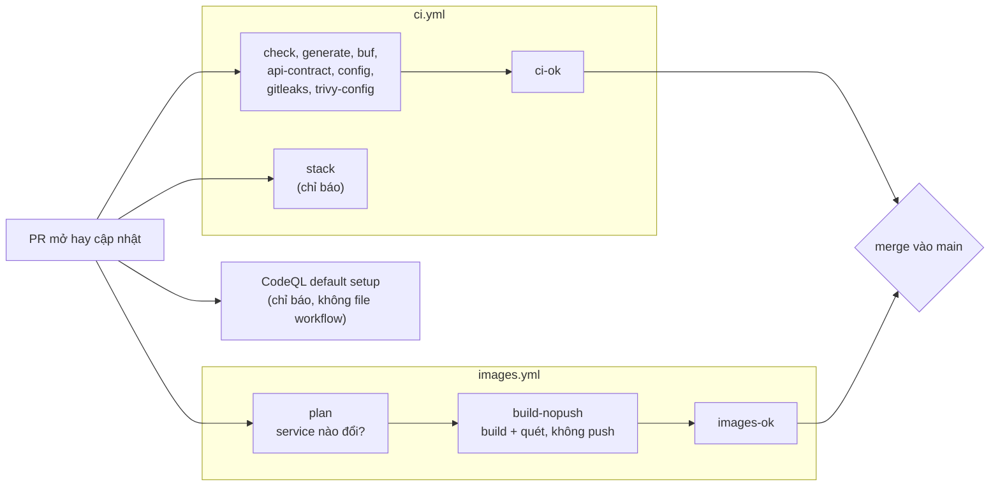
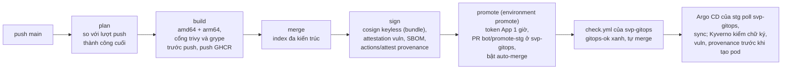
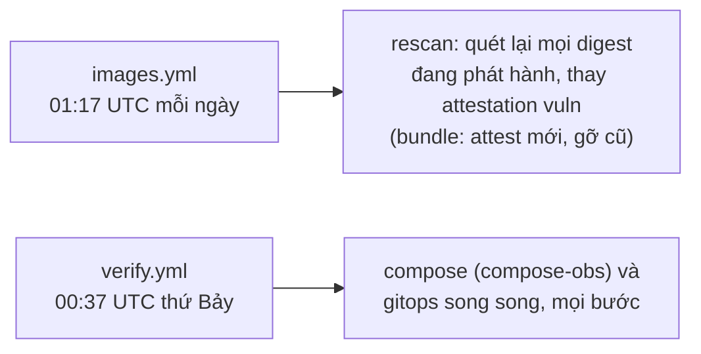
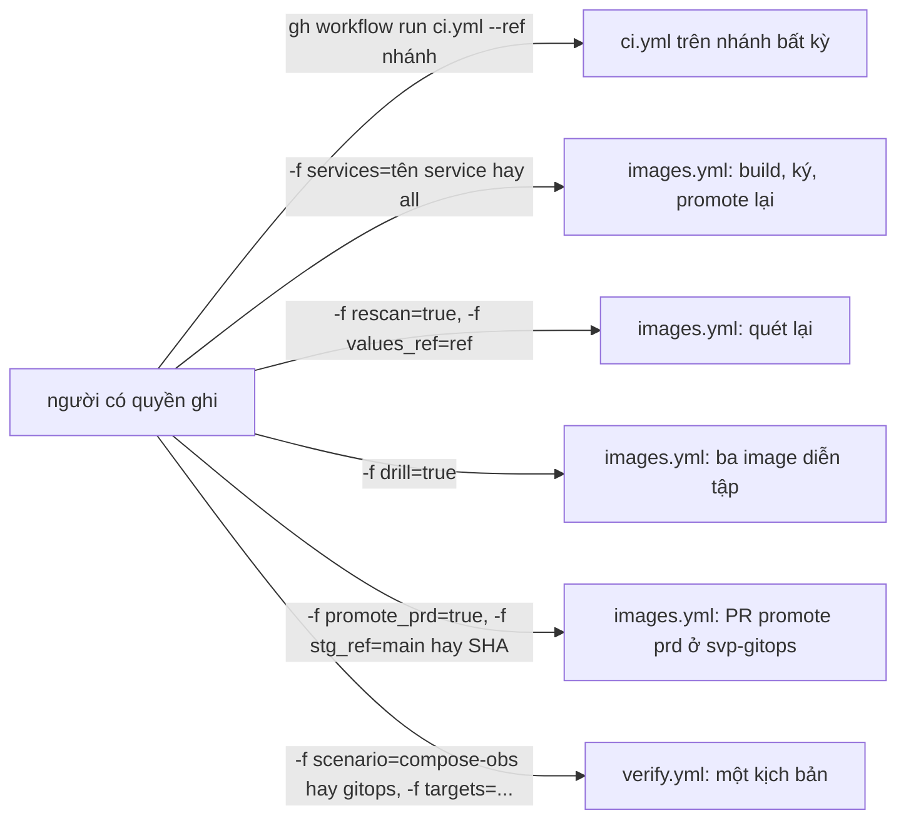
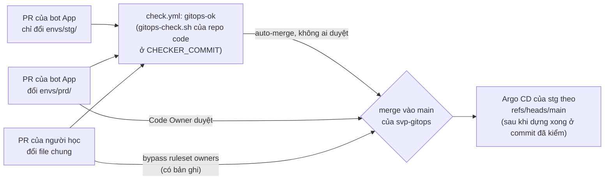

# CI/CD: luồng, job và cách đọc một lượt chạy

Tài liệu cho người mới mở trang lượt chạy của GitHub Actions mà chưa rõ job nào chạy khi nào, vì sao có job bị bỏ qua (skip),
và đọc kết quả ở đâu. Luồng kể bằng khái niệm chung của mọi hệ CI (pipeline, job, điều kiện chạy, check bắt buộc, artifact);
tên workflow và job của GitHub ghi kèm. Bảng tương ứng với GitLab ở
[ADR-0023](adr/0023-ci-platform-neutral.md) (mục "Bảng ánh xạ CI: GitHub Actions ↔ GitLab CI"), không chép lại ở đây.

Repo có năm workflow, mỗi file nối các bước, logic nằm ở `Makefile` và `deploy/ci/*.sh` (chạy được cả trên máy):

| Workflow | Việc | Quyết định |
| --- | --- | --- |
| `.github/workflows/ci.yml` | Kiểm code của mọi PR và mọi push `main`: Go (gồm govulncheck), code sinh, contract, luật version của hợp đồng REST, cấu hình, bí mật, misconfig, stack đầu-cuối (gồm DAST) | [ADR-0015](adr/0015-cicd-devsecops-stage5.md) §1, §2; [ADR-0020](adr/0020-reliability-stage6.md) §15 (job `stack`); [ADR-0030](adr/0030-devsecops-supplement.md) §1, §3; [ADR-0033](adr/0033-svp-web-repo.md) §1 (job `api-contract`) |
| `.github/workflows/images.yml` | Image của sáu service Go (image web ở CI của [`svp-frontend`](https://github.com/anhnvcoder/svp-frontend)): build, quét (trivy trên image, grype trên SBOM), push GHCR, ký, attestation, PR promote stg và prd sang repo `svp-gitops`, quét lại hằng ngày; phát hành hợp đồng REST của gateway có chữ ký | ADR-0015 §3–§9; ADR-0030 §6 (grype); [ADR-0025](adr/0025-gitops-config-repo.md) §2 (promote bằng GitHub App); [ADR-0037](adr/0037-mainpath-standard-tools.md) §6 (bước promote `yq` + `gh pr`); [ADR-0033](adr/0033-svp-web-repo.md) §1, §2, §4 (job `contract`, nguồn phát hành) |
| `.github/workflows/scorecard.yml` | OpenSSF Scorecard khi push `main`, hằng tuần: đo cả repo (ruleset, ghim, quyền), kết quả công khai và SARIF lên code scanning; không phải check của PR | [ADR-0041](adr/0041-github-hardening.md) (g) |
| `.github/workflows/pr-title.yml` | Job `pr-title`: tiêu đề PR theo Conventional Commits, vì tiêu đề thành tiêu đề commit squash | [ADR-0041](adr/0041-github-hardening.md) (h) |
| `.github/workflows/verify.yml` | Kiểm chứng trên runner những gì máy 16 GB không chạy nổi (stack có observability, cluster GitOps do Argo CD dựng, cluster của đường dev): ba kịch bản `compose-obs`, `gitops`, `dev-k3d` (chỉ dispatch) | [ADR-0021](adr/0021-deferred-verification-stage6b.md); [ADR-0037](adr/0037-mainpath-standard-tools.md) §6 (bỏ bản ghi stg); [ADR-0039](adr/0039-mainpath-drills-scan-gate-sourcemaps.md) §1 (thu gọn); [ADR-0050](adr/0050-bash-to-standard-tools.md) mục 6 (`dev-k3d`) |

Cấu hình triển khai (values, overlay, digest của mỗi môi trường, Argo CD) nằm ở repo public riêng
[`svp-gitops`](https://github.com/anhnvcoder/svp-gitops) ([ADR-0025](adr/0025-gitops-config-repo.md)); repo đó có một workflow
`check.yml` với check tổng `gitops-ok`, chạy `deploy/ci/gitops-check.sh` của repo này ở một commit ghim ([mục 1.5](#15-repo-cấu-hình-svp-gitops)).

Script của `deploy/ci/` đọc thẳng biến của GitHub Actions (`$GITHUB_OUTPUT`, `$GITHUB_STEP_SUMMARY`, `$RUNNER_TEMP`, repo, commit,
workflow của lượt) và gọi `gh` trực tiếp ([ADR-0037](adr/0037-mainpath-standard-tools.md) §2). DORA không còn workflow ở đây: là bài lab `dora/` của
[`svp-labs`](https://github.com/anhnvcoder/svp-labs) (§1 của ADR-0037).

Ngoài các workflow trên, tab Actions còn có workflow "CodeQL" do GitHub dựng và giữ: CodeQL **default setup** bật bằng cài đặt repo,
không có file trong repo, chỉ báo ([ADR-0030](adr/0030-devsecops-supplement.md) §4; bật, tắt, đọc kết quả ở [mục 7](#7-codeql-default-setup)).

## 1. Bốn luồng

### 1.1 Pull request

Mỗi lần mở hay cập nhật PR, `ci.yml` và `images.yml` cùng chạy trên code của PR, chỉ với quyền đọc repo. Merge được khi hai check
tổng `ci-ok` và `images-ok` xanh (ruleset của `main`), chỉ bằng squash, lịch sử `main` thẳng; `pr-title.yml` kiểm tiêu đề PR (thành check bắt
buộc sau khi xanh trên một PR người và một PR bot, [ADR-0041](adr/0041-github-hardening.md)). PR đổi file có Code Owner (`.github/`, `Makefile`,
`renovate.json`, `deploy/ci/`…) cần người học duyệt (ruleset `owners`).



- `stack` dựng cả stack compose (sáu service build từ PR, web là bản phát hành stg) và chạy smoke, e2e của `svp-frontend`, k6, Lighthouse,
  DAST (Schemathesis), nhưng không nằm trong `ci-ok`: đỏ thì người đọc PR thấy, không chặn merge.
- CodeQL quét PR từ nhánh của chính repo (PR từ fork thì không), check "CodeQL" hiện trên PR nhưng không bắt buộc.
- `build-nopush` chỉ có khi PR đổi đường dẫn của ít nhất một image; PR chỉ sửa tài liệu thì `plan` báo không có image và các
  job build đều skip, `images-ok` vẫn xanh.

### 1.2 Push hay merge vào `main`

`ci.yml` chạy lại toàn bộ trên `main` (thêm job `sarif` tải báo cáo lên tab Security). `images.yml` build bản phát hành của sáu service Go rồi
mở một PR "promote" **trong repo `svp-gitops`** ghi digest mới vào `envs/stg/images/` và commit chart vào `envs/stg/charts.yaml`;
PR đó tự merge khi check `gitops-ok` của `svp-gitops` xanh (không ai duyệt: `envs/stg/` không có Code Owner), Argo CD của stg
thấy commit và triển khai.



- PR promote do token của GitHub App `svp-gitops-promoter` mở (không phải `GITHUB_TOKEN`), nên GitHub chạy `check.yml` cho nó
  ngay, không ai bấm "Approve workflows to run" ([ADR-0025](adr/0025-gitops-config-repo.md) §6). Khoá App chỉ ở environment
  `promote` (stg) và `promote-prd` (prd, khoá riêng thứ hai) của repo này (deployment branch `main`); token chỉ cho `svp-gitops`, chỉ `contents`, `pull_requests` write, thu hồi
  cuối job.
- Lượt push chỉ đổi chart (`deploy/helm/` hay file chart đọc qua symlink) mà không image nào build vẫn chạy `promote`, chỉ ghi
  `envs/stg/charts.yaml`.
- `promote` là bước shell trong `images.yml` ([ADR-0037](adr/0037-mainpath-standard-tools.md) §6): clone `svp-gitops` ẩn danh, nhánh
  `bot/promote-stg` một commit của bot App trên `main` (giữ file mà PR bot đang mở đã đổi), `yq -i` (`YQ_IMAGE` ghim) khối `image` của
  file mỗi service vừa ký ở lượt này và `envs/stg/charts.yaml`, push `--force-with-lease`, `gh pr create`/`edit`,
  `gh pr merge --auto --squash --match-head-commit`. Chỉ ghi file của sáu service do repo này build; web do job `promote` của
  `svp-frontend` ghi ([ADR-0033](adr/0033-svp-web-repo.md) §4). Thứ tự giữ bằng nhóm `concurrency` không huỷ của build; guard
  `promote_not_behind` (`deploy/ci/common.sh`, thử ở `promote-test.sh`) từ chối lượt có commit cũ hơn `revision` mà stg đang ghim
  (chạy lại, dispatch commit cũ).
- Cùng lượt, job `contract` phát hành hợp đồng REST của gateway (`services/gateway/openapi.yaml`) thành OCI artifact
  `ghcr.io/anhnvcoder/svp-backend/api/gateway:<info.version>` ký keyless; version đã phát hành với đúng file đó thì bỏ qua,
  khác nội dung thì đỏ, không ghi đè ([ADR-0033](adr/0033-svp-web-repo.md) §1).
- Rollback stg là PR revert trong `svp-gitops`; lượt promote sau đó ghi bản của lượt đó (mới hơn), không ghi lại bản đã revert.
  Quy trình ở [`runbooks/svp-gitops-setup.md`](runbooks/svp-gitops-setup.md).
- Lần promote đầu sau khi tách repo, auto-merge của PR bot (bằng `promote.sh` cũ; bước shell thay nó: kiểm sau push): đã kiểm ngày 2026-10-30 (lượt [40984668411](https://github.com/anhnvcoder/svp-backend/actions/runs/40984668411) trên `2d9dab0`; PR #4, #5, #6 của `svp-gitops`, 0 review, bot tự merge sau `gitops-ok`).
- CodeQL default setup cũng quét mỗi push `main`; cảnh báo mở và đóng trên `refs/heads/main` ở tab Security.

### 1.3 Theo lịch



- Rescan giữ attestation `vuln` không quá 72 giờ tuổi, ngưỡng Kyverno chấp nhận; CRITICAL mới thì job đỏ và GitHub gửi mail.
  Mỗi repo chỉ attest bản của nguồn phát hành của mình: rescan của repo này bỏ qua file ghi bản của nguồn khác (một dòng), CI của
  nguồn đó rescan nó ([ADR-0033](adr/0033-svp-web-repo.md) §4); file dưới prefix không thuộc nguồn nào vẫn vào tập nên lượt đỏ.
  Rescan chỉ dùng trivy: grype chỉ quét lúc build, nên lỗ hổng chỉ grype thấy (ví dụ của `node` trong image web của `svp-frontend`) công bố sau khi
  phát hành chỉ bị bắt ở lần build kế.
  Digest ở định dạng cũ (`.sig`, `.att`) thì `--replace`; digest Sigstore bundle thì attest `vuln` mới rồi gỡ mọi `vuln` bundle khác, vì
  Kyverno đọc bundle cuối danh sách referrer, xếp theo digest chứ không theo tuổi ([ADR-0040](adr/0040-sigstore-bundle-actions-attest.md) §3).
- CodeQL default setup có lịch hằng tuần riêng do GitHub đặt (`schedule: weekly` trong cấu hình), không nằm trong YAML nào.
- Lượt lịch của `verify.yml` chạy trên commit mới nhất của `main`, không có input. GitHub có thể trễ hay bỏ lượt lịch lúc tải cao
  và tắt lịch sau 60 ngày repo không hoạt động (bật lại ở tab Actions). Lịch này mới thêm ngày 2026-10-25, chỉ kiểm được sau khi
  merge vào `main`.

### 1.4 Chạy tay (dispatch)



- `rescan` và `drill` chỉ chạy trên `main` và không chạy cùng lượt; `plan` từ chối (lượt đỏ) thay vì đoán.
- `rescan` quét digest của `envs/*/images/` trong `svp-gitops` ở `main`, ở PR `bot/promote-stg` đang mở và ở `values_ref` (ref của
  `svp-gitops`, hay SHA của repo này trước khi tách). Ca `l` của `make drill-k8s-supplychain` từ đổi tên repo dùng image diễn tập
  `drill-no-provenance` (ký, `vuln`, không provenance; [ADR-0036](adr/0036-repo-rename.md) §6) thay cho bản phát hành cũ trước build
  provenance: dispatch `-f drill=true` trong 72 giờ trước lượt diễn tập (diễn tập in đúng lệnh khi không tìm thấy hay `vuln` quá hạn).
  Provenance định dạng cũ trên bản phát hành đang chạy đã có (bảy bản của `6ca2d8a`); bản phát hành bundle đầu (provenance của
  `actions/attest`, Build L2): **kiểm sau push**, cùng phép đo admission thật của [ADR-0040](adr/0040-sigstore-bundle-actions-attest.md) §6.
- `-f promote_prd=true [-f stg_ref=<main|SHA đủ 40 hex>]` (chỉ `main`, một mình): job `promote-prd` mở PR `bot/promote-prd` trong
  `svp-gitops` chép giá trị khối `image` của bảy file và ba khoá `charts.yaml` của `envs/stg/` ở commit `stg_ref` (mặc định `main`;
  commit cũ hơn của `main` là rollback prd; nhánh, SHA ngắn, commit ngoài `main` bị từ chối) sang `envs/prd/` và ghim
  `gitopsRevision` của `envs/prd/charts.yaml` vào chính commit đó (prd render `argocd/apps`, `base/`, `platforms/` ở đó), không
  auto-merge; job dừng chờ người học duyệt environment `promote-prd`, rồi kiểm **bằng chứng stg** trước khi lấy khoá App: commit đó phải
  có commit status `argocd/stg` mới nhất là `success` (Argo CD Notifications của stg ghi khi đồng bộ xong và Healthy,
  [ADR-0032](adr/0032-argocd-deploy-status.md)), không thì đỏ và không PR nào mở; Reject environment cũng vậy. Rồi người học duyệt PR
  (Code Owner). Buổi prd vì vậy cần buổi stg đã đồng bộ đúng commit sẽ promote; rollback là một lượt với `stg_ref` cũ có status đó.
- `verify.yml` nhận `--ref main` hay nhánh `feat/stage6b-*`, ref khác dừng ở bước đầu; `targets` rỗng là mọi bước, bước dựng
  (`up`, `k8s-gitops-up`, `k8s-up`) luôn chạy; `gitops_ref` (chỉ `dev-k3d`) là `main` hay SHA đủ 40 hex của `svp-gitops`. Không còn input
  `web_ref`: workflow không clone `svp-frontend`, mọi kịch bản chạy image web của bản phát hành stg. Lệnh đầy đủ ở [`reference/ci.md`](reference/ci.md).

### 1.5 Repo cấu hình `svp-gitops`



- Check `gitops-ok` (ruleset `main` của `svp-gitops` bắt buộc, không ai bypass), bản rút gọn của
  [ADR-0037](adr/0037-mainpath-standard-tools.md) §4–§6: cây, `charts.yaml` (commit chart trên `main` repo này, hai giá trị dẫn xuất;
  ở prd thêm ghim `gitopsRevision`, phải là commit trên `main` của `svp-gitops` có `argocd/apps`),
  mỗi file image là bản của một nguồn có service đó theo bảng nguồn ở `revision` của env ([ADR-0033](adr/0033-svp-web-repo.md) §3),
  render mọi env × nền tảng × kiến trúc (env nào trên nền tảng nào và nền tảng nào được nêu `svp.localhost` đọc từ khoá `platforms` của
  `argocd/apps/components.json`; nền tảng `eks` nhận `cluster` từ `deploy/ci/cluster-values.example.yaml`, thay giá trị GitOps Bridge đặt;
  cây có `argocd/root` thì render hai tầng như Argo CD, env có ghim render `argocd/apps`, `base/`, `platforms/` ở commit ghim và
  `envs/<env>/` của PR, chi tiết ở [`reference/ci.md`](reference/ci.md)), luật trên manifest đã render bằng policy Kyverno CLI (`deploy/ci/gitops-policies/`: `images-pinned`
  mọi image ghim digest, `no-lab-hosts`), chữ ký và attestation của digest đổi. Luật trên file của cây (cây, `charts.yaml`, file image,
  lớp nền tảng, luật tác giả dưới đây) là policy conftest ở `deploy/ci/gitops-tree-policies/`; script chỉ dựng input cho chúng từ cây,
  từ git của repo này và từ sự kiện PR. Đã bỏ: PR đổi `envs/prd/` phải bằng một bản ghi stg (bước
  1b), image không mới hơn chart và tag nguồn khác là commit trên `main` repo nguồn (luật tổ tiên), đường cho cây chưa có `platforms/`.
- Luật tác giả hẹp: PR của bot một nguồn (`<promoter>[bot]`, đọc thẳng từ sự kiện PR) chỉ được đổi `envs/{stg,prd}/images/` của service
  thuộc nguồn đó (bot `backend` thêm hai `charts.yaml` và mọi file image prd, vì promote prd chép cả bộ); không bot nào xoá file; bot khác
  không đổi gì dưới `envs/`; PR của người không bị giới hạn ở bước này. Giữ vì `envs/stg/` không có Code Owner: PR bot tự merge.
- `CHECKER_COMMIT` (commit của repo này mà check chạy) đổi bằng PR ở `svp-gitops`; PR thêm hay sửa `check.yml` tự chạy bản sửa của
  chính nó (đặc tính của `pull_request`), nên `.github/` có Code Owner.
- Ruleset `owners` đòi duyệt của Code Owner cho mọi file trừ `envs/stg/`; ruleset `tags` cấm tạo tag (Argo CD có thể phân giải tên
  ngắn sang tag cùng tên). Lượt `check` đầu trên `main`: [40902199532](https://github.com/anhnvcoder/svp-gitops/actions/runs/40902199532)
  (2026-10-29), token chỉ `Contents: read`. Kiểm ngày 2026-10-30: người học là Code Owner duy nhất kiêm tác giả PR nên GitHub coi
  `owners` đã thoả, PR của họ đổi file chung merge được không cần duyệt và không có bản ghi bypass (đường "bypass ruleset owners" của
  sơ đồ trên chưa xảy ra); `gitops-ok` vẫn là lớp chặn. Luật vẫn áp lên PR của người khác; ca âm cho PR của bot chưa có (phần 4b).

## 2. Job theo từng workflow

"Chặn merge" nghĩa là job nằm trong check tổng mà ruleset của `main` đòi. Điều kiện chạy chép từ `if:` của YAML.

### `ci.yml`

Trigger: `pull_request`, `push` vào `main`, `workflow_dispatch`. Không trigger nào có bộ lọc `paths:`.

| Job | Làm gì | Chạy khi | Skip khi, vì sao | Chặn merge |
| --- | --- | --- | --- | --- |
| `changes` | Danh sách file của PR qua API (`pull-requests: read`, không checkout), ra năm output `code`, `proto`, `api`, `workflows`, `stack` cho các job dưới; tài liệu là `.md` (trừ `deploy/helm/*/README.md` do helm-docs sinh), `docs/`, `LICENSE`; PR đổi `Makefile`, file `*.mk` hay `ci.yml` thì mọi output là `true`; file đổi tên xét cả tên cũ; API liệt kê thiếu file (tối đa 3.000) thì mọi output là `true` | Mọi lượt (`push`, `workflow_dispatch`: mọi output `true`) | Không bao giờ | Có (qua `ci-ok`) |
| `check` | `make check-go` (gofmt, vet, golangci-lint, actionlint, buf lint, `make vulncheck`, Go test với Postgres, Redis native là service container). `make vulncheck`: govulncheck bằng Go của directive `go` trong `go.mod`, gate `tools/vulngate` đỏ khi code gọi tới một lỗ hổng không có ngoại lệ hợp lệ trong `.govulncheck-ignore.json`, hay khi image Go của `deploy/docker/` build bằng bản Go khác bản đã quét; lỗ hổng chỉ ở mức module, package là một dòng `INFO`; cần mạng tới `vuln.go.dev` | PR có file ngoài tài liệu, `push`, `workflow_dispatch` | PR chỉ tài liệu (job `changes`): `ci-ok` nhận `skipped` | Có (`ci-ok`) |
| `generate` | `make generate-check`: code sinh đã commit khớp | PR có file ngoài tài liệu, `push`, `workflow_dispatch` | PR chỉ tài liệu (job `changes`): `ci-ok` nhận `skipped` | Có |
| `buf` | `buf breaking` so với base | PR đổi `proto/` hay file của buf, `push`, `workflow_dispatch` | PR không đổi vùng đó (job `changes`): `ci-ok` nhận `skipped` | Có |
| `api-contract` | `make api-contract-check BASE=<base>` (base như `buf`): file `services/gateway/openapi.yaml` đổi thì `info.version` phải tăng đúng mức theo oasdiff (`OASDIFF_IMAGE`, không mạng), rồi `deploy/ci/contract-test.sh` (luật version với oasdiff thật, phát hành với registry và cosign giả) | PR đổi `services/gateway/openapi.yaml` hay script kiểm nó, `push`, `workflow_dispatch` | PR không đổi vùng đó (job `changes`): `ci-ok` nhận `skipped`; push tạo nhánh mới hay base không có spec thì một dòng summary và xanh | Có |
| `config` | `make gitops-clone` (bản clone ẩn danh `main` của `svp-gitops`, `SVP_GITOPS_DIR`), quy tắc các tệp ngoại lệ của cổng quét (`make conftest-verify`: test của policy conftest `deploy/ci/ignorefile-policies/`, cùng test của policy cây `svp-gitops` ở `deploy/ci/gitops-tree-policies/`; `scan-gate.sh --check-ignorefile`: các policy đó trên `.trivyignore.yaml`, `.grype.yaml`, `deploy/ci/trivy-config-ignore.yaml`), test của script pipeline image (`plan-test.sh`, `image-guard-test.sh` (guard và bước của ba composite action `image-*`), `image-gate-test.sh` (bước cổng của `image-leg` bằng trivy, syft, grype, conftest thật trên fixture), `scan-gate-test.sh`, `vuln-predicate-test.sh`, `sign-image-test.sh` (hàm Sigstore bundle của `common.sh`), `rescan-test.sh`, `verify-release-test.sh`, `changed-services-test.sh`; job giả của Actions, docker, gh, cosign giả), guard của hai job promote (`promote-test.sh`, trên repo nháp cục bộ), `verify-collect-test.sh`, test của các bước `verify.yml` (`deploy/ci/verify-steps/*-test.sh`: kiểm input `targets`, bảng kết quả từng bước, hình dạng hai job đọc bằng yq, bước supplychain, số đo admission, cổng test object store), glue diễn tập `deploy/k8s/drills/run-test.sh`, thứ tự xoay credential `deploy/k8s/rotate-test.sh`, `make chainsaw-lint` và test của diễn tập gitops không cluster (`deploy/k8s/drills/gitops/gitops-test.sh`: `chainsaw test --no-cluster` với kubectl giả, `chainsaw assert` trên object dựng sẵn), rule Prometheus, Collector, compose, `make helm-check` (chart của working tree với `base/` của bản clone, gồm ExternalSecret, SecretStore của mỗi env qua kubeconform theo CRD của chart External Secrets ghim, và policy Kyverno CLI trên render: image ghim digest, không `svp.localhost` ở nền tảng thật), `sources-test.sh` (bảng nguồn phát hành hỏng bị template `svp-policy`, nơi duy nhất viết luật bảng, từ chối lúc render; `release_sources` của `lib.sh` chỉ giữ bất biến prefix: kết thúc bằng `/`, không prefix nào là đầu prefix khác), `gitops-check-test.sh` (ca âm của check `svp-gitops`, gồm `kyverno test` của `deploy/ci/gitops-policies/` và `conftest verify` của `deploy/ci/gitops-tree-policies/`), k6, Job k6 của cloud (`make cloud-check`) | PR có file ngoài tài liệu, `push`, `workflow_dispatch` | PR chỉ tài liệu (job `changes`): `ci-ok` nhận `skipped` | Có |
| `gitleaks` | Quét bí mật toàn lịch sử, `--redact` | Mọi lượt | Không bao giờ | Có |
| `trivy-config` | Quét misconfig, chỉ báo (phát hiện không làm job đỏ; trừ các mục có hạn của `deploy/ci/trivy-config-ignore.yaml`) | PR có file ngoài tài liệu, `push`, `workflow_dispatch` | PR chỉ tài liệu (job `changes`): `ci-ok` nhận `skipped` | Có (chỉ khi lệnh lỗi, không khi có phát hiện) |
| `zizmor` | `make zizmor`: lint bảo mật workflow (zizmor ghim, `--persona=regular`, audit online bằng `GITHUB_TOKEN` chỉ đọc; ngoại lệ ở `.github/zizmor.yml`), SARIF chỉ báo cho `sarif` | PR đổi `.github/`, `push`, `workflow_dispatch` | PR không đổi `.github/` (job `changes`): `ci-ok` nhận `skipped` | Có |
| `dependency-review` | `actions/dependency-review-action`: dependency PR thêm vào có lỗ hổng từ mức high thì đỏ; không kiểm license | `pull_request` | Mọi sự kiện khác: chỉ so được với base của PR (`ci-ok` nhận `skipped`) | Có |
| `docs` | `make docs-check`: markdownlint-cli2 (luật ở `.markdownlint.yaml`, file sinh bỏ qua ở `.markdownlint-cli2.yaml`) và lychee `--offline` (link nội bộ, anchor), image ghim digest, không mạng | Mọi lượt | Không bao giờ | Tài liệu đi cùng code: link gãy hay sai định dạng chặn merge như lỗi code |
| `stack` | Stack compose đầu-cuối, web là bản phát hành stg theo digest: `make gitops-clone`, `make web-clone` (commit của web stg), smoke, e2e Chromium và WebKit của bản clone `svp-frontend` (`make web-e2e`), k6 `ci`, Lighthouse, rồi `make dast` cuối cùng (Schemathesis theo `services/gateway/openapi.yaml`, bước `continue-on-error`, hạn 15 phút; artifact `dast` chỉ `report.json`, `summary.json` đã dò bí mật) | PR đổi thứ stack compose chạy (mọi file trừ tài liệu, `deploy/helm/`, `deploy/ci/`, `deploy/k8s/drills/`, `deploy/k8s/cloud/`, `.github/`), `push`, `workflow_dispatch` | PR không đổi vùng đó (job `changes`) | Không |
| `sarif` | Tải SARIF lên tab Security | `always() && github.event_name != 'pull_request' && github.ref == 'refs/heads/main'` | PR và nhánh khác `main`: quyền `security-events: write` chỉ cho code đã qua review | Không |
| `ci-ok` | Đỏ trừ khi đủ mười một job trên `success` (`dependency-review` được `skipped` ngoài `pull_request`; job có vùng được `skipped` khi `changes` xanh và output của vùng đó là `false`) | `always()` | Không bao giờ | Là check bắt buộc |

### `images.yml`

Trigger: `pull_request`, `push` vào `main`, `schedule` hằng ngày, `workflow_dispatch` (`services`, `rescan`, `values_ref`,
`drill`, `promote_prd`, `record`). `plan` chọn **chế độ**: `rescan` khi lịch hay `rescan=true`, `drill` khi `drill=true`, còn lại
`build`; dispatch `promote_prd=true` bỏ qua `plan` và mọi job khác, chỉ chạy `promote-prd`. "Trên `main`" dưới đây là
`github.ref == 'refs/heads/main'` và sự kiện không phải `pull_request`.

| Job | Làm gì | Chạy khi | Skip khi, vì sao | Chặn merge |
| --- | --- | --- | --- | --- |
| `last-success` | Đọc commit của lượt push `main` thành công cuối (base để so), job duy nhất có `actions: read` | `push` vào `main` | Mọi sự kiện khác: chỉ push cần base này | Có (`images-ok` tính skip này là đúng) |
| `plan` | Chế độ, base, danh sách image, ma trận chân build (`deploy/ci/plan.sh`, `changed-services.sh`) | Trừ khi lượt bị huỷ | — | Có |
| `build-nopush` | Build, quét, cổng trivy (image) và grype (SBOM syft) từng image × kiến trúc, không push (composite action `.github/actions/image-leg`, `push: false`) | Chế độ `build`, có image, PR hay ref khác `main` | Không image nào đổi; hay đang trên `main` (job `build` làm) | Có |
| `build` | Như `build-nopush` rồi push GHCR đúng bản đã quét (`image-leg`, `push: true`) | Chế độ `build`, có image, trên `main` | PR, nhánh khác, hay không image nào đổi | Có |
| `merge` | Ghép hai chân thành index đa kiến trúc (`.github/actions/image-index`) | Như `build` | Như `build` | Có |
| `sign` | Ký keyless, attestation `vuln` và SBOM bằng `.github/actions/image-sign` (cosign ghim `COSIGN_IMAGE`, guard `deploy/ci/image-guard.sh`; Sigstore bundle, chỉ ghi loại chưa có trên digest nên chạy lại không thêm gì; [ADR-0040](adr/0040-sigstore-bundle-actions-attest.md)), rồi build provenance SLSA v1 bằng `actions/attest` (`attestations: write` chỉ ở job này, digest index, sau `vuln`; Build L2; ADR-0040 thay [ADR-0027](adr/0027-slsa-build-provenance.md)): chỉ khi `builder.id` bằng identity ký của nguồn phát hành của lượt (`deploy/helm/svp-policy/files/sources.json`, kiểm trước khi ký gì); image diễn tập không có | Như `build` | Như `build` | Có |
| `promote` | Environment `promote`, token App chỉ `svp-gitops` (`contents`, `pull_requests` write); bước shell dựng lại `bot/promote-stg` của `svp-gitops` bằng `yq` (`envs/stg/images/` của service vừa ký, `envs/stg/charts.yaml`; guard tổ tiên với `revision` của stg), mở hay cập nhật PR, bật auto-merge | Chế độ `build`, trên `main`, có image hay chart đổi (`promote_charts`) | PR, nhánh khác, không image và không chart nào đổi | Có |
| `promote-prd` | Environment `promote-prd` (người học duyệt trước khi job chạy), token App (`contents`, `pull_requests` write); bước shell chép giá trị `image` của bảy file và ba khoá `charts.yaml` của `envs/stg/` ở `stg_ref` vào `envs/prd/` trên `bot/promote-prd`, PR không auto-merge | Dispatch `promote_prd=true` trên `main` (kèm `services`, `rescan`, `values_ref`, `drill` thì đỏ ở bước đầu) | Mọi lượt khác | Có |
| `rescan` | `make gitops-clone`, quét lại mọi digest phát hành của nguồn `backend` trong `envs/*/images/` của `svp-gitops` (bản của nguồn khác bỏ qua), thay attestation `vuln` (digest định dạng cũ `--replace`; bundle: attest rồi gỡ `vuln` cũ bằng `oras manifest delete`) | Chế độ `rescan`, trên `main` | Mọi chế độ khác | Có |
| `contract` | `deploy/ci/contract.sh publish`: đẩy `info.version` của spec gateway thành OCI artifact `ghcr.io/anhnvcoder/svp-backend/api/gateway:<version>` bằng ORAS (`ORAS_IMAGE`), ký keyless digest đó; tag có cùng file thì bỏ qua (thiếu chữ ký thì ký bù), khác thì đỏ; `packages: write`, `id-token: write` | Chế độ `build`, trên `main` (push, dispatch không `rescan`, `drill`, `promote_prd`) | PR, nhánh khác, chế độ khác | Có |
| `drill-build`, `drill-merge`, `drill-sign` | Ba image diễn tập `drill-vulnerable` (có CRITICAL, ký), `drill-unsigned` (không ký) và `drill-no-provenance` (sạch, ký và attest `vuln`, không provenance), cùng các bước của bản phát hành | Chế độ `drill`, trên `main` | Mọi chế độ khác, nên luôn skip ở PR và push | Có |
| `sarif` | Tải SARIF của build (`trivy.sarif`, `grype.sarif` mỗi chân) và rescan trên `main` | Trên `main`, chế độ `rescan` hay `build` có image | PR, nhánh khác, không image | Không |
| `images-ok` | Xanh khi mỗi job `success`, hay `skipped` vì đúng lý do mà job này tính lại từ sự kiện, ref, output của `plan` | `always()` | Không bao giờ | Là check bắt buộc |

### `verify.yml`

Trigger: `workflow_dispatch` (input `scenario`, `targets`, `gitops_ref`) và `schedule` hằng tuần, job `compose` và `gitops`. Không check nào của ruleset đòi workflow này.

| Job | Làm gì | Chạy khi | Skip khi |
| --- | --- | --- | --- |
| `compose` | Kịch bản `compose-obs`: `make up OBS=lgtm`, smoke, `drill-obs-threats`, test tích hợp của object store (`test-stack-objstore`, không ca nào được SKIP); hạn 155 phút | `github.event_name == 'schedule' \|\| inputs.scenario == 'compose-obs'` | Dispatch kịch bản khác |
| `gitops` | Kịch bản `gitops`: `make gitops-clone`, `make k8s-gitops-up` vai stg ở SHA của `origin/main` trong bản clone (Argo CD đọc `svp-gitops` ở đúng commit đó, cluster ở yên commit đó suốt các bước kiểm, PR promote merge giữa chừng không đổi gì; chart của repo này ở commit `envs/stg/charts.yaml`, qua HTTPS ẩn danh), `make drill-k8s-gitops` (ba test Chainsaw của `deploy/k8s/drills/gitops/`: `gitops-env`, `gitops-external-secrets` (mọi ExternalSecret chart render với values của cluster `Ready`, 28 trên runner k3d, Secret đích đúng type và tên key), `gitops-argocd-metrics` (Prometheus thấy mọi Application của Argo CD Synced/Healthy, không cảnh báo Argo CD nào cháy, [ADR-0032](adr/0032-argocd-deploy-status.md))), `gitops-admission-metrics` (thời gian admission của lượt sync đầu từ apiserver và Kyverno, chỉ ghi số vào file của bước, [ADR-0040](adr/0040-sigstore-bundle-actions-attest.md) mục 6; thiếu metric là dòng `NOTE`, không đỏ), smoke chặt (key có version, `Cache-Control`), `drill-k8s-reloader` (xoay credential qua External Secrets; các bước sau chạy trên credential mới), `drill-k8s-supplychain` (gồm ca `l`: bản web thiếu provenance), `drill-k8s-threats` (gồm SEC-5/6/7). Lượt lịch bỏ ca (c), (l) của supplychain khi image của ca đó quá 72 giờ (SKIP kèm dòng `NOTE`, lệnh dispatch dựng lại image diễn tập `-f drill=true`; `SVP_VERIFY_SCHEDULED=true`); hạn 250 phút | `github.event_name == 'schedule' \|\| inputs.scenario == 'gitops'` | Dispatch kịch bản khác |
| `dev-k3d` | Kịch bản `dev-k3d`: kiểm `gitops_ref`, `make gitops-clone GITOPS_REF=<gitops_ref>`, `make k8s-up` (đường dev: helmfile, sáu image build bằng bake trên runner), `make k8s-smoke`, `make drill-k8s-reloader`, `drill-k8s-supplychain` với `SUPPLYCHAIN_ENFORCE_TMP=1` (gồm ca (k), chỉ chạy khi policy đang Audit); hạn 210 phút | `inputs.scenario == 'dev-k3d'` | Lượt lịch, dispatch kịch bản khác |

Mỗi job: kiểm ref, checkout, kiểm input `targets` (`deploy/ci/verify-steps/steps.sh check`), cài công cụ, `make gitops-clone` (đặt
`SVP_GITOPS_DIR` cho mọi bước sau), `make env`, `deploy/ci/verify-mask.sh`, ở `gitops` và `dev-k3d` bước sinh và mask giá trị mới của
`drill-k8s-reloader` (`deploy/k8s/drills/reloader/new-values.sh`, file 600 mà diễn tập đọc qua `SVP_DRILL_NEW_VALUES`), `verify-host.sh`,
rồi mỗi target một bước: id của bước là tên
target, `env.SVP_VERIFY_STEP_NAMES` của job liệt kê chúng theo thứ tự, bước đầu là bước dựng. Mỗi bước có `timeout-minutes` riêng, output vào
`$RUNNER_TEMP/verify/logs/<bước>.log` chứ không vào log job; bước sau bước dựng chạy khi bước dựng xanh, dù bước giữa đỏ (`!cancelled()`), và
chỉ khi `targets` rỗng hay có tên nó; job đỏ khi một bước đã chạy đỏ. Sau bước dựng là bước mask lại `.env` (và Secret của cluster ở
`gitops`); cuối cùng các bước `if: always()` ghi bảng kết quả từng bước (`steps.sh table` từ `toJSON(steps)`), lọc và tải artifact
`verify-<kịch bản>`, gỡ stack hay cluster. Hạn job đủ cho 20 phút cài đặt, tổng hạn các bước và 25 phút cho các bước cuối
(`deploy/ci/verify-steps/steps-test.sh` kiểm). Một lượt dispatch chạy đúng một job kịch bản, các job khác skip; lượt lịch chạy
`compose` và `gitops`. Mọi job chỉ `contents: read`, không secret hay environment. Các kịch bản sau là bài lab `drills/` của `svp-labs`
và không còn ở workflow: bản đo một lần của `dev-k3d`, `web-canary`, `k6-cloud-mini`, `chaos`, `velero`, phần còn lại của `compose-obs`
([ADR-0039](adr/0039-mainpath-drills-scan-gate-sourcemaps.md) §1). Lượt lịch đầu sau khi thu gọn: kiểm sau push.

## 3. Vì sao thiết kế như vậy

- **Lượt PR không secret, chỉ `contents: read`, không push hay ký.** Repo public: PR từ fork chạy code của chính nó trước khi ai
  đọc, kể cả PR Renovate đổi SHA action. Mọi job của lượt PR chỉ đọc repo; job nào cần ghi (`packages`, `id-token`, `contents`,
  `pull-requests`, `security-events`) là job riêng chỉ chạy trên `main` với code đã qua PR và check. Vì vậy đường PR và đường
  `main` của build là hai job (`build-nopush`, `build`) gọi chung một script, không phải một job có bước push bị tắt. Không
  `pull_request_target`, `workflow_run`. Chi tiết: ADR-0015 §1; [`threat-model.md`](threat-model.md) SC-2, SC-10, SC-11.
- **Chỉ build service đổi** (`deploy/ci/changed-services.sh`, ADR-0015 §3). Mỗi service có tập đường dẫn của image (`image_paths`
  của `deploy/k8s/lib.sh`); đổi đường build, quét, ký (`images.yml`, `deploy/ci/`, ghim `TRIVY_IMAGE`/`SYFT_IMAGE`/`GRYPE_IMAGE`/
  `COSIGN_IMAGE`) thì cả sáu (PR nâng một bộ quét quét lại mọi image trước khi merge), trừ các file của `deploy/ci/` không job image nào đọc (tệp bỏ qua misconfig, script của `verify.yml`, mọi test
  `*-test.sh`, check của `svp-gitops` cùng `values-check.sh` và `verify-release.sh` mà chỉ nó, `make k8s-gitops-up` và diễn tập chạy). Base của push `main` là lượt push thành công cuối chứ không phải commit ngay trước, để thay đổi của một lượt đỏ
  hay bị thay trong hàng chờ không bị bỏ sót. Không dùng `paths:` ở trigger vì check bắt buộc của workflow không chạy thì không
  bao giờ được báo, PR treo chờ mãi.
- **Check tổng** (`ci-ok`, `images-ok`). Ruleset chỉ cần hai tên ổn định, thêm hay đổi tên job không đụng ruleset. GitHub coi
  check bắt buộc bị skip là đạt, và job đỏ không tự làm job phụ thuộc đỏ, nên check tổng chạy `always()` và tự quyết: `ci-ok` đòi
  đủ chín job `success` (`dependency-review` `skipped` ngoài `pull_request` thì vẫn đạt); `images-ok` tính lại từ sự kiện, ref và output của `plan` xem mỗi job skip có đúng không (skip vì `if:`
  sai là đỏ).
- **Action ghim SHA commit đầy đủ**, chỉ action của GitHub, `sigstore/cosign-installer` và `ossf/scorecard-action`, cùng ba composite action của repo (`.github/actions/image-*`, gọi bằng `./` từ checkout của chính commit); trivy, syft, grype, cosign,
  Schemathesis, oasdiff, ORAS, Kyverno CLI, conftest, yq chạy bằng image ghim digest (`TRIVY_IMAGE`, `SYFT_IMAGE`, `GRYPE_IMAGE`, `COSIGN_IMAGE`,
  `SCHEMATHESIS_IMAGE`, `OASDIFF_IMAGE`, `ORAS_IMAGE`, `KYVERNO_CLI_IMAGE`, `CONFTEST_IMAGE`, `YQ_IMAGE` của `Makefile`), không dùng GitHub Action của oasdiff hay ORAS. Tag của action có thể bị đẩy sang code khác (các vụ tj-actions, trivy-action), SHA thì không; Renovate cập nhật SHA.
  ADR-0015 §1, §10.
- **Job `stack` chỉ báo.** Stack đầy đủ với hai trình duyệt trên runner dùng chung có lúc đỏ vì môi trường, không vì code; nếu
  nằm trong `ci-ok` thì một lần chập chờn chặn merge. Xem lại khi 20 lượt liên tiếp xanh, không lượt đỏ do môi trường (ADR-0020
  §15). DAST chạy cuối job vì nó làm cạn rate limit theo IP và theo user của gateway; output thô của Schemathesis (body của
  response, có token của user thử) chỉ nằm trên runner, log job chỉ có tóm tắt in từ hai tệp đã dò bí mật (ADR-0030 §3).
- **Quyền deploy ở repo khác, bằng GitHub App.** Push vào `main` của repo này không đổi cluster nào: chỉ PR vào `svp-gitops` đổi
  được thứ đang chạy. Ghi sang repo khác thì `GITHUB_TOKEN` không đủ, nên hai job trên `main` (`promote`, `promote-prd`) khai environment (`promote` cho stg, `promote-prd` cho prd; deployment branch `main`, lượt `pull_request` không lấy được khoá) và đổi khoá App
  thành token 1 giờ chỉ cho `svp-gitops`, mỗi job đúng quyền của nó; không job nào chạy kịch bản hay build mà có khoá. Chặn kẻ xấu ở prd là duyệt environment `promote-prd`
  (người học, admin không bypass) rồi duyệt của Code Owner (không còn bản ghi
  stg, [ADR-0037](adr/0037-mainpath-standard-tools.md) §6); ở stg là luật tác giả hẹp, chữ ký và admission Kyverno
  ([`threat-model.md`](threat-model.md) GIT-1 tới GIT-6).
- **govulncheck chặn, trivy và grype chặn image, CodeQL chỉ báo.** govulncheck chỉ đỏ với lỗ hổng mà code gọi tới (theo đồ thị
  gọi), nên ít báo giả; trivy và grype là hai DB và hai cách khớp khác nhau trên cùng image (grype đọc SBOM syft, thấy binary
  ngoài trình quản lý gói mà trivy không thấy), cùng cổng CRITICAL; ngoại lệ là một mục `.trivyignore.yaml` kèm rule `.grype.yaml` cùng id và version ([ADR-0039](adr/0039-mainpath-drills-scan-gate-sourcemaps.md) §2). CodeQL theo luồng dữ liệu qua
  hàm và tệp, còn mới ở repo nên chưa là check bắt buộc; gosec trong `check` vẫn là cổng SAST chặn (ADR-0030 §1, §4, §6).
- **Vì sao job `drill-*` nằm trong `images.yml` dù luôn skip ở PR và push.** Ký keyless không có khoá: danh tính ký là chứng chỉ
  Fulcio cấp cho đúng file workflow và ref đang chạy (SAN là `server_url` + `job_workflow_ref`, ADR-0015 §7), và Kyverno chỉ tin
  `.github/workflows/images.yml@refs/heads/main` của repo nguồn (`deploy/helm/svp-policy/files/sources.json`). Diễn tập phải chứng minh Kyverno từ chối
  `drill-vulnerable` **vì CRITICAL**: nếu image đó được ký ở workflow khác thì Kyverno từ chối vì sai danh tính, phép thử không
  còn chứng minh gì về rule CRITICAL; còn thêm danh tính thứ hai vào policy là nới niềm tin của cluster cho một workflow chỉ phục
  vụ diễn tập. Ở cùng file, drill đi đúng các bước của bản phát hành (alias YAML `*release-leg`, `*merge`, `*sign`), nên khác nhau
  duy nhất là CRITICAL hay chữ ký. Cái giá: ba job luôn hiện "skipped" trên trang lượt chạy, và `images-ok` phải biết skip đó là
  đúng.
- **Phương án workflow con (reusable workflow, `workflow_call`) và vì sao chưa chọn.** Có thể tách build, ghép, ký vào một file
  workflow con, `images.yml` và một workflow diễn tập cùng gọi nó: một định nghĩa bước, `images.yml` ngắn hơn. Chưa chọn vì
  (1) alias YAML đã cho một định nghĩa bước trong cùng file; (2) thêm một file workflow, tên job lồng `<job> / <job con>` mà
  `images-ok` phải đọc; (3) với workflow con, `job_workflow_ref` (nên danh tính ký) là file workflow con, không còn là
  `images.yml`: policy Kyverno và mọi phép kiểm chữ ký phải đổi theo, và mọi workflow trên `main` gọi được file đó đều ký ra cùng
  danh tính, nên phải kiểm thêm workflow gọi (điểm này suy từ cách GitHub định nghĩa claim `job_workflow_ref`, chưa thử trong
  repo). ADR-0015 §1 đã cân nhắc phương án này cho việc tách quyền PR/`main`. Xem lại khi có workflow thứ hai cần ký image.
- **Giá trị bên ngoài vào script qua `env:`.** Input của dispatch, tên nhánh, tiêu đề PR và giá trị ma trận do `plan` sinh tới script bằng
  `env:`, không qua `${{ }}` trong `run:`: biểu thức được thay vào mã shell trước khi shell chạy, nên một giá trị có dấu nháy hay
  `$(...)` thành lệnh. Mọi `actions/checkout` đặt `persist-credentials: false` để token không nằm lại trong `.git/config`; không job
  nào của `images.yml` push vào repo này.
- **Job giữ `id-token: write` không dùng cache.** `sign`, `rescan`, `contract` và action `image-sign` không khôi phục hay lưu cache. `sign` là
  job duy nhất của đường build có `id-token: write` và `attestations: write` (provenance cũng vào attestation của repo); artifact
  `release-<image>` (repository, tag, digest của index đã ký) là thứ bước promote đọc.
- **`last-success` là job riêng, và `plan` chỉ nhận SHA đủ.** Chỉ job này đọc Actions API nên nó không checkout và không chạy code của repo.
  API lỗi thì output rỗng và job vẫn xanh: `plan` build cả sáu image (thừa chứ không thiếu). API lọc theo nhánh, sự kiện, trạng thái;
  `plan.sh` chỉ nhận đáp án khi nó là SHA commit đủ.
- **`promote` chạy cả khi ký một image lỗi.** Mọi image đã ký ở lượt này vẫn được promote, image lỗi đỏ ở `sign`. Job cũng chạy khi không
  có image mà chart đổi (`promote_charts` của `plan`): chỉ `charts.yaml` dịch chuyển. `GITHUB_TOKEN` của `promote` chỉ đọc repo này, token
  App chỉ cho `svp-gitops`, không có `id-token` hay `packages`. `promote-prd` cũng vậy, `GITHUB_TOKEN` còn đọc được commit status của
  `svp-gitops` (repo public), và token App lấy từ khoá thứ hai của App mà chỉ job này giữ.
- **Hợp đồng REST được phát hành tối đa một lần mỗi version.** Job `contract` chạy ở mọi lượt build của `main` (push, hay dispatch không
  `rescan`, `drill`, `promote_prd`), chung nhóm concurrency không huỷ của build, nên các lượt chạy lần lượt và hai lượt không kiểm rồi đẩy
  cùng một tag cùng lúc (kiểm và đẩy là hai request). GitHub thay lượt đang chờ trong nhóm bằng lượt mới hơn: version merge khi một lượt
  build của `main` đang chạy, rồi có version khác merge trước khi lượt chờ bắt đầu, thì version đầu không bao giờ được phát hành. Chấp nhận
  vậy vì version sau đã chứa nó, còn phát hành bù mọi version thiếu từ lịch sử spec chỉ thêm các bản không client nào hỏi. Job không
  cần image của lượt và không dùng cache.
- **Rescan đọc `svp-gitops` như dữ liệu.** Job `rescan` clone `svp-gitops` ẩn danh và chỉ đọc file của nó, không chạy gì từ đó;
  `GITHUB_TOKEN` chỉ dùng để hỏi PR promote có đang mở không (đọc repo public).
- **Báo cáo SARIF của `images.yml` tải một lần mỗi công cụ.** `upload-sarif` gộp mọi file nhận được thành một log SARIF và GitHub từ chối
  log quá 20 run. Mỗi chân ghi một run trivy và một run grype, nên sáu image (12 chân) gộp cả hai công cụ ra 24 run; tách theo công cụ thì
  tối đa 14 (rescan chỉ ghi run trivy và không chung log với build). Bước đầu của job xếp file vào một thư mục mỗi công cụ và đếm run
  bằng `jq` của runner, để log vượt giới hạn dừng ở đó kèm số đếm thay vì bị GitHub từ chối; công cụ vượt giới hạn không được tải, công cụ
  kia vẫn tải. Job là báo cáo chứ không phải check: nằm ngoài `images-ok`, nhưng tải lỗi vẫn làm lượt đỏ.
- **Job `sarif` của `ci.yml`.** Job duy nhất có quyền ghi (`security-events: write`) trong `ci.yml`, chỉ chạy trên `main` ngoài PR: PR (từ nhánh
  của repo hay từ fork) chạy code của chính nó trước khi ai đọc, nên không bao giờ có quyền này; phát hiện của PR ở lại trong artifact và
  summary. Job checkout code chỉ để `upload-sarif` đọc dòng của từng phát hiện và tính fingerprint (cảnh báo nhờ đó giữ lịch sử và trạng
  thái dismiss khi dòng dịch chuyển), không chạy gì của repo. Là báo cáo chứ không phải check: `ci-ok` không cần nó, nhưng tải lỗi vẫn
  làm lượt đỏ.
- **Image có một chân lỗi thì không có bản phát hành.** Action `image-index` ghép hai manifest đã quét của một image thành một index
  đa kiến trúc (nhãn OCI theo commit), đọc lại index và kiểm nó có đúng hai manifest đó (`deploy/ci/image-guard.sh index`, `index-check`), rồi
  giao artifact `index-<image>` (repository, tag, digest): digest được ký, attest và promote. Image có chân lỗi không đủ hai artifact
  `leg-<image>-amd64`, `-arm64` nên đỏ ở đây: không index, không chữ ký, không bản phát hành. Action dùng chung với `images.yml` của
  `svp-frontend`. Job cấp `contents: read` và `packages: write`; `GITHUB_TOKEN` chỉ dùng cho `docker login`.
- **Cổng quét của một chân (`image-leg`).** Chân build image theo kiến trúc native của runner (không giả lập, không cross-compile), lưu
  thành tar rồi quét đúng tar đó: image đẩy lên là image đã quét. Dockerfile và context do guard trao, theo target của bảng image
  `deploy/docker-bake.json`, cùng target mà đường dev build bằng bake; không dùng provenance hay SBOM của BuildKit nên image là một manifest
  thuần. Hai cổng (trivy, grype) chạy bất kể cổng kia thấy gì để summary hiện cả hai, và không có gì được đẩy trừ khi mọi bước qua; mã
  thoát lạ của scanner, DB không tải được, hay tar mà syft không đọc được thì chân đỏ. trivy quét tar (chỉ đọc), cả lỗ hổng lẫn bí mật,
  mọi mức, ra JSON: bản ghi để làm cổng, SARIF và attestation `vuln`; DB không tải được thì scan lỗi, không bao giờ quét với DB không rõ
  tuổi; `ImageID` của báo cáo là config digest mà bước push so. grype quét SBOM đó là bộ khớp và DB thứ hai, thấy cả thứ syft tìm được
  ngoài trình quản lý gói (binary `node` của image web) mà trivy không liệt kê; grype thoát 2 khi có match từ `--fail-on` trở lên, thoát 1 khi
  không quét được (kiểm tra cập nhật DB là bắt buộc và grype từ chối DB build quá năm ngày); cấu hình duy nhất nó đọc là `.grype.yaml` của
  cây, truyền bằng `-c`, vì thư mục làm việc và `HOME` là tmpfs rỗng. Chỉ DB của trivy và grype được cache (một mục mỗi ngày); token của
  job chỉ dùng cho `docker login` lúc push, và job chỉ được cấp `packages: write` khi đó.
- **Ký keyless và cách chạy cosign trong `image-sign`.** Không có khoá để lộ hay xoay: cosign xin chứng chỉ ngắn hạn của Fulcio cho danh tính
  OIDC của workflow gọi và ghi từng mục vào Rekor. Bước của composite action chạy trong job của bên gọi nên danh tính là workflow của
  bên gọi, subject là cái mà nguồn phát hành nêu. Chữ ký đặt trên digest index (pod chạy digest index nên Kyverno xác minh nó); SBOM attest
  trên digest manifest của từng nền tảng; `vuln` (từ hai lượt quét đã qua cổng, `deploy/ci/vuln-predicate.sh`) và provenance (cuối cùng)
  trên digest index. Mỗi thứ là một Sigstore bundle; `deploy/ci/image-guard.sh sign` quyết trước khi ghi gì. Image diễn tập không có
  provenance: `drill-no-provenance` được ký chỉ để cho thấy policy từ chối image đã ký, sạch mà thiếu provenance. cosign chạy từ `COSIGN_IMAGE`
  ghim digest, bằng user của runner, với file credential do `docker login` ghi (chỉ đọc), thư mục làm việc chỉ đọc ở đúng đường dẫn của
  nó và yêu cầu token OIDC của job (`ACTIONS_ID_TOKEN_REQUEST_URL`, `ACTIONS_ID_TOKEN_REQUEST_TOKEN`, truyền theo tên chứ không theo giá
  trị) để cosign tự xin token. Action chỉ dùng trong job có `id-token: write`, `packages: write`, `attestations: write` trên `main`, job không
  chạy code của PR; `GITHUB_TOKEN` chỉ dùng cho `docker login` (cho cosign, ORAS liệt kê referrer và `actions/attest`). Mọi bước gọi docker
  bỏ `DOCKER_DEFAULT_PLATFORM` như mọi lệnh docker của repo.
- **Phép kiểm file ngoại lệ chạy ở job `config`, không chỉ ở cổng image.** PR chỉ đổi `.trivyignore.yaml` hay `.grype.yaml` không build image,
  và một mục hỏng merge vào `main` sẽ làm rescan hằng ngày không attest được service nào. Chỉ ở `config` mục hết hạn mới đỏ (grype không đọc
  ngày, nên rule của nó vẫn che match). Bước đó cũng giữ luật của các misconfiguration mà `trivy-config` bỏ qua: đường dẫn, lý do, tối đa
  90 ngày. Luật là policy conftest (`deploy/ci/ignorefile-policies/`) chạy với `yq` từ image `Makefile` ghim, không mạng sau khi pull,
  không token. `make conftest-verify` chạy test của chúng (mọi ca phải đỏ) và test của policy mà `deploy/ci/gitops-check.sh` áp lên cây
  `svp-gitops` (`deploy/ci/gitops-tree-policies/`).
- **`check`: bản Go và service container.** Bản Go là bản của image builder trong các Dockerfile và của máy dev; cache module và cache build,
  khoá theo `go.sum`. Test transcode của `media-worker` bị skip khi thiếu `ffmpeg` và `ffprobe`, mà runner không có; ffmpeg của Ubuntu
  cũ hơn bản trong image nên test chỉ dùng cờ lâu đời. Postgres service container cùng major với Postgres của máy dev và của cluster, superuser
  `postgres`/`postgres` là mặc định của `SVP_TEST_POSTGRES_URL` trong `Makefile`; test tự tạo các database `svp_*_test` từ đó. Redis native cùng dòng
  với Redis của máy dev; test dùng db 15 (mặc định của `SVP_TEST_REDIS_URL`); stack `make up` không dùng nó.
- **Job `stack`: cách chạy và vì sao.** Dựng cả stack `make up` trên runner như trên máy dev rồi chạy `make smoke`, e2e của web, k6 profile `ci` (chỉ ngưỡng
  lỗi: runner dùng chung không nói gì về độ trễ), Lighthouse và Schemathesis theo hợp đồng OpenAPI của gateway. Sáu service build từ code của
  PR; web là bản phát hành mà stg chạy (mặc định của `make up`, ghi ở `main` của `svp-gitops`, kéo ẩn danh từ GHCR), và e2e, Lighthouse
  là code của `svp-frontend` ở đúng commit của bản phát hành đó (`make web-clone`), nên thay đổi backend làm hỏng web hiện ở đây. Job build và chạy code của PR
  như các job khác, với `contents: read` và không secret: `make env` ghi `.env` gồm secret ngẫu nhiên mới, chỉ sống trên runner tới hết job,
  không in, không tải lên. Các thao tác đặt lại "LOCAL LAB ONLY" của smoke, e2e, k6, Lighthouse, DAST (xoá khoá rate limit đăng ký của gateway ở
  Valkey db 10, qua CLI vận hành trong container `valkey`) chỉ chạm Valkey của stack compose lượt này. Job chạy khoảng 15 đến 25 phút (sáu lần build image, kéo bản web phát hành, seed e2e
  (video READY), hai trình duyệt); `timeout-minutes: 45` chừa chỗ cho runner chậm và dừng một bước treo xa trước mặc định 6 giờ của
  GitHub.
- **Job `stack`: môi trường của runner.** Postgres của job là service container publish trên đúng hai địa chỉ: container compose gọi chúng là
  `host.docker.internal`, mà `host-gateway` của compose ánh xạ tới gateway của bridge mặc định của Docker (`docker0`, `172.17.0.1`), còn `psql` của
  `deploy/postgres/bootstrap.sh` chạy ngay trên runner nên cần loopback; không publish trên mọi interface. Kafka và Valkey là container của
  stack compose (`tls-init`, `kafka`, `kafka-init`, `valkey`), không publish cổng; khi một bước lỗi, bước "Container state" in log của chúng. Service
  compose đăng nhập Postgres bằng mật khẩu role do `make up` bootstrap (image đòi mật khẩu ở mọi kết nối TCP). Gói apt từ kho Ubuntu (không action bên thứ ba)
  cho script chạy trên runner: `psql` của bootstrap Postgres (`bootstrap.sql` cần bản 15 trở lên vì `\getenv`),
  `ffmpeg` cho video thử của smoke, seed e2e và Lighthouse, `jq` ở mọi nơi; `curl`, `openssl` có sẵn trong image runner. Node theo major của
  `.nvmrc` và pnpm theo `packageManager` của bản clone, như CI và Dockerfile của `svp-frontend`: Node 25 trở lên không còn Corepack, và repo
  không cho action bên thứ ba (`pnpm/action-setup`); không cache vì cache pnpm của `setup-node` cần pnpm trên `PATH` trước khi Node có
  mặt. Trước `make web-lighthouse` job bỏ hạn chế AppArmor `kernel.apparmor_restrict_unprivileged_userns`: Lighthouse mở Chromium của Playwright
  với sandbox của Chrome, cần user namespace không đặc quyền; Ubuntu 24.04 hạn chế chúng qua AppArmor cho mọi binary không có profile riêng,
  bản tải của Playwright không có, nên Chrome dừng với "No usable sandbox". Hạn chế bỏ trên runner dùng một lần này, nhờ đó sandbox vẫn bật;
  e2e tự tắt sandbox.
- **Artifact công khai của `stack` chỉ nhận báo cáo đã dò bí mật; k6 và DAST dò hai lần, Lighthouse một lần.** `deploy/k6/load.sh` làm lượt chạy đỏ khi kết quả của nó có token, cookie hay
  mật khẩu nhưng vẫn để nguyên chúng; job dò lại một lần nữa để `summary.json` chỉ vào artifact công khai khi sạch (`machine.json` và phần
  còn lại ở trên runner). Với Lighthouse, bước của job chỉ chép, không dò: việc dò là của `lighthouse/run.sh` của `svp-frontend`, ghi báo cáo ở đầu
  `test-results/lighthouse/` của bản clone sau khi thay cookie phiên và xoá chúng nếu còn thấy giá trị cookie. Job chép các báo cáo đó ra khỏi
  thư mục ẩn của bản clone, vì `upload-artifact` bỏ qua thư mục ẩn;
  thư mục con `.lighthouseci/` (kết quả trước khi thay cookie) không khớp mẫu nào nên không lên. Với `dast` chỉ `report.json` (đếm,
  tiêu đề lỗi, seed) và `summary.json` (request theo status và operation) được rời runner; `schemathesis.log`, `junit.xml`, `requests.har` có body
  response kèm token và form presigned. `deploy/dast/run.sh` làm lượt đỏ khi một trong hai file có bí mật nhưng để nguyên chúng; job dò lại
  để chúng chỉ vào artifact công khai khi sạch. Mỗi bước tải bị bỏ qua khi bước nguồn bị huỷ (quá hạn) hay không chạy.
- **Log và artifact của `verify.yml` công khai, nên bảo vệ nhiều lớp.** Repo public: log và artifact của mọi lượt, đỏ hay không, ai cũng đọc được.
  Lớp một là luật không script nào in bí mật (không bao giờ `set -x`, `env` hay `kubectl get secret`); lớp hai là mask giá trị bí mật trong log
  (`deploy/ci/verify-mask.sh`, sau `make env` và sau bước dựng); lớp ba là output của từng bước vào file dưới `$RUNNER_TEMP/verify/logs` thay vì log
  job, và `deploy/ci/verify-collect.sh` chỉ chép vào artifact những kết quả máy đọc, đã qua dò mọi giá trị bí mật đã biết và mẫu token (file nghi bị
  bỏ kèm cảnh báo). `make env` ghi `.env` gồm secret ngẫu nhiên mới sống trên runner tới hết job; bước dựng sinh thêm (token GlitchTip, Secret của cluster).
  Giá trị mới của `drill-k8s-reloader` (ghi vào `.env`) sinh và mask ở một bước riêng trước bước dựng, vào file riêng ở `$RUNNER_TEMP/verify-reloader`. Không code của repo khác chạy: `svp-gitops` được clone
  ẩn danh (`make gitops-clone`) và chỉ đọc, image kéo theo digest. `targets` và `gitops_ref` tới script chỉ qua `env` (`SVP_VERIFY_TARGETS`,
  `SVP_GITOPS_REF`), mỗi cái được kiểm lại bằng `case` trước khi dùng; `if:` so kịch bản và `targets` như biểu thức. Lượt lịch không có
  input: mỗi job chạy kịch bản của nó, mọi bước.
- **Kiểm ref đầu tiên, concurrency và `dev-k3d` của `verify.yml`.** Bước kiểm ref chạy trước mọi thứ và dừng dispatch của nhánh khác (cũ, có thể thiếu
  bản sửa của `main`) lẫn lượt lịch ngoài `main`. Đó là rào chắn tai nạn, không phải ranh giới bảo mật: ai dispatch được cũng
  push được nhánh có tên đó. Mỗi kịch bản có nhóm concurrency riêng nên một lượt tại một thời điểm, hai kịch bản song song, mỗi cái một
  runner, bản sửa hiếm khi chờ lượt kia; dispatch thứ ba của một kịch bản khi một lượt đang chạy và một đang chờ thay lượt đang chờ. Lượt lịch
  (cả hai job) là nhóm riêng `verify-schedule`: dispatch trong lúc đó chạy cạnh nó, trên runner riêng. `dev-k3d` chỉ dispatch, không bao giờ theo lịch:
  lượt hằng tuần giữ đường mà stg và prd theo. Job `compose` dựng stack giống job `stack` của `ci.yml`; `gitops` và `dev-k3d` dựng cluster theo hai đường nêu ở mục 2.
- **Giờ lịch lệch khỏi đầu giờ.** Lịch của `verify.yml` (thứ Bảy 00:37 UTC, tức 07:37 giờ Việt Nam) và của `images.yml` (01:17 UTC) cố ý ở phút lẻ: đầu giờ
  là lúc bộ lập lịch của GitHub bận, có thể trễ hay bỏ lượt. Attestation `vuln` Kyverno nhận trong 72 giờ nên hai ngày lỡ lượt rescan vẫn ổn.
- **`pr-title.yml`.** Tiêu đề PR theo Conventional Commits 1.0.0: `main` chỉ nhận squash merge và tiêu đề thành tiêu đề commit. Kiểm theo ngữ
  pháp, không theo danh sách scope, nên tiêu đề của bot qua nguyên trạng (`chore(stg):`, `chore(prd):` của App promote, `chore(deps):`, `fix(deps):` của
  Renovate), và cả nút Revert của GitHub (`Revert "<tiêu đề>"`). Cùng mẫu và bộ test chạy ở bốn repo có CI (`svp-backend`, `svp-frontend`, `svp-gitops`,
  `svp-infra`). Là workflow riêng, không phải job của `ci.yml`: sửa tiêu đề chạy riêng nó chứ không chạy cả CI. Không quyền, không checkout, không code của PR: tiêu đề
  tới script chỉ qua `env`.
- **`scorecard.yml`.** OpenSSF Scorecard của repo: ghim, quyền của token, ruleset, mẫu workflow nguy hiểm và các check khác (danh sách ở tài liệu của
  Scorecard), chạy mỗi push `main`, hằng tuần và khi một luật branch protection cổ điển đổi. Kết quả công khai ở API Scorecard (`publish_results: true`, huy hiệu và trang
  xem) và tải lên code scanning. Không trigger `pull_request`: đây không phải check của PR. Branch-Protection đọc ruleset bằng `GITHUB_TOKEN`
  nên không `repo_token`. Việc công khai ràng buộc file này theo các luật mà API Scorecard kiểm trước khi nhận kết quả ("Workflow Restrictions" trong README của
  `ossf/scorecard-action`): không `env` hay `defaults` ở mức workflow và không có trong job; không quyền ghi ở mức workflow; `id-token: write` chỉ ở job Scorecard; không
  container hay service; một nhãn runner Ubuntu do GitHub host (`ubuntu-latest` hay `ubuntu-YY.MM`, 22.04 trở lên); và các step của job đó chỉ gồm
  `actions/checkout`, `actions/upload-artifact`, `github/codeql-action/upload-sarif`, `ossf/scorecard-action`, `step-security/harden-runner`, mỗi step là `uses:` (không step `run:`).
  Kết quả được API nhận hay không hiện ở log của step Scorecard. Mọi action ghim SHA commit đầy đủ; checkout không để token ở `.git/config`.

## 4. Đọc một lượt chạy

Trang một lượt chạy (Actions → chọn lượt) có đồ thị job, danh sách annotation, summary của từng job và artifact ở cuối trang.

- **Đồ thị job:** xanh `success`, đỏ `failure`, xám gạch là `skipped`. Job skip là bình thường khi điều kiện ở mục 2 không đúng
  cho sự kiện này (ví dụ cả nhóm `build`, `sign`, `promote`, `drill-*` ở lượt PR). Muốn biết skip có đúng không, mở log job
  `images-ok`: mỗi job một dòng `ok    <job> skipped: not part of this run`, hay `::error::<job> was skipped, but this run needed
  it`.
- **Summary của job** (cuộn xuống dưới đồ thị), từ hai nguồn. Script ghi vào `$GITHUB_STEP_SUMMARY` (`step_summary` của `common.sh`): một dòng mỗi lần quét của mỗi chân build của `images.yml` (`image-guard.sh` trong bước của `image-leg`), của `scan-gate.sh` ở rescan và `make grype` (`(trivy): CRITICAL n, HIGH n, secrets n` và
  `(grype): Critical n, High n, excepted by .grype.yaml n`; chi tiết CRITICAL ở bảng của trivy trong log, HIGH ở SARIF); `plan` (chế độ, base, image được chọn và lý do); `rescan.sh` của lượt quét lại hằng ngày hay dispatch `rescan=true` (service chưa phát hành bị bỏ qua, hay không
  có digest đã phát hành nào để quét). Chính YAML của `ci.yml` ghi thẳng `$GITHUB_STEP_SUMMARY`: bảng SARIF (mức, rule, vị trí
  mỗi phát hiện, tối đa 50 dòng) của golangci-lint ở `check`, `gitleaks`, `trivy-config`, và
  dòng "buf breaking skipped" của `buf` khi bỏ qua; khi chuyển nền tảng, các bước này viết lại cùng YAML
  ([ADR-0023](adr/0023-ci-platform-neutral.md)). Playwright, k6 không ghi summary: kết quả ở
  log của bước tương ứng (`make web-e2e`, `make load-ci`); `promote`, `promote-prd` cũng không: bản phát hành nhánh bot mang nằm ở tiêu
  đề và mô tả của PR trong `svp-gitops`, link PR ở log bước.
- **Annotation:** dòng `::warning::`/`::error::` của script hiện ở đầu trang, kèm job. Ví dụ: `last-success` cảnh báo khi API
  không trả lời (lượt build cả sáu), `verify-collect.sh` cảnh báo khi bỏ một file khỏi artifact vì nghi có bí mật (không in đoạn
  khớp), `images-ok` báo job skip sai.
- **Bước đỏ trong job xanh:** bước có `continue-on-error: true` đỏ mà job vẫn xanh. Ở repo này là `make web-lighthouse` của job
  `stack`: Lighthouse một lượt mỗi trang trên runner dùng chung là nhiễu, nên vượt ngưỡng LCP/TBT không làm job đỏ; mở log bước
  đó để đọc số. `make dast` cùng job cũng vậy: log bước in version, seed, số operation, nhóm lỗi (check, operation, số lần) và
  phân bố status; chi tiết (body, lệnh curl tái hiện) chỉ có khi chạy lại `make dast` trên máy, `SVP_DAST_SEED=<seed>` lấy từ
  `report.json` của artifact `dast`.
- **Log:** `gh run view <id> --log-failed` chỉ in bước đỏ; `gh run view <id> --log` in tất cả. Log công khai: script không in
  giá trị bí mật, giá trị đã mask hiện là `***`.
- **Artifact** (cuối trang, hay `gh run download <id> -n <tên>`): `sarif-*` (báo cáo quét, `sarif` của `main` tải lên tab
  Security; của `images.yml` có cả `trivy.sarif` và `grype.sarif`), `lighthouse`, `k6-summary` và `dast` của job `stack`, `verify-<kịch bản>` của `verify.yml` (giữ 30 ngày). Với `verify`, đọc
  trước:
  - `results.tsv`: mỗi bước một dòng, outcome của bước (`success`, `failure`, kể cả bước quá `timeout-minutes`, `cancelled`, `skipped`) và
    ghi chú của bước skip (`not in targets`, `build step failed`, `not run`);
  - `files.txt`: file nào được giữ, file nào bị bỏ và theo luật nào; rồi report JUnit của diễn tập Chainsaw (`k8s-drills/<diễn tập>-<UTC>.xml`),
    dòng kết luận của `drill-obs-threats` (`logs/drill-obs-threats.verdicts.log`) và số đo admission (`logs/gitops-admission-metrics.log`).
    Output của các bước khác không lên artifact (có thể trích log service hay container bên thứ ba): bước đỏ thì đọc report JUnit, hay
    chạy lại đúng lệnh `make` của bước đó trên máy.
- **Chạy lại:** "Re-run failed jobs" tạo một lần chạy mới (attempt) của cùng lượt; mỗi attempt có log và artifact riêng.

## 5. Chạy lại một job trên máy

Lệnh tương đương từng job, chạy từ gốc repo, ở mục "Chạy lại một job trên máy" của [`reference/ci.md`](reference/ci.md). Script
của `deploy/ci/` chạy trên máy khi không có biến của GitHub Actions: output và tóm tắt in ra stdout, lệnh ghi qua API của GitHub chỉ được in ra, không push lên origin mạng.

Riêng cổng grype của một chân `images.yml`: `make grype IMAGE=<ref>@sha256:<digest> ARCH=amd64` (syft ghim đọc image của nền tảng
đó từ registry, ẩn danh, rồi grype với cờ của cổng như trong CI, `scan-gate.sh --grype`) hay `make grype SBOM=<đường tuyệt đối tới SPDX JSON>`;
in số gói, binary ngoài trình quản lý gói và dòng cổng. Bước `dast` của job `stack`: `make dast` trên stack `make up`. Job
`api-contract`: `make api-contract-check BASE=<base>` rồi `deploy/ci/contract-test.sh` (cần Docker); job `contract` chỉ chạy trong
CI (đẩy và ký), trên máy `deploy/ci/contract.sh publish --dry-run` đọc registry ẩn danh và in việc sẽ làm.

Fuzz không có job nào: seed của các target fuzz chạy như test thường trong `check`, còn fuzz thật là `make fuzz FUZZTIME=<thời
lượng>` chạy tay trên máy ([ADR-0030](adr/0030-devsecops-supplement.md) §2).

## 6. Thời gian điển hình

Đo bằng `gh run list` và `gh run view --json jobs` (đọc ngày 2026-10-25), tính từ lúc tạo lượt tới lúc job xong.

| Phần | Thời gian | Lượt (ngày) |
| --- | --- | --- |
| PR, phần chặn merge của `ci.yml` (tới `ci-ok`) | 4 phút 49 s; 5 phút 31 s | [40157835981](https://github.com/anhnvcoder/svp-backend/actions/runs/40157835981), [40151451875](https://github.com/anhnvcoder/svp-backend/actions/runs/40151451875) (2026-10-25) |
| PR, `images.yml` (tới `images-ok`) | 1 phút 41 s khi chỉ build `web` (2 chân); 2 phút 45 s khi build cả bảy (14 chân) | [40160528825](https://github.com/anhnvcoder/svp-backend/actions/runs/40160528825) (2026-10-25), [40127811785](https://github.com/anhnvcoder/svp-backend/actions/runs/40127811785) (2026-10-24) |
| PR, job `stack` | 13 phút 19 s; 15 phút 42 s | 40151451875, 40157835981 (2026-10-25) |
| PR, job `stack` có bước `make dast` | 19 phút 14 s (thời gian chạy của job; bước `make dast` 3 phút 40 s) | [40804508919](https://github.com/anhnvcoder/svp-backend/actions/runs/40804508919) (2026-10-29) |
| PR, cổng grype mỗi chân `images.yml` | 2–8 s khi DB grype có trong cache của ngày; lần tải DB đầu trên máy 2 phút 13 s | [40804508815](https://github.com/anhnvcoder/svp-backend/actions/runs/40804508815) (2026-10-29) |
| Sau merge: bảy image build, ký, tới lúc PR promote mở | 4 phút 32 s (push 20:17:13 UTC → PR #19 mở 20:21:45 UTC) | [40129094574](https://github.com/anhnvcoder/svp-backend/actions/runs/40129094574) (2026-10-24) |
| Sau khi merge PR promote: Argo CD sync, pod mới Ready | push → sync 109 s → pod cuối Ready 240 s (cluster GitOps trên máy, hai pause 60 s của canary) | [ADR-0014](adr/0014-kubernetes-local-stage4.md), mục Kiểm chứng |
| `verify.yml` `compose-obs`, mọi bước | 54 phút | [40132157276](https://github.com/anhnvcoder/svp-backend/actions/runs/40132157276) (2026-10-24) |
| `verify.yml` `compose-obs`, mọi bước, có các bước object store | 31 phút (job `compose`; kịch bản 29 phút); 45 phút ở lượt sau, trong đó 17 phút cài đặt trước kịch bản | [40203123781](https://github.com/anhnvcoder/svp-backend/actions/runs/40203123781), [40207235062](https://github.com/anhnvcoder/svp-backend/actions/runs/40207235062) (2026-10-25) |
| `verify.yml` `gitops`, mọi bước trên nhánh (bước chờ phát hành skip) | 63 phút (cài đặt 6 phút, kịch bản 57 phút) | [40620627534](https://github.com/anhnvcoder/svp-backend/actions/runs/40620627534) (2026-10-28) |
| `verify.yml` `gitops` đọc `svp-gitops`, mọi bước trên nhánh (bước chờ phát hành và job `record-stg` khi đó skip) | 48 phút (job `gitops`; `k8s-gitops-up` 610 s) | [40954609229](https://github.com/anhnvcoder/svp-backend/actions/runs/40954609229) (2026-10-29) |

Các dòng `verify.yml` đo trước khi thu gọn ([ADR-0039](adr/0039-mainpath-drills-scan-gate-sourcemaps.md)); số của các kịch bản đã chuyển sang
bài lab (`dev-k3d`, `web-canary`, `k6-cloud-mini`, `chaos`, `velero`) ở [ADR-0021](adr/0021-deferred-verification-stage6b.md) và các ADR
0017, 0020, 0031.

Thời gian của runner dùng chung thay đổi theo tải của GitHub và cache (cache Go, pnpm, DB của trivy, build cache Docker); số trên
là mốc để biết lượt nào chậm bất thường, không phải cam kết.

## 7. CodeQL default setup

CodeQL bật bằng cài đặt repo, không bằng file workflow ([ADR-0030](adr/0030-devsecops-supplement.md) §4): GitHub dựng workflow
động "CodeQL" (đường dẫn `dynamic/github-code-scanning/codeql`), tự giữ action và bản CodeQL. Cấu hình nằm ngoài git, nên lệnh
dưới đây là bản ghi của nó. Mọi lệnh ghi do người học chạy, cần quyền admin của repo.

Bật (ba ngôn ngữ: `actions` cho `.github/workflows/`, `go`, `javascript-typescript`, trước cho `web/`: từ khi web tách sang `svp-frontend`
(CodeQL bật riêng ở đó) repo này không còn mã TypeScript; bộ query `default`, threat model `remote`):

```sh
gh api -X PATCH repos/anhnvcoder/svp-backend/code-scanning/default-setup \
  -f state=configured -f query_suite=default -f threat_model=remote -f runner_type=standard \
  -f 'languages[]=actions' -f 'languages[]=go' -f 'languages[]=javascript-typescript'
```

Response có `run_id` của lượt quét đầu tiên. Tắt (cảnh báo đã có vẫn ở tab Security):

```sh
gh api -X PATCH repos/anhnvcoder/svp-backend/code-scanning/default-setup -f state=not-configured
```

Đọc (chỉ đọc):

```sh
# Cấu hình: đạt khi state là configured, đủ ba ngôn ngữ, schedule là weekly. API liệt kê thêm javascript và typescript
# cạnh javascript-typescript (đọc ngày 2026-10-29).
gh api repos/anhnvcoder/svp-backend/code-scanning/default-setup
# Các lượt phân tích của CodeQL trên main; với một PR dùng ref=refs/pull/<số>/head (ref mà default setup ghi;
# refs/pull/<số>/merge trả rỗng, đọc ngày 2026-10-29 ở PR #28).
gh api 'repos/anhnvcoder/svp-backend/code-scanning/analyses?tool_name=CodeQL&ref=refs/heads/main'
# Cảnh báo CodeQL đang mở trên main (thêm &ref=refs/pull/<số>/head cho một PR).
gh api 'repos/anhnvcoder/svp-backend/code-scanning/alerts?tool_name=CodeQL&state=open'
```

Trên giao diện:

- **Tab Security → Code scanning**, lọc `tool:CodeQL`: cảnh báo theo nhánh, mỗi cảnh báo có đường đi của dữ liệu (nguồn tới
  đích); cảnh báo giả thì "Dismiss alert" kèm lý do. Cảnh báo của `main` chỉ đóng sau lượt CodeQL trên `main` có bản sửa.
- **Tab Actions → workflow "CodeQL"**: mỗi lượt có một job `Analyze` mỗi ngôn ngữ. Quyền của token đọc ở bước "Set up job", mục
  "GITHUB_TOKEN Permissions": ngày 2026-10-29 (lượt [40804504269](https://github.com/anhnvcoder/svp-backend/actions/runs/40804504269))
  là `Actions: read`, `Contents: read`, `Metadata: read`, `Packages: read`, `SecurityEvents: write`. Quyền ghi khác ngoài
  `security-events` xuất hiện thì tắt default setup và xét advanced setup (điều kiện ở ADR-0030 §4): job này chạy `make` không
  đối số của commit được quét (autobuild Go).
- **Trên PR:** check "CodeQL" (không bắt buộc) với dòng tóm tắt, ví dụ "No new alerts in code changed by this pull request", và
  annotation ở dòng code có cảnh báo mới.
- **Settings → Advanced Security** (tên cũ "Code security"), mục Code scanning, dòng "CodeQL analysis": xem cấu hình, đổi hay tắt
  default setup bằng giao diện, cùng tác dụng với lệnh trên.

GitLab không có CodeQL: giấy phép CodeQL CLI chỉ cho CI/CD với codebase mã nguồn mở host trên GitHub.com hay khi có license GitHub
Advanced Security. Tương đương là SAST của GitLab (analyzer dựa trên Semgrep, có Go; chạy và tải báo cáo JSON ở mọi bậc, widget
MR và vulnerability report chỉ Ultimate) và GitLab Advanced SAST (Ultimate, taint qua hàm và tệp); chi tiết và nguồn ở ADR-0030
§5 "Tương đương GitLab".
