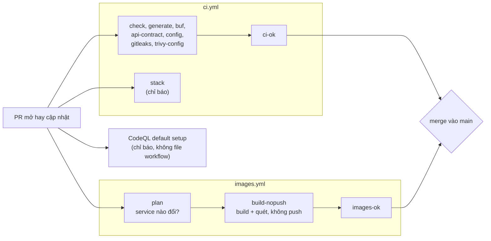
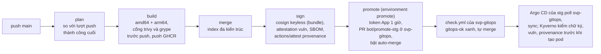
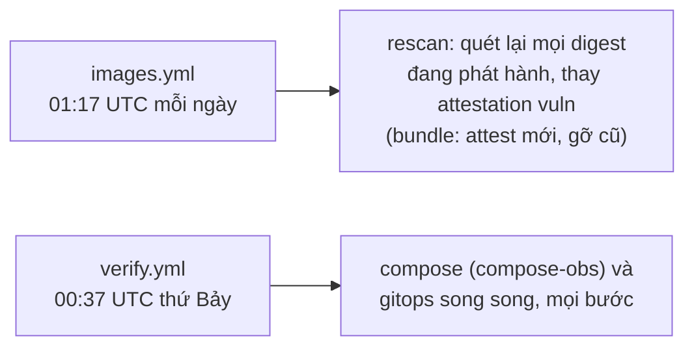
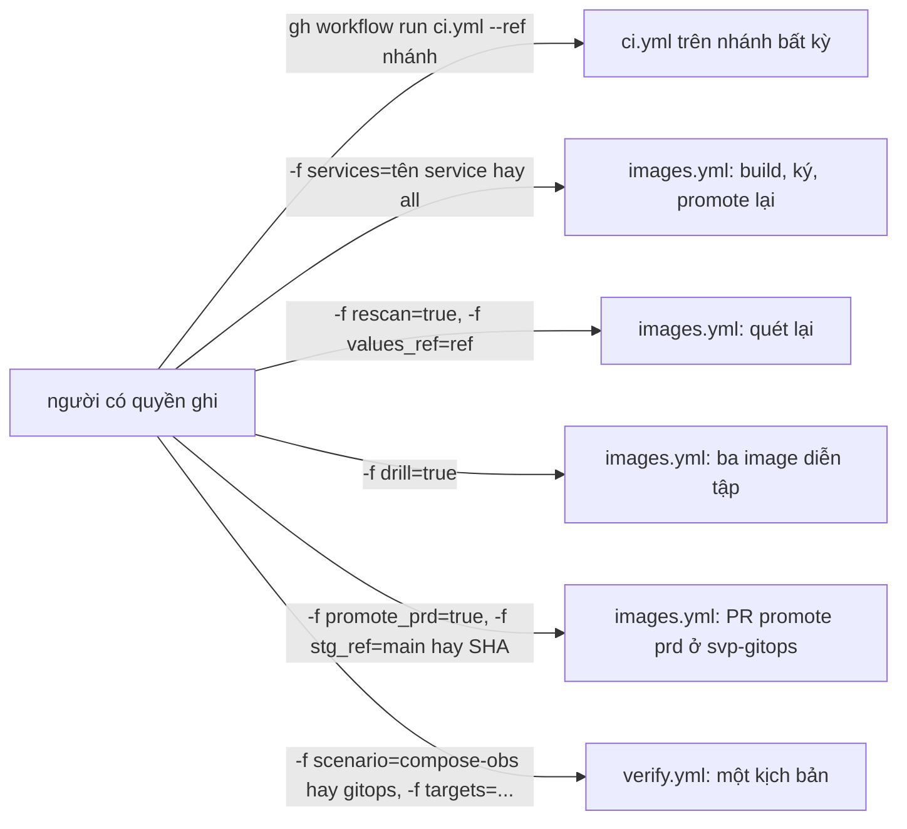
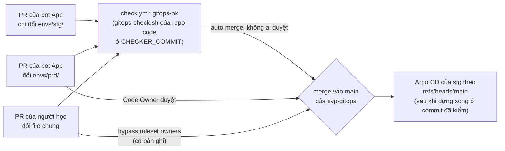

# CI/CD: luồng, job và cách đọc một lượt chạy

Tài liệu cho người mới mở trang lượt chạy của GitHub Actions mà chưa rõ job nào chạy khi nào, vì sao có job bị bỏ qua (skip),
và đọc kết quả ở đâu. Luồng kể bằng khái niệm chung của mọi hệ CI (pipeline, job, điều kiện chạy, check bắt buộc, artifact);
tên workflow và job của GitHub ghi kèm. Bảng tương ứng với GitLab ở
[ADR-0023](adr/0023-ci-platform-neutral.md) (mục "Bảng ánh xạ CI: GitHub Actions ↔ GitLab CI"), không chép lại ở đây.

Repo có ba workflow, mỗi file nối các bước, logic nằm ở `Makefile` và `deploy/ci/*.sh` (chạy được cả trên máy):

| Workflow | Việc | Quyết định |
| --- | --- | --- |
| `.github/workflows/ci.yml` | Kiểm code của mọi PR và mọi push `main`: Go (gồm govulncheck), code sinh, contract, luật version của hợp đồng REST, cấu hình, bí mật, misconfig, stack đầu-cuối (gồm DAST) | [ADR-0015](adr/0015-cicd-devsecops-stage5.md) §1, §2; [ADR-0020](adr/0020-reliability-stage6.md) §15 (job `stack`); [ADR-0030](adr/0030-devsecops-supplement.md) §1, §3; [ADR-0033](adr/0033-svp-web-repo.md) §1 (job `api-contract`) |
| `.github/workflows/images.yml` | Image của sáu service Go (image web ở CI của [`svp-frontend`](https://github.com/anhnvcoder/svp-frontend)): build, quét (trivy trên image, grype trên SBOM), push GHCR, ký, attestation, PR promote stg và prd sang repo `svp-gitops`, quét lại hằng ngày; phát hành hợp đồng REST của gateway có chữ ký | ADR-0015 §3–§9; ADR-0030 §6 (grype); [ADR-0025](adr/0025-gitops-config-repo.md) §2 (promote bằng GitHub App); [ADR-0037](adr/0037-mainpath-standard-tools.md) §6 (bước promote `yq` + `gh pr`); [ADR-0033](adr/0033-svp-web-repo.md) §1, §2, §4 (job `contract`, nguồn phát hành) |
| `.github/workflows/verify.yml` | Kiểm chứng trên runner những gì máy 16 GB không chạy nổi (stack có observability, cluster GitOps do Argo CD dựng): hai kịch bản `compose-obs`, `gitops` | [ADR-0021](adr/0021-deferred-verification-stage6b.md); [ADR-0037](adr/0037-mainpath-standard-tools.md) §6 (bỏ bản ghi stg); [ADR-0039](adr/0039-mainpath-drills-scan-gate-sourcemaps.md) §1 (thu gọn) |

Cấu hình triển khai (values, overlay, digest của mỗi môi trường, Argo CD) nằm ở repo public riêng
[`svp-gitops`](https://github.com/anhnvcoder/svp-gitops) ([ADR-0025](adr/0025-gitops-config-repo.md)); repo đó có một workflow
`check.yml` với check tổng `gitops-ok`, chạy `deploy/ci/gitops-check.sh` của repo này ở một commit ghim ([mục 1.5](#15-repo-cấu-hình-svp-gitops)).

Script có sẵn đọc ngữ cảnh CI hay gọi API của GitHub (output, summary, mask, link lượt chạy, PR, dispatch) qua adapter
`deploy/ci/platform.sh` (ADR-0023). Adapter đã đóng băng ([ADR-0037](adr/0037-mainpath-standard-tools.md) §2): không thêm hàm `ci_*`, script
mới đọc biến GitHub và gọi `gh` trực tiếp, hàm bị xoá khi không còn script nào gọi nó. DORA không còn workflow ở đây: là bài lab `dora/` của
[`svp-labs`](https://github.com/anhnvcoder/svp-labs) (§1 của ADR-0037).

Ngoài ba file đó, tab Actions còn có workflow "CodeQL" do GitHub dựng và giữ: CodeQL **default setup** bật bằng cài đặt repo,
không có file trong repo, chỉ báo ([ADR-0030](adr/0030-devsecops-supplement.md) §4; bật, tắt, đọc kết quả ở [mục 7](#7-codeql-default-setup)).

## 1. Bốn luồng

### 1.1 Pull request

Mỗi lần mở hay cập nhật PR, `ci.yml` và `images.yml` cùng chạy trên code của PR, chỉ với quyền đọc repo. Merge được khi hai check
tổng `ci-ok` và `images-ok` xanh (ruleset của `main`).



- `stack` dựng cả stack compose (sáu service build từ PR, web là bản phát hành stg) và chạy smoke, e2e của `svp-frontend`, k6, Lighthouse,
  DAST (Schemathesis), nhưng không nằm trong `ci-ok`: đỏ thì người đọc PR thấy, không chặn merge.
- CodeQL quét PR từ nhánh của chính repo (PR từ fork thì không), check "CodeQL" hiện trên PR nhưng không bắt buộc.
- `build-nopush` chỉ có khi PR đổi đường dẫn của ít nhất một image; PR chỉ sửa tài liệu thì `plan` báo không có image và các
  job build đều skip, `images-ok` vẫn xanh.

### 1.2 Push hay merge vào `main`

`ci.yml` chạy lại toàn bộ trên `main` (thêm job `sarif` tải báo cáo lên tab Security). `images.yml` build bản phát hành của sáu service Go rồi
mở một PR "promote" **trong repo `svp-gitops`** ghi digest mới vào `envs/stg/images/` và commit chart vào `envs/stg/charts.yaml`;
PR đó tự merge khi check `gitops-ok` của `svp-gitops` xanh (không ai duyệt: `envs/stg/` không có Code Owner), Argo CD của stg
thấy commit và triển khai.



- PR promote do token của GitHub App `svp-gitops-promoter` mở (không phải `GITHUB_TOKEN`), nên GitHub chạy `check.yml` cho nó
  ngay, không ai bấm "Approve workflows to run" ([ADR-0025](adr/0025-gitops-config-repo.md) §6). Khoá App chỉ ở environment
  `promote` của repo này (deployment branch `main`); token chỉ cho `svp-gitops`, chỉ `contents`, `pull_requests` write, thu hồi
  cuối job.
- Lượt push chỉ đổi chart (`deploy/helm/` hay file chart đọc qua symlink) mà không image nào build vẫn chạy `promote`, chỉ ghi
  `envs/stg/charts.yaml`.
- `promote` là bước shell trong `images.yml` ([ADR-0037](adr/0037-mainpath-standard-tools.md) §6): clone `svp-gitops` ẩn danh, nhánh
  `bot/promote-stg` một commit của bot App trên `main` (giữ file mà PR bot đang mở đã đổi), `yq -i` (`YQ_IMAGE` ghim) khối `image` của
  file mỗi service vừa ký ở lượt này và `envs/stg/charts.yaml`, push `--force-with-lease`, `gh pr create`/`edit`,
  `gh pr merge --auto --squash --match-head-commit`. Chỉ ghi file của sáu service do repo này build; web do job `promote` của
  `svp-frontend` ghi ([ADR-0033](adr/0033-svp-web-repo.md) §4). Thứ tự giữ bằng nhóm `concurrency` không huỷ của build; guard
  `promote_not_behind` (`deploy/ci/common.sh`, thử ở `promote-test.sh`) từ chối lượt có commit cũ hơn `revision` mà stg đang ghim
  (chạy lại, dispatch commit cũ).
- Cùng lượt, job `contract` phát hành hợp đồng REST của gateway (`services/gateway/openapi.yaml`) thành OCI artifact
  `ghcr.io/anhnvcoder/svp-backend/api/gateway:<info.version>` ký keyless; version đã phát hành với đúng file đó thì bỏ qua,
  khác nội dung thì đỏ, không ghi đè ([ADR-0033](adr/0033-svp-web-repo.md) §1).
- Rollback stg là PR revert trong `svp-gitops`; lượt promote sau đó ghi bản của lượt đó (mới hơn), không ghi lại bản đã revert.
  Quy trình ở [`runbooks/svp-gitops-setup.md`](runbooks/svp-gitops-setup.md).
- Lần promote đầu sau khi tách repo, auto-merge của PR bot (bằng `promote.sh` cũ; bước shell thay nó: kiểm sau push): đã kiểm ngày 2026-10-30 (lượt [40984668411](https://github.com/anhnvcoder/svp-backend/actions/runs/40984668411) trên `2d9dab0`; PR #4, #5, #6 của `svp-gitops`, 0 review, bot tự merge sau `gitops-ok`).
- CodeQL default setup cũng quét mỗi push `main`; cảnh báo mở và đóng trên `refs/heads/main` ở tab Security.

### 1.3 Theo lịch



- Rescan giữ attestation `vuln` không quá 72 giờ tuổi, ngưỡng Kyverno chấp nhận; CRITICAL mới thì job đỏ và GitHub gửi mail.
  Mỗi repo chỉ attest bản của nguồn phát hành của mình: rescan của repo này bỏ qua file ghi bản của nguồn khác (một dòng), CI của
  nguồn đó rescan nó ([ADR-0033](adr/0033-svp-web-repo.md) §4); file dưới prefix không thuộc nguồn nào vẫn vào tập nên lượt đỏ.
  Rescan chỉ dùng trivy: grype chỉ quét lúc build, nên lỗ hổng chỉ grype thấy (ví dụ của `node` trong image web của `svp-frontend`) công bố sau khi
  phát hành chỉ bị bắt ở lần build kế.
  Digest ở định dạng cũ (`.sig`, `.att`) thì `--replace`; digest Sigstore bundle thì attest `vuln` mới rồi gỡ mọi `vuln` bundle khác, vì
  Kyverno đọc bundle cuối danh sách referrer, xếp theo digest chứ không theo tuổi ([ADR-0040](adr/0040-sigstore-bundle-actions-attest.md) §3).
- CodeQL default setup có lịch hằng tuần riêng do GitHub đặt (`schedule: weekly` trong cấu hình), không nằm trong YAML nào.
- Lượt lịch của `verify.yml` chạy trên commit mới nhất của `main`, không có input. GitHub có thể trễ hay bỏ lượt lịch lúc tải cao
  và tắt lịch sau 60 ngày repo không hoạt động (bật lại ở tab Actions). Lịch này mới thêm ngày 2026-10-25, chỉ kiểm được sau khi
  merge vào `main`.

### 1.4 Chạy tay (dispatch)



- `rescan` và `drill` chỉ chạy trên `main` và không chạy cùng lượt; `plan` từ chối (lượt đỏ) thay vì đoán.
- `rescan` quét digest của `envs/*/images/` trong `svp-gitops` ở `main`, ở PR `bot/promote-stg` đang mở và ở `values_ref` (ref của
  `svp-gitops`, hay SHA của repo này trước khi tách). Ca `l` của `make drill-k8s-supplychain` từ đổi tên repo dùng image diễn tập
  `drill-no-provenance` (ký, `vuln`, không provenance; [ADR-0036](adr/0036-repo-rename.md) §6) thay cho bản phát hành cũ trước build
  provenance: dispatch `-f drill=true` trong 72 giờ trước lượt diễn tập (diễn tập in đúng lệnh khi không tìm thấy hay `vuln` quá hạn).
  Provenance định dạng cũ trên bản phát hành đang chạy đã có (bảy bản của `6ca2d8a`); bản phát hành bundle đầu (provenance của
  `actions/attest`, Build L2): **kiểm sau push**, cùng phép đo admission thật của [ADR-0040](adr/0040-sigstore-bundle-actions-attest.md) §6.
- `-f promote_prd=true [-f stg_ref=<main|SHA đủ 40 hex>]` (chỉ `main`, một mình): job `promote-prd` mở PR `bot/promote-prd` trong
  `svp-gitops` chép giá trị khối `image` của bảy file và ba khoá `charts.yaml` của `envs/stg/` ở commit `stg_ref` (mặc định `main`;
  commit cũ hơn của `main` là rollback prd; nhánh, SHA ngắn, commit ngoài `main` bị từ chối) sang `envs/prd/`, không auto-merge; người
  học duyệt (Code Owner). Không còn bản ghi stg ([ADR-0037](adr/0037-mainpath-standard-tools.md) §6): duyệt là cổng duy nhất, `stg_ref`
  không bảo đảm stg đã chạy và smoke qua với đúng bộ đó.
- `verify.yml` nhận `--ref main` hay nhánh `feat/stage6b-*`, ref khác dừng ở bước đầu; `targets` rỗng là mọi bước, bước dựng
  (`up`, `k8s-gitops-up`) luôn chạy. Không còn input `web_ref`: workflow không clone `svp-frontend`, hai kịch bản chạy image web của bản phát hành stg. Lệnh đầy đủ ở [`reference/ci.md`](reference/ci.md).

### 1.5 Repo cấu hình `svp-gitops`



- Check `gitops-ok` (ruleset `main` của `svp-gitops` bắt buộc, không ai bypass), bản rút gọn của
  [ADR-0037](adr/0037-mainpath-standard-tools.md) §4–§6: cây, `charts.yaml` (commit chart trên `main` repo này, hai giá trị dẫn xuất),
  mỗi file image là bản của một nguồn có service đó theo bảng nguồn ở `revision` của env ([ADR-0033](adr/0033-svp-web-repo.md) §3),
  render mọi env × nền tảng × kiến trúc (env nào trên nền tảng nào và nền tảng nào được nêu `svp.localhost` đọc từ khoá `platforms` của
  `argocd/apps/components.json`), luật trên manifest đã render bằng policy Kyverno CLI (`deploy/ci/gitops-policies/`: `images-pinned`
  mọi image ghim digest, `no-lab-hosts`), chữ ký và attestation của digest đổi. Đã bỏ: PR đổi `envs/prd/` phải bằng một bản ghi stg (bước
  1b), image không mới hơn chart và tag nguồn khác là commit trên `main` repo nguồn (luật tổ tiên), đường cho cây chưa có `platforms/`.
- Luật tác giả hẹp: PR của bot một nguồn (`<promoter>[bot]`, đọc thẳng từ sự kiện PR) chỉ được đổi `envs/{stg,prd}/images/` của service
  thuộc nguồn đó (bot `backend` thêm hai `charts.yaml` và mọi file image prd, vì promote prd chép cả bộ); không bot nào xoá file; bot khác
  không đổi gì dưới `envs/`; PR của người không bị giới hạn ở bước này. Giữ vì `envs/stg/` không có Code Owner: PR bot tự merge.
- `CHECKER_COMMIT` (commit của repo này mà check chạy) đổi bằng PR ở `svp-gitops`; PR thêm hay sửa `check.yml` tự chạy bản sửa của
  chính nó (đặc tính của `pull_request`), nên `.github/` có Code Owner.
- Ruleset `owners` đòi duyệt của Code Owner cho mọi file trừ `envs/stg/`; ruleset `tags` cấm tạo tag (Argo CD có thể phân giải tên
  ngắn sang tag cùng tên). Lượt `check` đầu trên `main`: [40902199532](https://github.com/anhnvcoder/svp-gitops/actions/runs/40902199532)
  (2026-10-29), token chỉ `Contents: read`. Kiểm ngày 2026-10-30: người học là Code Owner duy nhất kiêm tác giả PR nên GitHub coi
  `owners` đã thoả, PR của họ đổi file chung merge được không cần duyệt và không có bản ghi bypass (đường "bypass ruleset owners" của
  sơ đồ trên chưa xảy ra); `gitops-ok` vẫn là lớp chặn. Luật vẫn áp lên PR của người khác; ca âm cho PR của bot chưa có (phần 4b).

## 2. Job theo từng workflow

"Chặn merge" nghĩa là job nằm trong check tổng mà ruleset của `main` đòi. Điều kiện chạy chép từ `if:` của YAML.

### `ci.yml`

Trigger: `pull_request`, `push` vào `main`, `workflow_dispatch`. Không trigger nào có bộ lọc `paths:`.

| Job | Làm gì | Chạy khi | Skip khi, vì sao | Chặn merge |
| --- | --- | --- | --- | --- |
| `check` | `make check-go` (gofmt, vet, golangci-lint, actionlint, buf lint, `make vulncheck`, Go test với Postgres, Redis là service container). `make vulncheck`: govulncheck bằng Go của directive `go` trong `go.mod`, gate `tools/vulngate` đỏ khi code gọi tới một lỗ hổng không có ngoại lệ hợp lệ trong `.govulncheck-ignore.json`, hay khi image Go của `deploy/docker/` build bằng bản Go khác bản đã quét; lỗ hổng chỉ ở mức module, package là một dòng `INFO`; cần mạng tới `vuln.go.dev` | Mọi lượt | Không bao giờ | Có (`ci-ok`) |
| `generate` | `make generate-check`: code sinh đã commit khớp | Mọi lượt | Không bao giờ | Có |
| `buf` | `buf breaking` so với base | Mọi lượt | Không skip; push tạo nhánh mới thì bước in "buf breaking skipped" (không có gì để so) và xanh | Có |
| `api-contract` | `make api-contract-check BASE=<base>` (base như `buf`): file `services/gateway/openapi.yaml` đổi thì `info.version` phải tăng đúng mức theo oasdiff (`OASDIFF_IMAGE`, không mạng), rồi `deploy/ci/contract-test.sh` (luật version với oasdiff thật, phát hành với registry và cosign giả) | Mọi lượt | Không skip; push tạo nhánh mới hay base không có spec thì một dòng summary và xanh | Có |
| `config` | `make gitops-clone` (bản clone ẩn danh `main` của `svp-gitops`, `SVP_GITOPS_DIR`), quy tắc các tệp ngoại lệ của cổng quét (`scan-gate.sh --check-ignorefile`: `.trivyignore.yaml`, `.grype.yaml`, `deploy/ci/trivy-config-ignore.yaml`), `platform-test.sh` (gồm `sign-image.sh` và hàm Sigstore bundle của `common.sh` với docker, cosign giả), guard của hai job promote (`promote-test.sh`, trên repo nháp cục bộ), `verify-collect-test.sh`, rule Prometheus, Collector, compose, `make helm-check` (chart của working tree với `base/` của bản clone, gồm ExternalSecret, SecretStore của mỗi env qua kubeconform theo CRD của chart External Secrets ghim, và policy Kyverno CLI trên render: image ghim digest, không `svp.localhost` ở nền tảng thật), `sources-test.sh` (bảng nguồn phát hành hỏng bị cả template `svp-policy` lẫn `lib.sh` từ chối), `gitops-check-test.sh` (ca âm của check `svp-gitops`, gồm `kyverno test` của `deploy/ci/gitops-policies/`), k6, Job k6 của cloud (`make cloud-check`) | Mọi lượt | Không bao giờ | Có |
| `gitleaks` | Quét bí mật toàn lịch sử, `--redact` | Mọi lượt | Không bao giờ | Có |
| `trivy-config` | Quét misconfig, chỉ báo (phát hiện không làm job đỏ; trừ các mục có hạn của `deploy/ci/trivy-config-ignore.yaml`) | Mọi lượt | Không bao giờ | Có (chỉ khi lệnh lỗi, không khi có phát hiện) |
| `stack` | Stack compose đầu-cuối, web là bản phát hành stg theo digest: `make gitops-clone`, `make web-clone` (commit của web stg), smoke, e2e Chromium và WebKit của bản clone `svp-frontend` (`make web-e2e`), k6 `ci`, Lighthouse, rồi `make dast` cuối cùng (Schemathesis theo `services/gateway/openapi.yaml`, bước `continue-on-error`, hạn 15 phút; artifact `dast` chỉ `report.json`, `summary.json` đã dò bí mật) | Mọi lượt | Không bao giờ | Không |
| `sarif` | Tải SARIF lên tab Security | `always() && github.event_name != 'pull_request' && github.ref == 'refs/heads/main'` | PR và nhánh khác `main`: quyền `security-events: write` chỉ cho code đã qua review | Không |
| `ci-ok` | Đỏ trừ khi đủ bảy job trên `success` | `always()` | Không bao giờ | Là check bắt buộc |

### `images.yml`

Trigger: `pull_request`, `push` vào `main`, `schedule` hằng ngày, `workflow_dispatch` (`services`, `rescan`, `values_ref`,
`drill`, `promote_prd`, `record`). `plan` chọn **chế độ**: `rescan` khi lịch hay `rescan=true`, `drill` khi `drill=true`, còn lại
`build`; dispatch `promote_prd=true` bỏ qua `plan` và mọi job khác, chỉ chạy `promote-prd`. "Trên `main`" dưới đây là
`github.ref == 'refs/heads/main'` và sự kiện không phải `pull_request`.

| Job | Làm gì | Chạy khi | Skip khi, vì sao | Chặn merge |
| --- | --- | --- | --- | --- |
| `last-success` | Đọc commit của lượt push `main` thành công cuối (base để so), job duy nhất có `actions: read` | `push` vào `main` | Mọi sự kiện khác: chỉ push cần base này | Có (`images-ok` tính skip này là đúng) |
| `plan` | Chế độ, base, danh sách image, ma trận chân build (`deploy/ci/plan.sh`, `changed-services.sh`) | Trừ khi lượt bị huỷ | — | Có |
| `build-nopush` | Build, quét, cổng trivy (image) và grype (SBOM syft) từng image × kiến trúc, không push | Chế độ `build`, có image, PR hay ref khác `main` | Không image nào đổi; hay đang trên `main` (job `build` làm) | Có |
| `build` | Như `build-nopush` rồi push GHCR đúng bản đã quét | Chế độ `build`, có image, trên `main` | PR, nhánh khác, hay không image nào đổi | Có |
| `merge` | Ghép hai chân thành index đa kiến trúc | Như `build` | Như `build` | Có |
| `sign` | Ký keyless, attestation `vuln` và SBOM bằng `deploy/ci/sign-image.sh` (Sigstore bundle, chỉ ghi loại chưa có trên digest nên chạy lại không thêm gì; [ADR-0040](adr/0040-sigstore-bundle-actions-attest.md)), rồi build provenance SLSA v1 bằng `actions/attest` (`attestations: write` chỉ ở job này, digest index, sau `vuln`; Build L2; ADR-0040 thay [ADR-0027](adr/0027-slsa-build-provenance.md)): chỉ khi `builder.id` bằng identity ký của nguồn phát hành của lượt (`deploy/helm/svp-policy/files/sources.json`, kiểm trước khi ký gì); image diễn tập không có | Như `build` | Như `build` | Có |
| `promote` | Environment `promote`, token App chỉ `svp-gitops` (`contents`, `pull_requests` write); bước shell dựng lại `bot/promote-stg` của `svp-gitops` bằng `yq` (`envs/stg/images/` của service vừa ký, `envs/stg/charts.yaml`; guard tổ tiên với `revision` của stg), mở hay cập nhật PR, bật auto-merge | Chế độ `build`, trên `main`, có image hay chart đổi (`promote_charts`) | PR, nhánh khác, không image và không chart nào đổi | Có |
| `promote-prd` | Environment `promote`, token App (`contents`, `pull_requests` write); bước shell chép giá trị `image` của bảy file và ba khoá `charts.yaml` của `envs/stg/` ở `stg_ref` vào `envs/prd/` trên `bot/promote-prd`, PR không auto-merge | Dispatch `promote_prd=true` trên `main` (kèm `services`, `rescan`, `values_ref`, `drill` thì đỏ ở bước đầu) | Mọi lượt khác | Có |
| `rescan` | `make gitops-clone`, quét lại mọi digest phát hành của nguồn `backend` trong `envs/*/images/` của `svp-gitops` (bản của nguồn khác bỏ qua), thay attestation `vuln` (digest định dạng cũ `--replace`; bundle: attest rồi gỡ `vuln` cũ bằng `oras manifest delete`) | Chế độ `rescan`, trên `main` | Mọi chế độ khác | Có |
| `contract` | `deploy/ci/contract.sh publish`: đẩy `info.version` của spec gateway thành OCI artifact `ghcr.io/anhnvcoder/svp-backend/api/gateway:<version>` bằng ORAS (`ORAS_IMAGE`), ký keyless digest đó; tag có cùng file thì bỏ qua (thiếu chữ ký thì ký bù), khác thì đỏ; `packages: write`, `id-token: write` | Chế độ `build`, trên `main` (push, dispatch không `rescan`, `drill`, `promote_prd`) | PR, nhánh khác, chế độ khác | Có |
| `drill-build`, `drill-merge`, `drill-sign` | Ba image diễn tập `drill-vulnerable` (có CRITICAL, ký), `drill-unsigned` (không ký) và `drill-no-provenance` (sạch, ký và attest `vuln`, không provenance), cùng các bước của bản phát hành | Chế độ `drill`, trên `main` | Mọi chế độ khác, nên luôn skip ở PR và push | Có |
| `sarif` | Tải SARIF của build (`trivy.sarif`, `grype.sarif` mỗi chân) và rescan trên `main` | Trên `main`, chế độ `rescan` hay `build` có image | PR, nhánh khác, không image | Không |
| `images-ok` | Xanh khi mỗi job `success`, hay `skipped` vì đúng lý do mà job này tính lại từ sự kiện, ref, output của `plan` | `always()` | Không bao giờ | Là check bắt buộc |

### `verify.yml`

Trigger: `workflow_dispatch` (input `scenario`, `targets`) và `schedule` hằng tuần, cả hai job. Không check nào của ruleset đòi workflow này.

| Job | Làm gì | Chạy khi | Skip khi |
| --- | --- | --- | --- |
| `compose` | Kịch bản `compose-obs`: `make up OBS=lgtm`, smoke, `drill-obs-threats`, test tích hợp của object store (`test-stack-objstore`, không ca nào được SKIP); hạn 90 phút | `github.event_name == 'schedule' \|\| inputs.scenario == 'compose-obs'` | Dispatch kịch bản khác |
| `gitops` | Kịch bản `gitops`: `make gitops-clone`, `make k8s-gitops-up` vai stg ở SHA của `origin/main` trong bản clone (Argo CD đọc `svp-gitops` ở đúng commit đó, cluster ở yên commit đó suốt các bước kiểm, PR promote merge giữa chừng không đổi gì; chart của repo này ở commit `envs/stg/charts.yaml`, qua HTTPS ẩn danh), `gitops-env`, `gitops-external-secrets` (mọi ExternalSecret chart render với values của cluster `Ready`, 28 trên runner k3d, Secret đích đúng type và tên key), `gitops-argocd-metrics` (Prometheus thấy mọi Application của Argo CD Synced/Healthy, không cảnh báo Argo CD nào cháy, [ADR-0032](adr/0032-argocd-deploy-status.md)), `gitops-admission-metrics` (thời gian admission của lượt sync đầu từ apiserver và Kyverno, chỉ ghi số vào log, [ADR-0040](adr/0040-sigstore-bundle-actions-attest.md) mục 6; thiếu metric là dòng `NOTE`, không đỏ), smoke chặt (key có version, `Cache-Control`), `drill-k8s-supplychain` (gồm ca `l`: bản web thiếu provenance), `drill-k8s-threats` (gồm SEC-5/6/7). Lượt lịch bỏ ca (c), (l) của supplychain khi image của ca đó quá 72 giờ (SKIP kèm dòng `NOTE`, lệnh dispatch dựng lại image diễn tập `-f drill=true`; `SVP_VERIFY_SCHEDULED=true`); hạn 160 phút | `github.event_name == 'schedule' \|\| inputs.scenario == 'gitops'` | Dispatch kịch bản khác |

Mỗi job: kiểm ref, checkout, cài công cụ, `make env`, `deploy/ci/verify-mask.sh`, `verify-host.sh`, bước "Scenario" (`verify-run.sh`), rồi các
bước `if: always()` lọc và tải artifact `verify-<kịch bản>`, gỡ stack hay cluster. Một lượt dispatch chạy đúng một job kịch bản, job kia skip; lượt
lịch chạy cả hai. Hai job chỉ `contents: read`, không secret hay environment. Trình tự của từng kịch bản ở `deploy/ci/verify/<kịch bản>.sh`.
Bước kịch bản chạy `make gitops-clone` trước bước dựng và đặt `SVP_GITOPS_DIR` cho mọi target (`verify-run.sh`). Các kịch bản sau là bài lab `drills/` của `svp-labs`
và không còn ở workflow: `dev-k3d`, `web-canary`, `k6-cloud-mini`, `chaos`, `velero`, phần còn lại của `compose-obs`
([ADR-0039](adr/0039-mainpath-drills-scan-gate-sourcemaps.md) §1). Lượt lịch đầu sau khi thu gọn: kiểm sau push.

## 3. Vì sao thiết kế như vậy

- **Lượt PR không secret, chỉ `contents: read`, không push hay ký.** Repo public: PR từ fork chạy code của chính nó trước khi ai
  đọc, kể cả PR Renovate đổi SHA action. Mọi job của lượt PR chỉ đọc repo; job nào cần ghi (`packages`, `id-token`, `contents`,
  `pull-requests`, `security-events`) là job riêng chỉ chạy trên `main` với code đã qua PR và check. Vì vậy đường PR và đường
  `main` của build là hai job (`build-nopush`, `build`) gọi chung một script, không phải một job có bước push bị tắt. Không
  `pull_request_target`, `workflow_run`. Chi tiết: ADR-0015 §1; [`threat-model.md`](threat-model.md) SC-2, SC-10, SC-11.
- **Chỉ build service đổi** (`deploy/ci/changed-services.sh`, ADR-0015 §3). Mỗi service có tập đường dẫn của image (`image_paths`
  của `deploy/k8s/lib.sh`); đổi đường build, quét, ký (`images.yml`, `deploy/ci/`, ghim `TRIVY_IMAGE`/`SYFT_IMAGE`/`GRYPE_IMAGE`/
  `COSIGN_IMAGE`) thì cả sáu (PR nâng một bộ quét quét lại mọi image trước khi merge), trừ các file của `deploy/ci/` không job image nào đọc (tệp bỏ qua misconfig, script của `verify.yml`, test và guard
  của adapter, check của `svp-gitops` cùng `values-check.sh` và `verify-release.sh` mà chỉ nó, `make k8s-gitops-up` và diễn tập chạy). Base của push `main` là lượt push thành công cuối chứ không phải commit ngay trước, để thay đổi của một lượt đỏ
  hay bị thay trong hàng chờ không bị bỏ sót. Không dùng `paths:` ở trigger vì check bắt buộc của workflow không chạy thì không
  bao giờ được báo, PR treo chờ mãi.
- **Check tổng** (`ci-ok`, `images-ok`). Ruleset chỉ cần hai tên ổn định, thêm hay đổi tên job không đụng ruleset. GitHub coi
  check bắt buộc bị skip là đạt, và job đỏ không tự làm job phụ thuộc đỏ, nên check tổng chạy `always()` và tự quyết: `ci-ok` đòi
  đủ bảy job `success`; `images-ok` tính lại từ sự kiện, ref và output của `plan` xem mỗi job skip có đúng không (skip vì `if:`
  sai là đỏ).
- **Action ghim SHA commit đầy đủ**, chỉ action của GitHub và `sigstore/cosign-installer`; trivy, syft, grype, cosign,
  Schemathesis, oasdiff, ORAS, Kyverno CLI, yq chạy bằng image ghim digest (`TRIVY_IMAGE`, `SYFT_IMAGE`, `GRYPE_IMAGE`, `COSIGN_IMAGE`,
  `SCHEMATHESIS_IMAGE`, `OASDIFF_IMAGE`, `ORAS_IMAGE`, `KYVERNO_CLI_IMAGE`, `YQ_IMAGE` của `Makefile`), không dùng GitHub Action của oasdiff hay ORAS. Tag của action có thể bị đẩy sang code khác (các vụ tj-actions, trivy-action), SHA thì không; Renovate cập nhật SHA.
  ADR-0015 §1, §10.
- **Job `stack` chỉ báo.** Stack đầy đủ với hai trình duyệt trên runner dùng chung có lúc đỏ vì môi trường, không vì code; nếu
  nằm trong `ci-ok` thì một lần chập chờn chặn merge. Xem lại khi 20 lượt liên tiếp xanh, không lượt đỏ do môi trường (ADR-0020
  §15). DAST chạy cuối job vì nó làm cạn rate limit theo IP và theo user của gateway; output thô của Schemathesis (body của
  response, có token của user thử) chỉ nằm trên runner, log job chỉ có tóm tắt in từ hai tệp đã dò bí mật (ADR-0030 §3).
- **Quyền deploy ở repo khác, bằng GitHub App.** Push vào `main` của repo này không đổi cluster nào: chỉ PR vào `svp-gitops` đổi
  được thứ đang chạy. Ghi sang repo khác thì `GITHUB_TOKEN` không đủ, nên hai job trên `main` (`promote`, `promote-prd`) khai environment `promote` (deployment branch `main`, lượt `pull_request` không lấy được khoá) và đổi khoá App
  thành token 1 giờ chỉ cho `svp-gitops`, mỗi job đúng quyền của nó; không job nào chạy kịch bản hay build mà có khoá. Chặn kẻ xấu ở prd là duyệt của Code Owner (không còn bản ghi
  stg, [ADR-0037](adr/0037-mainpath-standard-tools.md) §6); ở stg là luật tác giả hẹp, chữ ký và admission Kyverno
  ([`threat-model.md`](threat-model.md) GIT-1 tới GIT-6).
- **govulncheck chặn, trivy và grype chặn image, CodeQL chỉ báo.** govulncheck chỉ đỏ với lỗ hổng mà code gọi tới (theo đồ thị
  gọi), nên ít báo giả; trivy và grype là hai DB và hai cách khớp khác nhau trên cùng image (grype đọc SBOM syft, thấy binary
  ngoài trình quản lý gói mà trivy không thấy), cùng cổng CRITICAL; ngoại lệ là một mục `.trivyignore.yaml` kèm rule `.grype.yaml` cùng id và version ([ADR-0039](adr/0039-mainpath-drills-scan-gate-sourcemaps.md) §2). CodeQL theo luồng dữ liệu qua
  hàm và tệp, còn mới ở repo nên chưa là check bắt buộc; gosec trong `check` vẫn là cổng SAST chặn (ADR-0030 §1, §4, §6).
- **Vì sao job `drill-*` nằm trong `images.yml` dù luôn skip ở PR và push.** Ký keyless không có khoá: danh tính ký là chứng chỉ
  Fulcio cấp cho đúng file workflow và ref đang chạy (SAN là `server_url` + `job_workflow_ref`, ADR-0015 §7), và Kyverno chỉ tin
  `.github/workflows/images.yml@refs/heads/main` của repo nguồn (`deploy/helm/svp-policy/files/sources.json`). Diễn tập phải chứng minh Kyverno từ chối
  `drill-vulnerable` **vì CRITICAL**: nếu image đó được ký ở workflow khác thì Kyverno từ chối vì sai danh tính, phép thử không
  còn chứng minh gì về rule CRITICAL; còn thêm danh tính thứ hai vào policy là nới niềm tin của cluster cho một workflow chỉ phục
  vụ diễn tập. Ở cùng file, drill đi đúng các bước của bản phát hành (alias YAML `*release-leg`, `*merge`, `*sign`), nên khác nhau
  duy nhất là CRITICAL hay chữ ký. Cái giá: ba job luôn hiện "skipped" trên trang lượt chạy, và `images-ok` phải biết skip đó là
  đúng.
- **Phương án workflow con (reusable workflow, `workflow_call`) và vì sao chưa chọn.** Có thể tách build, ghép, ký vào một file
  workflow con, `images.yml` và một workflow diễn tập cùng gọi nó: một định nghĩa bước, `images.yml` ngắn hơn. Chưa chọn vì
  (1) alias YAML đã cho một định nghĩa bước trong cùng file; (2) thêm một file workflow, tên job lồng `<job> / <job con>` mà
  `images-ok` phải đọc; (3) với workflow con, `job_workflow_ref` (nên danh tính ký) là file workflow con, không còn là
  `images.yml`: policy Kyverno và mọi phép kiểm chữ ký phải đổi theo, và mọi workflow trên `main` gọi được file đó đều ký ra cùng
  danh tính, nên phải kiểm thêm workflow gọi (điểm này suy từ cách GitHub định nghĩa claim `job_workflow_ref`, chưa thử trong
  repo). ADR-0015 §1 đã cân nhắc phương án này cho việc tách quyền PR/`main`. Xem lại khi có workflow thứ hai cần ký image.

## 4. Đọc một lượt chạy

Trang một lượt chạy (Actions → chọn lượt) có đồ thị job, danh sách annotation, summary của từng job và artifact ở cuối trang.

- **Đồ thị job:** xanh `success`, đỏ `failure`, xám gạch là `skipped`. Job skip là bình thường khi điều kiện ở mục 2 không đúng
  cho sự kiện này (ví dụ cả nhóm `build`, `sign`, `promote`, `drill-*` ở lượt PR). Muốn biết skip có đúng không, mở log job
  `images-ok`: mỗi job một dòng `ok    <job> skipped: not part of this run`, hay `::error::<job> was skipped, but this run needed
  it`.
- **Summary của job** (cuộn xuống dưới đồ thị), từ hai nguồn. Script ghi qua `ci_summary` của adapter: một dòng mỗi lần quét của mỗi chân build của `images.yml`, của `scan-gate.sh` (`(trivy): CRITICAL n, HIGH n, secrets n` và
  `(grype): Critical n, High n, excepted by .grype.yaml n`; chi tiết CRITICAL ở bảng của trivy trong log, HIGH ở SARIF); `plan` (chế độ, base, image được chọn và lý do); `rescan.sh` của lượt quét lại hằng ngày hay dispatch `rescan=true` (service chưa phát hành bị bỏ qua, hay không
  có digest đã phát hành nào để quét). Chính YAML của `ci.yml` ghi thẳng `$GITHUB_STEP_SUMMARY`: bảng SARIF (mức, rule, vị trí
  mỗi phát hiện, tối đa 50 dòng) của golangci-lint ở `check`, `gitleaks`, `trivy-config`, và
  dòng "buf breaking skipped" của `buf` khi bỏ qua; khi chuyển nền tảng, các bước này viết lại cùng YAML
  ([ADR-0023](adr/0023-ci-platform-neutral.md)). Playwright, k6 không ghi summary: kết quả ở
  log của bước tương ứng (`make web-e2e`, `make load-ci`); `promote`, `promote-prd` cũng không: bản phát hành nhánh bot mang nằm ở tiêu
  đề và mô tả của PR trong `svp-gitops`, link PR ở log bước.
- **Annotation:** dòng `::warning::`/`::error::` của script hiện ở đầu trang, kèm job. Ví dụ: `last-success` cảnh báo khi API
  không trả lời (lượt build cả sáu), `verify-collect.sh` cảnh báo khi bỏ một file khỏi artifact vì nghi có bí mật (không in đoạn
  khớp), `images-ok` báo job skip sai.
- **Bước đỏ trong job xanh:** bước có `continue-on-error: true` đỏ mà job vẫn xanh. Ở repo này là `make web-lighthouse` của job
  `stack`: Lighthouse một lượt mỗi trang trên runner dùng chung là nhiễu, nên vượt ngưỡng LCP/TBT không làm job đỏ; mở log bước
  đó để đọc số. `make dast` cùng job cũng vậy: log bước in version, seed, số operation, nhóm lỗi (check, operation, số lần) và
  phân bố status; chi tiết (body, lệnh curl tái hiện) chỉ có khi chạy lại `make dast` trên máy, `SVP_DAST_SEED=<seed>` lấy từ
  `report.json` của artifact `dast`.
- **Log:** `gh run view <id> --log-failed` chỉ in bước đỏ; `gh run view <id> --log` in tất cả. Log công khai: script không in
  giá trị bí mật, giá trị đã mask hiện là `***`.
- **Artifact** (cuối trang, hay `gh run download <id> -n <tên>`): `sarif-*` (báo cáo quét, `sarif` của `main` tải lên tab
  Security; của `images.yml` có cả `trivy.sarif` và `grype.sarif`), `lighthouse`, `k6-summary` và `dast` của job `stack`, `verify-<kịch bản>` của `verify.yml` (giữ 30 ngày). Với `verify`, đọc
  trước:
  - `results.tsv`: mỗi bước một dòng, `ok`, `fail`, `timeout`, `skipped` hay `cancelled`, exit status, số giây, ghi chú (ví dụ
    `infrastructure step failed`, `not in targets`, `deadline`);
  - `files.txt`: file nào được giữ, file nào bị bỏ và theo luật nào; rồi `logs/<NN>-<bước>.log` của bước đỏ và JSON của diễn tập.
- **Chạy lại:** "Re-run failed jobs" tạo một lần chạy mới (attempt) của cùng lượt; mỗi attempt có log và artifact riêng.

## 5. Chạy lại một job trên máy

Lệnh tương đương từng job, chạy từ gốc repo, ở mục "Chạy lại một job trên máy" của [`reference/ci.md`](reference/ci.md). Script
của `deploy/ci/` chạy trên máy ở chế độ `local` của adapter: không gọi API nào của GitHub, không push lên origin mạng.

Riêng cổng grype của một chân `images.yml`: `make grype IMAGE=<ref>@sha256:<digest> ARCH=amd64` (syft ghim đọc image của nền tảng
đó từ registry, ẩn danh, rồi grype và `scan-gate.sh --grype` như trong CI) hay `make grype SBOM=<đường tuyệt đối tới SPDX JSON>`;
in số gói, binary ngoài trình quản lý gói và dòng cổng. Bước `dast` của job `stack`: `make dast` trên stack `make up`. Job
`api-contract`: `make api-contract-check BASE=<base>` rồi `deploy/ci/contract-test.sh` (cần Docker); job `contract` chỉ chạy trong
CI (đẩy và ký), trên máy `deploy/ci/contract.sh publish --dry-run` đọc registry ẩn danh và in việc sẽ làm.

Fuzz không có job nào: seed của các target fuzz chạy như test thường trong `check`, còn fuzz thật là `make fuzz FUZZTIME=<thời
lượng>` chạy tay trên máy ([ADR-0030](adr/0030-devsecops-supplement.md) §2).

## 6. Thời gian điển hình

Đo bằng `gh run list` và `gh run view --json jobs` (đọc ngày 2026-10-25), tính từ lúc tạo lượt tới lúc job xong.

| Phần | Thời gian | Lượt (ngày) |
| --- | --- | --- |
| PR, phần chặn merge của `ci.yml` (tới `ci-ok`) | 4 phút 49 s; 5 phút 31 s | [40157835981](https://github.com/anhnvcoder/svp-backend/actions/runs/40157835981), [40151451875](https://github.com/anhnvcoder/svp-backend/actions/runs/40151451875) (2026-10-25) |
| PR, `images.yml` (tới `images-ok`) | 1 phút 41 s khi chỉ build `web` (2 chân); 2 phút 45 s khi build cả bảy (14 chân) | [40160528825](https://github.com/anhnvcoder/svp-backend/actions/runs/40160528825) (2026-10-25), [40127811785](https://github.com/anhnvcoder/svp-backend/actions/runs/40127811785) (2026-10-24) |
| PR, job `stack` | 13 phút 19 s; 15 phút 42 s | 40151451875, 40157835981 (2026-10-25) |
| PR, job `stack` có bước `make dast` | 19 phút 14 s (thời gian chạy của job; bước `make dast` 3 phút 40 s) | [40804508919](https://github.com/anhnvcoder/svp-backend/actions/runs/40804508919) (2026-10-29) |
| PR, cổng grype mỗi chân `images.yml` | 2–8 s khi DB grype có trong cache của ngày; lần tải DB đầu trên máy 2 phút 13 s | [40804508815](https://github.com/anhnvcoder/svp-backend/actions/runs/40804508815) (2026-10-29) |
| Sau merge: bảy image build, ký, tới lúc PR promote mở | 4 phút 32 s (push 20:17:13 UTC → PR #19 mở 20:21:45 UTC) | [40129094574](https://github.com/anhnvcoder/svp-backend/actions/runs/40129094574) (2026-10-24) |
| Sau khi merge PR promote: Argo CD sync, pod mới Ready | push → sync 109 s → pod cuối Ready 240 s (cluster GitOps trên máy, hai pause 60 s của canary) | [ADR-0014](adr/0014-kubernetes-local-stage4.md), mục Kiểm chứng |
| `verify.yml` `compose-obs`, mọi bước | 54 phút | [40132157276](https://github.com/anhnvcoder/svp-backend/actions/runs/40132157276) (2026-10-24) |
| `verify.yml` `compose-obs`, mọi bước, có các bước object store | 31 phút (job `compose`; kịch bản 29 phút); 45 phút ở lượt sau, trong đó 17 phút cài đặt trước kịch bản | [40203123781](https://github.com/anhnvcoder/svp-backend/actions/runs/40203123781), [40207235062](https://github.com/anhnvcoder/svp-backend/actions/runs/40207235062) (2026-10-25) |
| `verify.yml` `gitops`, mọi bước trên nhánh (bước chờ phát hành skip) | 63 phút (cài đặt 6 phút, kịch bản 57 phút) | [40620627534](https://github.com/anhnvcoder/svp-backend/actions/runs/40620627534) (2026-10-28) |
| `verify.yml` `gitops` đọc `svp-gitops`, mọi bước trên nhánh (bước chờ phát hành và job `record-stg` khi đó skip) | 48 phút (job `gitops`; `k8s-gitops-up` 610 s) | [40954609229](https://github.com/anhnvcoder/svp-backend/actions/runs/40954609229) (2026-10-29) |

Các dòng `verify.yml` đo trước khi thu gọn ([ADR-0039](adr/0039-mainpath-drills-scan-gate-sourcemaps.md)); số của các kịch bản đã chuyển sang
bài lab (`dev-k3d`, `web-canary`, `k6-cloud-mini`, `chaos`, `velero`) ở [ADR-0021](adr/0021-deferred-verification-stage6b.md) và các ADR
0017, 0020, 0031.

Thời gian của runner dùng chung thay đổi theo tải của GitHub và cache (cache Go, pnpm, DB của trivy, build cache Docker); số trên
là mốc để biết lượt nào chậm bất thường, không phải cam kết.

## 7. CodeQL default setup

CodeQL bật bằng cài đặt repo, không bằng file workflow ([ADR-0030](adr/0030-devsecops-supplement.md) §4): GitHub dựng workflow
động "CodeQL" (đường dẫn `dynamic/github-code-scanning/codeql`), tự giữ action và bản CodeQL. Cấu hình nằm ngoài git, nên lệnh
dưới đây là bản ghi của nó. Mọi lệnh ghi do người học chạy, cần quyền admin của repo.

Bật (ba ngôn ngữ: `actions` cho `.github/workflows/`, `go`, `javascript-typescript`, trước cho `web/`: từ khi web tách sang `svp-frontend`
(CodeQL bật riêng ở đó) repo này không còn mã TypeScript; bộ query `default`, threat model `remote`):

```sh
gh api -X PATCH repos/anhnvcoder/svp-backend/code-scanning/default-setup \
  -f state=configured -f query_suite=default -f threat_model=remote -f runner_type=standard \
  -f 'languages[]=actions' -f 'languages[]=go' -f 'languages[]=javascript-typescript'
```

Response có `run_id` của lượt quét đầu tiên. Tắt (cảnh báo đã có vẫn ở tab Security):

```sh
gh api -X PATCH repos/anhnvcoder/svp-backend/code-scanning/default-setup -f state=not-configured
```

Đọc (chỉ đọc):

```sh
# Cấu hình: đạt khi state là configured, đủ ba ngôn ngữ, schedule là weekly. API liệt kê thêm javascript và typescript
# cạnh javascript-typescript (đọc ngày 2026-10-29).
gh api repos/anhnvcoder/svp-backend/code-scanning/default-setup
# Các lượt phân tích của CodeQL trên main; với một PR dùng ref=refs/pull/<số>/head (ref mà default setup ghi;
# refs/pull/<số>/merge trả rỗng, đọc ngày 2026-10-29 ở PR #28).
gh api 'repos/anhnvcoder/svp-backend/code-scanning/analyses?tool_name=CodeQL&ref=refs/heads/main'
# Cảnh báo CodeQL đang mở trên main (thêm &ref=refs/pull/<số>/head cho một PR).
gh api 'repos/anhnvcoder/svp-backend/code-scanning/alerts?tool_name=CodeQL&state=open'
```

Trên giao diện:

- **Tab Security → Code scanning**, lọc `tool:CodeQL`: cảnh báo theo nhánh, mỗi cảnh báo có đường đi của dữ liệu (nguồn tới
  đích); cảnh báo giả thì "Dismiss alert" kèm lý do. Cảnh báo của `main` chỉ đóng sau lượt CodeQL trên `main` có bản sửa.
- **Tab Actions → workflow "CodeQL"**: mỗi lượt có một job `Analyze` mỗi ngôn ngữ. Quyền của token đọc ở bước "Set up job", mục
  "GITHUB_TOKEN Permissions": ngày 2026-10-29 (lượt [40804504269](https://github.com/anhnvcoder/svp-backend/actions/runs/40804504269))
  là `Actions: read`, `Contents: read`, `Metadata: read`, `Packages: read`, `SecurityEvents: write`. Quyền ghi khác ngoài
  `security-events` xuất hiện thì tắt default setup và xét advanced setup (điều kiện ở ADR-0030 §4): job này chạy `make` không
  đối số của commit được quét (autobuild Go).
- **Trên PR:** check "CodeQL" (không bắt buộc) với dòng tóm tắt, ví dụ "No new alerts in code changed by this pull request", và
  annotation ở dòng code có cảnh báo mới.
- **Settings → Advanced Security** (tên cũ "Code security"), mục Code scanning, dòng "CodeQL analysis": xem cấu hình, đổi hay tắt
  default setup bằng giao diện, cùng tác dụng với lệnh trên.

GitLab không có CodeQL: giấy phép CodeQL CLI chỉ cho CI/CD với codebase mã nguồn mở host trên GitHub.com hay khi có license GitHub
Advanced Security. Tương đương là SAST của GitLab (analyzer dựa trên Semgrep, có Go; chạy và tải báo cáo JSON ở mọi bậc, widget
MR và vulnerability report chỉ Ultimate) và GitLab Advanced SAST (Ultimate, taint qua hàm và tệp); chi tiết và nguồn ở ADR-0030
§5 "Tương đương GitLab".
