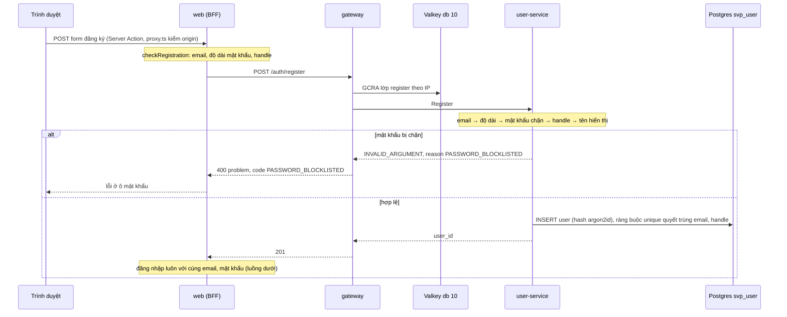
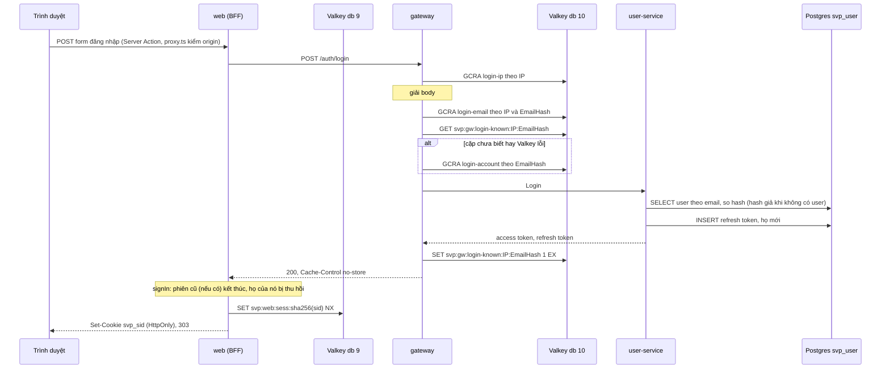
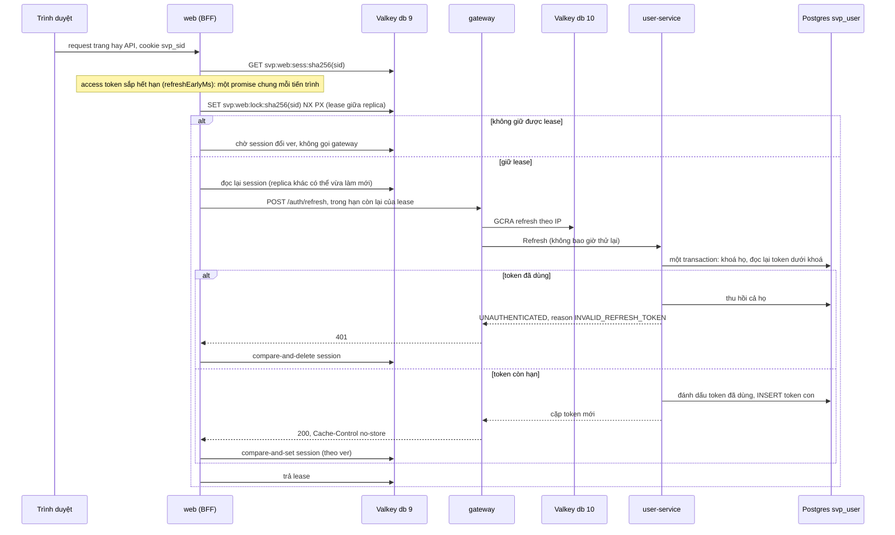
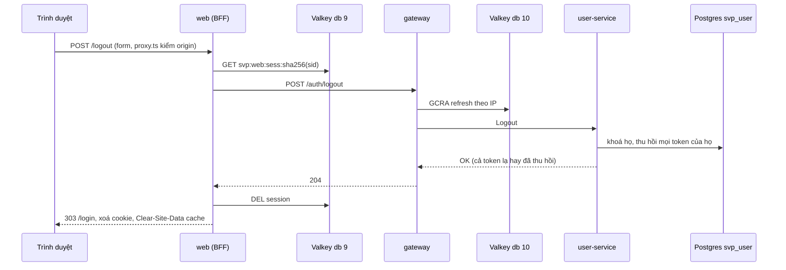

# Xác thực: đăng ký, đăng nhập, làm mới phiên, đăng xuất

Trang này giải thích bốn luồng xác thực đi qua web BFF, gateway và user-service: mỗi bước kiểm gì, theo thứ tự nào, vì
sao, và cái giá của từng lựa chọn. Quyết định và nguồn ở [ADR-0016](../adr/0016-web-client.md) (BFF, refresh token xoay
vòng), [ADR-0042](../adr/0042-caller-identity-grpc.md) (service kiểm lại access token),
[ADR-0046](../adr/0046-web-session-lifetime.md) (hạn phiên web) và [ADR-0069](../adr/0069-auth-hardening.md) (giới hạn
theo tài khoản, header bảo mật, hạn access token, mật khẩu chặn). Giá trị nằm ở code: ngưỡng rate limit ở
[`ratelimit.go`](../../services/gateway/internal/ratelimit/ratelimit.go), hạn access token ở
[`authtoken.go`](../../internal/authtoken/authtoken.go), hạn refresh token ở
[`refresh.go`](../../services/user-service/internal/server/refresh.go). Mối đe doạ và cách kiểm ở [threat model
§4.1](../threat-model.md#41-jwt-và-đăng-nhập) và [§4.4](../threat-model.md#44-rate-limit-ở-gateway).

Trình duyệt không bao giờ giữ token. Nó chỉ có cookie `svp_sid` (HttpOnly); BFF giữ access token và refresh token trong
session ở Valkey db 9 (khoá `svp:web:sess:<sha256(sid)>`). Gateway giữ rate limit và cặp đã biết ở Valkey db 10 (tiền tố
`svp:gw:`); user-service giữ hash mật khẩu và hash refresh token trong Postgres `svp_user`. Tên trong sơ đồ dưới đây là
tên trong code: handler `register`, `login`, `refresh`, `logout` của `services/gateway/internal/api/api.go`; RPC cùng
tên của user-service; `signIn`, `signOut` (`server/auth.ts`) và `SessionAccess` (`server/session-access.ts`) của
`svp-frontend`.

## Đăng ký

- `Register` kiểm mọi đầu vào trước khi băm, nên đầu vào sai không tốn một lần argon2id. Thứ tự là email, độ dài mật
  khẩu, mật khẩu chặn, handle, tên hiển thị; lỗi đầu tiên gặp là lỗi trả về.
- **Mật khẩu chặn** (`password.CheckBlocklist`): mật khẩu bị từ chối khi chữ thường của nó có trong danh sách nhúng
  `services/user-service/internal/password/blocklist.txt`, hay bằng chữ thường của email, phần trước `@` của email,
  handle người dùng chọn. So cả chuỗi, không so chuỗi con. Danh sách sinh bằng `blocklist.sh` từ danh sách mật khẩu phổ
  biến nhất của NCSC (lấy từ dữ liệu Have I Been Pwned) ở một commit ghim; nguồn, sha256 và giấy phép ở [phụ lục
  ADR-0069](../adr/appendix/0069-auth-hardening.md). Kiểm trong bộ nhớ, nên đăng ký không gửi gì ra ngoài service và
  không cần mạng ngoài.
- Chỉ `Register` kiểm danh sách (không có RPC đổi mật khẩu); `Login` không kiểm, nên tài khoản đặt mật khẩu trước khi
  một mục vào danh sách vẫn đăng nhập được.
- Gateway trả reason của service làm `code` của problem qua ánh xạ chung
  ([`contracts.md`](../reference/contracts.md#mã-lỗi-grpc-sang-http-ở-gateway)); web đổi `PASSWORD_BLOCKLISTED` thành
  câu nêu lý do ở ô mật khẩu, như NIST SP 800-63B-4 đòi khi từ chối một mật khẩu.

## Đăng nhập

**Thứ tự kiểm login** ở handler `login`: `login-ip` theo IP trước khi đọc body, để body lớn hay sai dạng không tốn gì
hơn một lượt đếm; `login-email` theo cặp (IP, email) sau khi giải body; rồi cặp đã biết; cặp chưa biết thì
`login-account`; cuối cùng `Login`. Bị từ chối ở lớp nào cũng là 429 `RATE_LIMITED` kèm `Retry-After`. Mỗi lớp trả lời
một câu hỏi khác:

| Lớp | Id | Chặn |
| --- | --- | --- |
| `login-ip` | IP client | Một nguồn thử nhiều tài khoản (credential stuffing từ ít IP) |
| `login-email` | IP + `EmailHash` | Một nguồn dò một tài khoản |
| `login-account` | `EmailHash` | Nhiều nguồn cùng dò một tài khoản (dò phân tán) |

- **Email băm** (`ratelimit.EmailHash`): tiền tố hex của SHA-256 của email đã `TrimSpace` và `ToLower`, cùng chuẩn hoá
  như user-service. Không email thô nào vào Valkey.
- `login-account` đếm GCRA nguyên tử trước `Login` và không hoàn lại khi thành công: không có khe giữa "xem" và "đếm" để
  nhiều request song song lách qua. Email không có tài khoản cũng đếm như vậy, và `Login` trả cùng một lỗi, chạy hash
  giả khi không có user, nên cả 429 lẫn 401 không cho biết email có tồn tại.
- **Cặp đã biết**: (IP, email) đã đăng nhập thành công từ IP đó còn trong hạn của khoá
  `svp:gw:login-known:<IP>:<EmailHash>` (hạn bằng hạn cả họ refresh token, `knownPairTTL` ở `known.go`). Cặp đã biết bỏ
  qua `login-account` nhưng vẫn qua `login-ip`, `login-email`. Chỉ `Login` thành công mới ghi cặp. `GET` lỗi hay quá hạn
  thì cặp coi là chưa biết; `SET` lỗi chỉ ghi log WARN, response không đổi.
- Valkey lỗi hay quá hạn: ba lớp login cùng **đóng mềm**, đếm trong bộ nhớ của từng instance với ngưỡng thấp hơn
  ([`rate-limit-fallback-active.md`](../runbooks/rate-limit-fallback-active.md)).

### Vì sao không khoá tài khoản

Khoá tài khoản sau N lần sai biến chống dò thành công cụ DoS: ai biết email của người khác cũng khoá được họ, và hệ
thống chưa có luồng mở khoá (xác minh email, đặt lại mật khẩu). `login-account` giới hạn tốc độ thay vì khoá: kẻ dò chỉ
được một số lượt mỗi ngày trên một tài khoản, ít hơn hẳn danh sách mật khẩu phổ biến mà luồng đăng ký đã cấm đặt. Cặp đã
biết là cách giảm nhẹ: kẻ xấu tiêu hết bucket `login-account` thì chủ thật vẫn đăng nhập được từ IP họ đã dùng, vì cặp
của họ không đi qua lớp đó. NIST SP 800-63B gọi đây là kỹ thuật dựa trên IP đã xác thực thành công trước đó; OWASP tả
cùng ý bằng device cookie.

## Làm mới phiên

- BFF làm mới khi access token còn dưới `refreshEarlyMs` (bằng `Leeway` gateway cho phép lệch đồng hồ), không đợi 401.
  Hạn access token ngắn (`authtoken.TTL`), nên phiên đang dùng làm mới vài lần mỗi giờ; refresh token và hạn phiên của
  web giữ người dùng đăng nhập.
- **Single-flight**: refresh token chỉ dùng được một lần, trình lại thì cả họ bị thu hồi. Nên mỗi phiên chỉ một lượt làm
  mới ở bất kỳ đâu: request cùng tiến trình chia một promise, replica chia lease trong Valkey db 9, ai không giữ lease
  thì chờ session mới.
- **Xoay vòng**: mỗi lần `Refresh` đánh dấu token cũ đã dùng và cấp token con cùng họ, trong một transaction dưới khoá
  theo họ. Token con có hạn trượt nhưng không quá hạn của cả họ tính từ lúc đăng nhập.
- **Dùng lại thì thu hồi họ**: token đã dùng mà được trình lại, service không phân biệt được client thật với kẻ cắp, nên
  thu hồi cả họ, kể cả token vừa cấp (RFC 9700 §4.14.2). Mọi ca lỗi cùng reason `INVALID_REFRESH_TOKEN`.
- **Không rõ kết quả** (timeout, mất kết nối): BFF giữ session và không thử lại trong request đó, vì gateway có thể đã
  xoay token, thử lại là trình lại. Request sau thử với token đang giữ; nếu nó đã bị xoay thì user-service thấy dùng
  lại, thu hồi họ, và phiên kết thúc.
- Gateway trả 429 cho refresh: BFF dùng access token cũ khi còn hạn, hết hạn thì trả 429 cho request đó.
- Session bị đăng xuất trong lúc làm mới: compare-and-set thất bại, BFF không dựng lại session và thu hồi họ của token
  vừa nhận.

## Đăng xuất

- `Logout` trả 204 cho mọi token, kể cả token không biết hay gọi lần hai, nên câu trả lời không cho biết token nào tồn
  tại. Lỗi database là `INTERNAL`: client phải biết việc thu hồi chưa xảy ra.
- `signOut` vẫn xoá session khi gateway lỗi; refresh token khi đó hết hạn theo thời gian của nó.
- Access token đã cấp không thu hồi được: nó còn dùng được tới hết hạn (`authtoken.TTL` cộng `Leeway`). Đăng xuất cắt
  được phiên vì BFF không còn session, và không ai làm mới được họ đã thu hồi.

## Header bảo mật

Middleware `httpx.SecurityHeaders` (`services/gateway/internal/httpx/headers.go`) bọc mọi response của gateway, cả
`/healthz`, `/readyz`, 404, problem và 500 của `Recover`, vì nó đặt header trước khi handler chạy và nằm ngoài
`Recover`:

| Header | Vì sao |
| --- | --- |
| `X-Content-Type-Options: nosniff` | Trình duyệt không đọc body JSON thành kiểu khác |
| `Content-Security-Policy: default-src 'none'; frame-ancestors 'none'` | Body bị mở như trang không chạy được gì, không bị nhúng frame; trùng policy API của edge |
| `Cache-Control: no-store` | Response login, refresh mang token (RFC 6749 §5.1), response khác thuộc về một người gọi |

`getPublicVideo` thành công thay `Cache-Control` bằng giá trị cho cache công khai, vì video `READY` giống nhau với mọi
người. Gateway không đặt HSTS, `X-Frame-Options` (edge đặt, [`edge.md`](edge.md)), `Referrer-Policy`,
`Permissions-Policy` (chỉ có tác dụng với trang HTML), `Pragma` (RFC 9111 §5.4 bỏ) hay CORS (trình duyệt chỉ gọi BFF
cùng origin); lý do đủ ở ADR-0069 §3. Header giống nhau ở compose, k3d và cloud, vì gateway đặt chúng chứ không chỉ
edge.

## Cái giá

- Access token ngắn thay cho thu hồi theo user: token lộ vẫn dùng được tới hết hạn, và mỗi phiên làm mới nhiều lần hơn,
  nên lớp `refresh` theo IP nhận nhiều lượt hơn. Không cần tra trạng thái user ở năm nơi kiểm JWT.
- Lượt tải k6 dùng token cấp một lần trong `setup()`, không làm mới, nên mọi profile phải kết thúc trước khi token hết
  hạn: `ramp + hold + rampDown` bị giới hạn ở `deploy/k6/lib/config.js` và `deploy/k6/cloud/render.sh`
  ([`compose.md`](../reference/compose.md)).
- Một cuộc dò đều đặn từ IP bất kỳ tiêu hết bucket `login-account` của một tài khoản; trong lúc đó chủ thật ở IP chưa
  biết (mạng di động đổi IP, máy mới) không đăng nhập được tới khi cuộc dò dừng. Gỡ tay: theo dõi metric quyết định của
  lớp, chặn nguồn ở WAF.
- Cặp đã biết là dữ liệu cá nhân mới: (IP, SHA-256 email) sống trong Valkey bằng hạn của khoá. Ở compose mọi request qua
  web chung IP của BFF, nên ở đó cặp đã biết là theo BFF, không theo người dùng.
- Danh sách mật khẩu cục bộ không phủ mật khẩu lộ sau commit ghim, và tài khoản tạo trước đó giữ mật khẩu cũ.

Số đo, phương án đã cân nhắc và chỗ lệch chuẩn ở [ADR-0069](../adr/0069-auth-hardening.md) và [phụ
lục](../adr/appendix/0069-auth-hardening.md) của nó.
