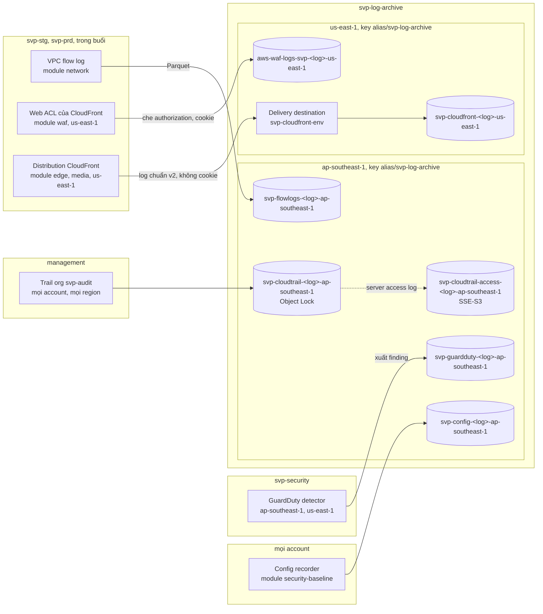
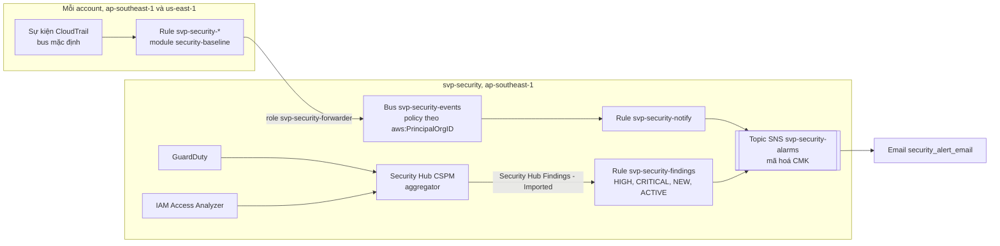
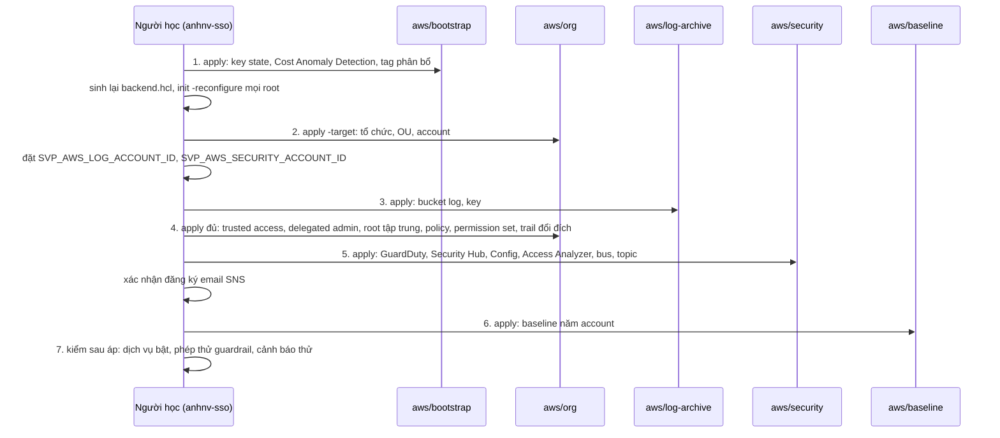

# Bảo mật AWS cấp tổ chức

Trang này giải thích lớp bảo mật nằm trên mọi account AWS của lab: org gồm những account nào và vì sao, guardrail gắn ở đâu, ai đổi được gì,
dịch vụ nào phát hiện bất thường, log đi về đâu và một sự kiện bảo mật tới người học bằng đường nào. Quyết định và lý do ở
[ADR-0059](../adr/0059-org-structure-guardrails.md) (cấu trúc, guardrail, quyền) và [ADR-0060](../adr/0060-org-detection-logging.md) (phát hiện,
log, cảnh báo); statement đủ của mọi policy, event pattern, retention và bảng giá ở phụ lục của hai ADR. Bảo mật trong một env (pod, bucket, mạng,
dịch vụ dữ liệu) ở [`threat-model.md`](../threat-model.md#411-biên-aws); đường vào công khai ở [`edge.md`](edge.md); stg so với prd ở
[`environments.md`](environments.md).

Code ở repo [`svp-infra`](https://github.com/anhnvcoder/svp-infra): root `aws/org`, `aws/log-archive`, `aws/security`, `aws/baseline`,
`aws/bootstrap` và module `aws/modules/org-policies`, `aws/modules/security-baseline`. Mọi lệnh chạm account do người học chạy.

## Cấu trúc org theo AWS SRA

AWS Security Reference Architecture (SRA) tách việc quản trị, log và công cụ bảo mật ra khỏi account chạy workload. Admin của workload có toàn
quyền trong account của nó; nếu log và finding nằm cùng account, người đó (hay credential bị lộ của người đó) xoá được dấu vết của chính mình.
Đặt chúng ở account khác, chỉ đổi được qua Terraform chạy từ management, cắt đường đó.

| Account | OU | Vai trò | Profile |
| --- | --- | --- | --- |
| management | root của org | Organizations, Identity Center, trail org, policy, budget, state Terraform; không workload | `anhnv-sso` |
| `svp-log-archive` | `Security` | Log Archive: bucket của mọi loại log | `anhnv-log-ro` (chỉ đọc log) |
| `svp-security` | `Security` | Security Tooling: delegated admin của GuardDuty, Security Hub, Config, Access Analyzer; bus và topic cảnh báo | `anhnv-security-ro` (chỉ đọc) |
| `svp-prd` | `Workloads/Prod` | Env prd, chỉ sống trong buổi | `anhnv-prd`, `anhnv-prd-ro` |
| `svp-stg` | `Workloads/NonProd` | Env stg, chỉ sống trong buổi | `anhnv-stg`, `anhnv-stg-ro` |

Hai account `svp-log-archive`, `svp-security` không có profile ghi và không có bucket state riêng: Terraform của chúng chạy từ management (mục
sau). Biến terminal `SVP_AWS_LOG_ACCOUNT_ID`, `SVP_AWS_SECURITY_ACCOUNT_ID` giữ id của chúng, như `SVP_AWS_STG_ACCOUNT_ID`; không file commit nào
ghi id account.

### Policy của org gắn ở đâu

Policy gắn ở root của org áp cho mọi account thành viên, kể cả account tạo sau; policy gắn ở OU `Prod` chỉ áp cho prd. SCP và RCP không áp lên
management, nên management là đường sửa khi một guardrail chặn nhầm. Declarative policy và tag policy gắn root thì áp cả management.

| Policy | Loại | Gắn ở | Việc |
| --- | --- | --- | --- |
| `svp-deny-leave-organization` | SCP | root | Account không tự rời org |
| `svp-protect-cloudtrail` | SCP | root | Không dừng, xoá, sửa trail org |
| `svp-deny-other-regions` | SCP | root | Chỉ region nhà và `us-east-1` (dịch vụ toàn cục; WAF, cert ACM, log của CloudFront; khoá DNSSEC) |
| `svp-protect-baseline` | SCP | root | Không đổi baseline bảo mật của account, trừ **vai trò triển khai baseline** |
| `svp-deny-iam-users` | SCP | root | Không tạo IAM user, access key, mật khẩu console |
| `svp-prod-guardrails` | SCP | OU `Prod` | Không chạy EC2 Spot qua `RunInstances` ở prd |
| `svp-data-perimeter` | RCP | root | Dữ liệu S3, KMS, Secrets Manager, SQS, STS không tới principal ngoài org, không qua request không TLS |
| `svp-ec2-baseline` | Declarative EC2 | root | Không AMI, snapshot EBS public; IMDSv2 bắt buộc; serial console tắt |
| `svp-tags` | Tag policy | root | Bốn khoá tag `Project`, `Env`, `ManagedBy`, `Stack` đúng hoa thường và đúng giá trị |

SCP đặt trần quyền: IAM của account cho gì thì vẫn không vượt được nó. RCP đặt trần cho tài nguyên: một bucket policy lỡ cho principal ngoài org
vẫn bị RCP từ chối. Hai lớp bổ sung nhau, nên cấu hình sai ở một phía không đủ để lộ dữ liệu. `svp-prod-guardrails` không chặn được Spot qua
`CreateFleet` của Karpenter; NodePool on-demand của prd giữ phần đó (ADR-0059 §3).

## Ai đổi được gì

### Root chạy từ management và vai trò triển khai baseline

Ba root `aws/log-archive`, `aws/security`, `aws/baseline` chạy bằng `anhnv-sso`. Provider của mỗi account đích assume
`OrganizationAccountAccessRole`, role mà Organizations tạo trong mọi account thành viên và chỉ management assume được. Cách này giống
`AWSControlTowerExecution` của Control Tower: baseline của mọi account đi qua một đường có `plan` đọc được.

`OrganizationAccountAccessRole` cũng là principal duy nhất được miễn ở `svp-protect-baseline`. `SvpAdmin` ở stg, prd có `AdministratorAccess`
mà vẫn không tắt được GuardDuty, Config, Security Hub, không đổi S3 Block Public Access cấp account hay key EBS mặc định, không sửa rule chuyển
cảnh báo. Đổi lại, admin của management là admin của mọi account: management giữ ít người và MFA phần cứng.

### Permission set

Người học vào account bằng Identity Center, không IAM user. Mỗi permission set gán ở account cần nó; thời hạn phiên ở ADR-0059 §8.

| Permission set | Gán ở | Quyền | Dùng cho |
| --- | --- | --- | --- |
| `SvpAdmin` | `svp-stg`, `svp-prd` | `AdministratorAccess`, phiên ngắn | `apply`, script buổi |
| `SvpReadOnly` | `svp-stg`, `svp-prd`, `svp-security` | `ViewOnlyAccess` + `SecurityAudit`, thêm đọc CloudWatch Logs | Đọc cấu hình, trạng thái, finding; không đọc object S3, giá trị secret, dữ liệu bảng; không ghi trạng thái finding |
| `SvpLogReader` | `svp-log-archive` | `ViewOnlyAccess`, đọc object và giải mã bucket log | Đọc log trail, Config, flow log, GuardDuty, WAF, CloudFront |

Đọc hằng ngày đi qua permission set chỉ đọc, nên một phiên điều tra không vô tình sửa gì; quyền ghi chỉ mở khi cần, và chỉ ở stg, prd.

### Root tập trung và break-glass

`aws/org` bật centralized root access: account thành viên không giữ mật khẩu, access key hay MFA của root. Việc chỉ root làm được trên account
thành viên đi qua `sts:AssumeRoot` từ management, mỗi phiên một task policy và một thời hạn ngắn. Rule `svp-security-root-session` của management
bắt phiên mở ở `ap-southeast-1` và `us-east-1` (mục [Đường cảnh báo](#luồng-phát-hiện-tới-cảnh-báo)). STS nhận `AssumeRoot` ở endpoint của mọi
region, mà management không chịu `svp-deny-other-regions`: phiên mở ở region khác chỉ nằm trong trail org, không tới email (phần Hệ quả của
ADR-0060). Root của management giữ MFA phần cứng cất ngoài máy và là đường break-glass khi Identity Center hỏng: runbook
[`break-glass.md`](https://github.com/anhnvcoder/svp-infra/blob/main/docs/runbooks/break-glass.md) của `svp-infra`.

## Baseline của mỗi account

Module `security-baseline` áp một lần mỗi account trong năm account (management, `svp-log-archive`, `svp-security`, `svp-stg`, `svp-prd`), từ
root `aws/baseline`:

- S3 Block Public Access cấp account, bốn cờ bật.
- EBS mã hoá mặc định ở region nhà và `us-east-1`. Ở `svp-stg`, `svp-prd` region nhà key mặc định là CMK `alias/svp-ebs` (root `aws/baseline`
  tạo), nơi khác là `aws/ebs`.
- AWS Config ghi liên tục mọi loại tài nguyên, giao snapshot và lịch sử về bucket Config của Log Archive.
- Rule EventBridge `svp-security-*` chuyển sự kiện bảo mật sang account `svp-security`.

Khác biệt giữa account (key EBS, có chuyển sự kiện đổi IAM, KMS, S3 hay không, region của rule đăng nhập root) là dữ liệu trong bảng
`local.accounts` của `aws/baseline`, không nhánh `if` theo account. Ở stg, prd không chuyển sự kiện đổi IAM, KMS, S3 thành công: mỗi buổi tạo
và xoá hàng chục role, key, bucket, và email cho từng cái sẽ che mất email đáng đọc.

## Phát hiện

Root `aws/security` cấu hình các dịch vụ từ account `svp-security`, delegated admin do `aws/org` đăng ký, ở region nhà `ap-southeast-1` và
`us-east-1`. Region khác bị `svp-deny-other-regions` chặn ở account thành viên nên không bật.

- **GuardDuty** tự bật cho mọi account, kể cả account mới: S3 Protection, EKS Audit Log, Runtime Monitoring, RDS Protection, Lambda Protection,
  Malware Protection for EC2. Agent runtime của node EKS là add-on `aws-guardduty-agent` do module `eks` cài, gửi sự kiện qua interface endpoint
  `guardduty-data` của module `network`: GuardDuty tự quản agent thì tự tạo endpoint và security group ngoài state Terraform, chặn destroy VPC
  cuối buổi. Bucket `uploads` của mỗi env có plan Malware Protection for S3 (module `media`), gắn tag kết quả quét lên object.
- **Security Hub CSPM** cấu hình tập trung: một configuration policy `svp-security-standards` gắn root bật chuẩn AWS Foundational Security Best
  Practices và CIS AWS Foundations Benchmark cho mọi account; region nhà gom finding của `us-east-1`.
- **AWS Config**: recorder của baseline ở mọi account, aggregator `svp-org` ở `svp-security`. Không conformance pack: chuẩn CIS của Security Hub
  đã đánh giá cùng các rule.
- **IAM Access Analyzer** loại `ORGANIZATION` ở hai region: báo tài nguyên chia sẻ ra ngoài org.

Phần không được giám sát và lý do (bastion không có agent runtime, volume mã hoá bằng `alias/svp-ebs` không được quét malware, management ngoài
hai region, kể cả phiên `AssumeRoot` mở ở đó) ở phần Hệ quả của ADR-0060.

## Lớp edge

Mỗi env đón request công khai ở CloudFront, không ở load balancer nào trong VPC ([`edge.md`](edge.md),
[ADR-0061](../adr/0061-edge-cloudfront-waf-acm.md)). Phần bảo mật của lớp này:

- **WAF:** ba web ACL scope CLOUDFRONT mỗi env (`svp-<env>-web`, `-api`, `-media`), giống hệt ở stg và prd: luật rate-based theo IP, IP
  reputation và các nhóm luật managed của AWS; ATP cho đăng nhập ở api, Bot Control chỉ gắn nhãn ở web. Log về bucket log WAF của Log Archive.
- **Origin không công khai:** web, API qua VPC origin tới ALB internal ở subnet edge; security group của ALB chỉ nhận prefix list
  origin-facing của CloudFront. Media đọc bucket qua OAC.
- **TLS:** cert ACM ở CloudFront (`us-east-1`) và ALB (region nhà), TLS policy AWS khuyên; Envoy dùng CA nội bộ của cert-manager, nên không
  khoá riêng của cert công khai nào nằm trong cluster.
- **DNS:** CAA ở đỉnh zone của cả hai env chỉ cho CA của Amazon; zone prd ký DNSSEC (khoá KMS ở `us-east-1`, hai alarm page tới topic SNS
  của module `alarms`) và có query log. Root `aws/accounts/<env>` giữ chúng, sống giữa các buổi.
- **Log:** log chuẩn v2 của CloudFront và log WAF về Log Archive (mục sau); không access log ALB vì mọi request đã có ở hai log đó.

Control Security Hub FSBP áp lên tài nguyên edge (`CloudFront.*`, `WAF.*`, `ACM.*`, `Route53.*`, `ELB.*`), đạt hay chấp nhận có lý do: phụ lục
ADR-0061. Mối đe doạ của lớp này ở [threat model](../threat-model.md#413-edge).

## Luồng log

Mọi log bảo mật về account `svp-log-archive`. Mỗi loại log một bucket, tên `<tiền tố>-<id account log>-<region>`
([ADR-0038](../adr/0038-s3-bucket-names.md)), mã hoá bằng key `alias/svp-log-archive` cùng region với bucket, policy chỉ cho principal dịch vụ
của org ghi. Riêng bucket access log của trail dùng SSE-S3: S3 chỉ giao server access log vào bucket SSE-S3. Bucket trail có Object Lock;
retention của từng bucket ở ADR-0060 §7.

- Trail `svp-audit` ở management ghi management event của mọi account. Data event S3 chỉ cho bucket người dùng của prd: `uploads` đọc và ghi,
  `media` chỉ ghi (đọc là lưu lượng người xem qua CloudFront). stg không có dữ liệu người dùng thật, nên không trả phí data event ở đó.
- Bucket trail cũ ở management còn giữ log trước khi trail đổi đích, chỉ đọc tới khi Object Lock của nó hết hạn; README của `aws/org` ghi bước gỡ.
- Log chuẩn v2 của CloudFront đi chéo account: account env giữ delivery source và delivery, `svp-log-archive` giữ delivery destination mỗi env
  và bucket ([ADR-0061](../adr/0061-edge-cloudfront-waf-acm.md) §8). Media của stg (gói CloudFront Free) không có log này.
- Flow log, log WAF và log CloudFront chỉ có khi env sống, nhưng bucket sống giữa các buổi: log của buổi đã gỡ vẫn đọc được. Root env nhận id account log qua
  `TF_VAR_log_archive_account_id` (từ `SVP_AWS_LOG_ACCOUNT_ID`), nên buổi chỉ chạy được sau khi `aws/log-archive` đã áp.
- Đọc log: profile `anhnv-log-ro`; lệnh mẫu ở runbook [`security-alert.md`](../runbooks/security-alert.md).

## Luồng phát hiện tới cảnh báo

Cảnh báo phải tới người học khi không cluster nào chạy, nên nó đi hoàn toàn trên dịch vụ managed: EventBridge, SNS, email.

- Rule ở mỗi account bắt các nhóm sự kiện của ADR-0060 §10: root đăng nhập; management mở phiên `AssumeRoot` (chỉ ở hai region, mục
  [Root tập trung và break-glass](#root-tập-trung-và-break-glass)); đổi cấu trúc, policy của Organizations (chỉ management); trail bị dừng,
  xoá, sửa; rule `svp-security-*` bị đổi; GuardDuty, Security Hub, Config, Access Analyzer bị tắt hay đổi; lệnh bị guardrail từ chối;
  đổi IAM, KMS, S3, Identity Center ở ba account không chạy workload. Event pattern đủ ở phụ lục ADR-0060.
- Sự kiện cần role để sang bus của account khác (`svp-security-forwarder`); bus chỉ nhận từ principal trong org.
- Finding đi đường riêng: GuardDuty và Access Analyzer gửi finding vào Security Hub, rule trên bus mặc định của `svp-security` chỉ lấy finding
  mới, còn mở, mức HIGH hay CRITICAL. Finding của control FSBP, CIS không tới email: Security Hub gửi lại sự kiện mỗi lần đánh giá lại, email sẽ
  lặp; người học đọc bảng Security Hub theo runbook.
- Input transformer ghi tên sự kiện hay tiêu đề finding, account, region, principal, mã lỗi và URL runbook
  [`security-alert.md`](../runbooks/security-alert.md), nên email đủ để bắt đầu phân loại.
- Topic SNS dùng module `alarms` như alarm của dịch vụ managed; publisher là `events.amazonaws.com` thay vì CloudWatch.

## Thứ tự áp lần đầu

Mỗi root đọc thứ root trước tạo ra (id account, tên bucket, ARN key), nên lần đầu phải áp theo thứ tự. Mọi bước do người học chạy theo runbook
[`org-security-setup.md`](https://github.com/anhnvcoder/svp-infra/blob/main/docs/runbooks/org-security-setup.md) của `svp-infra`; bước nào đỏ thì
dừng.

Bước 2 dùng `-target` vì tạo account gần như không đảo ngược (đóng account chờ 90 ngày): plan của bước này chỉ được thêm hai account và đổi OU
của stg, prd. Bước 3 phải trước bước 4 vì trail và policy của bucket trỏ vào nhau: bucket cho đúng trail `svp-audit` ghi, trail chỉ đổi đích
khi bucket đã có. Từ khi bước 1–3 đã áp, buổi stg, prd mới chạy được, vì root env ghi flow log, log WAF và log CloudFront vào Log Archive.
Phần edge (bucket log CloudFront, CAA, DNSSEC) áp thêm theo runbook
[`edge-setup.md`](https://github.com/anhnvcoder/svp-infra/blob/main/docs/runbooks/edge-setup.md) của `svp-infra`.
