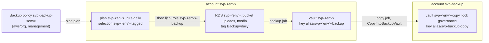
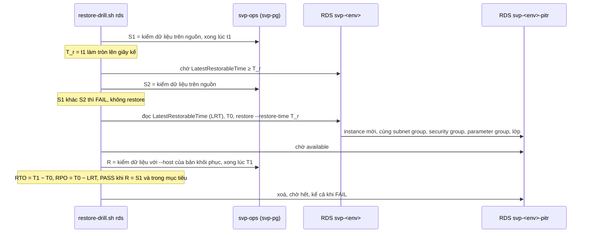
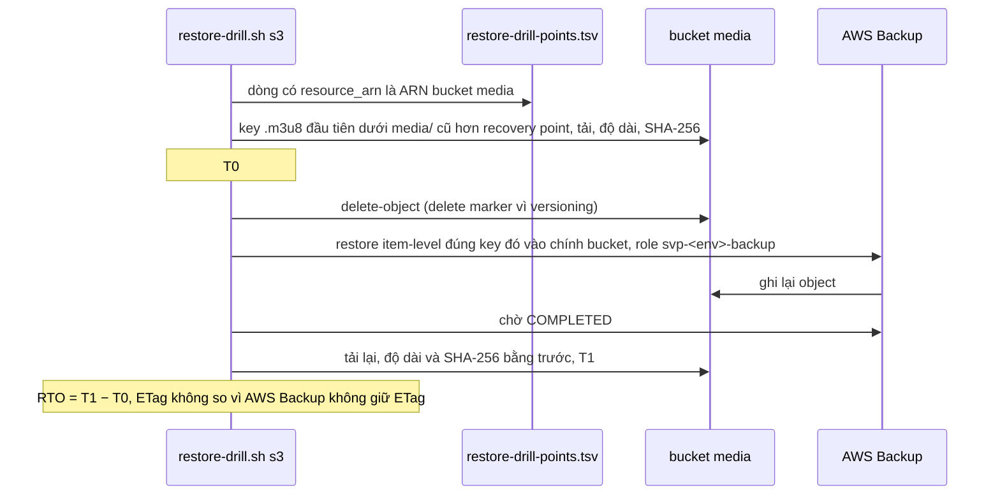
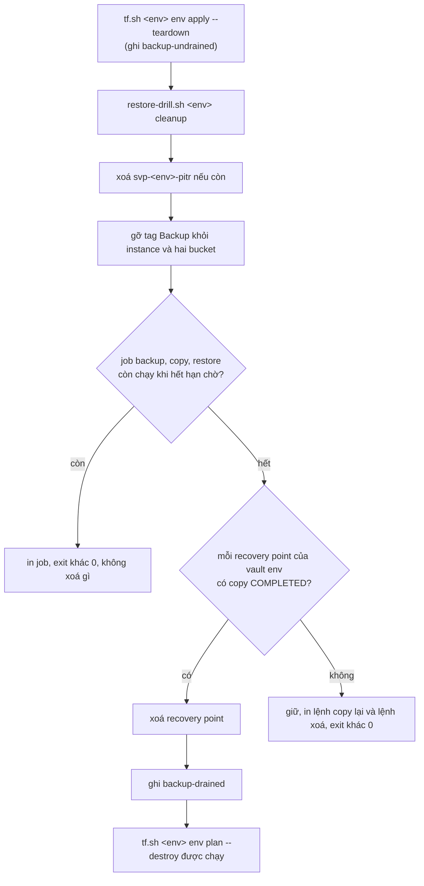

# Backup và DR trên AWS

Trang này giải thích dữ liệu của stg, prd được giữ ở đâu, chép đi đâu, khôi phục bằng đường nào và đo thế nào trong
buổi. Quyết định, số (RTO, RPO, retention, lock, chi phí) và nguồn nằm ở [ADR-0067](../adr/0067-backup-dr.md) và [phụ
lục](../adr/appendix/0067-backup-dr.md); code ở `svp-infra` (root `aws/org`, `aws/backup`, `aws/accounts/<env>`,
`aws/envs/<env>`, script
[`aws/scripts/restore-drill.sh`](https://github.com/anhnvcoder/svp-infra/blob/main/aws/scripts/restore-drill.sh)) và ở
repo này (`deploy/ops/svp-pg`, chart `svp-data`). Khôi phục khi có sự cố theo hai runbook
[`rds-restore.md`](../runbooks/rds-restore.md) và [`s3-restore.md`](../runbooks/s3-restore.md). Postgres của k3d có
đường riêng: [`postgres-restore.md`](../runbooks/postgres-restore.md).

## Phạm vi: cái gì được backup

Chỉ dữ liệu không dựng lại được vào AWS Backup: instance RDS `svp-<env>` (mọi database, kể cả `svp_glitchtip`) và hai
bucket của module `media`, `uploads` (bản gốc người dùng tải lên) và `media` (HLS; không dựng lại được khi bản gốc đã
hết hạn theo lifecycle của `uploads`). Phần còn lại dựng lại từ nguồn của nó: MSK (topic, user, ACL do `kafka-init`),
ElastiCache Valkey (cache, session web, rate limit), cluster EKS và cấu hình GitOps (git, Argo CD), image ECR (CI dựng
và ký lại), state Terraform (bucket có versioning), log (account Log Archive). Danh sách và cái giá của từng mục (event
đang bay khi mất MSK, bản gốc `uploads` đã sang lớp lưu trữ archive) ở ADR-0067 §1.

RDS có hai lớp bảo vệ khác nhau:

- **PITR gốc của RDS** (backup tự động, `rds_backup_retention_period` của `<env>.tfvars`): khôi phục tới một giây bất kỳ
  trong cửa sổ, chỉ trong account env. Đây là đường của hỏng dữ liệu, RPO tính bằng phút.
- **Snapshot của AWS Backup** hằng ngày: điểm khôi phục có thể chép sang account khác. Đây là đường của mất account env
  và của dữ liệu cũ hơn cửa sổ PITR.

S3 cũng có hai lớp: version cũ của object (cả hai env bật versioning) và recovery point của AWS Backup.

Mục tiêu RTO, RPO của từng loại sự cố (hỏng dữ liệu RDS, mất object, mất bucket, mất account env) là bảng của ADR-0067
§2; mất cả region nằm ngoài phạm vi (§12): không có bản nào ở region khác.

## Account, vault và khoá

- **Account `svp-backup`** (OU `Security`) giữ bản copy, theo mẫu Central Backup account của AWS SRA. Admin hay kẻ chiếm
  account env xoá được instance, backup tự động và vault trong account đó, nhưng không chạm được bản copy ở đây. Account
  không có profile ghi; root `aws/backup` apply từ management qua `OrganizationAccountAccessRole`, profile
  `anhnv-backup-ro` chỉ đọc vault, recovery point và job.
- **Vault env** `svp-<env>` ở account env (root `aws/accounts/<env>`, sống giữa các buổi) nhận recovery point của plan;
  không có vault lock vì recovery point của nó bị xoá mỗi cuối buổi.
- **Vault copy** `svp-stg-copy`, `svp-prd-copy` ở `svp-backup` (root `aws/backup`) có vault lock chế độ governance:
  không ai xoá được recovery point trước hạn tối thiểu, trừ người có quyền IAM gỡ lock. Vault access policy chỉ cho đúng
  account env tương ứng chép vào; mọi action khác từ account khác bị AWS từ chối.
- **Khoá:** AWS Backup mã hoá lại bản copy bằng key của vault đích (`alias/svp-backup-copy`), nên bản copy dùng được cả
  khi key RDS đã xoá cùng env cuối buổi (key vault env sống giữa các buổi, như vault env). Key RDS cho account `svp-backup` dùng nó khi chép snapshot
  (statement chéo account, action ở ADR-0067 §6); key policy của mọi key giữ statement quản trị mặc định.
- **Role `svp-<env>-backup`** là role AWS Backup dùng để chụp, chép và khôi phục. Nó chỉ gắn các managed policy của AWS
  Backup (§7 của ADR): quyền KMS trong đó là `Resource "*"` thu hẹp bằng điều kiện theo dịch vụ, nên role dùng được mọi
  key của account qua AWS Backup, RDS và S3. Đó là cái giá đổi lấy policy mà AWS giữ theo kịp dịch vụ; chỉ AWS Backup
  của đúng account assume được role. Threat model ghi rủi ro này ở BAK-3.
- **Bucket `uploads`** mã hoá SSE-KMS bằng CMK `alias/<name_prefix>-uploads` với Bucket Key (ADR-0067 §8): mỗi principal
  đọc, ghi object có quyền KMS trên đúng ARN key đó. Bucket `media` giữ SSE-S3 vì nội dung công khai qua CloudFront.

## Lịch: Backup policy của Organizations

Plan không viết trong account env mà sinh ra từ Backup policy của Organizations ở management: `svp-backup-prd` gắn OU
`Prod`, `svp-backup-stg` gắn OU `NonProd`. Mỗi policy tạo trong account env plan `svp-<env>` (rule `daily`, selection
`svp-<env>-tagged`, `copy_actions` tới vault copy). Admin account env không sửa hay xoá được plan đó; sửa lịch là sửa
module `org-policies` rồi apply `aws/org`.

Selection chọn theo mẫu ARN DB instance và S3 bucket kèm tag `Backup = daily`. Tag gắn thẳng trên instance của module
`rds` và hai bucket của module `media`; snapshot RDS kế thừa tag nhưng không khớp mẫu ARN nên không bị chọn. AWS Backup
chỉ chụp loại tài nguyên đã opt-in: opt-in của management quyết cho plan của policy, opt-in của account env cho job
on-demand và restore; cả hai bật RDS, S3.

Retention của recovery point ít nhất hai ngày: bản trước còn tới khi bản kế tiếp hoàn tất muộn nhất (chu kỳ cộng start
window và completion window), nên lúc nào cũng có một bản hoàn tất. Đó cũng là nguồn của RPO S3 trong ADR-0067 §2. stg
và prd chỉ khác retention, giới hạn lock và OU gắn policy ([`environments.md`](environments.md)).

Env sống trong buổi vài giờ nên lịch hằng ngày thường không chạy trong buổi. Buổi kiểm cấu hình mà lịch dựa vào (plan,
selection, opt-in) và chụp on-demand bằng cùng role, cùng vault, cùng đích copy; lịch chạy thật được chứng minh một lần
bằng thử sandbox ở management (runbook `backup-sandbox-probe.md` của `svp-infra`).

## Nơi sống của tài nguyên

| Sống giữa các buổi | Theo buổi (root `aws/envs/<env>`) |
| --- | --- |
| Account `svp-backup`, root `aws/backup` (key, vault copy, bản copy theo retention), baseline và contact của account | Key `uploads` |
| Vault env, key vault env, opt-in và role `svp-<env>-backup` của `aws/accounts/<env>` | Alarm `svp-<env>-backup-job-failed`, `svp-<env>-backup-copy-failed` |
| Trusted access, cross-account backup, opt-in của management, Backup policy (`aws/org`) | Recovery point của vault env (xoá ở bước `cleanup`) |

## Diễn tập trong buổi

Script `restore-drill.sh <env> backup|rds|s3|cleanup` (người học chạy, `--print` in mọi lệnh mà không gọi AWS) đo khôi
phục trên chính env của buổi và ghi kết quả vào `$SVP_SESSION_DIR/restore-drill.tsv`. Mọi lệnh con trừ `cleanup` ghi
`backup-undrained` vào timeline của buổi trước khi làm gì. Thứ tự và chỗ chạy trong buổi ở runbook buổi của `svp-infra`.

- **`backup`**: kiểm plan `svp-<env>` khớp policy, selection khớp, opt-in bật; chụp on-demand instance và hai bucket vào
  vault env; chép từng recovery point sang vault copy; ghi **điểm của buổi** `restore-drill-points.tsv`, một dòng mỗi
  tài nguyên. Các lệnh con khác chọn recovery point theo đúng ARN tài nguyên trong file này, không theo "bản mới nhất"
  của vault.
- **`rds`**: diễn tập PITR, dưới đây.
- **`s3`**: diễn tập object S3, dưới đây.
- **`cleanup`**: xoá cuối buổi, dưới đây.

### Kiểm dữ liệu qua `svp-pg`

So bản khôi phục với nguồn cần đọc dữ liệu trong VPC, nơi chỉ pod của cluster tới được RDS. Wrapper `svp-pg`
(`deploy/ops/svp-pg`) chạy trong container `postgres` của Deployment `svp-ops` (chart `svp-data`): đăng nhập role app
`svp_<service>_app` vào `svp_<service>` của video, engagement, feed, `sslmode=verify-full` với CA của nền tảng, phiên
`default_transaction_read_only`. `--host` trỏ tới server khác cùng CA, như instance khôi phục; instance đó nằm cùng
subnet database và security group với nguồn nên NetworkPolicy và security group đã có cho pod `svp-ops` đủ
([`deployment.md`](deployment.md)).

Với mỗi bảng mà migration của ba service tạo, script lấy số hàng và `md5` của mọi hàng kèm `xmin`. Digest đổi khi có
INSERT, UPDATE, DELETE, kể cả đổi rồi trả lại giá trị cũ (hàng mang `xmin` mới); restore point-in-time dựng lại trang dữ
liệu và replay WAL nên giữ `xmin` (lý lẽ ở phụ lục ADR-0067 §9). Phép so này chỉ nói về nội dung tại các mẫu đã lấy,
trên các bảng đã kiểm.

### Diễn tập PITR

Chạy sau phần đo của buổi, khi không client nào ghi. Không cắt ứng dụng sang bản khôi phục: đó là bước của runbook.

S1 = S2 chỉ nói nội dung tại hai mẫu bằng nhau: một INSERT rồi DELETE giữa chúng không để dấu, nên diễn tập chạy khi
không tải. R khác S1 là FAIL "restore khác mẫu S1", chưa phải bằng chứng restore sai: đọc log ứng dụng quanh T_r trước
khi kết luận.

### Diễn tập object S3

`rpo_s` của dòng `s3` là tuổi của recovery point đã dùng, ghi để đọc; mục tiêu RPO S3 là giới hạn tính từ cấu hình lịch,
không đo được trong buổi. Script chỉ xoá đúng key đã in, chỉ ở bucket media của env.

### Xoá cuối buổi

Recovery point của vault env gắn với dữ liệu của buổi (key RDS và key `uploads` xoá cùng env), nên giữ chúng qua buổi là vô ích; bản cần giữ là bản copy.
`cleanup` chạy sau lần ghi Terraform cuối vào root env (apply nào cũng gắn lại tag `Backup`) và ngay trước
`tf.sh <env> env plan --destroy`.

`tf.sh` từ chối `env plan --destroy` và `env destroy` khi sự kiện cuối trong timeline không phải `backup-drained`, không
có cờ bỏ qua: job kẹt thì dừng nó bằng tay rồi chạy lại `cleanup`. Vault env, vault copy và bản copy giữ nguyên.

## Giám sát

Hai alarm của module `backup-alarms` ở root env, `svp-<env>-backup-job-failed` và `svp-<env>-backup-copy-failed`, đếm
job thất bại trong namespace `AWS/Backup` và gửi topic alarm của env. Cả hai mức `ticket`: không có runbook riêng; job
thất bại đọc bằng lệnh của [`rds-restore.md`](../runbooks/rds-restore.md#kiểm-tra-nhanh-5-phút) và
[`s3-restore.md`](../runbooks/s3-restore.md#kiểm-tra-nhanh-5-phút).
