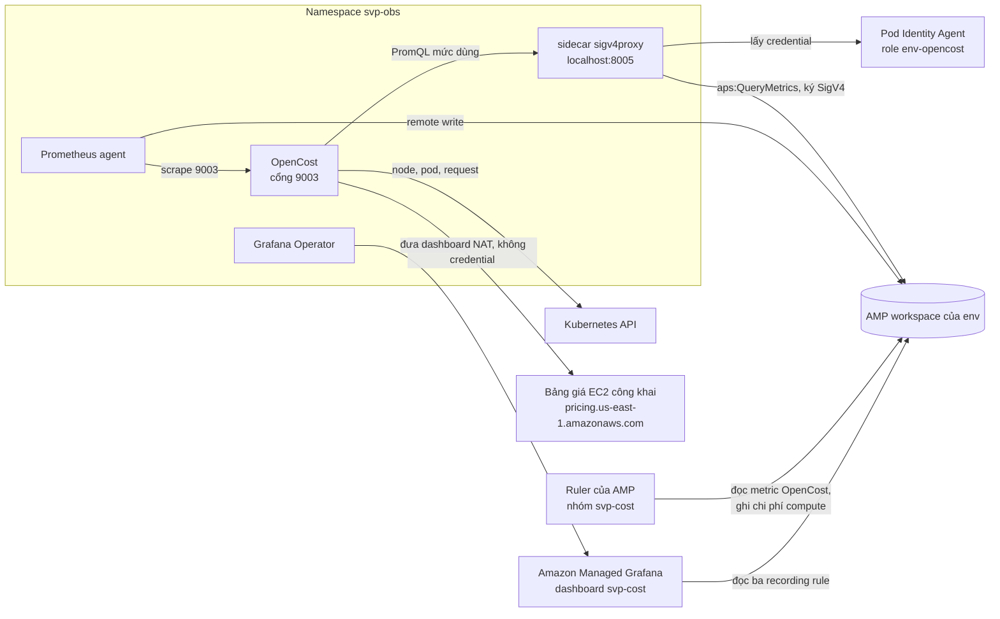
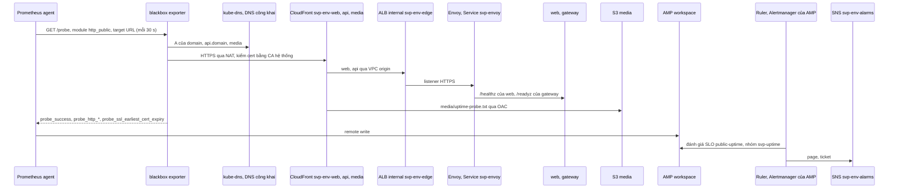
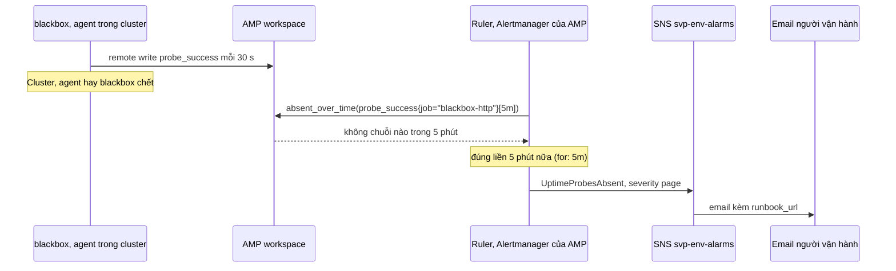

# Chi phí compute và uptime: OpenCost, blackbox exporter

Trang này giải thích hai phép đo nhìn hệ thống từ ngoài code của service: chi phí compute theo namespace và service (OpenCost), và uptime
của đường người dùng đi (blackbox exporter). Mỗi phần nói số lấy từ đâu, nghĩa và giới hạn của nó, cái giá của cách đo, và compose, k3d,
eks khác nhau ở đâu. Quyết định, phương án đã so và nguồn ở [ADR-0074](../adr/0074-cost-uptime.md) và
[phụ lục](../adr/appendix/0074-cost-uptime.md) của nó; số tiền mỗi buổi ở §11 của ADR, không chép ở đây. Giá trị nằm ở code:

- `svp-gitops`: component `opencost`, `blackbox-exporter`, `blackbox-exporter-public` của `argocd/apps/components.json`, values
  `base/opencost.yaml`, `base/blackbox-exporter*.yaml`, overlay `platforms/eks/`.
- Repo này: recording rule, luật cảnh báo ở
  [`svp-alerts.yaml`](../../deploy/observability/prometheus/rules/svp-alerts.yaml), SLO `public-uptime` ở
  [`svp-slos.yaml`](../../deploy/observability/slo/svp-slos.yaml), value `probes`, `opencost` và NetworkPolicy của chart
  [`svp-observability`](../../deploy/helm/svp-observability/values.yaml), dashboard `svp-cost`, `svp-uptime` ở
  [`deploy/observability/grafana/dashboards/`](../../deploy/observability/grafana/dashboards/).
- `svp-infra`: role Pod Identity `<cluster>-opencost` (`aws/modules/eks/`), object probe media (`aws/modules/media/uptime-probe.tf`).

Mối đe doạ của hai thành phần ở [threat model](../threat-model.md) OPS-5, OPS-6. Trong sơ đồ, `env` là `stg` hay `prd`, `<domain>` là tên
zone của env, `<media>` là tên media của env (`cluster.mediaDomain`).

## Chi phí compute

### Số lấy từ đâu

OpenCost (chart chính thức, một replica ở `svp-obs`) làm ba việc:

1. Đọc node, pod và các object khác qua Kubernetes API (ClusterRole của chart: `get`, `list`, `watch`, không Secret); request CPU, RAM
   của từng container lấy từ spec pod ở đây.
2. Đọc giá node: trên eks là bảng giá on-demand công khai của AWS cho region của cluster, tải không credential từ
   `pricing.us-east-1.amazonaws.com` lúc khởi động và mỗi khi gặp loại node mới; trên k3d là giá mặc định có sẵn của OpenCost.
3. Hỏi Prometheus chỉ mức dùng CPU, RAM của từng container (metric cAdvisor): trên k3d là `kps-prometheus` của `svp-obs`, trên eks là
   workspace AMP của env qua sidecar `sigv4proxy` trong cùng pod (OpenCost không tự ký SigV4; chế độ AMP của chart dùng proxy này).

Từ đó nó phát metric ở cổng 9003: `container_cpu_allocation`, `container_memory_allocation_bytes` (lượng cấp phát, là max của request và
mức dùng) và giá `node_cpu_hourly_cost`, `node_ram_hourly_cost`, `node_total_hourly_cost`. Prometheus của k3d hay agent của eks scrape
cổng đó qua ServiceMonitor của chart. Nhóm luật `svp-cost` ghép chúng thành ba recording rule, gọi chung là chi phí compute:

| Recording rule | Nghĩa |
| --- | --- |
| `namespace:svp_compute_cost_usd_per_hour:sum` | USD mỗi giờ của CPU và RAM được cấp phát cho container, theo namespace |
| `service:svp_compute_cost_usd_per_hour:sum` | Như trên cho namespace `svp`, theo service (tên container của chart `svp-service`) |
| `cluster:svp_node_cost_usd_per_hour:sum` | USD mỗi giờ của mọi node, gồm phần chưa cấp phát cho ai |

Dashboard `svp-cost` chỉ đọc ba rule này, không đọc metric thô của OpenCost: chi phí theo namespace, theo service, tổng cluster, phần
idle (cluster trừ tổng namespace) và ước tính tháng. UI, MCP và API Allocation của OpenCost không dùng: UI tắt, không gì gọi API.

Trên eks, sidecar lấy credential từ Pod Identity của ServiceAccount `opencost`: role `<cluster>-opencost` chỉ có bốn hành động đọc của AMP
trên workspace của env, không quyền giá, EC2 hay S3. Mọi lời gọi API AWS khác của OpenCost bị từ chối, và đó là chủ ý (mục sau). Recording
rule chạy ở ruler của AMP như mọi luật khác của eks ([ADR-0063](../adr/0063-managed-observability.md) §5), nên số còn đọc được ở AMG sau khi
cluster bị destroy. Component `opencost` sync sau các service: nó không Ready khi chưa tới được Prometheus, mà NetworkPolicy của
`svp-observability` và Pod Identity có thể chưa có trên một cluster mới; root chờ từng wave, nên đặt sớm hơn thì một lỗi của nó chặn mọi
service.

### Nghĩa và giới hạn của số

Chi phí compute trả lời "namespace hay service nào chiếm phần nào của node đang trả tiền", không phải "hoá đơn là bao nhiêu":

- Chỉ CPU và RAM được cấp phát cho container. Không EBS, dữ liệu qua NAT, CloudFront, RDS, MSK, ElastiCache hay dịch vụ managed khác:
  các khoản đó ở Cost Explorer theo tag ([ADR-0060](../adr/0060-org-detection-logging.md)).
- Giá là giá niêm yết on-demand: không Savings Plans, không giảm giá. prd chạy node on-demand nên khớp giá niêm yết; stg chạy node Spot
  mà OpenCost tính bằng giá on-demand (dưới), nên số stg là **trần**, không phải tiền đã trả.
- Trên k3d, giá mặc định của OpenCost không phải giá của máy nào: số k3d chỉ để thấy đường đi chạy (bước `uptime-cost` của `verify.yml`
  đòi tổng cluster và namespace `svp` lớn hơn 0), không để so.
- Compose không có OpenCost: dashboard `svp-cost` trống ở đó.
- API Allocation, Assets của OpenCost đọc vài metric kube-state-metrics v1 mà OpenCost chỉ phát khi `emitKsmV1Metrics` bật; values tắt nó
  để không trùng series với kube-state-metrics của kube-prometheus-stack. Metric mà ba recording rule đọc không cần chúng (request từ
  Kubernetes API, mức dùng từ cAdvisor), nên vẫn đúng; phần capacity, idle của API thì sai, và không gì đọc API.

### Vì sao không Spot Data Feed, không CUR

OpenCost đối soát được với hoá đơn thật qua Spot Data Feed (bucket S3, giao theo giờ) hay CUR qua Athena (`cloudCost`). Cluster của lab sống
một buổi vài giờ rồi destroy, còn CUR tới chậm tới một ngày và làm mới mỗi ngày, feed spot giao theo giờ: lúc dữ liệu đối soát tới thì
cluster đã không còn, nên không có gì để chạy đối soát. Bật chúng thêm bucket, quyền IAM và tài nguyên sống lâu mà không ra số nào trong buổi.

Không feed thì với node Spot OpenCost gọi `ec2:DescribeSpotPriceHistory`; role không có quyền đó nên lời gọi bị từ chối (OpenCost nhớ lỗi
một giờ) và nó lấy giá on-demand. Cái giá là số Spot của stg là trần. Thêm đúng quyền đó cho giá Spot gần thật là việc của "Xem lại khi" ở
ADR-0074, không phải hiện trạng.

## Uptime

### Probe đo từ đâu và cái giá

Mọi cảnh báo khác đo từ trong hệ thống (metric của service, của Envoy): DNS, cert, CloudFront, WAF hay ALB hỏng thì người dùng thấy lỗi mà
không SLO nào đỏ. Probe đi đúng đường người dùng đi:

- blackbox exporter chạy **trong cluster** (2 replica, trải zone, PDB) và gọi tên công khai của env qua NAT: DNS công khai, CloudFront có
  web ACL, VPC origin, ALB internal, Envoy, rồi web hay gateway; media qua CloudFront tới bucket S3 bằng OAC.
- Luật đánh giá ở **ruler của AMP**, ngoài cluster.

Phương án đúng nghĩa đen "từ ngoài" (CloudWatch Synthetics, Route 53 health check, Grafana Cloud Synthetic Monitoring, blackbox ở region
khác) thêm dịch vụ tính tiền hay công cụ, máy thứ hai; bảng so có giá ở phụ lục §6 của ADR-0074. Cái giá của cách đã chọn:

- Probe chung region, VPC và NAT với hệ thống, không đo từ địa lý người dùng: probe xanh chưa chứng minh mọi người dùng tới được; NAT hỏng
  thì probe đỏ dù người dùng vẫn vào được.
- Cluster chết thì probe chết theo. Phần này được bù bằng `UptimeProbesAbsent` ở ruler AMP (mục dưới).
- Bot Control của web ACL `svp-<env>-web` đang chỉ đếm ([ADR-0061](../adr/0061-edge-cloudfront-waf-acm.md)). Probe gửi User-Agent
  `svp-uptime-probe` và không chạy JavaScript; chuyển Bot Control sang chặn thì probe có thể bị 403.

### Luồng probe trên eks

Mỗi đích là một CR `Probe` (`uptime-<name>`, job `blackbox-http`; DNS `uptime-dns-<name>`, job `blackbox-dns`) do chart
`svp-observability` render từ value `probes`; agent Prometheus đọc chúng như đọc ServiceMonitor.

Đích `web` là `/healthz` của web, `api` là `/readyz` của gateway (gateway không Ready thì probe đỏ dù tiến trình còn sống), `media` là
object `media/uptime-probe.txt` trong bucket media, `Cache-Control: no-store` để mỗi probe tới origin. Module `http_public` chỉ nhận 200,
không theo redirect, chỉ IPv4, đòi TLS và kiểm chuỗi bằng CA hệ thống như trình duyệt. Ba probe DNS (`dns_web`, `dns_api`, `dns_media`) hỏi
`kube-dns` bản ghi A của ba tên; chúng không vào SLI (cùng lỗi đã làm probe HTTP đỏ) mà để khoanh vùng ở dashboard `svp-uptime` và runbook.

### SLO và cảnh báo

| Tên | Từ đâu | Mức | Bắt gì |
| --- | --- | --- | --- |
| `PublicUptimeBudgetBurn` | SLO `public-uptime` (99,9 %, SLI là trung bình `probe_success` của job `blackbox-http`) | page, ticket | Probe HTTP lỗi đủ nhiều để đốt ngân sách lỗi |
| `UptimeProbesAbsent` | Nhóm `svp-uptime`, `absent_over_time` 5 phút, `for: 5m` | page | Không còn chuỗi probe nào: cluster, agent hay blackbox chết |
| `TLSCertExpiringSoon` | Nhóm `svp-uptime`, hạn cert dưới 21 ngày | ticket | Gia hạn tự động đã hỏng |
| `TLSCertExpiryImminent` | Nhóm `svp-uptime`, hạn cert dưới 7 ngày | page | Như trên, sắp hết hạn |

21 ngày nằm dưới mốc gia hạn của ACM và của cert-manager (nguồn ở ADR-0074 §10): cert còn dưới mốc đó nghĩa là gia hạn đã không chạy, không
phải sắp chạy. Runbook: [`public-uptime-budget-burn.md`](../runbooks/public-uptime-budget-burn.md),
[`uptime-probes-absent.md`](../runbooks/uptime-probes-absent.md), [`tls-cert-expiry-imminent.md`](../runbooks/tls-cert-expiry-imminent.md).

Mỗi lần dựng cluster mới, `PublicUptimeBudgetBurn` cháy dù không có sự cố: `Probe` có từ khi `svp-observability` sync, trước khi web và
gateway lên, nên các lượt probe lúc dựng lỗi thật và nằm trong cửa sổ của cảnh báo. Page hết trong khoảng 30 phút sau khi ba đích xanh,
ticket theo cửa sổ 6 giờ của nó. Lab chấp nhận điều này thay vì làm trễ probe hay tắt luật lúc dựng; runbook ghi "cháy trong giờ đầu sau khi
dựng thì chờ, không điều tra".

### Khi cluster chết

Không có chuỗi `probe_success` thì SLI không có tỉ lệ và `PublicUptimeBudgetBurn` không cháy, như mọi SLO khác: chính lúc cluster chết là lúc
cảnh báo SLO im. `UptimeProbesAbsent` đóng chỗ đó vì ruler chạy ở AMP, không ở cluster:

Cảnh báo cũng cháy vài phút lúc dựng hay gỡ buổi: luật ở AMP có trước khi probe chạy và bị xoá ở bước gỡ buổi sau khi blackbox đã đi. Compose
và k3d chạy cùng luật trên Prometheus của chính chúng, nên có blackbox ở cả hai: không có nó thì cảnh báo cháy mãi ở đó.

## Compose, k3d và eks khác nhau ở đâu

| | Compose (`OBS=lgtm`) | k3d | eks |
| --- | --- | --- | --- |
| OpenCost | Không có | Component `opencost`, đọc `kps-prometheus`, giá mặc định | Component `opencost`, đọc AMP qua `sigv4proxy` và Pod Identity, giá công khai của AWS |
| blackbox | Service `blackbox` của profile `obs`, chỉ ở mạng internal `probe`, `probe-web` | Component `blackbox-exporter` | Component `blackbox-exporter-public` |
| Đích HTTP | `http://web:3001/healthz`, `http://gateway:8080/readyz`, `http://s3:9000/media/media/uptime-probe.txt` | `https://svp-envoy.envoy-gateway-system.svc.cluster.local` với `/healthz`, `/readyz`, `/media/media/uptime-probe.txt` | `https://<domain>/healthz`, `https://api.<domain>/readyz`, `https://<media>/media/uptime-probe.txt` |
| Module | `http_compose`, HTTP thường | `http_local_web`, `http_local_api`, `http_local_media`: SNI và `Host` của từng listener, không kiểm chuỗi TLS | `http_public` kiểm chuỗi bằng CA hệ thống; `dns_*` |
| Probe DNS | Không | Không (`svp.localhost` không có trong DNS của cluster) | Ba probe qua `kube-dns` |
| Nơi chạy luật | Prometheus trong LGTM | Prometheus `kps-prometheus` | Ruler của AMP |
| Object probe media | `deploy/s3/init.sh` | `deploy/s3/init.sh` qua Job `s3-init` | `aws/modules/media/uptime-probe.tf` của `svp-infra` |

- **k3d gọi Envoy theo tên Service cố định.** Service của đội Envoy tên `svp-envoy` ở mọi nền tảng (mặc định của chart `svp-cluster`), nên URL
  probe không phụ thuộc tên Envoy Gateway tự sinh. Probe đặt `Host` và SNI là `svp.localhost`, `api.svp.localhost`, `s3.svp.localhost` để
  Envoy chọn đúng listener và route.
- **k3d không kiểm chuỗi TLS.** Cert listener do cert-manager ký bằng CA sinh trong cluster (ClusterIssuer `svp-ca`), không có bản ở
  `svp-obs`; Secret `local-ca` của `svp-obs` là CA khác. Module bật `insecure_skip_verify`, và `probe_ssl_earliest_cert_expiry` vẫn có vì
  blackbox đọc hạn từ cert peer khi có kết nối TLS. eks kiểm đủ: không module nào của eks bỏ kiểm.
- **Compose không có TLS** ở trong mạng của nó, nên không có chuỗi hạn cert và hai cảnh báo TLS không cháy ở đó. blackbox không ra
  Internet: hai mạng của nó là internal ([`reference/compose.md`](../reference/compose.md)).
- **Đường mạng** là NetworkPolicy của chart `svp-observability`: blackbox ra pod Envoy cổng 10443 (`probes.egress: envoy`, k3d) hay TCP 443
  tới IPv4 công khai (`internet`, eks); OpenCost ra Prometheus (`opencost.query: prometheus`) hay endpoint AWS và agent Pod Identity
  (`amp`), và TCP 443 công khai cho bảng giá (`opencost.publicPricing`, eks). Luồng vào, ra của `svp-obs`:
  [`observability.md`](observability.md#networkpolicy).

## Kiểm ở đâu

- Kiểm tĩnh: `make helm-check` (render `Probe`, NetworkPolicy, hai component theo nền tảng), `make slo-check` (test promtool của nhóm
  `svp-uptime`, `svp-cost` và SLO `public-uptime`), test mocked của role `opencost` và object probe ở `svp-infra`.
- Bước `uptime-cost` của `verify.yml` ở job `gitops` (k3d) và `compose` (`compose-obs`): ba đích xanh, luật đã nạp, không
  `UptimeProbesAbsent` nào cháy; k3d thêm hạn cert và chi phí compute lớn hơn 0. Điều kiện đủ ở
  [`reference/ci.md`](../reference/ci.md#script-của-các-bước-verifyyml).
- Buổi stg, prd: chi phí theo namespace, uptime, mẫu AMP và dữ liệu NAT thật thay ước lượng ở phụ lục §11 của ADR-0074.
