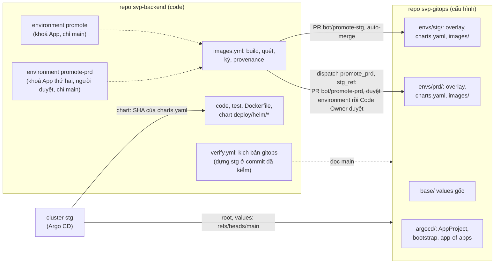
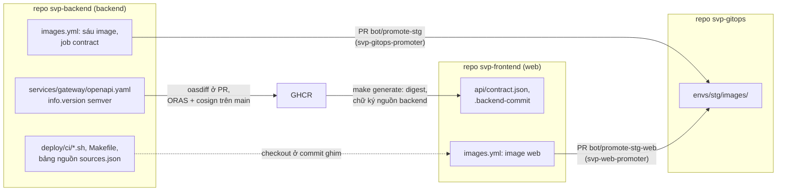

# Phát hành: CI/CD, chuỗi cung ứng, ba repo và hợp đồng API

Trang này trả lời: một thay đổi đi từ pull request tới pod đang chạy qua những bước nào, ai được làm bước nào, cái gì chứng minh
image đang chạy là image đã build và quét, và ba repo `svp-backend`, `svp-frontend`, `svp-gitops` chia việc với nhau ra sao. Lệnh ở
[`reference/ci.md`](../reference/ci.md), [`reference/k8s.md`](../reference/k8s.md); đọc một lượt chạy CI ở [`ci-cd.md`](../ci-cd.md);
nơi image chạy ở [`deployment.md`](deployment.md).

## CI/CD và chuỗi cung ứng

Vì sao: [ADR-0015](../adr/0015-cicd-devsecops-stage5.md), [ADR-0027](../adr/0027-slsa-build-provenance.md),
[ADR-0040](../adr/0040-sigstore-bundle-actions-attest.md), [ADR-0041](../adr/0041-github-hardening.md).

Image phát hành build trên GitHub Actions, không trên máy: workflow build, quét, ký và đẩy lên GHCR; một PR trong repo `svp-gitops`
ghi digest vào values ([hai repo](#hai-repo-code-và-cấu-hình-triển-khai)); Argo CD đồng bộ; Kyverno chỉ cho pod của `svp` chạy
image đã ký và sạch. Đường dev `make k8s-up` giữ image `dev-*` chưa ký trong registry k3d, policy chạy Audit.

```mermaid
flowchart LR
    dev["Người học<br/>nhánh, PR"]
    renovate["App Renovate<br/>PR dependency"]
    subgraph gh["GitHub: repo public"]
        pr["Pull request"]
        checks["ci.yml: make check, generate-check,<br/>buf, config, gitleaks<br/>images.yml: build-nopush"]
        main["main<br/>ruleset: ci-ok, images-ok"]
        build["images.yml trên main<br/>build amd64 + arm64 → trivy<br/>→ push → index → ký, attest"]
        promote["job promote<br/>(token App)"]
        rescan["rescan hằng ngày"]
    end
    gitops["repo svp-gitops<br/>PR bot/promote-stg,<br/>gitops-ok, auto-merge"]
    ghcr[("GHCR<br/>image theo digest,<br/>Sigstore bundle")]
    sigstore["Sigstore công khai<br/>Fulcio, Rekor, TUF"]
    subgraph cluster["cluster GitOps svp"]
        argo["Argo CD<br/>poll git"]
        kyv["Kyverno svp-images<br/>Enforce, chỉ ns svp"]
        app["Pod của svp<br/>canary gateway"]
    end
    dev --> pr
    renovate --> pr
    pr --> checks
    checks -->|"xanh, merge"| main
    main --> build
    build -->|"push, Sigstore bundle"| ghcr
    build -->|"OIDC → chứng chỉ, log ký"| sigstore
    build --> promote
    promote -->|"envs/stg/images/, charts.yaml"| gitops
    rescan -->|"attestation vuln mới"| ghcr
    gitops -->|"image.digest"| argo
    main -->|"chart ở SHA của charts.yaml"| argo
    argo -->|"tạo pod"| kyv
    kyv -->|"chữ ký, attestation"| ghcr
    kyv -->|"khoá tin cậy TUF"| sigstore
    kyv -->|"nhận"| app
    app -->|"kéo theo digest"| ghcr
```

- **Workflow** (ADR-0015 §1, §2): `ci.yml` chạy đủ mục Kiểm tra (Go test trên Postgres và Redis là service container, lệch code
  sinh, `buf breaking`, cấu hình, chart, digest bên thứ ba, gitleaks toàn lịch sử); `images.yml` build image. Mỗi file một check
  tổng (`ci-ok`, `images-ok`), là hai check bắt buộc của ruleset `main`. Cổng CRITICAL cho lockfile npm của web nằm ở CI của
  `svp-frontend`. Workflow thứ ba `verify.yml` nằm ngoài check bắt buộc ([kiểm chứng trên runner](reliability.md#kiểm-chứng-trên-runner),
  [ADR-0021](../adr/0021-deferred-verification-stage6b.md)); logic của cả ba nằm ở `Makefile` và `deploy/ci/`
  ([ADR-0023](../adr/0023-ci-platform-neutral.md)), script đọc thẳng biến của GitHub Actions và gọi `gh` trực tiếp
  ([ADR-0037](../adr/0037-mainpath-standard-tools.md) §2). Luồng và job của từng workflow cho
  người mới: [`ci-cd.md`](../ci-cd.md). Mọi action ghim SHA commit và chỉ là action của GitHub hay của chính nhà cung cấp công cụ;
  trivy, syft chạy bằng image ghim digest. Mọi job của lượt PR, kể cả PR từ fork, chỉ có `contents: read` và không secret; quyền
  ghi (`packages`, `id-token`, `contents`, `pull-requests`, `security-events`) chỉ ở job chạy trên `main` với code đã qua PR.
- **Build** (ADR-0015 §3, §4, §6): chỉ service có thay đổi so với lần push `main` thành công cuối (tập đường dẫn `image_paths` của
  `deploy/k8s/lib.sh`; đổi đường build, quét, ký thì cả sáu). Image `web` build, ký, promote ở CI của `svp-frontend` bằng cùng script
  ([ba repo](#ba-repo-và-hợp-đồng-api)); trivy quét cả gói npm của `node_modules` (ADR-0019 §1). Mỗi service build native trên
  runner amd64 và arm64, trivy quét tar cục bộ của từng kiến trúc: bí mật (mọi severity), lỗ hổng CRITICAL và HIGH có bản vá chặn
  **trước** push ([ADR-0070](../adr/0070-scan-gate-high-fixed.md)), HIGH chưa có bản vá chỉ báo (SARIF lên tab Security của `main`);
  ngoại lệ chỉ qua `.trivyignore.yaml` có lý do, tối đa 30 ngày. Push đúng image
  đã quét (so config digest), rồi ghép index đa kiến trúc `ghcr.io/anhnvcoder/svp-backend/<svc>:<12 hex commit>`.
- **Ký và attestation** (ADR-0015 §7): cosign keyless bằng OIDC của GitHub (chứng chỉ Fulcio, ghi Rekor; không khoá dài hạn), ký
  digest index với identity `images.yml@refs/heads/main`; attestation `vuln` trên index gộp kết quả quét hai nền tảng,
  SBOM SPDX của syft trên từng manifest con. Rescan hằng ngày quét lại mọi digest đang phát hành bằng DB mới và thay
  attestation `vuln` (rescan attest bundle mới rồi gỡ bundle `vuln` cũ). Chữ ký và attestation ở định dạng Sigstore bundle
  ([ADR-0040](../adr/0040-sigstore-bundle-actions-attest.md)); định dạng cũ (`.sig`, `.att`) chỉ còn cho bản phát hành cũ tới khi
  stg, prd hết digest cũ. Index của bản phát hành mang thêm attestation build provenance SLSA v1 do `actions/attest` sinh (workflow,
  ref, commit, lượt chạy), mức SLSA Build L2 (không L3).
- **Promote** (ADR-0015 §9, [ADR-0025](../adr/0025-gitops-config-repo.md) §2, §6): job `promote` dựng lại nhánh `bot/promote-stg` từ
  `main` của repo `svp-gitops` bằng token GitHub App, ghi `repository`, `tag`, `digest` của mọi service đã ký mà stg chưa chạy (không
  bao giờ ghi lùi) vào `envs/stg/images/<svc>.yaml` cùng commit chart vào `envs/stg/charts.yaml`, mở hay cập nhật một PR cuộn và bật
  auto-merge; PR tự merge khi `gitops-ok` xanh; Argo CD poll thấy commit, sync, gateway đi
  [canary](deployment.md#kubernetes-cục-bộ-k3d). Rollback stg là PR revert trong `svp-gitops`.
- **Admission** (ADR-0015 §8): Kyverno (admission controller + reports controller; version ghim ở `argocd/apps/components.json` của
  `svp-gitops`; admission controller một replica ở k3d, ba replica có PDB và trải zone trên EKS, `platforms/eks/kyverno.yaml`,
  [ADR-0056](../adr/0056-eks-platform-ha.md) §5), một `ImageValidatingPolicy` `svp-images` cho Pod ở namespace `svp`, kiểm theo
  thứ tự: prefix GHCR của repo và có digest (không gọi mạng), chữ ký đúng identity, attestation `vuln` đúng identity, đủ hai nền
  tảng, không CRITICAL, không quá 72 giờ; khi bật `requireProvenance` (overlay `envs/<env>/svp-policy.yaml` của `svp-gitops`, bật ở
  stg và prd) thêm provenance đúng identity, đúng `builder.id`, repository, ref, và `verify-release.sh` đối chiếu commit của nó với
  chứng chỉ. Đường GitOps Enforce (`Deny`, webhook `Fail`: Kyverno chết hay Sigstore, GHCR không tới được thì pod `svp` mới bị từ
  chối); đường dev Audit. Namespace khác không qua webhook. Image bên thứ ba (operator, dữ liệu, observability, Argo CD, Kyverno)
  ghim digest, kiểm tĩnh trong CI bằng bước 4 của `deploy/ci/gitops-check.sh` (`make helm-check`, check của `svp-gitops`), chưa
  kiểm chữ ký nhà cung cấp.
- **Thứ tự các phép của policy:** các phép chạy theo thứ tự và dừng ở phép đầu tiên sai, mỗi phép một message nêu image bị từ chối và,
  từ phép 2, nguồn của image. Phép 1 chỉ đọc pod nên từ chối image của registry cục bộ, của Docker Hub hay tên lạ dưới một prefix mà
  không hỏi registry nào; Kyverno chỉ xác minh image mà `matchImageReferences` chọn và cho mọi image khác đi qua. Điều đó chỉ đúng với
  image không glob nào khớp: Kyverno lấy mọi image được chọn từ registry của nó trước mọi phép, và registry từ chối (repository không
  tồn tại thì GHCR trả `DENIED`) làm đánh giá lỗi thay vì ra message của phép 1. Vì vậy `matchImageReferences` có hai glob mỗi tên được
  phát hành (`<imagePrefix><tên>@*`, `<imagePrefix><tên>:*`; glob kiểu gobwas không có dấu phân tách, `*` khớp cả `/`, `:`, `@`),
  không một glob mỗi prefix: `<imagePrefix>*` để pod có tên lạ dưới prefix tới GHCR trước
  ([lý do](../reference/k8s.md#kyverno-và-nguồn-phát-hành)). Image của một tên
  được phát hành mà không có digest khớp glob `:*` và bị `verifyDigest` từ chối sớm hơn ("does not have a digest"), trước khi Kyverno tra
  tag. Với `requireProvenance`, bốn phép thêm đứng sau sáu phép đầu cho mọi nguồn như nhau: image thiếu provenance chỉ bị từ chối khi đã
  qua mọi phép khác, nên message thiếu provenance không che lỗi nào khác. Nguồn của một image được chọn trong CEL theo prefix nó bắt đầu
  bằng: các prefix đã được kiểm không lồng nhau nên nhiều nhất một nguồn khớp, và mỗi phép xác minh chỉ gọi attestor của nguồn đó (`&&` và
  `?:` không tính vế bị bỏ qua). Payload của một attestation là cả statement in-toto nên đường dẫn bắt đầu ở `.predicate`;
  `extractPayload` chỉ đọc sau khi `verifyAttestationSignatures` đã xác minh nó trong cùng lần đánh giá (phép 3 đứng trước cho `vuln`,
  phép 7 cho provenance). Mỗi image vì vậy tốn một lần xác minh thứ ba khi Kyverno chưa có trong cache. Hai định dạng chữ ký được
  Kyverno tự phân biệt theo từng image nên policy không nêu tên chúng; image có một bundle thì chỉ đọc qua bundle, nên một bản phát
  hành không bao giờ trộn hai định dạng, và trong bundle mọi attestation của identity cũng tính là chữ ký cho phép 2. Định dạng cũ còn
  được nhận chừng nào một bản phát hành trong `envs/stg/images/` hay `envs/prd/images/` của `svp-gitops` còn mang nó (rollback cũng có
  thể tới một bản như vậy); hết bản thì các comment nhắc nó bỏ đi, và rollback về một bản như vậy cần quyết định khác.
- **Timeout của policy:** `webhookConfiguration.timeoutSeconds` là 30 giây, mức tối đa API server cho (mặc định của Kyverno là 10). Một
  lần xác minh chưa có cache tới TUF của Sigstore và GHCR; Rekor không được gọi vì policy không đặt `ctlog`, nên Kyverno v1.19.1 kiểm
  bằng chứng transparency log nhúng trong Sigstore bundle ngoại tuyến. Một chữ ký mất 6–8 giây trên cluster của lab (định dạng cũ); với
  image dạng bundle Kyverno lấy mọi bundle của digest cho mỗi lần xác minh, và CLI không cache mất 36–46 giây so với 14–16 giây của định
  dạng cũ. Tuổi tối đa của attestation (`maxAttestationAge`, một CEL duration) là 72 giờ: rescan hằng ngày làm mới nó, nên 72 giờ chịu
  được hai lượt chạy lỡ.
- **Policy sẵn sàng:** script coi policy `svp-images` (hay policy tạm của diễn tập) sẵn sàng khi Kyverno đã biên dịch nó
  (`status.conditionStatus.ready`) và `kyverno-resource-validating-webhook-cfg` có một webhook cho nó: webhook có `failurePolicy` của
  policy (hay giá trị gọi hàm nêu, `Fail` hoặc `Ignore`), `objectSelector` của policy, và rule mà `namespaceSelector` mang phép khớp
  namespace `svp` của policy (Kyverno AND nó với selector của ConfigMap của chính nó). Policy có `webhookConfiguration.timeoutSeconds`
  riêng (`svp-images` và mọi policy tạm của diễn tập) có webhook riêng, `ivpol.validate.kyverno.svc-fail-finegrained-<policy>`
  (`-ignore-` khi Audit); script vẫn tìm webhook theo cái nó chọn chứ không theo tên đó, vì tên thuộc quyền Kyverno đổi
  (`image_policy_ready` của `deploy/k8s/lib.sh`).
- **Bảng nguồn phát hành:** `files/sources.json` của chart `svp-policy` là chỗ duy nhất khai mọi nguồn (trường và nguồn hiện có ở
  [`reference/k8s.md`](../reference/k8s.md#kyverno-và-nguồn-phát-hành)). Nó nằm trong chart chứ không ở overlay nên một nguồn thêm hay
  bỏ tới stg trước prd cùng `revision` của chart, và không môi trường nào đổi được. Identity keyless khai trong đó là của `images.yml`
  trên `main` của repo nguồn: SAN của chứng chỉ Fulcio là `server_url` cộng `job_workflow_ref`, nên lượt chạy ở nhánh khác hay của
  workflow khác bị từ chối. Policy nhận đúng các image này với đúng các identity này, và script đọc cùng file, nên cái script kiểm
  chính là cái admission kiểm. Luật của bảng viết một lần trong template (`deploy/ci/sources-test.sh`); script không kiểm lại chúng
  và chỉ giữ hai luật về prefix (`release_sources`, hai hàm chọn nguồn), vì bảng có thể chưa qua render nào: lý do ở
  [`reference/k8s.md`](../reference/k8s.md#kyverno-và-nguồn-phát-hành). `release_sources` còn fail khi REV không phải commit của clone này
  hay là commit từ trước khi có bảng: không môi trường nào ghim commit như vậy nữa nên nguồn duy nhất của nó không được dựng lại từ
  values của thời đó; ghim commit mới hơn. Bảng của commit cũ có thể còn nguồn nghỉ hưu, không có `promoter` (repo đã đổi tên, nguồn kế
  thừa là nguồn khác): các bản phát hành ký dưới tên cũ vẫn được nhận chừng nào một môi trường còn chạy chúng, nhưng không gì build,
  promote hay rescan cho nguồn đó. Mọi nguồn của bảng working tree đều có `promoter` (`deploy/ci/sources-test.sh`).
- **Đọc file image của service:** `values_field FIELD` (`deploy/k8s/lib.sh`) đọc `image.FIELD` (`repository`, `tag`, `digest`) từ file
  values của một service và in không nháy, `""` khi rỗng. Nó chỉ đọc đúng dạng các file này có: một dòng `FIELD: <giá trị>` (thụt hai dấu cách) trong khối
  `image:` cấp cao nhất, giá trị trần hay trong nháy kép, không comment sau nó, đúng dạng của FIELD (`repository` `[0-9a-z.:/_-]*`, `tag`
  rỗng hay 12 hex thường là một commit, `digest` rỗng hay `sha256:<64 hex>`). Dạng khác thì fail và nêu vấn đề trên stderr thay vì đoán,
  vì kết quả đi tới registry, cosign và git; mã thoát 3 là không có dòng đó, 4 là dòng đó hai lần, 5 là giá trị sai dạng.
  `release_image SERVICE WHERE` đọc file image của SERVICE từ stdin (WHERE nêu nó trong message, như `envs/stg/images/gateway.yaml at
  1a2b3c4d5e6f`) và in `REPOSITORY@DIGEST` của bản phát hành mà file nêu, khi cluster GitOps kéo được nó: `image.digest` đã đặt (PR
  promote ghi), `image.repository` là image của SERVICE ở một nguồn phát hành có xuất bản SERVICE (`release_source_of`, bảng của working
  tree), và GHCR phục vụ manifest đó cho một lần kéo ẩn danh. Không thì fail và nêu nguyên nhân; không tạo gì. Bản phát hành có chữ ký và
  attestation `vuln` còn mới không là việc kiểm của `deploy/ci/verify-release.sh`.
- **Diễn tập admission controller chết:** ca (g) của `make drill-k8s-supplychain` làm Deployment của Kyverno giữ replica nhưng pod bị
  dừng và pod thay thế không lịch được (strategy `Recreate` và `nodeSelector` mà không node nào có), như khi nó crash hay node mất. Không
  scale về 0, vì Kyverno v1.19.1 xoá mọi cấu hình webhook của nó khi dừng mà Deployment đòi 0 replica (`IsGoingDown`,
  `pkg/utils/runtime/utils.go`), và khi đó mọi pod đi qua. Pod của `svp` bị từ chối (webhook fail closed), pod ở namespace `svp-probe`
  (tạo cho ca bằng template dùng chung, Pod Security `restricted`, ngoài phạm vi webhook) được nhận; giữa các lần thử Deployment vẫn muốn
  replica của nó mà không có pod Ready. Cuối ca, kể cả khi một bước lỗi, Deployment được đặt lại và Ready; trên cluster GitOps sync tự động
  của Argo CD tắt trước (Application gốc `svp-root`, rồi Application `kyverno`) để Argo CD không hoàn tác thay đổi giữa ca, và bật lại
  `kyverno` trước. Webhook của policy (selector, `failurePolicy`, rule) sau khi Kyverno trở lại giống như trước. Image gửi là bản phát
  hành đã ký mà một pod `svp` chạy, không thì image của registry cục bộ (đường dev). Hàm, đầu vào và dòng kết luận ở `deploy/k8s/drills/supplychain/lib.sh`.
- **Image chưa ký của diễn tập:** `unsigned_image` dùng giá trị `unsigned` khi được cho, không thì `drill-unsigned` mới nhất dưới
  prefix của nguồn `backend` trên GHCR (`deploy/ci/ghcr-digest.sh newest`, ẩn danh; dòng lỗi cuối ở `$work/unsigned.err`), rỗng khi
  không có. CI đẩy nó không chữ ký và không attestation nên không gì trên GHCR trỏ tới nó. Không dùng manifest nền tảng của index một bản
  phát hành đã ký: trong Sigstore bundle, attestation của bản đó trỏ cả tới từng manifest nền tảng và Kyverno tính chúng là chữ ký, nên nó
  qua phép chữ ký rồi bị từ chối muộn hơn, ở attestation `vuln`; các ca b, h và i khi đó phụ thuộc định dạng.
- **Renovate** (ADR-0015 §10): App Mend cho repo này và `svp-gitops`, mở PR hằng tuần cho Go module, action (SHA), base image, công
  cụ của `Makefile` (repo này), chart upstream, image ghim trong `base/`, commit checker (`svp-gitops`, bỏ qua `envs/**`); chờ bản
  phát hành 3 ngày; repo này tự merge khi `ci-ok`, `images-ok` xanh chỉ `digest`, `pinDigest` của base image và image của chart
  (cùng tag, digest mới) và `patch`, `digest` của image compose; còn lại (mọi cập nhật Go module, patch tag của base image và image
  chạy trong cluster, và mọi PR của `svp-gitops`) duyệt tay ([ADR-0041](../adr/0041-github-hardening.md) (i), thay một phần
  [ADR-0035](../adr/0035-renovate-automerge.md)). Nhóm `postgres` gom image Postgres của compose, job test của CI và CloudNativePG vào một PR
  cho minor, patch, digest, không tự merge, để mọi nơi giữ cùng `x.y` ([ADR-0057](../adr/0057-postgres17-verify-full.md) §1). Add-on EKS và AMI
  không đi qua Renovate (datasource cần credential AWS): nâng tay theo runbook nâng minor của `svp-infra`
  ([ADR-0056](../adr/0056-eks-platform-ha.md) §8); chart và image Karpenter qua Renovate của `svp-gitops` như component khác.
- **Chi phí:** repo public nên runner (cả arm64) và package GHCR public không tính tiền; ngân sách thời gian mỗi workflow dưới 10
  phút. Kyverno thêm 0,13–0,16 GiB RAM: cluster dev nghỉ 6,40 GiB, đỉnh 7,92 GiB khi media-worker scale lên (cách đo ADR-0014 §2).

## Hai repo: code và cấu hình triển khai

Vì sao: [ADR-0025](../adr/0025-gitops-config-repo.md), [ADR-0037](../adr/0037-mainpath-standard-tools.md) §6,
[ADR-0041](../adr/0041-github-hardening.md). Cài đặt và quy trình tay ở [`runbooks/svp-gitops-setup.md`](../runbooks/svp-gitops-setup.md).

- **Ranh giới:** repo code giữ code, test, Dockerfile, chart Helm và CI build, quét, ký; `svp-gitops` (public, không secret) giữ
  mọi thứ quyết định cái gì chạy ở một env: values gốc (`base/`), overlay, commit chart (`envs/<env>/charts.yaml`) và digest
  (`envs/<env>/images/`) của mỗi env, bản cài và manifest Argo CD. Push vào `main` repo code không đổi cluster nào.
- **Một bản phát hành = bảy digest + một commit chart**, đi qua stg rồi mới tới prd (như Freight của Kargo). `charts.yaml` mang
  `revision` (commit repo code) cùng hai giá trị dẫn xuất (`podSecurityVersion`, `collectorConfigSha256`); check của `svp-gitops`
  tính lại chúng; bước promote stg của repo code giữ guard tổ tiên ([ADR-0037](../adr/0037-mainpath-standard-tools.md) §6).
- **Argo CD multi-source:** root `svp-root` và nguồn `ref: values` đọc `svp-gitops` ở `refs/heads/main` (tên đầy đủ, không bao giờ
  tên ngắn: tên ngắn có thể phân giải sang tag cùng tên; ruleset `tags` cấm tạo tag), nguồn chart đọc repo code ở SHA 40 hex.
- **Quyền:** stg tự động (PR của bot chỉ đổi `envs/stg/`, không Code Owner, tự merge sau `gitops-ok`); prd chỉ qua PR do bot mở
  chép `envs/stg/` của một commit trên `main` của `svp-gitops` (`stg_ref`), sau khi người học duyệt environment `promote-prd` của
  repo code (job dừng chờ, admin không bypass) rồi Code Owner duyệt PR; file chung cần Code Owner, người học tự merge bằng bypass
  ruleset `owners` (có bản ghi). Khoá App chỉ ở hai environment của repo code, mỗi nơi một khoá riêng: `promote` (stg) và
  `promote-prd` (prd); hai job trên `main` (`promote`, `promote-prd`) dùng khoá của mình với token 1 giờ, chỉ `contents`,
  `pull_requests` write ([ADR-0041](../adr/0041-github-hardening.md) (d)).
- **Không có bản ghi stg** ([ADR-0037](../adr/0037-mainpath-standard-tools.md) §6): cổng prd là duyệt environment `promote-prd` rồi
  duyệt của Code Owner; `stg_ref` không bảo đảm stg đã chạy và smoke qua với đúng bộ đó. Bản ghi trạng thái triển khai được chọn
  là Argo CD Notifications ([ADR-0032](../adr/0032-argocd-deploy-status.md) A, B), dựng khi có EKS stg chạy suốt buổi.
- **Đường dev:** đọc working tree của bản clone `svp-gitops` cạnh repo (`../gitops`, hay `SVP_GITOPS_DIR`), không tự clone hay
  fetch; CI clone ẩn danh bằng `make gitops-clone`. Thay đổi cần cả code lẫn cấu hình thành hai PR theo thứ tự (cấu hình tương
  thích bản cũ trước).
- **Ngân sách RAM của cluster GitOps** trên runner và lượt kiểm của đường hai repo: [ADR-0021](../adr/0021-deferred-verification-stage6b.md),
  [ADR-0025](../adr/0025-gitops-config-repo.md).

## Ba repo và hợp đồng API

Vì sao: [ADR-0033](../adr/0033-svp-web-repo.md), [ADR-0036](../adr/0036-repo-rename.md),
[ADR-0037](../adr/0037-mainpath-standard-tools.md) §6. Cài đặt GitHub ở
[`runbooks/svp-frontend-setup.md`](../runbooks/svp-frontend-setup.md).

Web client nằm ở repo riêng để mô phỏng team FE và team BE riêng (hệ thống một người không cần tách; cái giá ở ADR-0033 mục 11).

- **Ranh giới:** backend giữ service Go, hợp đồng REST, stack compose, cluster k3d, chart và script CI; `svp-frontend` giữ mã web,
  test Vitest và e2e, `Dockerfile` ở gốc, CI và image web; `svp-gitops` giữ cái gì chạy ở mỗi env
  ([hai repo](#hai-repo-code-và-cấu-hình-triển-khai)). Workspace trên máy: `backend/`, `frontend/` (bản clone `svp-frontend`),
  `gitops/` cạnh nhau; script của backend đọc mã web qua `web_dir` (`SVP_WEB_DIR` hay `../frontend`), `svp-frontend` đọc harness
  của backend qua `SVP_BACKEND_DIR` (mặc định `../backend`).
- **Hợp đồng:** `services/gateway/openapi.yaml` là nguồn duy nhất ([REST ở gateway](../reference/contracts.md#rest-ở-gateway)),
  `info.version` theo semver; `make api-contract-check` (job `api-contract`, bắt buộc ở PR) dùng oasdiff đòi tăng đúng mức (breaking
  là major, có changelog là minor). Mỗi version phát hành một lần bằng job `contract` của `images.yml` trên `main`: OCI artifact
  `ghcr.io/anhnvcoder/svp-backend/api/gateway:<version>` đẩy bằng ORAS, ký keyless, không ghi đè. `svp-frontend` ghim `repository`,
  `version`, `digest` ở `api/contract.json`; `make generate` kiểm digest, version, chữ ký của nguồn `backend` rồi mới sinh
  `gen/api.d.ts`. Breaking đi ba bước: thêm cái mới (minor), chuyển web, bỏ cái cũ (major).
- **Nguồn phát hành:** mỗi repo phát hành image dưới prefix riêng, ký bằng workflow của chính nó
  (`deploy/helm/svp-policy/files/sources.json`: `backend` sáu service Go dưới `ghcr.io/anhnvcoder/svp-backend/`, `web` chỉ
  `ghcr.io/anhnvcoder/svp-frontend/web`); Kyverno chọn attestor theo prefix, check của `svp-gitops` giới hạn file mỗi bot được đổi
  (luật tác giả hẹp, đọc từ bảng nguồn). Identity ký và prefix image mang tên repo ([ADR-0036](../adr/0036-repo-rename.md)), nên
  image dưới tên repo cũ (`short-video-platform`, `svp-web`) bị policy từ chối. Danh sách build của backend (`built_services`, sáu)
  tách khỏi danh sách bảy bản triển khai (`svp_services`) mà promote prd, rescan đọc.
- **Script CI dùng chung:** `svp-frontend` checkout `deploy/ci/` của backend ở commit ghim `.backend-commit` (chỗ ghim duy nhất,
  Renovate nâng) và chạy với `SVP_CODE_ROOT` trỏ cây của nó; logic build, quét, ký, attest, rescan chỉ có một bản; promote là bước
  `yq` + `gh pr` trong `images.yml` của mỗi repo ([ADR-0037](../adr/0037-mainpath-standard-tools.md) §6).
- **Kiểm chéo:** job `stack` của `svp-frontend` dựng compose của backend ở commit stg chạy với sáu image stg theo digest
  (`make up IMAGES=stg WEB_FROM=clone`) và chạy e2e của PR; job `stack` của backend chạy web bản stg và e2e của `svp-frontend` ở
  commit đó. Cả hai chỉ báo; e2e không chặn một PR backend làm hỏng web mà oasdiff không thấy.
