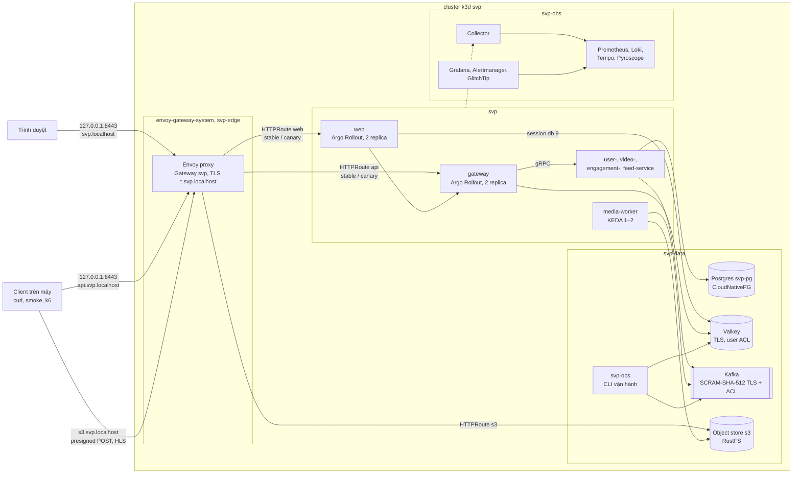
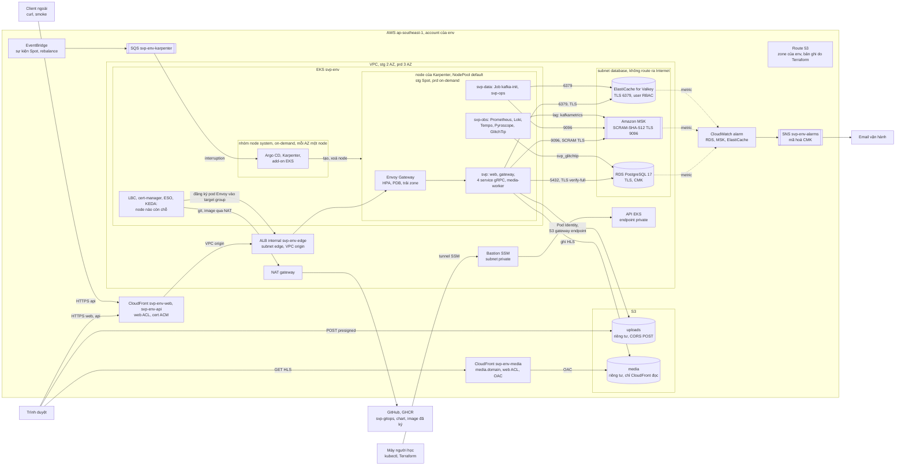
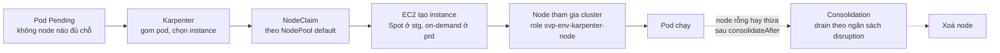
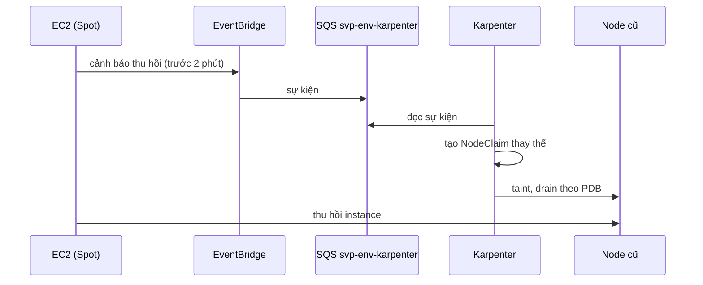
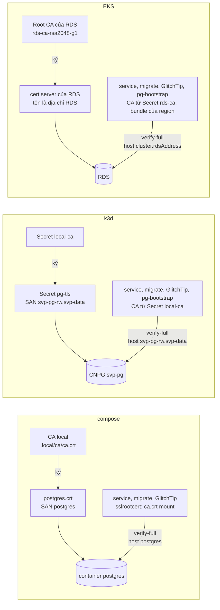

# Triển khai: compose, k3d và AWS

Trang này trả lời: cùng một hệ thống chạy ở đâu (stack compose trên máy, cluster k3d, cluster EKS trên AWS), mỗi nơi gồm những
thành phần nào, nối với nhau ra sao và vì sao khác nhau. Lệnh chạy ở [`reference/compose.md`](../reference/compose.md),
[`reference/k8s.md`](../reference/k8s.md), [`reference/eks.md`](../reference/eks.md); sơ đồ container chung ở
[`architecture.md`](../architecture.md#5-khối). Quan sát (Collector, Grafana, GlitchTip) ở
[`observability.md`](observability.md); cách image đi tới cluster ở [`delivery.md`](delivery.md).

## Compose

Vì sao: [ADR-0008](../adr/0008-async-upload-pipeline-stage2a.md), [ADR-0022](../adr/0022-local-object-store-minio-replacement.md),
[ADR-0053](../adr/0053-msk-elasticache-valkey.md), [ADR-0057](../adr/0057-postgres17-verify-full.md).

Object store RustFS thay S3, không có CDN (client đọc thẳng store). Postgres, Kafka, Valkey và object store chạy trong compose profile `core`.
Giới hạn RAM, CPU của từng container ở [`deploy/compose/compose.yaml`](../../deploy/compose/compose.yaml).

- **Postgres** (ADR-0057 §3; cùng major và cùng TLS với RDS của stg, prd): container `postgres`, PostgreSQL 17 ghim digest, mỗi service một
  database và cặp role migrator/app (bảng ở [`AGENTS.md`](../../AGENTS.md) mục "Database và Redis"), dữ liệu ở volume riêng, không publish
  cổng (`127.0.0.1:5432` của máy là Postgres native, chỉ cho `make test`). Server phục vụ cert `postgres.crt` do CA local của `make env` ký;
  `deploy/postgres/pg_hba.conf` từ chối mọi kết nối mạng không TLS, như `rds.force_ssl` của RDS. Client nối `postgres:5432` với
  `sslmode=verify-full`: kiểm CA lẫn tên trong cert ([chuỗi TLS tới Postgres](#tls-tới-postgres)). `make up` dựng container trước rồi chạy
  bootstrap role, database bên trong nó (`docker compose … exec postgres psql`), nên máy không cần `psql`.

- **Object store `s3`** (RustFS ghim version và digest, non-root, root fs chỉ đọc, console tắt;
  [ADR-0022](../adr/0022-local-object-store-minio-replacement.md)): `s3` là endpoint tương thích S3 API (không phải AWS S3), chạy
  RustFS; code dùng `internal/objstore`. Hai bucket `uploads` (riêng tư) và `media` (ẩn danh chỉ đọc từng object, không liệt kê
  được); video-service và media-worker mỗi bên một user với policy theo tiền tố key; root chỉ ở container store và job init
  `s3-init` (`deploy/s3/init.sh`, chạy lại mỗi `make up`, idempotent). Client upload và đọc HLS qua `127.0.0.1:9000`. CORS theo
  bucket do `s3-init` đặt, chỉ nhận origin của web (`http://localhost:3001`, `web-dev` `http://localhost:3002`): `POST` vào
  `uploads`, `GET`/`HEAD` ở `media`; bucket khác không có header CORS (threat model WEB-10); web đặt `MEDIA_ORIGIN` và
  `UPLOAD_ORIGIN` là `http://127.0.0.1:9000`. Compose có thêm user thử `svp-objstore-probe` chỉ cho bucket `objstore-probe` của
  test tích hợp. Không có đường quay lại MinIO ([ADR-0050](../adr/0050-bash-to-standard-tools.md)): đổi store thì chép bằng
  công cụ S3 chuẩn (`mc mirror`, `rclone`).
- **Kafka** (cùng phần mềm, xác thực, TLS và cổng với Amazon MSK của stg, prd): service `kafka`, image `apache/kafka`, một tiến trình
  KRaft (broker và controller), client nói SASL_SSL SCRAM-SHA-512 ở `kafka:9096` với cert do CA local của `make env` ký (container
  một lần `tls-init` chép cert và khoá vào volume `svp-tls` với owner là user của image server); listener controller và liên broker là
  PLAINTEXT bind `localhost` của container. Không publish cổng nào. Container init `kafka-init` (`deploy/kafka/kafka-init.sh`, cùng
  script với Job `kafka-init` của chart `svp-data`) đăng nhập `svp-admin`, cấp `svp-admin` ALL trên mọi tài nguyên trước mọi ACL khác,
  tạo topic và `.dlq` (broker tắt tự tạo topic, RF 1), user của từng client và ACL literal của chúng; service có Kafka chờ nó xong.
- **engagement-service và feed-service** ([ADR-0009](../adr/0009-engagement-feed-stage2b.md) mục 12): gRPC ở `:9103` và
  `:9104` chỉ trong mạng compose, không publish ra máy (gateway gọi `engagement-service:9103`, `feed-service:9104`); database riêng
  `svp_engagement`, `svp_feed`. Số đo: lúc nghỉ 9–23 MiB mỗi service; feed-service đỉnh 82 MiB khi nạp 200.000 follow.
- **Valkey** ([ADR-0010](../adr/0010-redis-ratelimit-cache-resilience-stage2c.md) mục 1, ADR-0053 §8, §9; cùng phần mềm với ElastiCache
  for Valkey): container `valkey`, TLS ở `valkey:6379` (không cổng thường, không publish), user `default` tắt, mỗi client một user ACL
  chỉ được db và tiền tố của mình, qua `REDIS_URL=rediss://<user>:<mật khẩu>@valkey:6379/<db>`: gateway `svp-gateway` db 10, tiền tố
  `svp:gw:` (rate limit, `svp:gw:rl:<lớp>:<định danh>`); web `svp-web` db 9, tiền tố `svp:web:` (session, khoá single-flight của
  refresh); feed-service `svp-feed-service` db 14, tiền tố `svp:feed:` (cache trang đầu feed khám phá). aclfile do `make up` ghi từ mật
  khẩu của `.env` (`deploy/valkey/aclfile.sh`, access string của ADR-0053 §9). Không persistence, `maxmemory 64mb`, `noeviction`; mọi
  khoá có TTL. `make test` vẫn dùng Redis native `127.0.0.1:6379` db 15, mỗi test một tiền tố `svp:test:<hex>:`. Client có timeout ngắn
  (dial 100 ms, đọc/ghi 50 ms); service khởi động và vẫn ready khi Valkey lỗi, vì mọi chỗ dùng nó đều có đường lui
  ([đọc feed](../architecture.md#62-đọc-feed), [REST ở gateway](../reference/contracts.md#rest-ở-gateway)).
- **CLI vận hành** (ADR-0053 §13): script trên máy chạm Kafka và Valkey chỉ qua `/opt/svp/bin/svp-kafka` (Kafka CLI, đăng nhập `svp-admin`)
  và `/opt/svp/bin/svp-valkey` (`valkey-cli --tls`, đăng nhập `svp-ops`), mount chỉ đọc từ `deploy/ops/` vào container `kafka`, `valkey`
  và chạy bằng `docker compose exec`; `SVP_AS_USER=<user>` đăng nhập user thường để kiểm quyền, mật khẩu là dòng đầu của stdin.
- **web** ([ADR-0016](../adr/0016-web-client.md) §5–7, [ADR-0019](../adr/0019-web-k3d-supply-chain-observability.md)): Next.js
  standalone trong image distroless, publish `127.0.0.1:3001`, origin `http://localhost:3001`; gọi duy nhất `http://gateway:8080`;
  session ở Valkey db 9 (user `svp-web`, tiền tố `svp:web:`, khoá là `sha256(sid)`; Node tin CA local qua `NODE_EXTRA_CA_CERTS`).
  Container chỉ đọc, bỏ mọi capability, non-root, giới hạn pid. Nằm trong mạng compose riêng `web` chỉ chung với gateway, `valkey`,
  `otelcol` và `glitchtip` (hai cái sau thuộc profile `obs`, để web gửi OTLP và lỗi), không tới service gRPC, Kafka, object store theo
  tên compose. Web không cần dịch vụ nào của máy, nhưng Docker Desktop vẫn phân giải `host.docker.internal` ở mọi container, nên nó vẫn
  tới mọi cổng publish trên loopback của máy (threat model WEB-13, chấp nhận ở compose). Gateway compose bật `TRUST_TRACE_CONTEXT`
  ([quan sát web](observability.md#web)).
- **Mạng riêng của media-worker:** worker chạy ffmpeg trên file người dùng tải lên, nên chỉ nằm trong mạng compose `worker`
  (`internal`, không route ra ngoài) cùng Kafka, object store `s3` và Collector `otelcol`; nó không tới được gateway, các service
  gRPC, Postgres hay internet. Container chỉ đọc, bỏ mọi capability, giới hạn 2 CPU, 2 GB.
- **Observability:** Collector, profile `obs` và `obs-elastic` ở [`observability.md`](observability.md#compose).

## Kubernetes cục bộ (k3d)

Vì sao: [ADR-0014](../adr/0014-kubernetes-local-stage4.md), [ADR-0019](../adr/0019-web-k3d-supply-chain-observability.md),
[ADR-0024](../adr/0024-multi-environment.md), [ADR-0026](../adr/0026-secrets-gitops.md).

Cùng 6 service và web, cùng image và cùng biến môi trường như compose, chạy trên cluster k3d `svp` (1 server + 1 agent, node
arm64, image k3s theo `K3S_IMAGE_TAG` của [`Makefile`](../../Makefile)). Compose vẫn là đường dev chính; hai đường không chạy cùng
lúc (máy 16 GB). Cổng chỉ trên `127.0.0.1`: API 6550, HTTPS 8443, registry 5111. Lệnh ở [`reference/k8s.md`](../reference/k8s.md).

- **Namespace:** `svp` (6 service và web), `svp-data` (Postgres, Valkey, Kafka, object store `s3`, `svp-ops`), `svp-obs` (observability,
  GlitchTip), `svp-edge` (`Gateway`, chứng chỉ wildcard); công cụ ở `cert-manager`, `envoy-gateway-system`, `cnpg-system`, `keda`,
  `argo-rollouts`, `kyverno` và `argocd` (chỉ đường GitOps). Mọi namespace trừ `kube-system` chạy Pod Security `restricted`; bốn
  namespace của project có NetworkPolicy chặn mặc định hai chiều, mỗi luồng ở bảng ADR-0014 §3 một policy theo label pod
  (threat model FF-5, IN-2).
- **Luồng vào:** client gọi `https://api.svp.localhost:8443` (tên `*.localhost` phân giải về loopback), qua load balancer
  của k3d và `svclb` tới Envoy proxy do Envoy Gateway dựng từ `Gateway` `svp`; TLS dùng chứng chỉ wildcard do cert-manager
  ký bằng CA local (`make k8s-ca` xuất CA ra `.k8s/ca.crt`). HTTPRoute `api` chia traffic giữa Service `gateway` và
  `gateway-canary`; HTTPRoute `s3` (`s3.svp.localhost`) đưa presigned POST và GET HLS tới object store `s3`, nên URL ký có host
  công khai thay `127.0.0.1:9000`. Trình duyệt mở web ở `https://svp.localhost:8443`: listener `https-apex` của Gateway với chứng
  chỉ riêng chỉ có tên `svp.localhost` (wildcard không phủ tên gốc; chứng chỉ chung cho cả hai tên làm trình duyệt gộp kết nối
  HTTP/2 của `s3` vào listener khác), HTTPRoute `web` tới Service `web:3001`; mọi route của chart service bỏ `traceparent`,
  `tracestate`, `baggage`, `sentry-trace` của client. Object store chỉ nhận CORS từ `https://svp.localhost:8443`, theo bucket như
  compose. Gateway tin đúng một hop `X-Forwarded-For` từ dải pod `10.42.0.0/16` (threat model RL-1); mọi client trên máy đi ra
  cùng địa chỉ node nên rơi vào tối đa hai bucket rate limit (ADR-0014 §9).
- **Dữ liệu trong cluster** (ADR-0014 §4, §5), không đụng Postgres/Redis native: Postgres `svp-pg` một instance PostgreSQL 17 do
  CloudNativePG quản, cùng tên database `svp_<svc>` và cặp role migrator/app như compose, đăng nhập `scram-sha-256` trên TLS `verify-full`
  tới `svp-pg-rw.svp-data` (cert server `postgres.crt` của CA local qua Secret `pg-tls`, [chuỗi TLS](#tls-tới-postgres));
  Valkey (Deployment `valkey`, `valkey.mode: cluster`) và Kafka (StatefulSet `kafka` một broker, Job `kafka-init`, `kafka.mode: cluster`)
  cùng image, cùng cấu hình, cùng user và ACL như compose ([ADR-0053](../adr/0053-msk-elasticache-valkey.md)): Valkey TLS ở
  `valkey.svp-data.svc.cluster.local:6379`, không persistence, gateway db 10, feed-service db 14, web db 9 (session), mỗi client một
  user; Kafka SASL_SSL SCRAM-SHA-512 ở `kafka.svp-data.svc.cluster.local:9096` (broker quảng bá tên Service, tên có trong SAN của CA
  local), mỗi client một user, ACL literal. Cert và khoá của CA local, aclfile và mật khẩu user Kafka là Secret của `svp-data` (Pod mount
  với `defaultMode: 0440` và `fsGroup`); client tin CA qua `SSL_CERT_DIR` (Go), `NODE_EXTRA_CA_CERTS` (web), tham số `ca` (KEDA),
  `tls.ca_file` (Collector). Object store `s3` (StatefulSet một replica, `s3.svp-data:9000`)
  cùng bucket, user, policy và script init như compose, không user thử. Mật khẩu sinh bằng `make env`, đưa vào Secret bằng `deploy/k8s/secrets.sh`, không nằm
  trong git. Trên đường GitOps ([ADR-0026](../adr/0026-secrets-gitops.md)) `secrets.sh` chỉ ghi nguồn vào namespace
  `svp-secrets`; External Secrets Operator (component `external-secrets`, wave 0, chỉ đường GitOps) dựng Secret từ ExternalSecret
  của chart `svp-cluster` (`deploy/helm/svp-cluster/templates/external-secrets.yaml`), mỗi namespace một SecretStore chỉ đọc đúng
  entry của nó; stg và prd trên EKS đọc AWS Secrets Manager, entry do `deploy/k8s/aws-secrets.sh` (`make eks-secrets`) ghi, trừ
  `kafka-admin`, `kafka-users`, `valkey-users` mà Terraform ghi cùng lúc tạo user MSK và ElastiCache ([AWS](#aws)). Repo chỉ có tên Secret, key và nguồn. Đổi một credential là một lệnh, `make k8s-secrets` (k3d, cả cluster GitOps) hay
  `make eks-secrets` (EKS), làm theo thứ tự máy chủ, rồi Job init của `svp-data` đặt mật khẩu mới, rồi client; Reloader (component
  `reloader`, mọi nền tảng) restart workload opt in khi Secret nó đọc đổi, không script nào restart
  ([ADR-0050](../adr/0050-bash-to-standard-tools.md) mục 5).
- **Workload** (ADR-0014 §10): một chart chung `deploy/helm/svp-service` cho 6 service và web (probe, `requests`/`limits`,
  securityContext `restricted`, không token ServiceAccount); gateway 2 replica có PDB và HPA theo CPU, feed-service luôn 2
  replica (HPA 2–2) có PDB, ưu tiên trải theo zone rồi theo node ([ADR-0031](../adr/0031-chaos-findings-feed-engagement-tempo.md) §1,
  [ADR-0056](../adr/0056-eks-platform-ha.md) §6; node k3d không có nhãn zone nên chỉ trải node có tác dụng), web 2
  replica cố định có PDB, trải hai node, chờ 5 s trước khi tắt (server Next thoát ngay khi nhận SIGTERM), NetworkPolicy chỉ nhận
  từ Envoy và chỉ ra gateway, Valkey, Collector, GlitchTip (threat model WEB-13); media-worker 1–2 replica do KEDA scale theo lag
  của group `media-worker` (topic vẫn 3 partition; 3 worker cùng transcode làm Docker VM hết CPU và k3s server chết,
  [ADR-0017](../adr/0017-gitops-capacity-media-worker-max2.md)). Probe của chart có hạn nới để node bão hoà CPU không làm kubelet
  giết pod còn sống ([khởi động và probe](reliability.md#khởi-động-và-probe)).
- **Observability** (ADR-0014 §11): tách thành từng thành phần trong `svp-obs`, chi tiết ở
  [`observability.md`](observability.md#k3d).
- **Cài đặt và GitOps** (ADR-0014 §7, §12; cấu hình ở repo `svp-gitops`, [hai repo](delivery.md#hai-repo-code-và-cấu-hình-triển-khai)):
  `argocd/apps/components.json` của `svp-gitops` liệt kê các thành phần theo wave 0–7 (cert-manager, Envoy Gateway, External
  Secrets Operator (chỉ đường GitOps cài); namespace, CA, policy; operator và Kyverno; backend dữ liệu, observability, plugin
  Barman Cloud và policy image `svp-policy`; chart dữ liệu; chart observability; Collector; 6 service và web, web đứng sau
  gateway). Đường dev `make k8s-up` cài file đó bằng helmfile (`deploy/k8s/helmfile.yaml.gotmpl`, `needs` theo wave) từ bản clone
  `svp-gitops` cạnh repo (values `base/`), image tag `dev-<image ID>` build từ working tree bằng `docker buildx bake` (bảng
  `deploy/docker-bake.json`) vào registry k3d (môi trường dev); đường GitOps `make k8s-gitops-up` dựng cluster mới
  đóng vai stg (`base/` cộng overlay `envs/stg/`, [ADR-0024](../adr/0024-multi-environment.md)) mà Argo CD (app-of-apps, root
  `svp-root` với giá trị `env`, AppProject `svp`) đồng bộ từ GitHub qua HTTPS ẩn danh (không deploy key), image kéo từ GHCR theo
  digest mà PR promote ghi vào `envs/stg/images/` ([CI/CD](delivery.md#cicd-và-chuỗi-cung-ứng)); overlay prd chỉ render và kiểm
  tĩnh ở k3d.
- **Canary của gateway** (ADR-0014 §13): Argo Rollouts đổi trọng số HTTPRoute `api` qua plugin Gateway API: 25% → 60 s →
  50% → 60 s → bước phân tích chặn → 100%. Phân tích đọc metric Envoy của backend canary trong Prometheus: tỉ lệ 5xx < 1%
  và p99 < 150 ms (SLO feed), cần ít nhất 30 response không phải 4xx mỗi phút; hỏng hay Prometheus không trả lời thì
  abort, route về 100/0, pod stable không bị đụng. Web có canary cùng bước trên HTTPRoute `web`, p99 < 250 ms. Điều hướng
  gặp bản build khác thì Next tự tải lại trang (so build ID của payload RSC); `deploymentId` theo commit thay build ID ngẫu
  nhiên đó bằng một id đã biết, dùng làm khoá tải lại, `release` và `service.version`. Server Action tới bản khác (409) và
  chunk lệch (404, gồm chunk hls.js mà player bắt lỗi) thì một helper dùng chung tải lại trang một lần cho mỗi bản build,
  gọi từ error boundary, `unhandledrejection` và nhánh `catch` của `loadHls()` trong player pool (ADR-0019 §3). Chunk tải
  lười thứ hai, `web-vitals` của RUM, 404 thì lỗi bị nuốt: không tải lại, không báo lỗi, chỉ mất số đo của lần tải đó.
- **Client Kafka** ([ADR-0013](../adr/0013-kafka-metadata-min-age.md)): mọi client franz-go đặt `MetadataMinAge` 1 s, nên
  produce có hạn trả về gần hạn hơn khi kết nối tới broker chết giữa chừng; áp cho cả compose và k3d.
- **Chi phí:** RAM của cả cluster lúc nghỉ 5,9–6,8 GiB theo `docker stats` (gồm ~1–2 GiB page cache; phần anon ~3,9 GiB),
  đỉnh ~8 GiB khi media-worker scale lên, so với 1,7–2,6 GiB của compose `core` + `obs`; cách đo ở ADR-0014 §2.

## Chart Helm của project

Năm chart ở `deploy/helm/`: `svp-cluster` (nền tảng của cluster: namespace, chứng chỉ, cổng vào, NetworkPolicy, ExternalSecret),
`svp-data` (tầng dữ liệu), `svp-observability` (phần observability của project ở namespace `svp-obs`), `svp-service` (một chart
chung cho 6 service và web) và `svp-policy` (policy image, xem [phát hành](delivery.md#cicd-và-chuỗi-cung-ứng)). Lệnh cài và kiểm ở [`reference/k8s.md`](../reference/k8s.md); phần này ghi vì sao
chart cấu hình như vậy.

### Cài đặt: namespace và kiểu apply

- **Namespace có trước release.** `install.sh` tạo namespace của wave 0 và của project với Pod Security `restricted`, chart `svp-cluster`
  tạo namespace của nền tảng. `--create-namespace` kiểu server-side của Helm 4 sẽ apply một Namespace riêng dưới field manager mà mọi
  release dùng chung, và lần apply đó xoá nhãn mà `svp-cluster` đặt. `svp-cluster` tạo các namespace nền tảng của values
  (`argo-rollouts`, `cnpg-system`, `keda`, `kyverno`, `reloader`) để Pod Security có hiệu lực trước pod đầu tiên của chart của chúng;
  `install.sh` tạo namespace của project trước đó với cùng nhãn, vì Envoy Gateway (wave 0) gắn một Role vào từng namespace nó theo dõi
  và Helm không tạo được Role trong namespace chưa có. `svp-cluster` tiếp quản các namespace đó (`takeOwnership` trong
  `helmfile.yaml.gotmpl`), vì Helm từ chối một object có sẵn mà thiếu annotation của release trừ khi được bảo tiếp quản. Mọi object
  `svp-cluster` render là của project, dưới tên không chart nào khác dùng.
- **Release có canary (gateway, web) apply phía client.** Argo Rollouts ghi vào hai object của chart: selector của Service `<release>` và
  `<release>-canary` (`rollouts-pod-template-hash`) và trọng số trong HTTPRoute của release. Apply server-side của Helm 4 gửi cả
  selector và `rules` của chart, hai field atomic do controller và plugin của nó quản, nên upgrade lỗi vì xung đột (với
  `--force-conflicts` thì selector bị xoá, mọi request đi tới cả pod stable lẫn canary cho tới khi controller nhận ra). Upgrade phía client
  chỉ patch phần khác nhau giữa manifest của release trước và release này, nên Service hay route không đổi giữ nguyên như controller
  đặt. `--wait` của Helm không bao giờ thấy Rollout sẵn sàng: Helm chỉ chờ hook (không `--wait` là `hookOnly` của Helm 4), và hook
  postsync chờ Rollout (`wait_rollout` của `install.sh`).

### Secret và Reloader

- Mỗi service báo lỗi gọi tên Secret `sentry` trong annotation `secret.reloader.stakater.com/reload` (chart `svp-service`), nên Reloader
  (component `reloader` của `svp-gitops`) restart nó khi DSN trong Secret đó đổi; gateway và web là Rollout nên restart qua cơ chế restart
  của Argo Rollouts (không tạo revision). Reloader không restart gì khi Secret mới được tạo (`reloadOnCreate` tắt, `base/reloader.yaml` của
  `svp-gitops`): trên đường dev, `glitchtip-init.sh` tạo nó trước khi wave của service bắt đầu; trên đường GitOps và EKS, Secret có
  (rỗng) ngay khi ExternalSecret của nó có, nên service đọc DSN lúc khởi động hay Reloader restart khi nó được điền. Workload mà template
  không đọc Secret `sentry` (media-worker) không bị đụng.
- `opt_in_gaps` (`deploy/k8s/rotate.sh`) đọc các dòng của `opt_in_render` và in, nối bằng dấu chấm phẩy, những gì chặn Reloader restart các
  workload đó: mỗi workload có mà gọi tên Secret khác (hay không có) trong `$reload_key` so với chart của nó, và mỗi namespace và kind mà
  ServiceAccount của Reloader không được patch (restart là một patch). Chart của Reloader chỉ cấp quyền đó trên Rollout khi cluster đã
  phục vụ API của chúng lúc render (vì vậy release `reloader` có `needs` trong `deploy/k8s/helmfile.yaml.gotmpl`). Workload chưa được tạo
  thì nhận annotation cùng release của nó. Không có gì để sửa thì không in gì.

### `svp-cluster`

- **TLS của cổng vào.** Issuer tự ký ký CA `svp-ca`, issuer CA ký các chứng chỉ mà Envoy phục vụ, mỗi listener của `listeners` một cái
  (mặc định, k3d: wildcard và `svp-apex` chỉ cho `svp.localhost`). Client chỉ tin CA (`make k8s-ca` ghi ra `.k8s/ca.crt`), không cài gì vào kho
  tin cậy của máy, và cert-manager gia hạn chúng. Đó là issuer duy nhất (`tls.issuer: selfSigned`) ở mọi nền tảng: trên EKS chứng chỉ công
  khai là cert ACM của CloudFront và ALB, còn Envoy dùng cert của CA nội bộ vì ALB không kiểm cert target ([`edge.md`](edge.md)).
- **Cổng vào.** `GatewayClass` `svp` và `Gateway` `svp` ở `svp-edge`, xuất ra máy ở `127.0.0.1:8443` qua load balancer của k3d, hai
  listener HTTPS cổng 443: `https` cho `*.svp.localhost` (API, storage) và `https-apex` cho `svp.localhost` (web), mà wildcard không phủ;
  mỗi cái phục vụ chứng chỉ chỉ nêu tên host của nó. Một chứng chỉ cho cả hai tên sẽ hợp lệ cho `s3.svp.localhost` trên kết nối mở tới
  `svp.localhost` (cùng địa chỉ), nên trình duyệt có thể gửi request HLS qua kết nối HTTP/2 đó (RFC 9113 mục 9.1.1), nơi Envoy chọn
  listener apex theo SNI và không route nào của nó khớp `s3`. Không route nào tới UI vận hành được gắn vào (OPS-2): UI đó vào qua
  `kubectl port-forward` và đăng nhập riêng. Trên EKS Envoy đứng sau ALB internal mà CloudFront tới qua VPC origin ([`edge.md`](edge.md)):
  values nền tảng đặt Service `svp-envoy` kiểu `ClusterIP` (`envoy.service`), `TargetGroupBinding` `svp-envoy` cho AWS Load Balancer
  Controller ghi địa chỉ pod Envoy vào target group của ALB (`envoy.targetGroupArn`), và một listener `https` không hostname (`listeners`)
  phục vụ cả `<domain>` lẫn `api.<domain>`, vì ALB không gửi SNI tới target.
- **Envoy HA** ([ADR-0056](../adr/0056-eks-platform-ha.md) §4, §6). EnvoyProxy `svp` không đặt `replicas`: HPA `envoyHpa` giữ số pod
  proxy từ 2 lên tới mức trần theo CPU, PDB `envoyPDB` (`minAvailable: 1`) giữ một pod khi drain node, và pod trải theo zone rồi theo node
  (`ScheduleAnyway`: khi một zone hết chỗ pod vẫn chạy ở zone còn lại). Giống nhau ở mọi nền tảng, không value theo nền tảng; HPA đọc
  metrics-server (add-on ở EKS, có sẵn ở k3s). Mất một node hay một AZ không mất cổng vào.
- **Namespace và Pod Security.** Namespace theo vai trò: `svp` (sáu service Go và web), `svp-data` (Postgres, Valkey, Kafka, object
  store `s3`, `svp-ops`), `svp-obs` (observability, GlitchTip), `svp-edge` (Gateway và chứng chỉ của Envoy). Pod Security Admission `enforce`
  `restricted`: pod phải chạy không phải root, bỏ mọi capability, dùng seccomp `RuntimeDefault` và cấm leo quyền; chart không đạt thì sửa ở
  values của nó, không nới namespace. `warn` và `audit` cùng mức để `kubectl` và audit log nêu tên cái `enforce` từ chối. Namespace nền
  tảng của `values.yaml` nhận cùng nhãn Pod Security và không gì khác. `install.sh` và `gitops.sh` render riêng template này (không
  release) cho các namespace chúng tạo trước chart, nên chúng mang cùng nhãn: cả hai tạo namespace của project trước wave 0, vì Envoy
  Gateway bind một Role ở mỗi namespace nó theo dõi; `install.sh` tạo thêm namespace của wave 0 (`platformNamespaces` đặt bằng chúng),
  `gitops.sh` tạo `argocd`. Chart này sau đó tiếp quản namespace của project. Khi `externalSecrets` bật với store `kubernetes` (stg của
  đường GitOps) thêm namespace `externalSecrets.sourceNamespace`: Secret nguồn của `templates/external-secrets.yaml`, không pod;
  `gitops.sh` render template với overlay đó nên nó có trước khi `secrets.sh` điền.
- **Namespace của chart nền tảng** (`values.yaml`) được tạo ở đây, trước chart của chúng (wave sau), chỉ để Pod Security `restricted` có
  hiệu lực từ pod đầu tiên: không NetworkPolicy, không route. Thiếu nhãn thì ai tạo được pod trong namespace đó (controller của nó, nếu bị
  chiếm) khởi động được pod đặc quyền có `hostPath` của node và đọc mọi Secret của cluster từ đó. `argo-rollouts`: Role riêng của chart ở
  đó (không giá trị nào của chart 2.43.8 thu hẹp được) cho controller tạo Job, sửa Deployment và pod. Mọi pod mà các chart ghim render với
  values của project đều đạt `restricted` (`helm template`, kiểm từng luật), và controller của chúng không tự khởi động pod ở đây:
  CloudNativePG chạy instance và Job ở `svp-data`, KEDA chỉ khởi động Job cho `ScaledJob` (không có), Argo Rollouts chạy pod của gateway ở
  `svp`. `reloader`: Reloader được patch pod template của mọi workload ở namespace nó theo dõi. Namespace của wave 0 (`cert-manager`,
  `envoy-gateway-system`) phải có trước chart này (chart cần CRD của chúng): `install.sh` và Application Argo CD của chúng gán nhãn;
  `gitops.sh` gán nhãn `argocd`. Cả hai script cũng tạo namespace của project nêu trên.
- **NetworkPolicy mặc định chặn** hai chiều cho mọi pod của namespace project (IN-2, FF-5): pod không tới được và không được tới bởi gì
  cho tới khi policy của chart riêng của nó mở đúng luồng đó, nên pod bị chiếm không quét được cluster hay gọi ra internet. Namespace nền
  tảng (`cert-manager`, `envoy-gateway-system`...) không bị chặn mặc định: chart của chúng không kèm policy, webhook của chúng được API
  server gọi từ mạng của node, và chúng không giữ dữ liệu của project. Không cần mở dù có chặn: probe của kubelet và `kubectl
  port-forward` đến từ node mà pod chạy, mà NetworkPolicy không chặn được. Namespace `kyverno` nhận cùng ba policy (pod gọi API server
  mang `svp-kube-api=allow`) và hai policy nữa ở cuối file; namespace `reloader` cũng vậy mà không gì thêm (controller, nhãn
  `svp-kube-api=allow`, chỉ nói chuyện với API server, không gì đi vào); với `externalSecrets` bật (đường GitOps) namespace
  `external-secrets` cũng vậy (controller chỉ nói chuyện với API server, không gì đi vào: không webhook, không gì scrape metrics), và với
  store `aws` thêm TCP 443 ra địa chỉ công khai (Secrets Manager, STS) và TCP 80 tới EKS Pod Identity Agent. Namespace nguồn của store
  `kubernetes` không có pod và vẫn bị chặn.
  - **Admission controller của Kyverno.** Vào: lời gọi admission của API server tới cổng webhook. API server chạy trên node server: lời
    gọi tới pod trên node đó đến từ chính node, lời gọi tới pod trên node agent đi ra qua interface VXLAN của server
    (`kyverno.vxlanAddresses`), nên chỉ các địa chỉ đó và mạng của các node được vào, không pod nào. Trên EKS `nodeSubnet` là CIDR của
    VPC: network interface của control plane nằm trong cùng subnet private với node nên không dải hẹp hơn nào chứa chúng, và VPC CNI cấp
    mọi pod một địa chỉ của VPC nên mọi pod cũng được vào cổng webhook. Chấp nhận: namespace của project chặn egress mặc định, nên chỉ
    pod của namespace nền tảng (có Envoy) có thêm tầm với đó. Ra: TCP 443 chỉ tới địa chỉ công khai, cho registry và kho TUF của Sigstore
    mà nó xác minh image theo; mọi dải private bị loại (`kyverno.privateRanges`), nên registry local lẫn bất kỳ gì trên mạng của node hay
    host đều không tới được. Reports controller chỉ cần API server.
  - **External Secrets Operator với store `aws`** không có khối `auth`: controller lấy credential AWS từ EKS Pod Identity Agent, nghe trên
    node ở địa chỉ link-local `169.254.170.23` cổng 80 (địa chỉ mà `AWS_CONTAINER_CREDENTIALS_FULL_URI` trỏ SDK tới). Policy ở trên loại
    mọi dải private, link-local gồm cả, nên policy này mở đúng địa chỉ và cổng đó, chỉ cho pod này. Agent cũng trả lời ở `[fd00:ec2::23]:80`;
    cluster IPv6 cần địa chỉ đó thay vào đây.
  - **Pod Envoy của Gateway `svp`**, khi `envoy.networkPolicy.enabled` (EKS): khi một policy chọn chúng, không gì khác tới được chúng, nên
    pod của cluster không tới được Envoy. Vào: 10443, cổng Envoy Gateway cấp cho 443 của listener trong pod (cổng dưới 1024 được cộng 10000
    để Envoy bind không cần đặc quyền), từ nguồn `httpsFrom` (EKS: dải subnet edge, nơi chỉ ALB có địa chỉ, và namespace `svp-load` của Job
    k6); cổng metrics từ Prometheus ở `svp-obs` (phân tích canary đọc chúng); cổng health check `healthCheck.port` (EKS: 19003, `/ready` của
    Envoy) từ nguồn `healthCheck.from` (EKS: dải subnet edge). Gateway tin `CloudFront-Viewer-Address` chỉ vì không gì ngoài ALB và Job k6 tới
    được Envoy (threat model RL-1). Probe của kubelet đến từ node, mà NetworkPolicy không chặn được. Ra: không hạn chế (Envoy tới controller
    của nó và mọi backend).
- **RBAC của operator CloudNativePG** (ServiceAccount `cnpg-system/cloudnative-pg`, chart `cloudnative-pg` 0.29.1 ở wave 2) được render
  ở chart này vì `base/cloudnative-pg.yaml` của `svp-gitops` tắt RBAC của chính chart: chart bind rule theo namespace hoặc toàn cluster
  hoặc chỉ ở namespace release, mà Cluster duy nhất của project, `svp-pg`, ở `svp-data`. Rule là của chart (`templates/_helpers.tpl` của
  chart 0.29.1): `clusterwideRules` ở ClusterRole (node, ClusterImageCatalog; không Secret, không pod) trừ `get` và `patch` trên webhook
  configuration, và `commonRules` nguyên vẹn ở Role của `svp-data` thôi. Operator chỉ patch webhook configuration để ghi CA của chính nó
  vào đó, và `patch` trên chúng cho phép token bị lấy trỏ một webhook tới pod của operator cho mọi Secret ghi trong cluster: nó chạy
  với `MANAGE_WEBHOOK_CONFIGURATIONS=false` (`base/cloudnative-pg.yaml`) và cainjector của cert-manager ghi CA thay
  (`templates/cnpg-webhook-certificate.yaml`). Operator theo dõi `svp-data` và `cnpg-system` (`WATCH_NAMESPACE`, đúng hai namespace có
  RoleBinding): informer của nó list và watch mọi kind nó cache ở mỗi namespace, nên mỗi Role đọc mọi kind của `commonRules`. `svp-data`
  là nơi nó chạy pod và Job của `svp-pg` và tạo Secret, ServiceAccount, Role, RoleBinding của chúng: toàn bộ `commonRules`. `cnpg-system`
  không có Cluster; operator ở đó vì ConfigMap, Service của plugin Barman Cloud, EndpointSlice và Secret TLS (nó tìm plugin chỉ bằng
  cách watch ở đó), Lease bầu leader, event của nó, và PKI của chính nó: CloudNativePG 1.30.1 tạo Secret `cnpg-ca-secret` (type `Opaque`)
  lúc khởi động khi thiếu và cập nhật khi gần hết hạn (`pkg/certs/k8s.go`, `ensureRootCACertificate` và `renewCACertificate`), và sẽ patch
  `cnpg-webhook-cert` (type `kubernetes.io/tls`, do cert-manager cấp) nếu thấy nó gần hết hạn. Nên Role của nó ở `cnpg-system` đọc, và chỉ
  ghi Secret (create, update, patch; không delete), event và Lease: không pod, `pods/exec`, Deployment, Job, PVC, ServiceAccount, Role hay
  RoleBinding được ghi ở đó. Namespace đó cũng chạy plugin, mà ServiceAccount của nó đọc mọi Secret của cluster (có khoá ký JWT của
  `svp`; `base/plugin-barman-cloud.yaml`): với `commonRules` ở đó, token operator bị lấy có thể exec vào pod của plugin, chạy pod hay patch
  Deployment của nó bằng ServiceAccount đó và đọc hết. Tạo Secret ở `cnpg-system` vẫn là một đường như vậy: Secret type
  `kubernetes.io/service-account-token` nêu ServiceAccount `plugin-barman-cloud` nhận token của ServiceAccount đó. RBAC không thu hẹp
  `create` theo tên được (`resourceNames` không áp cho create), và operator bỏ PKI của nó chỉ khi đặt env `WEBHOOK_CERT_DIR`, rồi đọc file
  `apiserver.crt`, `apiserver.key` mà mount Secret `cnpg-webhook-cert` của chart (`tls.crt`, `tls.key`) không cung cấp. Do đó
  ValidatingAdmissionPolicy `svp-cnpg-operator-secrets`, kiểm ngay trong API server (không webhook nào có thể chết): với request của
  ServiceAccount operator, Secret được tạo hay sửa ở `cnpg-system` phải là `cnpg-ca-secret` type `Opaque`, hoặc (chỉ update)
  `cnpg-webhook-cert` type `kubernetes.io/tls`. Còn lại: đọc Secret của `cnpg-system` (các Secret TLS của plugin), và ghi hai Secret đó. Tên
  khác tên của chart (`cloudnative-pg`), nên cluster cài trước không giữ gì của chart: release của chart xoá ClusterRole và
  ClusterRoleBinding của nó ở lần upgrade tiếp theo, sau khi chart này đã tạo những cái này. Viết ở wave 1 cho operator của wave 2: một
  RoleBinding có thể nêu ServiceAccount chưa tồn tại, và policy nêu user theo chuỗi. Mối đe doạ và cách kiểm: BAK-1 trong [threat model](../threat-model.md).
- **Chứng chỉ của webhook CloudNativePG** (Service `cnpg-webhook-service` ở `cnpg-system`) do cert-manager cấp thay vì operator. Để
  nguyên, operator tự tạo CA và ghi vào MutatingWebhookConfiguration và ValidatingWebhookConfiguration của nó, việc cần `patch` trên mọi
  webhook configuration của cluster: đủ để đổi rule và đích của một webhook sao cho API server gửi nó mọi Secret ghi ở bất kỳ namespace
  nào. Ở đây cert-manager ghi cặp khoá vào Secret `cnpg-webhook-cert`, cái mà chart mount vào pod operator và operator phục vụ từ đó, và
  cainjector ghi chứng chỉ vào cả hai webhook configuration (annotation `cert-manager.io/inject-ca-from` trong
  `base/cloudnative-pg.yaml`; quyền của cainjector là một ngoại lệ ghi ở `base/cert-manager.yaml`, cả hai của `svp-gitops`). Operator chạy
  với `MANAGE_WEBHOOK_CONFIGURATIONS=false`, không đụng chúng và không giữ quyền nào trên chúng (`templates/cnpg-rbac.yaml`).
  CloudNativePG 1.30.1 vẫn đọc Secret này lúc khởi động và mỗi giờ (`pkg/certs/k8s.go`) và ký chứng chỉ mới vào đó bằng CA của nó khi tên
  DNS khác đúng `cnpg-webhook-service.cnpg-system.svc` hay chứng chỉ hết hạn trong 7 ngày. Do đó chỉ một tên DNS đó, và gia hạn mặc định
  của cert-manager (30 ngày trước khi hết hạn của chứng chỉ 90 ngày), luôn trước khi operator can thiệp. Tự ký: API server tin đúng một
  chứng chỉ này, không gì khác cert-manager cấp. Lúc gia hạn, API server tin chứng chỉ mới ngay trong khi operator phục vụ chứng chỉ cũ cho
  tới khi kubelet làm mới Secret đã mount (khoảng một phút); ghi vào resource của CloudNativePG bị từ chối trong lúc đó (`failurePolicy:
  Fail`) và bên tạo ra chúng thử lại, như khi operator tự xoay. `install.sh` chờ chứng chỉ này trước khi cài operator, nên operator không
  bao giờ khởi động mà thiếu nó rồi tự tạo một cái; trên đường GitOps, health check Certificate của Argo CD làm việc đó giữa các wave.
- **ExternalSecret của đường GitOps** (`externalSecrets` của `values.yaml`; bật ở `envs/stg` và `envs/prd` của `svp-gitops`, tắt ở đường
  dev, nơi `secrets.sh` apply từ `.env`). Với mỗi namespace có ExternalSecret (`svp`, `svp-data`, `svp-obs`, `keda`, và `argocd` khi
  `externalSecrets.argocdNotifications`):
  - SecretStore `svp-store` là nguồn giá trị. Store `kubernetes` (cluster lab): Secret ở namespace `externalSecrets.sourceNamespace`, đọc
    qua API server bằng ServiceAccount `externalSecrets.storeServiceAccount` của namespace store, mà controller lấy token cho (store
    provider `kubernetes` không dùng được ServiceAccount của chính controller). Store `aws` (prd): AWS Secrets Manager, entry
    `svp/<env>/<entry>`, qua role IAM của namespace trong `externalSecrets.aws.roles`, assume bằng EKS Pod Identity của controller.
  - Chỉ store `kubernetes`: ServiceAccount đó, không mount token ở đâu; một Role ở namespace nguồn cho nó chỉ `get` đúng entry mà
    ExternalSecret của namespace này gọi tên (`resourceNames`), không gì khác, không list hay watch; và một Role ở đây cho controller tạo
    token cho đúng ServiceAccount đó (ClusterRole của chart, vốn làm được cho mọi ServiceAccount của cluster, được thu hẹp trong
    `base/external-secrets.yaml` của `svp-gitops`).
  - Một ExternalSecret mỗi Secret của `files/external-secrets.yaml`, cùng tên, `refreshPolicy: OnChange` (với `s3.mode: external` thì bỏ
    Secret và key của object store trong cluster, đánh dấu ở đó): Secret được dựng khi ExternalSecret được tạo và chỉ dựng lại khi spec
    hay metadata của nó đổi, đó là cách một giá trị đổi tới được nó (`secrets.sh` và `glitchtip-init.sh` annotate `force-sync` sau khi ghi
    nguồn). Làm mới định kỳ sẽ đặt mật khẩu mới vào Secret trước các restart và Job phải đi trước (Job `kafka-init` đặt mật khẩu mới của user
    Kafka trước khi client restart với nó, object store restart trước khi Job init của nó đăng nhập bằng mật khẩu mới).
  - `SelfSubjectRulesReview` mà store `kubernetes` gửi để kiểm ServiceAccount của nó được `get` Secret ở namespace nguồn không cần rule ở
    đây: mọi user đã xác thực đều tạo được (ClusterRole `system:basic-user`).

  ValidatingAdmissionPolicy `svp-external-secrets-writes` giữ các lần ghi Secret của controller, việc RBAC không thu hẹp được (ClusterRole
  của chart: controller watch metadata của mọi Secret của cluster bất kể cờ, nên cần list và watch, và ghi Secret của mọi namespace),
  trong các namespace của ExternalSecret, và không bao giờ Secret type `kubernetes.io/service-account-token`, thứ sẽ trao cho nó token của
  bất kỳ ServiceAccount nào của namespace. Ở namespace của chart khác (`sharedNamespace` trong `files/external-secrets.yaml`: `argocd`,
  mà Secret giữ mật khẩu admin, credential cluster và khoá ký của Argo CD) chỉ các Secret liệt kê ở đó, mỗi cái đúng type của nó; mọi
  Secret khác ở đó bị từ chối. Chỉ store `kubernetes`, như ServiceAccount đó: hai ValidatingAdmissionPolicy `svp-store-serviceaccount-pods`
  và `-tokens` giữ ServiceAccount của các store cho controller, vốn lấy token qua TokenRequest API và không tạo pod: ở mọi namespace, không
  pod nào được chạy dưới nó (`automountServiceAccountToken: false` của ServiceAccount chỉ là mặc định mà pod spec hay projected token
  volume ghi đè được, và pod như vậy đọc mọi entry nguồn của namespace nó) và không Secret nào được giữ token của nó (cái mà pod của
  ServiceAccount khác có thể mount). Policy trên pod phủ mọi workload: Deployment, Job hay StatefulSet chỉ khởi động qua pod mà controller
  của nó tạo, mà policy này từ chối (workload hiện `FailedCreate`); static pod không được nêu ServiceAccount. `serviceAccountName` của
  pod không đổi được sau khi tạo nên `CREATE` là đủ.
- **NodePool và EC2NodeClass của Karpenter** (`templates/karpenter.yaml`, khi `karpenter.enabled`; chỉ nền tảng `eks`,
  [ADR-0056](../adr/0056-eks-platform-ha.md) §2). Một NodePool `default` và một EC2NodeClass `default`: Graviton arm64, họ, thế hệ và cỡ
  instance, IMDSv2 hop 1, đĩa gốc gp3 mã hoá, tag `Project=svp` ghim trong template (cùng ở hai env); role node, subnet và security group
  suy từ `karpenter.clusterName` (role `<tên>-karpenter-node`, tag discovery `karpenter.sh/discovery`); AMI, capacity type, `limits`, ngân
  sách disruption, `terminationGracePeriod` là value bắt buộc khi bật. Luồng co giãn ở [Karpenter](#karpenter-node-theo-pod-đang-chờ).
- **Secret `rds-ca`** (`templates/rds-ca.yaml`, [ADR-0057](../adr/0057-postgres17-verify-full.md) §2): bundle CA của RDS cho region, từ value
  `rdsCA.bundle`, thành Secret thường (cert công khai) khoá `ca.crt` ở `svp`, `svp-obs`, `svp-data`, ba namespace có client Postgres; không
  render khi value rỗng (k3d). Cùng chart giữ chuỗi kết nối Postgres của mọi client (`files/external-secrets.yaml`, host từ
  `externalSecrets.postgres`), đều `sslmode=verify-full&sslrootcert=/etc/svp-ca/ca.crt`.

### `svp-data`

- **Thứ tự cài và nguồn Secret.** Namespace `svp-data` cài ở wave 4 của `argocd/apps/components.json` của `svp-gitops`: sau operator
  CloudNativePG và KEDA (wave 2, CRD của chúng mà `Cluster` và `ClusterTriggerAuthentication` cần) và plugin Barman Cloud (wave 3, CRD
  của nó mà `ObjectStore` cần), trước observability và service. Mọi Secret nó đọc do `deploy/k8s/secrets.sh` ghi từ `.env` trước
  release này; không cái nào ở trong git.
- **Hai chế độ Postgres.** `cluster`: Postgres `svp-pg` do CloudNativePG chạy trong namespace này, WAL và base backup vào object store
  `s3` (`templates/postgres.yaml`, `backup.yaml`); cert server từ Secret `pg-tls`, CA `local-ca`. `external`: Postgres managed ngoài cluster
  (Amazon RDS), tự giữ backup: không `Cluster`, không backup, không Service nào trong namespace này. Client gọi đúng tên mà cert server mang,
  vì `verify-full` kiểm cert theo host đã gọi: `svp-pg-rw.svp-data` ở `cluster`, địa chỉ RDS ở `external` (`externalSecrets.postgres` của
  chart `svp-cluster`, [chuỗi TLS](#tls-tới-postgres)). Job `pg-bootstrap` tạo role và database ở đó, bằng login của Secret `pg-superuser`
  (trên RDS là master user `postgres`), với `PGHOST` suy từ chế độ (`svp-pg-rw` hay `external.host`), `PGSSLMODE=verify-full` và CA mount
  theo chế độ (`local-ca` hay `rds-ca`).
- **Thế hệ archive.** Giá trị này là prefix của bucket mà `svp-pg` ghi WAL và base backup vào. Cluster phục hồi từ backup phải archive vào
  một prefix mới, trống (Job recovery từ chối archive đã có WAL, và hai thế hệ trong một prefix sẽ trộn backup của chúng), nên mỗi lần
  phục hồi ([`postgres-restore.md`](../runbooks/postgres-restore.md)) bắt đầu thế hệ tiếp theo, `svp-pg-<yymmddhhmmss>` (UTC), và
  `install.sh` truyền thế hệ mà Cluster đang chạy dùng bằng `--set` để `make k8s-up` giữ nó. Giá trị mặc định là của thế hệ đầu, của
  cluster mới.
- **Giá trị phục hồi** chỉ đặt bởi một lần phục hồi, trên dòng lệnh của đúng một upgrade tạo lại `svp-pg` từ backup, không bao giờ trong
  file: `source` là thế hệ archive để phục hồi (cái mà Cluster đã xoá archive vào), `targetTime` (RFC 3339) là mốc tuỳ chọn để dừng
  recovery (PITR). CloudNativePG chỉ đọc `bootstrap` khi tạo instance đầu tiên, nên upgrade kế tiếp không có các giá trị này gỡ chúng khỏi
  Cluster và không đổi gì trong database đã phục hồi.
- **CORS của object store.** Các origin mà trang của nó được đọc phản hồi của store, do Job `s3-init` đặt làm rule CORS của từng bucket:
  POST tới `uploads`, GET và HEAD tới `media`, không gì khác. Trình duyệt nói chuyện với store khác origin: hls.js tải playlist và segment
  bằng XHR, trang upload POST file bằng XHR (listener tiến độ của nó khiến thành preflight) (threat model WEB-10). Trong cluster chỉ có
  origin của web: web của compose và `make dev` của `svp-frontend` (`http://localhost:3001`, `:3002`) dùng store của compose, không bao
  giờ cái này. Dấu phẩy không có khoảng trắng.
- **NetworkPolicy của `svp-data`** (threat model IN-2, IN-4, IN-9). Chart `svp-cluster` đã chặn mọi pod của namespace hai chiều và mở DNS,
  và mở API server cho pod mang nhãn `svp-kube-api=allow` (instance Postgres). Mỗi policy ở đây mở một cổng server cho
  các pod dùng nó, chọn bằng nhãn, nên pod ở nơi khác của cluster (hay một client thêm sau mà thiếu nhãn) không tới được gì. Client ở
  `svp` và `svp-obs` cũng cần policy egress riêng ở đó; KEDA, operator CloudNativePG và Envoy ở namespace nền tảng, vốn không chặn gì
  chiều ra. Pod duy nhất ở đây gọi pod khác của namespace là Postgres, mà backup của nó đi tới object store `s3` (policy
  `postgres-backup`). Cổng là cổng của pod: NetworkPolicy thấy gói sau khi Service đã được dịch sang pod. Với `postgres.mode: external` không
  có pod Postgres: Job `pg-bootstrap` tới Postgres managed ở `postgres.external.cidrs`. Với `s3.mode: external` không có pod object
  store và không Job `s3-init`.
- **Hai chế độ Valkey** (`valkey.mode`). `cluster`: Deployment `valkey` (image và cấu hình của container `valkey` ở compose), TLS ở
  `valkey.svp-data.svc.cluster.local:6379` với cert của CA local (Secret `valkey-tls`), aclfile từ Secret `valkey-acl`. `external`:
  ElastiCache for Valkey do Terraform tạo với cùng user và access string; không pod Valkey, `valkey.host` là primary endpoint, và egress 6379
  của `svp-ops` chỉ tới `valkey.external.cidrs` (dải subnet database). Cùng số db và tiền tố khoá ở cả hai: gateway db 10 (`svp:gw:`),
  feed-service db 14 (`svp:feed:`), web db 9 (`svp:web:`, session và khoá làm mới của nó). Rate limit, cache và session đều không đáng
  lưu: khi pod restart, mọi session web mất và người dùng đăng nhập lại. `noeviction` như ElastiCache của project: khi đầy, ghi lỗi
  (gateway quay về bộ đếm trong tiến trình kèm metric, đăng nhập lỗi) thay vì khoá rate limit hay session của ai đó bị bỏ im lặng. Mỗi
  client một user ACL chỉ được db, tiền tố và lệnh nó gửi (access string của ADR-0053 §9), `default` tắt, nên số db là ranh giới quyền
  (threat model IN-7): gateway và feed-service không đọc được session ở db 9 (WEB-22); NetworkPolicy chỉ cho gateway, feed-service, web
  và `svp-ops` tới 6379.
- **Hai chế độ Kafka** (`kafka.mode`). `cluster`: StatefulSet `kafka` một broker (image `apache/kafka`, chạy `deploy/kafka/broker.sh` với
  `server.properties` như container `kafka` của compose), SASL_SSL SCRAM-SHA-512 ở `kafka.svp-data.svc.cluster.local:9096`; broker format
  volume ở lần chạy đầu với credential của `svp-admin`, nên topic, user và ACL sống qua restart pod. `external`: Amazon MSK; không pod
  broker, `kafka.brokers` là bootstrap SCRAM của MSK, egress 9096 của Job `kafka-init` và `svp-ops` chỉ tới `kafka.external.cidrs`. Job
  `kafka-init` chạy cùng script ở cả hai (`deploy/kafka/kafka-init.sh`): cấp `svp-admin` ALL trên cluster, mọi topic, group,
  transactional id trước mọi ACL khác (`allow.everyone.if.no.acl.found=true` như mặc định của MSK, nên mọi tài nguyên phải có ACL; threat
  model IN-4), tạo topic và ACL, tạo user chỉ ở `cluster` (MSK giữ user bằng secret `AmazonMSK_*`), thử đăng nhập lại tới 10 phút vì MSK áp
  secret SCRAM mới chậm.
- **CLI vận hành: Deployment `svp-ops`** (ADR-0053 §13). Một replica, hai container `kafka` (Kafka CLI của image `apache/kafka`) và
  `valkey` (`valkey-cli` của image Valkey), lệnh `sleep infinity`; wrapper `svp-kafka`, `svp-valkey` của `deploy/ops/` mount từ ConfigMap
  vào `/opt/svp/bin` (`defaultMode: 0555`). Script, drill, runbook chạy `kubectl --context <ctx> -n svp-data exec deploy/svp-ops -c kafka
  -- /opt/svp/bin/svp-kafka …` (`-c valkey -- /opt/svp/bin/svp-valkey …`), giống nhau trên k3d và EKS trừ context. Pod giữ mật khẩu
  `svp-admin` và `svp-ops` (Secret `svp-ops`), đổi lấy một đường duy nhất kiểm được thay vì pod tạm mỗi lần: PSA `restricted`, root FS chỉ
  đọc (`emptyDir` `/tmp`), không token ServiceAccount, không Service, NetworkPolicy không ingress và egress chỉ 9096, 6379 (threat model
  IN-10). `SVP_AS_USER` đăng nhập user thường, mật khẩu là dòng đầu của stdin, lấy từ Secret của chính client đó.
- **Quyền CONNECT của Postgres trong cluster.** `bootstrap.sql` (`files/pg-bootstrap.sh`) gỡ `CONNECT` khỏi `PUBLIC` chỉ trên các
  database `svp_*`. Ba database mà `initdb` và CloudNativePG tạo, `postgres`, `app` và `template1`, giữ quyền mặc định `CONNECT` cho
  `PUBLIC` của Postgres, nên mọi role của service đăng nhập được vào đó (và tạo bảng tạm ở hai cái đầu). Không cái nào cần: mỗi service và
  migration của nó dùng database `svp_*` riêng, GlitchTip cũng vậy (`MAINTENANCE_DATABASE_URL` nêu `svp_glitchtip`). Superuser `postgres`
  (Job này, instance manager của operator, cũng mở `template1`) bỏ qua kiểm quyền, và owner `app` giữ `CONNECT` trên database của nó. Hai
  role của operator không phải superuser và nhận `CONNECT` theo tên: metrics exporter đăng nhập `cnpg_metrics_exporter` vào `postgres`
  (metric up và WAL) và vào database ứng dụng `app` (query giám sát mặc định), và `streaming_replica` mở kết nối thường tới `postgres` từ
  replica, cho `pg_rewind` và replication slot (kết nối streaming của nó không nêu database). `CREATE DATABASE` không cần `CONNECT` trên
  `template1`. Instance manager tạo hai role đó khi server chạy, có thể sau một lúc kể từ khi login superuser ở trên lần đầu chạy được:
  Job chờ chúng, trong cùng giới hạn thời gian. `GRANT` đứng trước `REVOKE` trong một transaction nên không có lúc nào role của operator
  không kết nối được, và `GRANT` lỗi thì không `REVOKE` gì. Chạy ở mọi lần install và upgrade, nên cluster tạo trước các dòng này cũng
  nhận chúng (`initdb` của operator chỉ chạy khi cluster được tạo); `GRANT` và `REVOKE` idempotent.

### `svp-service`

- **Deployment.** Cấu hình chỉ qua biến môi trường như compose: biến thường từ values, biến bí mật từ Secret `<service>-env` mà
  `deploy/k8s/secrets.sh` ghi từ `.env`. Tiến trình chỉ đọc môi trường khi khởi động, nên workload gọi tên các Secret nó đọc
  (`<service>-env`, và `sentry` khi `errorTracking`) trong annotation `secret.reloader.stakater.com/reload`: Reloader restart nó khi dữ
  liệu của một trong chúng đổi (Secret mới tạo không làm restart: xem [Secret và Reloader](#secret-và-reloader)). Gọi theo tên, không `reloader.stakater.com/auto`: Secret mà
  pod không đọc không bao giờ restart nó. Với `canary` đặt (gateway, web) nó là Rollout của Argo Rollouts: cùng pod template, và revision
  mới ra như canary sau Envoy thay vì rolling update. ReplicaSet của mỗi revision có nhãn `rollouts-pod-template-hash`, mà controller
  thêm vào selector của Service `<release>` (stable) và `<release>-canary`. Reloader restart Rollout bằng
  `reloader.stakater.com/rollout-strategy: restart`: nó đặt `spec.restartAt`, và Argo Rollouts evict từng pod cũ hơn thời điểm đó:
  không revision mới, không canary.
- **Job `migrate`.** Service có database chạy migration bằng một Job `migrate` với role migrator của nó trước mỗi install và upgrade, một
  lần, không phải ở mỗi replica; pod chạy dài chỉ giữ role app. goose chỉ áp cái còn thiếu nên lần chạy không có gì mới không làm gì.
  Migration lỗi làm release lỗi: Helm (và Argo CD, đọc `pre-install`/`pre-upgrade` là PreSync) dừng trước khi pod mới thay pod cũ, nên không
  service nào chạy với schema cũ hơn code của nó. Hook chạy trước mọi resource thường của release, trong namespace chặn mọi thứ mặc định:
  ServiceAccount và policy egress của Job là hook cùng loại với weight thấp hơn, nên chúng có trước Job cả trên cluster mới.
  `before-hook-creation` thay từng cái ở lần chạy sau, nên Job đã hoàn thành giữ pod và log cho tới lúc đó. Job lỗi thì không: Job
  controller xoá pod, và log theo nó, khi Job lỗi; `install.sh` chép log của mỗi lần thử lỗi khi pod còn và in ra. Pod của Job mang tên
  service (nhãn mà policy của Postgres ở `svp-data` mở cổng 5432 cho) với component `migrate`, nên không Service lẫn policy riêng của
  service chọn chúng. Địa chỉ của pod mới chỉ tới được Postgres khi network policy controller của k3s đã thêm nó vào policy của `svp-data`,
  khoảng 2 giây sau khi pod khởi động (đã đo), và `migrate` lỗi ngay khi bị từ chối kết nối. Container vì vậy được restart trong cùng pod
  (`OnFailure` giữ pod và địa chỉ của nó; pod mới lại đua): ngay lập tức, rồi sau back-off của kubelet 10 giây và 20 giây. Job lỗi khi
  container restart lần thứ ba, khoảng 40 giây sau khi khởi động (đã đo); ba lần restart chừa chỗ cho Postgres ngừng ngắn, và migration
  còn lỗi sau đó là lỗi thật làm release lỗi. Mọi kết nối của Job mang `lock_timeout` của runner ([ADR-0068](../adr/0068-zero-downtime-migrations.md) §4),
  nên một DDL chờ khoá quá hạn lỗi `55P03` thay vì xếp hàng truy vấn của pod cũ sau nó; xử lý ở [`schema-change.md`](../runbooks/schema-change.md).
- **HPA, PDB, KEDA.** `hpa`: HorizontalPodAutoscaler theo CPU, đọc từ metrics-server mà k3s kèm. Utilization là phần trăm CPU request
  của container, mà mọi release đặt, nên gateway xin 100m scale ra khi pod trung bình 70m. `pdb`: PodDisruptionBudget, chỉ ở nơi luôn có ít
  nhất hai replica chạy: HPA có minimum từ hai trở lên, hay số replica cố định từ hai trở lên không có autoscaler (web; ở overlay prd
  còn user-, video- và engagement-service). Một gián đoạn tự nguyện (drain node, eviction) khi đó chỉ lấy một pod một lần, không bao giờ pod
  cuối đang phục vụ. Nó chọn pod theo nhãn, nên với Rollout nó đếm pod stable và canary như nhau; restart của chính Argo Rollouts
  (`spec.restartAt`) cũng evict qua nó. `keda`: ScaledObject của KEDA theo lag của consumer group Kafka của service; KEDA tự tạo và điều
  khiển HPA `keda-hpa-<release>`. Scaler Kafka đăng nhập qua `ClusterTriggerAuthentication` `keda-kafka` (user Kafka `svp-keda`, chỉ
  được DESCRIBE; Secret `keda/keda-kafka`: `sasl=scram_sha512`, `tls=enable`, `ca` chỉ ở local), do chart `svp-data` tạo một lần cho cả cluster: operator KEDA chỉ đọc được Secret của namespace `keda`
  (`base/keda.yaml` của `svp-gitops`), nên login không thể là `TriggerAuthentication` cạnh ScaledObject. Operator chạy ở namespace `keda`,
  không chặn egress; policy ingress `kafka` ở `svp-data` mở 9096 cho nó (với `kafka.mode: external` không có pod broker, SG của MSK nhận
  node SG của EKS).
- **Canary.** Release có `canary` (gateway, web) có: strategy của Rollout, Service `<release>-canary`, và hai AnalysisTemplate:
  `<release>-canary` (nền) và `<release>-canary-gate` (bước trước 100%), quyết định từ metric của Envoy canary được promote hay abort.
  HTTPRoute của release (`api` cho gateway, `web` cho web) chia traffic giữa hai Service (`templates/httproute.yaml`). Backend canary có
  Envoy cluster riêng, `httproute/<namespace>/<route>/rule/0/backend/1`, chỉ vì mỗi `backendRef` của route mang một filter (Envoy Gateway
  không thì đặt cả hai Service vào một cluster, mà không metric nào phân biệt được). Counter của nó có khi trọng số của canary lớn hơn 0.
  - Mỗi revision mới: `setWeight 25` (controller scale ReplicaSet canary lên 25% replica, làm tròn lên nên một pod trên hai, và khi nó
    sẵn sàng, plugin Gateway API đặt HTTPRoute của release thành 75/25); `pause` 60 giây; `setWeight 50` (vẫn một pod); `pause` 60 giây;
    gate (một bước analysis); rồi 100%: canary thành stable, route về 100/0 và ReplicaSet cũ được scale xuống 30 giây sau.
  - Analysis nền chạy từ bước đầu tới cuối, bắt sớm canary hỏng. Riêng nó không giữ được canary khỏi 100%: các bước không chờ nó, và khi
    Rollout hoàn thành nó bị dừng và kết thúc `Successful` bất kể đã đo gì (không đo gì cả nếu mọi query tới giờ đều timeout). Gate mới
    là thứ promote: AnalysisRun của nó đo thêm một lần trên phút cuối ở 50%, và bước chỉ xong khi run đó `Successful`, nên canary chỉ tới
    100% sau một lần đo hợp lệ của từng metric.
  - AnalysisRun lỗi hay errored (nền hay gate) abort Rollout: route về 100/0 ngay và pod canary đi sau 30 giây, pod stable không bao giờ
    bị đụng. Run inconclusive (quá ít response để phán đoán) tạm dừng Rollout tới khi ai đó resume hay abort: nó không bao giờ promote.
  - Bước không hoàn thành được (pod canary không bao giờ Ready) abort Rollout sau 600 giây (`progressDeadlineAbort`). Hạn đó không chạy
    khi Rollout đang tạm dừng cũng như trong gate (Rollouts coi bước analysis là vô hạn); gate tự kết thúc trong 50 giây (AnalysisTemplate).
  - Template mới bằng template stable (release được đặt lại sau abort) lại là revision stable: Rollout về `Healthy` không cần canary.
  - Hai metric của backend canary trên phút cuối, trong hai AnalysisTemplate chỉ khác thời điểm đo: `<release>-canary` (nền) đo mỗi
    30 giây từ giây 60 sau khi canary bắt đầu (lúc đó một cửa sổ traffic đầy đủ ở 25% đã tới nó; đo ngay thì cửa sổ đầu luôn thiếu
    response), `failureLimit: 1` cho một lần đo xấu qua, lần thứ hai làm run fail. `<release>-canary-gate` (bước trước 100%) đo một lần
    mỗi metric (`count: 1`), `failureLimit: 0`: với một lần đo không có lần lạc nào để cho qua. `inconclusiveLimit` giữ 0 ở cả hai, nên
    lần đo inconclusive đầu tiên dừng Rollout.
  - Mỗi query trả -1 khi canary có dưới 30 response không phải 4xx trong cửa sổ: không điều kiện nào đúng, lần đo là Inconclusive và
    canary không được promote. Traffic diễn tập (`deploy/k8s/drills/traffic.sh`) đưa gateway khoảng 150 mỗi phút ở 25% (khoảng 10 request
    API mỗi giây) và web khoảng 45 (`/login` khoảng 3 lần mỗi giây); traffic phần lớn là 401 hay 429 (token hết hạn, bị rate limit) không
    đạt 30, nên canary hỏng không qua được bằng traffic hỏng. 4xx bị loại khỏi mẫu số của tỉ lệ để không làm loãng 5xx.
  - Query mà Prometheus không trả lời, hay trả lỗi, là một lần đo ở trạng thái Error, thử lại 10 giây sau khi nó kết thúc; Error không
    tính là thành công cũng không là thất bại, và `consecutiveErrorLimit: 2` khiến lần Error thứ ba liên tiếp làm cả run lỗi, abort
    Rollout. `timeout: 10` bỏ query treo sau 10 giây thay vì 30 giây mặc định của provider, nên tính bằng giây từ đầu mỗi run:
    - nền, Prometheus treo: Error ở 70, 90 và 110 (query từ 60, 80, 100): abort khoảng 110, trước khi hai pause kết thúc (ít nhất 120 sau
      khi bắt đầu, cộng thời gian khởi động pod canary); từ chối ngay: abort khoảng 80. Với 30 giây mặc định và 4 error, hai error đầu chỉ
      tới khoảng 90 và 130: các bước đã chạy hết trước và run nền bị dừng `Successful` mà không có một lần đo nào.
    - gate, Prometheus treo: Error ở 10, 30 và 50: abort khoảng 50, không bao giờ promote; run phục hồi kịp thì được phán theo câu trả
      lời đầu tiên, nhiều nhất 50 giây sau khi gate bắt đầu (hai Error, rồi một query tới 10 giây).
    - canary tốt, Prometheus chạy: run nền đo ở 60 và 90 (và 120 khi pod khởi động chậm); gate đo ngay và promote ngay khi query trả về,
      chậm hơn hai pause đơn thuần khoảng một giây.
  - Hai ngưỡng là `canaryLimits` của release (file values của nó nêu lý do cho con số): `p99Ms`, p99 tính bằng ms, và `errorRatio`, tỉ lệ
    5xx. Histogram bucket mặc định của Envoy thô (100, 250, 500, 1000 ms), nên p99 là nội suy giữa hai bucket và tỉ lệ 5xx là tiêu chí
    chính.

## AWS

Vì sao: [ADR-0034](../adr/0034-aws-stage7.md) (nền tảng, lý do và bảng đầy đủ), [ADR-0038](../adr/0038-s3-bucket-names.md),
[ADR-0053](../adr/0053-msk-elasticache-valkey.md) (MSK, ElastiCache), [ADR-0054](../adr/0054-data-subnet-tier.md) (subnet database),
[ADR-0056](../adr/0056-eks-platform-ha.md) (Karpenter, HA nền tảng), [ADR-0057](../adr/0057-postgres17-verify-full.md) (RDS, TLS),
[ADR-0058](../adr/0058-managed-data-operations.md) (alarm, vận hành dịch vụ dữ liệu), [ADR-0061](../adr/0061-edge-cloudfront-waf-acm.md) (edge:
CloudFront, WAF, ALB internal, ACM, DNS; giải thích ở [`edge.md`](edge.md)).

Hạ tầng ở repo `svp-infra` (cài đặt GitHub: [`runbooks/svp-infra-setup.md`](../runbooks/svp-infra-setup.md)). Thiết kế: một
cluster stg ở `ap-southeast-1`, dựng và xoá trong mỗi buổi; prd là cluster thứ hai theo chuẩn production. Hai env chạy cùng dịch vụ, cấu
hình, xác thực và giám sát; stg chỉ giảm dự phòng, cỡ, số lượng, retention và bảo vệ xoá. Từng khác biệt, nhóm và lý do của nó ở
[`environments.md`](environments.md). Trạng thái dựng và số đo của buổi AWS ở mục Kiểm chứng của ADR-0034.

Sơ đồ triển khai stg với icon AWS (đúng subnet của module Terraform; trang prd và trang luồng ở
[`svp-aws.pdf`](https://github.com/anhnvcoder/svp-infra/blob/main/docs/diagrams/svp-aws.pdf)), sinh từ spec của repo `svp-infra` nên
ảnh nằm ở đó, không chép vào repo này:

Sơ đồ khối bên dưới là cùng hệ thống ở mức thành phần, cho một env `svp-<env>`:

Alarm nằm ngoài cluster: khi cluster chết, alarm của RDS, MSK, ElastiCache vẫn tới email (ADR-0058; mỗi alarm `page` có runbook cùng tên ở
[`runbooks/`](../runbooks/README.md)). Máy người học tới API chỉ qua tunnel SSM, cổng local theo env ([`reference/eks.md`](../reference/eks.md)).

| Thành phần | Local (compose, k3d) | AWS stg, prd |
| --- | --- | --- |
| Cluster | k3d, 2 node | EKS: nhóm node hệ thống on-demand (mỗi AZ một node) cho add-on, Argo CD, Karpenter; node workload do Karpenter tạo theo pod đang chờ (cỡ, capacity type, trần: [ADR-0056](../adr/0056-eks-platform-ha.md) §2, §3) |
| Postgres | PostgreSQL 17: container `postgres` (compose), CloudNativePG `svp-pg` (k3d); cert server của CA local | RDS for PostgreSQL 17, CMK riêng, tham số ghi log; client nối thẳng địa chỉ RDS, CA là bundle của RDS (Secret `rds-ca`); stg một AZ, prd Multi-AZ |
| Object store | RustFS `s3` | S3 `uploads`, `media`; credential Pod Identity |
| CDN | Không có | CloudFront trước mọi tên, mỗi tên một distribution và một web ACL; `media.<domain>` đọc bucket `media` qua OAC ([`edge.md`](edge.md)) |
| Kafka | `apache/kafka` một broker (container `kafka`, StatefulSet `kafka`), SCRAM-SHA-512 TLS 9096, CA local | Amazon MSK provisioned, một broker mỗi AZ, cùng giao thức, user là secret `AmazonMSK_*`; dung lượng broker tự tăng tới trần của env |
| Valkey | Container `valkey`, Deployment `valkey`, TLS 6379, aclfile | ElastiCache for Valkey cluster mode tắt (stg một node; prd primary + replica khác AZ, Multi-AZ), cùng access string; slow-log tới CloudWatch Logs |
| Subnet dữ liệu | Không có | RDS, MSK, ElastiCache ở subnet database (khối 6 của VPC, route table chỉ `local`); `cluster.dbCidrs` là dải của subnet đó |
| Vào hệ thống | Loopback, Envoy với CA tự ký | CloudFront với WAF và cert ACM, VPC origin tới ALB internal ở subnet edge, Envoy (HPA, PDB, trải zone) với cert CA nội bộ; IP client từ `CloudFront-Viewer-Address`; bản ghi Route 53 do Terraform ghi |
| API Kubernetes | `127.0.0.1:6550` | Endpoint private, tunnel SSM qua bastion, cổng local theo env |
| Admission (Kyverno) | Một replica | Ba replica, PDB, trải zone (`platforms/eks/kyverno.yaml`) |
| NetworkPolicy | network policy controller của k3s | Network policy agent của VPC CNI |
| StorageClass, metrics-server | `local-path`, metrics-server của k3s | `gp3` do chart `svp-cluster` tạo, addon `metrics-server` |
| Secret | `.env` (compose), ESO provider `kubernetes` (k3d GitOps) | ESO provider `aws`: Secrets Manager + Pod Identity, giá trị từ `make eks-secrets`; mật khẩu Kafka, Valkey do Terraform sinh và ghi write-only (không vào plan, state) |
| Cảnh báo | Alertmanager (profile `obs`, k3d) | Alertmanager trong cluster, cộng CloudWatch alarm của dịch vụ dữ liệu tới SNS và email |
| Hạ tầng | `make up`, `make k8s-up`, `make k8s-gitops-up` | Terraform `aws/envs/<env>` của `svp-infra`, `make eks-secrets`, rồi Terraform `aws/gitops/<env>` (Argo CD và root) |

Version của k3s và EKS ghim ở `K3S_IMAGE_TAG` của [`Makefile`](../../Makefile) và ở cấu hình Terraform của `svp-infra`. Bảng đủ (kể
cả thứ k3s có sẵn mà EKS không) ở ADR-0034 mục Quyết định 8. Khác biệt k3d/EKS nằm ở lớp `platforms/<platform>/` của `svp-gitops`
cùng giá trị theo cluster `cluster.*` mà root `aws/gitops/<env>` đặt từ output Terraform (annotation của cluster Secret của
Argo CD); `envs/stg` dùng chung cho k3d stg và EKS stg.

**Luồng upload → `READY` → feed → phát trên AWS:**

1. Web (trình duyệt → CloudFront → ALB → Envoy → `web` → `gateway`) gọi `POST /videos`; video-service ký form POST bằng credential tạm của Pod Identity
   (role chỉ ghi `uploads/<video_id>`), URL là endpoint vùng của bucket (`https://<bucket uploads>.s3.ap-southeast-1.amazonaws.com`,
   virtual-hosted).
2. Trình duyệt POST file thẳng lên S3 (CORS chỉ nhận origin web, hạn form 15 phút); `CompleteUpload`: video-service `HEAD` object qua S3
   gateway endpoint (không qua NAT), outbox phát `video.uploaded` vào MSK.
3. media-worker (KEDA theo lag) tải file gốc từ `uploads`, chạy ffmpeg, ghi HLS bất biến vào bucket `media` (master chỉ tạo một lần bằng
   `If-None-Match: *`); `transcode.completed` → video-service chuyển `READY`, phát `video.ready` → feed-service fan-out vào timeline (RDS).
4. Feed: gateway → feed-service (cache khám phá ở ElastiCache); URL HLS trong response là `https://media.<domain>/` + khoá của object.
5. Phát: trình duyệt GET master, playlist, segment từ CloudFront (cache theo `Cache-Control: … immutable`); CloudFront đọc `media` bằng
   OAC, đọc thẳng bucket bị từ chối (threat model AWS-2).

### Karpenter: node theo pod đang chờ

Controller Karpenter (component `karpenter`, hai replica ở `kube-system`, chạy trên nhóm node hệ thống) theo dõi pod không xếp được và chọn
instance cho chúng trong tập mà NodePool `default` cho phép (ADR-0056 §1, §2). Nhóm node hệ thống có trước Karpenter, nên Argo CD và chính
Karpenter luôn có chỗ chạy; không taint, nên workload chạy được trên nó khi Karpenter chưa có node.

Consolidation gỡ node rỗng hay gộp pod sang node rẻ hơn, mỗi lượt không quá ngân sách disruption của NodePool; drain tôn trọng PDB tới
`terminationGracePeriod`, quá hạn đó node bị xoá dù PDB còn chặn. Đổi AMI hay requirement làm node lệch (drift): Karpenter thay node theo cùng
ngân sách.

Interruption chỉ xảy ra ở stg (Spot), nên stg kiểm luôn đường này cho prd ([`environments.md`](environments.md)). Cuối buổi,
`pre-destroy.sh` của `svp-infra` xoá NodePool rồi EC2NodeClass khi controller còn chạy và chờ hết NodeClaim, để `terraform destroy` không
gặp instance mà Terraform không biết (ADR-0056 §9).

## TLS tới Postgres

Vì sao: [ADR-0057](../adr/0057-postgres17-verify-full.md) §2. Mọi client Postgres (bốn service, Job `migrate`, GlitchTip, Job `pg-bootstrap`)
nối với `sslmode=verify-full&sslrootcert=/etc/svp-ca/ca.crt` ở compose, k3d và EKS: client kiểm cert server nối về CA trong file đó và mang
đúng tên host đã gọi. `require` chỉ mã hoá; một máy đứng giữa trong VPC hay trong cluster vẫn giả được server. Chuỗi kết nối giống nhau ở ba
nơi, chỉ khác host và nội dung file CA.

- **compose:** `make env` sinh `postgres.crt` ký bởi CA local (một lần, file mới, không đè cert của Kafka, Valkey); `tls-init` chép vào
  volume `svp-tls` cho container `postgres`; client mount `ca.crt` ở `/etc/svp-ca`.
- **k3d:** cùng cert, vào cluster qua nguồn `local-tls` thành Secret `pg-tls` (`certificates.serverTLSSecret` của Cluster `svp-pg`); CA
  là Secret `local-ca`, client mount qua value `localCA` của chart `svp-service`.
- **EKS:** RDS đặt `ca_cert_identifier`; client gọi địa chỉ RDS (`externalSecrets.postgres` = `cluster.rdsAddress:5432`), vì cert RDS không
  mang tên nào khác. Bundle CA công khai của region nằm ở value `rdsCA.bundle` (`platforms/eks/svp-cluster.yaml` của `svp-gitops`), chart
  `svp-cluster` render thành Secret `rds-ca`; bốn service có Postgres đặt `localCA: rds-ca`. Bundle chỉ chứa root CA nên RDS xoay cert server
  mà không cần đổi gì ở client. Đổi bundle là một PR vào `svp-gitops`.

Cái giá: thêm một cert phải giữ ở local, Secret `rds-ca` phải theo bundle của AWS; `make test` vẫn nối Postgres native không TLS (helper
`internal/pgtest`), nên đường TLS chỉ được kiểm ở stack compose, k3d và CI.
