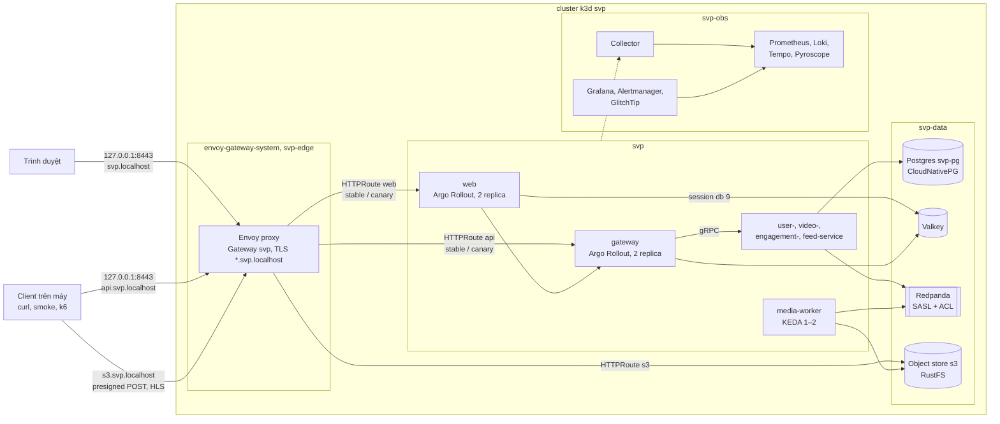
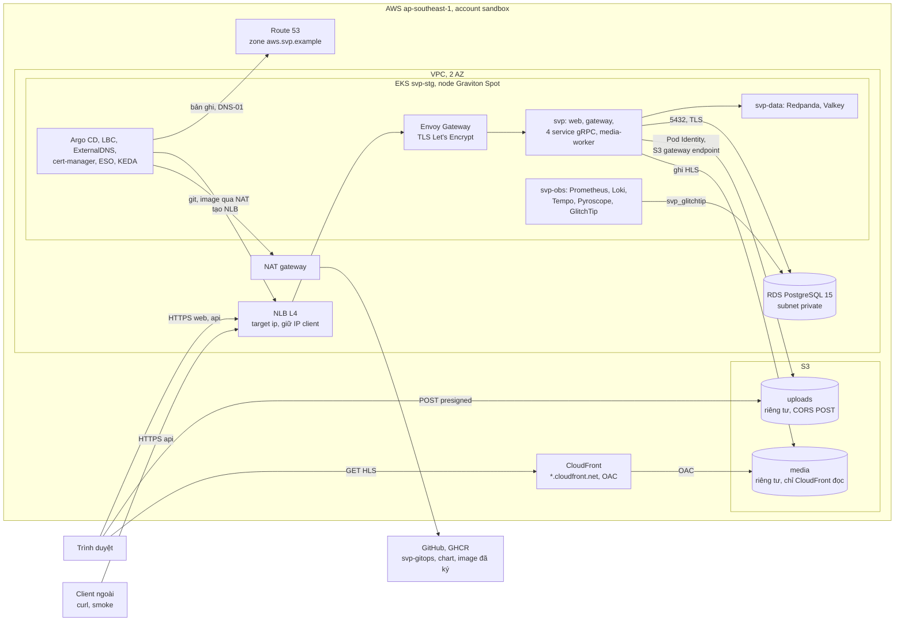

# Triển khai: compose, k3d và AWS

Trang này trả lời: cùng một hệ thống chạy ở đâu (stack compose trên máy, cluster k3d, cluster EKS trên AWS), mỗi nơi gồm những
thành phần nào, nối với nhau ra sao và vì sao khác nhau. Lệnh chạy ở [`reference/compose.md`](../reference/compose.md),
[`reference/k8s.md`](../reference/k8s.md), [`reference/eks.md`](../reference/eks.md); sơ đồ container chung ở
[`architecture.md`](../architecture.md#5-khối). Quan sát (Collector, Grafana, GlitchTip) ở
[`observability.md`](observability.md); cách image đi tới cluster ở [`delivery.md`](delivery.md).

## Compose

Vì sao: [ADR-0008](../adr/0008-async-upload-pipeline-stage2a.md), [ADR-0022](../adr/0022-local-object-store-minio-replacement.md).

Postgres và Redis native trên máy (mỗi service một database, xem [`AGENTS.md`](../../AGENTS.md) mục "Database và Redis"), object
store RustFS thay S3, không có CDN (client đọc thẳng store). Redpanda và object store chạy trong compose profile `core`. Giới hạn RAM,
CPU của từng container ở [`deploy/compose/compose.yaml`](../../deploy/compose/compose.yaml).

- **Object store `s3`** (RustFS ghim version và digest, non-root, root fs chỉ đọc, console tắt;
  [ADR-0022](../adr/0022-local-object-store-minio-replacement.md)): `s3` là endpoint tương thích S3 API (không phải AWS S3), chạy
  RustFS; code dùng `internal/objstore`. Hai bucket `uploads` (riêng tư) và `media` (ẩn danh chỉ đọc từng object, không liệt kê
  được); video-service và media-worker mỗi bên một user với policy theo tiền tố key; root chỉ ở container store và job init
  `s3-init` (`deploy/s3/init.sh`, chạy lại mỗi `make up`, idempotent). Client upload và đọc HLS qua `127.0.0.1:9000`. CORS theo
  bucket do `s3-init` đặt, chỉ nhận origin của web (`http://localhost:3001`, `web-dev` `http://localhost:3002`): `POST` vào
  `uploads`, `GET`/`HEAD` ở `media`; bucket khác không có header CORS (threat model WEB-10); web đặt `MEDIA_ORIGIN` và
  `UPLOAD_ORIGIN` là `http://127.0.0.1:9000`. Compose có thêm user thử `svp-objstore-probe` chỉ cho bucket `objstore-probe` của
  test tích hợp. Không có đường quay lại MinIO ([ADR-0050](../adr/0050-bash-to-standard-tools.md)): đổi store thì chép bằng
  công cụ S3 chuẩn (`mc mirror`, `rclone`).
- **Redpanda:** một broker; topic và `.dlq` do container init tạo, broker tắt tự tạo topic. Trong compose là
  `redpanda:9092`, từ máy host là `127.0.0.1:19092`.
- **engagement-service và feed-service** ([ADR-0009](../adr/0009-engagement-feed-stage2b.md) mục 12): gRPC ở `:9103` và
  `:9104` chỉ trong mạng compose, không publish ra máy (gateway gọi `engagement-service:9103`, `feed-service:9104`); database riêng
  `svp_engagement`, `svp_feed`. Số đo: lúc nghỉ 9–23 MiB mỗi service; feed-service đỉnh 82 MiB khi nạp 200.000 follow.
- **Redis** ([ADR-0010](../adr/0010-redis-ratelimit-cache-resilience-stage2c.md) mục 1): bản native `127.0.0.1:6379` dùng
  chung với dự án khác, không có container; compose trỏ `REDIS_URL` tới `host.docker.internal:6379/<db>`. Gateway dùng
  db 10, tiền tố khoá `svp:gw:` (rate limit, `svp:gw:rl:<lớp>:<định danh>`); web db 9, tiền tố `svp:web:` (session, khoá
  single-flight của refresh); feed-service db 14, tiền tố `svp:feed:` (cache trang đầu feed khám phá); test db 15, mỗi test một
  tiền tố `svp:test:<hex>:`. Mọi khoá có TTL (Redis local `maxmemory 0`, `noeviction`). Client có timeout ngắn (dial 100 ms,
  đọc/ghi 50 ms); service khởi động và vẫn ready khi Redis lỗi, vì mọi chỗ dùng Redis đều có đường lui
  ([đọc feed](../architecture.md#62-đọc-feed), [REST ở gateway](../reference/contracts.md#rest-ở-gateway)).
- **web** ([ADR-0016](../adr/0016-web-client.md) §5–7, [ADR-0019](../adr/0019-web-k3d-supply-chain-observability.md)): Next.js
  standalone trong image distroless, publish `127.0.0.1:3001`, origin `http://localhost:3001`; gọi duy nhất `http://gateway:8080`;
  session ở Redis native db 9 (tiền tố `svp:web:`, khoá là `sha256(sid)`). Container chỉ đọc, bỏ mọi capability, non-root, giới
  hạn pid. Nằm trong mạng compose riêng `web` chỉ chung với gateway, `otelcol` và `glitchtip` (hai cái sau thuộc profile `obs`,
  để web gửi OTLP và lỗi), không tới service gRPC, Redpanda, object store theo tên compose; nhưng có `host.docker.internal` để tới
  Redis của máy, nên vẫn tới mọi cổng publish trên loopback của máy (threat model WEB-13, chấp nhận ở compose). Gateway compose
  bật `TRUST_TRACE_CONTEXT` ([quan sát web](observability.md#web)).
- **Mạng riêng của media-worker:** worker chạy ffmpeg trên file người dùng tải lên, nên chỉ nằm trong mạng compose `worker`
  (`internal`, không route ra ngoài) cùng Redpanda, object store `s3` và Collector `otelcol`; nó không tới được gateway, các service
  gRPC, Postgres hay internet. Container chỉ đọc, bỏ mọi capability, giới hạn 2 CPU, 2 GB.
- **Observability:** Collector, profile `obs` và `obs-elastic` ở [`observability.md`](observability.md#compose).

## Kubernetes cục bộ (k3d)

Vì sao: [ADR-0014](../adr/0014-kubernetes-local-stage4.md), [ADR-0019](../adr/0019-web-k3d-supply-chain-observability.md),
[ADR-0024](../adr/0024-multi-environment.md), [ADR-0026](../adr/0026-secrets-gitops.md).

Cùng 6 service và web, cùng image và cùng biến môi trường như compose, chạy trên cluster k3d `svp` (1 server + 1 agent, node
arm64, image k3s theo `K3S_IMAGE_TAG` của [`Makefile`](../../Makefile)). Compose vẫn là đường dev chính; hai đường không chạy cùng
lúc (máy 16 GB). Cổng chỉ trên `127.0.0.1`: API 6550, HTTPS 8443, registry 5111. Lệnh ở [`reference/k8s.md`](../reference/k8s.md).

- **Namespace:** `svp` (6 service và web), `svp-data` (Postgres, Valkey, Redpanda, object store `s3`), `svp-obs` (observability,
  GlitchTip), `svp-edge` (`Gateway`, chứng chỉ wildcard); công cụ ở `cert-manager`, `envoy-gateway-system`, `cnpg-system`, `keda`,
  `argo-rollouts`, `kyverno` và `argocd` (chỉ đường GitOps). Mọi namespace trừ `kube-system` chạy Pod Security `restricted`; bốn
  namespace của project có NetworkPolicy chặn mặc định hai chiều, mỗi luồng ở bảng ADR-0014 §3 một policy theo label pod
  (threat model FF-5, IN-2).
- **Luồng vào:** client gọi `https://api.svp.localhost:8443` (tên `*.localhost` phân giải về loopback), qua load balancer
  của k3d và `svclb` tới Envoy proxy do Envoy Gateway dựng từ `Gateway` `svp`; TLS dùng chứng chỉ wildcard do cert-manager
  ký bằng CA local (`make k8s-ca` xuất CA ra `.k8s/ca.crt`). HTTPRoute `api` chia traffic giữa Service `gateway` và
  `gateway-canary`; HTTPRoute `s3` (`s3.svp.localhost`) đưa presigned POST và GET HLS tới object store `s3`, nên URL ký có host
  công khai thay `127.0.0.1:9000`. Trình duyệt mở web ở `https://svp.localhost:8443`: listener `https-apex` của Gateway với chứng
  chỉ riêng chỉ có tên `svp.localhost` (wildcard không phủ tên gốc; chứng chỉ chung cho cả hai tên làm trình duyệt gộp kết nối
  HTTP/2 của `s3` vào listener khác), HTTPRoute `web` tới Service `web:3001`; mọi route của chart service bỏ `traceparent`,
  `tracestate`, `baggage`, `sentry-trace` của client. Object store chỉ nhận CORS từ `https://svp.localhost:8443`, theo bucket như
  compose. Gateway tin đúng một hop `X-Forwarded-For` từ dải pod `10.42.0.0/16` (threat model RL-1); mọi client trên máy đi ra
  cùng địa chỉ node nên rơi vào tối đa hai bucket rate limit (ADR-0014 §9).
- **Dữ liệu trong cluster** (ADR-0014 §4, §5), không đụng Postgres/Redis native: Postgres `svp-pg` một instance do
  CloudNativePG quản, cùng tên database `svp_<svc>` và cặp role migrator/app như compose, đăng nhập `scram-sha-256`;
  Valkey không persistence, gateway db 10, feed-service db 14, web db 9 (session); Redpanda một broker, SASL SCRAM mỗi service
  một user, ACL theo bảng của ADR-0014 §5 (compose không SASL); object store `s3` (StatefulSet một replica, `s3.svp-data:9000`)
  cùng bucket, user, policy và script init như compose, không user thử. Mật khẩu sinh bằng `make env`, đưa vào Secret bằng `deploy/k8s/secrets.sh`, không nằm
  trong git. Trên đường GitOps ([ADR-0026](../adr/0026-secrets-gitops.md)) `secrets.sh` chỉ ghi nguồn vào namespace
  `svp-secrets`; External Secrets Operator (component `external-secrets`, wave 0, chỉ đường GitOps) dựng Secret từ ExternalSecret
  của chart `svp-cluster` (`deploy/helm/svp-cluster/templates/external-secrets.yaml`), mỗi namespace một SecretStore chỉ đọc đúng
  entry của nó; stg và prd trên EKS đọc AWS Secrets Manager, entry do `deploy/k8s/aws-secrets.sh` (`make eks-secrets`) ghi
  ([AWS](#aws)). Repo chỉ có tên Secret, key và nguồn. Đổi một credential là một lệnh, `make k8s-secrets` (k3d, cả cluster GitOps) hay
  `make eks-secrets` (EKS), làm theo thứ tự máy chủ, rồi Job init của `svp-data` đặt mật khẩu mới, rồi client; Reloader (component
  `reloader`, mọi nền tảng) restart workload opt in khi Secret nó đọc đổi, không script nào restart
  ([ADR-0050](../adr/0050-bash-to-standard-tools.md) mục 5).
- **Workload** (ADR-0014 §10): một chart chung `deploy/helm/svp-service` cho 6 service và web (probe, `requests`/`limits`,
  securityContext `restricted`, không token ServiceAccount); gateway 2 replica có PDB và HPA theo CPU, feed-service luôn 2
  replica (HPA 2–2) có PDB, ưu tiên trải hai node ([ADR-0031](../adr/0031-chaos-findings-feed-engagement-tempo.md) §1), web 2
  replica cố định có PDB, trải hai node, chờ 5 s trước khi tắt (server Next thoát ngay khi nhận SIGTERM), NetworkPolicy chỉ nhận
  từ Envoy và chỉ ra gateway, Valkey, Collector, GlitchTip (threat model WEB-13); media-worker 1–2 replica do KEDA scale theo lag
  của group `media-worker` (topic vẫn 3 partition; 3 worker cùng transcode làm Docker VM hết CPU và k3s server chết,
  [ADR-0017](../adr/0017-gitops-capacity-media-worker-max2.md)). Probe của chart có hạn nới để node bão hoà CPU không làm kubelet
  giết pod còn sống ([khởi động và probe](reliability.md#khởi-động-và-probe)).
- **Observability** (ADR-0014 §11): tách thành từng thành phần trong `svp-obs`, chi tiết ở
  [`observability.md`](observability.md#k3d).
- **Cài đặt và GitOps** (ADR-0014 §7, §12; cấu hình ở repo `svp-gitops`, [hai repo](delivery.md#hai-repo-code-và-cấu-hình-triển-khai)):
  `argocd/apps/components.json` của `svp-gitops` liệt kê các thành phần theo wave 0–7 (cert-manager, Envoy Gateway, External
  Secrets Operator (chỉ đường GitOps cài); namespace, CA, policy; operator và Kyverno; backend dữ liệu, observability, plugin
  Barman Cloud và policy image `svp-policy`; chart dữ liệu; chart observability; Collector; 6 service và web, web đứng sau
  gateway). Đường dev `make k8s-up` cài file đó bằng helmfile (`deploy/k8s/helmfile.yaml.gotmpl`, `needs` theo wave) từ bản clone
  `svp-gitops` cạnh repo (values `base/`), image tag `dev-<image ID>` build từ working tree bằng `docker buildx bake` (bảng
  `deploy/docker-bake.json`) vào registry k3d (môi trường dev); đường GitOps `make k8s-gitops-up` dựng cluster mới
  đóng vai stg (`base/` cộng overlay `envs/stg/`, [ADR-0024](../adr/0024-multi-environment.md)) mà Argo CD (app-of-apps, root
  `svp-root` với giá trị `env`, AppProject `svp`) đồng bộ từ GitHub qua HTTPS ẩn danh (không deploy key), image kéo từ GHCR theo
  digest mà PR promote ghi vào `envs/stg/images/` ([CI/CD](delivery.md#cicd-và-chuỗi-cung-ứng)); overlay prd chỉ render và kiểm
  tĩnh ở k3d.
- **Canary của gateway** (ADR-0014 §13): Argo Rollouts đổi trọng số HTTPRoute `api` qua plugin Gateway API: 25% → 60 s →
  50% → 60 s → bước phân tích chặn → 100%. Phân tích đọc metric Envoy của backend canary trong Prometheus: tỉ lệ 5xx < 1%
  và p99 < 150 ms (SLO feed), cần ít nhất 30 response không phải 4xx mỗi phút; hỏng hay Prometheus không trả lời thì
  abort, route về 100/0, pod stable không bị đụng. Web có canary cùng bước trên HTTPRoute `web`, p99 < 250 ms. Điều hướng
  gặp bản build khác thì Next tự tải lại trang (so build ID của payload RSC); `deploymentId` theo commit thay build ID ngẫu
  nhiên đó bằng một id đã biết, dùng làm khoá tải lại, `release` và `service.version`. Server Action tới bản khác (409) và
  chunk lệch (404, gồm chunk hls.js mà player bắt lỗi) thì một helper dùng chung tải lại trang một lần cho mỗi bản build,
  gọi từ error boundary, `unhandledrejection` và nhánh `catch` của `loadHls()` trong player pool (ADR-0019 §3). Chunk tải
  lười thứ hai, `web-vitals` của RUM, 404 thì lỗi bị nuốt: không tải lại, không báo lỗi, chỉ mất số đo của lần tải đó.
- **Client Kafka** ([ADR-0013](../adr/0013-kafka-metadata-min-age.md)): mọi client franz-go đặt `MetadataMinAge` 1 s, nên
  produce có hạn trả về gần hạn hơn khi kết nối tới broker chết giữa chừng; áp cho cả compose và k3d.
- **Chi phí:** RAM của cả cluster lúc nghỉ 5,9–6,8 GiB theo `docker stats` (gồm ~1–2 GiB page cache; phần anon ~3,9 GiB),
  đỉnh ~8 GiB khi media-worker scale lên, so với 1,7–2,6 GiB của compose `core` + `obs`; cách đo ở ADR-0014 §2.

## AWS

Vì sao: [ADR-0034](../adr/0034-aws-stage7.md) (nền tảng, lý do và bảng đầy đủ), [ADR-0038](../adr/0038-s3-bucket-names.md).

Hạ tầng ở repo `svp-infra` (cài đặt GitHub: [`runbooks/svp-infra-setup.md`](../runbooks/svp-infra-setup.md)). Thiết kế: một
cluster stg ở `ap-southeast-1`, dựng và xoá trong mỗi buổi; prd là cluster thứ hai theo chuẩn production, chỉ khác stg ở biến.
Trạng thái dựng và số đo của buổi AWS ở mục Kiểm chứng của ADR-0034.

Sơ đồ triển khai stg với icon AWS (đúng subnet của module Terraform; trang prd và trang luồng ở
[`svp-aws.pdf`](https://github.com/anhnvcoder/svp-infra/blob/main/docs/diagrams/svp-aws.pdf)), sinh từ spec của repo `svp-infra` nên
ảnh nằm ở đó, không chép vào repo này:

Sơ đồ khối bên dưới là cùng hệ thống ở mức thành phần:

| Thành phần | Local (compose, k3d) | AWS stg |
| --- | --- | --- |
| Cluster | k3d, 2 node | EKS, managed node group 3 × `m7g.large` Spot |
| Postgres | Native (compose), CloudNativePG (k3d) | RDS PostgreSQL 15 single-AZ; Service `ExternalName` `svp-pg-rw` giữ chuỗi kết nối |
| Object store | RustFS `s3` | S3 `uploads`, `media`; credential Pod Identity |
| CDN | Không có | CloudFront trước `media` (OAC) |
| Redis, Kafka | Native Redis (compose), Valkey; Redpanda | Valkey, Redpanda trong cluster |
| Vào hệ thống | Loopback, Envoy với CA tự ký | NLB L4 giữ IP client, Envoy với chứng chỉ Let's Encrypt, DNS Route 53 do ExternalDNS ghi |
| NetworkPolicy | network policy controller của k3s | Network policy agent của VPC CNI |
| StorageClass, metrics-server | `local-path`, metrics-server của k3s | `gp3` do chart `svp-cluster` tạo, addon `metrics-server` |
| Secret | `.env` (compose), ESO provider `kubernetes` (k3d GitOps) | ESO provider `aws`: Secrets Manager + Pod Identity, giá trị từ `make eks-secrets` |
| Hạ tầng | `make up`, `make k8s-up`, `make k8s-gitops-up` | Terraform `aws/envs/<env>` của `svp-infra`, `make eks-secrets`, rồi Terraform `aws/gitops/<env>` (Argo CD và root) |

Version của k3s và EKS ghim ở `K3S_IMAGE_TAG` của [`Makefile`](../../Makefile) và ở cấu hình Terraform của `svp-infra`. Bảng đủ (kể
cả thứ k3s có sẵn mà EKS không) ở ADR-0034 mục Quyết định 8. Khác biệt k3d/EKS nằm ở lớp `platforms/<platform>/` của `svp-gitops`
cùng giá trị theo cluster `cluster.*` mà root `aws/gitops/<env>` đặt từ output Terraform (annotation của cluster Secret của
Argo CD); `envs/stg` dùng chung cho k3d stg và EKS stg.

**Luồng upload → `READY` → feed → phát trên AWS:**

1. Web (trình duyệt → NLB → Envoy → `web` → `gateway`) gọi `POST /videos`; video-service ký form POST bằng credential tạm của Pod Identity
   (role chỉ ghi `uploads/<video_id>`), URL là endpoint vùng của bucket (`https://<bucket uploads>.s3.ap-southeast-1.amazonaws.com`,
   virtual-hosted).
2. Trình duyệt POST file thẳng lên S3 (CORS chỉ nhận origin web, hạn form 15 phút); `CompleteUpload`: video-service `HEAD` object qua S3
   gateway endpoint (không qua NAT), outbox phát `video.uploaded` vào Redpanda.
3. media-worker (KEDA theo lag) tải file gốc từ `uploads`, chạy ffmpeg, ghi HLS bất biến vào bucket `media` (master chỉ tạo một lần bằng
   `If-None-Match: *`); `transcode.completed` → video-service chuyển `READY`, phát `video.ready` → feed-service fan-out vào timeline (RDS).
4. Feed: gateway → feed-service (cache khám phá ở Valkey); URL HLS trong response là `https://<tên CloudFront>/` + khoá của object.
5. Phát: trình duyệt GET master, playlist, segment từ CloudFront (cache theo `Cache-Control: … immutable`); CloudFront đọc `media` bằng
   OAC, đọc thẳng bucket bị từ chối (threat model AWS-2).
