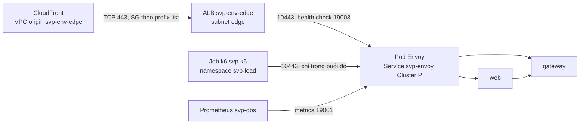
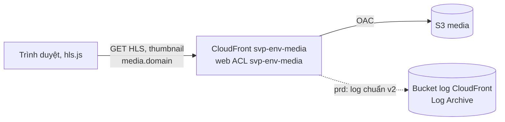
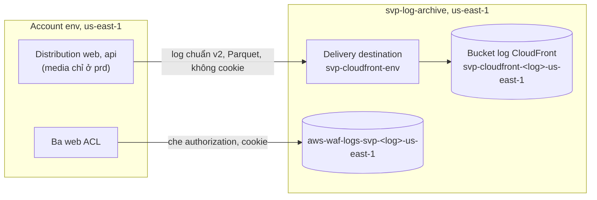

# Edge ở stg và prd: CloudFront, WAF, ALB internal, Envoy

Trang này giải thích đường vào công khai của web, API và media trên AWS: request đi qua những chặng nào, vì sao chọn từng chặng, ai đặt được
địa chỉ client mà gateway tin, và DNS, chứng chỉ, log của edge nằm ở đâu. Quyết định và nguồn ở
[ADR-0061](../adr/0061-edge-cloudfront-waf-acm.md) và [phụ lục](../adr/appendix/0061-edge-cloudfront-waf-acm.md) của nó; giá trị (TLS policy,
luật WAF, header, trường log) nằm ở code: [module `edge`](https://github.com/anhnvcoder/svp-infra/tree/main/aws/modules/edge),
[`media`](https://github.com/anhnvcoder/svp-infra/tree/main/aws/modules/media), [`waf`](https://github.com/anhnvcoder/svp-infra/tree/main/aws/modules/waf)
và `waf.tf` của root `aws/envs/<env>` ở `svp-infra`, values nền tảng `platforms/eks/` của `svp-gitops`. Compose và k3d không có edge này: compose
publish thẳng web và gateway trên loopback, không proxy phía trước ([Compose](deployment.md#compose)); k3d mở Envoy trên loopback
([k3d](deployment.md#kubernetes-cục-bộ-k3d)). Mối đe doạ và cách kiểm ở mục Edge của [threat model](../threat-model.md#413-edge).

Trong sơ đồ, `env` là `stg` hay `prd`; `<domain>` là tên zone của env.

## Ba tên, ba distribution

| Tên | Distribution, web ACL | Origin |
| --- | --- | --- |
| `<domain>` | `svp-<env>-web` | VPC origin `svp-<env>-edge` tới ALB internal `svp-<env>-edge`, rồi Envoy, rồi `web` |
| `api.<domain>` | `svp-<env>-api` | Cùng VPC origin, ALB, Envoy, rồi `gateway` |
| `media.<domain>` | `svp-<env>-media` | Bucket S3 `media` qua OAC |

Mỗi tên một distribution vì một distribution gắn đúng một web ACL, và mỗi tên cần luật riêng: web có Bot Control, api có ATP cho đăng nhập.
Envoy định tuyến theo Host như ở k3d, nên distribution chuyển nguyên Host của trình duyệt.

## Đường đi của một request web hay API

```mermaid
sequenceDiagram
    participant B as Trình duyệt
    participant CF as CloudFront svp-env-web, svp-env-api
    participant W as Web ACL cùng tên
    participant ALB as ALB internal svp-env-edge
    participant E as Envoy, Service svp-envoy
    participant WEB as web (BFF)
    participant GW as gateway
    B->>CF: HTTPS #lt;domain#gt; hay api.#lt;domain#gt;, cert ACM us-east-1
    CF->>W: kiểm request
    W-->>CF: cho qua, hay 403
    Note over CF: đặt CloudFront-Viewer-Address, đè giá trị trình duyệt gửi
    CF->>ALB: HTTPS qua VPC origin svp-env-edge, Host của trình duyệt
    Note over ALB: SG chỉ nhận 443 từ prefix list origin-facing của CloudFront
    ALB->>E: HTTPS tới pod (target group svp-env-envoy), cert CA nội bộ
    alt Host #lt;domain#gt;
        E->>WEB: HTTPRoute web
        WEB->>GW: REST + Bearer, chuyển CloudFront-Viewer-Address, X-Forwarded-For
    else Host api.#lt;domain#gt;
        E->>GW: HTTPRoute api
    end
    Note over GW: IP client từ CloudFront-Viewer-Address (rate limit, span)
    GW-->>B: câu trả lời; CloudFront thêm security header
```

1. CloudFront kết thúc TLS của trình duyệt bằng cert ACM của đúng tên đó, chạy web ACL cùng tên, rồi dựng request mới tới origin. Origin request
   policy managed chuyển mọi header, cookie, query của trình duyệt và thêm `CloudFront-Viewer-Address`.
2. VPC origin đưa request vào VPC qua network interface do CloudFront quản trong subnet edge, tới ALB internal. ALB không có địa chỉ công khai.
3. ALB là proxy L7: nó kết thúc TLS bằng cert ACM của region nhà, mở kết nối mới tới địa chỉ pod Envoy mà `TargetGroupBinding` `svp-envoy` ghi
   vào target group. ALB không gửi SNI tới target và không kiểm cert target, nên Envoy trên eks có một listener `https` không hostname với cert
   của CA nội bộ.
4. Envoy chọn route theo Host. Request trang đi tới `web`, BFF gọi gateway và chuyển nguyên `CloudFront-Viewer-Address`; request API đi thẳng
   tới gateway.
5. Câu trả lời đi ngược lại; response headers policy của distribution thêm HSTS, nosniff và các header còn thiếu (web tự đặt CSP có nonce, nên
   policy của web không đè header web đã đặt).

## Vì sao CloudFront, VPC origin, ALB internal

- **Chỉ một đường vào.** Mọi request qua CloudFront và WAF trước khi chạm VPC, và có log ở cả hai. ALB internal chỉ có địa chỉ private;
  tới nó chỉ có VPC origin của chính account env. Tầng public của VPC chỉ còn NAT gateway, không load balancer nào.
- **VPC origin thay vì ALB public.** ALB public phải mở cho prefix list origin-facing của CloudFront, mà prefix list đó gồm distribution của
  mọi khách AWS, nên phải thêm header bí mật và xoay nó. VPC origin không cần cả hai.
- **ALB, không load balancer L4.** VPC origin không nhận Network Load Balancer có listener TLS; listener TCP thì Envoy phải giữ cert công
  khai.
- **Cái giá:** thêm một ALB, một tầng subnet và một chặng TLS mỗi env; web ACL tính phí theo giờ. Số tiền ở §13 của ADR-0061.

Không access log ALB và không web ACL regional trên ALB: ALB chỉ nhận từ CloudFront, nên mọi request đã có trong log CloudFront và log WAF.

## Ai tới được Envoy



- **Subnet edge** (module `network`): tầng subnet thứ tư, mỗi AZ một subnet, chỉ route trong VPC, không tag cho Load Balancer Controller hay
  Karpenter. Không node nào ở đây, nên không pod nào có địa chỉ ở đây (VPC CNI cấp địa chỉ pod từ subnet của node): kết nối từ dải này tới
  Envoy chỉ có thể là của ALB.
- **NetworkPolicy `envoy`** (chart `svp-cluster`, nguồn là values của `platforms/eks/svp-cluster.values.tpl`): cổng 10443 (cổng của listener
  443 trong pod) chỉ từ dải subnet edge và namespace `svp-load`; cổng health check 19003 chỉ từ dải subnet edge; metrics từ `svp-obs`. Pod khác
  của cluster không tới được Envoy.
- **Security group:** ALB chỉ nhận TCP 443 từ prefix list origin-facing của CloudFront, nên pod và máy trong VPC cũng không gọi được ALB; ALB
  chỉ ra tới SG node ở hai cổng của Envoy.
- **Service `svp-envoy` kiểu ClusterIP:** không load balancer nào khác được tạo cho Envoy. Load Balancer Controller chỉ còn đăng ký địa chỉ pod
  vào target group do Terraform tạo; ALB, listener, target group nằm trong state của root env.

## IP client

Gateway đếm rate limit theo IP cho route chưa đăng nhập và ghi IP vào `client.address` của span. Trên eks nó lấy IP từ
`CloudFront-Viewer-Address` (`<ip>:<cổng>`), không đọc `X-Forwarded-For` (`TRUSTED_CLIENT_ADDRESS_HEADER` ở
`platforms/eks/gateway.values.tpl`; quy tắc parse ở [`reference/contracts.md`](../reference/contracts.md)). CloudFront đè giá trị trình duyệt tự
gửi, nên header không phụ thuộc số chặng proxy phía sau. Header chỉ đáng tin khi mọi chặng sau CloudFront chỉ nhận từ chặng trước:

| Chặng | Chỉ nhận từ | Giữ bằng |
| --- | --- | --- |
| gateway | Envoy, web | NetworkPolicy của gateway; gateway chỉ tin header trên kết nối từ `TRUSTED_PROXY_CIDRS` (CIDR VPC) |
| web | Envoy | NetworkPolicy của web |
| Envoy | ALB, Job k6 ở `svp-load` | NetworkPolicy `envoy`, subnet edge không pod |
| ALB | CloudFront | ALB internal, SG theo prefix list origin-facing |
| CloudFront | Trình duyệt | Đè `CloudFront-Viewer-Address` mà trình duyệt gửi |

Ngoại lệ là đo tải: Job k6 `svp-k6` đi thẳng tới ClusterIP của `svp-envoy`, bỏ qua CloudFront và WAF (luật rate-based của WAF sẽ chặn tải
từ vài IP NAT), và mỗi pod tự đặt `CloudFront-Viewer-Address` là IP của nó để mỗi pod một bucket. Namespace `svp-load` chỉ có trong buổi đo,
do người học tạo; ADR-0061 §10 chấp nhận điều này (threat model RL-7). Cách chạy ở [`reference/compose.md`](../reference/compose.md).

## WAF

Ba web ACL mỗi env, tên trùng distribution nó gắn, giống hệt ở stg và prd. Mọi ACL bắt đầu bằng luật rate-based theo IP, rồi IP reputation,
Core rule set và Known bad inputs của AWS. ACL `svp-<env>-api` thêm ATP cho `POST /auth/login` của gateway: so credential với danh sách bị lộ
và đọc status của câu trả lời để đếm lần đăng nhập thất bại. Web đăng nhập bằng Server Action (body multipart), mà ATP chỉ đọc JSON và
form-urlencoded, nên ACL `svp-<env>-web` không có ATP; nó có Bot Control mức common ở chế độ chỉ gắn nhãn, để đo trước khi chặn. Sau WAF vẫn
còn rate limit của gateway theo IP thật và theo (IP, email). Log của ba ACL về bucket log WAF của account Log Archive, che `authorization` và
`cookie`. [AWS Shield Standard](https://docs.aws.amazon.com/waf/latest/developerguide/ddos-standard-summary.html) bảo vệ CloudFront và
Route 53 ở tầng mạng và tầng vận chuyển mà không cần cấu hình.

## Chứng chỉ và TLS

| Chặng | Chứng chỉ | Ai giữ |
| --- | --- | --- |
| Trình duyệt → CloudFront | Mỗi distribution một cert ACM ở `us-east-1` cho đúng tên của nó | Module `edge`, `media`; ACM tự gia hạn |
| CloudFront → ALB | Cert ACM ở region nhà cho `<domain>` và `api.<domain>` | Module `edge` |
| ALB → Envoy | Secret `svp-edge-tls`, ký bởi issuer CA nội bộ `svp-ca` của cert-manager | Chart `svp-cluster` |

Cert ACM xác thực bằng bản ghi DNS trong zone của env. Envoy dùng CA nội bộ vì ALB không kiểm cert target; không cert công khai nào nằm trong
cluster, và không gì trong cluster ghi Route 53. TLS policy của CloudFront và ALB là bản AWS khuyên còn nhận TLS 1.2 bên cạnh 1.3 (§5 của
ADR-0061). Job k6 tin CA nội bộ bằng `ca.crt` của Secret `svp-edge-tls`.

## Media



Media giữ origin S3 qua OAC; bucket chỉ cho distribution của chính nó đọc. stg giữ gói CloudFront flat-rate Free: không log chuẩn, header CORS
là policy managed `Managed-SimpleCORS`. prd trả theo dùng (pay-as-you-go): log chuẩn v2 và response headers policy `svp-prd-media` (CORS chỉ
origin của web, HSTS, nosniff). Biến `media_flat_rate_free` của `<env>.tfvars` chọn giữa hai cách.

## DNS

Tên của edge là bản ghi alias A và AAAA trong zone của env, cùng bản ghi validation của ACM. Root `aws/envs/<env>` tạo và gỡ chúng theo buổi
(module `edge`, `media`); không controller nào trong cluster ghi zone. Phần sống lâu của zone ở module `account-baseline` (root
`aws/accounts/<env>`):

- **CAA** ở đỉnh zone của cả hai env: chỉ CA của Amazon được phát hành cert cho tên trong zone; tên con thừa hưởng CAA của đỉnh.
- **DNSSEC** chỉ zone prd: khoá KMS ở `us-east-1` ký zone, bản ghi `DS` ở DNS cha nối chuỗi tin cậy. Hai alarm mức page báo khi Route 53 không
  ký được hay KSK cần xử lý: runbook [`dnssec-internal-failure.md`](../runbooks/dnssec-internal-failure.md),
  [`dnssec-ksk-action-needed.md`](../runbooks/dnssec-ksk-action-needed.md). Tắt ký và thứ tự gỡ ở runbook
  [`edge-setup.md`](https://github.com/anhnvcoder/svp-infra/blob/main/docs/runbooks/edge-setup.md) của `svp-infra`.
- **Query log** chỉ zone prd, vào log group ở `us-east-1`.

## Log edge



Log chuẩn v2 của CloudFront đi chéo account: account env tạo delivery source và delivery, account Log Archive giữ delivery destination và
bucket. Danh sách trường là tường minh và không có cookie (cookie phiên của web). Log còn sau khi env bị gỡ; đọc bằng profile `anhnv-log-ro`
([`aws-security.md`](aws-security.md#luồng-log)).

## stg và prd

Edge của stg giống prd trừ: media trên gói Free không log chuẩn, zone không DNSSEC và query log, ALB không deletion protection. Nhóm và lý do
từng khác biệt ở [`environments.md`](environments.md#edge-cloudfront-waf-dns).

## Kiểm ở đâu

- Tĩnh, mỗi PR: test mocked của module `edge`, `media`, `waf`, `network`, `account-baseline` (`make check` của `svp-infra`); test và fuzz IP
  client của gateway (`make test`, `make fuzz`); render chart với values eks và policy Kyverno (`make helm-check`).
- Trong buổi stg, prd: mục Phép kiểm edge của runbook
  [`session-stg.md`](https://github.com/anhnvcoder/svp-infra/blob/main/docs/runbooks/session-stg.md#phép-kiểm-edge) của `svp-infra` (header, cert,
  TLS, ALB chỉ có IP private, mẫu thử WAF bị chặn, IP thật ở span gateway kể cả khi tự đặt header, log edge có object, DNSSEC, CAA).
