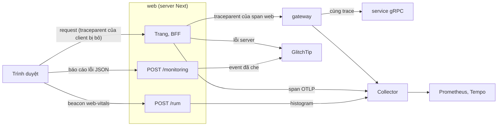

# Quan sát: trace, metric, log, lỗi và RUM

Trang này trả lời: tín hiệu nào (trace, metric, log, profile, lỗi, số đo trình duyệt) đi từ đâu tới đâu, ở compose và ở k3d khác
nhau ra sao, và web được quan sát thế nào mà không lộ dữ liệu người dùng. SLO và cảnh báo ở [`reliability.md`](reliability.md#slo);
lệnh ở [`reference/compose.md`](../reference/compose.md), [`reference/k8s.md`](../reference/k8s.md).

## Compose

Vì sao: [ADR-0011](../adr/0011-observability-stage3.md), so sánh Elastic ở [ADR-0012](../adr/0012-elastic-vs-grafana-stage3.md).

Mọi service đẩy trace, metric (mỗi 15 s) và log qua OTLP/gRPC tới Collector `otelcol` (`otel/opentelemetry-collector-contrib`, nằm
ở cả mạng `default` và `worker`, cổng 4317 không publish; memory limiter, xoá attribute nhạy cảm, batch, đọc lag Kafka). Không
service nào mở `/metrics` hay pprof.

- **Lag Kafka** ([ADR-0053](../adr/0053-msk-elasticache-valkey.md) §15): receiver `kafka_metrics` (`kafkametrics` của bản contrib
  đang ghim) đăng nhập `svp-otelcol` SCRAM-SHA-512 trên TLS ở `kafka:9096` mỗi 15 s, scraper `brokers` và `consumers`; ACL của user này chỉ
  DESCRIBE 8 topic và 4 group nên Collector không đọc hay ghi được record nào. Biến cùng tên ở compose, k3d và EKS:
  `SVP_OTELCOL_KAFKA_BROKERS`, `SVP_OTELCOL_KAFKA_CA_FILE` (`/etc/svp-ca/ca.crt` ở local, rỗng trên EKS: root hệ thống),
  `SVP_KAFKA_OTELCOL_PASSWORD`. Client của receiver tạo ở lần scrape đầu, nên broker không tới được chỉ làm hỏng scrape của receiver này.
  Dashboard, rule, runbook và drill dùng `kafka_consumer_group_lag_ratio`, `kafka_consumer_group_lag_sum_ratio`, `kafka_brokers` (nhãn
  `kafka_cluster_alias="svp"`).
- **Profile `obs`** (`make up OBS=lgtm`) thêm `lgtm` (Grafana `127.0.0.1:3000` cùng Prometheus giữ 30 ngày, Loki, Tempo,
  Pyroscope; 5 service đẩy profile tới `lgtm:4040`, media-worker không), `alertmanager` (`127.0.0.1:9093`, gửi `severity=page` tới
  Telegram khi `.env` có bot) và `glitchtip` (`127.0.0.1:8000`, tracker lỗi qua giao thức Sentry, database `svp_glitchtip` trên
  Postgres native). Không có profile `obs`, DNS `otelcol` không tồn tại: SDK bỏ export, service vẫn chạy.
- **RAM** (`docker stats`, giới hạn ở [`deploy/compose/compose.yaml`](../../deploy/compose/compose.yaml)): `otelcol` 64–255 MiB lúc
  nghỉ (trung vị 246 và 255,3 ở hai lượt đo), `lgtm` 730–750 MiB lúc nghỉ, 1 203 MiB sau smoke và 1 245 MiB sau mọi diễn tập,
  `alertmanager` 17–42 MiB, `glitchtip` 185–232 MiB; cả `core` + `obs` 1,71–2,61 GiB (2,60 GiB sau một smoke, 2,22 GiB nghỉ và
  2,61 GiB lúc smoke ở lượt so với Elastic).
- **Overhead của SDK** trên 6 service so với tắt telemetry: khoảng +50 MiB RAM và +2% một lõi CPU dưới tải smoke, p50/p95 trang
  khám phá +12/+12 ms (cách đo ghi trong ghi chú lộ trình học, ngoài repo).
- **Profile `obs-elastic`** (Elasticsearch, Kibana `127.0.0.1:5601`, APM Server, `otelcol-elastic` cùng alias `otelcol`) chỉ để so
  sánh, không chạy cùng `obs`.
- **Dữ liệu ở lại máy:** như tracker lỗi chạy cục bộ, Grafana, Tempo, Loki và Pyroscope không báo usage tới `stats.grafana.org`,
  và Grafana không hỏi `grafana.com` bản mới. Grafana cũng không cài plugin lúc chạy: không preinstall (mặc định Grafana tải một
  danh sách plugin không ghim version ở mỗi lần khởi động, trong đó có datasource Prometheus, Tempo, Loki, Pyroscope, các app
  Drilldown và advisor, còn image thêm `grafana-llm-app`), không cập nhật plugin mà volume đã giữ, và khoá ký plugin giữ bản dựng
  sẵn. Volume `lgtm-data` mới dùng datasource dựng sẵn trong Grafana của image và không có app Drilldown. Volume đã giữ bản tải về
  thì giữ chúng, đóng băng ở version đó, và Grafana nạp chúng thay cho bản dựng sẵn. Script chạy của image nối `*_EXTRA_ARGS` vào
  dòng lệnh của binary tương ứng.
- **GlitchTip, không phải Sentry:** `sentry.io` bị chặn có chủ đích trên máy này, Sentry tự host cần RAM nhiều hơn lab có, còn
  GlitchTip nói giao thức Sentry nên SDK chỉ cần DSN khác để chuyển. `deploy/observability/glitchtip/bootstrap.py` tạo qua ORM của
  image những gì service và diễn tập cần: user admin, organization `svp`, team và project `svp` cùng DSN của nó, token API
  `svp-drill` (`event:read`, `project:read`) và token API `svp-sourcemaps` (`project:releases`) để tải source map của web client.
  Idempotent: chạy lần hai không tạo gì và không đổi khoá, token hay mật khẩu. Nó chạy trong container `glitchtip-init`
  (`python manage.py shell < /init/bootstrap.py`), đọc `GLITCHTIP_ADMIN_EMAIL` và `GLITCHTIP_ADMIN_PASSWORD`. Khi
  `SVP_GLITCHTIP_OUT` là tên một file, nó ghi DSN và hai token vào đó (mode 600, các dòng `dsn=`, `token=` và `sourcemaps_token=`)
  cho `deploy/observability/glitchtip/init.sh`; chúng không bao giờ được in. Nó chỉ in số đếm đối tượng.

## k3d

Vì sao: [ADR-0014](../adr/0014-kubernetes-local-stage4.md) §11.

Cùng SDK và cùng file với compose (rule, dashboard, SLO dùng lại bằng symlink), nhưng tách thành thành phần riêng trong namespace
`svp-obs`: Collector (OTLP 4317, đẩy metric sang Prometheus bằng OTLP, log sang Loki, trace sang Tempo, đọc lag của
Kafka bằng receiver `kafka_metrics`), kube-prometheus-stack (Prometheus, Alertmanager gửi Telegram, Grafana), Loki, Tempo có metrics-generator, Pyroscope,
GlitchTip trên database `svp_glitchtip` của `svp-pg`. Không UI nào có route hay cổng node: chỉ `make k8s-ui-*` (port-forward trên
`127.0.0.1`), Grafana và GlitchTip có đăng nhập. Sơ đồ cluster ở [`deployment.md`](deployment.md#kubernetes-cục-bộ-k3d).

### Collector của cluster

Release `otel-collector` ở namespace `svp-obs`, Service `otel-collector.svp-obs:4317`. Chart `svp-observability` đặt
[`deploy/observability/otelcol/k8s-config.yaml`](../../deploy/observability/otelcol/k8s-config.yaml) vào ConfigMap
`otel-collector-config` (khoá `relay`) qua symlink, nên file là cấu hình thật, không qua template Helm.

Receiver, processor xoá dữ liệu nhạy cảm và telemetry của chính nó giống `config.yaml` của profile `obs` ở compose; chỉ đích khác.
Compose chuyển mọi thứ tới Collector bên trong `grafana/otel-lgtm` rồi nó tách ra; ở cluster mỗi backend là một Deployment riêng nên
Collector này gửi từng tín hiệu thẳng tới endpoint OTLP của backend, chính là các endpoint mà Collector trong LGTM dùng: Prometheus
và Loki qua OTLP/HTTP, Tempo qua OTLP/gRPC. Tên và nhãn metric vì vậy ra từ phần dịch OTLP của chính Prometheus như ở compose, và
dashboard, rule chạy không đổi. Giữ hai file khớp nhau; `make otelcol-validate` kiểm cả hai. Chỉ hàng đợi của exporter khác có chủ
đích: ở đây giới hạn theo byte, vì ba exporter dùng chung một `memory_limiter`.

- **Kafka:** lag consumer group và số broker như ở compose, cùng receiver `kafka_metrics` với user `svp-otelcol`, mật khẩu từ Secret
  `svp-obs/otelcol-kafka` (khoá `password`); k3d nối `kafka.svp-data.svc.cluster.local:9096` và tin CA local, EKS nối bootstrap SCRAM của
  MSK (`cluster.kafkaBrokers`) với root hệ thống. Receiver hỏi metadata của cluster qua bootstrap nên một cấu hình phủ mọi broker, bao
  nhiêu cũng vậy. NetworkPolicy egress của Collector mở 9096 tới pod `kafka` (`kafka.mode: cluster`) hay `kafka.external.cidrs`
  (`external`, dải subnet database).
- **Bộ nhớ:** trong container 256 MiB (`resources.limits.memory` của chart), Collector từ chối dữ liệu từ 144 MiB heap (giới hạn
  mềm, `limit_mib` trừ `spike_limit_mib`) và ép GC từ 192 MiB, thay vì bị OOM-kill. Một instance phục vụ ba pipeline và đo heap của cả
  tiến trình, nên khi vượt giới hạn mềm mọi receiver bị từ chối, bất kể tín hiệu nào làm đầy nó; hàng đợi exporter có giới hạn giữ
  backend chậm khỏi đẩy nó tới đó. `GOMEMLIMIT` (140 MiB, `base/otel-collector.yaml` của `svp-gitops`) nằm ngay dưới giới hạn mềm để
  runtime Go thu gom rác trước khi limiter đếm nó.

### Alertmanager

Routing là bản mà `deploy/observability/alertmanager/entrypoint.sh` ghi cho compose (giữ hai bản khớp nhau): cảnh báo gom theo tên
và `severity`; `severity="page"` tới Telegram khi `.env` có đủ bot token và chat id là số nguyên; mọi cảnh báo còn lại (và mọi cảnh
báo, khi không có Telegram) chỉ hiện ở UI và API. `severity="ticket"` luôn chỉ ở UI: cửa sổ SLO 1d/3d còn cháy nhiều ngày sau một
buổi diễn tập. Bot token không bao giờ nằm trong cấu hình này: Alertmanager đọc nó từ file là Secret `alertmanager-telegram` được
mount (`alertmanagerSpec.secrets` của `base/kube-prometheus-stack.yaml` ở `svp-gitops`). Chat id nằm trong cấu hình, như ở compose:
là định danh, không phải credential.

### GlitchTip

GlitchTip ở `svp-obs` là tracker lỗi mà năm service báo tới, như ở compose, gồm hai phần:

- Job `glitchtip-init` migrate database `svp_glitchtip` (role migrator, `MAINTENANCE_DATABASE_URL`), tạo bảng cache và các partition,
  rồi chạy `deploy/observability/glitchtip/bootstrap.py` (symlink trong `files/`): user admin, organization, team và project `svp`
  cùng DSN, token API chỉ đọc của diễn tập. Mọi bước idempotent nên Job chạy trước mỗi lần install và upgrade. Nó là hook
  pre-install/pre-upgrade (Argo CD đọc là PreSync) để server bên dưới không bao giờ khởi động trên schema cũ hơn code. Hook chạy
  trước tài nguyên thường của release, trong namespace chặn mọi thứ mặc định: ConfigMap, ServiceAccount và egress policy của nó là
  hook có weight thấp hơn, nên chúng tồn tại trước Job cả trên cluster mới. `bootstrap.py` chỉ in số đếm; DSN và token được
  `deploy/k8s/glitchtip-init.sh` đọc sau đó, thẳng vào Secret.
- Deployment `glitchtip`: web và task worker trong một tiến trình (`GLITCHTIP_EMBED_WORKER`), không Valkey, bỏ các bước init (Job đã
  chạy chúng). Năm service tới nó ở cổng 8000; từ host chỉ qua `make k8s-ui-glitchtip` (port-forward tới `127.0.0.1:8000`, cần
  đăng nhập; threat model OPS-2).

Secret `glitchtip-env` (`SECRET_KEY`, `DATABASE_URL` với role app, `MAINTENANCE_DATABASE_URL` với role migrator) và `glitchtip-admin`
lấy từ `.env` qua `deploy/k8s/secrets.sh`. Server đọc môi trường chỉ lúc khởi động: Reloader restart nó khi data của `glitchtip-env`
đổi (annotation của Deployment). `glitchtip-admin` chỉ Job đọc, và Job chạy lại với mỗi install và upgrade.

### Secret của `svp-obs`

- `grafana-admin`: login admin của Grafana (kube-prometheus-stack, `grafana.admin.existingSecret`). Grafana không cho user ẩn danh
  nào trong cluster (threat model OPS-2) nên đây là đường vào duy nhất. Grafana đặt mật khẩu admin từ nó khi database của nó được tạo,
  tức mỗi lần khởi động vì nó không giữ volume.
- `alertmanager-svp`: cấu hình routing ở trên (`alertmanagerSpec.configSecret`; khoá phải là `alertmanager.yaml`).
- `alertmanager-telegram`: bot token, rỗng khi Telegram tắt; pod Alertmanager mount nó trong mọi trường hợp và sẽ không khởi động
  nếu thiếu.
- `glitchtip-env`: Django secret key của GlitchTip và hai login database của nó trên `svp-pg`: role app cho server, role migrator
  (`MAINTENANCE_DATABASE_URL`) cho migration của Job init. Chỉ GlitchTip và Job init của nó.
- `glitchtip-admin`: login admin mà `bootstrap.py` tạo (mật khẩu chỉ được đặt khi user được tạo, như ở compose). Chỉ Job init.

### NetworkPolicy

Luồng vào và ra `svp-obs` (threat model IN-2, FF-5, OPS-2). Chart `svp-cluster` đã chặn mọi pod của namespace hai chiều, mở DNS, và
mở API server cho pod gắn nhãn `svp-kube-api=allow` (Prometheus, operator của nó, kube-state-metrics, sidecar của Grafana,
Pyroscope). Mỗi pod có một policy liệt kê mọi cổng nó phục vụ và mọi peer nó gọi, nên policy của một pod là toàn bộ lưu
lượng của nó; ngoại lệ duy nhất là egress ra internet của Alertmanager, tách ở `allow-alertmanager-telegram` để luật rộng nhất của
namespace đứng riêng.

Không gì mở UI cho pod nào: Grafana, Prometheus và các UI khác chỉ tới từ host bằng `kubectl port-forward`, đi vào từ node và không
NetworkPolicy nào chặn. Pod gọi chính nó (memberlist, gRPC của các binary đơn) ở lại trong pod. Cổng là cổng của pod: NetworkPolicy
thấy gói sau khi Service đã dịch tới pod (cổng 3000 của Grafana sau Service `kps-grafana:80`).

- **Prometheus:** vào gồm OTLP từ Collector, remote write từ metrics-generator của Tempo, truy vấn từ Grafana và từ controller Argo
  Rollouts (AnalysisRun của canary gateway). Ra gồm cảnh báo tới Alertmanager, scrape của các ServiceMonitor của stack (Grafana,
  kube-state-metrics, Alertmanager và config reloader của nó, operator), kubelet của mỗi node (cAdvisor và metric probe), proxy Envoy
  (PodMonitor `envoy-svp`), exporter của Postgres `svp-pg` (PodMonitor `svp-pg`) và application controller của Argo CD ở đường
  GitOps (PodMonitor `argocd-application-controller`). Prometheus scrape chính pod của nó ở lại trong pod. `argo-rollouts` không chặn
  lưu lượng mặc định; `envoy-gateway-system` chỉ chặn khi chart `svp-cluster` bật `envoy.networkPolicy` (EKS), và chart đó khi ấy
  tự cho phép các scrape này, nên policy ở đây là policy duy nhất các luồng còn lại cần. `argocd` có policy ingress riêng của chart
  argo-cd (mỗi thành phần một), và policy của application controller đã nhận cổng metrics (8082) từ mọi namespace; `svp-data` chặn
  mặc định và chart của nó mở 9187 của pod Postgres cho Prometheus.
- **Alertmanager tới Telegram** (`api.telegram.org:443`, cho cảnh báo `severity=page` khi `.env` có bot): NetworkPolicy không gọi tên
  được host, chỉ pod và khối IP, nên policy mở TCP 443 tới mọi địa chỉ IPv4 công khai: `0.0.0.0/0` trừ các dải riêng, link-local và
  dùng chung, là nơi các pod (`10.42.0.0/16`), Service (`10.43.0.0/16`), node (`10.200.0.0/24`) và mạng của chính máy nằm, nên không
  gì trong cluster hay trên host bị mở. Dải đã công bố của Telegram sẽ hẹp hơn, nhưng chúng đổi không báo trước, và cảnh báo khi đó
  dừng mà không lỗi nào cho thấy. Policy vẫn còn khi Telegram tắt: Alertmanager khi đó không gửi gì. Cái giá: một Alertmanager bị chiếm
  tới được mọi địa chỉ công khai ở cổng 443 (compose cũng không giới hạn nó).

## Web

Vì sao: [ADR-0019](../adr/0019-web-k3d-supply-chain-observability.md) §7–§11,
[ADR-0039](../adr/0039-mainpath-drills-scan-gate-sourcemaps.md) §3.

- **Trace:** server Next dựng OTel (`@opentelemetry/sdk-node`, instrumentation `http`, `undici`, `service.name=web`). Request
  đến web luôn mở trace gốc mới (web không đọc trace context đến); lời gọi BFF tới gateway mang `traceparent` của span web, và
  gateway nhận nó khi bật `TRUST_TRACE_CONTEXT` (compose và k3d), nên một trace đi từ web qua gateway xuống service. Ở k3d Envoy bỏ
  trace context của client trên mọi route và chỉ Envoy, web vào được gateway; ở compose gateway chỉ publish trên loopback (threat
  model WEB-24). Span không ghi header, query hay id người dùng.
- **Lỗi:** trình duyệt không có SDK Sentry: một reporter nhỏ gửi báo cáo JSON (tên, message, stack, pathname, debug ID của
  chunk) tới `/monitoring` cùng origin; server dựng event và gửi GlitchTip bằng `@sentry/nextjs` ở server, cùng bộ luật che
  với lỗi server nhưng ngân sách gửi riêng, nhỏ hơn, để báo cáo rác không đẩy lỗi server ra ngoài (WEB-9, WEB-20). Source map
  trình duyệt sinh kèm debug ID, không nằm trong image, tải lên GlitchTip bằng `make web-sourcemaps` (compose) hay
  `make k8s-web-sourcemaps` (k3d); image phát hành không mang source map: tải map lúc build vào tracker chạy lâu dài làm khi có
  tracker đó ([ADR-0039](../adr/0039-mainpath-drills-scan-gate-sourcemaps.md) §3).
- **Tải source map:** `deploy/observability/glitchtip/sourcemaps.sh` tải source map của bundle trình duyệt lên GlitchTip để stack của
  lỗi trình duyệt hiện theo mã nguồn. Ở compose (`make web-sourcemaps`) nó dùng web của `make up` (`http://localhost:3001`), GlitchTip
  của `make up OBS=lgtm` (`http://127.0.0.1:8000`) và token `SENTRY_SOURCEMAPS_TOKEN` của `.env` (do `make glitchtip-init` ghi). Ở k3d
  (`make k8s-web-sourcemaps`) nó dùng web của cluster `svp` (`https://svp.localhost:8443`, CA `.k8s/ca.crt`), GlitchTip của cluster
  qua port-forward tới `127.0.0.1:8000` trong lúc tải, và token ở Secret `svp-obs/glitchtip-sourcemaps` (do `make k8s-glitchtip-init`
  ghi). Các bước:
  1. GlitchTip trả lời, token có, web trả lời; nếu không thì dừng và nêu lệnh phải chạy trước, trước khi build hay gửi gì.
  2. Build stage `sourcemaps` của Dockerfile web từ mã nguồn của nó (`web_dir` và `web_dockerfile` của `deploy/k8s/lib.sh`, như `make
     up` và `make k8s-up` build) với build argument mà image đang chạy nhận (`SVP_BUILD_ID`: rỗng ở compose, `web_build_id` của
     `deploy/k8s/lib.sh` ở k3d), vào một thư mục tạm riêng. Build cache trả đúng stage của chính build đó, nên map là của bundle đang
     phục vụ. Web chạy bản phát hành (`WEB_FROM=stg|image`) được CI build với build id riêng, từ cây không có ở đây: bị từ chối, nêu
     tên bản phát hành.
  3. Mọi chunk web phục vụ ở `/login` phải mang debug id có trong các chunk đó; nếu không, web đang chạy build khác (image build từ cây
     khác, hoặc cache đã bị dọn từ đó) và không gửi gì.
  4. `sentry sourcemap upload` (Sentry CLI trong `package.json` của web, qua pnpm) gửi chunk và map thành một artifact bundle của
     organization và project `svp`, mà GlitchTip khớp với event theo debug id. Không có `--no-rewrite` có chủ đích: khi đó CLI đọc
     debug id Turbopack đã ghi (`//# debugId=`, file giữ nguyên) và đặt nó vào manifest của bundle thành header `debug-id` của từng
     file. Với `--no-rewrite` CLI không gửi header đó, và bước assemble của GlitchTip bỏ mọi artifact không có header `debug-id` lẫn
     release ("skipped ... no debug-id header and no release" trong log của nó), trong khi lần tải lên vẫn thành công. Token được
     export cho riêng tiến trình đó, không bao giờ in hay đặt trên dòng lệnh; telemetry, kiểm tra cập nhật và thư mục cấu hình của CLI
     bị tắt hay là thư mục tạm.
  5. GlitchTip assemble bundle sau khi lần tải lên trả lời và không có API đọc lại, nên script chỉ nói được là đã gửi; kiểm tra stack
     có map hay không là `e2e/glitchtip.e2e.ts` (`SVP_E2E_GLITCHTIP=1`).

  Thư mục tạm và port-forward mất đi khi script kết thúc, kết thúc kiểu nào cũng vậy.
- **RUM:** `web-vitals` gửi LCP, INP, CLS, FCP, TTFB trong một beacon khi trang bị ẩn (`visibilitychange` → hidden, cả khi rời
  trang: sự kiện đó đến sau `pagehide` và sau lúc `web-vitals` chốt CLS, INP; gửi ở `pagehide` thì thiếu hai số này); `/rum` kiểm
  schema, map đường sang 8 route template cố định và ghi histogram `svp.web.vital.*` (Prometheus `svp_web_vital_*`), nhãn duy nhất
  `route`; dashboard Grafana `svp-web` vẽ p75 theo route (WEB-21). SLO trên RUM là `web-inp` ([SLO](reliability.md#slo)).
- **Log:** web chỉ ghi stdout, không gửi log OTLP; Loki không có dòng của web.

## Trace qua Kafka

Vì sao: [ADR-0011](../adr/0011-observability-stage3.md) §3.

`kafkax.Produce` cho mỗi record một producer span nằm dưới span của request, và đặt `traceparent` của chính span đó vào header
của record. Ở `RecordView` của engagement-service (`view.recorded`, produce thẳng), lần produce bị cắt ngang không được thử
lại, vì broker có thể đã nhận record.

## Log trang khám phá

Vì sao: [runbook `explore-cache-redis-timeout`](../runbooks/explore-cache-redis-timeout.md).

Khi feed-service đọc Postgres để trả trang khám phá, nó ghi dòng `explore page loaded from database`:

- `cache` cho biết vì sao cache không phục vụ lần đọc này, để đếm được các lần đọc Postgres do Redis chậm gây ra. Cảnh báo (WARN)
  của cache chỉ ghi tối đa một lần mỗi phút nên không đếm được chúng. Lần nhìn cache ngay trước dòng log là lần quyết định có đọc
  Postgres hay không.
- `cache_write` cho biết việc ghi trang vào cache kết thúc ra sao. Lần ghi vượt ngân sách có thể không để lại trang nào, nên lần
  đọc chung kế tiếp thấy `cache=miss` vì Redis chậm chứ không phải vì trang hết hạn.

## Cảnh báo

Rule viết tay ở [`deploy/observability/prometheus/rules/svp-alerts.yaml`](../../deploy/observability/prometheus/rules/svp-alerts.yaml);
cảnh báo burn rate của SLO ở `slo-generated.yaml` ([SLO](reliability.md#slo)). Rule được đánh giá mỗi 15 s và kiểm bằng
`svp-alerts.test.yaml` (`make slo-check`). Trong rule viết tay, mọi cảnh báo là page trừ `PostgresBackupTooOld`,
`RateLimitFallbackElevated` và `ArgoCDApplicationNotConverged` (ticket). Annotation nêu service, target hay pod, không bao giờ nêu
giá trị của user; `runbook_url` trỏ tới runbook cùng tên cảnh báo trong `docs/runbooks/` trên `main`.

- **Gauge đẩy qua OTLP:** gauge đẩy qua OTLP không có staleness marker khi tiến trình dừng, nên mẫu cuối của instance đã dừng vẫn
  hiện trong 5 phút lookback, và mỗi lần restart mang `service_instance_id` mới. Vì vậy rule trên gauge giữ chỉ các mẫu mới hơn 45 s
  (2 lần chu kỳ xuất 15 s cộng 15 s đánh giá), theo từng series gồm instance, bằng `timestamp(x) > time() - 45` trên chính series
  nguồn; và đo mọi khoảng thời gian bằng mẫu thật, không dùng `for`: `for` sẽ tiếp tục đếm trong lúc mẫu cuối của instance đã được
  thay còn nằm trong 45 s, và page về một instance đã biến mất. Bộ ngắt mạch đếm mẫu trong một cửa sổ; các vòng lặp so thời điểm
  của chính một mẫu với lần thành công cuối mà nó báo. Cửa sổ dài hơn khoảng thời gian nó chứng minh 20 s (15 s cho mẫu ở đầu cửa
  sổ, 5 s dự phòng), để jitter của việc xuất không làm mẫu rơi khỏi cửa sổ và cảnh báo chập chờn.
- **`RateLimitFallbackActive`:** rate limit chạy trên store dự phòng trong bộ nhớ khi một lệnh Redis lỗi hay vượt giới hạn 50 ms của
  nó. Một lệnh chậm chưa phải sự cố: dưới tải vài lệnh mỗi phút hết hạn (khoảng 3 trên 1 200 quyết định trong một game day), nên
  page dựa trên tỷ lệ quyết định dự phòng, theo từng instance gateway; hai nhánh `increase` và series mới, ngưỡng của chúng và lúc
  không cháy ở [runbook](../runbooks/rate-limit-fallback-active.md#ý-nghĩa-và-tác-động-tới-người-dùng). Ngưỡng sàn 3 giữ instance
  vắng (2 quyết định mỗi phút, một ở dự phòng) khỏi page. Là 2 phút chứ không phải 1: nhánh phải đúng lâu hơn `for` cộng hai lần
  đánh giá, nếu không nó không bao giờ cháy. `for: 1m` bao cả hai nhánh (cùng nhãn sau khi cộng, nên chuyển nhánh giữ cảnh báo). Mẫu
  cuối của instance chết giữ nhánh `increase` đúng tới 2 phút sau khi nó dừng.
- **Argo CD:** `argocd_app_info` là một series cho mỗi Application ở đường GitOps, nhãn mang trạng thái sync và health của nó,
  scrape từ application controller (PodMonitor `argocd-application-controller` của chart `svp-observability`). Nó được scrape chứ
  không đẩy qua OTLP, nên series biến mất có staleness marker và `for` an toàn ở đây, khác các gauge ở trên. `max by (name,
  dest_namespace)` giữ một series cho mỗi Application qua lúc nhãn trạng thái đổi (Degraded sang Missing), để `for` tiếp tục đếm.
  Không có Argo CD (compose, đường dev): không có series, cả hai cảnh báo không cháy.
- **Deploy không tới nơi** (`ArgoCDApplicationDegraded`, 10 phút, [ADR-0032](../adr/0032-argocd-deploy-status.md)): các trạng thái
  health làm nó cháy và vì sao một sync không áp được vẫn page qua root `svp-root` ở
  [runbook](../runbooks/argocd-application-degraded.md#ý-nghĩa-và-tác-động-tới-người-dùng). Bản stable có thể vẫn phục vụ: page nói
  về bản phát hành, cảnh báo SLO nói về người dùng. Một Application đang bị xoá (`operation="delete"`: bị bỏ khỏi `components.json`,
  finalizer của nó xoá những gì nó đã deploy) mất tài nguyên có chủ đích và không bao giờ page; việc xoá bị treo giữ một tài nguyên ở
  "Pending deletion" (Progressing), tức ticket.
