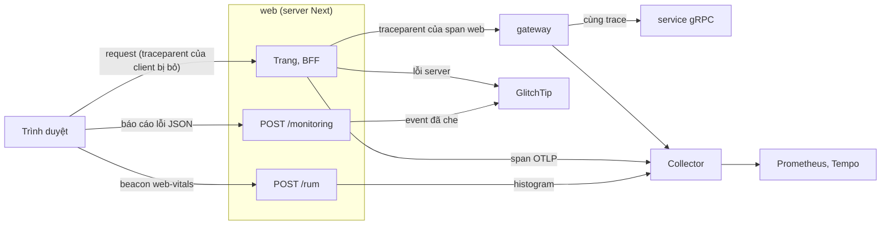

# Quan sát: trace, metric, log, lỗi và RUM

Trang này trả lời: tín hiệu nào (trace, metric, log, profile, lỗi, số đo trình duyệt) đi từ đâu tới đâu, ở compose và ở k3d khác
nhau ra sao, và web được quan sát thế nào mà không lộ dữ liệu người dùng. SLO và cảnh báo ở [`reliability.md`](reliability.md#slo);
lệnh ở [`reference/compose.md`](../reference/compose.md), [`reference/k8s.md`](../reference/k8s.md).

## Compose

Vì sao: [ADR-0011](../adr/0011-observability-stage3.md), so sánh Elastic ở [ADR-0012](../adr/0012-elastic-vs-grafana-stage3.md).

Mọi service đẩy trace, metric (mỗi 15 s) và log qua OTLP/gRPC tới Collector `otelcol` (`otel/opentelemetry-collector-contrib`, nằm
ở cả mạng `default` và `worker`, cổng 4317 không publish; memory limiter, xoá attribute nhạy cảm, batch, scrape lag Redpanda). Không
service nào mở `/metrics` hay pprof.

- **Profile `obs`** (`make up OBS=lgtm`) thêm `lgtm` (Grafana `127.0.0.1:3000` cùng Prometheus giữ 30 ngày, Loki, Tempo,
  Pyroscope; 5 service đẩy profile tới `lgtm:4040`, media-worker không), `alertmanager` (`127.0.0.1:9093`, gửi `severity=page` tới
  Telegram khi `.env` có bot) và `glitchtip` (`127.0.0.1:8000`, tracker lỗi qua giao thức Sentry, database `svp_glitchtip` trên
  Postgres native). Không có profile `obs`, DNS `otelcol` không tồn tại: SDK bỏ export, service vẫn chạy.
- **RAM** (`docker stats`, giới hạn ở [`deploy/compose/compose.yaml`](../../deploy/compose/compose.yaml)): `otelcol` 64–255 MiB lúc
  nghỉ (trung vị 246 và 255,3 ở hai lượt đo), `lgtm` 730–750 MiB lúc nghỉ, 1 203 MiB sau smoke và 1 245 MiB sau mọi diễn tập,
  `alertmanager` 17–42 MiB, `glitchtip` 185–232 MiB; cả `core` + `obs` 1,71–2,61 GiB (2,60 GiB sau một smoke, 2,22 GiB nghỉ và
  2,61 GiB lúc smoke ở lượt so với Elastic).
- **Overhead của SDK** trên 6 service so với tắt telemetry: khoảng +50 MiB RAM và +2% một lõi CPU dưới tải smoke, p50/p95 trang
  khám phá +12/+12 ms (cách đo ghi trong ghi chú lộ trình học, ngoài repo).
- **Profile `obs-elastic`** (Elasticsearch, Kibana `127.0.0.1:5601`, APM Server, `otelcol-elastic` cùng alias `otelcol`) chỉ để so
  sánh, không chạy cùng `obs`.

## k3d

Vì sao: [ADR-0014](../adr/0014-kubernetes-local-stage4.md) §11.

Cùng SDK và cùng file với compose (rule, dashboard, SLO dùng lại bằng symlink), nhưng tách thành thành phần riêng trong namespace
`svp-obs`: Collector (OTLP 4317, đẩy metric sang Prometheus bằng OTLP, log sang Loki, trace sang Tempo, scrape `/public_metrics` của
Redpanda), kube-prometheus-stack (Prometheus, Alertmanager gửi Telegram, Grafana), Loki, Tempo có metrics-generator, Pyroscope,
GlitchTip trên database `svp_glitchtip` của `svp-pg`. Không UI nào có route hay cổng node: chỉ `make k8s-ui-*` (port-forward trên
`127.0.0.1`), Grafana và GlitchTip có đăng nhập. Sơ đồ cluster ở [`deployment.md`](deployment.md#kubernetes-cục-bộ-k3d).

## Web

Vì sao: [ADR-0019](../adr/0019-web-k3d-supply-chain-observability.md) §7–§11,
[ADR-0039](../adr/0039-mainpath-drills-scan-gate-sourcemaps.md) §3.

- **Trace:** server Next dựng OTel (`@opentelemetry/sdk-node`, instrumentation `http`, `undici`, `service.name=web`). Request
  đến web luôn mở trace gốc mới (web không đọc trace context đến); lời gọi BFF tới gateway mang `traceparent` của span web, và
  gateway nhận nó khi bật `TRUST_TRACE_CONTEXT` (compose và k3d), nên một trace đi từ web qua gateway xuống service. Ở k3d Envoy bỏ
  trace context của client trên mọi route và chỉ Envoy, web vào được gateway; ở compose gateway chỉ publish trên loopback (threat
  model WEB-24). Span không ghi header, query hay id người dùng.
- **Lỗi:** trình duyệt không có SDK Sentry: một reporter nhỏ gửi báo cáo JSON (tên, message, stack, pathname, debug ID của
  chunk) tới `/monitoring` cùng origin; server dựng event và gửi GlitchTip bằng `@sentry/nextjs` ở server, cùng bộ luật che
  với lỗi server nhưng ngân sách gửi riêng, nhỏ hơn, để báo cáo rác không đẩy lỗi server ra ngoài (WEB-9, WEB-20). Source map
  trình duyệt sinh kèm debug ID, không nằm trong image, tải lên GlitchTip bằng `make web-sourcemaps` (compose) hay
  `make k8s-web-sourcemaps` (k3d); image phát hành không mang source map: tải map lúc build vào tracker chạy lâu dài làm khi có
  tracker đó ([ADR-0039](../adr/0039-mainpath-drills-scan-gate-sourcemaps.md) §3).
- **RUM:** `web-vitals` gửi LCP, INP, CLS, FCP, TTFB trong một beacon khi trang bị ẩn (`visibilitychange` → hidden, cả khi rời
  trang: sự kiện đó đến sau `pagehide` và sau lúc `web-vitals` chốt CLS, INP; gửi ở `pagehide` thì thiếu hai số này); `/rum` kiểm
  schema, map đường sang 8 route template cố định và ghi histogram `svp.web.vital.*` (Prometheus `svp_web_vital_*`), nhãn duy nhất
  `route`; dashboard Grafana `svp-web` vẽ p75 theo route (WEB-21). SLO trên RUM là `web-inp` ([SLO](reliability.md#slo)).
- **Log:** web chỉ ghi stdout, không gửi log OTLP; Loki không có dòng của web.
