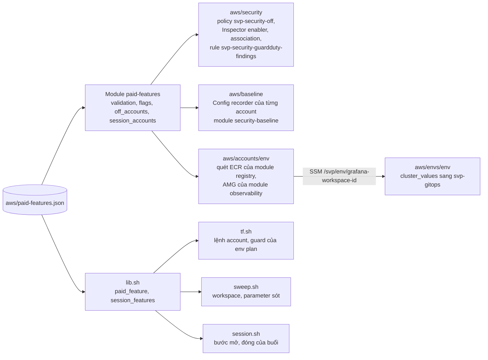
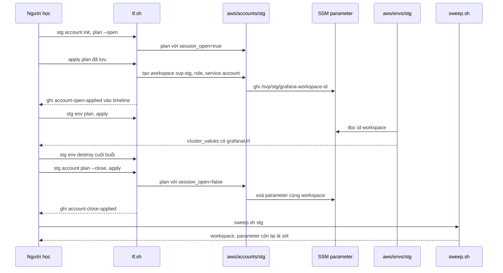

# Dịch vụ AWS tốn tiền theo cờ

Trang này trả lời: vì sao một số dịch vụ AWS có cờ bật, tắt theo account, mỗi cờ điều khiển gì, account nào dùng giá trị
nào và thay bằng gì, cái gì không bao giờ có cờ, và một buổi mở, đóng phần theo buổi ra sao. Quyết định ở
[ADR-0071](../adr/0071-paid-features.md); giá trị rẻ ở mọi account và buổi prd ở
[ADR-0078](../adr/0078-paid-features-lean-defaults.md); kho mục, số tiền và bảng tháng ở phụ lục của
[0071](../adr/appendix/0071-paid-features.md#bảng-tháng-không-buổi) và
[0078](../adr/appendix/0078-paid-features-lean-defaults.md#chi-phí). stg so với prd ở phần còn lại:
[`environments.md`](environments.md); lớp bảo mật cấp org: [`aws-security.md`](aws-security.md).

Code ở repo [`svp-infra`](https://github.com/anhnvcoder/svp-infra): file
[`aws/paid-features.json`](https://github.com/anhnvcoder/svp-infra/blob/main/aws/paid-features.json), module
[`aws/modules/paid-features`](https://github.com/anhnvcoder/svp-infra/tree/main/aws/modules/paid-features) và các root đọc nó. Đổi giá trị
một cờ theo runbook [`paid-features.md`](https://github.com/anhnvcoder/svp-infra/blob/main/docs/runbooks/paid-features.md) của `svp-infra`.

## Vì sao có khối cờ

Env stg, prd chỉ sống trong buổi, nhưng các root sống lâu (`aws/security`, `aws/baseline`, `aws/accounts/<env>`…) tính
tiền cả tháng không buổi. Một phần của số đó là dịch vụ hệ thống không cần để chạy: dashboard managed, chấm posture,
lịch sử cấu hình, quét lại image. Chúng là phần chuẩn ngành: code dựng được chúng ở mọi account, nhưng giữa các buổi
không account nào cần chúng để chạy. Vì thế file cờ ghi cho mọi account giá trị rẻ nhất hợp lệ; prd chỉ chạy một buổi và
về giá trị production trước buổi đó.

Khác biệt giữa account là dữ liệu, không nhánh `if` theo tên env: mọi root chạy cùng code, chỉ đọc giá trị khác nhau. Giá trị nằm trong
một file commit, không trong `<env>.tfvars` của từng root, vì một cờ chạm nhiều root (Inspector ở `aws/security` và `aws/accounts/<env>`;
Security Hub, Config ở `aws/security` và `aws/baseline`) và root org không có `<env>.tfvars`. Hai bản chép của một cờ có thể lệch nhau; một
file đọc qua một module có một nguồn và một chỗ `validation`.

- File là object `{"<khoá account>": {"<cờ>": "<giá trị>"}}`, chỉ ghi giá trị khác `always`. Khoá hay cờ vắng là
  `always`, tức giá trị production: xoá khoá của một account là bật lại mọi dịch vụ có cờ của nó.
- Module `paid-features` không có provider, không có resource: nó nhận map, từ chối khoá, cờ, giá trị lạ và tổ hợp sai, rồi trả đủ mọi
  account với đủ mọi cờ. Mọi root dùng cờ gọi module này; không root nào tự đọc JSON.
- Script đọc cùng file bằng `jq` qua hai hàm của `aws/scripts/lib.sh`: `paid_feature <account> <cờ>` (giá trị, vắng là `always`) và
  `session_features <env>` (các cờ có giá trị `session` của env).

## Cờ và giá trị rẻ

Giá trị đang dùng là nội dung của `aws/paid-features.json`: mỗi account lấy giá trị rẻ nhất mà `validation` cho phép.
`svp-security` vắng khoá: nó là delegated admin nên giữ Security Hub, và Security Hub cần Config cùng account.
`managed_grafana`, `inspector_ecr` chỉ đặt được cho stg, prd; Inspector vẫn bật ở `svp-security`, `svp-log-archive`,
`svp-backup`, nơi không có image. Bảng dưới tả nghĩa của giá trị rẻ.

| Cờ | Giá trị rẻ điều khiển gì | Đường thay thế | Cái giá |
| --- | --- | --- | --- |
| `managed_grafana` (`always`, `session`) | `session`: workspace AMG `svp-<env>`, role `svp-<env>-grafana`, gán nhóm, service account `svp-grafana-operator` và SSM parameter `/svp/<env>/grafana-workspace-id` chỉ có trong buổi | Workspace dựng lại ở bước mở của mỗi buổi; workspace AMP, key `alias/svp-<env>-observability`, log group, X-Ray luôn có | Không xem dashboard giữa các buổi; dữ liệu AMP, CloudWatch vẫn giữ, đọc bằng lệnh AMP của runbook buổi và console CloudWatch; mỗi buổi trả một workspace mới |
| `inspector_ecr` (`always`, `off`) | `off`: `aws/security` không đưa account vào Inspector; registry dùng quét cơ bản của ECR (`BASIC`, `SCAN_ON_PUSH`, cùng filter repo cache) | Quét cơ bản khi push; image của repo code vẫn qua cổng quét của CI và attestation `vuln` mà Kyverno đòi; Inspector quét digest bên thứ ba ghim ở `svp-gitops` trong buổi prd, khi prd ở giá trị production | Digest bên thứ ba ngoài buổi prd chỉ có quét cơ bản; tắt quét xoá finding Inspector của account |
| `security_hub` (`always`, `off`) | `off`: account gắn configuration policy `svp-security-off` (`service_enabled = false`); `svp-security` không đặt được `off` | Giữa các buổi posture chỉ được chấm ở `svp-security`; prd được chấm trong buổi prd; CloudTrail org ghi mọi lệnh ở mọi account; finding GuardDuty mức HIGH, CRITICAL của mọi account `off` tới email qua rule `svp-security-guardduty-findings` | Không control FSBP, CIS ở account `off`; finding cũ của account bị xoá theo hạn của Security Hub |
| `config_recording` (`always`, `off`) | `off`: module `security-baseline` của account không tạo recorder, delivery channel, recorder status ở hai region | CloudTrail org ghi mọi lệnh; prd ghi lịch sử cấu hình trong buổi prd | Không lịch sử cấu hình của tài nguyên ở account `off`; thông tin đã ghi và bản đã giao vào Log Archive giữ |

Hai luật giữa các cờ: `security_hub` = `always` cần `config_recording` = `always`, vì control của Security Hub là rule
của Config; `managed_grafana` không phụ thuộc cờ nào, vì AMP luôn có. Một mục thành cờ khi chi phí ở một account qua
ngưỡng, chức năng lõi và an toàn cơ bản không cần nó, và có đường chạy không có nó bằng code (ADR-0071 §7, ADR-0078 §4).

Không có `off` cho AMG với Grafana trong cluster thay vào: Grafana từ bản 12 đọc AMP qua plugin Amazon Managed Service for Prometheus, image
ghim không có plugin đó, và hardening của `kube-prometheus-stack` cấm tải plugin lúc chạy. `session` giữ hợp đồng cluster: trong buổi
`cluster_values` gửi sang `svp-gitops` đủ mọi khoá như khi workspace sống lâu.

`session` của AMG chỉ lợi ở tháng không buổi stg: AMG tính mỗi user mỗi workspace mỗi tháng, và mỗi buổi dựng một workspace mới. Tháng một
buổi thì bằng `always`, từ buổi thứ hai thì đắt hơn; tháng có từ hai buổi stg trở lên thì đặt `always` trước buổi đầu (số ở phụ lục).

## Không bao giờ có cờ

Các mục dưới đây giữ ở mọi account, mọi env; lý do từng dòng ở [kho mục](../adr/appendix/0071-paid-features.md#kho-mục) của phụ lục:

- Phát hiện lạm dụng: GuardDuty với mọi protection plan (lạm dụng credential cần phát hiện nhất lúc không ai trực, và rẻ), IAM Access
  Analyzer truy cập ngoài, đường sự kiện bảo mật tới email.
- Bằng chứng: CloudTrail org trail và data event của prd, bucket của Log Archive, VPC flow log, log WAF. CloudTrail còn là đường thay thế
  khi Config, Security Hub tắt.
- Guardrail: SCP, RCP, tag policy, backup policy, baseline account (S3 Block Public Access, mã hoá EBS mặc định, liên hệ SECURITY, root
  tập trung), budget, Cost Anomaly Detection: gần như không phí và giữ mọi account trong cùng luật.
- Dữ liệu: mọi KMS CMK (xoá key là mất dữ liệu mã hoá bằng nó) và AWS Backup.

Mục khác có tiền nhưng không qua ngưỡng hay cần để chạy (AMP, CloudWatch Logs, X-Ray, endpoint interface, WAF Bot
Control, ATP) không có cờ; NAT, Multi-AZ, cỡ, gói CloudFront, retention đã là dữ liệu trong `<env>.tfvars`
([`environments.md`](environments.md)). Mỗi mục, số tiền và lý do giữ: [bảng xét
lại](../adr/appendix/0078-paid-features-lean-defaults.md#xét-lại) của phụ lục ADR-0078.

## Cờ đi tới đâu

- `aws/security` đổi id account từ khoá của file và dùng output `off_accounts`: account `off` của `security_hub` nhận policy
  `svp-security-off` (association của account thắng association của root), account `off` của `inspector_ecr` ra khỏi enabler và member
  association.
- Account `off` của `security_hub` không còn đường email của rule `svp-security-findings`, vì GuardDuty đưa finding vào Security Hub của cùng
  account trước khi gộp lên admin. Rule `svp-security-guardduty-findings` ở hai region của `svp-security` lấy finding của các account đó với
  mức ≥ 7; ở `us-east-1` nó gửi qua bus `svp-security-events` bằng role `svp-security-guardduty-forwarder`, vì rule không nhắm được topic SNS
  của region khác. Luồng đủ ở [`aws-security.md`](aws-security.md#luồng-phát-hiện-tới-cảnh-báo).
- `aws/baseline` truyền giá trị `config_recording` của từng account vào module `security-baseline` của account đó.
- `aws/accounts/<env>` truyền `inspector_ecr` vào module `registry` (`enhanced_scanning`) và bật AMG khi `managed_grafana` là `always` hay
  biến `session_open` là `true`. Workspace AMG không tra được theo tên, nên module `observability` ghi id của nó vào SSM parameter; root env
  đọc parameter đó và dừng plan khi không có.

## Một buổi với AMG theo buổi

`session.sh` đặt hai bước account quanh root env; `tf.sh` giữ thứ tự bằng timeline của buổi.

- `env plan` (không phải plan destroy) bị từ chối khi env có cờ `session` mà sự kiện account cuối cùng không phải `account-open-applied`:
  thiếu bước mở thì root env không có id workspace để đọc.
- `account plan --close` bị từ chối khi root env còn đứng trong buổi: workspace phải sống tới khi cluster đã gỡ.
- `session_open` không nằm trong file nào: chỉ `plan --open`, `plan --close` của `tf.sh` đặt nó, nên không file nào để quên workspace
  sống qua buổi.
- Giữa các buổi prd cũng theo `session`, không có workspace. Buổi prd chạy sau khi prd về giá trị production (`always`),
  nên trong buổi đó mọi lệnh account của prd in `ok no session feature of prd …` và thoát 0; workspace sống tới khi prd
  về lại giá trị rẻ.

## Phép kiểm buổi theo cờ

Phép kiểm nào của runbook buổi đọc dịch vụ có cờ ở ADR-0071 §12. Với `managed_grafana` = `session`, phép kiểm cần Grafana (token Grafana
Operator, dashboard, Explore) chạy được sau bước mở. Phép kiểm đọc Inspector hay finding Security Hub không có gì để đọc ở account có cờ đó
`off`; chúng chạy ở buổi prd. Không phép kiểm nào đọc Config riêng: control FAILED cần Config đi cùng Security Hub.

## Đổi một cờ

- Tắt cờ của một account: `aws/security` trước (Security Hub, Inspector), rồi `aws/baseline` (Config), rồi `aws/accounts/<env>` (rule quét
  cơ bản). Bật: `aws/baseline` trước, vì Security Hub cần Config đang ghi; rồi `aws/security`, vì bật quét ECR của Inspector tự đổi registry
  sang Enhanced; rồi `aws/accounts/<env>` đặt lại rule quét liên tục.
- Cờ chỉ gỡ tài nguyên của dòng nó; không cờ nào chạm KMS key, bucket, vault, recovery point, log group. Địa chỉ resource mà plan gỡ, mất
  gì và giá của lần bật lại ở [Đổi cờ](../adr/appendix/0071-paid-features.md#đổi-cờ) của phụ lục.
- Bật lại không miễn phí: Inspector quét lại mọi image đủ điều kiện, Security Hub chạy lại mọi check, Config ghi lại mọi tài nguyên. Vì thế
  chỉ AMG đi theo buổi; Security Hub, Config, Inspector bật tắt mỗi buổi sẽ trả lượt đầu mỗi lần và mất finding, lịch sử.
- prd đổi hai lần mỗi buổi prd: xoá khoá `prd` rồi áp theo thứ tự bật trước buổi, ghi lại giá trị rẻ rồi áp theo thứ tự
  tắt sau buổi, theo runbook `paid-features.md` của `svp-infra`. Account dùng chung giữ giá trị rẻ suốt buổi (ADR-0078
  §3).
- Test của `svp-infra` (`make test`, mock provider) chạy module `paid-features` với mọi giá trị và mọi luật `validation`, và các module
  `observability`, `registry`, `security-baseline` ở cả hai trạng thái của cờ của nó.
