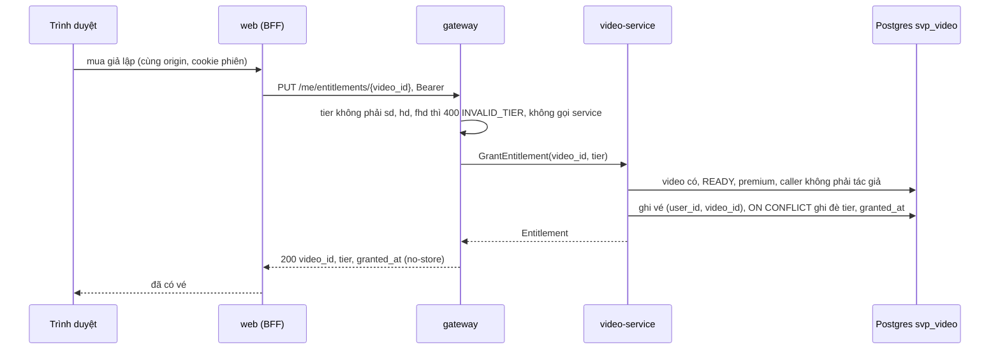
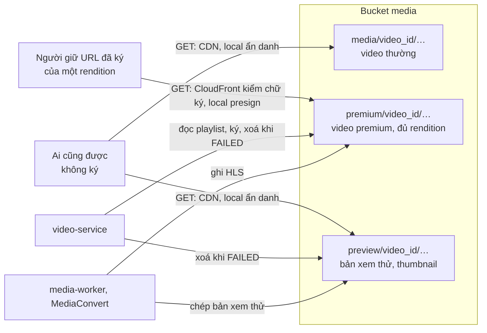
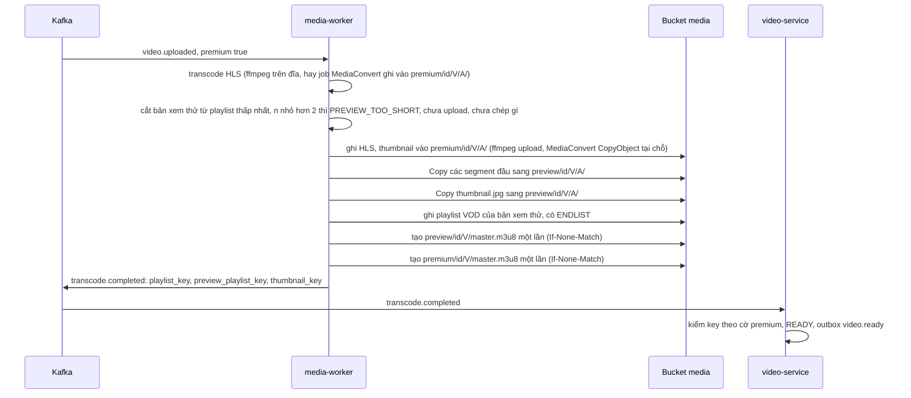
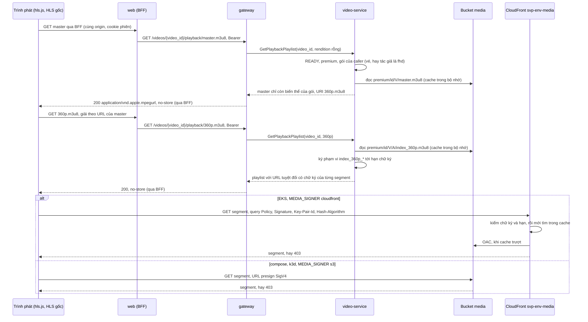

# Video premium: vé, bản xem thử, playlist đã ký

Trang này giải thích video premium đi từ upload tới lúc phát: ai xem được gì, object nằm ở đâu, vì sao playlist do API viết lại còn
segment đi thẳng từ CDN, chữ ký phủ gì và hết hạn khi nào, khác nhau giữa compose, k3d và EKS, và kiểm bằng gì. Quyết định, phương án đã
cân nhắc và nguồn AWS ở [ADR-0073](../adr/0073-premium-playback.md) và [phụ lục](../adr/appendix/0073-premium-playback.md) của nó; mối đe doạ
ở mục Nội dung premium của [threat model](../threat-model.md#414-nội-dung-premium). Code:

- `internal/objstore` (tiền tố, `IsKeyUnder`, `PresignGet`, `Read`), `internal/hls` (lọc master, ký playlist), `internal/mediasign` (bộ ký);
- `services/video-service` (vé, `GrantEntitlement`, `GetPlaybackPlaylist`), `services/media-worker` (output `premium/`, bản xem thử
  `preview/`), `services/feed-service` (feed chỉ giữ key xem thử), `services/gateway` (route, URL công khai);
- hạ tầng ở module `media` của [`svp-infra`](https://github.com/anhnvcoder/svp-infra/tree/main/aws/modules/media) (key group, behavior
  mặc định cần chữ ký, bucket policy), giá trị theo nền tảng ở `svp-gitops`.

Không có thanh toán: "mua" là một lời gọi ghi vé (**mua giả lập**).

## Mô hình

- **Video premium**: cờ `premium` của `POST /videos` (vắng là `false`), lưu ở cột `videos.premium` của `svp_video`, không đổi sau upload. Đổi
  cờ phải chuyển mọi object sang tiền tố khác và bỏ cache của bản cũ, nên API không có đường đổi. Chỉ video premium có vé, bản xem thử và
  route phát premium; video thường phát như trước, công khai.
- **Gói**: `sd` < `hd` < `fhd` (proto `svp.video.v1.Tier`, REST là chuỗi). Mỗi gói mở một tập rendition, gói cao gồm gói thấp:

  | Gói | Rendition phát được |
  | --- | --- |
  | `sd` | `source`, `360p` |
  | `hd` | như `sd`, thêm `720p` |
  | `fhd` | mọi rendition của thang |

  Bảng trong code là `renditionTiers` của `services/video-service/internal/server/playback.go`; thang là của
  `services/media-worker/internal/transcode/transcode.go`.
- **Vé** (entitlement): một dòng của bảng `video_entitlements` (`user_id`, `video_id`, `tier`, `granted_at`, khoá chính
  `(user_id, video_id)`). Mỗi người một vé mỗi video, không hết hạn. Tác giả luôn có `fhd` mà không cần vé.
- **Mua giả lập**: `PUT /me/entitlements/{video_id}` với thân `{"tier":"sd|hd|fhd"}` (RPC `GrantEntitlement`). Gọi lại ghi đè gói của vé.

Vé nằm ở video-service, không ở user-service: lời kiểm mỗi lần phát cần cờ premium, trạng thái `READY`, tác giả và vé cùng lúc, mà cả bốn đều
ở `svp_video`. Một truy vấn là đủ, không lời gọi chéo service nào trên đường phát. Cái giá: video-service giữ thêm miền "mua".

Lỗi: video không có hay chưa `READY` thì 404 `VIDEO_NOT_FOUND`; video thường thì 409 `VIDEO_NOT_PREMIUM`; tác giả tự mua thì 409
`ALREADY_ENTITLED`. Bảng mã đủ của từng route ở [`services/gateway/openapi.yaml`](../../services/gateway/openapi.yaml), cách đổi mã gRPC
sang HTTP ở [`reference/contracts.md`](../reference/contracts.md#mã-lỗi-grpc-sang-http-ở-gateway).

## Ba tiền tố media

Mọi object của một video nằm dưới đúng một trong ba tiền tố của bucket `media`, cùng bố cục `<tiền tố><video_id>/<version>/…`:

| Tiền tố | Chứa | Ai đọc được |
| --- | --- | --- |
| `media/` | Mọi object của video thường | Ai cũng đọc được (CDN; local: ẩn danh từng object) |
| `premium/` | Mọi rendition, playlist, master của video premium | Chỉ người giữ URL đã ký; video-service đọc playlist |
| `preview/` | Bản xem thử và thumbnail của video premium | Ai cũng đọc được, như `media/` |

Tách bằng tiền tố vì mọi lớp kiểm quyền chọn theo path: behavior của CloudFront theo path pattern, bucket policy ẩn danh của object store
local theo ARN object, IAM của service theo ARN. Tag object không dùng được: CloudFront không chọn behavior theo tag.

- **Người nhận event kiểm key theo cờ** (`objstore.IsKeyUnder`): video thường có playlist, thumbnail dưới `media/<id>/`; video premium có
  playlist dưới `premium/<id>/`, thumbnail và playlist xem thử dưới `preview/<id>/`. video-service và feed-service đưa event sai dạng vào DLQ.
- **Gateway không bao giờ trả URL dưới `premium/`**: mọi `playlist_url` của video premium (trang video, trang công khai, feed, danh sách theo
  tác giả) là master xem thử, kèm `premium: true`; `thumbnail_url` là thumbnail dưới `preview/`. `GET /videos/{video_id}` thêm
  `entitlement_tier` khi caller có vé hay là tác giả. Gateway còn trả URL rỗng cho mọi key dưới `premium/`, lớp chặn thứ hai khi một service
  gửi nhầm.
- **Feed không giữ key `premium/` nào**: feed-service lưu cột `premium` và lưu `preview_playlist_key` của `video.ready` vào `playlist_key`.
- **Quyền object store**: ẩn danh (chỉ local) đọc `media/` và `preview/`, không `premium/`, không liệt kê; CloudFront qua OAC đọc cả ba;
  video-service, media-worker có quyền hiện có trên cả ba tiền tố, video-service thêm đọc `premium/*` để lọc và ký playlist; role MediaConvert
  ghi `media/*`, `premium/*`. Object store local (RustFS) áp policy ẩn danh cho cả request có ký, nên ở local chỉ việc không mở `premium/*`
  cho ẩn danh giữ nó riêng ([threat model](../threat-model.md) BAK-1).

## Bản xem thử

Sau một lần thử thành công của video premium, ở cả đường ffmpeg và MediaConvert ([`transcode.md`](transcode.md)), media-worker chép vài segment
đầu của rendition thấp nhất từ `premium/<id>/<version>/<attempt>/` sang `preview/<id>/<version>/<attempt>/`, cùng tên. Số segment là
min(3, ⌊n/2⌋), với n là số segment của rendition đó: segment dài 4 s nên xem thử tối đa 12 s và không quá nửa số segment
(`transcode.CutPreview`). Video premium chỉ một segment không có bản xem thử: lần thử thất bại vĩnh viễn, video `FAILED` với lý do
`PREVIEW_TOO_SHORT`. Nhờ vậy video premium `READY` luôn có bản xem thử, và bản đó không bao giờ là trọn video.

- **Thứ tự** là segment, thumbnail, playlist, master xem thử, rồi master đầy đủ. Master đầy đủ là object cuối, nên lần thử nào đã có master
  thì đã có bản xem thử; lần giao lại gặp master có sẵn chỉ đọc kết quả đã lưu. Master xem thử đã có từ lần thử trước thì giữ, và
  `thumbnail_key` là thumbnail của lần thử mà master đó nêu: mọi lần phát cùng một kết quả.
- **Ở đường ffmpeg**, `PREVIEW_TOO_SHORT` được biết trước khi upload gì; ở đường MediaConvert, mỗi lần `settle` tính lại nó từ playlist bất
  biến.
- **Chép thay transcode lại**: cùng byte, không thêm phút MediaConvert, và chỉ có rendition thấp nhất. Segment cuối có thể ngắn hơn 4 s, nên
  bản xem thử đếm theo segment có thể quá nửa thời lượng của video rất ngắn (ADR-0073, phần Hệ quả).

## Phát: playlist từ API, segment từ CDN

Trình phát giải mỗi URI tương đối của playlist theo URL của playlist chứa nó, và phép giải đó lấy query của tham chiếu, không của URL gốc. Chữ
ký đặt trên URL của master vì vậy không theo xuống playlist con hay segment. Cách của các nền tảng video (manifest manipulation) là API kiểm
quyền theo người rồi viết lại playlist, còn CDN chỉ kiểm chữ ký của từng segment:

- **Master đã lọc** (`GET /videos/{video_id}/playback/master.m3u8`): video-service đọc master dưới `premium/`, giữ các biến thể thuộc gói của
  caller, đổi URI thành `<rendition>.m3u8` tương đối. Trình phát vì vậy hỏi lại đúng route phát cho từng chất lượng.
- **Playlist đã ký** (`GET /videos/{video_id}/playback/<rendition>.m3u8`): video-service đọc playlist của rendition, đổi mỗi URI segment thành
  URL tuyệt đối có chữ ký, giữ mọi tag. Playlist khác dạng media-worker ghi (URI lạ, tag `#EXT-X-MAP`, `#EXT-X-KEY`) là lỗi `INTERNAL`,
  không ký mù.

- **Route** đăng ký một pattern `GET /videos/{video_id}/playback/{file}` vì `ServeMux` của Go chỉ nhận wildcard trọn một đoạn path; gateway
  tách `file`: `master.m3u8` là master, `<rendition>.m3u8` với rendition chữ thường và số là playlist của rendition đó, dạng khác là 404
  `RENDITION_NOT_FOUND` mà không gọi service. Route cần Bearer, lớp rate limit `read`, câu trả lời `Cache-Control: no-store`. Web gọi qua BFF
  cùng origin, nên token không tới trình duyệt.
- **Thứ tự kiểm** của video-service: video có và `READY` (tác giả cũng vậy), premium (không thì `VIDEO_NOT_PREMIUM`), gói của caller (không
  vé, không phải tác giả thì 403 `NOT_ENTITLED` trước khi đọc storage, nên người không vé không biết rendition nào có), rồi rendition (không
  có thì 404 `RENDITION_NOT_FOUND`, ngoài gói thì 403 `RENDITION_NOT_ENTITLED`).
- **Cache playlist**: playlist gốc bất biến (version, lần thử không bao giờ ghi lại), nên video-service giữ chúng trong bộ nhớ theo key, có
  trần số mục và byte (`playlist_cache.go`). Chữ ký thì làm mỗi lần gọi, không cache. Lỗi tạm khi đọc storage là 503, không vào cache.
- **Không log** playlist đã ký, URL hay query chữ ký: chúng là quyền đọc. Metric `svp.video.playback.playlists` đếm theo `kind` (`master`,
  `media`) và `result`.
- **Cái giá**: mỗi lần trình phát đổi chất lượng là một RPC tới video-service, qua BFF và gateway.

## Phạm vi và hạn chữ ký

- **Phạm vi**: mỗi rendition một chữ ký, phủ mọi segment của nó: `<base>/premium/<id>/<version>/<attempt>/index_<rendition>_*`. Mọi object của
  một lần thử nằm phẳng trong một thư mục (bố cục của [`transcode.md`](transcode.md#bố-cục-output)), nên phạm vi là tiền tố tên thay vì thư
  mục con mỗi rendition; dấu `_` sau tên giữ `360p` khác `3600p`. Chữ ký của rendition này không mở rendition khác, lần thử khác hay video
  khác.
- **Hạn** (`mediasign.Expiry`): thời điểm nhỏ nhất là bội của 15 phút và không sớm hơn `now + độ dài video + 5 phút`, tức hạn rơi trong
  khoảng từ độ dài + 5 tới độ dài + 20 phút. Với bộ ký `cloudfront`, mọi lần hỏi cùng rendition trong một khung 15 phút nhận cùng URL: cache
  HTTP của trình duyệt dùng lại được, và chữ ký không lộ thời điểm hỏi. Cái giá: hạn dài hơn cần tới 15 phút. CloudFront kiểm hạn lúc request
  bắt đầu; tạm dừng quá hạn thì segment trả 403 và web hỏi lại playlist.
- **Vé không hết hạn**: "hết hạn" trong bài này là chữ ký quá hạn. Thuê theo thời hạn là quyết định khác (ADR-0073, Xem lại khi).

## Bộ ký theo nền tảng

`internal/mediasign` có một interface và hai bản, chọn bằng biến `MEDIA_SIGNER` của video-service (giá trị và luật khởi động ở
[`reference/environment.md`](../reference/environment.md#biến-và-hành-vi-khởi-động-của-service)). Khác biệt nền tảng là dữ liệu của
`svp-gitops` và `compose.yaml`, không phải nhánh `if` theo tên môi trường.

| | `cloudfront` | `s3` |
| --- | --- | --- |
| Chạy ở | EKS (stg, prd) | compose, k3d |
| URL segment | `MEDIA_SIGNED_BASE_URL` (`https://media.<domain>`) + key | Endpoint công khai của object store (`S3_PUBLIC_ENDPOINT`) + key |
| Chữ ký | Signed URL custom policy của CloudFront: một policy mỗi rendition, cùng query nối vào mọi segment | Presign SigV4 `GET` từng segment, hạn `exp − now` |
| Ai kiểm | CloudFront, theo key group của behavior mặc định | Object store, theo quyền của credential video-service |
| Cùng URL trong một khung | Có | Không: SigV4 ký cả thời điểm ký, chỉ hạn rơi vào cùng khung |

- **`cloudfront`**: policy JSON không khoảng trắng, chữ ký RSA PKCS#1 v1.5 trên SHA-256 của byte policy, query `Policy`, `Signature`,
  `Key-Pair-Id`, `Hash-Algorithm=SHA256`, base64 với `+`, `=`, `/` thay bằng `-`, `_`, `~`. Thư viện chuẩn Go, không SDK. RSA vì chữ ký
  PKCS#1 v1.5 tất định: cùng policy cho cùng URL ở mọi bộ ký; ECDSA chỉ tất định khi bộ ký theo RFC 6979.
- **`s3`**: chuẩn cho object riêng khi không có CDN. `objstore.PresignGet` chỉ ký key dưới `premium/`, với trần hạn đủ cho video dài nhất mà
  upload nhận. Local không dựng giả CloudFront: bộ kiểm tự viết chỉ chứng minh nó khớp bộ ký tự viết. Định dạng chữ ký CloudFront vì vậy được
  kiểm bằng test Go (xác minh bằng khoá công khai) và ở buổi cloud.

## Cache key ở CloudFront

Distribution media có ba behavior cùng GET, HEAD, `https-only`, nén và response headers policy. Behavior mặc định mang `trusted_key_groups`:
mọi path cần chữ ký, trừ hai `ordered_cache_behavior` công khai `media/*` và `preview/*`. Key group ở behavior mặc định, không ở một behavior
`premium/*` riêng, vì CloudFront chọn behavior trên path đã chuẩn hoá rồi gửi path thô cho S3: path mã hoá như `premium%2F<id>/…` không khớp
`premium/*` mà S3 có thể giải thành key `premium/`; lý do đủ và các path đó ở [`edge.md`](edge.md#media). Cả ba dùng cache policy managed
`Managed-CachingOptimized`: không query, cookie, header nào (ngoài `Accept-Encoding` chuẩn hoá) vào cache key. Mọi chữ ký của một segment vì
vậy trúng cùng mục cache, và tỉ lệ trúng của video premium ngang video công khai. CloudFront kiểm chữ ký và policy trước khi tìm trong cache,
nên object đã cache không trả cho request thiếu chữ ký. Sơ đồ edge của media ở [`edge.md`](edge.md#media); giá trị ở module `media` của
`svp-infra`.

## Khoá ký và xoay

- **Khoá**: RSA 2048, sinh bằng `openssl` trên máy người học (`aws/scripts/media-signing-key.sh` của `svp-infra`), không vào git, state hay
  log. Module `media` nhận khoá công khai của hai ô `a`, `b` và tạo key group; khoá riêng cùng ID vào entry Secrets Manager
  `svp/<env>/media-signing`, rồi External Secrets đưa vào Secret `video-service-env` (`MEDIA_SIGNING_KEY_ID`, `MEDIA_SIGNING_KEY`) khi chart
  `svp-cluster` bật `externalSecrets.mediaSigning`. `make eks-secrets` không ghi entry này, chỉ kiểm nó đã có giá trị
  ([`reference/eks.md`](../reference/eks.md)).
- **Secret chỉ đổi sau một lượt đồng bộ**: ExternalSecret có `refreshPolicy: OnChange`, không tự đọc lại entry. Ghi entry xong phải chạy
  `aws/scripts/bootstrap.sh <env> secrets` của `svp-infra` (gọi `make eks-secrets`); lượt đó dựng lại Secret từ entry, rồi Reloader khởi
  động lại video-service, và video-service đọc khoá lúc khởi động.
- **Xoay**: sinh khoá ở ô kia, apply root env (key group hai khoá), ghi entry bằng ô mới, rồi lượt `bootstrap.sh <env> secrets`; URL ký
  bằng ô cũ dùng được tới hạn của chúng, ô cũ ở lại tới lần xoay sau. Thiếu lượt đồng bộ thì video-service vẫn ký bằng ô cũ, và lần xoay sau
  thay khoá của chính ô đó: mọi segment premium 403. Lộ khoá: thay ngay ô bị lộ (sinh, apply, ghi entry cùng ô, rồi lượt đồng bộ), URL đã
  ký bằng nó hỏng. Root env bị destroy cuối buổi nên mỗi buổi sinh khoá mới.
- **Lệnh** của từng bước, phép kiểm sau mỗi bước và dọn: runbook
  [`media-signing-keys.md`](https://github.com/anhnvcoder/svp-infra/blob/main/docs/runbooks/media-signing-keys.md) của `svp-infra`.

## Thứ tự triển khai

Cờ `premium` đi qua gateway (`InitUploadRequest.premium`), video-service (cột `videos.premium`, `VideoUploaded.premium`) và media-worker
(tiền tố của output); video-service và feed-service kiểm key của `transcode.completed`, `video.ready` theo cờ. Bản trước của mỗi service
không biết cờ: protobuf bỏ qua field lạ mà không báo lỗi, và bản đó chỉ nhận key dưới `media/<id>/`. Promote đổi image của mọi service
trong một commit của `svp-gitops`, nên lúc các Deployment rolling update, pod bản trước và bản mới chạy cạnh nhau, không theo thứ tự nào.
Upload premium trong khoảng đó hỏng theo một trong hai cách:

- **Cờ mất trên đường.** Gateway mới gọi pod video-service bản trước: video thành video thường, công khai dưới `media/`, vào feed. Pod
  video-service bản trước phát `video.uploaded`, hay media-worker bản trước nhận nó: trọn thang ghi dưới `media/<id>/`, ai biết key đọc được
  qua behavior công khai `media/*`; `transcode.completed` sai tiền tố vào `media.transcodes.v1.dlq`, video đứng ở `PROCESSING`. Không lần
  phát lại nào gỡ được: event mang key sai, cờ không đổi sau upload, API không có đường xoá video.
- **Người nhận bản trước từ chối key đúng.** Pod video-service bản trước nhận `transcode.completed` của video premium: record vào
  `media.transcodes.v1.dlq`, video đứng ở `PROCESSING`. feed-service bản trước nhận `video.ready` của video premium: record vào
  `video.lifecycle.v1.dlq`, video `READY` vắng khỏi feed. Cả hai mang `dlq-reason: permanent` và bật cảnh báo `KafkaDLQRecords`.

Cách thứ hai gỡ được khi mọi pod đã lên bản mới. Với group `video-service` trên `media.transcodes.v1` hay group `feed-service` trên
`video.lifecycle.v1`, đưa offset của từng partition về `dlq-offset` nhỏ nhất trong các record DLQ có `dlq-partition` là partition đó, theo
mục Khôi phục của runbook [`kafka-dlq-records.md`](../runbooks/kafka-dlq-records.md#khôi-phục-và-xác-nhận). Handler idempotent nên record phát
lại không đổi gì đã có.

Buổi stg, prd dựng env mới, mọi service chạy cùng bản từ đầu, nên khoảng này chỉ có khi nâng một env đang chạy bản không biết cờ `premium`.
Khi đó không tạo video premium, kể cả bằng lời gọi API thẳng, tới khi Argo CD báo mọi Application của service `Healthy`.

## Kiểm bằng gì

- **Test Go** (`make check`): `internal/mediasign` xác minh chữ ký CloudFront bằng khoá công khai trên đúng byte policy, phạm vi, hạn với
  clock giả, presign; `internal/hls` lọc master, ký playlist, từ chối playlist lạ; `internal/objstore` tiền tố, `IsKeyUnder` (cả fuzz
  `FuzzIsMediaKey`), `PresignGet`; video-service mọi ca của vé, mua giả lập, `GetPlaybackPlaylist` (không vé, ngoài gói, chữ ký, lỗi
  storage); media-worker bản xem thử ở hai đường; feed-service key xem thử; gateway route, mã lỗi, URL công khai không bao giờ dưới
  `premium/`.
- **Smoke** (`make smoke`, `make k8s-smoke`, `make eks-smoke`; [`reference/compose.md`](../reference/compose.md)): luồng premium đầu-cuối
  qua API: bản xem thử công khai 200, object `premium/` ẩn danh 403, không vé 403 `NOT_ENTITLED`, vé `sd` chỉ thấy rendition của `sd` và
  phát được, rendition cao hơn 403 `RENDITION_NOT_ENTITLED`, chữ ký của video này trên segment của video khác 403.
- **Kiểm edge premium** (`make eks-premium-check`, người học chạy trong buổi stg, prd; [`reference/eks.md`](../reference/eks.md)):
  `deploy/k8s/premium-edge-check.sh` chỉ gọi API và CDN qua HTTPS, không gọi API AWS. Hai user A, B, video thường V0 và hai video premium V1,
  V2 của A, B có vé `sd` của V1. In bảng có mốc UTC: segment `premium/` không ký 403; segment và playlist 360p của V1 dưới các path mã hoá
  `premium%2F<id>/…`, `%70remium/<id>/…`, `media/..%2Fpremium/<id>/…`, `preview/..%2Fpremium/<id>/…` (vì sao: [`edge.md`](edge.md#media)),
  không ký, gửi nguyên path (`curl --path-as-is`): 403; chữ ký 360p của V1 trên segment của V2 403, trên segment 720p của V1 403; B hỏi
  playlist 720p 403 `RENDITION_NOT_ENTITLED`, master của V2 403 `NOT_ENTITLED`; bản xem thử V1 không ký 200. Với `WAIT_EXPIRY=1`, script đọc
  `DateLessThan` của một policy, chờ qua nó 5 giây rồi GET segment đó: 403. Self-test `deploy/k8s/premium-edge-check-test.sh` (`curl` giả)
  chạy trong CI.
- **Đo cache hit** (cùng script): 3 lượt, mỗi lượt GET mọi segment 360p của V0 (công khai, "trước") và V1 (đã ký, "sau"), query `svp_probe`
  khác mỗi lượt; đếm header `x-cache` (`Hit`, `RefreshHit` là trúng) của lượt 2 và 3. Kỳ vọng V1 ngang V0, vì query, kể cả chữ ký, không vào
  cache key. Không dùng metric trả tiền của CloudFront. Số đo của buổi ghi ở phụ lục ADR-0073.
- **Tĩnh** ở `svp-infra` (`make check`): test mocked của module `media` (key group ở behavior mặc định, `media/*`, `preview/*` công khai,
  quyền theo tiền tố), `transcode`, `external-secrets`, script buổi.

## Giới hạn đã nhận

- URL đã ký chia sẻ được tới hạn của nó (tối đa độ dài video + 20 phút); DRM ngoài phạm vi, người có vé chép được nội dung đã tải.
- Log chuẩn của CloudFront (prd) và log WAF giữ query đã ký; chúng chỉ ở account Log Archive và hết hiệu lực theo hạn chữ ký.
- Cờ premium không đổi sau upload; video premium quá ngắn không phát hành được (`PREVIEW_TOO_SHORT`).

Lý do chấp nhận từng điểm ở mục 6 của [threat model](../threat-model.md#6-rủi-ro-chấp-nhận) và phần Hệ quả của ADR-0073.
