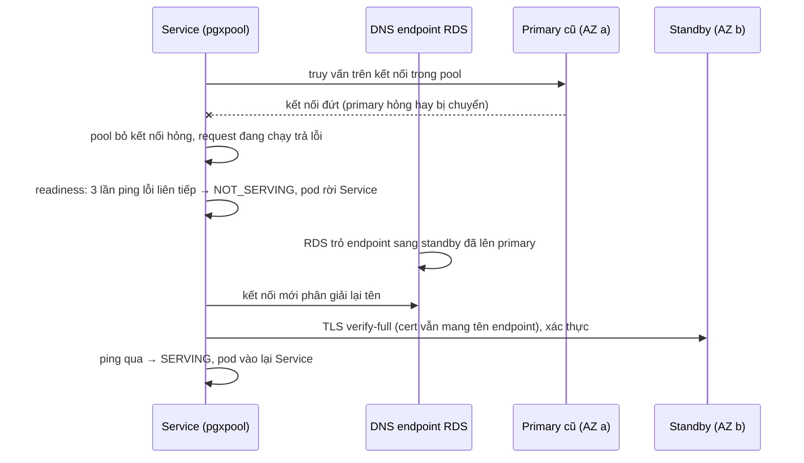
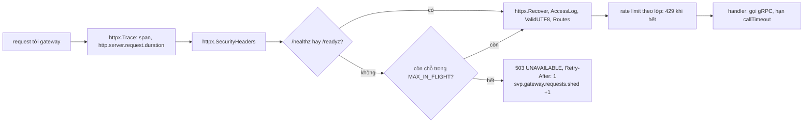
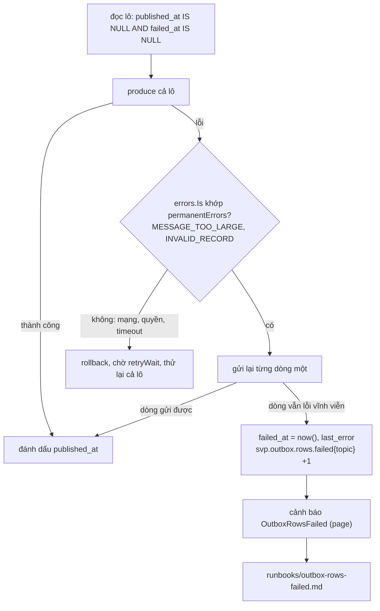
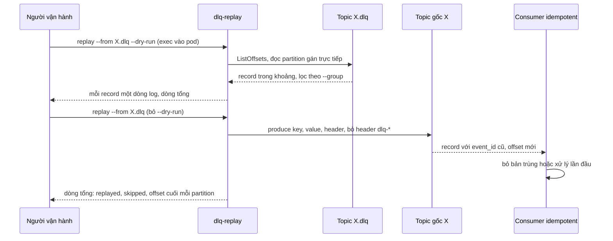

# Độ tin cậy: SLO, tải, backup, probe và vận hành

Trang này trả lời: hệ thống hứa gì (SLO), kiểm lời hứa đó bằng tải và diễn tập nào, phục hồi dữ liệu ra sao, và cái gì đo được trên
máy 16 GB, cái gì chạy trên runner CI, cái gì cần cloud. Số đo đầy đủ ở mục Kết quả của
[ADR-0020](../adr/0020-reliability-stage6.md); lệnh ở [`reference/compose.md`](../reference/compose.md),
[`reference/k8s.md`](../reference/k8s.md).

Phần chạy được trên máy 16 GB chạy local; phần cần máy lớn hơn (k3d nặng, observability dưới tải, diễn tập đầy đủ) chạy trên runner
CI ([kiểm chứng trên runner](#kiểm-chứng-trên-runner)); phần cần dịch vụ cloud chờ cluster AWS
([chưa đo trên cloud](#chưa-đo-trên-cloud)).

## SLO

Vì sao: [ADR-0011](../adr/0011-observability-stage3.md), [ADR-0020](../adr/0020-reliability-stage6.md).

Sáu SLO bằng Sloth ([`deploy/observability/slo/svp-slos.yaml`](../../deploy/observability/slo/svp-slos.yaml)): bốn của backend
(`feed-availability`, `feed-latency`, `upload-init-availability`, `video-ready-latency`) và hai của web.

- `web-availability`: 99,9% response của server web không 5xx, trên histogram
  `http_server_request_duration_seconds{service_name="web"}` (mọi response, kể cả probe và asset, vì histogram không có nhãn route
  nên SLI lạc quan hơn tỷ lệ lỗi của trang), cảnh báo page và ticket.
- `web-inp`: 75% lượt có INP ≤ 200 ms từ RUM ([quan sát web](observability.md#web)), chỉ ticket (ngân sách lỗi 25% làm cửa sổ
  page không bao giờ chạm).
- Chưa có SLO độ trễ SSR tới khi histogram có route.

## Tải

Vì sao: [ADR-0020](../adr/0020-reliability-stage6.md), quy mô mục tiêu ở [`capacity.md`](capacity.md).

Kịch bản k6 ở `deploy/k6/` chạy bằng image ghim (`K6_IMAGE`), mỗi request mang tag `route` là template, trùng nhãn route của
gateway và RUM nên số phía k6 và phía server ghép được. Pool user và tốc độ tính từ bảng rate limit để kịch bản không tự chặn mình
(429 đếm riêng là lỗi cỡ kịch bản).

- Profile `local` (~24 req/s, compose) chỉ kiểm kịch bản đúng cỡ và cho một mốc độ trễ ở tải rất nhẹ, **không kết luận năng lực**.
- `ci` chạy trong job `stack` của CI.
- `cloud` là Job Indexed 20 pod trong cluster, 1 000 req/s feed, chạy trên cluster cloud; bản thu nhỏ `k6-cloud-mini` là bài lab
  `drills/` của `svp-labs`.

## Backup và phục hồi Postgres

Vì sao: [ADR-0020](../adr/0020-reliability-stage6.md), [ADR-0021](../adr/0021-deferred-verification-stage6b.md) D20. Quy trình
tay ở [`runbooks/postgres-restore.md`](../runbooks/postgres-restore.md).

Trên k3d, Cluster CloudNativePG `svp-pg` lưu WAL liên tục và backup cơ sở hằng ngày qua plugin Barman Cloud (sidecar trong pod
Postgres, controller ở `cnpg-system`) vào bucket `pg-backups` của object store trong cluster, bằng user `svp-pg-backup` riêng chỉ
có quyền bucket đó. Mỗi lần phục hồi ghi vào một thế hệ lưu trữ mới (`serverName`), vì Job phục hồi từ chối lưu WAL vào nơi đã có
WAL. PodMonitor đưa `cnpg_*`, `barman_cloud_*` vào Prometheus; cảnh báo `PostgresWALArchivingFailing` (page) và
`PostgresBackupTooOld` (ticket).

- **Nơi lưu:** plugin Barman Cloud lưu WAL và backup cơ sở, từ sidecar trong pod Postgres, vào bucket `pg-backups` của object store
  `s3` trong cluster bằng user `svp-pg-backup`, có policy chỉ cho bucket đó (`deploy/s3/pg-backup-policy.json`, do Job `s3-init`
  tạo; không service nào có user này). Secret key của nó lấy từ `.env` (`SVP_PG_BACKUP_S3_SECRET_KEY`) vào Secret `pg-backup-s3`
  (`deploy/k8s/secrets.sh`). Bucket nằm cùng cluster, cùng ổ với dữ liệu, và store ở đây không có KMS: đủ để lab diễn tập phục hồi
  (WAL, điểm trong thời gian, các thế hệ lưu trữ) và đo RTO, RPO của nó, không phải một bản sao sống sót khi cluster mất. Trong
  bucket mỗi thế hệ lưu trữ có prefix riêng, là `serverName` của plugin (`postgres.backup.serverName`). Với `postgres.mode:
  external` chart không tạo backup: Postgres được quản lý giữ backup của chính nó.
- **Lịch backup cơ sở:** mỗi ngày lúc 03:00 UTC (cron của CloudNativePG có trường giây ở đầu), và một lần ngay khi object được tạo,
  để cluster mới có điểm phục hồi trong vài phút thay vì tới 03:00 kế tiếp (`PostgresBackupTooOld` cháy khi không có backup nào
  trong một giờ). Object `ScheduledBackup` `svp-pg-daily` là hook (weight 1) sau các Job init: CloudNativePG khởi `Backup` tức thì
  trên primary Ready đầu tiên và không bao giờ thử lại lần đã thất bại, trong khi bucket `pg-backups` và login `svp-pg-backup` chỉ có sau khi Job `s3-init` chạy,
  sau khi tài nguyên thường của release sẵn sàng (Argo CD: PostSync, hook theo thứ tự weight). Là tài nguyên thường thì `Backup` của
  nó sẽ đua với Job đó trên cluster mới và thất bại vĩnh viễn. Mỗi lần upgrade hay sync tạo lại object; CloudNativePG khi đó không
  lấy thêm `Backup` tức thì thứ hai khi object của lần đầu còn (nó nhận lại object đó), và `make k8s-up` tự lấy một backup cơ sở
  khi thế hệ đang chạy chưa có (`pg_base_backup` trong `deploy/k8s/install.sh`). Các `Backup` nó tạo không thuộc object nào, để việc
  tạo lại object hay xoá Cluster khi phục hồi ([runbook](../runbooks/postgres-restore.md)) không xoá chúng; plugin xoá những `Backup`
  của Cluster đang chạy mà chính sách retention đã xoá khỏi bucket. Không object nào của bucket bị xoá trừ bởi chính sách đó.
- **Nâng chart `svp-data` sau phục hồi:** `pg_backup_sets` trong `deploy/k8s/rotate.sh` đặt `pg_server` về thế hệ lưu trữ của Cluster
  `svp-pg` đang chạy (giá trị state `pgServerName` của `deploy/k8s/helmfile.yaml.gotmpl`). Mỗi lần phục hồi tạo lại `svp-pg` lưu vào
  thế hệ mới (`postgres.backup.serverName`), còn mặc định của chart là thế hệ đầu: nâng cấp không có giá trị này sẽ trỏ việc lưu WAL
  của Cluster đã phục hồi về thế hệ nó phục hồi từ đó, nơi archive không rỗng, và việc lưu sẽ lỗi. Cluster mới, hay Cluster tạo trước
  khi có backup (chưa có `serverName`), để giá trị rỗng: mặc định của chart. Cluster không còn mà `Backup` của nó còn nghĩa là nó bị
  xoá sau khi đã có dữ liệu (một lần phục hồi dừng giữa chừng): chart sẽ tạo một database rỗng thay chỗ, nên script dừng trước khi
  nâng chart `svp-data`. Script cũng dừng với Cluster đang được phục hồi (`bootstrap.recovery` đã đặt, chưa Ready): nâng cấp sẽ bỏ
  `bootstrap.recovery` và `externalClusters`, mà chart chỉ render trên dòng lệnh của chính lần phục hồi, trong khi lần phục hồi còn
  đọc chúng.
- **Diễn tập khôi phục** (bài lab `drills/` của `svp-labs`) xoá Cluster và ổ rồi dựng lại cùng tên từ backup: RTO đo trên máy
  151 s (`MODE=latest`, một lượt) và 85, 126 s (`MODE=pitr`, hai lượt; ADR-0020 "Restore RTO/RPO"); trên runner CI (4 vCPU, không
  so với máy) `latest` 95,2 và 92,8 s, `pitr` 80,8 và 84,3 s.
- **RPO:** lượt `latest` không dòng nào ghi trong phút cuối trở lại (RPO ≥ 60 s), vì Postgres chỉ lưu segment WAL đã đóng: RPO tới
  `archive_timeout` (5 phút) cộng thời gian lưu, cả khi tắt êm.
- **Giới hạn:** backup cùng cluster, cùng ổ với dữ liệu, không mã hoá lúc nghỉ: chỉ đúng cho lab. Postgres của compose là container
  với volume trên máy, không backup. Cloud dùng backup tự động và PITR của RDS ([chưa đo trên cloud](#chưa-đo-trên-cloud)). Plugin đọc được
  mọi Secret của cluster dev (RBAC của chart) và quyền của operator ở `cnpg-system` bị thu hẹp để không leo sang plugin
  ([`threat-model.md`](../threat-model.md) BAK-1).

## Khởi động và probe

Vì sao: [ADR-0020](../adr/0020-reliability-stage6.md), [ADR-0044](../adr/0044-grpc-readiness.md).

- Service có Postgres thử lại kết nối lúc khởi động 30 s chỉ với lỗi mạng, nên pod mới trên k3d (bị từ chối một lần ngay sau khi
  lên) không restart.
- Probe của chart nới thời hạn (liveness 5 s, readiness 2 s;
  [`deploy/helm/svp-service/templates/deployment.yaml`](../../deploy/helm/svp-service/templates/deployment.yaml)) để node bận CPU
  không làm kubelet giết pod còn sống.
- Readiness của bốn service gRPC hỏi tên health `readiness`: một vòng nền ping pool Postgres của service mỗi 2 s (timeout 1 s), 3
  lần lỗi liên tiếp thì NOT_SERVING, một lần qua là SERVING, nên pod không tới được database rời Service và pod mới chỉ vào Service
  khi database trả lời.
- Liveness, startup, healthcheck của compose và `/readyz` của gateway giữ health tổng `""`, không phụ thuộc database: restart không
  chữa được database chết.
- Release `protocol: http` (gateway, web) cũng có `startupProbe` `httpGet /healthz`, cùng nhịp với probe gRPC: kubelet
  không chạy liveness và readiness tới khi nó qua, nên node bận CPU không làm liveness giết một tiến trình mới chỉ
  khởi động chậm.
- Lúc tắt, pod thôi nhận request trước khi tiến trình nhận SIGTERM (`preStop`, drain): cách làm ở
  [vòng đời pod](deployment.md#vòng-đời-pod).

## Failover của RDS và Valkey

Vì sao: [ADR-0055](../adr/0055-environment-matrix.md) §4, [ADR-0057](../adr/0057-postgres17-verify-full.md) §7,
[ADR-0010](../adr/0010-redis-ratelimit-cache-resilience-stage2c.md).

Ở prd, RDS chạy Multi-AZ (một standby đồng bộ ở AZ khác) và ElastiCache có một replica ở AZ khác với failover tự động; stg giảm về một
instance, một node, nên failover chỉ diễn tập được ở buổi prd ([`environments.md`](environments.md)). Cả hai đổi primary bằng cách trỏ lại
tên DNS của endpoint; client không đổi cấu hình, chỉ cần nối lại.

- **Postgres:** pool pgxpool dài hạn của mỗi service ([`internal/pgpool`](../../internal/pgpool/pgpool.go)) bỏ kết nối đứt và mở kết nối mới
  khi cần; mỗi kết nối mới phân giải lại tên endpoint nên tới primary mới. Request đang chạy lúc failover trả lỗi, không thử lại ở tầng pool;
  gateway trả lỗi theo [hợp đồng REST](../reference/contracts.md#rest-ở-gateway), event nằm trong outbox chờ gửi lại. Readiness kéo pod ra
  khỏi Service trong lúc database không trả lời, không restart pod ([khởi động và probe](#khởi-động-và-probe)). Chuỗi `verify-full` vẫn
  đúng sau failover: client gọi tên endpoint, cert của instance mới mang tên đó. Không có proxy kết nối giữ phiên qua failover (ADR-0057
  §7 ghi khi nào xem lại).
- **Valkey:** client của service ([`internal/redisx`](../../internal/redisx/redisx.go)) thử mỗi lệnh một lần với timeout ngắn rồi để đường
  lui của chỗ gọi làm việc: rate limit của gateway chuyển sang bộ đếm trong bộ nhớ mỗi pod với mức thấp hơn ở lớp đóng mềm, để lớp mở đi qua
  ([`rate-limit-fallback-active.md`](../runbooks/rate-limit-fallback-active.md)), feed khám phá đọc thẳng Postgres thay cache. Khi
  ElastiCache đưa replica lên primary và trỏ lại primary endpoint, kết nối mới tới primary mới; service không restart, không NotReady vì
  Valkey.
- **Đo:** thời gian từ lúc đứt tới lúc readiness SERVING lại, số request lỗi trong khoảng đó, so với ngân sách lỗi của SLO; đo ở buổi prd
  ([chưa đo trên cloud](#chưa-đo-trên-cloud)).

## Hạn ghi của Like và Unlike

Vì sao: [ADR-0031](../adr/0031-chaos-findings-feed-engagement-tempo.md) §2.

Phần Postgres của Like và Unlike ở engagement-service có hạn 1 s (`writeTimeout` trong
`services/engagement-service/internal/server/server.go`), tính cả thời gian chờ kết nối của pool ghi. Mỗi thao tác là một câu lệnh
chạy ở chế độ mặc định của pgx: chuẩn bị câu lệnh một lần cho mỗi kết nối rồi giữ lại. Số round trip vì vậy phụ thuộc kết nối:

- kết nối đã chạy câu lệnh này: một round trip;
- kết nối chạy câu lệnh lần đầu: hai (chuẩn bị, rồi thực thi);
- kết nối mới: thêm TCP connect và khởi động Postgres cùng xác thực, tức vài round trip nữa;
- kết nối rảnh quá 1 s: pool ping thêm một round trip trước khi giao kết nối.

Với mỗi round trip 200 ms, kết nối có sẵn trả lời trong 200 đến 600 ms, nằm gọn trong hạn, còn kết nối mới thì không. Khi đó người
gọi nhận `UNAVAILABLE` sau 1 s, thay vì chờ hết hạn gọi 3 s của gateway.

## Chặn quá tải ở gateway

Vì sao: [ADR-0072](../adr/0072-pod-operations.md). Số request mục tiêu ở
[`capacity.md`](capacity.md#giới-hạn-in-flight-của-gateway).

Mỗi pod gateway chỉ chạy cùng lúc nhiều nhất `MAX_IN_FLIGHT` request
([`httpx.LoadShed`](../../services/gateway/internal/httpx/loadshed.go)); request thứ nhiều hơn nhận ngay `503`,
`Retry-After: 1`, problem+json mã `UNAVAILABLE`, không xếp hàng. Xếp hàng dưới quá tải chỉ cộng thời gian chờ vào mọi
câu trả lời cho tới khi chúng quá hạn; một `503` ngay để client thử lại ở pod khác hay lúc sau. Gateway tự giữ giới
hạn vì không phải request nào cũng đi qua proxy có thể giữ nó: BFF của web gọi gateway thẳng trong cluster, không qua
Envoy. Giới hạn theo pod nên năng lực được bảo vệ tăng theo số replica HPA thêm.

- **Vị trí trong chuỗi.** Sau `Trace`, nên request bị chặn vẫn có span và một điểm `http.server.request.duration` mang
  route của nó (`503`), và SLO feed đếm nó là lỗi. Trước rate limit và routes, nên request bị chặn không đọc body,
  không tốn token rate limit, không gọi gRPC: lúc quá tải không làm thêm việc nào cho nó.
- **Probe đứng ngoài.** `/healthz` và `/readyz` không bị giới hạn và không được đếm, để pod đang bận không bị restart
  hay bị lấy khỏi Service chính vì nó đang phục vụ.
- **Slot trả lại bằng `defer`**, nên handler panic, client huỷ hay kết nối bị hijack cũng trả chỗ; slot bị rò sẽ làm
  pod trả `503` mãi.
- **Cấu hình sai thì không khởi động.** `MAX_IN_FLIGHT` phải là số nguyên ≥ 1; giá trị khác làm gateway không khởi
  động, lỗi nêu tên biến chứ không nêu giá trị. Mặc định `defaultMaxInFlight` ở
  `services/gateway/cmd/gateway/main.go`; giá trị chạy ở stg, prd là `env.MAX_IN_FLIGHT` của
  `base/services/gateway.yaml` trong `svp-gitops`.
- **Không dùng adaptive concurrency của Envoy.** Envoy Gateway không có API cho filter đó (chỉ vá xDS bằng
  `EnvoyPatchPolicy`) và đường BFF của web không qua Envoy. Mesh chưa dựng
  ([`architecture.md`](../architecture.md#10-rủi-ro-và-nợ-kỹ-thuật)); nếu dựng, giới hạn theo proxy L7 thay chỗ này.

## Timeout Postgres của role app

Vì sao: [ADR-0072](../adr/0072-pod-operations.md).

Câu lệnh treo giữ một kết nối của pool, và giữ nó tới khi có người giết; một transaction mở mà client quên đóng giữ
khoá và chặn vacuum. Hai giới hạn nằm ở role chứ không ở client, nên áp cho mọi đường vào, kể cả CLI `svp-pg` của
`svp-ops` đăng nhập bằng role app:

- `statement_timeout` và `idle_in_transaction_session_timeout` của role app `svp_<svc>_app` trong database
  `svp_<svc>` của mỗi service có Postgres đặt bằng `ALTER ROLE … IN DATABASE … SET` ở
  `deploy/postgres/bootstrap.sql`; giá trị do `bootstrap.sh` (compose) và `pg-bootstrap.sh` (k3d, EKS) truyền vào. Database `svp_glitchtip` được `RESET`:
  GlitchTip là phần mềm ngoài, có câu lệnh dài. Role migrator không đặt: migration có `lock_timeout` của
  `internal/dbmigrate`.
- `statement_timeout` lấy bằng deadline dài nhất code đặt cho một câu lệnh theo request (`postgresTimeout` của
  `internal/outbox/relay.go`; `callTimeout` của gateway ngắn hơn), là lưới an toàn cho đường đọc và ghi theo request.
  Hai việc nền của feed-service dài hơn và tự nới bằng `set_config('statement_timeout', …, true)` (tương đương
  `SET LOCAL`) là câu đầu tiên của transaction: projector fan-out theo `handlerTimeout`, mỗi lô prune timeline là một
  transaction theo `pruneTimeout`.
- `idle_in_transaction_session_timeout` dài hơn khoảng hở dài nhất trong một transaction của relay (chờ produce Kafka,
  comment `metadataMinAge` của `internal/kafkax/kafkax.go`), nên relay đúng không bị cắt.
- `ALTER ROLE` chỉ có tác dụng ở lần đăng nhập sau (tài liệu PostgreSQL 17): kết nối đang mở giữ giá trị cũ cho tới
  khi pool nối lại. Đổi giá trị vì vậy chỉ tới pod khi pool của nó nối lại.

Số kết nối mỗi pod mở tối đa là `DATABASE_MAX_CONNS`, không theo CPU node; bảng tính theo `max_connections` của từng
env ở [`capacity.md`](capacity.md#ngân-sách-kết-nối).

## Outbox gặp dòng lỗi vĩnh viễn

Vì sao: [ADR-0072](../adr/0072-pod-operations.md), [ADR-0003](../adr/0003-async-events-outbox.md).

Relay (`internal/outbox`) đọc các dòng `published_at IS NULL AND failed_at IS NULL` theo id, gửi cả lô trong một
transaction giữ advisory lock. Nếu chỉ thử lại cả lô, một dòng broker từ chối mãi (quá lớn, bị validate từ chối) làm
lô lỗi ở mỗi lượt và mọi dòng sau nó đứng chờ vĩnh viễn. Vì vậy relay phân biệt lỗi do chính record với lỗi còn chữa
được:

- **Lỗi vĩnh viễn** là mã `kerr` của franz-go version ghim (`go.mod`) có cờ retriable `false` và do chính record gây
  ra (`permanentErrors` trong `internal/outbox/relay.go`, nguồn và các mã bị loại ghi ở doc comment của nó). Lỗi
  quyền, mạng, timeout, và `CORRUPT_MESSAGE` (retriable) vẫn thử lại cả lô, vì sửa nguyên nhân thì cùng các dòng đó đi
  qua.
- **Dòng lỗi không chặn hàng đợi.** Dòng được ghi `failed_at` và `last_error` trong cùng transaction với các dòng đã
  gửi được; relay bỏ qua nó từ đó, gửi tiếp các dòng sau. Index partial `outbox_pending_idx` khớp đúng điều kiện đọc.
- **Backoff có jitter.** Chờ sau lỗi là giá trị nhân đôi (trần `retryMax`) lấy ngẫu nhiên đều trong [½, 1] của nó,
  cùng công thức với backoff của `kafkax.ConsumerConfig`: các pod relay của nhiều service không cùng thức dậy khi
  Kafka vừa hồi phục.
- Dòng lỗi cần người xem: runbook hướng dẫn tìm nguyên nhân và cách đưa dòng về hàng đợi khi sửa được.
  Migration của cột theo [`schema-change.md`](../runbooks/schema-change.md).

## Phát lại DLQ

Vì sao: [ADR-0072](../adr/0072-pod-operations.md), [ADR-0045](../adr/0045-bounded-batch-retry.md). Các bước ở
[`kafka-dlq-records.md`](../runbooks/kafka-dlq-records.md#phát-lại-bằng-lệnh-phát-lại-dlq).

Record vào `<topic>.dlq` mang value protobuf nhị phân và header `dlq-*` ghi nguồn gốc. Công cụ Kafka CLI chép record
qua dòng văn bản và làm hỏng value, nên phát lại có lệnh riêng: `dlq-replay replay` (`services/dlq-replay`) chép key,
value và header nguyên byte bằng `internal/kafkax`. Pod `dlq-replay` ở trạng thái `standby` (không nối Kafka, không
telemetry); người vận hành chạy `replay` trong đó, đăng nhập user Kafka `svp-dlq-replay`, chỉ có quyền đọc bốn topic
`*.dlq` và ghi bốn topic gốc, không group, không quyền cluster.

- **Không consumer group, không commit.** `replay` đọc DLQ bằng gán partition trực tiếp, nên không đổi offset của
  group nào và chạy được khi consumer đang chạy; khoảng chọn bằng `--start-offset`/`--end-offset` hay
  `--since`/`--until`, thêm `--group` để chỉ lấy record của một consumer group. `--dry-run` đọc và lọc, không produce.
- **Timestamp là lúc phát lại**, nên retention của topic đích tính từ đó; partition do partitioner mặc định theo key,
  như producer gốc.
- **Log không có dữ liệu.** Mỗi record một dòng gồm partition và offset nguồn, topic đích, độ dài key, tên header;
  không bao giờ key, value hay giá trị header, vì chúng có thể chứa dữ liệu cá nhân. Metric `svp.dlq.replay.records`
  thuộc tính `from`, `to`, `result`.
- **Lỗi giữa chừng dừng ngay** (thoát 1) và dòng tổng nêu offset kế tiếp để chạy tiếp; sai cờ thoát 2.
- **Idempotent theo consumer.** Chạy lại cùng khoảng gửi lại mỗi record; video-service, feed-service và media-worker
  bỏ bản trùng theo trạng thái hay khoá. Ngoại lệ là `engagement.views.v1`: engagement-service khử trùng theo offset,
  nên bản phát lại có offset mới được đếm lại. Mỗi khoảng chỉ phát lại một lần, và lệnh in cảnh báo khi topic đích là
  topic đó; lượt xem là số gần đúng, ADR ghi cái giá.

## Vận hành

Vì sao: [ADR-0020](../adr/0020-reliability-stage6.md) §12, §14.

- [`runbooks/`](../runbooks/) có một runbook cho mỗi cảnh báo page (`runbook_url` trên rule, link đi kèm thông báo) và runbook cho
  các sự cố đã gặp; [`postmortems/`](../postmortems/) theo mẫu không đổ lỗi; RFC một trang cho người không làm kỹ thuật ở
  [`rfc/`](../rfc/).
- Game day trên compose (`gameday` của bài lab `drills/` của `svp-labs`: tắt engagement-service dưới tải k6, người trực chỉ theo runbook); lượt đầu cảnh báo sau
  75 s, hồi phục sau 184 s, postmortem ở
  [`postmortems/261024-gameday-engagement-down.md`](../postmortems/261024-gameday-engagement-down.md).
- Job `stack` của CI dựng compose trên runner và chạy smoke, e2e web, k6 `ci`, Lighthouse ở mọi PR, chỉ báo, ngoài `ci-ok`.

## Kiểm chứng trên runner

Vì sao: [ADR-0021](../adr/0021-deferred-verification-stage6b.md), [ADR-0039](../adr/0039-mainpath-drills-scan-gate-sourcemaps.md) §1.

Những gì máy 16 GB không chạy nổi chạy trên runner GitHub `ubuntu-24.04` (4 vCPU, 16 GB, amd64, VM mới mỗi job) bằng workflow
`verify.yml`: dispatch tay một kịch bản, `compose-obs` hay `gitops`, và lịch hằng tuần trên `main` chạy cả hai, mỗi kịch bản dựng
bằng đúng target `make` của máy. Workflow chỉ giữ regression của bản phát hành (smoke, threat model, supply chain, test object
store); các kịch bản đo một lần là bài lab `drills/` của `svp-labs`: `dev-k3d`, `web-canary`, `k6-cloud-mini`, `chaos`, `velero`.
Không secret; cổng đĩa của `verify-host.sh` dừng lượt trước khi thiếu chỗ; artifact chỉ theo danh sách cho phép, quét giá trị bí
mật. Số của runner (amd64, không VM) chỉ so với ngân sách và ngưỡng, không thay số của máy.

Kết luận từ các lượt đo, còn áp dụng (số đo và lượt chạy ở ADR-0017, 0020, 0021, 0031):

- RAM đỉnh của đường dev và RAM nghỉ của đường GitOps (7 510 MiB ở 60 s, phần chênh phần lớn là Argo CD) vượt ngân sách của laptop.
- Canary web promote và abort đúng với hai bản build thật; ngưỡng p99 canary của web 250 ms.
- k6 thu nhỏ đạt tới 2 pod (110 req/s); mức 4 pod chạm trần CPU của runner.
- Chaos Mesh: tắt broker Kafka trong cluster 5 phút (đo trên broker trước khi đổi sang `apache/kafka`,
  [ADR-0053](../adr/0053-msk-elasticache-valkey.md)) và kill pod gateway giữ SLO. Hai phát hiện (feed-service một replica mất pod thì feed 5xx;
  engagement-service chậm 200 ms thì like hết hạn) và Tempo OOM sửa theo
  [ADR-0031](../adr/0031-chaos-findings-feed-engagement-tempo.md), kiểm lại đạt.
- Velero đích RustFS phục hồi giữ offset (RTO 58 s).
- LCP mobile mô phỏng sát ngưỡng 2,5 s trên runner mà chưa ổn định: Lighthouse là tín hiệu hồi quy, chuẩn là RUM p75 (ADR-0020,
  Kết quả "LCP").

## Chưa đo trên cloud

Vì sao: [ADR-0020](../adr/0020-reliability-stage6.md), [ADR-0034](../adr/0034-aws-stage7.md).

Cần dịch vụ cloud nên chạy ở cluster AWS ([`deployment.md`](deployment.md#aws)): k6 1 000 req/s, Chaos Mesh trên EKS, diễn tập
phục hồi RDS, Velero với S3 và snapshot EBS, hạn 50 ms của Valkey trên ElastiCache, khởi động lại một broker MSK khi đang ghi
không mất event và failover ElastiCache không làm service lỗi quá timeout của nó (buổi prd, ADR-0053 mục Xác nhận), failover RDS Multi-AZ
và mất một broker MSK với RF, min ISR của prd (kiểm bù của ADR-0055 §4), drain một AZ khi Envoy và Kyverno vẫn trả lời (ADR-0056 mục Xác nhận). Job k6 của phần này kiểm schema bằng
`make cloud-check` (manifest Chaos Mesh, Velero lấy từ bài lab khi cần).
