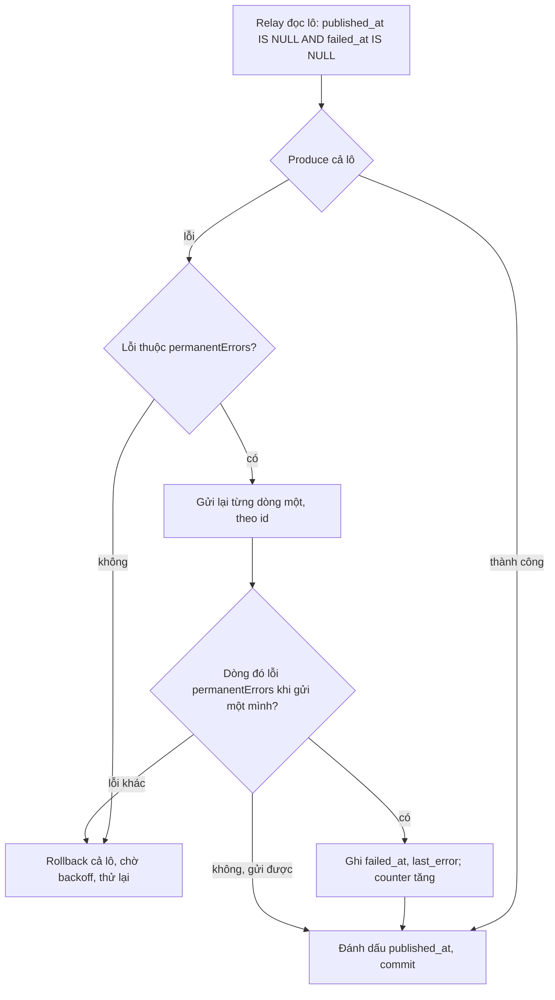

# OutboxRowsFailed

- Severity: `page`. Rule: `deploy/observability/prometheus/rules/svp-alerts.yaml`, nhãn `service_name`, `topic`.
- Chuẩn bị biến `PROM`, `AM`, hàm `dc`: [README](README.md#chuẩn-bị-trong-terminal). Postgres của compose qua container
  `postgres`; k3d và EKS qua `/opt/svp/bin/svp-pg` của Deployment `svp-ops` (chỉ đọc, chỉ `video`, `engagement`, `feed`:
  database `svp_user` không có lệnh này, đọc dòng lỗi của user-service bằng log).

## Ý nghĩa và tác động tới người dùng

Trong 10 phút qua relay outbox của `service_name` (user-service hay video-service) đã **bỏ** ít nhất một event của
`topic`: Kafka từ chối record với lỗi do chính record gây ra, gửi lại cũng không qua. Danh sách lỗi đó là
`permanentErrors` của [`internal/outbox/relay.go`](../../internal/outbox/relay.go) (record quá lớn, record broker kiểm
không hợp lệ). Dòng outbox được ghi `failed_at`, `last_error` (thông điệp lỗi Kafka, không có payload) trong cùng
transaction với các dòng gửi được; relay không đọc lại nó, counter `svp_outbox_rows_failed_total` tăng một.



Broker từ chối cả lô của một partition khi một record trong lô sai, và client gán lỗi đó cho mọi record của lô; vì vậy
relay gửi lại từng dòng một và chỉ bỏ dòng vẫn lỗi khi đi một mình. Các dòng lô đầu đã ghi vào Kafka được ghi lần nữa
(trùng `event_id`, consumer bỏ bản trùng như sau mọi lô lỗi).

Tác động: mỗi dòng là một việc không xảy ra ở consumer. `video.lifecycle.v1`: video không được transcode, không thành
`READY` trong feed; `user.follows.v1`: follow hay unfollow không vào feed. **Thứ tự theo key bị hở**: relay không dừng
hàng đợi vì một dòng, nên event sau của cùng thực thể (cùng `record_key`) vẫn ra Kafka trong khi event trước đó thì
không. Đó là cái giá của việc không để một dòng chặn mọi event của service. Các event khác vẫn chạy bình thường.

Cảnh báo hết 10 phút sau dòng lỗi cuối; nó không nói event đã được phát lại.

## Kiểm tra nhanh (5 phút)

Compose:

```sh
curl -sG "$AM/api/v2/alerts" --data-urlencode 'filter=alertname="OutboxRowsFailed"' | jq -c '.[] | [.labels.service_name, .labels.topic, .startsAt]'
# id, topic và lỗi Kafka của từng dòng bị bỏ (service_name của cảnh báo)
make logs SVC=video-service | grep 'outbox row failed permanently, skipped'
# dòng bị bỏ trong database của service, phiên chỉ đọc; octet_length là cỡ payload, không in payload
dc exec -T postgres psql -U postgres -d svp_video -X -c 'SET default_transaction_read_only = on' \
  -c 'SELECT id, topic, record_key, octet_length(payload) AS bytes, failed_at, last_error FROM outbox WHERE failed_at IS NOT NULL ORDER BY id'
# số dòng bị bỏ trong 1 giờ theo service, topic
curl -sG "$PROM/api/v1/query" --data-urlencode 'query=sum by (service_name, topic) (increase(svp_outbox_rows_failed_total[1h]))' | jq -c '.data.result[] | [.metric, .value[1]]'
```

User-service: thay `video-service` bằng `user-service` và `svp_video` bằng `svp_user`.

k3d (EKS: cùng lệnh với context của cluster EKS, người học chạy):

```sh
kubectl --context k3d-svp -n svp logs -l app.kubernetes.io/name=video-service --since=1h --tail=5000 | grep 'outbox row failed permanently, skipped'
kubectl --context k3d-svp -n svp-data exec deploy/svp-ops -c postgres -- /opt/svp/bin/svp-pg video \
  -c 'SELECT id, topic, record_key, octet_length(payload), failed_at, last_error FROM outbox WHERE failed_at IS NOT NULL ORDER BY id'
```

Đọc kết quả: `last_error` nêu mã Kafka (`MESSAGE_TOO_LARGE`, `INVALID_RECORD`); với `MESSAGE_TOO_LARGE`, cột `bytes` cho
biết record lớn cỡ nào. `record_key` là id của thực thể (video, người follow) bị ảnh hưởng.

## Nguyên nhân thường gặp

1. **Event quá lớn** (`MESSAGE_TOO_LARGE`, `bytes` gần hay trên 1 MB): code mới đưa vào event một trường lớn (danh sách,
   văn bản dài). Client franz-go từ chối record lớn hơn cỡ lô tối đa của nó trước khi gửi; dấu hiệu là cùng một loại
   event, bắt đầu sau một deploy.
2. **Broker nhận ít hơn client gửi** (`MESSAGE_TOO_LARGE` với `bytes` nhỏ, nhiều dòng cùng lúc): `max.message.bytes` của
   topic (hay `message.max.bytes` của broker, MSK) bị hạ dưới cỡ lô tối đa của client. Khi đó cả lô bị từ chối; relay
   gửi lại từng dòng, dòng nhỏ đi qua, chỉ dòng một mình vẫn quá giới hạn bị bỏ, và relay chậm đi vì mọi lô đi đường
   từng dòng.
3. **Broker kiểm record không hợp lệ** (`INVALID_RECORD`): cấu hình topic đòi điều record không có (ví dụ topic compact
   mà record không có key). Dấu hiệu: bắt đầu sau khi đổi cấu hình topic ở `deploy/kafka/kafka-init.sh` hay Terraform
   của MSK.

Lỗi quyền (`TOPIC_AUTHORIZATION_FAILED`), `CORRUPT_MESSAGE`, lỗi mạng không vào đây: relay thử lại cả lô, không bỏ dòng
nào, và hiện ở `BackgroundLoopStalled` ([background-loop-stalled.md](background-loop-stalled.md)).

## Giảm thiểu

- Nguyên nhân 1: quay về bản trước (compose: checkout bản trước rồi `make up OBS=lgtm`; GitOps: PR revert của commit
  promote, theo ruleset `main`) để event mới không lỗi nữa; dòng đã bỏ vẫn nằm trong bảng.
- Nguyên nhân 2, 3: đưa cấu hình topic về như cũ qua PR (`deploy/kafka/kafka-init.sh` cho compose, k3d; Terraform của
  svp-infra cho MSK, người học chạy).
- Dòng bị bỏ không bị xoá: vòng dọn chỉ xoá dòng đã gửi quá 24 giờ, nên event còn đó để phát lại.

## Khôi phục và xác nhận

Phát lại **sau khi đã sửa nguyên nhân** và chỉ khi người trực quyết. Không sửa tay database của stg, prd (không `UPDATE`
bằng psql): event được xếp lại hàng bằng một migration trong release mang bản sửa, đi qua PR, review và Job `migrate`
như mọi thay đổi schema ([schema-change.md](schema-change.md)):

1. Kiểm thứ tự trước: event phát lại đến **sau** các event mới hơn của cùng `record_key`. Đọc handler của consumer topic
   đó (feed-service với cả hai topic, media-worker với `video.lifecycle.v1`) xem nó có ghi đè trạng thái mới bằng event
   cũ không. Không an toàn thì không phát lại: ghi `record_key` vào postmortem và sửa thực thể bằng một thao tác mới của
   ứng dụng.
2. Thêm migration kế tiếp của service (file thường, trong transaction) xoá dấu lỗi của mọi dòng bị bỏ:

   ```sql
   -- +goose Up
   -- Requeue the rows the relay gave up on: their cause is fixed in this release.
   UPDATE outbox SET failed_at = NULL, last_error = NULL WHERE failed_at IS NOT NULL;
   -- +goose Down
   SELECT 1;
   ```

   Cùng file chạy ở mọi env theo thứ tự promote, nên stg phát lại trước prd. Relay gửi các dòng đó ở lô kế; dòng nào vẫn
   lỗi được ghi lỗi lại và cảnh báo cháy lại.
3. Xác nhận: lệnh `SELECT … WHERE failed_at IS NOT NULL` ở trên không còn dòng; log có `outbox batch sent` sau khi Job
   `migrate` xong; thực thể bị ảnh hưởng đúng trạng thái (video `READY`, follow có trong feed); cảnh báo không cháy lại
   sau 10 phút.

## Leo thang

- Event quá lớn do thiết kế (trường không có giới hạn cỡ): sửa producer cho event nhỏ lại (gửi id, không gửi dữ liệu),
  thêm test bằng cỡ đó; không nâng giới hạn của Kafka chỉ cho một event.
- Không chắc phát lại an toàn với consumer: không phát lại, mở postmortem ([mẫu](../postmortems/README.md)) với danh
  sách `record_key`.
- Hơn vài dòng, hay ảnh hưởng tới video của người dùng: mở postmortem.

## Liên kết

- ADR: [ADR-0003](../adr/0003-async-events-outbox.md) (outbox, relay),
  [ADR-0068](../adr/0068-zero-downtime-migrations.md) (migration).
- Code: [`internal/outbox/relay.go`](../../internal/outbox/relay.go) (`permanentErrors`, lượt gửi từng dòng), doc của
  package [`internal/outbox`](../../internal/outbox/outbox.go).
- Diễn tập tái hiện: chưa có diễn tập trên stack; test `TestRelayMarksTooLargeRowAndSendsTheRest`,
  `TestRelayMarksOnlyTheRecordTheBrokerRejects` của `internal/outbox/failed_test.go` tái hiện hai lỗi trên Kafka giả.
