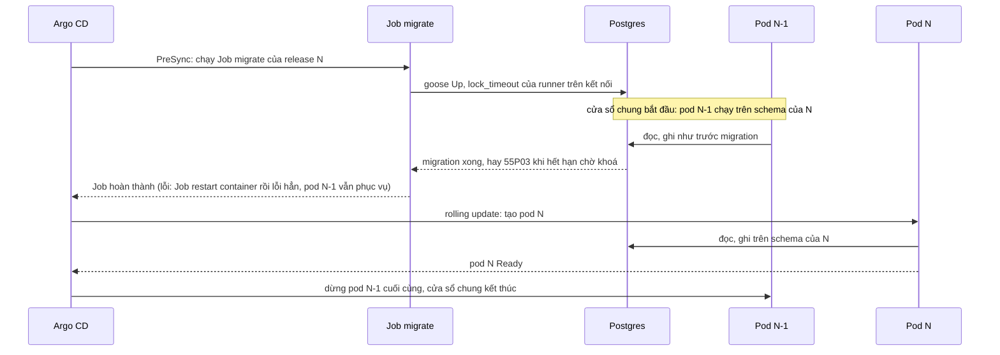
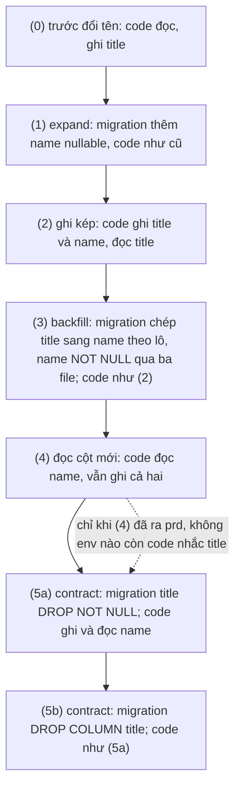

# Đổi schema của một service không downtime

- Quy trình làm tay khi viết một thay đổi schema (file migration, release, test) và khi Job `migrate` của release lỗi. Không có cảnh báo
  riêng: Job lỗi hiện qua `ArgoCDApplicationDegraded` hay `ArgoCDApplicationNotConverged`
  ([argocd-application-degraded.md](argocd-application-degraded.md)).
- Luật và lý do: [ADR-0068](../adr/0068-zero-downtime-migrations.md). Tên "Bước expand/contract", "Ngưỡng khoá", "Luật file migration",
  "Bất biến hai bản" dưới đây là các mục của ADR đó.

## Ý nghĩa và tác động tới người dùng

Bốn service có database (user-, video-, engagement-, feed-service) ra bằng rolling update, và Job `migrate` của release N chạy trước khi
pod mới thay pod cũ. Từ lúc Job bắt đầu tới khi pod N-1 cuối cùng dừng, code N-1 chạy trên schema của N, rồi N-1 và N chạy cùng lúc. Một
migration làm hỏng code N-1 (đổi tên cột, thêm `NOT NULL` không default) hay giữ khoá lâu làm request của người dùng lỗi ngay trong lúc
release, không đợi tới khi pod mới lên. Hai luật giữ điều đó không xảy ra:

- **Bất biến hai bản**: schema sau migration của N phục vụ đúng cả code N-1 lẫn N.
- **Ngưỡng khoá**: `internal/dbmigrate` đặt `lock_timeout` trên mọi kết nối của nó (hằng `lockTimeout` ở `internal/dbmigrate/dbmigrate.go`),
  nên một DDL phải chờ khoá thì lỗi `55P03` sớm thay vì giữ cả hàng đợi truy vấn của app sau nó.



Người dùng thường **chưa thấy gì** khi Job lỗi: release dừng ở PreSync, pod N-1 vẫn phục vụ trên schema cũ hay schema đã đổi một phần
(mỗi file chạy trong transaction riêng, trừ file `-- +goose NO TRANSACTION`). Lỗi chỉ tới người dùng khi migration đã qua và vi phạm
**Bất biến hai bản**: pod N-1 lỗi khi đọc hay ghi.

## Kiểm tra nhanh (5 phút)

Trước khi mở PR, ở gốc repo (Docker cho squawk; test dùng Postgres native `127.0.0.1:5432`, database `svp_<...>_test`):

```sh
make migration-lint                                   # squawk trên mọi file migration
make test PKGS=./internal/dbmigrate/... TESTFLAGS=-count=1
make test PKGS=./services/<svc>/migrations/... TESTFLAGS=-count=1   # test kiểu bản trước
make migration-drill                                  # tuỳ chọn: diễn tập 1 000 000 dòng, in số đo
```

Đọc kết quả:

- `make migration-lint` in vấn đề kèm tên luật của squawk: sửa file theo **Luật file migration**, hay thêm `-- squawk-ignore <luật>` ngay dòng
  trên câu mà luật của ADR bắt buộc, kèm comment lý do (xem "Giảm thiểu" bước 3).
- `TestMigrationFiles` (`internal/dbmigrate/files_test.go`) báo tên file vi phạm: thiếu `-- +goose NO TRANSACTION` ở file có
  `CONCURRENTLY`, `VALIDATE CONSTRAINT` cùng file với `ADD CONSTRAINT`, hay hai dòng `NO TRANSACTION` và
  `-- squawk-disable-assume-in-transaction` không đi cùng nhau.
- `make migration-drill` là một lượt đo của chính ví dụ đổi tên, không phải test của migration của bạn; số đo mẫu ở
  [phụ lục ADR-0068](../adr/appendix/0068-zero-downtime-migrations.md#số-đo-diễn-tập).

Sau khi release chạy, đọc log Job `migrate` của service. Tên của nó theo nơi chạy:

- k3d (stg, prd do người học chạy với context của cluster đó): Job `<release>-migrate`, `<release>` là tên release Helm, tức tên đầy đủ
  của service (`user-service-migrate`, `deploy/helm/svp-service/templates/migrate.yaml`).
- compose: service `<tên ngắn>-migrate` của `deploy/compose/compose.yaml` (`user-migrate`), đọc bằng `make logs SVC=user-migrate`.

```sh
kubectl --context k3d-svp -n svp logs job/user-service-migrate
```

Log phải có dòng `"migration settings"` với thuộc tính `lock_timeout` (đọc lại bằng `SHOW lock_timeout`) và dòng `"migrations up to
date"`. Job lỗi thì pod bị xoá cùng log: `deploy/k8s/install.sh` chép log mỗi lần thử lỗi khi pod còn; Job đang chạy thì
`kubectl … get pods -l app.kubernetes.io/name=<svc>` và xem pod `migrate`.

## Nguyên nhân thường gặp

1. **`55P03 lock_not_available`** trong log Job: một DDL chờ khoá quá `lock_timeout` của runner. Dấu hiệu: `SQLSTATE 55P03` và tên câu
   ngay trước nó trong log. Hai thứ thường giữ khoá xung đột trên bảng:
   - một transaction dài: của app, của việc nền, hay một phiên tay để mở;
   - autovacuum trên bảng đó. Autovacuum thường bị Postgres huỷ sau `deadlock_timeout`, sớm hơn `lock_timeout` của runner (**Ngưỡng
     khoá**), nên chỉ autovacuum chống wraparound (truy vấn kết thúc bằng `(to prevent wraparound)`) làm DDL lỗi ở mọi lượt.

   Với file CIC, lượt chờ cuối gồm mọi transaction có snapshot cũ hơn của cả database, không chỉ của bảng (ADR-0068 §6 (a)).
2. **Lỗi lặp qua các lượt thử của Job**: cùng migration lỗi ở mỗi lượt (Job restart container theo `restartPolicy`, `backoffLimit` của
   `deploy/helm/svp-service/templates/migrate.yaml`); khác với Postgres chưa nhận kết nối ngay sau khi pod khởi động, vốn tự hết.
3. **`CREATE INDEX CONCURRENTLY` lỗi và để lại index `INVALID`**: lượt thử lại chạy lại file; `DROP INDEX CONCURRENTLY IF EXISTS` đứng trước
   câu tạo (Luật file migration (a)) dọn index đó. Nguyên nhân gốc là dữ liệu vi phạm unique, hay một transaction mở quá ngưỡng riêng của
   file CIC.
4. **File vi phạm luật mà lint hay test bắt được ở PR**: đổi tên cột hay bảng mà code N-1 còn dùng, `SET NOT NULL` hay `VALIDATE` cùng file với
   backfill: đi theo **Bước expand/contract** dưới đây thay vì một file.

## Giảm thiểu

**Viết thay đổi**, mỗi bước một release (mỗi release một PR, một lần promote). Đổi tên cột `a` `NOT NULL` thành `b` đi qua sáu release
theo **Bước expand/contract**; ví dụ chạy được ở `internal/dbmigrate/testdata/rename/` (file `00001`–`00008` theo thứ tự áp; release nào gồm file
nào ở `renameReleases` của `internal/dbmigrate/drill_test.go`). Thêm cột, bảng hay index mới chỉ cần bước (1) và code dùng nó.



Mỗi mũi tên là một release; mũi tên chấm giữa (4) và (5a) là điều kiện của contract: release trước nó không còn nhắc cột cũ ở bất kỳ env
nào. Mỗi release giữ **Bất biến hai bản**: pod của release trước vẫn chạy được trên schema sau migration của nó.

1. **Chọn bước của thay đổi** theo sơ đồ trên: mỗi release chỉ làm đúng một bước, và release có migration kèm code chỉ dùng thứ bước đó
   cho phép.
2. **Viết file theo Luật file migration** (mọi file mới của `services/<svc>/migrations/`): index `CONCURRENTLY` trong file
   `-- +goose NO TRANSACTION`, ràng buộc `NOT VALID` rồi `VALIDATE` ở file sau, `SET NOT NULL` qua ba file, backfill chia lô theo keyset
   trên khoá chính trong file `NO TRANSACTION` (ADR-0068 §7, mẫu `internal/dbmigrate/testdata/rename/00003_backfill_name.sql`), không
   `RENAME` cột mà code N-1 dùng. Ví dụ chạy được ở `internal/dbmigrate/testdata/rename/` chỉ có thêm cột, backfill theo lô, `SET NOT NULL`
   qua ba file và contract; index `CONCURRENTLY`, khoá ngoại `NOT VALID` và `UNIQUE USING INDEX` theo ADR-0068 §6 và bảng khoá của phụ lục
   (không chép SQL vào đây). File cần ngưỡng khoá khác `lockTimeout` tự đặt kèm comment lý do: `SET LOCAL lock_timeout` trong file thường,
   `SET lock_timeout` ở đầu và `RESET lock_timeout` ở cuối trong file `NO TRANSACTION` (giá trị cho file CIC ở ADR-0068 §6 (a)).
3. **Chạy `make migration-lint`.** Câu mà ADR bắt buộc nhưng squawk báo (`DROP NOT NULL` của (5a), `DROP COLUMN` của (5b), `SET NOT NULL` và
   `DROP CONSTRAINT` của ba file `SET NOT NULL`) mang `-- squawk-ignore <luật>` ngay dòng trên, kèm comment lý do; câu của mục
   `-- +goose Down` mà squawk báo cũng vậy, lý do là Down chỉ chạy ở local và test. File `NO TRANSACTION` mang thêm
   `-- squawk-disable-assume-in-transaction`. Luật tắt và file loại trừ ở `.squawk.toml`, không thêm vào đó cho file mới.
4. **Viết test kiểu bản trước** cho migration đổi bảng đã có: áp migration lên database ở version trước, chạy SQL của release trước, rồi áp
   migration mới và chạy lại SQL đó (khuôn `services/user-service/migrations/migrations_test.go`, helper `upTo`). Test chỉ dùng database
   `svp_<...>_test` qua `internal/pgtest`.
5. **Không sửa file đã có.** File đã áp ở bất kỳ database nào là bất biến; sai thì thêm migration mới (fix forward).

**Khi Job `migrate` lỗi `55P03` ở release đang chạy** (người dùng chưa bị ảnh hưởng, pod N-1 còn phục vụ):

- Đừng tăng `lock_timeout` hay sửa file migration đã áp. Tìm thứ giữ khoá bằng `pg_locks` và `pg_stat_activity` trên database của
  service (người học chạy với quyền của cluster đó; chỉ `SELECT`):

  ```sql
  -- Who holds or waits for a lock on the table the failing statement names.
  SELECT a.pid, a.backend_type, a.state, a.xact_start, l.mode, l.granted, left(a.query, 80) AS query
  FROM pg_locks l JOIN pg_stat_activity a USING (pid)
  WHERE l.relation = '<bảng>'::regclass
  ORDER BY a.xact_start;
  -- A failing CIC waits for every older snapshot of the database, on any table.
  SELECT pid, backend_type, state, xact_start, left(query, 80) AS query
  FROM pg_stat_activity
  WHERE datname = current_database() AND backend_xmin IS NOT NULL
  ORDER BY xact_start;
  ```

  `backend_type` `autovacuum worker` là autovacuum; `xact_start` cũ nhất là transaction dài nhất.
- Transaction của app ngắn thì Argo CD thử lại sync (Application `OutOfSync` tự thử lại, hay sync tay) và lượt sau qua. Phiên tay hay
  job dài giữ khoá thì dừng nó, rồi để Job chạy lại. Autovacuum chống wraparound thì không dừng nó (huỷ nó đẩy database gần wraparound):
  chờ nó xong rồi sync lại.
- Migration luôn lỗi `55P03` vì app giữ khoá bảng đó lâu bình thường: sửa file thành bước nhỏ hơn (thêm cột nullable thay vì đổi), theo
  fix forward dưới đây; ghi vào ADR-0068 "Xem lại khi" nếu lặp ở stg, prd.

## Khôi phục và xác nhận

- **Quay lại** = triển khai lại release N-1 ([svp-gitops-setup.md](svp-gitops-setup.md) phần C4): ở stg, revert commit promote trong
  `svp-gitops`; ở prd, dispatch `promote_prd` với `stg_ref` là commit cũ hơn mà `envs/stg/` mang bộ N-1. Không bao giờ `goose down` ở stg,
  prd: `Down` chỉ cho local và test. Chỉ quay lại được một release (N → N-1): N-1 phục vụ đúng trên schema của N nhờ **Bất biến hai bản**,
  N-2 thì không bảo đảm.
- **Migration sai hay lỗi**: fix forward bằng migration mới trong release kế, không sửa file đã áp ở bất kỳ database nào (goose đã áp nó
  ở đó, file đổi không đổi gì mà làm database lệch nhau).
- **Xác nhận**: Job `<svc>-migrate` có dòng `"migrations up to date"`; Application `Synced`/`Healthy`:

```sh
kubectl --context k3d-svp -n argocd get applications.argoproj.io <app> \
  -o jsonpath='{.status.sync.status}{" "}{.status.health.status}{"\n"}'         # Synced Healthy
```

## Leo thang

- Migration cần giữ khoá quá hạn mà không chia nhỏ được, hay backfill vượt `activeDeadlineSeconds` của Job: dừng, mở thảo luận ADR-0068 §7
  (backfill chạy bằng lệnh riêng ngoài Job) thay vì tăng ngưỡng. Giới hạn ước theo số dòng ở
  [phụ lục ADR-0068](../adr/appendix/0068-zero-downtime-migrations.md#số-đo-diễn-tập).
- Cần quay lại quá một release: không có đường tự động; dừng promote, mở postmortem ([mẫu](../postmortems/README.md)).
- Lỗi `55P03` lặp ở stg, prd, hay lỗi khoá làm request người dùng lỗi: mở postmortem.

## Liên kết

- [ADR-0068](../adr/0068-zero-downtime-migrations.md) (luật), [phụ lục](../adr/appendix/0068-zero-downtime-migrations.md) (khoá theo lệnh,
  squawk, số đo diễn tập).
- [`internal/dbmigrate`](../../internal/dbmigrate/dbmigrate.go) (runner), [`.squawk.toml`](../../.squawk.toml) (luật lint),
  [`migrate.yaml`](../../deploy/helm/svp-service/templates/migrate.yaml) (Job), `make migration-lint` và `make migration-drill`
  ([`make.md`](../reference/make.md)), [`testing.md`](../reference/testing.md).
- [argocd-application-degraded.md](argocd-application-degraded.md): release không hội tụ, rollback.
- Diễn tập: `make migration-drill` chạy ví dụ đổi tên ở trên; không có diễn tập trên cluster (database stg, prd rỗng, pod thật chỉ kiểm ở
  buổi stg, prd).
