# Dựng và kiểm cài đặt GitHub của `svp-frontend` (repo, App `svp-web-promoter`, environment `promote`, package GHCR, ruleset)

- Quy trình làm tay, không có cảnh báo. Mở khi dựng repo web `anhnvcoder/svp-frontend` lần đầu (tách web khỏi repo backend), khi dựng lại sau
  khi gỡ App, khi xoay khoá App, khi nghi khoá hay token của App bị lộ, khi lượt promote stg của web đỏ hay PR của nó không tự merge.
- Mọi thao tác ghi (tạo repo, UI Settings, tạo và cài App, đặt secret, đổi visibility package, nhập ruleset, bật CodeQL, chạy lại check) do
  **người học chạy** với quyền admin. Mọi lệnh "Kiểm" ở đây chỉ `GET` (hay kéo ẩn danh từ GHCR), chạy bằng đăng nhập `gh` của người học:
  scope `repo` là đủ, trừ lệnh đọc package (`users/anhnvcoder/packages/…`) cần thêm `read:packages` (`gh auth refresh -s read:packages`,
  người học chạy; không có scope này API trả 403 `You need at least read:packages scope`, đọc ngày 2026-10-30).
- Thiết kế và lý do ở [ADR-0033](../adr/0033-svp-web-repo.md) (§2 image và nguồn phát hành, §4 promote và App thứ hai, §7 source map,
  §9 trình tự chuyển, §10 cài đặt repo); App, environment và ruleset theo cùng mẫu với `svp-gitops`
  ([svp-gitops-setup.md](svp-gitops-setup.md), [ADR-0025](../adr/0025-gitops-config-repo.md) §6–§7). Trang này chỉ nói làm gì, vì sao từng
  ô, kiểm thế nào.
- **Không ghi giá trị nào** (Client ID, khoá `.pem`, token, id bản cài) vào repo, issue, PR hay chat: ba repo đều public. Trang này chỉ ghi
  tên biến.

## Ý nghĩa và tác động tới người dùng

Repo web phát hành image của mình dưới prefix riêng và promote riêng file `envs/stg/images/web.yaml` sang `svp-gitops` bằng App thứ hai;
repo backend giữ chart, hợp đồng API và script CI dùng chung:

```mermaid
flowchart LR
  subgraph be["repo backend: anhnvcoder/svp-backend"]
    contract["hợp đồng API đã ký<br/>ghcr.io/…/svp-backend/api/gateway"]
    scripts["deploy/ci/*.sh, sources.json<br/>(ở BACKEND_COMMIT)"]
  end
  subgraph web["repo anhnvcoder/svp-frontend"]
    ci["ci.yml: lint, test, build, generate-check"] --> img["images.yml: build, quét, ký, provenance<br/>ghcr.io/anhnvcoder/svp-frontend/web<br/>…/svp-frontend/web-sourcemaps"]
    img --> promote["job promote<br/>environment promote (chỉ main)<br/>variable SVP_WEB_APP_CLIENT_ID + secret SVP_WEB_APP_PRIVATE_KEY"]
  end
  app["GitHub App svp-web-promoter<br/>token 1 giờ, chỉ svp-gitops,<br/>contents + pull_requests"]
  subgraph gitops["repo anhnvcoder/svp-gitops"]
    pr["PR bot/promote-stg-web<br/>chỉ envs/stg/images/web.yaml"] --> rules["check gitops-ok<br/>(luật nguồn, luật tác giả PR)"] --> main["main (auto-merge stg)"]
  end
  contract -- "kéo ẩn danh, cosign verify" --> ci
  scripts -- "checkout ở commit ghim" --> img
  promote -- "khoá ký JWT, đổi lấy token" --> app
  app -- "token: đẩy nhánh, mở PR, bật auto-merge" --> pr
```



**Vì sao App thứ hai, không dùng chung `svp-gitops-promoter`** (ADR-0033 §4, bảng "Credential của `svp-frontend`"):

- Khoá riêng, thu hồi riêng: lộ khoá của repo web không promote được image backend, và suspend App web không dừng promote của backend.
- Tác giả PR là `svp-web-promoter[bot]`, khác bot backend, nên check của `svp-gitops` giới hạn được bot nào sửa file nào: bot web chỉ được
  đổi file image của `web` (`envs/{stg,prd}/images/web.yaml`; luật tác giả hẹp, ADR-0033 §3, [ADR-0037](../adr/0037-mainpath-standard-tools.md) §6).
- Không quyền `deployments`: không job nào cần (bản ghi stg đã bỏ, [ADR-0037](../adr/0037-mainpath-standard-tools.md) §6).
- Lý do chung của App so với PAT hay `GITHUB_TOKEN` như ở [svp-gitops-setup.md](svp-gitops-setup.md#ý-nghĩa-và-tác-động-tới-người-dùng).

Cài sai thì người dùng của nền tảng không thấy gì ngay (stg giữ web đang chạy), nhưng: bản phát hành web không tới stg (promote đỏ,
package private nên check của `svp-gitops` không kéo được image, PR không tự merge); hay một ô để mở làm repo web yếu đi mà không ai biết
(workflow dùng action theo tag, PR fork chạy workflow không ai duyệt, push thẳng `main` không qua `ci-ok`). Vì vậy mỗi bước dưới có lệnh
kiểm.

## Kiểm tra nhanh (5 phút)

Một lượt, chỉ đọc. Mỗi lệnh in một dòng (`-q` in JSON gọn, khoá theo thứ tự chữ cái). Kết quả mong đợi ở bảng dưới; dòng nào khác là sai,
xem mục của bước đó ở "Khôi phục và xác nhận". Lệnh của phần nào chưa làm tới (repo còn rỗng, chưa có lượt CI) thì bỏ qua.

```sh
W=repos/anhnvcoder/svp-frontend
# A1, A2. Repo và cài đặt
gh api $W -q '{visibility, default_branch, has_issues, allow_auto_merge, allow_squash_merge, allow_merge_commit, allow_rebase_merge}'
gh api $W -q '{squash_merge_commit_title, squash_merge_commit_message}'
gh api $W/actions/permissions -q '{enabled, allowed_actions, sha_pinning_required}'
gh api $W/actions/permissions/selected-actions -q .
gh api $W/actions/permissions/workflow -q .
gh api $W/actions/permissions/fork-pr-contributor-approval -q .
gh api $W -q '.security_and_analysis | {secret_scanning: .secret_scanning.status, push_protection: .secret_scanning_push_protection.status}'
gh api -i $W/vulnerability-alerts | head -1
# A5. Environment promote (chỉ tên biến, secret; không API nào trả giá trị secret)
gh api $W/environments/promote -q '{name, deployment_branch_policy, rules: [.protection_rules[].type]}'
gh api $W/environments/promote/deployment-branch-policies -q '.branch_policies[] | {name, type}'
gh api $W/environments/promote/variables -q '{total_count, names: [.variables[].name]}'
gh api $W/environments/promote/secrets -q '{total_count, names: [.secrets[].name]}'
# Khoá đặt nhầm ở mức repo (không qua environment) đi tới workflow của mọi nhánh
gh api $W/actions/secrets -q .total_count
# A6, C1. Package kéo ẩn danh (không cần đăng nhập)
anon() { t=$(curl -s "https://ghcr.io/token?scope=repository:anhnvcoder/$1:pull" | jq -r '.token // empty')
  [ -n "$t" ] || { echo "$1 DENIED"; return; }
  echo "$1 $(curl -s -o /dev/null -w '%{http_code}' -H "Authorization: Bearer $t" "https://ghcr.io/v2/anhnvcoder/$1/tags/list")"; }
anon svp-backend/api/gateway; anon svp-frontend/web; anon svp-frontend/web-sourcemaps
# B2. CodeQL default setup
gh api $W/code-scanning/default-setup -q '{state, languages, query_suite, schedule}'
# C2. Ruleset (sau khi nhập)
gh api $W/rulesets -q '.[] | {id, name, target, enforcement}'
gh api $W/rules/branches/main -q '.[] | .type'
```

| Lệnh | Mong đợi |
| --- | --- |
| repo | `"visibility":"public"`, `"has_issues":true`, `"allow_auto_merge":true`, `"allow_squash_merge":true`, `"allow_merge_commit":false`, `"allow_rebase_merge":false`; `"default_branch":"main"` sau push đầu (repo rỗng báo `main` hay `master` tuỳ cài đặt tài khoản, chưa có nghĩa gì) |
| squash | `{"squash_merge_commit_message":"PR_BODY","squash_merge_commit_title":"PR_TITLE"}` |
| `actions/permissions` | `{"allowed_actions":"selected","enabled":true,"sha_pinning_required":true}` |
| `selected-actions` | `{"github_owned_allowed":true,"patterns_allowed":["sigstore/cosign-installer@*"],"verified_allowed":false}` |
| `actions/permissions/workflow` | `{"can_approve_pull_request_reviews":false,"default_workflow_permissions":"read"}` |
| `fork-pr-contributor-approval` | `{"approval_policy":"all_external_contributors"}` |
| `security_and_analysis` | `{"push_protection":"enabled","secret_scanning":"enabled"}` |
| `vulnerability-alerts` | `HTTP/2.0 204 No Content` (Dependabot alerts bật; `404` là tắt) |
| environment | `{"deployment_branch_policy":{"custom_branch_policies":true,"protected_branches":false},"name":"promote","rules":["branch_policy"]}` |
| branch policies | đúng một dòng `{"name":"main","type":"branch"}` |
| variables | `{"names":["SVP_WEB_APP_CLIENT_ID"],"total_count":1}` |
| secrets | `{"names":["SVP_WEB_APP_PRIVATE_KEY"],"total_count":1}` |
| repo secrets | `0` (`actions/secrets`: khoá đặt ở repo thay vì environment chạy được ở mọi nhánh, bỏ qua rule `main`-only; xoá ở Settings → Secrets and variables → Actions → tab Repository secrets) |
| `anon` | mỗi package một dòng `<package> 200`. `DENIED` là package private hay chưa có (đọc ngày 2026-10-30: package chưa có trả `DENIED`, package public `200`). sau đổi tên repo (2026-10-31) cả ba là package mới: `svp-backend/api/gateway` có từ lượt `images.yml` đầu của backend sau đổi tên, hai package `svp-frontend/…` từ lượt `images.yml` đầu của `svp-frontend` sau đổi tên (E1) |
| `default-setup` | `"state":"configured"`, `languages` có `actions` và `javascript-typescript` (API liệt kê thêm `javascript`, `typescript`), `"query_suite":"default"`, `"schedule":"weekly"` |
| rulesets | đúng một dòng `main`, `"target":"branch"`, `"enforcement":"active"` |
| `rules/branches/main` | `deletion`, `non_fast_forward`, `pull_request`, `required_status_checks` |

Không kiểm được bằng `gh` của người học: **App `svp-web-promoter` và bản cài của nó** (A3, A4) và **Renovate** (B3). Như với App của
`svp-gitops` (đã thử 2026-10-29, [svp-gitops-setup.md](svp-gitops-setup.md#kiểm-tra-nhanh-5-phút)): `GET /apps/<tên>` trả 404 với App chỉ
cho tài khoản này, `GET repos/anhnvcoder/svp-gitops/installation` cần JWT ký bằng khoá App (401), `GET user/installations` cần token người
dùng do chính một App cấp (403). Kiểm bằng UI ở mục của từng bước, và bằng lượt promote đầu của web (D1).

## Nguyên nhân thường gặp

Theo thứ tự hay gặp (hai cái đầu đã gặp khi dựng `svp-gitops`, 2026-10-29), mỗi cái kèm dấu hiệu trong kết quả của "Kiểm tra nhanh":

1. **Client ID đặt ở secret thay vì variable**: `variables` rỗng, `secrets` có hai tên. Workflow đọc `vars.SVP_WEB_APP_CLIENT_ID`, biến
   không có thì là chuỗi rỗng: bước tạo token của job `promote` đỏ ngay. Sửa ở A5.
2. **Duyệt workflow PR fork chỉ cho người mới** (`first_time_contributors`, mặc định của GitHub): không lỗi nào hiện ra, chỉ lệnh kiểm
   thấy. Sửa ở A2.
3. **Package image còn private sau lượt `images.yml` đầu** (`anon` báo `DENIED`): check `gitops-ok` của PR `bot/promote-stg-web` đỏ ở bước
   kéo ẩn danh và kiểm chữ ký, PR không tự merge. Sửa ở C1, rồi chạy lại check.
4. **Thiếu `sigstore/cosign-installer` trong danh sách action** (`patterns_allowed` rỗng, chép từ `svp-gitops`): job ký của `images.yml`
   bị từ chối trước khi chạy ("not allowed to be used"). Sửa ở A2.
5. **App cài "All repositories"** hay thêm repo khác: không lỗi nào, token xin được cho repo thừa. Chỉ UI thấy (A4).
6. **Ruleset nhập trước lượt CI đầu xanh trên `main`**: push thẳng `main` bị từ chối, commit thêm CI phải đi qua PR. Xem C2.

## Giảm thiểu

**Nghi khoá App hay token của `svp-web-promoter` bị lộ**, làm theo thứ tự (cùng mẫu với
[svp-gitops-setup.md](svp-gitops-setup.md#giảm-thiểu); App backend không bị đụng):

1. **Suspend bản cài** (cắt ngay mọi token còn hạn): https://github.com/settings/installations → `svp-web-promoter` → **Configure** → cuối
   trang **Suspend**. Từ lúc này job `promote` của `svp-frontend` đỏ ở bước gọi API; web của stg giữ bản đang chạy; promote của backend chạy
   bình thường.
2. **Xoá khoá bị lộ, tạo khoá mới** theo "Xoay khoá App" bước 1, 2, 4 (xoá khoá cũ ngay).
3. **Xem bot đã làm gì** (chỉ đọc). Token chỉ tới `svp-gitops`, chỉ `contents`, `pull_requests` write: đẩy được nhánh, mở PR, tạo tag hay
   release (ruleset `tags` của `svp-gitops` chặn khi đang `active`); không ghi được Deployment.

   ```sh
   gh pr list --repo anhnvcoder/svp-gitops --author 'app/svp-web-promoter' --state all --limit 20 \
     --json number,title,headRefName,state,createdAt,mergedAt
   gh api repos/anhnvcoder/svp-gitops/branches -q '.[].name'
   gh api 'repos/anhnvcoder/svp-gitops/tags?per_page=100' -q '.[] | {name, sha: .commit.sha}'
   gh api 'repos/anhnvcoder/svp-gitops/releases?per_page=20' -q '.[] | {id, tag_name, created_at, author: .author.login}'
   # lịch sử file mà bot web được đổi: mỗi commit nêu tác giả và tiêu đề
   gh api 'repos/anhnvcoder/svp-gitops/commits?path=envs/stg/images/web.yaml&per_page=10' \
     -q '.[] | {sha: .sha[0:12], date: .commit.committer.date, author: .author.login, msg: (.commit.message | split("\n")[0])}'
   ```

   Thứ token lộ làm được mà không ai duyệt: PR chỉ đổi `envs/stg/images/web.yaml` qua `gitops-ok`, mà check chỉ nhận image dưới prefix
   `svp-frontend`, tag là commit trên `main` của `svp-frontend`, ký bởi `images.yml@refs/heads/main` của `svp-frontend` (ADR-0033 §3). Lưu ý cửa sổ từ
   bước 1 tới bước 4 của ADR-0033 §9 (từ lúc có khoá ở A3–A5 tới khi D1 "Trước đó" bump `CHECKER_COMMIT`): checker còn cũ chưa có luật tác
   giả, nên trong cửa sổ đó token lộ đổi được mọi file `envs/stg/` mà bot backend được đổi, ví dụ `charts.yaml`. Suspend ngay bước 1 là
   việc cần làm đầu tiên, trước mọi bước khác. Nên trường hợp xấu
   nhất là stg chạy một bản web **thật** khác (thường là bản cũ hơn); file khác, `envs/prd/` hay image không ký đều đỏ. Commit lạ của
   `web.yaml`: trả về bằng PR revert như rollback stg ([svp-gitops-setup.md](svp-gitops-setup.md#c4-rollback), C4 phần stg). PR, nhánh lạ:
   đóng, xoá; tag, release lạ: dọn như bước 3 của "Giảm thiểu" ở trang đó.
4. **Unsuspend** (cùng trang) khi secret đã là khoá mới, khoá cũ đã xoá và bước 3 đã dọn xong; rồi kiểm khoá mới bằng bước 3 của "Xoay
   khoá App".

**Gỡ hẳn** (không dùng App nữa, hay dựng lại từ đầu): https://github.com/settings/installations → `svp-web-promoter` → **Configure** →
**Uninstall**; trang App https://github.com/settings/apps/svp-web-promoter → **Advanced** → **Delete GitHub App**; xoá variable và secret của
environment `promote` của `svp-frontend` (Settings → Environments → `promote`). Dựng lại theo A3–A5.

## Khôi phục và xác nhận

Dựng từ đầu theo thứ tự phụ thuộc của ADR-0033 §9:

- **A. Trước push lịch sử** (bước 1 của §9; A6 sau khi PR-1 của backend merge): repo rỗng, cài đặt, App, environment, package hợp đồng.
- **B. Sau push lịch sử và commit thêm CI** (bước 3 của §9 và commit kế tiếp của §8: CI, `Makefile`, `renovate.json`, `README.md`): kiểm
  lịch sử, CodeQL, Renovate.
- **C. Sau lượt CI đầu trên `main`** (`ci.yml`, `images.yml` của commit thêm CI): package image public, ruleset.
- **D. Sau bản phát hành đầu** (bước 5 của §9): PR đầu của bot web tự merge, image và source map kéo ẩn danh, chữ ký đúng identity.

### A1. Tạo repo rỗng

**Làm gì** (người học chạy, lệnh ghi):

```sh
gh repo create anhnvcoder/svp-frontend --public --description 'Web client (Next.js + BFF) of the short-video platform lab'
```

Không `--add-readme`, `--license`, `--gitignore` (hay trên UI https://github.com/new: không tích **Add a README file**, **.gitignore**
None, **License** None).

**Vì sao:** lịch sử web được chuyển bằng `git filter-repo` rồi push lên `main` (ADR-0033 §8). Repo có sẵn commit (README, license) thì
`main` có lịch sử khác gốc, push lịch sử bị từ chối non-fast-forward, mà force push hay merge hai gốc đều làm lịch sử khác bản đã kiểm
(`commit-map`). Public: image và source map kéo ẩn danh, như hai repo kia.

**Kiểm:**

```sh
gh api repos/anhnvcoder/svp-frontend -q '{visibility, size}'          # {"size":0,"visibility":"public"}
gh api repos/anhnvcoder/svp-frontend/commits 2>&1 | tail -1           # 409: Git Repository is empty.
```

**Nếu sai:** repo đã có commit (lệnh thứ hai liệt kê commit) và chưa push lịch sử → xoá repo rồi tạo lại (Settings → Danger Zone →
**Delete this repository**; người học chạy, chỉ khi repo chưa có gì khác). `private` → Settings → Danger Zone → **Change visibility**.

### A2. Cài đặt repo `svp-frontend`

Làm trước khi bất kỳ commit nào có `.github/workflows/` được push (repo backend bật cài đặt trước push đầu, ADR-0015 §11).

**Làm gì** (https://github.com/anhnvcoder/svp-frontend/settings):

- **General** → mục **Pull Requests**: bật **Allow squash merging**, ô **Default commit message** chọn **Pull request title and
  description**; tắt **Allow merge commits** và **Allow rebase merging**; bật **Allow auto-merge**. Mục **Features**: giữ **Issues** bật.
- **Actions** → **General**:
  - **Actions permissions**: **Allow anhnvcoder, and select non-anhnvcoder, actions and reusable workflows**; tích **Allow actions created
    by GitHub**, không tích Marketplace verified creators; ô danh sách action ghi đúng một dòng `sigstore/cosign-installer@*`; tích
    **Require actions to be pinned to a full-length commit SHA**. **Save**.
  - **Approval for running fork pull request workflows from contributors**: **Require approval for all external contributors**. **Save**.
  - **Workflow permissions**: **Read repository contents and packages permissions**; **bỏ tích** **Allow GitHub Actions to create and
    approve pull requests**. **Save**.
- **Advanced Security**: bật **Dependabot alerts**; **Secret Protection** (secret scanning) và **Push protection** bật (repo public thường
  đã bật sẵn, kiểm lại).

**Vì sao** (ADR-0033 §10: như `svp-gitops` ở điểm khác backend, còn lại như backend):

- Chỉ squash, auto-merge: mỗi PR là đúng một commit trên `main`, tức một tag image (12 hex của commit) và một ứng viên phát hành; guard
  không lùi của job `promote` web so tổ tiên trên `main` của `svp-frontend` (lượt cũ hơn tag web ở `main` hay ở PR đang mở của
  `svp-gitops` thì đỏ), lịch sử thẳng thì tổ tiên trùng thứ tự merge; rollback
  một thay đổi là revert một commit. Auto-merge: Renovate tự bật trên PR bản `patch`, `digest` của danh sách cho phép (gói npm, Node,
  base image, image dịch vụ của CI; ADR-0035); người học bật trên PR của mình hay PR Renovate còn lại (sau khi đọc) để PR tự merge khi
  `ci-ok`, `images-ok` xanh; không mở đường nào qua ruleset (C2).
- Commit squash lấy tiêu đề và mô tả của PR: tiêu đề PR (conventional commit) thành message trên `main`, footer `Refs:` hay dòng `This
  reverts commit <sha>.` của PR revert còn trong commit; mặc định của GitHub lấy message commit lẻ khi PR có một commit.
- Chỉ action của GitHub và `sigstore/cosign-installer`, ghim SHA bắt buộc: như repo backend (ADR-0015 §11); `svp-frontend` ký image và
  attest provenance bằng cosign nên cần action cài cosign, khác `svp-gitops` (danh sách rỗng). Tag của action có thể bị đẩy sang code
  khác, SHA thì không.
- Tắt "create and approve pull requests" (khác backend, như `svp-gitops`): không workflow nào của `svp-frontend` mở hay duyệt PR trong chính
  nó; PR promote mở ở `svp-gitops` bằng token App, không bằng `GITHUB_TOKEN`. Quyền không ai dùng thì tắt. Token mặc định chỉ đọc; job
  cần `packages: write` (đẩy image) hay `id-token: write` (ký keyless) tự khai ở `permissions:` của job.
- Duyệt PR fork của mọi người ngoài: repo public, PR fork chạy `ci.yml` với code lạ trên runner; người học xem trước khi cho chạy.
- Secret scanning + push protection: chặn ngay lúc push nếu ai lỡ commit khoá (ví dụ `.pem` của A3). Dependabot alerts: lockfile pnpm
  của web có cảnh báo thật, và `vulnerabilityAlerts` của `renovate.json` đọc chính các cảnh báo này (PR vá lỗ hổng mở ngoài lịch).

**Kiểm:** tám lệnh đầu của "Kiểm tra nhanh" (repo tới `vulnerability-alerts`), output như bảng. Các API này chạy được trên repo rỗng.

**Nếu sai:** `allow_auto_merge` false → bật lại; không gì đỏ ngay, chỉ PR không tự merge. `allow_merge_commit`/`allow_rebase_merge` true
→ người merge tay có thể tạo merge commit hay rebase. `sha_pinning_required` false hay `verified_allowed` true → workflow dùng tag hay
action bên thứ ba vẫn chạy. `patterns_allowed` rỗng → job ký bị từ chối. `can_approve_pull_request_reviews` true → tắt ở Workflow
permissions. `approval_policy` khác `all_external_contributors` → chọn lại ô duyệt PR fork. Sửa ở đúng ô rồi chạy lại lệnh kiểm.

### A3. Tạo GitHub App `svp-web-promoter`

**Làm gì** (https://github.com/settings/apps/new):

- **GitHub App name**: `svp-web-promoter`. **Homepage URL**: `https://github.com/anhnvcoder/svp-frontend`.
- **Callback URL** để trống, không tích **Request user authorization (OAuth) during installation**.
- **Webhook**: **bỏ tích Active**.
- **Permissions** → **Repository permissions**: **Contents** Read and write, **Pull requests** Read and write; **Metadata** Read-only
  (tự có). Mọi quyền khác No access, đặc biệt **Deployments**, **Workflows**, **Actions**, **Administration**, **Checks**, **Commit
  statuses**. Không quyền nào ở **Organization permissions**, **Account permissions**.
- **Where can this GitHub App be installed?**: **Only on this account**. **Create GitHub App**.
- Trên trang App vừa tạo: đọc **Client ID** (mục About, để dán ở A5); **Private keys** → **Generate a private key**: trình duyệt tải một
  file `.pem`, để ở thư mục tạm ngoài mọi repo. Không bấm **Generate a new client secret**: App không dùng OAuth.

**Vì sao:**

- Contents write: đẩy nhánh `bot/promote-stg-web` của `svp-gitops`, merge bằng auto-merge. Pull requests write: mở, sửa PR, bật
  auto-merge. Hai quyền đó là đủ (ADR-0033 §4).
- Không Deployments: không job nào ghi bản ghi triển khai (bản ghi stg đã bỏ, [ADR-0037](../adr/0037-mainpath-standard-tools.md) §6).
- Không Workflows: GitHub từ chối mọi push đổi `.github/workflows/` của token không có quyền này, bot không sửa được check đang chặn nó.
  Không Administration: bot không đổi được ruleset, cài đặt repo.
- Webhook tắt, Only on this account: như A2 của [svp-gitops-setup.md](svp-gitops-setup.md#a2-tạo-github-app-svp-gitops-promoter). Client
  ID là định danh, không bí mật; khoá `.pem` là bí mật duy nhất.

**Kiểm** (UI, API không đọc được, xem "Kiểm tra nhanh"): https://github.com/settings/apps/svp-web-promoter → **Permissions & events**:
đúng ba quyền repository trên (Contents, Pull requests, Metadata), không quyền organization/account, không sự kiện nào được tích; trang
**General**: Webhook không Active, **Private keys** có đúng một khoá (ngày tạo hôm nay); tab **Advanced** còn nút **Make public**.

**Nếu sai:** thiếu Contents/Pull requests → job `promote` đỏ khi push hay mở PR với `Resource not accessible by integration`. Thừa quyền
→ bỏ ở Permissions & events (bớt quyền có hiệu lực ngay; thêm quyền thì bản cài phải chấp nhận).

### A4. Cài App chỉ lên `svp-gitops`

**Làm gì:** trang App → **Install App** → dòng `anhnvcoder` → **Install** → **Only select repositories** → chọn `anhnvcoder/svp-gitops`
→ **Install**.

**Vì sao:** token của App chỉ tới repo đã cài. Cài lên `svp-frontend` thì token lộ đẩy được nhánh, mở PR ở chính repo build image; cài lên
repo backend thì chạm được chart và script mà mọi env chạy.

**Kiểm** (UI): https://github.com/settings/installations → `svp-web-promoter` → **Configure**: **Repository access** là "Only select
repositories" với đúng một dòng `anhnvcoder/svp-gitops`; phần quyền liệt kê đúng ba quyền của A3. Cùng trang, `svp-gitops-promoter` vẫn
chỉ `svp-gitops` (hai bản cài độc lập).

**Nếu sai:** chọn lại repo ở cùng trang, **Save**.

### A5. Environment `promote` của `svp-frontend`

**Làm gì** (https://github.com/anhnvcoder/svp-frontend/settings/environments → **New environment**):

- **Name**: `promote` → **Configure environment**.
- **Deployment protection rules**: không **Required reviewers**, không **Wait timer** (promote stg tự động; cổng prd là Code Owner của PR
  prd ở `svp-gitops`, và PR prd do job của backend mở).
- **Deployment branches and tags**: **Selected branches and tags** → **Add deployment branch or tag rule** → Ref type **Branch**, Name
  pattern `main` → **Add rule**.
- **Environment variables** → **Add environment variable**: Name `SVP_WEB_APP_CLIENT_ID`, Value là Client ID của A3.
- **Environment secrets**: Name `SVP_WEB_APP_PRIVATE_KEY`, Value là **toàn bộ** nội dung file `.pem` (cả dòng `-----BEGIN …-----` và
  `-----END …-----`). Hay từ terminal, không qua clipboard (người học chạy):

  ```sh
  gh secret set SVP_WEB_APP_PRIVATE_KEY --env promote --repo anhnvcoder/svp-frontend < /đường/tới/khoá.pem
  ```

  Rồi xoá file `.pem` (khoá mới tạo lại được bất cứ lúc nào ở trang App).

**Vì sao:** secret của environment chỉ tới job khai `environment: promote` chạy trên nhánh khớp luật; luật chỉ `main` nên một nhánh hay PR
thêm `environment: promote` vào workflow bị GitHub từ chối trước khi job chạy. Client ID là **variable** (đọc lại được để kiểm, workflow
đọc `vars.SVP_WEB_APP_CLIENT_ID`); khoá là **secret** (GitHub không trả lại giá trị, che trong log). Tên biến đúng như ADR-0033 §4; job
`promote` của `images.yml` trong `svp-frontend` đọc đúng hai tên này.

**Kiểm:** bốn lệnh "Environment promote" của "Kiểm tra nhanh". Thời điểm đặt khoá (không có giá trị):

```sh
gh api repos/anhnvcoder/svp-frontend/environments/promote/secrets/SVP_WEB_APP_PRIVATE_KEY -q '{name, updated_at}'
```

**Nếu sai:**

- Client ID nằm ở secret (`variables` rỗng, `secrets` có hai tên): **Add environment variable** cùng tên với Client ID (đọc lại ở trang
  App), rồi xoá secret `SVP_WEB_APP_CLIENT_ID`. Chạy lại hai lệnh `variables`, `secrets`.
- `deployment_branch_policy` là `null` (No restriction) hay `protected_branches: true`: sửa lại ô Deployment branches như trên.
- Khoá sai (bước tạo token báo lỗi đọc khoá, hay 401 khi đổi JWT lấy token): tạo khoá mới và đặt lại theo "Xoay khoá App".

### A6. Package hợp đồng API public (sau khi PR-1 của backend merge, trước push lịch sử)

**Làm gì:** sau lượt `images.yml` trên `main` backend có job `contract` xanh (phát hành hợp đồng `1.0.0`), người học mở
https://github.com/users/anhnvcoder/packages/container/package/svp-backend%2Fapi%2Fgateway → **Package settings** → **Change
visibility** → **Public**. Không đổi ngược lại được ("Once you make a package public, you cannot make it private again", ADR-0015 §5).

**Vì sao:** `make generate` và `make generate-check` của `svp-frontend` (máy và CI) kéo hợp đồng ẩn danh theo digest rồi `cosign verify` với
identity backend (ADR-0033 §1); package private thì `generate-check` của lượt CI đầu đỏ.

**Kiểm:** dòng `anon svp-backend/api/gateway` của "Kiểm tra nhanh" in `200`. Chữ ký (cosign trên PATH; không có thì image
`COSIGN_IMAGE` của `Makefile` backend):

```sh
cosign verify --certificate-oidc-issuer https://token.actions.githubusercontent.com \
  --certificate-identity https://github.com/anhnvcoder/svp-backend/.github/workflows/images.yml@refs/heads/main \
  ghcr.io/anhnvcoder/svp-backend/api/gateway:1.0.0 >/dev/null && echo verified
```

**Nếu sai:** `DENIED` sau khi đã đổi visibility → package chưa có (job `contract` chưa chạy hay đỏ: đọc log lượt `images.yml` backend).
cosign báo không có chữ ký khớp → job `contract` đẩy mà không ký xong: chạy lại job đó (tag đã có cùng digest thì job chỉ ký, không ghi
đè).

### B1. Kiểm lịch sử và nhánh mặc định (sau push lịch sử)

Push lịch sử (bước 3 của ADR-0033 §9) và commit kế tiếp thêm CI không thuộc trang này; ở đây chỉ kiểm kết quả.

**Kiểm:**

```sh
gh api repos/anhnvcoder/svp-frontend -q .default_branch                                     # main
gh api 'repos/anhnvcoder/svp-frontend/contents/' -q '[.[].name] | join(" ")'               # có package.json, Dockerfile; không có web/
gh api 'repos/anhnvcoder/svp-frontend/commits?per_page=1' -q '.[0] | {sha: .sha[0:12], msg: (.commit.message | split("\n")[0])}'
gh run list --repo anhnvcoder/svp-frontend --branch main --limit 4 --json workflowName,conclusion,headSha,url
```

**Nếu sai:** nhánh mặc định khác `main` (ruleset C2 nhắm `~DEFAULT_BRANCH`) → Settings → General → **Default branch** → `main`. Gốc repo
còn thư mục `web/` → filter-repo thiếu `--path-rename web/:`. Chỉ trước bản phát hành đầu (chưa image nào mang tag là commit của repo
này): người học xoá repo và tạo lại theo A1, A2, A5 (environment mất cùng repo; không force push `main`), người điều phối chạy lại filter-repo trên bản clone tạm mới và
push. Sau bản phát hành đầu không viết lại lịch sử `main`.

### B2. CodeQL default setup

**Làm gì** (người học chạy, sau khi `main` có mã web; như backend, [ci-cd.md](../ci-cd.md) mục 7, ADR-0030 §4):

```sh
gh api -X PATCH repos/anhnvcoder/svp-frontend/code-scanning/default-setup \
  -f state=configured -f query_suite=default -f threat_model=remote -f runner_type=standard \
  -f 'languages[]=actions' -f 'languages[]=javascript-typescript'
```

**Vì sao:** cùng mức quét với code web khi còn ở backend (ngôn ngữ `javascript-typescript`) cộng `actions` cho workflow mới; chỉ báo, không
là check bắt buộc. Repo rỗng thì không có ngôn ngữ nào để bật, nên bước này sau B1.

**Kiểm:** dòng `default-setup` của "Kiểm tra nhanh"; lượt đầu ở tab Actions, workflow "CodeQL".

**Nếu sai:** `not-configured` → chạy lại lệnh bật; response báo ngôn ngữ không có → `main` chưa có mã web (làm lại sau B1).

### B3. Renovate cho `svp-frontend`

**Làm gì:** https://github.com/apps/renovate → **Configure** → `anhnvcoder` → **Only select repositories** → thêm `anhnvcoder/svp-frontend`
(giữ `svp-backend`, `svp-gitops`) → **Save**. Làm sau khi `renovate.json` đã ở `main` (commit thêm CI), để không có PR onboarding.

**Vì sao:** `renovate.json` của `svp-frontend` mang các luật web chuyển từ backend (npm ghim chính xác, nhóm non-major, nhóm `sentry`, nhóm Node
gồm `.nvmrc`, `engines`, base image của `Dockerfile`), action, `.backend-commit` (datasource `git-refs`) và `api/contract.json` (ADR-0033
§10); không có thì các ghim đó cũ dần.

**Kiểm** (UI): https://github.com/settings/installations → **Renovate** → **Configure**: danh sách repo có `svp-frontend`. Vài giờ sau có issue
**Dependency Dashboard**:

```sh
gh issue list --repo anhnvcoder/svp-frontend --state all --search 'Dependency Dashboard in:title' --json number,title,author
```

**Nếu sai:** không có issue sau một ngày → log của repo ở https://developer.mend.io → `anhnvcoder/svp-frontend`. PR nâng `api/contract.json`
không bao giờ mở dù backend đã phát hành bản mới → custom manager datasource `docker` chưa đọc được OCI artifact (mục "Kiểm chứng sau"
của ADR-0033): nâng tay bằng `make contract-bump VERSION=<x>` trong `svp-frontend`.

### C1. Package image public, gắn repo (sau lượt `images.yml` đầu trên `main`)

**Làm gì:** với mỗi package `svp-frontend/web`, `svp-frontend/web-sourcemaps`: https://github.com/users/anhnvcoder/packages/container/package/svp-frontend%2Fweb
(và `svp-frontend%2Fweb-sourcemaps`) → **Package settings** → **Change visibility** → **Public**. Không có API đổi visibility (ADR-0015 §5).

**Vì sao:** cluster stg kéo image ẩn danh theo digest; check `gitops-ok` của `svp-gitops` kéo ẩn danh để kiểm chữ ký, attestation `vuln`,
provenance; `gitops-sourcemaps.sh` kéo image source map ẩn danh (ADR-0033 §7). Package do `GITHUB_TOKEN` tạo ở lần đẩy đầu thường là
private. Gắn repo: package có nhãn `org.opencontainers.image.source` của `svp-frontend` từ lần đẩy đầu thì tự gắn và workflow của `svp-frontend`
giữ quyền ghi; package gắn repo khác thì lượt sau của `svp-frontend` không đẩy được.

**Kiểm:** hai dòng `anon svp-frontend/…` của "Kiểm tra nhanh" in `200`. Repo gắn với package (cần `read:packages`):

```sh
for p in svp-frontend%2Fweb svp-frontend%2Fweb-sourcemaps; do
  gh api users/anhnvcoder/packages/container/$p -q '{name, visibility, repo: .repository.full_name}'
done   # mỗi dòng "visibility":"public", "repo":"anhnvcoder/svp-frontend"
```

Không có scope đó: trang package (link trên), cột phải có `anhnvcoder/svp-frontend`; **Package settings** → **Manage Actions access** có
`svp-frontend` với role Write hay Admin.

**Nếu sai:** `repo` rỗng → trang package → **Connect Repository** → `svp-frontend`. Thiếu `svp-frontend` ở Manage Actions access → **Add Repository**,
role Write. Sau khi package public, PR `bot/promote-stg-web` đang đỏ ở check thì người học chạy lại check:
`gh run rerun <id lượt check> --repo anhnvcoder/svp-gitops --failed` (id ở trang Checks của PR).

### C2. Ruleset (sau lượt `ci.yml` và `images.yml` đầu xanh trên `main`)

Thứ tự như backend và `svp-gitops`: ruleset cấm push thẳng `main` và đòi `ci-ok`, `images-ok`; nhập sau lượt xanh trên `main` thì commit
thêm CI đã push thẳng được, và hai check đã chạy được trên `main` trước khi thành bắt buộc.

**Trước khi nhập:**

```sh
gh api repos/anhnvcoder/svp-frontend -q .default_branch                                     # main
for w in ci.yml images.yml; do
  gh run list --repo anhnvcoder/svp-frontend --workflow $w --branch main --limit 1 --json workflowName,conclusion,headSha
done                                                                                    # hai dòng "conclusion":"success"
```

**Làm gì** (người học chạy, từ gốc bản clone `svp-frontend`, ở workspace là `frontend/`):

```sh
gh api -X POST repos/anhnvcoder/svp-frontend/rulesets --input .github/rulesets/main.json
```

(UI: Settings → **Rules** → **Rulesets** → **New ruleset** → **Import a ruleset**.) File trong repo chỉ là bản để nhập; sửa sau đó bằng
`gh api -X PUT repos/anhnvcoder/svp-frontend/rulesets/<id> --input .github/rulesets/main.json`.

**Từng luật và vì sao** (ADR-0033 §10, cùng luật với `main` của backend, ADR-0015 §11):

| Luật | Vì sao |
| --- | --- |
| `deletion`, `non_fast_forward` | Không ai xoá `main` hay force push: tag image là commit trên `main`, check của `svp-gitops` đòi tag là commit của `main` `svp-frontend` (ADR-0033 §3), viết lại lịch sử làm image đã phát hành mất commit gốc |
| `pull_request`, 0 approval | Mọi thay đổi qua PR để check chạy; repo một người nên không bắt người thứ hai (cổng triển khai nằm ở `svp-gitops`); không CODEOWNERS |
| `required_status_checks` `ci-ok`, `images-ok`, `integration_id` 15368 | Hai check tổng phải xanh, chỉ nhận từ app GitHub Actions (`gh api apps/github-actions -q .id` là 15368, đọc 2026-10-30) |
| `bypass_actors: []` | Không ai bỏ qua, cả admin |

**Kiểm:** hai lệnh "Ruleset" của "Kiểm tra nhanh", rồi:

```sh
id=$(gh api repos/anhnvcoder/svp-frontend/rulesets -q '.[] | select(.name=="main") | .id')
gh api repos/anhnvcoder/svp-frontend/rulesets/$id -q '{bypass_actors, include: .conditions.ref_name.include,
  checks: [.rules[] | select(.type=="required_status_checks") | .parameters.required_status_checks[] | {context, integration_id}]}'
# {"bypass_actors":[],"checks":[{"context":"ci-ok","integration_id":15368},{"context":"images-ok","integration_id":15368}],"include":["~DEFAULT_BRANCH"]}
```

**Nếu sai:** `disabled`/`evaluate` → mở ruleset → **Enforcement status** → Active. Hai ruleset cùng tên → xoá bản thừa ở UI. Thiếu một
check hay `integration_id` khác → sửa file bằng PR rồi `PUT` như trên.

### D1. PR đầu của bot web (bản phát hành đầu)

**Trước đó** (ADR-0033 §9 bước 4, [ADR-0036](../adr/0036-repo-rename.md) §4 bước 2): `check.yml` của `svp-gitops` đã ghim
`CHECKER_COMMIT` lên một commit của backend có bảng nguồn hiện tại (bump theo C5 của
[svp-gitops-setup.md](svp-gitops-setup.md#c5-bump-commit-ghim-chart-và-checker)); từ đổi tên, check checkout repo code
`anhnvcoder/svp-backend` và không checkout repo web nữa (check tự clone ẩn danh repo của mỗi nguồn khác `backend`):

```sh
gh api -H 'Accept: application/vnd.github.raw' repos/anhnvcoder/svp-gitops/contents/.github/workflows/check.yml |
  grep -n 'CHECKER_COMMIT:\|repository: anhnvcoder/\|SVP_SOURCE_DIR_[A-Z]*:'   # CHECKER_COMMIT, repository: anhnvcoder/svp-backend; không SVP_SOURCE_DIR_*
```

**Làm gì:** không làm gì. Lượt `images.yml` trên `main` của `svp-frontend` ký xong thì job `promote` (environment `promote`; bước shell
`yq` + `gh pr` của chính `svp-frontend` từ 2026-11-01, [ADR-0037](../adr/0037-mainpath-standard-tools.md) §6, thay `promote.sh --source web` của backend) dựng nhánh
`bot/promote-stg-web` của `svp-gitops` một commit trên `main`, `yq -i` khối `image` của `envs/stg/images/web.yaml`, mở hay cập nhật PR,
bật auto-merge; PR tự merge khi `gitops-ok` xanh (`envs/stg/` không Code Owner). Ghi lại lượt đầu (với `promote.sh` cũ): `web.yaml` trên
`main` còn là image của backend, log in dòng `takeover: …` (ADR-0033 §4); lượt đầu sau đổi tên (2026-10-31) log có dòng `takeover …
(source oldweb, retired)` (ADR-0036 §3). Bước mới không tiếp quản: `web.yaml` ở `main` hay ở PR đang mở mà không phải
`ghcr.io/anhnvcoder/svp-frontend/web` thì job đỏ (`not guessing whose it is`).

**Kiểm:**

```sh
gh run list --repo anhnvcoder/svp-frontend --workflow images.yml --branch main --limit 1 --json databaseId,conclusion,url
gh pr list --repo anhnvcoder/svp-gitops --author 'app/svp-web-promoter' --state all --limit 1 \
  --json number,headRefName,state,mergedAt                                                # headRefName bot/promote-stg-web
gh pr view <số PR> --repo anhnvcoder/svp-gitops --json files -q '.files[].path'          # chỉ envs/stg/images/web.yaml
gh api -H 'Accept: application/vnd.github.raw' repos/anhnvcoder/svp-gitops/contents/envs/stg/images/web.yaml
# repository: ghcr.io/anhnvcoder/svp-frontend/web, tag 12 hex là commit trên main của svp-frontend, digest sha256:…
gh api 'repos/anhnvcoder/svp-frontend/deployments?environment=promote&per_page=3' -q '.[] | {ref, created_at}'   # ref main
```

**Nếu sai:**

- Job `promote` đỏ ở bước tạo token → A5 (tên biến, khoá), rồi A3, A4.
- PR mở mà `gitops-ok` đỏ: đọc message. Kéo ẩn danh hay chữ ký → C1 rồi chạy lại check. Tác giả hay file không được phép → checker chưa
  bump (bước "Trước đó") hay bot đổi file ngoài `web.yaml` (lỗi bước `promote` của `svp-frontend`). PR xanh mà không tự merge →
  `allow_auto_merge` của `svp-gitops` (A1 của trang đó).
- Job đỏ `is older than …, which … of svp-gitops names` → lượt của commit cũ (chạy lại hay dispatch): chạy ở HEAD của `main`. Đỏ
  `names …, not ghcr.io/anhnvcoder/svp-frontend/web` → `web.yaml` ở `main` hay PR đang mở của `svp-gitops` mang image khác: sửa bằng PR
  ở `svp-gitops` (người học), không để bot đoán.

### D2. Image, chữ ký, provenance, source map kéo ẩn danh

**Kiểm** (digest lấy từ `web.yaml` ở D1; cosign như A6):

```sh
img=ghcr.io/anhnvcoder/svp-frontend/web@sha256:<digest>
id=https://github.com/anhnvcoder/svp-frontend/.github/workflows/images.yml@refs/heads/main
iss=https://token.actions.githubusercontent.com
cosign verify --certificate-oidc-issuer $iss --certificate-identity $id $img >/dev/null && echo signature ok
cosign verify-attestation --type slsaprovenance1 --certificate-oidc-issuer $iss --certificate-identity $id $img |
  jq -r '.payload | @base64d | fromjson | .predicate.buildDefinition.externalParameters.workflow.repository'
# https://github.com/anhnvcoder/svp-frontend
# image source map: tag <arch>-<hex của digest manifest con>, mỗi kiến trúc một tag
t=$(curl -s "https://ghcr.io/token?scope=repository:anhnvcoder/svp-frontend/web-sourcemaps:pull" | jq -r .token)
curl -s -H "Authorization: Bearer $t" https://ghcr.io/v2/anhnvcoder/svp-frontend/web-sourcemaps/tags/list | jq -c .tags
```

**Vì sao:** Kyverno của stg nhận image dưới prefix `svp-frontend` chỉ với identity của `svp-frontend` (ADR-0033 §2); lệnh này là cùng phép kiểm, chạy
tay. Ký bằng identity backend, hay provenance mang repo backend, thì pod web bị từ chối khi Argo CD triển khai.

**Nếu sai:** cosign báo identity không khớp → `images.yml` của `svp-frontend` chạy ký qua reusable workflow hay workflow khác tên (ADR-0033 §5:
job ký chạy trong `images.yml` của chính `svp-frontend`). Không có tag source map → bước đẩy stage `sourcemaps` của `build-image.sh` không chạy
ở `svp-frontend`; `drill-k8s-web-obs` trên `main` sẽ FAIL phép `errors`. Phép chéo nguồn trên cluster (ca `m` của `drill-k8s-supplychain`) và
lượt `gitops` sau bản phát hành đầu: mục "Kiểm chứng sau" của ADR-0033.

### E1. Đổi tên repo: package GHCR mới public (2026-10-31)

**Bối cảnh** ([ADR-0036](../adr/0036-repo-rename.md)): ngày 2026-10-31 `anhnvcoder/svp-web` đổi tên thành `anhnvcoder/svp-frontend`,
`anhnvcoder/short-video-platform` thành `anhnvcoder/svp-backend`. Image mới đẩy dưới prefix mang tên mới; package mới do lần đẩy đầu tạo,
mặc định private, không kế thừa visibility của package cũ. Package cũ (`svp-web/…`, `short-video-platform/…`) giữ nguyên, không xoá:
lịch sử `envs/` của `svp-gitops` trỏ tới chúng.

**Làm gì:** người học bật public 12 package, mỗi package khi nó xuất hiện (thứ tự theo ADR-0036 §4), ở
`https://github.com/users/anhnvcoder/packages/container/package/<tên, / viết thành %2F>` → **Package settings** → **Change visibility** →
**Public** (không có API, không đổi ngược được):

| Package | Có từ |
| --- | --- |
| `svp-backend/gateway`, `svp-backend/user-service`, `svp-backend/video-service`, `svp-backend/engagement-service`, `svp-backend/feed-service`, `svp-backend/media-worker`, `svp-backend/api/gateway` | lượt `images.yml` push `main` đầu của backend sau đổi tên (bước 1; bật trước khi chạy lại job `promote`, bước 3–4) |
| `svp-backend/drill-vulnerable`, `svp-backend/drill-unsigned`, `svp-backend/drill-no-provenance` | `gh workflow run images.yml --repo anhnvcoder/svp-backend --ref main -f drill=true` (bước 4) |
| `svp-frontend/web`, `svp-frontend/web-sourcemaps` | lượt `images.yml` push `main` đầu của `svp-frontend` sau đổi tên (bước 5) |

**Vì sao:** check `gitops-ok` của `svp-gitops`, Kyverno, `make up IMAGES=stg`, `make generate` của `svp-frontend` (hợp đồng) và
`gitops-sourcemaps.sh` kéo ẩn danh; package private thì PR bot của nó đỏ ở check, pod không kéo được image.

**Kiểm** (chỉ đọc; `anon` như "Kiểm tra nhanh"; vòng thứ hai cần `read:packages`):

```sh
anon() { t=$(curl -s "https://ghcr.io/token?scope=repository:anhnvcoder/$1:pull" | jq -r '.token // empty')
  [ -n "$t" ] || { echo "$1 DENIED"; return; }
  echo "$1 $(curl -s -o /dev/null -w '%{http_code}' -H "Authorization: Bearer $t" "https://ghcr.io/v2/anhnvcoder/$1/tags/list")"; }
pkgs="svp-backend/gateway svp-backend/user-service svp-backend/video-service svp-backend/engagement-service svp-backend/feed-service
svp-backend/media-worker svp-backend/api/gateway svp-backend/drill-vulnerable svp-backend/drill-unsigned svp-backend/drill-no-provenance
svp-frontend/web svp-frontend/web-sourcemaps"
for p in $pkgs; do anon "$p"; done          # mỗi dòng "<package> 200"; DENIED: private hay chưa có (chưa tới bước tạo nó)
for p in $pkgs; do gh api "users/anhnvcoder/packages/container/$(printf %s "$p" | sed 's#/#%2F#g')" \
  -q '{name, visibility, repo: .repository.full_name}'; done
# "visibility":"public"; "repo": anhnvcoder/svp-backend cho svp-backend/…, anhnvcoder/svp-frontend cho svp-frontend/…
```

**Nếu sai:** `DENIED` sau khi lượt tạo package đã xanh → bật public như trên, rồi chạy lại check của PR bot đang đỏ
(`gh run rerun <id> --repo anhnvcoder/svp-gitops --failed`). `repo` rỗng hay khác → trang package → **Connect Repository**, và
**Manage Actions access** có repo đó với role Write (như C1).

### Xoay khoá App

Định kỳ (vài tháng một lần), hay ngay khi nghi lộ (sau bước Suspend của "Giảm thiểu"). App có nhiều khoá cùng lúc được, nên xoay không
làm gián đoạn:

1. https://github.com/settings/apps/svp-web-promoter → **Private keys** → **Generate a private key**.
2. Đặt secret bằng khoá mới (lệnh `gh secret set` của A5), xoá file `.pem`.
3. Kiểm `updated_at` của secret (lệnh ở A5); lượt `images.yml` kế trên `main` của `svp-frontend` có bước tạo token xanh. Không có thay đổi web
   nào để phát hành thì đọc lượt kế khi có; khi nghi lộ chỉ làm bước này sau **Unsuspend**.
4. **Private keys** → **Delete** khoá cũ (còn lại đúng một khoá, ngày tạo hôm nay). Khi nghi lộ thì xoá **ngay** sau bước 2.

## Leo thang

- Bước tạo token vẫn đỏ sau khi đã kiểm đủ A3–A5: so input của bước tạo token trong `.github/workflows/images.yml` của `svp-frontend` với tên
  ở đây (`client-id` đọc `vars.SVP_WEB_APP_CLIENT_ID`, `private-key` đọc `secrets.SVP_WEB_APP_PRIVATE_KEY`, `owner`, `repositories:
  svp-gitops`); lệch tên thì sửa bằng PR ở `svp-frontend`.
- PR của bot web đổi file khác `envs/stg/images/web.yaml`, hay `gitops-ok` cho qua PR như vậy: lỗi ở bước `promote` của `svp-frontend` hay
  luật tác giả hẹp của `gitops-check.sh` (repo backend). Đóng PR, suspend bản cài như "Giảm thiểu" bước 1, sửa ở repo tương ứng.
- Nghi lộ mà `web.yaml` của stg đã đổi sang bản lạ, hay bot đã tạo tag, release trong `svp-gitops`: revert bằng PR, dọn như bước 3, ghi
  mốc thời gian và mở postmortem ([mẫu](../postmortems/README.md)).

## Liên kết

- [ADR-0033](../adr/0033-svp-web-repo.md) §2 (image, identity, `sources.json`), §3 (luật nguồn và tác giả PR của `svp-gitops`), §4
  (promote, App `svp-web-promoter`, environment), §7 (source map), §8 (lịch sử), §9 (trình tự, đóng băng, cách lùi), §10 (cài đặt repo,
  ruleset, Renovate); mục "Kiểm chứng sau": các phép kiểm sau push.
- [svp-gitops-setup.md](svp-gitops-setup.md): App backend, ruleset và check của `svp-gitops`, rollback stg (C4), bump checker (C5).
- [ADR-0025](../adr/0025-gitops-config-repo.md) §6–§7 (App, environment, ruleset của mẫu này); [ADR-0015](../adr/0015-cicd-devsecops-stage5.md)
  §5 (visibility package), §11 (cài đặt repo backend); [ADR-0030](../adr/0030-devsecops-supplement.md) §4 và [ci-cd.md](../ci-cd.md) mục 7
  (CodeQL).
- Không có diễn tập; phép kiểm sau push là lượt CI đầu (C1, C2) và bản phát hành đầu (D1, D2) của `svp-frontend`.

## Đã kiểm

- 2026-10-30, trước khi dựng: `gh repo view anhnvcoder/svp-web` (tên của repo lúc đó) trả "Could not resolve to a Repository"; `anon` với package chưa có trả
  `DENIED`, với `short-video-platform/web` (public) trả `200`; đọc package bằng token chỉ scope `repo` trả 403 cần `read:packages`.
- Chưa kiểm: toàn bộ A–D, xoay khoá, gỡ khẩn cấp.
