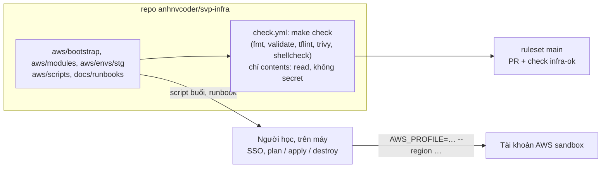

# Dựng và kiểm cài đặt GitHub của `svp-infra` (repo Terraform: cài đặt repo, nhánh mặc định, Renovate, ruleset)

- Quy trình làm tay, không có cảnh báo. Mở khi dựng repo hạ tầng `anhnvcoder/svp-infra` lần đầu (giai đoạn 7), khi kiểm lại cài đặt sau
  một thay đổi của GitHub hay của repo, khi PR không merge được vì check bắt buộc, hay khi nghi repo đã lộ thông tin của tài khoản AWS.
- Mọi thao tác ghi (UI Settings, nhập ruleset, cài Renovate, push đầu) do **người học chạy** với quyền admin. Mọi lệnh "Kiểm" ở đây chỉ
  `GET`, chạy bằng đăng nhập `gh` của người học (scope `repo` là đủ).
- Thiết kế và lý do ở [ADR-0034](../adr/0034-aws-stage7.md) §2 (repo, bố cục, CI không credential) và threat model
  [AWS-6](../threat-model.md#411-biên-aws-giai-đoạn-7); cài đặt theo cùng mẫu với [svp-frontend-setup.md](svp-frontend-setup.md) và
  [svp-gitops-setup.md](svp-gitops-setup.md). Trang này chỉ nói làm gì, vì sao từng ô, kiểm thế nào.
- **Ở giai đoạn 7a repo không có** secret, variable, environment, GitHub App hay role OIDC nào: CI chỉ kiểm tĩnh, mọi lệnh chạm tài khoản
  AWS do người học chạy từ máy. **Không ghi** account ID, IP, email, tên miền thật vào repo, issue, PR hay chat: repo public.

## Ý nghĩa và tác động tới người dùng

`svp-infra` giữ Terraform của lab (AWS ở giai đoạn 7, GCP ở 8, Cloudflare ở 8b, GitHub dưới dạng code ở 7c), bản clone ở `infra/` của
workspace. Repo code giữ chart, `svp-gitops` giữ cái gì chạy ở mỗi env; `svp-infra` dựng nền (mạng, cluster, dữ liệu) mà Argo CD triển khai
lên:



Cài sai thì người dùng của nền tảng không thấy gì (repo không triển khai gì tự động), nhưng repo yếu đi mà không ai biết: workflow dùng
action theo tag, PR từ fork chạy workflow không ai duyệt, push thẳng `main` không qua `infra-ok`, hay ai đó thêm khoá AWS "cho tiện" làm
CI của một repo public cầm quyền vào tài khoản. Vì vậy mỗi bước dưới có lệnh kiểm.

## Kiểm tra nhanh (5 phút)

Một lượt, chỉ đọc. Mỗi lệnh in một dòng (`-q` in JSON gọn, khoá theo thứ tự chữ cái). Kết quả mong đợi ở bảng dưới; dòng nào khác là sai,
xem bước tương ứng ở "Khôi phục và xác nhận". Lệnh của phần chưa làm tới (repo còn rỗng, chưa có lượt CI) thì bỏ qua.

```sh
I=repos/anhnvcoder/svp-infra
# A2. Repo và cài đặt
gh api $I -q '{visibility, default_branch, has_issues, allow_auto_merge, allow_squash_merge, allow_merge_commit, allow_rebase_merge}'
gh api $I -q '{squash_merge_commit_title, squash_merge_commit_message}'
gh api $I/actions/permissions -q '{enabled, allowed_actions, sha_pinning_required}'
gh api $I/actions/permissions/selected-actions -q .
gh api $I/actions/permissions/workflow -q .
gh api $I/actions/permissions/fork-pr-contributor-approval -q .
gh api $I -q '.security_and_analysis | {secret_scanning: .secret_scanning.status, push_protection: .secret_scanning_push_protection.status}'
gh api -i $I/vulnerability-alerts | head -1
# A3. Không credential nào ở 7a
gh api $I/actions/secrets -q .total_count
gh api $I/actions/variables -q .total_count
gh api $I/environments -q .total_count
# B1. Nhánh mặc định và lượt CI đầu
gh run list --repo anhnvcoder/svp-infra --workflow check.yml --branch main --limit 1 --json conclusion,headSha
# C1. Ruleset (sau khi nhập)
gh api $I/rulesets -q '.[] | {id, name, target, enforcement}'
gh api $I/rules/branches/main -q '.[] | .type'
```

| Lệnh | Mong đợi |
| --- | --- |
| repo | `"visibility":"public"`, `"has_issues":true`, `"allow_auto_merge":true`, `"allow_squash_merge":true`, `"allow_merge_commit":false`, `"allow_rebase_merge":false`; `"default_branch":"main"` sau push đầu (repo rỗng báo `master`, đọc ngày 2026-10-31: chưa có nghĩa gì) |
| squash | `{"squash_merge_commit_message":"PR_BODY","squash_merge_commit_title":"PR_TITLE"}` |
| `actions/permissions` | `{"allowed_actions":"selected","enabled":true,"sha_pinning_required":true}` |
| `selected-actions` | `{"github_owned_allowed":true,"patterns_allowed":[],"verified_allowed":false}` |
| `actions/permissions/workflow` | `{"can_approve_pull_request_reviews":false,"default_workflow_permissions":"read"}` |
| `fork-pr-contributor-approval` | `{"approval_policy":"all_external_contributors"}` |
| `security_and_analysis` | `{"push_protection":"enabled","secret_scanning":"enabled"}` |
| `vulnerability-alerts` | `HTTP/2.0 204 No Content` (Dependabot alerts bật; `404` là tắt) |
| `actions/secrets`, `actions/variables`, `environments` | `0`, `0`, `0` |
| `gh run list` | một dòng `"conclusion":"success"` |
| rulesets | đúng một dòng `main`, `"target":"branch"`, `"enforcement":"active"` |
| `rules/branches/main` | `deletion`, `non_fast_forward`, `pull_request`, `required_status_checks` |

Không kiểm được bằng `gh` của người học: **Renovate** (B2), như với hai repo kia ([svp-frontend-setup.md](svp-frontend-setup.md#kiểm-tra-nhanh-5-phút)).
Kiểm bằng UI ở bước đó.

## Nguyên nhân thường gặp

Theo thứ tự hay gặp (ba cái đầu đã gặp hay suýt gặp khi dựng `svp-gitops`, `svp-frontend`), mỗi cái kèm dấu hiệu trong kết quả của "Kiểm tra
nhanh":

1. **Ruleset nhập trước lượt CI đầu xanh trên `main`**: commit thêm sau đó phải đi qua PR mà check `infra-ok` chưa từng chạy trên `main`.
   Xem C1.
2. **Push đầu lên `master`**: bản clone ở `infra/` đang ở nhánh `master` chưa có commit; push nhánh đó thì `default_branch` thành `master`,
   ruleset (`~DEFAULT_BRANCH`) và workflow (`push` lên `main`) lệch nhau. Xem B1.
3. **Duyệt workflow PR fork chỉ cho người mới** (`first_time_contributors`, mặc định của GitHub): không lỗi nào hiện ra, chỉ lệnh kiểm
   thấy. Sửa ở A2.
4. **Check bắt buộc mang tên khác tên job tổng của `check.yml`**: PR đứng ở "Expected — Waiting for status to be reported", không merge được.
   Tên đúng là `infra-ok`; sửa ruleset hay tên job cho khớp (C1).
5. **Ai đó thêm secret, variable hay environment ở 7a** (`total_count` khác 0): không gì đỏ, nhưng repo public có credential. Xoá và xem
   "Giảm thiểu".
6. **`patterns_allowed` không rỗng** (chép từ `svp-frontend`, nơi cần `sigstore/cosign-installer`): `svp-infra` không ký gì, ô đó chỉ làm danh
   sách action được chạy rộng ra. Sửa ở A2.

## Giảm thiểu

**Nghi khoá AWS (access key, khoá phiên) đã vào repo** (commit, log Actions, issue, PR):

1. **Thu hồi ngay ở AWS** (người học, console IAM hay SSO của account): vô hiệu hoá và xoá access key đó; khoá phiên SSO thì đăng xuất mọi
   phiên và đợi hết hạn. Repo public nên coi như đã bị đọc: xoá commit không thu hồi được gì.
2. **Kiểm tài khoản**: Cost Explorer và billing trong 24 giờ qua, CloudTrail theo access key đó (người học đọc); tài nguyên lạ thì dừng và
   ghi lại trước khi xoá.
3. **Đọc cảnh báo của GitHub**: tab Security → Secret scanning của `svp-infra`. Push protection chặn được phần lớn khoá AWS lúc push; cảnh báo
   có nghĩa là khoá đã lên.
4. Gỡ khoá khỏi cây bằng PR (lịch sử vẫn giữ; khoá đã thu hồi thì vô hại). Mở postmortem ([mẫu](../postmortems/README.md)).

**Nghi account ID, IP, email hay tên miền thật đã vào repo** (không phải bí mật theo nghĩa credential, nhưng trái luật của repo public):
gỡ khỏi cây bằng PR, chuyển giá trị sang `*.auto.tfvars` không commit hay `TF_VAR_*`. Lịch sử git vẫn giữ giá trị; viết lại lịch sử cần tắt
ruleset `main` và force push, là bước nặng (xem "Leo thang").

## Khôi phục và xác nhận

Dựng từ đầu theo thứ tự:

- **A. Trước commit đầu**: repo rỗng (đã có), cài đặt repo, không credential.
- **B. Commit đầu và CI**: push đầu lên `main`, lượt `check.yml` đầu xanh, Renovate.
- **C. Sau lượt CI đầu xanh trên `main`**: ruleset.

### A1. Repo rỗng

Repo `anhnvcoder/svp-infra` đã tạo ngày 2026-10-31 (public, rỗng) và bản clone ở `<workspace>/infra`.

**Kiểm:**

```sh
gh api repos/anhnvcoder/svp-infra -q '{visibility, size}'          # {"size":0,"visibility":"public"} trước push đầu
git -C infra remote get-url origin                                 # https://github.com/anhnvcoder/svp-infra.git (hay SSH tương đương)
```

**Nếu sai:** `private` → Settings → Danger Zone → **Change visibility** → Public (ruleset ở gói Free cần repo public; nội dung không có gì
phải giấu khi biến cá nhân ở ngoài git, ADR-0034 §2). Repo đã có commit lạ (README, license tạo sẵn) trước push đầu → xoá repo rồi tạo lại
không `--add-readme`, `--license`, `--gitignore` (người học chạy, chỉ khi repo chưa có gì khác).

### A2. Cài đặt repo

Làm trước khi bất kỳ commit nào có `.github/workflows/` được push.

**Làm gì** (https://github.com/anhnvcoder/svp-infra/settings):

- **General** → mục **Pull Requests**: bật **Allow squash merging**, ô **Default commit message** chọn **Pull request title and
  description**; tắt **Allow merge commits** và **Allow rebase merging**; bật **Allow auto-merge**. Mục **Features**: giữ **Issues** bật.
- **Actions** → **General**:
  - **Actions permissions**: **Allow anhnvcoder, and select non-anhnvcoder, actions and reusable workflows**; tích **Allow actions created
    by GitHub**, không tích Marketplace verified creators; ô danh sách action **để trống**; tích **Require actions to be pinned to a
    full-length commit SHA**. **Save**.
  - **Approval for running fork pull request workflows from contributors**: **Require approval for all external contributors**. **Save**.
  - **Workflow permissions**: **Read repository contents and packages permissions**; **bỏ tích** **Allow GitHub Actions to create and
    approve pull requests**. **Save**.
- **Advanced Security**: bật **Dependabot alerts**; **Secret Protection** (secret scanning) và **Push protection** bật (repo public thường
  đã bật sẵn, kiểm lại).

**Vì sao:**

- Chỉ squash: mỗi PR là đúng một commit trên `main`, nên mỗi thay đổi hạ tầng (mỗi lần người học `plan`, `apply` từ `main`) ứng với một
  commit đọc được; hoàn tác là revert một commit. Commit squash lấy tiêu đề và mô tả của PR (conventional commit, footer, dòng revert còn
  trong commit). Auto-merge để PR của người học tự merge khi `infra-ok` xanh; không mở đường nào qua ruleset.
- Chỉ action của GitHub, ghim SHA bắt buộc: như hai repo kia; `check.yml` chỉ dùng action của GitHub, còn terraform, tflint, trivy,
  shellcheck chạy bằng image hay bản tải ghim, nên danh sách action ngoài để trống (khác `svp-frontend`, không ký gì).
- Token mặc định chỉ đọc, tắt "create and approve pull requests": không workflow nào của repo này ghi hay mở PR.
- Duyệt PR fork của mọi người ngoài: repo public, PR fork chạy `check.yml` với code lạ trên runner; người học xem trước khi cho chạy.
- Secret scanning + push protection: chặn ngay lúc push nếu ai lỡ commit khoá AWS (threat model AWS-6). Dependabot alerts: cảnh báo về
  action; provider và module Terraform do Renovate nâng.

**Kiểm:** tám lệnh đầu của "Kiểm tra nhanh" (repo tới `vulnerability-alerts`), output như bảng. Các API này chạy được trên repo rỗng.

**Nếu sai:** sửa ở đúng ô rồi chạy lại lệnh kiểm. `allow_merge_commit`/`allow_rebase_merge` true → người merge tay có thể tạo merge commit hay
rebase. `sha_pinning_required` false hay `verified_allowed` true → workflow dùng tag hay action bên thứ ba vẫn chạy. `patterns_allowed` không
rỗng → xoá dòng trong ô danh sách action. `can_approve_pull_request_reviews` true → tắt ở Workflow permissions. `approval_policy` khác
`all_external_contributors` → chọn lại ô duyệt PR fork.

### A3. Không credential ở 7a

**Làm gì:** không tạo gì ở Settings → **Secrets and variables** → **Actions** (cả tab Secrets lẫn Variables) và Settings → **Environments**;
không tạo role IAM nào tin OIDC của GitHub cho repo này.

**Vì sao** (ADR-0034 §2, threat model AWS-6): CI của 7a chỉ kiểm tĩnh (`make check` không gọi `plan`, `apply` hay `aws`), nên không job nào
cần quyền vào tài khoản; repo public với một credential trong CI là một đường vào tài khoản qua code của PR hay action bị chiếm. `plan`,
`apply` chạy từ máy người học bằng SSO. Đăng nhập CI vào AWS bằng OIDC (không khoá dài hạn) là bài của 7c, khi có lý do.

**Kiểm:** ba lệnh "A3" của "Kiểm tra nhanh" in `0`.

**Nếu sai:** xoá secret, variable, environment thừa ở đúng trang trên; secret là khoá AWS thì làm "Giảm thiểu" trước.

### B1. Push đầu lên `main`

**Làm gì** (người học chạy, hay người được giao commit, từ gốc workspace): commit đầu trên nhánh `main`, không trên `master` của bản clone rỗng;
push `main` (repo rỗng không có nhánh nào để mở PR vào, nên commit đầu đi thẳng); các thay đổi sau qua PR.

```sh
git -C infra symbolic-ref HEAD refs/heads/main   # bản clone còn ở master chưa commit: chuyển HEAD sang main trước khi commit
git -C infra push -u origin main
```

**Vì sao:** nhánh push đầu lên repo rỗng thành nhánh mặc định. Ruleset nhắm `~DEFAULT_BRANCH`, `check.yml` chạy khi push `main`, hai repo
kia dùng `main`: nhánh mặc định phải là `main` từ đầu.

**Kiểm:**

```sh
gh api repos/anhnvcoder/svp-infra -q .default_branch                                       # main
gh run list --repo anhnvcoder/svp-infra --workflow check.yml --branch main --limit 1 --json conclusion,headSha
# một dòng "conclusion":"success"; headSha là commit vừa push
```

**Nếu sai:** `default_branch` là `master` → push `main` rồi Settings → **General** → **Default branch** → chọn `main`, sau đó xoá nhánh
`master` trên GitHub (người học chạy, chỉ khi `master` không có gì khác `main`). Lượt `check.yml` đỏ → đọc log, sửa bằng commit (ruleset chưa
bật nên còn push được), chờ lượt xanh trước C1.

### B2. Renovate

**Làm gì:** https://github.com/apps/renovate → **Configure** → `anhnvcoder` → **Only select repositories** → thêm `anhnvcoder/svp-infra`
(giữ ba repo đã có) → **Save**. Làm sau khi `renovate.json` đã ở `main` (B1), để không có PR onboarding.

**Vì sao:** `renovate.json` của `svp-infra` nâng provider Terraform, module `terraform-aws-modules` (ghim version chính xác), ruleset tflint,
image ghim của `Makefile` và SHA của action, cùng lịch sáng thứ Bảy giờ Việt Nam và `minimumReleaseAge` 3 ngày như hai repo kia; không có
thì các ghim cũ dần. Không automerge: mỗi PR nâng module hay provider người học đọc changelog trước khi merge (nâng major của module EKS có
breaking).

**Kiểm** (UI): https://github.com/settings/installations → **Renovate** → **Configure**: danh sách repo có `svp-infra`. Vài giờ sau có issue
**Dependency Dashboard**:

```sh
gh issue list --repo anhnvcoder/svp-infra --state all --search 'Dependency Dashboard in:title' --json number,title,author
```

**Nếu sai:** không có issue sau một ngày → log của repo ở https://developer.mend.io → `anhnvcoder/svp-infra`.

### C1. Ruleset `main` (sau lượt `check.yml` đầu xanh trên `main`)

Thứ tự như ba repo kia: ruleset cấm push thẳng `main` và đòi check tổng `infra-ok`; tạo sau lượt xanh trên `main` thì commit đầu đã push
thẳng được, và check đã chạy được trên `main` trước khi thành bắt buộc.

**Trước khi `apply`:** hai lệnh "Kiểm" của B1 ra `main` và `success`; tên job tổng của `check.yml` là `infra-ok`:

```sh
gh api repos/anhnvcoder/svp-infra/commits/main/check-runs -q '.check_runs[] | {name, conclusion}'   # có {"conclusion":"success","name":"infra-ok"}
```

**Làm gì** (người học chạy): ruleset `main` là `github_repository_ruleset.infra_main` của root Terraform `github/` (`rulesets.tf`);
tạo và sửa bằng `plan`, `apply` ở đó theo `github/README.md`, không nhập tay.

**Từng luật và vì sao** (như `main` của `svp-gitops`, `svp-frontend`):

| Luật | Vì sao |
| --- | --- |
| `deletion`, `non_fast_forward` | Không ai xoá `main` hay force push: mỗi `apply` của người học ứng với một commit trên `main`, viết lại lịch sử làm mất dấu cấu hình đã apply |
| `pull_request`, 0 approval | Mọi thay đổi qua PR để `make check` chạy; repo một người nên không bắt người thứ hai; không CODEOWNERS |
| `required_status_checks` `infra-ok`, `integration_id` 15368 | Check tổng phải xanh, chỉ nhận từ app GitHub Actions (`gh api apps/github-actions -q .id` là 15368, như `svp-frontend-setup.md` đọc ngày 2026-10-30) |
| `bypass_actors: []` | Không ai bỏ qua, cả admin |

**Kiểm:** hai lệnh "C1" của "Kiểm tra nhanh", rồi:

```sh
id=$(gh api repos/anhnvcoder/svp-infra/rulesets -q '.[] | select(.name=="main") | .id')
gh api repos/anhnvcoder/svp-infra/rulesets/$id -q '{bypass_actors, include: .conditions.ref_name.include,
  checks: [.rules[] | select(.type=="required_status_checks") | .parameters.required_status_checks[] | {context, integration_id}]}'
# {"bypass_actors":[],"checks":[{"context":"infra-ok","integration_id":15368}],"include":["~DEFAULT_BRANCH"]}
```

**Nếu sai:** `disabled`/`evaluate` → mở ruleset → **Enforcement status** → Active. Hai ruleset cùng tên → xoá bản thừa ở UI. PR đứng chờ
check (nguyên nhân 4) → so tên job tổng của `check.yml` với `context`, sửa bên sai (PR sửa `rulesets.tf` rồi `apply`, hay PR đổi tên job khi ruleset tạm ở
`evaluate`).

## Leo thang

- Khoá AWS đã lên repo và có dấu hiệu dùng (chi phí lạ, CloudTrail có lời gọi không phải của người học): dừng mọi việc khác, giữ bằng chứng,
  mở postmortem ([mẫu](../postmortems/README.md)); xét đóng tài khoản sandbox nếu không chắc đã dọn hết.
- Cần viết lại lịch sử để gỡ email, IP hay tên miền: bước nặng (tắt ruleset, `git filter-repo`, force push, mọi bản clone phải clone lại);
  chỉ làm khi người học quyết, ghi lý do vào postmortem. Account ID không phải bí mật theo nghĩa credential: thường gỡ khỏi cây là đủ.
- `check.yml` cần quyền hay secret mới (ví dụ OIDC vào AWS): không thêm tay; viết ADR (7c `ci-oidc`) rồi mới đổi cài đặt và threat model.

## Liên kết

- [ADR-0034](../adr/0034-aws-stage7.md) §2 (repo, bố cục, state, CI không credential), §14 (buổi AWS); threat model
  [AWS-6](../threat-model.md#411-biên-aws-giai-đoạn-7).
- [svp-frontend-setup.md](svp-frontend-setup.md), [svp-gitops-setup.md](svp-gitops-setup.md): cùng mẫu cài đặt, ruleset, Renovate.
- Trình tự buổi AWS và gỡ tài nguyên: `docs/runbooks/session-stg.md` của repo `svp-infra`.
- Không có diễn tập; phép kiểm là lượt `check.yml` đầu (B1) và ruleset (C1).

## Đã kiểm

- 2026-10-31, trước khi dựng: `gh api repos/anhnvcoder/svp-infra` trả `{"default_branch":"master","size":0,"visibility":"public"}`;
  `git -C infra status` báo nhánh `master`, chưa có commit.
- Chưa kiểm: toàn bộ A2–C1.
