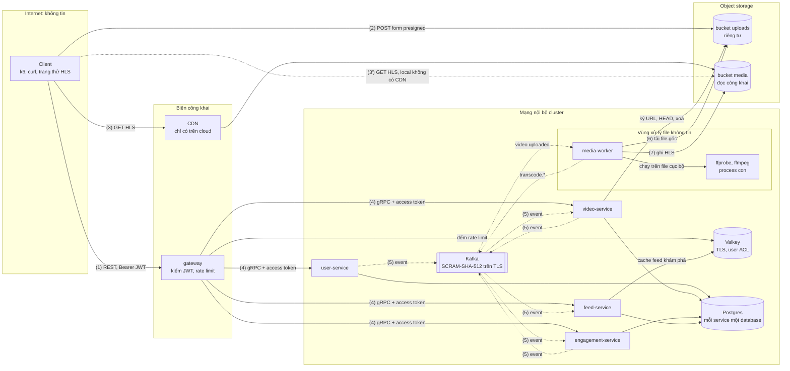

# Threat model (STRIDE, bản nhẹ)

Mối đe doạ của hệ thống như đang chạy (compose, k3d, CI/CD, GitOps, AWS) theo STRIDE, xét theo bề mặt. Xét lại khi thêm bề mặt mới (service,
môi trường, nhà cung cấp) và trước mỗi môi trường mới; lịch sử cập nhật và cách kiểm từng dòng theo thời gian ở
[phụ lục](appendix/threat-model.md).

## 1. Phạm vi và cách làm

**STRIDE** là sáu loại mối đe doạ, mỗi loại ứng với một tính chất cần giữ:

| Chữ | Loại | Tính chất bị phá | Ví dụ trong hệ thống này |
| --- | --- | --- | --- |
| S | Spoofing: giả danh | Xác thực | Tự ký JWT, gọi thẳng gRPC với token bắt được của người khác |
| T | Tampering: sửa dữ liệu | Toàn vẹn | Thay file gốc sau khi đã `CompleteUpload`, phát event giả |
| R | Repudiation: chối bỏ | Truy vết được | Không có log nào cho biết ai đã upload một video |
| I | Information disclosure: lộ thông tin | Bí mật | Email trong log, dò email đã đăng ký |
| D | Denial of service: làm ngừng dịch vụ | Sẵn sàng | File video "bom" làm treo worker, spam đăng nhập |
| E | Elevation of privilege: leo quyền | Phân quyền | Khai thác lỗi ffmpeg để lấy credential của worker |

**"Nhẹ" nghĩa là:** xét theo **bề mặt** (chỗ dữ liệu đi qua một ranh giới tin cậy), không xét từng hàm; mỗi bề mặt liệt kê
các mối đe doạ thấy rõ, biện pháp, nơi biện pháp chạy và mức ưu tiên. Không chấm điểm định lượng (DREAD, CVSS).

**Cách đọc bảng:**

- **Ở đâu:** biện pháp chạy ở đâu. `local` là compose, cluster k3d và CI; `AWS` là Terraform `svp-infra` và cluster EKS; `GCP (kế hoạch)`,
  `capstone (kế hoạch)` là chưa có. Phần sau dấu `;` nói rủi ro chấp nhận ở đâu (lý do ở [mục 6](#6-rủi-ro-chấp-nhận)).
- **Ưu tiên:** **Cao** = khai thác dễ, hoặc hậu quả là chiếm tài khoản, lộ dữ liệu cá nhân, chạy code lạ; phải có trước khi
  hệ thống nhận request từ internet. **Vừa** = cần làm nhưng hậu quả có giới hạn. **Thấp** = phòng thêm.
- Dòng ghi **Chấp nhận** là rủi ro không xử lý (hoặc chỉ giảm bớt); lý do và lúc xem lại ở [mục 6](#6-rủi-ro-chấp-nhận).
- Câu "vì sao" của các biện pháp quan trọng nằm ngay dưới mỗi bảng.
- Phép kiểm `drill-k8s-threats` của một dòng là test Chainsaw `deploy/k8s/drills/threats/<ID>/` (ID viết thường, `/` thành `-`); ca (x)
  của `drill-k8s-supplychain` là `deploy/k8s/drills/supplychain/case-<x>/`. Cách chạy ở [`reference/k8s.md`](reference/k8s.md).

## 2. Luồng dữ liệu và ranh giới tin cậy

Dựa trên C4 container ([architecture §5](architecture.md)). Mỗi `subgraph` là một vùng tin cậy; mũi tên đi qua viền
vùng là chỗ phải kiểm.

| Chỗ vượt ranh giới | Ai bên kia | Kiểm ở đâu |
| --- | --- | --- |
| (1) Internet → gateway | Bất kỳ ai | gateway: JWT, rate limit, giới hạn kích thước và thời gian request ([4.1](#41-jwt-và-đăng-nhập), [4.4](#44-rate-limit-ở-gateway)); trên AWS qua CloudFront, WAF, ALB internal, Envoy trước đó ([4.13](#413-edge)) |
| (2) Internet → bucket `uploads` | Ai đang giữ form presigned | Chính storage, theo policy đã ký ([4.2](#42-presigned-post-và-bucket)) |
| (3) Internet → bucket `media` | Bất kỳ ai | Không kiểm: nội dung công khai, chỉ cho đọc từng object ([4.2](#42-presigned-post-và-bucket)) |
| (4) gateway → service | Hiện tại: mọi thứ vào được mạng nội bộ | Service kiểm lại access token gateway chuyển tiếp; NetworkPolicy, mTLS ([4.5](#45-mức-tin-cậy-giữa-các-service)) |
| (5) Service ↔ Kafka | Client có user Kafka và tới được cổng 9096 | SCRAM-SHA-512 trên TLS, ACL theo service, NetworkPolicy; consumer kiểm event ([4.5](#45-mức-tin-cậy-giữa-các-service), IN-4) |
| gateway, feed-service, web ↔ Valkey | Client có user Valkey và tới được cổng 6379 | TLS, user ACL theo db, tiền tố khoá và lệnh, NetworkPolicy (IN-7, WEB-22) |
| (6), (7) File người dùng → ffmpeg | Nội dung do người dùng tạo | ffprobe, giới hạn định dạng, giao thức, tài nguyên, quyền ([4.3](#43-ffmpeg-đọc-file-người-dùng)) |

## 3. Tài sản cần bảo vệ

| Tài sản | Nằm ở đâu | Tính chất cần giữ | Mất thì sao |
| --- | --- | --- | --- |
| **Khoá ký JWT** (khoá riêng) | Chỉ user-service | Bí mật | Ai có khoá là ký được token của **mọi** người dùng. Tài sản giá trị nhất |
| Hash mật khẩu và email (dữ liệu cá nhân) | `svp_user` | Bí mật | Lộ email là lộ dữ liệu cá nhân; hash bị bẻ offline nếu thuật toán yếu |
| Credential của service (database, object storage, Kafka, Valkey) | `.env` (compose); Secret của cluster từ secret store; trên AWS mật khẩu Kafka, Valkey do Terraform sinh, ghi write-only | Bí mật | Mở đường đi tắt qua mọi kiểm tra của API |
| Mật khẩu vận hành `svp-admin` (Kafka), `svp-ops` (Valkey) | `.env`; Secret `svp-data/svp-ops` và pod `svp-ops`; Secrets Manager `svp/<env>/kafka-admin`, `valkey-users` | Bí mật | `svp-admin` ghi mọi topic, đổi và xoá mọi ACL; `svp-ops` đọc mọi khoá `svp:*`, gồm session web có token (IN-10); ở k3d, EKS pod còn giữ mật khẩu role app của video, engagement, feed (Secret `pg-roles`, cho `svp-pg`): đọc, ghi database của ba service (IN-10) |
| File gốc trong `uploads` | Object storage | Bí mật, toàn vẹn | File chưa phát hành, có thể chứa metadata riêng (vị trí GPS, thiết bị) |
| Bản HLS trong `media` | Object storage, CDN | Toàn vẹn | Công khai theo thiết kế; bị ghi đè là video của người khác bị thay |
| Bộ đếm lượt xem, like | `svp_engagement` | Toàn vẹn | Số sai làm sai mọi thứ xếp hạng dựa trên nó về sau |
| Tính sẵn sàng của feed và upload | gateway, feed-service, video-service | Sẵn sàng | Vi phạm SLO 99,9% ([architecture §2](architecture.md)) |
| Backup Postgres (backup cơ sở và WAL của mọi database) | Bucket `pg-backups` của object store trong cluster k3d (RustFS); AWS: backup tự động (PITR) của RDS, recovery point của AWS Backup (RDS, `uploads`, `media`) ở vault `svp-<env>` của account env và bản copy ở vault `svp-<env>-copy` của account `svp-backup` (BAK-3) | Bí mật, toàn vẹn, sẵn sàng | Bản sao của mọi dữ liệu trên, cả hash mật khẩu và email; mất hay bị sửa thì không phục hồi được |

## 4. Mối đe doạ theo bề mặt

### 4.1 JWT và đăng nhập

**Lựa chọn (quyết định của threat model):**

- **Thuật toán ký: EdDSA với Ed25519** (`alg: "EdDSA"`). user-service giữ khoá riêng, gateway và bốn service gRPC chỉ có khoá công khai
  ([architecture §7.4](architecture.md)).
  - Không chọn **HS256**: khoá đối xứng, bên nào kiểm được token thì cũng ký được token, nên gateway (bề mặt lộ ra internet
    nhiều nhất) sẽ giữ quyền ký cho mọi người dùng.
  - Không chọn **RS256**: chạy được, nhưng chữ ký 2048 bit dài 256 byte làm token phình, ký chậm hơn hẳn.
  - **ES256** là lựa chọn dự phòng, nhưng ECDSA cần số ngẫu nhiên tốt cho từng chữ ký (dùng lại nonce là lộ khoá riêng,
    một lớp lỗi kinh điển). Ed25519 có chữ ký tất định nên không có lớp lỗi đó, khoá 32 byte, chữ ký 64 byte, chỉ có một
    đường cong nên không có tham số để chọn sai, và có sẵn trong thư viện chuẩn Go (`crypto/ed25519`). Nếu về sau phải ký
    bằng dịch vụ quản lý khoá trên cloud mà dịch vụ đó không hỗ trợ Ed25519 thì đổi sang ES256: chỉ đổi cấu hình hai đầu,
    không đổi contract.
- **Claim:** `iss = "svp-user"`, `aud = "svp-api"`, `sub = user_id`, `iat`, `exp`, `jti` (UUIDv7, chưa dùng, để dành cho
  danh sách thu hồi). Header có `kid` để đổi khoá không gián đoạn. **Không** đặt email hay dữ liệu cá nhân vào token.
- **Thời hạn: 1 giờ**, lệch đồng hồ cho phép 30 giây. MVP không có refresh token
  ([ADR-0006](adr/0006-contract-ids-and-event-envelope.md)): hạn ngắn hơn (15 phút) buộc client gửi lại mật khẩu
  thường hơn, tức thêm tải hash và thêm lần mật khẩu đi trên đường truyền; hạn dài hơn kéo dài thời gian một token bị lộ còn
  dùng được. 1 giờ đủ cho một lượt k6 bình thường; bài soak dài hơn thì k6 đăng nhập lại. Có refresh token
  ([ADR-0016](adr/0016-web-client.md) §2): access token vẫn 1 giờ, client đổi refresh token lấy access token mới thay vì
  gửi lại mật khẩu.
- **Hash mật khẩu: argon2id**, chuỗi lưu theo định dạng PHC (gồm tham số và salt 16 byte ngẫu nhiên riêng từng người), tham
  số theo khuyến nghị OWASP hiện hành và đo thời gian hash trên máy. Không chọn bcrypt dù cũng chấp nhận được:
  bcrypt chỉ dùng 72 byte đầu của mật khẩu và không tốn bộ nhớ, nên bẻ bằng GPU rẻ hơn; argon2id tốn cả CPU lẫn RAM theo tham
  số chỉnh được. Cái giá: thêm dependency `golang.org/x/crypto` (lý do ghi ở `go.mod` và ADR), và mỗi lần hash ngốn vài
  chục MiB RAM (xem JWT-9).

| ID | Thành phần | STRIDE | Kịch bản | Biện pháp | Ở đâu | Ưu tiên |
| --- | --- | --- | --- | --- | --- | --- |
| JWT-1 | gateway kiểm JWT | S, E | Token có `alg: none`, hoặc `alg: HS256` dùng chính khoá công khai làm khoá HMAC (nhầm thuật toán): gateway chấp nhận token tự ký, kẻ tấn công thành người dùng bất kỳ | Gateway chỉ chấp nhận đúng `EdDSA`, khoá lấy theo `kid` từ cấu hình cục bộ, `kid` lạ thì từ chối; bỏ qua `jku`, `x5u`, `jwk` trong header; test cho từng kiểu token giả. [ADR-0030](adr/0030-devsecops-supplement.md) §2, §3: fuzz `FuzzVerify` (qua được thì đúng ba đoạn, `alg` `EdDSA`, `kid` đã cấu hình và `ed25519.Verify` đúng; seed `alg: none`, HS256 ký bằng khoá công khai, khoá khác, `kid` lạ, `jku`/`jwk`) và `FuzzRequireAuth`; Schemathesis `ignored_auth` ở job `stack`: mọi operation có `security: bearerAuth` phải trả 401 khi không token hay token sai **Đã kiểm 2026-10-29:** seed trong `make test`, `make fuzz FUZZTIME=60s` không tìm ra lỗi; job `stack` của PR #28 ([40804508919](https://github.com/anhnvcoder/svp-backend/actions/runs/40804508919)) 0 lỗi | local | Cao |
| JWT-2 | gateway kiểm JWT | S | Token đúng chữ ký nhưng hết hạn, hoặc của hệ thống khác dùng chung khoá (`iss`/`aud` khác) | Bắt buộc có và kiểm `exp`, `iss`, `aud`; thiếu claim là từ chối. [ADR-0030](adr/0030-devsecops-supplement.md) §2: fuzz `FuzzVerify`, seed thiếu `exp`, sai `iss`/`aud` **Đã kiểm 2026-10-29:** seed trong `make test`, `make fuzz FUZZTIME=60s` không tìm ra lỗi | local | Cao |
| JWT-3 | Token đã cấp | S | Token bị lộ (log, máy người dùng) còn dùng được tới hết hạn; đổi mật khẩu hay đăng xuất không làm token cũ mất hiệu lực | Hạn 1 giờ; token chỉ đi trong header `Authorization`, không bao giờ trong query string. [ADR-0016](adr/0016-web-client.md) §2: refresh token xoay mỗi lần dùng, trình lại token đã dùng thì thu hồi cả họ, logout thu hồi cả họ, nên đăng xuất cắt được phiên; web giữ token ở server (BFF), không bao giờ ở trình duyệt. Access token đã cấp vẫn sống tới hết 1 giờ (chưa có danh sách thu hồi theo `jti`): **chấp nhận** phần đó **Đã kiểm 2026-10-22:** test integration của user-service (xoay, dùng lại token cũ thì token mới nhất của họ cũng bị từ chối, refresh song song, logout), `make smoke` (refresh 200, dùng lại → 401 `INVALID_REFRESH_TOKEN` cho cả token mới nhất, logout 204 hai lần, refresh sau logout 401), e2e WEB-6 (sau logout cookie cũ → 401). [ADR-0030](adr/0030-devsecops-supplement.md) §2, §3: fuzz `FuzzRequireAuth` (handler chỉ chạy khi có đúng một header `Authorization`, scheme `Bearer` và token qua `FuzzVerify`; còn lại 401, `WWW-Authenticate: Bearer`, cùng một `detail`), Schemathesis `ignored_auth` ở job `stack` **Đã kiểm 2026-10-29:** seed trong `make test`, `make fuzz FUZZTIME=60s` không tìm ra lỗi | local; chấp nhận, xem lại ở capstone | Vừa |
| JWT-4 | `Login` | S | Dò mật khẩu: thử hàng loạt mật khẩu cho một email, hoặc một mật khẩu phổ biến cho nhiều email | Rate limit theo IP và theo cặp (IP, email) ở route login; **không** khoá tài khoản sau N lần sai | local | Cao |
| JWT-5 | `Login` | I | Phân biệt "email không tồn tại" với "sai mật khẩu" qua message hoặc qua thời gian phản hồi | Hai trường hợp cùng `UNAUTHENTICATED`, cùng `reason` `INVALID_CREDENTIALS`, cùng message ([ADR-0006](adr/0006-contract-ids-and-event-envelope.md), `proto/svp/user/v1/user_service.proto`); email không tồn tại vẫn chạy so hash với một hash giả để thời gian như nhau. [ADR-0030](adr/0030-devsecops-supplement.md) §2: fuzz `FuzzEmail` (email chuẩn hoá luỹ đẳng, chữ thường, không khoảng trắng đầu cuối, đúng một địa chỉ không tên), nên một email không có hai dạng lưu | local | Vừa |
| JWT-6 | `Register` | I | Gọi `Register` với email người khác, nhận `ALREADY_EXISTS` là biết email đó có tài khoản | Rate limit theo IP ở route register. **Chấp nhận** ở MVP | local; chấp nhận | Thấp |
| JWT-7 | `svp_user` | I | Database bị lộ (backup, SQL injection): bẻ hash offline | argon2id có salt riêng; lưu tham số trong chuỗi hash để tăng tham số về sau mà không bắt mọi người đổi mật khẩu (hash lại lúc đăng nhập); mọi câu SQL tham số hoá qua `sqlc` | local | Cao |
| JWT-8 | Log, trace, tracker lỗi (GlitchTip, giao thức Sentry) | I | Mật khẩu, token, email bị ghi vào log, attribute của span hay báo lỗi gửi tracker | Log `user_id` thay cho email; kiểu riêng cho mật khẩu và token tự che giá trị khi log; access log không ghi header `Authorization`. [ADR-0011](adr/0011-observability-stage3.md) §2, §4, §7: span HTTP không có header, thân hay query; span SQL không có tham số, lỗi Postgres trong span chỉ còn mức và SQLSTATE; span Redis không có lệnh, khoá; span consumer chỉ ghi kiểu lỗi và mã an toàn. Collector xoá `http.request.header.authorization`, `http.request.header.cookie`, `user.email`, `user.name` ở cả attribute và resource (lớp phụ). Tracker chỉ nhận bản ghi ERROR: message hằng trong danh sách cho phép, attribute trong danh sách cho phép, exception chỉ kiểu lỗi và mã an toàn (không `err.Error()`), bỏ `Request`, user chỉ `id`; regex che email và JWT là lớp phụ; tracker chạy local, đổi sang Sentry SaaS chỉ bằng DSN và vẫn giữ các lớp này. [ADR-0016](adr/0016-web-client.md) §2, §4: refresh token thô chỉ sống trong `secret.String`, không vào log, span, problem; database chỉ giữ SHA-256; log ghi `token_id`, `family_id`, `user_id`; web không log token, sid hay cookie. [ADR-0030](adr/0030-devsecops-supplement.md) §2, §3: fuzz `FuzzEmail`; báo cáo DAST công bố (`report.json`, `summary.json`) và log bước `dast` dò JWT, token, cookie, chữ ký presigned và chính token của lượt trước khi in hay tải (SC-10) | local | Cao |
| JWT-9 | user-service | D | Spam đăng nhập: mỗi lần hash argon2id tốn vài chục MiB, vài trăm request cùng lúc làm user-service hết RAM | Rate limit login (JWT-4); giới hạn số phép hash chạy cùng lúc bằng semaphore (bulkhead), quá thì trả `RESOURCE_EXHAUSTED`; giới hạn độ dài mật khẩu (8–128 ký tự) | local | Vừa |
| JWT-10 | Khoá ký JWT | I, E | Khoá riêng lộ (commit nhầm, nằm trong image, log): ký được token cho mọi người | Xem [4.7](#47-bí-mật): chỉ user-service đọc được; đổi khoá theo `kid` (gateway và bốn service gRPC giữ cùng lúc khoá công khai cũ và mới trong lúc chuyển, khoá mới tới đủ năm nơi trước khi user-service ký bằng nó: [runbook](runbooks/jwt-key-rotation.md)). Khoá bị commit thì gitleaks toàn lịch sử của CI làm PR đỏ (SEC-1), file khoá chép vào image thì trivy chặn trước push (SEC-2); khoá nhúng vào binary Go chỉ gitleaks bắt được, ở mã nguồn | local, AWS | Cao |
| JWT-11 | Refresh token | S | Refresh token bị lộ (đọc được Redis giữ session web, database, log) hay bị dùng lại: kẻ cắp tự đổi lấy access token mới tới hết hạn của họ | Token mờ 32 byte ngẫu nhiên, database chỉ lưu SHA-256; token chỉ ở user-service, gateway (chuyển qua) và BFF/Redis, không bao giờ ở trình duyệt; xoay mỗi lần dùng, trình lại token đã dùng thì thu hồi cả họ, kể cả token vừa cấp; mọi thao tác trên một họ chạy dưới khoá theo họ, nên refresh song song với logout hay với việc dùng lại token tổ tiên không sinh token con sống sót; mọi ca lỗi cùng `INVALID_REFRESH_TOKEN`, cùng message; 14 ngày trượt, trần 30 ngày; logout thu hồi họ; rate limit `refresh` theo IP. Kẻ cắp dùng trước mà client thật không quay lại thì không phát hiện được tới hết trần 30 ngày: **chấp nhận** | local | Cao |

**Vì sao:**

- **JWT-1:** chữ ký chỉ có nghĩa khi bên kiểm tự quyết thuật toán. Nếu gateway đọc `alg` từ chính token rồi làm theo, kẻ tấn
  công chọn `none` (không cần chữ ký) hoặc `HS256` với khoá công khai (vốn ai cũng có) làm khoá bí mật. Đây là lỗi thật đã
  xảy ra ở nhiều thư viện JWT; cách chặn duy nhất là cấu hình cứng một thuật toán ở bên kiểm.
- **JWT-4, không khoá tài khoản:** khoá tài khoản sau N lần sai biến chống dò mật khẩu thành công cụ DoS: ai biết email
  của bạn là khoá được bạn khỏi tài khoản. Rate limit theo (IP, email) chặn dò một tài khoản mà không chặn chủ thật đăng nhập
  từ IP khác.
- **JWT-5, so hash giả:** nếu email không tồn tại mà trả lời ngay, còn email có thật mất thêm thời gian hash, thì đo thời gian
  phản hồi là biết email nào đã đăng ký, dù message giống nhau.
- **JWT-8, không đặt email vào token:** JWT chỉ được ký, không được mã hoá; phần payload là base64, ai cầm token cũng đọc
  được.
- **JWT-11, thu hồi cả họ khi dùng lại:** khi một refresh token đã dùng bị trình lại, user-service không biết ai là client
  thật, ai là kẻ cắp (RFC 9700 §4.14.2). Thu hồi cả họ cắt cả hai; client thật đăng nhập lại là xong, kẻ cắp thì mất quyền.
  Cái giá là hai request refresh song song của chính client thật cũng bị coi là dùng lại, nên BFF phải gửi mỗi lúc một
  request refresh cho mỗi phiên, và không có cửa sổ chồng để bù ([ADR-0016](adr/0016-web-client.md) §2, §5).

### 4.2 Presigned POST và bucket

Thiết kế ở [ADR-0004](adr/0004-direct-upload-and-hls.md): video-service ký form POST cho key cố định `uploads/<video_id>`,
policy ép `content-length-range` tối đa 500 MB và content type, hết hạn sau 15 phút; `CompleteUpload` thì `HEAD` kiểm lại.

| ID | Thành phần | STRIDE | Kịch bản | Biện pháp | Ở đâu | Ưu tiên |
| --- | --- | --- | --- | --- | --- | --- |
| UP-1 | Form presigned | T, D | Client sửa form để ghi vào key khác (đè file người khác), gửi file vượt 500 MB, hoặc đổi content type | Policy ký điều kiện **khớp chính xác** key `uploads/<video_id>`, `content-length-range` [1, `size` đã khai], `Content-Type` đúng giá trị đã khai; storage tự từ chối nếu sai. Từ RustFS, [ADR-0022](adr/0022-local-object-store-minio-replacement.md) test tích hợp kiểm thêm form có policy sửa sau khi ký (nới `content-length-range`, đổi key) và form không có trường chữ ký; RustFS từ chối form đổi key hay bucket bằng 400 `InvalidPolicyDocument` (MinIO, S3: 403), nên test đòi một mã 4xx và không object nào được ghi, không đòi mã riêng của store. **Đã kiểm 2026-10-25** trên RustFS: `make test-stack PKGS=./internal/objstore/...` trên máy và trên runner (`compose-obs` [40203123781](https://github.com/anhnvcoder/svp-backend/actions/runs/40203123781)), 39 PASS, 0 SKIP | local | Cao |
| UP-2 | Form presigned | T | Form lộ (log proxy, máy người dùng): trong 15 phút ai cũng gửi được file vào key đó, kể cả **sau** khi tác giả đã `CompleteUpload`, nên file worker đọc có thể khác file đã `HEAD` | Hạn 15 phút; không log URL và field của form; `CompleteUpload` chỉ chuyển trạng thái từ `UPLOADING`. Phần còn lại **chấp nhận** (xem đề xuất ở [mục 7](#7-việc-còn-mở)) | local; chấp nhận | Thấp |
| UP-3 | `CompleteUpload`, `GetVideo`, `ListAuthorVideos`, `GetPublicVideo` | S, I | Người dùng A gọi `CompleteUpload` hoặc `GetVideo` với `video_id` của B; A xem danh sách video của B, hay khách đọc video qua route công khai, để thấy video chưa `READY` của B | video-service so người gọi (`sub` của access token) với `author_id`: `CompleteUpload` của người khác bị từ chối; `GetVideo` video chưa `READY` mà không phải tác giả thì `NOT_FOUND` ([ADR-0006](adr/0006-contract-ids-and-event-envelope.md), `proto/svp/video/v1/video_service.proto`). [ADR-0018](adr/0018-web-profiles-public-video-upload.md) §4, §6: `ListAuthorVideos` trả video chưa `READY` chỉ khi caller là tác giả, lọc theo caller chứ không theo cursor; `GetPublicVideo` không có caller nên chỉ trả `READY`, mọi ca khác cùng `VIDEO_NOT_FOUND` (WEB-14) **Đã kiểm 2026-10-22** (phần B): test video-service (danh sách của người khác chỉ `READY` qua nhiều trang, kể cả khi dùng cursor của tác giả; `GetPublicVideo` không caller hay caller rác → `NOT_FOUND`); `make smoke` (`GET /me/videos` thấy video `UPLOADING` của mình, danh sách của người khác chỉ `READY`, `GET /public/videos/{id}` 404 với video `UPLOADING`); e2e `/v/{id}` của video chưa `READY` → cùng 404 với id ngẫu nhiên | local | Cao |
| UP-4 | Credential ký URL | E | Lỗi trong code ký (key ghép từ input) sinh được form ghi vào `media/` hoặc key tuỳ ý | Form presigned mang quyền của credential đã ký nó: credential của video-service chỉ được `PutObject` dưới `uploads/*`, đọc `HEAD`, và xoá (dọn upload bỏ dở, video `FAILED`); key luôn ghép từ `video_id` do server sinh. [ADR-0030](adr/0030-devsecops-supplement.md) §4: CodeQL default setup (`go`, chỉ báo) theo luồng dữ liệu từ input tới key | local, AWS | Vừa |
| UP-5 | Bucket `uploads` | I | Bucket để lộ công khai, file chưa phát hành bị tải về | Bucket riêng tư, chặn truy cập công khai ở mức bucket; object store local (RustFS) tạo user riêng cho từng service với policy theo bucket và tiền tố, không dùng tài khoản root trong service (root chỉ ở container store và job init `s3-init`). **Đã kiểm 2026-10-25** trên RustFS: `make smoke` (đọc ẩn danh `uploads` 403) trên máy và ở job `stack` ([40203127200](https://github.com/anhnvcoder/svp-backend/actions/runs/40203127200)), `TestIntegrationWorkerPermissions`, `TestIntegrationVideoServicePermissions` của `make test-stack` | local, AWS | Cao |
| UP-6 | Bucket `media` | I | Ai có link đều xem được video; cho phép `ListBucket` thì liệt kê được mọi video, kể cả bản HLS ghi dở của video chưa `READY` hoặc `FAILED` | Đọc công khai là **chấp nhận** (nền tảng công khai, chưa có video riêng tư hay xoá video). Chỉ mở đọc từng object, **không** mở liệt kê; trên cloud chỉ CDN đọc được bucket; video `FAILED` bị dọn file (ADR-0004) | local, AWS; chấp nhận | Vừa |
| UP-7 | `InitUpload` | D | Một tài khoản gọi `InitUpload` liên tục, mỗi lần được quyền đẩy 500 MB: đầy storage, tốn tiền | Rate limit theo user ở route init upload; mỗi user tối đa 3 video `UPLOADING` có form còn hạn (tạo trong 15 phút gần nhất); lượt lặp `Idempotency-Key` nhận form hết hạn cùng form đầu (`created_at` + 15 phút), quá cửa sổ đó thì 409 không form, nên không gia hạn được form ngoài giới hạn hay quá lượt dọn ([ADR-0043](adr/0043-idempotency-key.md) §4); job dọn upload bỏ dở quá 1 giờ (ADR-0004) | local | Vừa |
| UP-8 | Upload | R | Video vi phạm được đưa lên, không ai biết ai upload | `author_id` gắn với video từ `InitUpload`; log có cấu trúc ghi `user_id`, `video_id`, `trace_id` ở `InitUpload`, `CompleteUpload` (video-service `video created`, `upload completed`); access log của gateway cùng `trace_id` ghi `user_id`. Log đi OTLP vào Loki, tra theo `trace_id` | local | Thấp |

**Vì sao:**

- **UP-1:** giới hạn phải nằm ở chỗ nhận file. Kiểm `size` ở `InitUpload` chỉ là kiểm con số client khai; chính policy đã ký
  mới buộc storage từ chối byte thứ 500 MB + 1. Content type trong policy chỉ giữ metadata nhất quán, **không** chứng minh
  file là video: nội dung thật chỉ được kiểm ở worker bằng `ffprobe` (FF-1).
- **UP-4:** URL presigned không có quyền riêng, nó mượn quyền của credential đã ký. Credential có quyền ghi cả bucket thì một
  lỗi ghép key là đủ để ghi đè video công khai của người khác.
- **UP-6, không mở liệt kê:** đọc công khai từng object chỉ lộ video mà người xem đã biết `video_id`; mở liệt kê thì lộ toàn bộ,
  kể cả thứ chưa phát hành.

### 4.3 ffmpeg đọc file người dùng

Bề mặt tấn công lớn nhất ([ADR-0004](adr/0004-direct-upload-and-hls.md)): một chương trình C rất lớn, hàng trăm demuxer và
decoder, chạy trên byte do người lạ chọn. Coi như **sẽ có** lỗi bị khai thác; thiết kế để khi đó thiệt hại nhỏ nhất.

| ID | Thành phần | STRIDE | Kịch bản | Biện pháp | Ở đâu | Ưu tiên |
| --- | --- | --- | --- | --- | --- | --- |
| FF-1 | ffprobe, ffmpeg | E | File được dựng để khai thác lỗi bộ nhớ trong demuxer hoặc decoder ít dùng, chạy code trong container worker | `ffprobe` (cũng chạy trong vùng cô lập) kiểm trước: chỉ nhận container MP4/MOV, WebM/Matroska và codec trong danh sách; ffmpeg chỉ mở demuxer và decoder trong danh sách (tuỳ chọn whitelist định dạng và codec của ffmpeg, tên chính xác kiểm bằng test của worker); file khác thì `transcode.failed` | local | Cao |
| FF-2 | ffmpeg | I, S | File là playlist hoặc định dạng tham chiếu tới file/URL khác (HLS, concat và họ hàng): ffmpeg đọc file cục bộ (vd. `/proc/self/environ` chứa credential) hoặc gọi URL nội bộ (SSRF), rồi **nhúng nội dung vào video đầu ra** vốn công khai | Worker tải file gốc về file tạm rồi chạy ffmpeg trên đường dẫn cục bộ, chỉ mở giao thức `file` (whitelist giao thức); các demuxer playlist/tham chiếu không có trong whitelist ở FF-1; ffmpeg chạy với biến môi trường rỗng | local | Cao |
| FF-3 | ffmpeg | D | "Bom" tài nguyên: độ phân giải khổng lồ, thời lượng dài hơn 3 phút trong file nhỏ, frame rate hay số stream bất thường; worker treo hoặc hết RAM, hàng chờ nghẽn, SLO 2 phút vỡ cho mọi người | `ffprobe` kiểm cạnh dài, thời lượng ≤ 180 s (có dung sai), frame rate, số stream; ffmpeg vẫn ép `-t` vì metadata thời lượng có thể nói dối; timeout thời gian thực cho cả job (`exec.CommandContext`); giới hạn CPU/RAM của container (compose ở 2; k3d ở 4: media-worker `limits` 2 CPU / 2 GiB, mọi container của project có `requests`/`limits`, kubelet `pod-max-pids=512` cho mọi pod thay `pids_limit` của compose, [ADR-0014](adr/0014-kubernetes-local-stage4.md) §2, §10) | local | Cao |
| FF-4 | Container worker | E | Đã chạy được code trong worker (FF-1): đọc credential, lấn sang node, gọi service khác | Chạy không phải root, root filesystem chỉ đọc (thư mục tạm riêng), bỏ mọi capability, cấm leo quyền, seccomp mặc định; credential object storage chỉ đọc `uploads/*`, ghi `media/*`, từ [ADR-0029](adr/0029-immutable-media-versions.md) thêm đọc `media/media/*` và liệt kê bucket `media` chỉ theo tiền tố `media/*` (kiểm master của version, đọc lại playlist), vẫn không xoá; output đã công khai không bị ghi lại vì mỗi lần thử ghi thư mục riêng và master chỉ tạo một lần bằng `If-None-Match: *`; không gọi gRPC, không có Postgres hay Redis. k3d: namespace `svp` enforce PSA `restricted` v1.36 (API server từ chối pod chạy root, privileged, có hostPath hay host namespace), không mount token ServiceAccount, user Kafka riêng có ACL (IN-4) | local | Cao |
| FF-5 | Mạng của worker | E, I | Code lạ trong worker quét mạng nội bộ, gọi thẳng gRPC của service, gửi dữ liệu ra internet | NetworkPolicy egress: worker chỉ tới object storage, Kafka, Collector telemetry và DNS; trên cloud object storage nằm ngoài cluster nên chặn theo VPC endpoint hoặc dải địa chỉ. Compose ([ADR-0011](adr/0011-observability-stage3.md) §1, §7): mạng `worker` internal, không route ra ngoài, chỉ có Kafka, object store (`s3`) và Collector `otelcol` (nhận OTLP gRPC ở 4317, không làm proxy hay router); worker không gửi lỗi tới GlitchTip, không đẩy profile. k3d ([ADR-0014](adr/0014-kubernetes-local-stage4.md) §3): NetworkPolicy `default-deny` hai chiều ở `svp`, egress của media-worker chỉ tới object store (`s3`) 9000, Kafka 9096, Collector 4317 và DNS, không pod nào vào được worker. Rule NetworkPolicy của kube-router chỉ chặn kết nối mới, kết nối mở trước khi siết policy vẫn đi tiếp (thấy ở diễn tập canary chặn Prometheus): siết policy trên pod đang chạy thì restart pod đó. **AWS** ([ADR-0034](adr/0034-aws-stage7.md) §10): trên EKS egress S3 của media-worker và video-service theo dải địa chỉ, TCP 443 tới từng dải S3 AWS công bố cho region của cluster (khoá `s3Cidrs` của `cluster.*`, đọc lúc `apply` Terraform), cộng agent Pod Identity `169.254.170.23/32` TCP 80, Kafka 9096 chỉ tới dải subnet database (`cluster.dbCidrs`), không bao giờ `0.0.0.0/0`; S3 đi qua gateway endpoint của VPC có endpoint policy ở cả stg và prd (`s3_endpoint_restricted`, [ADR-0055](adr/0055-environment-matrix.md) §2): chỉ bucket của env, bucket layer ECR của region và bucket mà `registry.k8s.io` chuyển hướng client trong AWS tới (`s3_endpoint_extra_buckets`), nên worker đã bị chiếm (FF-1, qua được FF-4) không chép được file gốc của `uploads` sang bucket lạ của region dù NetworkPolicy theo địa chỉ không phân biệt bucket. Kiểm ở buổi stg: dựng đủ, smoke qua với policy bật | local, AWS | Cao |
| FF-6 | Worker → Kafka | T | Worker bị chiếm phát `transcode.completed` giả cho video khác, trỏ playlist tới key tuỳ ý | video-service chỉ nhận `transcode.*` cho video đang `PROCESSING`, chỉ chấp nhận key nằm dưới `media/<video_id>/`; ACL Kafka (IN-4): ở compose, k3d và MSK user `svp-media-worker` chỉ ghi `media.transcodes.v1` và `video.lifecycle.v1.dlq`, ghi `video.lifecycle.v1` hay `user.follows.v1` bị broker từ chối (`TOPIC_AUTHORIZATION_FAILED`, `drill-k8s-threats` IN-4/FF-6). [ADR-0030](adr/0030-devsecops-supplement.md) §2: fuzz `FuzzIsMediaKey` (key được nhận khi và chỉ khi nằm dưới `media/<video_id>/`, mỗi đoạn chỉ `[A-Za-z0-9._-]`, không đoạn `.` hay `..`, đã ở dạng `path.Clean`) **Đã kiểm 2026-10-29:** seed trong `make test`, `make fuzz FUZZTIME=60s` không tìm ra lỗi | local | Vừa |
| FF-7 | Bản HLS | I | Metadata của file gốc (vị trí GPS, thiết bị, tên người quay) bị chép sang bản HLS công khai | Bỏ metadata khi transcode (`-map_metadata -1`); luôn mã hoá lại, không chép thẳng stream (`-c copy`) từ file gốc | local | Vừa |
| FF-8 | Image ffmpeg | E | Bản ffmpeg trong image có lỗ hổng đã công bố | trivy quét image trong CI, chặn lỗ hổng nghiêm trọng; Renovate cập nhật base image; Kyverno chỉ cho chạy image đã quét và ký. [ADR-0015](adr/0015-cicd-devsecops-stage5.md) §4, §6–8: trivy quét từng kiến trúc (amd64, arm64) trên tar cục bộ, CRITICAL (kể cả chưa có bản vá) chặn push, ký và promote, HIGH chỉ báo (SARIF, job summary); rescan hằng ngày bằng DB mới ghi lại attestation `vuln`, nên CRITICAL công bố sau khi phát hành cũng chặn pod mới; Kyverno ở `svp` từ chối pod có CRITICAL trong attestation hay attestation quá 72 giờ; ngoại lệ chỉ qua `.trivyignore.yaml` có lý do, tối đa 30 ngày, kiểm ở mọi PR; base image ghim digest, Renovate đề xuất bản mới; gói `ffmpeg` của Alpine không ghim version nên build lại (dispatch `services`) lấy bản vá | local | Cao |
| FF-9 | Transcode trên cloud | E | Như FF-1 nhưng trên EKS/GKE | Trên stg, prd media-worker chạy lệnh con `mediaconvert`: AWS Elemental MediaConvert transcode, file người dùng không vào cluster, nên rủi ro FF-1, FF-2, FF-4, FF-5 chuyển sang nhà cung cấp ([ADR-0066](adr/0066-mediaconvert-transcode.md), [`transcode.md`](explanation/transcode.md)). **FF-3 vẫn phải giữ phần thời lượng:** dịch vụ tính tiền theo phút đầu ra, file nhỏ mà thời lượng thật hàng giờ sẽ thành hoá đơn. Kiểm theo nhánh (a), thời lượng do nhà cung cấp báo: `Probe` của MediaConvert đọc file trước khi tạo job, so với giới hạn của `serve` (một nguồn hằng số); quá 3 phút thì `transcode.failed` với lý do `DURATION_EXCEEDED` (`proto/svp/media/v1/events.proto`), giống local, không job nào được tạo. `Probe` đọc S3 bằng quyền người gọi, nên role của media-worker vẫn đọc được `uploads/*` dù không tự mở file. Job cắt đầu vào (`InputClippings`) tại thời lượng `Probe` báo, không quá 3 phút: **trần chi phí** phòng khi metadata nói dối, không phải biện pháp chính. Job chạy với role `svp-<env>-mediaconvert` chỉ đọc `uploads/*`, ghi `media/*`; media-worker chỉ `CreateJob` trên queue của env, `iam:PassRole` chỉ cho MediaConvert (bảng quyền ở phụ lục ADR-0066). Trên GCP (Transcoder API) cùng luật: nhánh (a) nếu dịch vụ báo thời lượng đầu vào, không thì (b) `ffprobe` trong cluster, vẫn gánh FF-1 tới FF-4 cho bước đó | AWS, GCP (kế hoạch) | Vừa |

**Vì sao:**

- **FF-1, kiểm trước bằng `ffprobe` và whitelist:** phần lớn lỗ hổng của ffmpeg nằm ở demuxer và decoder ít ai dùng; video
  từ điện thoại chỉ cần vài định dạng. Mỗi định dạng bỏ khỏi danh sách là một khối code kẻ tấn công không chạm tới được.
  `ffprobe` cũng đọc file nên cũng là bề mặt tấn công: nó chạy với cùng giới hạn như ffmpeg, chỉ khác là dừng sớm hơn.
- **FF-2, file cục bộ + chỉ giao thức `file`:** lỗi kinh điển của ffmpeg là playlist trong file upload trỏ tới file cục bộ
  hoặc URL nội bộ, nội dung đọc được bị vẽ vào khung hình video, và video đó lại được phát công khai. Đưa ffmpeg một file cục
  bộ và chỉ mở giao thức `file` cắt đường gọi ra mạng; bỏ demuxer playlist cắt đường đọc file khác; môi trường rỗng làm
  `/proc/self/environ` của process ffmpeg không chứa credential. Lớp cuối này chỉ phụ: process cha (worker) cùng user vẫn
  có `/proc/<pid>/environ` của nó, nên lớp chính vẫn là hai whitelist.
- **FF-3, ép `-t` dù đã kiểm:** thời lượng `ffprobe` báo đọc từ header, header do người upload viết. Giới hạn phải áp lên
  việc thật sự xảy ra (số giây được giải mã, thời gian chạy, RAM), không áp lên lời khai.
- **FF-4, FF-5:** lớp phòng thủ khi FF-1 thất bại. Credential của worker được giới hạn tới mức tệ nhất chỉ là đọc file gốc và
  ghi đè HLS; không có đường mạng thì không lấn sang service khác được.
- **FF-7, luôn mã hoá lại:** chép thẳng stream đưa nguyên byte do người lạ chọn tới trình phát của người xem; mã hoá lại thì
  thứ người xem nhận là byte do encoder của mình sinh ra.

### 4.4 Rate limit ở gateway

Ngưỡng cụ thể chốt bằng đo ở lab `rate-limiter`. Lab đó không làm: ngưỡng chốt ở
[ADR-0010](adr/0010-redis-ratelimit-cache-resilience-stage2c.md) mục 2, chọn bằng lập luận, xem lại bằng k6.
Route chưa đăng nhập giới hạn theo IP; route đã đăng nhập giới hạn theo `user_id`, nên k6 chạy từ một máy phải dùng nhiều
tài khoản thử, không phải nới ngưỡng theo IP.

| Loại route | Khoá đếm | Redis lỗi thì | Lý do |
| --- | --- | --- | --- |
| `login`, `register` | IP; login thêm cặp (IP, email) | **Đóng mềm:** chuyển sang bộ đếm trong bộ nhớ của từng instance gateway, ngưỡng thấp hơn | Thứ cần bảo vệ là mật khẩu; không bao giờ để route này không giới hạn. Đếm cục bộ chỉ lỏng đi N lần (N = số instance) nhưng người dùng thật vẫn đăng nhập được |
| `refresh` (`POST /auth/refresh`, `POST /auth/logout`) | IP | **Đóng mềm**, như trên | Route xác thực, không bao giờ để không giới hạn; mỗi lần gọi là một transaction ở user-service. Token 256 bit nên giới hạn này chống tải, không chống dò ([ADR-0016](adr/0016-web-client.md) §4) |
| `public` (`GET /public/videos/{video_id}`) | IP (120/phút, burst 60) | **Đóng mềm** (60/phút, burst 30) | Route không xác thực: không có `user_id` để đếm và không bao giờ để không giới hạn; mỗi lần gọi chạm video-service, user-service, engagement-service. Kiểm trước mọi lời gọi service ([ADR-0018](adr/0018-web-profiles-public-video-upload.md) §6, WEB-15) |
| `POST /videos` (init upload) | `user_id` | **Đóng mềm**, như trên | Mỗi lần gọi mở quyền ghi 500 MB vào storage (UP-7); vẫn phải giữ SLO khởi tạo upload 99,9% nên không chặn hẳn |
| Ghi lượt xem, like | `user_id`; lượt xem thêm cặp (`user_id`, `video_id`) | **Mở** | Tệ nhất là bộ đếm bị đẩy lên trong lúc Redis lỗi; like vốn idempotent; chặn thì người dùng thật mất chức năng vì lỗi của mình |
| Đọc (feed, video, số đếm) | `user_id` | **Mở** | Feed là SLO quan trọng nhất; chống quá tải ở đây do timeout, bulkhead và cache, không do rate limit |

| ID | Thành phần | STRIDE | Kịch bản | Biện pháp | Ở đâu | Ưu tiên |
| --- | --- | --- | --- | --- | --- | --- |
| RL-1 | Rate limit theo IP | S, D | Kẻ tấn công tự đặt header `X-Forwarded-For` (trên AWS cả `CloudFront-Viewer-Address`) khác nhau ở mỗi request, mỗi lần được tính là một IP mới, vượt mọi giới hạn | Chỉ đọc IP client từ header do proxy tin cậy đặt, lấy đúng một bước; local dùng địa chỉ kết nối. Đọc `X-Forwarded-For` thì số hop proxy tin cậy phụ thuộc môi trường: đếm thiếu hop thì mọi client chung một bucket IP (địa chỉ của proxy gần nhất); đếm thừa hop thì đọc phải phần client tự ghi vào `X-Forwarded-For`, tức giả mạo IP quay lại. Gateway đọc `TRUSTED_PROXY_HOPS`, `TRUSTED_PROXY_CIDRS`: compose 0 hop (địa chỉ kết nối, mặc định); k3d 1 hop, chỉ tin kết nối từ dải pod `10.42.0.0/16` (Envoy). Ở k3d, Envoy thấy địa chỉ mạng pod của node nhận kết nối (serverlb và svclb đổi nguồn), nên mọi client trên máy rơi vào tối đa hai bucket ([ADR-0014](adr/0014-kubernetes-local-stage4.md) §9): **chấp nhận** ở local, diễn tập chỉ kiểm được "`X-Forwarded-For` giả không đổi bucket". [ADR-0030](adr/0030-devsecops-supplement.md) §2, §3: fuzz `FuzzClientAddr` (0 hop hay kết nối ngoài dải tin cậy thì luôn địa chỉ kết nối; kết quả khác là IP dạng chuẩn; thêm một `X-Forwarded-For` tuỳ ý trước các header có sẵn không đổi kết quả); Schemathesis ở job `stack` kiểm gián tiếp: 429 là status đã khai và `Retry-After` (khi có) đúng schema của spec (số nguyên ≥ 1) **Đã kiểm 2026-10-29:** seed trong `make test`, `make fuzz FUZZTIME=60s` không tìm ra lỗi; job `stack` của PR #28 ([40804508919](https://github.com/anhnvcoder/svp-backend/actions/runs/40804508919)): 119 response 429, không check nào trượt. **AWS** ([ADR-0061](adr/0061-edge-cloudfront-waf-acm.md) §9): gateway không đọc `X-Forwarded-For` mà đọc **`CloudFront-Viewer-Address`** (`TRUSTED_CLIENT_ADDRESS_HEADER`, `TRUSTED_PROXY_HOPS=0`, `TRUSTED_PROXY_CIDRS` là CIDR của VPC; `platforms/eks/gateway.values.tpl`): CloudFront đặt header đó và đè giá trị viewer tự gửi, nên số chặng proxy phía sau (ALB, Envoy, có khi web) không đổi kết quả; header thiếu, nhiều giá trị hay sai dạng thì địa chỉ kết nối (mọi request qua pod Envoy hay web đó chung một bucket: chặt hơn, không lỏng hơn). Header chỉ đáng tin khi mọi chặng sau CloudFront chỉ nhận từ chặng trước: gateway chỉ nhận từ Envoy và web, web chỉ từ Envoy (NetworkPolicy của release); Envoy chỉ từ subnet edge, nơi chỉ ALB có địa chỉ, và namespace `svp-load` (NetworkPolicy `envoy`); ALB chỉ từ CloudFront (ALB internal, SG theo prefix list origin-facing); chuỗi đủ ở [`explanation/edge.md`](explanation/edge.md#ip-client). Dải tin cậy (CIDR VPC) rộng hơn Envoy và web, nên NetworkPolicy là thứ giữ pod khác không tự đặt header (EDGE-2); ngoại lệ là Job k6 ở `svp-load` (RL-7). Kiểm: `TestClientAddrFromHeader` (một giá trị, `<ip>:<cổng>`, `[v6]:<cổng>`, sai dạng, ngoài dải tin cậy), `FuzzClientAddr` ở chế độ header (ngoài dải tin cậy luôn địa chỉ kết nối, nhiều giá trị không ra IP của header, thêm `X-Forwarded-For` không đổi kết quả); buổi AWS: Phép kiểm edge (d) của runbook buổi, `client.address` của span gateway là IP công khai của máy người học, kể cả khi request tự đặt `CloudFront-Viewer-Address` hay `X-Forwarded-For` | local, AWS; bucket chung ở k3d chấp nhận | Cao |
| RL-2 | Redis của rate limit | D | Redis lỗi: hoặc mọi request bị chặn (feed sập theo Redis), hoặc mọi giới hạn biến mất | Theo bảng trên, chốt từng loại route; metric và cảnh báo khi gateway đang chạy bộ đếm dự phòng: counter `svp_ratelimit_decisions_total` có label `store="redis\|fallback"`, cảnh báo `RateLimitFallbackActive` (page) khi phần `fallback` tăng ([ADR-0011](adr/0011-observability-stage3.md) §5, §8). Từ [ADR-0021](adr/0021-deferred-verification-stage6b.md) §11: page theo từng instance khi quyết định dự phòng chiếm ≥ 0,5 và ≥ 3 quyết định trong 2 phút (hay series mới sinh đã như vậy), `for: 1m`, nên vài lệnh Redis quá hạn dưới tải không page; ticket `RateLimitFallbackElevated` khi ≥ 1% và ≥ 30 quyết định trong 30 phút. **Đã kiểm:** tám ca promtool của `make slo-check` trong job `config`; trên runner `drill-obs-threats` (Redis không tới được) page 81 và 91 s sau login đầu (hạn 240 s), `make load-local` không page (0 quyết định dự phòng) ([40129183687](https://github.com/anhnvcoder/svp-backend/actions/runs/40129183687), [40132157276](https://github.com/anhnvcoder/svp-backend/actions/runs/40132157276)) | local | Vừa |
| RL-3 | Lượt xem | T | Một tài khoản gọi ghi lượt xem liên tục cho một video, đẩy số xem lên | Mỗi cặp (`user_id`, `video_id`) chỉ được tính một lượt trong một khoảng thời gian (khoá đếm riêng ở gateway). Nhiều tài khoản giả cùng đẩy: **chấp nhận** | local; chấp nhận | Thấp |
| RL-4 | gateway HTTP | D | Request thân rất lớn, hoặc client gửi header thật chậm giữ kết nối (slowloris) | `http.Server` đặt `ReadHeaderTimeout`, `ReadTimeout`, `WriteTimeout`, `IdleTimeout`; `http.MaxBytesReader` cho thân request (JSON nhỏ, file không đi qua gateway). [ADR-0030](adr/0030-devsecops-supplement.md) §3: Schemathesis ở job `stack` kiểm gián tiếp: input sai schema dừng ở 4xx đã khai, không 5xx, 429 có `Retry-After` đúng spec; nó không gửi thân lớn hay header chậm, nên không thay các giới hạn trên **Đã kiểm 2026-10-29:** job `stack` của PR #28 ([40804508919](https://github.com/anhnvcoder/svp-backend/actions/runs/40804508919)): 1 007 request, không check nào trượt | local | Cao |
| RL-5 | Login khi chưa có rate limit | S, D | Một bản build chỉ có login mà chưa có rate limit | Không còn: rate limit login có ở mọi bản từ khi có login trên đường chính | local | Thấp |
| RL-6 | Ghi like, lượt xem | D | `Like` / `RecordView` nhận `video_id` bất kỳ: engagement-service không sở hữu video và không kiểm video có tồn tại (comment đầu `proto/svp/engagement/v1/engagement_service.proto`). Gửi id ngẫu nhiên tạo dòng like và bộ đếm mới mỗi lần, chỉ bị chặn bởi rate limit theo user (mà route này fail **mở** khi Redis lỗi, bảng trên), nên `svp_engagement` phình dần | Rate limit theo `user_id` ở route ghi (bảng trên), rate limit register làm tạo tài khoản chậm. Phần còn lại **chấp nhận** có điều kiện, xem lại trước khi mở ra internet (AWS) | local; chấp nhận, xem lại ở AWS | Thấp |
| RL-7 | Rate limit khi đo tải (k6) | S, D | Kịch bản tải chạy từ ít địa chỉ chạm các giới hạn theo IP (`register`, `login-ip`, `public`) trước khi chạm hệ thống, nên phải xoá khoá rate limit, tự đặt header IP client hay dựng pool user giả: trỏ nhầm vào stack dùng chung hay môi trường thật thì tắt được chống đăng ký hàng loạt và dò mật khẩu; token, cookie của pool user lọt vào kết quả hay artifact công khai | Gateway không có cờ tắt rate limit. `make load-local`, `make load-ci` chỉ xoá `svp:gw:rl:register:*` ở Valkey db 10 của stack qua `svp-valkey` (`SCAN` + `DEL`, **LOCAL LAB ONLY**, như `make smoke`) và từ chối khi stack không chạy; cloud không xoá khoá nào: Job k6 đi thẳng tới ClusterIP của `svp-envoy`, không qua CloudFront, WAF (luật rate-based của WAF chặn tải từ vài IP NAT), và mỗi pod đặt `CloudFront-Viewer-Address: <IP pod>:0` (downward API), nên mỗi pod một bucket ([ADR-0061](adr/0061-edge-cloudfront-waf-acm.md) §10). Đổi lại, pod ở `svp-load` chọn được IP mà gateway tin: NetworkPolicy `envoy` chỉ nhận namespace đó ngoài subnet edge, namespace chỉ có trong buổi đo và do người học tạo (**chấp nhận**, mục 6); pod nơi khác không tới được Envoy (EDGE-2). Mật khẩu của user giả sinh ngẫu nhiên mỗi lượt; token, cookie chỉ trong bộ nhớ của k6; kết quả không có `setup_data`, không `--summary-export`, `--out json`. Job `stack` của CI chạy `make load-ci` trên runner dùng một lần; artifact `k6-summary` chỉ có `summary.json` sau khi grep lại cùng mẫu (SC-10). Đã kiểm (2026-10-24): lượt `make load-local` và `make load-ci` đầu, grep `.k6/` không ra file nào; `load.sh` từ chối khi container gateway, web của compose không chạy hay cluster k3d đang chạy. Kiểm sau: số khoá `svp:gw:rl:register:*` bằng số pod k6 | local, AWS; pod `svp-load` chọn IP chấp nhận | Thấp |

**Vì sao:**

- **RL-1:** `X-Forwarded-For` là header client tự viết được. Chỉ phần do proxy của mình nối thêm mới đáng tin, nên gateway
  phải biết trước có bao nhiêu proxy đứng trước nó và lấy đúng địa chỉ do proxy gần nhất ghi. Trên AWS số chặng đổi theo đường đi
  (BFF thêm một chặng), nên gateway đọc header một giá trị mà CloudFront đặt và đè; cái phải giữ thay vào đó là không chặng nào sau
  CloudFront nhận kết nối từ nơi khác.
- **RL-4:** `http.Server` của Go mặc định **không có** timeout nào (giá trị 0 nghĩa là chờ mãi). Đây là chỗ khác NestJS/Node,
  nơi server có sẵn timeout mặc định: trong Go phải tự đặt.
- **RL-6, chấp nhận thay vì kiểm video tồn tại:** muốn từ chối `video_id` lạ, engagement-service có hai cách. Một là dựng
  bản sao danh sách video từ `video.ready` (thêm consumer, đổi contract và danh mục event ở architecture §6); job dọn dòng của
  video không tồn tại cũng cần chính bản sao đó. Hai là gọi đồng bộ `GetVideo` của video-service để kiểm video tồn tại
  (`AGENTS.md` cho phép gọi API của service khác), cái giá là thêm một lời gọi đồng bộ trên đường ghi nóng của lượt xem: độ
  trễ cộng thêm và lượt xem lỗi theo video-service. Cách hai còn nới ranh giới tin cậy ở §4.5: IN-2, IN-3 hiện chỉ cho
  gateway gọi cổng gRPC, nay phải mở cổng gRPC của video-service cho engagement-service, và engagement-service phải chuyển
  tiếp token của người gọi. NetworkPolicy (IN-2) mở theo cổng, không theo method, nên engagement-service bị chiếm là gọi được
  **mọi** RPC của video-service dưới danh tính của mọi người dùng có token đi qua nó, không chỉ `GetVideo`: `InitUpload` (tạo
  form upload 500 MB, bỏ qua rate limit ở gateway, xem UP-7) và `CompleteUpload` video của những người đó. Chỉ AuthorizationPolicy theo method (IN-3, tuỳ chọn
  tuỳ chọn) mới thu hẹp được về `GetVideo`. Rate limit theo user không phải lúc nào cũng chặn: route like/view fail
  **mở** khi Redis lỗi (bảng ở đầu mục), nên trong lúc Redis lỗi id ngẫu nhiên không bị giới hạn. Vẫn giữ mức
  Thấp vì hậu quả chỉ là database lớn dần, không lộ hay sai dữ liệu người khác: id lạ chỉ tạo bộ đếm không feed nào đọc.
  Lúc còn chạy local thì cái giá của cả hai cách đều không đáng. Nếu sau này phải chặn id lạ thì **ưu tiên cách một**
  (bản sao từ `video.ready`): event đi qua Kafka đã có ACL (IN-4), nên không thêm đường gọi gRPC nào ngoài gateway và
  ranh giới tin cậy giữ nguyên.

### 4.5 Mức tin cậy giữa các service

Quyết định ở [ADR-0042](adr/0042-caller-identity-grpc.md): gRPC request không mang danh tính người gọi trong thân; gateway,
sau khi kiểm access token, chuyển tiếp chính token đó trong metadata `authorization: Bearer <token>`, mỗi service gRPC kiểm
lại bằng cùng khoá công khai (`JWT_VERIFY_KEYS`: chữ ký EdDSA, `kid`, `iss`, `aud`, hạn) và lấy `sub` làm người gọi. Hệ quả:
giả một người dùng cần khoá ký của user-service (JWT-10) hay một token còn hạn của chính người đó; gửi được gRPC tới service
không còn là đủ, ở compose, k3d và EKS như nhau. Còn lại hai chỗ: kênh gateway → service là gRPC plaintext tới khi có mTLS,
nên token bắt được trên mạng nội bộ dùng lại được tới hết hạn (IN-3); và service biết người dùng nào đang gọi chứ không biết
**service** nào gọi, nên chặn đường đi (IN-2) vẫn là lớp bắt buộc.

| ID | Thành phần | STRIDE | Kịch bản | Biện pháp | Ở đâu | Ưu tiên |
| --- | --- | --- | --- | --- | --- | --- |
| IN-1 | gateway → service | S | Client gửi header `x-user-id` (danh tính kiểu cũ, service không còn đọc), một `Authorization` thứ hai hay header bất kỳ mong gateway chuyển nguyên xuống metadata | gateway dựng metadata gRPC từ đầu, chỉ gồm `authorization` mang đúng token `RequireAuth` đã kiểm (route không xác thực không gửi); không chép header của client sang metadata; test: request có header danh tính giả, metadata chỉ có token đã kiểm | local | Cao |
| IN-2 | Cổng gRPC | S, E | Thứ gì đó trong mạng nội bộ (pod hay container bị chiếm, worker ở FF-4) gọi thẳng gRPC dưới danh tính của nạn nhân | Lớp ứng dụng ([ADR-0042](adr/0042-caller-identity-grpc.md)): mỗi service gRPC kiểm access token trong metadata `authorization` như gateway (chỉ `EdDSA`, `kid` đã cấu hình, `iss`, `aud`, hạn, cùng leeway) và lấy người gọi từ `sub`; thiếu, hai giá trị, sai chữ ký, hết hạn, `kid` lạ cùng `UNAUTHENTICATED`, reason `UNAUTHENTICATED_CALLER`, cùng message, chi tiết chỉ vào log, token không vào log, span hay message lỗi; RPC có người gọi tuỳ chọn mà token sai cũng `UNAUTHENTICATED`, không phục vụ như gọi ẩn danh. Lớp mạng, local: cổng gRPC không publish ra máy (compose chỉ publish gateway; chạy native thì bind `127.0.0.1`). k3d ([ADR-0014](adr/0014-kubernetes-local-stage4.md) §3): NetworkPolicy `default-deny` cả Ingress lẫn Egress ở `svp`, `svp-data`, `svp-obs`, `svp-edge`, mỗi luồng một policy theo label pod; chỉ gateway (cả pod canary) vào được cổng gRPC 9101–9104, chỉ Envoy vào được cổng 8080 của gateway (từ Envoy và pod web, [ADR-0019](adr/0019-web-k3d-supply-chain-observability.md) §4; đã kiểm 2026-10-24 từ container web: cổng gRPC 9101 của user-service đóng, gateway 8080 mở). Rủi ro còn lại, **chấp nhận** tới khi có lớp kênh (IN-3): service không xác thực service gọi, nên ở compose (không có lớp mạng giữa các container cùng mạng) container bị chiếm cầm token hợp lệ của chính tài khoản kẻ tấn công gọi thẳng service bằng danh tính đó, bỏ qua rate limit và kiểm đầu vào của gateway | local | Cao |
| IN-3 | gateway → service | S, T | Như IN-2 nhưng kẻ tấn công đứng được ở chỗ NetworkPolicy cho phép, hoặc nghe lén mạng nội bộ | mTLS bằng Istio ambient + AuthorizationPolicy theo danh tính service (chỉ service account của gateway gọi được). Istio ambient dời vì máy 16 GB không đủ RAM; [ADR-0020](adr/0020-reliability-stage6.md) §16: **chấp nhận** tới đó. Token chuyển tiếp (IN-2) không đóng mục này: token bắt được khi nghe lén kênh plaintext dùng lại được tới hết hạn (1 giờ cộng leeway), và service không biết service nào gọi. Istio ambient dựng ở buổi EKS có lớp nền tảng, không dựng ở k3d (RAM), compose không có lớp kênh ([ADR-0042](adr/0042-caller-identity-grpc.md) mục 4) | sau AWS (kế hoạch); chấp nhận tới lúc đó | Vừa |
| IN-4 | Kafka | S, T, I | Ai vào được broker là produce được vào mọi topic: `transcode.completed` giả đánh video `READY`, `video.ready` giả chèn video vào feed mọi người, `view.recorded` giả, `user.followed` giả làm sai bản sao follow; nghe lén mạng nội bộ đọc event hay mật khẩu của client | Mỗi client một user SCRAM-SHA-512 trên TLS ở cổng 9096, như nhau ở compose, k3d và MSK (cùng đường code của `internal/kafkax`, [ADR-0053](adr/0053-msk-elasticache-valkey.md) §4): nghe lén trong mạng nội bộ không còn đọc được event hay credential (local: cert của CA local; MSK: `client_broker = "TLS"`, `in_cluster = true`, client không xác thực bị tắt). ACL `literal` theo bảng của `deploy/kafka/kafka-init.sh`: chỉ service sở hữu event ghi topic của nó (ADR-0001 luật 3) và DLQ của topic nó đọc, consumer chỉ đọc topic và group của mình, `svp-keda` và `svp-otelcol` chỉ `DESCRIBE`. **Mô hình quyền:** mọi broker đặt `allow.everyone.if.no.acl.found=true` (mặc định của MSK, và MSK không cho đặt `super.users`), nên tài nguyên **không có ACL nào** mở cho mọi user đã đăng nhập; script init cấp `svp-admin` ALL trên CLUSTER, TOPIC `*`, GROUP `*`, TRANSACTIONAL_ID `*` trước mọi ACL khác, nên mọi tài nguyên đều có ACL và user khác chỉ có quyền được cấp. Rủi ro còn lại: ai xoá được ACL wildcard đó (chỉ `svp-admin`: Job init, pod `svp-ops`, IN-10) mở lại cho mọi user mọi tài nguyên không có ACL riêng (**chấp nhận**, mục 6). Broker local có thêm listener PLAINTEXT (controller, liên broker) bind `localhost` với `super.users=User:ANONYMOUS`: chỉ tiến trình trong chính container broker tới được, không cổng host nào publish. NetworkPolicy chỉ cho 5 service có Kafka, KEDA, Collector, Job init và `svp-ops` vào 9096; trên EKS SG của MSK chỉ mở 9096 từ node SG và cluster primary SG (AWS-9). Kiểm bằng: `drill-k8s-threats` IN-4/FF-6 (mỗi user qua `svp-kafka` với `SVP_AS_USER` và mật khẩu từ Secret của chính nó: ghi topic không phải của mình `TOPIC_AUTHORIZATION_FAILED`, đọc group khác `GROUP_AUTHORIZATION_FAILED`, mật khẩu sai `SASL_AUTHENTICATION_FAILED`, ghi được topic của mình; đối chứng `svp-admin` liệt kê ACL) và IN-2/IN-4 (pod không có policy không mở được 9096); `deploy/helm/svp-data/files/kafka-init-test.sh` trong CI (ACL của `svp-admin` cấp trước, bảng ACL, không tạo user khi broker là MSK); test module `msk` của `svp-infra` (`stg_values`, `prd_values`: không client không xác thực, chỉ SCRAM, chỉ TLS, SG chỉ 9096). Chưa kiểm trên MSK: mục Xác nhận (c) của ADR-0053, buổi stg | local, AWS | Vừa |
| IN-5 | Consumer | D, T | Event hỏng hoặc sai schema (poison pill) làm consumer lỗi mãi, chặn cả partition | Consumer parse và kiểm field bắt buộc, lỗi vĩnh viễn thì sang DLQ (ADR-0003); kiểm ngữ nghĩa (FF-6) | local | Vừa |
| IN-6 | Postgres | E | Service bị chiếm đọc database của service khác, hoặc chạy lệnh quản trị | Mỗi service một role Postgres chỉ có quyền trên database của mình (ADR-0001), không dùng superuser trong service; migration chạy bằng role riêng | local, AWS | Vừa |
| IN-7 | Valkey | E, T, I | Client kết nối được `SELECT` sang db của client khác: xoá bộ đếm rate limit (db 10), đọc session web có token (db 9, WEB-22), làm bẩn cache khám phá (db 14) | Mỗi client một user ACL của Valkey, access string ghi một lần ở [ADR-0053](adr/0053-msk-elasticache-valkey.md) §9 và dùng nguyên văn ở aclfile local (`deploy/valkey/aclfile.sh`) và `aws_elasticache_user.access_string`: chỉ db của mình (`db=`, Valkey từ 9.1), chỉ khoá tiền tố `svp:<service>:`, chỉ lệnh client đó gửi (`-@all` rồi cho từng lệnh), `resetchannels`; user `default` tắt; chỉ TLS ở 6379, không cổng thường. Compose, k3d và ElastiCache cùng access string, nên số db là ranh giới quyền ở mọi nơi. `SCAN` của `svp-ops` vẫn trả tên mọi khoá của db (db 9, 10, 14 chỉ chứa `svp:*`). NetworkPolicy chỉ cho gateway, feed-service, web và `svp-ops` vào 6379; trên EKS SG của ElastiCache chỉ 6379 từ node SG và cluster primary SG (AWS-10). Kiểm bằng: `drill-k8s-threats` WEB-7 (`svp-feed-service`, qua `svp-valkey` với `SVP_AS_USER` và mật khẩu của chính nó, đọc session của user diễn tập ở db 9: `NOPERM`), IN-2/IN-4 (pod không có policy không mở được 6379); test module `elasticache` của `svp-infra` (`stg_values`: access string của `svp-feed-service` đúng bằng aclfile local, không user `default`, TLS bắt buộc, RBAC không AUTH token); phép thử năm access string trên image Valkey 9.1.3 lúc quyết (phụ lục ADR-0053 §9). Chưa kiểm trên ElastiCache: mục Xác nhận (d) của ADR-0053, buổi stg | local, AWS | Thấp |
| IN-8 | Lỗi trả về client | I | Message lỗi nội bộ (câu SQL, tên host, stack) lộ ra client | Với mã 5xx gateway không trả message gốc, chỉ `trace_id` ([architecture §8](architecture.md)). [ADR-0030](adr/0030-devsecops-supplement.md) §2–§4: fuzz `FuzzValidUTF8` (middleware chặn chuỗi không UTF-8 trước khi proto3 biến nó thành 500); Schemathesis ở job `stack`: không 5xx, lỗi đúng schema problem của spec, input sai schema dừng ở 4xx (`negative_data_rejection`; lượt đầu trên máy tìm ra `null` được nhận như vắng, body `null`, `page_size` rỗng, đã sửa); CodeQL default setup (chỉ báo) **Đã kiểm 2026-10-29:** seed trong `make test`, `make fuzz FUZZTIME=60s` không tìm ra lỗi; job `stack` của PR #28 ([40804508919](https://github.com/anhnvcoder/svp-backend/actions/runs/40804508919)) 0 lỗi trên 20 operation | local | Vừa |
| IN-9 | Postgres local | S, T, E | Container hay pod bị chiếm đăng nhập Postgres bằng superuser không mật khẩu, đọc database của service khác hay của project khác; hay đứng giữa client và Postgres (giả server, đọc mật khẩu role và dữ liệu) khi client chỉ mã hoá mà không kiểm cert | Compose ([ADR-0057](adr/0057-postgres17-verify-full.md) §3): container `postgres` riêng của stack, không publish cổng; `deploy/postgres/pg_hba.conf` chỉ cho socket trong container (`peer`, cho bootstrap) và TCP qua TLS bằng `scram-sha-256`, từ chối kết nối không TLS. k3d ([ADR-0014](adr/0014-kubernetes-local-stage4.md) §4): CloudNativePG `svp-pg`, mọi rule TCP của `pg_hba` là `scram-sha-256` hay `cert`, không `trust` (cả loopback trong pod). Ở cả hai: role ứng dụng không CONNECT được `postgres`, `app`, `template1` hay database của service khác; client nối `sslmode=verify-full` với CA local và tên mà cert server mang (`postgres`, `svp-pg-rw.svp-data`), nên một bên giữa không có cert do CA local ký cho đúng tên không giả được server (ADR-0057 §2); NetworkPolicy (k3d) chỉ cho 4 service có database, Job migrate, GlitchTip và Job init vào 5432. Postgres native của máy (`trust` cho loopback, dùng chung với project khác) không còn giữ dữ liệu của stack, chỉ database test của `make test`: container compose vẫn tới được nó qua `host.docker.internal` (WEB-13), **chấp nhận** (mục 6). **Đã kiểm 2026-11-11** trên một project compose tạm cùng file: role app vào bằng TLSv1.3 `verify-full`, `sslmode=disable` bị `pg_hba` từ chối, gọi bằng IP thì cert sai tên, role app không CONNECT được database khác | local; Postgres native chấp nhận | Thấp |
| IN-10 | Pod `svp-ops` (CLI vận hành, [ADR-0053](adr/0053-msk-elasticache-valkey.md) §13) | E, I, T | Ai `exec` được vào pod hay đọc được Secret `svp-data/svp-ops` có mật khẩu `svp-admin` (ghi mọi topic, đổi và xoá mọi ACL, IN-4) và `svp-ops` (đọc mọi khoá `svp:*` của db 9, 10, 14, gồm session web có token, WEB-22); container `postgres` mount mật khẩu role app `svp_video_app`, `svp_engagement_app`, `svp_feed_app` (Secret `pg-roles`) cho `svp-pg` của diễn tập khôi phục ([ADR-0067](adr/0067-backup-dr.md) §9): ai vào pod đọc và ghi được database của ba service như chính service đó, vì `default_transaction_read_only` của phiên chỉ chặn ghi nhầm, role tự tắt được; pod bị chiếm gọi thẳng broker, Valkey và Postgres | Đánh đổi có chủ đích: một Deployment thường trực thay pod tạm mỗi lần, đổi lấy một đường duy nhất kiểm được cho script, drill, runbook ở k3d và EKS (compose chạy cùng wrapper trong container `kafka`, `valkey`). Giảm bằng: PSA `restricted` (non-root, drop ALL, seccomp `RuntimeDefault`, root FS chỉ đọc với `emptyDir` `/tmp`), `automountServiceAccountToken: false`, không Service, NetworkPolicy không ingress (`kubectl exec` đi qua kubelet, không qua mạng pod), egress chỉ Kafka 9096, Valkey 6379 và Postgres 5432 (pod `svp-pg` hay dải subnet database); image ghim digest; container chỉ `sleep infinity`; mật khẩu chỉ ở biến môi trường của container và stdin (mật khẩu role app là file chỉ đọc, không biến môi trường; `svp-pg` chỉ nhận ba service đó, không `svp_user`, `svp_glitchtip`), wrapper không đặt nó lên dòng lệnh hay in ra (`deploy/ops/ops-test.sh` trong CI); `svp-ops` chỉ `DEL` hai tiền tố mà `AGENTS.md` cho xoá, không ghi. Ai khác với tới: admin cluster; operator CloudNativePG có `pods/exec` và `get`/`list` Secret ở `svp-data`, controller Envoy Gateway `get`/`list` Secret ở `svp-data` (cả hai theo mục RBAC của `drill-k8s-threats`); plugin Barman Cloud (BAK-1) và controller ESO (SEC-5) đọc được mọi Secret. Mật khẩu `svp-admin` còn nằm ở `svp-data/kafka-admin` (mọi nền tảng); ở k3d thêm `svp-data/kafka-users` và `valkey-acl` (mọi mật khẩu Valkey), nên cùng những người đó đọc được chúng. Rủi ro còn lại **chấp nhận** (mục 6) | local, AWS | Vừa |

**Vì sao:**

- **IN-1, dựng metadata từ đầu:** cách an toàn là danh sách cho phép (chỉ gửi những gì mình đặt), không phải danh sách chặn
  (xoá vài header rồi chép phần còn lại). Danh sách chặn hỏng ngay khi có header mới mà mình quên chặn, hoặc khác chữ
  hoa/thường.
- **IN-2 trước IN-3:** NetworkPolicy chặn **đường đi**, token chuyển tiếp chứng minh **người dùng nào** đang gọi, mTLS chứng minh
  **service nào** đang gọi. Token chuyển tiếp là lớp bắt buộc vì nó che cả compose (mesh cần Kubernetes) mà không thêm khoá,
  secret hay thành phần thường trực: khoá công khai lấy từ cùng nguồn `jwt-verify` của gateway. Cái giá: token tới thêm bốn
  process, mỗi RPC có người gọi tốn một lần kiểm chữ ký, và kẻ đã có một token hợp lệ vẫn dùng được nó tới hết hạn; mTLS
  (IN-3) là lớp thêm cho phần đó ([ADR-0042](adr/0042-caller-identity-grpc.md)).
- **IN-4:** luật "event về một thực thể chỉ do service sở hữu nó phát" (ADR-0001) đang chỉ là quy ước trong code. ACL của
  Kafka biến quy ước đó thành thứ broker ép buộc. MSK giữ `allow.everyone.if.no.acl.found=true` và không cho `super.users`, nên
  thay vì danh sách superuser, `svp-admin` nhận ACL wildcard trước mọi ACL khác: không tài nguyên nào rơi vào nhánh "không có ACL", và
  broker local đặt y hệt để thứ chạy ở compose, k3d cũng là thứ chạy trên MSK.
- **IN-7 và WEB-22, ACL theo user thay instance riêng:** một instance cho mỗi client là ba cluster ElastiCache; luật `db=` của Valkey 9.1
  cùng tiền tố khoá cho cùng ranh giới trên một instance, với một access string chạy y hệt ở local.
- **IN-10, pod thường trực:** pod tạm `kubectl run` mỗi lần cần quyền tạo pod, kéo image, và mỗi script tự dựng client properties; một
  Deployment có cấu hình cố định là thứ kiểm được (policy, PSA, test của wrapper), đổi lại mật khẩu vận hành sống trong cluster.

### 4.6 Phân trang

`page_token` ([architecture §8](architecture.md)) là base64url của (`published_at`, `video_id`) của item cuối trang,
**không ký**.

| ID | Thành phần | STRIDE | Kịch bản | Biện pháp | Ở đâu | Ưu tiên |
| --- | --- | --- | --- | --- | --- | --- |
| PG-1 | `page_token` | T | Client sửa token để đọc thứ không được đọc | **Không phải mối đe doạ:** feed "đang theo dõi" luôn lọc theo `user_id` lấy từ metadata, không lấy từ token; feed khám phá là danh sách công khai. Sửa token chỉ đổi vị trí đọc trong dữ liệu người gọi vốn được xem. Danh sách video theo tác giả cũng vậy: token chỉ mang (`created_at`, `video_id`), video chưa `READY` chỉ hiện khi caller là tác giả, luật lấy từ `author_id` của request và người gọi của access token, nên token của tác giả đưa cho người khác không mở thêm video nào ([ADR-0018](adr/0018-web-profiles-public-video-upload.md) §4) **Đã kiểm 2026-10-22:** test video-service với token của tác giả và token tự tạo đưa cho người khác: không lộ video chưa `READY` | local | Thấp |
| PG-2 | `page_token` | D | Token hỏng, quá dài hoặc giải mã ra giá trị vô lý | Giới hạn độ dài trước khi giải mã; token hỏng → `INVALID_ARGUMENT`; `page_size` tối đa 50 nên mỗi request đọc có giới hạn. [ADR-0030](adr/0030-devsecops-supplement.md) §2: fuzz `FuzzDecode` (quá `MaxLen` luôn `ErrInvalid`, mọi lỗi là `ErrInvalid`, giải mã được thì năm 1–9999, UTC và mã hoá lại ra đúng cursor) và `FuzzRoundTrip` (mọi cursor mã hoá không quá `MaxLen`) **Đã kiểm 2026-10-29:** seed trong `make test`, `make fuzz FUZZTIME=60s` không tìm ra lỗi | local | Thấp |

**Vì sao không ký:** ký HMAC chỉ cần khi token mang thứ quyết định **quyền** (ví dụ `user_id` của timeline). Ở đây token chỉ
mang vị trí. Nếu sau này token mang bộ lọc hay danh tính, phải ký và ghi lại ở đây.

### 4.7 Bí mật

| ID | Thành phần | STRIDE | Kịch bản | Biện pháp | Ở đâu | Ưu tiên |
| --- | --- | --- | --- | --- | --- | --- |
| SEC-1 | Repo | I | Khoá ký JWT, mật khẩu database, key object storage bị commit | Local đọc từ `.env` (đã gitignore), `.env.example` chỉ có tên biến; gitleaks trong CI và git hook. Job `gitleaks` của `ci.yml` quét **toàn lịch sử** mọi ref ở mọi PR và push `main` (`--redact`: log và SARIF của repo public không chứa giá trị), phát hiện nào cũng đỏ, phát hiện giả chỉ loại bằng allowlist hẹp có lý do; `pre-commit` quét thay đổi đã stage; secret scanning + push protection của GitHub chặn ngay lúc push (người học bật ngày 2026-10-21, đọc lại bằng `gh api`) | local | Cao |
| SEC-2 | Image | I | Bí mật bị chép vào image lúc build | Bí mật chỉ đưa vào lúc chạy (biến môi trường, file mount), không có trong Dockerfile hay build arg; trivy quét bí mật trong image. ADR-0015 §4, §6: trivy `--scanners secret` trên tar cục bộ **trước** push, mọi phát hiện chặn ở mọi severity, không đường bỏ qua (`.trivyignore.yaml` chỉ nhận lỗ hổng), vì package public và chữ ký không thu hồi được thứ đã đẩy lên; rescan gặp bí mật thì không attest; báo cáo chỉ có mã quy tắc, file, dòng. trivy bỏ qua file nhị phân, khoá nhúng vào binary Go do gitleaks bắt ở mã nguồn | local | Cao |
| SEC-3 | Cloud | I, E | Bí mật để trong manifest, Helm values hoặc biến môi trường cố định | AWS Secrets Manager + External Secrets; GCP Secret Manager; quyền cloud của pod qua Pod Identity / Workload Identity (credential ngắn hạn, không có key dài hạn). Hiện thực bằng External Secrets Operator theo [ADR-0026](adr/0026-secrets-gitops.md): đường GitOps (stg trên k3d) dựng 36 Secret từ ExternalSecret của chart `svp-cluster`, repo chỉ có tên, key và nguồn, không giá trị hay ciphertext; overlay prd render store `aws` (`svp/prd/<entry>`, role mỗi namespace, giá trị giữ chỗ), chạy thật ở AWS | local, AWS, GCP (kế hoạch) | Cao |
| SEC-5 | Controller External Secrets Operator (đường GitOps) | I, T, E | Controller bị chiếm: đọc, ghi Secret của mọi namespace, xin token cho ServiceAccount khác (controller của Argo CD) rồi leo quyền | Chỉ controller (không webhook, không cert-controller có ClusterRole đọc Secret mọi namespace); `serviceAccountTokenCreate: false`, token chỉ cho ServiceAccount của store qua Role theo tên ở từng namespace đích; ghi Secret giới hạn bằng ValidatingAdmissionPolicy `svp-external-secrets-writes` (chỉ bốn namespace đích, không bao giờ Secret token; ở `argocd`, namespace của chart Argo CD có mật khẩu admin, credential cluster và khoá ký của nó, chỉ Secret Opaque `argocd-notifications-secret` và chỉ khi chart `svp-cluster` bật `externalSecrets.argocdNotifications`, mọi Secret khác ở đó bị từ chối, SEC-8); không kind cluster-scoped của ESO; PSA `restricted`, NetworkPolicy không ingress, image ghim digest. **Ngoại lệ:** controller v2.14.0 luôn watch Secret toàn cluster, nên giữ quyền đọc mọi Secret của chart (ngang controller của Argo CD), `make drill-k8s-threats` in ngoại lệ kèm lý do (mục 6). Kiểm bằng `drill-k8s-threats` SEC-5 (dry run dưới tên controller, `kubectl auth can-i`, mỗi ca có đối chứng; cluster có ExternalSecret `argocd/argocd-notifications-secret` thêm ba ca: Opaque tên đó qua, Secret token tên đó và Opaque tên khác ở `argocd` bị từ chối, chưa kiểm, kiểm ở buổi AWS): **đã kiểm** 2026-10-29, kịch bản `gitops` [40873382301](https://github.com/anhnvcoder/svp-backend/actions/runs/40873382301) (chỉ `drill-k8s-threats`) PASS gồm đối chứng, sau tách repo [40954609229](https://github.com/anhnvcoder/svp-backend/actions/runs/40954609229) 16/16 mục PASS | local | Cao |
| SEC-6 | Kho nguồn của ExternalSecret | I | Store của một namespace đọc entry không phải của nó (store của `svp` đọc mật khẩu superuser Postgres); store của env này đọc kho của env khác | stg: mỗi namespace một SecretStore `svp-store` với ServiceAccount `svp-secrets-reader`, Role ở `svp-secrets` chỉ `get` với `resourceNames` là entry namespace đó đọc (lấy từ `files/external-secrets.yaml` của chart), không list/watch; không `ClusterSecretStore`; không pod nào chạy dưới `svp-secrets-reader` (cờ `automountServiceAccountToken: false` của ServiceAccount chỉ là mặc định, pod spec hay projected token volume ghi đè được, pod như vậy đọc mọi entry nguồn của namespace): ValidatingAdmissionPolicy `svp-store-serviceaccount-pods` từ chối pod chạy dưới nó ở mọi namespace (mọi workload đều tạo pod qua đó), `svp-store-serviceaccount-tokens` từ chối Secret token của nó, controller lấy token bằng TokenRequest nên không bị chặn; prd: mỗi store assume một role chỉ `GetSecretValue` trên `svp/prd/<entry>` cần, mỗi cluster chỉ đường env mình ([ADR-0024](adr/0024-multi-environment.md) §9). Secret nguồn ở `svp-secrets` được `verify-mask.sh` mask. Kiểm bằng `drill-k8s-threats` SEC-6 (store của `svp` không lấy được `pg-superuser`, đối chứng lấy được `pg-roles`) và mục `SEC-6-reader` (dry run ở `svp-data`: pod chạy dưới `svp-secrets-reader` và Secret token của nó bị hai policy từ chối đúng message, đối chứng với `default` được nhận): **đã kiểm** 2026-10-29, kịch bản `gitops` [40873382301](https://github.com/anhnvcoder/svp-backend/actions/runs/40873382301) và sau tách repo [40954609229](https://github.com/anhnvcoder/svp-backend/actions/runs/40954609229) PASS gồm đối chứng, 28 ExternalSecret vẫn `Ready`; prd ở AWS (chưa dựng) | local, AWS | Cao |
| SEC-7 | Quyền tạo ExternalSecret | I, E | Ai tạo được ExternalSecret hay SecretStore trong một namespace thì đọc được mọi thứ store của namespace đó đọc | Chỉ Argo CD (AppProject `svp`, Application `svp-cluster`) tạo; aggregate vào ClusterRole `view`/`edit`/`admin` tắt. Kiểm bằng `drill-k8s-threats` SEC-7 (không ServiceAccount nào của `svp` tạo được hai kind đó, ba ClusterRole không cấp gì trên `external-secrets.io`): **đã kiểm** 2026-10-29, kịch bản `gitops` [40873382301](https://github.com/anhnvcoder/svp-backend/actions/runs/40873382301) và sau tách repo [40954609229](https://github.com/anhnvcoder/svp-backend/actions/runs/40954609229) PASS | local | Vừa |
| SEC-8 | Khoá GitHub App `svp-argocd-notifier` trong cluster (Argo CD Notifications, [ADR-0032](adr/0032-argocd-deploy-status.md) A) | S, T, I | Khoá riêng dài hạn của App lộ từ Secret `argocd/argocd-notifications-secret`, nguồn `svp-secrets/argocd-notifications` hay `.env`: kẻ có khoá xin token rồi ghi commit status giả (`argocd/<env>` xanh cho bản không lên được, đỏ cho bản đã lên) lên commit của `svp-gitops` | App riêng, không dùng lại `svp-gitops-promoter` (khoá của App đó ghi được nội dung `svp-gitops`, GIT-1, không vào cluster): quyền repo chỉ **Commit statuses: Read and write** (Metadata đọc tự có), không webhook, cài chỉ trên `svp-gitops`; khoá không ghi được nội dung, nhánh, PR, tag hay ruleset, và commit status không phải check bắt buộc nào (`gitops-ok` là check của workflow), nên status giả chỉ đánh lừa người đọc, không merge hay triển khai được gì. Khoá chỉ ở `.env` của máy (mode 600, không commit, `make env` không sinh), nguồn `svp-secrets/argocd-notifications` (store `svp-store` của `argocd` chỉ `get` entry đó theo tên, SEC-6) và Secret đích ở `argocd`; ở `argocd` controller ESO chỉ ghi được đúng Secret đó (SEC-5); Secret và nguồn chỉ có khi chart `svp-cluster` bật `externalSecrets.argocdNotifications` (mặc định tắt: đường dev, cluster của runner không có khoá). Đọc được Secret đích: các thành phần Argo CD có quyền đọc Secret ở `argocd` (đã đọc được credential cluster của nó), controller ESO (ngoại lệ SEC-5), admin cluster. `deploy/k8s/secrets.sh` kiểm id và khoá (base64 chuẩn, PEM đọc được, không passphrase) trước khi ghi, không in giá trị. Xoay và nghi lộ khoá: [`runbooks/argocd-notifier-key-rotation.md`](runbooks/argocd-notifier-key-rotation.md). prd: nguồn ở Secrets Manager `svp/prd/argocd-notifications`, role của store `argocd` chỉ đọc entry đó, chưa có. Chưa kiểm, kiểm ở buổi AWS | AWS | Vừa |
| SEC-4 | Khoá ký JWT | I | Khoá dùng mãi, lộ lúc nào không biết | Đổi khoá theo `kid`: user-service ký bằng khoá mới, gateway chấp nhận cả hai trong một khoảng bằng thời hạn token rồi bỏ khoá cũ; quy trình viết thành runbook | local, AWS | Vừa |

### 4.8 Bề mặt khác

| ID | Thành phần | STRIDE | Kịch bản | Biện pháp | Ở đâu | Ưu tiên |
| --- | --- | --- | --- | --- | --- | --- |
| SC-1 | Chuỗi cung ứng | T, E | Image bị thay trên registry, hoặc chạy image không rõ nguồn trong cluster | SBOM bằng syft, ký image bằng cosign, Kyverno chỉ cho chạy image đã ký và không có lỗ hổng nghiêm trọng; Renovate cập nhật dependency; `go.sum` khoá checksum module. [ADR-0015](adr/0015-cicd-devsecops-stage5.md) §5, §7, §8: image 6 service build trên runner GitHub, ký keyless bằng cosign (OIDC → Fulcio, ghi Rekor, không khoá dài hạn) theo digest index với identity `images.yml@refs/heads/main`, attestation `vuln` gộp kết quả quét hai nền tảng, SBOM SPDX mỗi nền tảng; values và Pod trỏ digest, không tag. Kyverno `ImageValidatingPolicy` cho Pod ở `svp` (containers, initContainers, ephemeralContainers, CREATE và UPDATE): chỉ prefix GHCR của repo có digest, chữ ký và attestation đúng identity, đủ hai nền tảng, không CRITICAL, không quá 72 giờ; Enforce + `failurePolicy: Fail` trên đường GitOps, Audit trên đường dev. Image bên thứ ba ghim digest, kiểm tĩnh trong CI (`deploy/k8s/check-image-digests.sh`). [ADR-0030](adr/0030-devsecops-supplement.md) §6: grype quét SBOM syft của mỗi chân image trước push, cùng cổng CRITICAL (`--fail-on critical`; ngoại lệ là rule của `.grype.yaml`, mỗi rule ứng đúng một mục còn hạn của `.trivyignore.yaml`; hạn kiểm ở job `config`, mục hết hạn làm job đỏ, grype không đọc hạn; [ADR-0039](adr/0039-mainpath-drills-scan-gate-sourcemaps.md) §2), bắt runtime cài ngoài trình quản lý gói mà trivy không thấy (`node` của image web); giới hạn: attestation `vuln`, Kyverno và rescan hằng ngày chỉ đọc trivy. `.grype.yaml` nằm trong cây được quét, nên sửa nó đổi cổng grype của chính cây đó: phép kiểm danh sách cho phép của `scan-gate.sh --check-ignorefile` (job `config` ở mọi PR, và bước đầu của mỗi chân image, composite action `image-leg`) từ chối khoá che CRITICAL không cần mục ngoại lệ (`only-notfixed`, `ignore-wontfix`, rule thiếu `package`), rule không ứng một mục còn hạn và tên gói không thoát đúng; ở PR `images.yml` chỉ build và quét, không push. **Đã kiểm 2026-10-29:** `images.yml` của PR #28 ([40804508815](https://github.com/anhnvcoder/svp-backend/actions/runs/40804508815)) 14 chân qua cổng grype, 0 CRITICAL, chân web liệt kê `node@26.12.0`; ca âm SBOM log4j-core 2.14.1 bị chặn trên máy; SARIF grype lên tab Security kiểm sau push. [ADR-0027](adr/0027-slsa-build-provenance.md): mỗi bản phát hành (không image diễn tập) mang attestation build provenance SLSA v1 (`slsaprovenance1`, trên digest index, sau `vuln`) nêu workflow, ref, commit, lượt chạy; từ [ADR-0040](adr/0040-sigstore-bundle-actions-attest.md) chữ ký, `vuln`, SBOM và provenance của bản phát hành mới là Sigstore bundle (provenance do `actions/attest` dựng từ claim OIDC của lượt chạy, không còn predicate tự dựng), bản đang chạy ở stg, prd còn định dạng cũ (`.sig`, `.att`) cho tới khi không còn digest nào như vậy; rescan thay `vuln` theo định dạng của digest (bundle: attest mới rồi gỡ `vuln` cũ, vì Kyverno đọc bundle cuối danh sách referrer); provenance chỉ được attest khi `builder.id` bằng identity ký; khi `svp-policy` bật `requireProvenance` (overlay `envs/<env>/svp-policy.yaml` của `svp-gitops`; bật ở cả stg và prd từ commit khởi tạo của repo đó, đường dev tắt) Kyverno từ chối image thiếu provenance đúng identity, sai `builder.id`, repository hay ref, và `verify-release.sh` đối chiếu commit của predicate với chứng chỉ của chữ ký. Mức ghi trung thực là SLSA Build L2 cho bản phát hành bundle, L1 cho bản định dạng cũ (mục 6); bản phát hành bundle đầu: **kiểm sau push** (xác minh, rescan, đo admission thật theo ADR-0040). **Đã kiểm 2026-10-29 (định dạng cũ):** `gitops` [40954609229](https://github.com/anhnvcoder/svp-backend/actions/runs/40954609229) (nhánh tách repo, policy `Deny` có kiểm provenance): `verify-release.sh` qua 7/7 bản phát hành của `envs/stg/images/`, mỗi bản đúng một provenance của `6ca2d8a`; ca (a) của `make drill-k8s-supplychain` được nhận, ca (l) (bản web không provenance) bị từ chối đúng message của phép provenance | local | Vừa |
| SC-2 | CI | E | Action bên thứ ba bị chiếm, đọc được secret của CI | Ghim action theo commit SHA; quyền `GITHUB_TOKEN` tối thiểu; đăng nhập cloud bằng OIDC, không lưu key cloud trong CI. ADR-0015 §1, §11: mọi `uses:` ghim SHA commit, nền tảng ép thêm (`sha_pinning_required`, `allowed_actions: selected` chỉ action của GitHub và `sigstore/cosign-installer`, người học bật, đọc lại bằng `gh api` ngày 2026-10-21); pattern có thêm `ossf/scorecard-action@*` ([ADR-0041](adr/0041-github-hardening.md) (g)): job Scorecard của `scorecard.yml` có `id-token: write` và `security-events: write`, nên action đó bị chiếm thì xin được token OIDC của `scorecard.yml@refs/heads/main` (Kyverno chỉ tin danh tính `images.yml` trên `main`, nên không ký được bản phát hành) và ghi được kết quả giả vào tab Security; không action tiện ích bên thứ ba, trivy và syft chạy bằng image ghim digest; `permissions: {}` ở đầu mỗi workflow, quyền khai theo job; repo không có secret nào cho CI đọc (ký keyless, GHCR bằng `GITHUB_TOKEN`); `persist-credentials: false` trừ job promote; cosign tải qua installer có kiểm sha256 và chữ ký | local, AWS | Vừa |
| SC-3 | Workflow chạy code của PR | E, I | PR từ fork (hay PR Renovate đổi SHA action) chạy code và script của chính nó trong job trước khi ai đọc; tiêu đề PR, tên nhánh, input dispatch được chèn vào lệnh shell (script injection, như vụ nx 8/2025) để lấy token | Mọi job của lượt `pull_request` chỉ `contents: read`, GitHub không truyền secret và cho token chỉ đọc với PR từ fork; không `pull_request_target`, `workflow_run`; workflow của PR từ mọi người ngoài chờ duyệt (`all_external_contributors`, bật và đọc lại ngày 2026-10-21); input không tin cậy chỉ vào script qua `env:`, không nội suy `${{ }}` trong `run:`; `actionlint` trong `make check`; zizmor (`make zizmor`, job `zizmor` trong `ci-ok`, [ADR-0041](adr/0041-github-hardening.md) (g)) chặn lỗi bảo mật của từng workflow trước merge và `pr-title.yml` lint tiêu đề PR bằng `env` + `[[ =~ ]]`, không nội suy vào lệnh. [ADR-0030](adr/0030-devsecops-supplement.md) §4: CodeQL default setup quét workflow (`actions`: script injection, checkout code không tin cậy). Job CodeQL do GitHub quản, có `security-events: write`, chạy `make` không đối số của commit được quét (autobuild Go), chỉ với PR từ nhánh của repo (chủ repo, Renovate SC-8, `bot/promote`): một PR nội bộ sửa `Makefile` chạy lệnh của nó ở đó trước khi duyệt; **chấp nhận** ở lab (mục 6). **Đã kiểm 2026-10-29:** quyền token ở đầu log lượt [40804504269](https://github.com/anhnvcoder/svp-backend/actions/runs/40804504269) chỉ `Actions`, `Contents`, `Metadata`, `Packages` đọc và `SecurityEvents: write` | local | Cao |
| SC-4 | Job có quyền ghi | T, E | Code chạy trong job `build`, `merge`, `sign`, `rescan`, `promote` (`packages: write`, `id-token: write`, `contents: write`; `sign` thêm `attestations: write`) bị đổi: đẩy image lạ lên GHCR, ký nó bằng identity của repo, ghi digest lạ vào nhánh promote; hay (`rescan`, `packages: write`) gỡ referrer chữ ký hay provenance của một bản, làm pod mới bị từ chối (mất sẵn sàng, không đổi cái chạy) | Job ghi chỉ chạy trên `refs/heads/main` khi sự kiện khác `pull_request`, nên chỉ chạy code đã qua PR có `ci-ok`, `images-ok` (ruleset, không ai bypass, cấm force push và xoá `main`; áp ngày 2026-10-21, mọi thay đổi sau đó vào `main` qua PR); code Go và lệnh `RUN` chạy trong BuildKit, không thấy token; `promote` không có quyền ghi repo này (`GITHUB_TOKEN` của job chỉ `contents: read`), chỉ ghi nhánh `bot/promote-stg` của repo cấu hình `svp-gitops` bằng token GitHub App (`--force-with-lease`, GIT-1); digest tới stg sau check `gitops-ok` của `svp-gitops`, tới prd sau duyệt của Code Owner (GIT-4). Quy tắc này chỉ phủ workflow trên `main`: ai có quyền ghi nội dung và workflow đẩy được một nhánh khác có workflow `on: push` của chính họ, xin `packages: write`, `id-token: write`, không qua PR (xem SC-8) | local | Cao |
| SC-5 | Cache của Actions | T | Lượt PR ghi cache (module Go, GOBIN, DB trivy) để lượt `main` đọc lại: công cụ hay DB lạ trong job build hoặc quét | Cache do lượt PR tạo chỉ nằm ở ref `refs/pull/.../merge`, lượt `main` không đọc được; job có `id-token` (ký, rescan, ký image diễn tập) không dùng cache nào; GOBIN cache khoá theo hash của `Makefile`; trivy tải DB mới khi DB trong cache cũ, không tải được thì job đỏ | local | Vừa |
| SC-6 | GHCR | T, I, D | Tag bị đẩy lại sang nội dung khác, package bị xoá; package public cho ai cũng kéo image về đọc | Mọi chỗ triển khai trỏ digest (`image.digest` trong values; Kyverno từ chối image không digest), tag chỉ để người đọc; image không chứa bí mật (SEC-2) nên public không lộ gì ngoài code vốn public; package bị xoá thì pod mới không kéo được image và `make k8s-gitops-up` dừng trước khi tạo cluster | local | Vừa |
| SC-7 | Sigstore công khai (Fulcio, Rekor, TUF) | D, S | Sigstore không tới được: không ký được, Kyverno không xác minh được; gốc tin cậy TUF bị chiếm thì chữ ký giả được nhận | Đóng khi lỗi: ký lỗi thì không phát hành gì; Kyverno `Deny` + `Fail` từ chối pod `svp` mới khi không tới được TUF hay GHCR (namespace khác không qua webhook); kết quả xác minh cache 60 phút giảm số lần gọi; gốc tin cậy là TUF của Sigstore (rủi ro chung của mọi người dùng Sigstore) | local | Vừa |
| SC-8 | GitHub App Renovate | T, E, D | App bên thứ ba có quyền ghi nội dung, PR, workflow bị chiếm, hoặc bản dependency vừa phát hành bị chiếm: PR đổi SHA action, digest, version sang bản độc hại. Hoặc App bị chiếm (như mọi ai có quyền ghi nội dung + workflow) đẩy một nhánh khác `main` có workflow `on: push` xin `packages: write`, `id-token: write`: workflow chạy ngay, không qua PR, vì ruleset chỉ bảo vệ `main` | App chỉ cài cho ba repo của lab (repo này, `svp-gitops`, `svp-frontend`); PR qua `ci-ok`, `images-ok`; `minimumReleaseAge` 3 ngày (bản bị chiếm thường bị gỡ trong vài giờ; Renovate không tạo nhánh trước hạn đó, `internalChecksFilter` mặc định `strict` cả với update `digest`, nên auto-merge của GitHub không merge sớm được); App không bypass ruleset; tag action đẩy lại vẫn đổi SHA nên PR lộ ra. Người học review rồi merge: action (cả action ký và action lấy token App), nhóm `tools` (công cụ ký, đẩy, quét bản phát hành), `cosign`, `.backend-commit` và `api/contract.json` của `svp-frontend`, mọi `minor`, `major`. Từ 2026-10-31 ([ADR-0035](adr/0035-renovate-automerge.md)) bản `patch`, `digest` của Go module, gói npm, base image và image dịch vụ **tự merge** khi hai check xanh, không ai đọc; từ 2026-11-01 ([ADR-0041](adr/0041-github-hardening.md) (i)) chỉ còn `digest`, `pinDigest` của base image và image của chart (cùng tag, digest mới), `patch`, `digest` của image compose (chỉ chạy trên máy dev và CI) và `patch` của npm `devDependencies` của `svp-frontend` chạy trên máy dev và CI, không vào image (trừ `typescript`, `tailwindcss`, `@tailwindcss/postcss`); mọi cập nhật Go module (cả `digest`), patch tag của base image và image chạy trong cluster, image của workflow, image công cụ trong `Makefile` giữ duyệt tay, và `CODEOWNERS` đặt chủ lên `/.github/`, `/Makefile`, `/renovate.json`, `deploy/ci/` nên PR đổi chúng cần người học duyệt. Phần tự merge còn lại: digest mới của image bị chiếm mà qua 3 ngày và CI (trivy, grype chỉ bắt lỗ hổng đã công bố, không bắt mã độc) được build, ký bằng identity `images.yml@refs/heads/main` mà Kyverno tin và tự vào stg qua PR promote; bản patch `devDependencies` hay image compose bị chiếm chạy trên máy dev và trong CI (job chỉ `contents: read` ở lượt PR), không vào image. Tuổi mà 3 ngày đo là giờ của registry với gói npm và image Docker Hub (`tag_last_pushed`), còn với Go module là giờ commit do người phát hành tự đặt (`Time` của goproxy, ngày của tag GitHub; chỉ ngày của GitHub Release, do GitHub ghi, thay được khi muộn hơn): tag Go bị chiếm trỏ commit lùi ngày qua hạn 3 ngày ngay, chỉ còn CI chặn. PR `vulnerabilityAlerts` không chờ 3 ngày nhưng đề xuất bản sửa thấp nhất của advisory (`vulnerabilityFixStrategy` mặc định `lowest`), thường phát hành trước advisory. Lớp còn lại trên đường tự merge: `go.sum` và checksum database của Go (nội dung một version không đổi được sau khi phát hành), chính sách pnpm của WEB-11, prd chỉ đổi qua PR promote prd có người duyệt; **chấp nhận** (mục 6). Đường nhánh khác `main`: chữ ký từ đó mang subject `…@refs/heads/<nhánh>`, Kyverno chỉ nhận `images.yml@refs/heads/main`, nên không image lạ nào chạy; nhưng token ghi được package của repo, nên đè được tag `.att`, `.sig` của digest đã phát hành định dạng cũ (vd. `cosign attest --replace --type vuln` bằng identity của nhánh đó); digest Sigstore bundle thì ghi thêm được bundle hay `oras manifest delete` referrer của nó (cùng quyền; hậu quả cùng loại, chưa thử trên GHCR): hết cache 60 phút thì Kyverno từ chối mọi pod `svp` mới (DoS; pod đang chạy không bị đụng). `.att` bị đè được lượt rescan kế (hằng ngày hay dispatch `rescan=true`) đặt lại; `.sig` bị đè chỉ hết khi phát hành lại service đó (dispatch `services=<svc>`, merge PR promote). Mất sẵn sàng, không mất toàn vẹn; chưa có biện pháp chặn trên nền tảng, ghi ở mục 6 | local | Cao |
| SC-9 | Repo public | I | Mọi thứ được commit, log, artifact, SARIF của mọi lượt Actions ai cũng đọc; bí mật bị commit hay push lên | gitleaks toàn lịch sử ở mọi PR (SEC-1), `--redact` cho log và SARIF; secret scanning + push protection của GitHub (bật ngày 2026-10-21); `.env` gitignore, `make env` sinh secret ngẫu nhiên trên máy; `.env` của job `config` sinh trên runner, không in, không upload; trivy che giá trị bí mật trong báo cáo | local | Cao |
| SC-10 | Job `stack` của CI | I, E | Job dựng cả stack, chạy smoke, e2e, k6 bằng code của PR (cả PR fork) trên runner; artifact của repo công khai ai cũng tải: trace, video, HAR, báo cáo HTML của Playwright, log mang cookie, token hay `.env`; dịch vụ dữ liệu của job mở ra ngoài runner | Job chỉ `contents: read`, không secret (PR fork không nhận secret), không `pull_request_target`, input không tin cậy chỉ qua `env:`, action ghim SHA; `.env` sinh bằng `make env` trên runner, không in, không upload; artifact chỉ báo cáo Lighthouse đã lọc cookie (`lighthouse/run.sh` của `svp-frontend`; `*.html`, `*.json` của `test-results/lighthouse/` trong bản clone `svp-frontend` của job, không thư mục ẩn) tên `lighthouse` và `summary.json` của k6 tên `k6-summary` (RL-7), cả hai chỉ khi bước tương ứng chạy xong; job đỏ chỉ in trạng thái container (`make ps`), không in log của service vào log công khai; job không có service container: Postgres, Kafka, Valkey là container của stack compose, không publish cổng; job không thuộc `ci-ok` nên không thêm đường merge nào ([ADR-0020](adr/0020-reliability-stage6.md) §15). Trên máy (2026-10-24): `make actionlint` sạch. **Đã kiểm sau push** (2026-10-24, lượt PR [40133806424](https://github.com/anhnvcoder/svp-backend/actions/runs/40133806424), ba lần chạy liền xanh): quyền token ở đầu log chỉ `Contents: read` (cùng `Metadata: read` GitHub luôn cấp), danh sách artifact chỉ `lighthouse`, `k6-summary`. [ADR-0030](adr/0030-devsecops-supplement.md) §3: bước `make dast` (cuối job, chỉ báo) và artifact `dast` chỉ `report.json`, `summary.json`, dò bí mật lại trước khi chép; output thô của Schemathesis (body của response, có token của user thử) chỉ nằm trên runner, log bước chỉ có tóm tắt in từ hai tệp đã dò. **Đã kiểm 2026-10-29** (lượt PR [40804508919](https://github.com/anhnvcoder/svp-backend/actions/runs/40804508919)): artifact `dast` và log bước không khớp mẫu bí mật nào | local | Vừa |
| SC-11 | Workflow kiểm chứng `verify.yml` | I, E, D | Lượt dispatch hay lượt lịch dựng cả stack hay cluster k3d, chạy diễn tập (từ [ADR-0039](adr/0039-mainpath-drills-scan-gate-sourcemaps.md) §1 chỉ `drill-obs-threats`, `drill-k8s-supplychain`, `drill-k8s-threats`; Chaos Mesh, Velero, driver CSI chạy đặc quyền đã chuyển sang bài lab `drills/` của `svp-labs`) bằng code của ref được dispatch trên runner GitHub; log và artifact của repo công khai ai cũng đọc, kể cả khi job đỏ: giá trị của `.env`, Secret trong cluster, cookie, token, kubeconfig hay CA lọt vào log hay artifact là lộ vĩnh viễn; dispatch từ nhánh chưa review; job treo hay đĩa đầy giữa chừng làm mất kết quả mà vẫn công khai phần đã in | Chỉ `workflow_dispatch` (chỉ người có quyền ghi; không bao giờ chạy code của PR fork) và, từ 2026-10-25, lịch hằng tuần (`schedule`: code của `main`, không input, cùng quyền và cùng bộ lọc artifact; GitHub tắt lịch sau 60 ngày repo không hoạt động), không `pull_request_target`, `workflow_run`; `permissions: {}` đầu file, `contents: read` ở cả hai job (`compose`, `gitops`; hai quyền đọc thêm của job `gitops` và `GH_TOKEN` cho bước tìm source map, bước chờ phát hành đã bỏ cùng các bước đó: trước đây `actions: read` tải artifact source map, `pull-requests: read` đọc `merged_at` của PR promote cho `measure-gitops`), **không secret, không environment** (kể cả đường GitOps, SC-12); input `scenario` kiểu choice chỉ qua `env:`, script kiểm lại; bước đầu dừng khi ref không phải `main` hay `feat/stage6b-*` (lượt lịch: chỉ `main`; chặn tai nạn, không phải ranh giới: ai có quyền ghi đẩy được nhánh có bản workflow của họ, như SC-8); action ghim SHA, `persist-credentials: false`; `concurrency` một lượt mỗi kịch bản (từ 2026-10-25; trước đó một lượt mỗi lúc). Log: không script nào in giá trị bí mật (không `set -x`, `env`, `kubectl get secret` ra stdout, `make logs`); `::add-mask::` cho giá trị bí mật của `.env` ngay sau `make env` và lại sau step dựng (step dựng như `make up OBS=lgtm` thêm token GlitchTip vào `.env` giữa chừng), và cho mọi giá trị Secret của cluster sau khi nó lên (lớp thứ hai). Artifact: chỉ danh sách cho phép (`results.tsv`, `scenario`, `df-before.txt`, dòng kết luận của `drill-obs-threats`, số đo admission, báo cáo JUnit, JSON và `traffic-*.log` của diễn tập ở `.k8s/drills/`, `k8s-state.json` khi `make k8s-up` đỏ: trường trạng thái của pod, Job, event `Warning` (message đã mask), release Helm, và với mỗi container đang `CrashLoopBackOff` hay có lần chạy trước thoát khác 0, ở namespace của `log_tail_namespaces` (trừ Postgres của CloudNativePG, GlitchTip), tối đa 40 dòng cuối log của lần chạy trước: chẩn đoán crash cần log mà log job không có; che hai lớp, giá trị mà `verify-mask.sh` đã giữ thành `***`, rồi mọi cặp khoá-giá trị có tên chứa `password`, `secret`, `token` hay `credential` (không phân biệt hoa thường; ngăn bằng `=` hay `:`) thành `***`; không output của step khác), cấm `.env`, kubeconfig, `.k8s/ca.*`, trace, video, HAR, báo cáo HTML của Playwright, log của service; đầu ra của target bỏ dòng log JSON, dòng trích access log và dòng log container (dạng `[<namespace>] …` thụt bốn khoảng trắng) của namespace ngoài `log_tail_namespaces` của `deploy/k8s/lib.sh`: chỉ đuôi log của server và operator bên thứ ba (`svp-data` trừ Postgres, `svp-obs` trừ GlitchTip, namespace của operator), không bao giờ `svp` hay proxy Envoy (`make k8s-up` không in log của container nào của chúng, trừ log của Job migrate thất bại, mang dấu `[svp]`: nó chỉ nằm trong file đầu ra thô trên VM của runner, artifact và log job bỏ); một luật cho artifact và log job (log job chỉ in đuôi bản đã lọc); mỗi file quét theo giá trị (`.env`, Secret của cluster, dạng thô và base64) và mẫu (JWT theo hình `eyJ….eyJ….`, để base64 của ảnh chụp không khớp oan; `svp_sid`, `Bearer`, `Set-Cookie`, khoá PEM), khớp thì bỏ file và ghi `::warning::` không kèm đoạn khớp; không đọc được giá trị của cluster thì chỉ tải file do runner ghi; bước gom, lọc, tải `if: always()` với hạn bước để lại 25 phút; cổng đĩa trước mọi build. Mọi thứ kịch bản tạo nằm trên VM của runner, bị huỷ cùng job; script cloud chỉ mở cho `k3d-svp` khi chạy trong runner GitHub ([ADR-0021](adr/0021-deferred-verification-stage6b.md) §3, §4, §7). **Đã kiểm** (2026-10-24 đến 2026-10-25, hai lượt `compose-obs`, bảy lượt `dev-k3d`, kịch bản nay ở bài lab `drills/`; luật mask và lọc dùng chung vẫn ở `verify-mask.sh`, `verify-collect.sh`): log thô có `mask-check: ***` và không dòng `::add-mask::` nào, kể cả sau `verify-mask.sh cluster` (317 giá trị); không mẫu JWT, `Bearer`, `Set-Cookie`, `svp_sid`, khoá riêng nào trong log và artifact; `files.txt` chỉ bỏ file `not-allowed` (một lần bộ lọc bỏ oan dòng phán quyết của `drill-k8s-threats` vì câu nêu tên cookie, đã sửa luật, giá trị cookie vẫn làm bỏ file); bước gom, lọc, tải chạy sau bước kịch bản đỏ; `verify-collect-test.sh` xanh ([40129183687](https://github.com/anhnvcoder/svp-backend/actions/runs/40129183687), [40145677985](https://github.com/anhnvcoder/svp-backend/actions/runs/40145677985), [40160414327](https://github.com/anhnvcoder/svp-backend/actions/runs/40160414327)). Lượt lịch, bước `verify-collect-test.sh` của job `config` (mọi PR, từ 2026-10-25) và luật đuôi log hạ tầng trên lượt `dev-k3d` thật: kiểm sau push. Từ 2026-10-26 (tới 2026-10-28; sau đó các quyền đọc thêm, `GH_TOKEN`, adapter `ci_artifact_fetch` và các namespace Chaos Mesh, Velero của `verify-mask.sh cluster` bỏ cùng các bước dùng chúng): job `gitops` có `contents: read`, `actions: read`, `GH_TOKEN` chỉ ở bước tìm artifact source map và bước chờ phát hành, bước kịch bản không giữ token; adapter `ci_artifact_fetch` tắt debug log của `gh` và cắt URL tải có chữ ký khỏi lỗi trước khi in; `verify-mask.sh cluster` thêm namespace `chaos-mesh`, `svp-load` (cạnh `velero`), khoá của user `svp-velero` vào danh sách mask trước khi dùng; (các lượt `web-canary`, `k6-cloud-mini`, `velero`, `chaos` là kịch bản nay ở bài lab `drills/`) `files.txt` của các lượt `gitops` [40620627534](https://github.com/anhnvcoder/svp-backend/actions/runs/40620627534), `web-canary` [40641057955](https://github.com/anhnvcoder/svp-backend/actions/runs/40641057955), `k6-cloud-mini` [40620333867](https://github.com/anhnvcoder/svp-backend/actions/runs/40620333867), `velero` [40626700272](https://github.com/anhnvcoder/svp-backend/actions/runs/40626700272) chỉ bỏ file `not-allowed`, không file nào bị bỏ vì khớp giá trị bí mật; `drill-k8s-threats` trên cluster GitOps không in giá trị nào của 10 Secret đã đọc. Driver CSI và Velero chỉ sống trong cluster tạm của job, gỡ sạch (BAK-2). Chaos Mesh: `files.txt` của `chaos` [40691107770](https://github.com/anhnvcoder/svp-backend/actions/runs/40691107770), [40712072895](https://github.com/anhnvcoder/svp-backend/actions/runs/40712072895) chỉ bỏ file `not-allowed`; chẩn đoán của namespace `chaos-mesh` (pod, log controller và chaos-daemon, trạng thái thí nghiệm) chỉ nằm trong JSON của `.k8s/drills/` qua cùng bộ quét, không in vào log job (OPS-4) | local | Cao |
| SC-12 | Argo CD đọc repo qua HTTPS ẩn danh | T, D | Argo CD kéo manifest từ `https://github.com/anhnvcoder/svp-backend.git` không xác thực: ai giả được GitHub (DNS, TLS) đưa manifest lạ vào cluster; GitHub chặn hay giới hạn git ẩn danh thì sync dừng; repo thành private thì GitOps hỏng | Thay deploy key SSH (một credential bỏ đi ở cả máy lẫn runner): Argo CD kiểm chứng chỉ TLS của `github.com` bằng CA hệ thống, như `known_hosts` của SSH trước đây; Argo CD chỉ đọc, không ghi được repo; AppProject `svp` chỉ nhận đúng URL đó; mọi thay đổi vào `main` vẫn qua PR và ruleset (SC-4); image vẫn phải qua Kyverno (SC-1) dù manifest đến từ đâu; poll 60 s có cache nên khoảng 60 lần `ls-remote` mỗi giờ. Repo thành private hay GitHub giới hạn git ẩn danh: quay lại deploy key, khi đó là secret của environment được bảo vệ ([ADR-0021](adr/0021-deferred-verification-stage6b.md) §6). Hiện thực 2026-10-26: một URL HTTPS ở `repoURL`, `sourceRepos` và `gitops.sh` (từ đổi tên repo 2026-10-31 là URL `svp-backend.git` ở `chartRepoURL`, `sourceRepos`, `gitops.sh`, không giữ URL cũ song song, [ADR-0036](adr/0036-repo-rename.md)), `gitops.sh` không tạo Secret repo, `make k8s-gitops-up` không nhận deploy key. **Đã chạy** (2026-10-28, kịch bản `gitops` [40620627534](https://github.com/anhnvcoder/svp-backend/actions/runs/40620627534)): 25/25 Application Synced/Healthy, sync cuối Succeeded, root đọc HTTPS không credential; không Secret repo theo cách dựng (cluster mới, values Argo CD không có `repositories` hay `credentialTemplates`), phép đếm Secret repo tường minh thêm ở lượt `gitops` trên `main`. Người học xoá deploy key cũ trên GitHub. Từ [ADR-0025](adr/0025-gitops-config-repo.md) §8 root `svp-root` và nguồn values đọc repo thứ hai `https://github.com/anhnvcoder/svp-gitops.git` cũng ẩn danh, chart đọc repo code chỉ ở SHA 40 hex do `envs/<env>/charts.yaml` ghim; `sourceRepos` của AppProject `svp` có đúng hai URL đó cộng repo chart upstream; mọi `targetRevision` vào `svp-gitops` là tên đầy đủ `refs/heads/<nhánh>` hay SHA (tên ngắn có thể phân giải sang tag cùng tên), `gitops-check.sh` từ chối tên ngắn. **Đã chạy** 2026-10-29 (kịch bản `gitops` [40954609229](https://github.com/anhnvcoder/svp-backend/actions/runs/40954609229)): root theo `refs/heads/main` của `svp-gitops` qua HTTPS không credential, chart ở `c59c7426663d`, 26/26 Application Synced/Healthy | local | Vừa |
| GIT-1 | Khoá GitHub App `svp-gitops-promoter` (environment `promote` và `promote-prd` của repo code) | S, T, E | Khoá riêng dài hạn lộ (log, một job trên `main` bị sửa để khai `promote` và in khoá): kẻ có khoá xin token ghi `svp-gitops`, đẩy nhánh, mở PR, đẩy tag hay release; tag `main` có thể bị Argo CD đọc thay nhánh | Khoá chỉ ở hai environment, mỗi nơi một khoá riêng của App (thu hồi từng khoá): `promote` (stg, deployment branch "Selected branches" = `main`) và `promote-prd` ([ADR-0041](adr/0041-github-hardening.md) (d); khoá thứ hai, chỉ nhánh `main`, người học duyệt trước khi job chạy, admin không bypass), nên job `promote-prd` dừng chờ duyệt có bản ghi trước khi lấy khoá và một lần Reject thì không PR prd nào mở; không job `pull_request` nào khai chúng, chỉ hai job trên `main` (`promote`, `promote-prd` của `images.yml`) không chạy kịch bản hay build; mỗi job đổi khoá thành token 1 giờ bằng `actions/create-github-app-token` ghim SHA, chỉ repo `svp-gitops`, chỉ `contents` + `pull_requests` write, thu hồi cuối job; bước promote clone ẩn danh, token chỉ tới `gh` và push qua `gh auth setup-git` (không vào URL, `.git/config`); App không có `workflows`, `actions`, `administration`, `checks` (quyền `deployments` của bản ghi stg nay thừa, gỡ theo [`runbooks/svp-gitops-setup.md`](runbooks/svp-gitops-setup.md)), cài "Only select repositories" = `svp-gitops`; `main` của `svp-gitops` chỉ đổi qua PR có `gitops-ok` (ruleset `main`, không ai bypass, cấm force push và xoá), file ngoài `envs/stg/` cần Code Owner (ruleset `owners`), ruleset `tags` cấm tạo, sửa, xoá tag (chỉ admin bypass), `targetRevision` luôn tên đầy đủ (SC-12); luật tác giả hẹp của check (GIT-6) giới hạn PR của bot này ở file image và `charts.yaml`; xoay và gỡ khẩn cấp (Suspend, Uninstall) theo runbook. Còn lại khi khoá lộ: PR chỉ đổi `envs/stg/` tự merge, nên stg chạy được một bộ digest khác của nguồn `backend`, cả bản cũ hơn, và `charts.yaml` trỏ được một commit bất kỳ trên `main` repo code (từ [ADR-0037](adr/0037-mainpath-standard-tools.md) §6 check không còn đòi tag image là tổ tiên của `revision`; guard tổ tiên chỉ ở bước promote, khoá lộ đi vòng được), nhưng vẫn chỉ image ký bởi `images.yml@refs/heads/main`, `vuln` sạch, có provenance (Kyverno Enforce, SC-1); overlay stg không đổi được (luật tác giả) | local | Cao |
| GIT-2 | Bản ghi triển khai stg (Deployment `stg` trên `svp-gitops`) | S, T | Token App lộ tạo bản ghi `success` giả mang một bộ tuỳ chọn, rồi PR prd chép bộ đó | **Kiểm soát đã bỏ** ([ADR-0037](adr/0037-mainpath-standard-tools.md) §6, 2026-11-01): không còn bản ghi stg (job `record-stg`, `release-set.sh`), check PR prd không còn so bản ghi (bước 1b), nên tài sản này không còn. Thay bằng: promote prd chép `envs/stg/` của một commit trên `main` của `svp-gitops` (`stg_ref`) và duyệt của Code Owner (GIT-4). Rủi ro còn lại ghi ở GIT-4 và mục 6. Quyền `deployments` của App gỡ theo runbook | local | — |
| GIT-3 | Tách quyền merge code khỏi quyền deploy | E, T | Ai merge được vào `main` của repo code đổi thứ đang chạy ở stg, prd (một PR code đổi cả values) | Values, overlay, digest và Argo CD ở `svp-gitops`; push vào `main` repo code không đổi cluster nào (Argo CD đọc chart ở SHA ghim, không theo `main`); commit chart mới chỉ tới stg qua PR promote (`charts.yaml`), tới prd qua PR prd có Code Owner. Lab một người: người học tự merge thay đổi file chung bằng bypass ruleset `owners` (chế độ `pull_request`, có bản ghi bypass, `gitops-ok` của ruleset `main` vẫn bắt buộc): tách quyền là mô phỏng (mục 6) | local | Vừa |
| GIT-4 | Cổng prd | T, E | Một bộ chưa từng chạy cùng nhau ở stg lên prd: ghép digest từ nhiều commit của `envs/stg/`, bộ đã merge vào `envs/stg/images/` mà chưa qua kịch bản `gitops`, digest đúng mà chart khác | **Kiểm soát đã đổi** ([ADR-0037](adr/0037-mainpath-standard-tools.md) §6, 2026-11-01): promote prd (job `promote-prd` của `images.yml`, chỉ dispatch trên `main`) chép giá trị `image` của cả bảy file và ba khoá `charts.yaml` của `envs/stg/` ở `stg_ref`; guard `promote_stg_ref` chỉ nhận `main` hay SHA đủ 40 hex của một commit trên `main` của `svp-gitops` (nhánh bot, SHA ngắn, commit ngoài `main` bị từ chối); PR prd không auto-merge, `envs/prd/` có Code Owner: cổng là hai lần duyệt có bản ghi: environment `promote-prd` của repo code (job dừng chờ người học, admin không bypass, [ADR-0041](adr/0041-github-hardening.md) (d); `prevent_self_review = false` vì người dispatch là người duyệt duy nhất) rồi Code Owner trên PR prd (đọc `stg_ref` trong mô tả PR, so với lượt `verify.yml gitops` gần nhất). Check không còn đòi cả bộ bằng một bản ghi stg (bước 1b đã bỏ). Còn lại: `stg_ref` chỉ bảo đảm bộ từng nằm trên `main` của `envs/stg/`, không bảo đảm stg đã đồng bộ và smoke qua với đúng bộ đó; PR prd do người hay bot `backend` sửa tay ghép được bộ khác, chỉ duyệt chặn. Cổng tự động trở lại khi có Argo CD Notifications ([ADR-0032](adr/0032-argocd-deploy-status.md) A, B). Prd chưa có cluster chạy lâu dài (AWS): cổng này chỉ giữ nội dung `envs/prd/` | local | Vừa |
| GIT-5 | Check `gitops-ok` của `svp-gitops` | T, E | PR vào `svp-gitops` sửa bộ kiểm để qua check, hay chạy với quyền ghi | `check.yml` checkout repo code ở `CHECKER_COMMIT` (SHA đủ, một chỗ trong workflow) và chạy `gitops-check.sh` của commit đó, không của PR; PR sửa workflow chạy bản sửa của chính nó (đặc tính của `pull_request`), nên `.github/` có Code Owner và App không có quyền `workflows`; job chỉ quyền đọc (`contents: read`; `deployments: read` và `GH_TOKEN` chỉ cho bước so bản ghi đã bỏ, gỡ cùng PR nâng `CHECKER_COMMIT` lên bản rút gọn), không secret, không `pull_request_target`, action ghim SHA; duyệt workflow PR fork cho mọi người ngoài. Lượt đầu trên `main` [40902199532](https://github.com/anhnvcoder/svp-gitops/actions/runs/40902199532) (2026-10-29): token chỉ `Contents: read` | local | Vừa |
| SC-14 | Hợp đồng API của gateway phát hành cho repo khác ([ADR-0033](adr/0033-svp-web-repo.md) §1) | S, T | Web client ở repo `svp-frontend` sinh type từ hợp đồng tải về từ GHCR: ai đẩy được một version giả, hay đẩy lại tag sang nội dung khác, đưa type sai vào bản build của web (BFF gọi sai route, bỏ kiểm field); một job khác của repo code đẩy và ký một hợp đồng chưa qua luật version | Chỉ job `contract` của `images.yml` trên `main` đẩy (`packages: write`, `id-token: write`, cùng nhóm concurrency không huỷ với build nên hai lượt không cùng kiểm và đẩy một tag); `deploy/ci/contract.sh publish` đòi lượt ký được bằng identity của nguồn `backend` (`run_builder_id` bằng `subject` của `deploy/helm/svp-policy/files/sources.json`) trước khi đẩy gì, rồi ký keyless digest đó định dạng cũ; tag đã có với cùng layer thì để nguyên (chỉ ký bù khi thiếu chữ ký), tag có nội dung khác thì đỏ, không ghi đè; mọi thay đổi của spec qua `make api-contract-check` (job `api-contract` trong `ci-ok`) trước khi merge. Đường `api/gateway` không thuộc `services` của nguồn nào nên Kyverno không cho pod nào chạy nó. Tag trên GHCR không bất biến (job nào có `packages: write` của repo vẫn đẩy lại được), nên phía tải phải ghim digest và kiểm chữ ký: `svp-frontend` kéo theo digest ghim rồi `cosign verify` với identity của nguồn `backend` trước khi sinh `gen/api.d.ts` (ADR-0033 §1): `scripts/contract.sh` của `svp-frontend` (`make generate`, `make generate-check`) kiểm manifest băm đúng digest ghim ở `api/contract.json`, `artifactType`, layer, version, tag trỏ đúng digest, `cosign verify` với identity của nguồn `backend` đọc từ `sources.json` ở `.backend-commit`; sai một điều thì `gen/` không đổi. Đã kiểm trên máy 2026-10-30: `deploy/ci/contract-test.sh` (registry và cosign giả: sai identity không đẩy, cùng nội dung bỏ qua, khác nội dung đỏ kể cả dry run); ca âm của `scripts/contract.sh` (subject sai, digest khác, version lệch digest, repository dưới prefix `svp-frontend`: đều đỏ, `gen/api.d.ts` không đổi). Đã kiểm sau push: lượt `contract` đầu ([41079830814](https://github.com/anhnvcoder/svp-backend/actions/runs/41079830814)) phát hành `api/gateway:1.0.0`, kéo ẩn danh 200; `make generate-check` của `svp-frontend` (CI PR #1, [41108867928](https://github.com/anhnvcoder/svp-frontend/actions/runs/41108867928)) kiểm chữ ký thật | local | Vừa |
| SC-15 | Nhiều nguồn phát hành image ([ADR-0033](adr/0033-svp-web-repo.md) §2) | S, T, E | Hai repo cùng phát hành image cho cluster: workflow của repo này ký được image của `svp-frontend` hay ngược lại; một nguồn đẩy image của service không phải của nó; một nguồn mới được thêm âm thầm qua overlay của một env; trong lúc chuyển, web đến từ hai nguồn nên bản cũ hay bản lạ lọt qua | Mọi nguồn khai một chỗ, `deploy/helm/svp-policy/files/sources.json` của chart: chỉ đổi bằng PR repo code, đi stg trước prd theo `revision` của `charts.yaml`, overlay của `svp-gitops` không đổi được. `svp-images` một attestor mỗi nguồn, chọn theo prefix của image; phép 1 chỉ nhận `<imagePrefix><tên>@sha256:…` với `<tên>` thuộc `services`/`drillImages` của nguồn có prefix đó, nên identity của `svp-frontend` chỉ ký được image dưới `ghcr.io/anhnvcoder/svp-frontend/` và ngược lại; provenance so `subject`, `repository`, `provenanceRef` của chính nguồn. Template từ chối bảng có prefix lồng nhau hay thiếu `/`, tên hay `promoter` trùng, `promoter` rỗng hay sai kiểu, service ở hơn hai nguồn, giá trị có nháy, `\`, khoảng trắng (vào CEL). Script đọc cùng bảng: guard `deploy/ci/image-guard.sh` của action `image-sign` từ chối image ngoài prefix hay ngoài `services` của nguồn của lượt và `builder.id` khác `subject` của nguồn đó; nguồn của lượt là nguồn có `repository` bằng repo của job (`use_build_source`), repo không có trong bảng thì không đẩy, ký gì; `verify-release.sh`, `values-check.sh`, `gitops-check.sh` kiểm identity theo nguồn ở `revision` của env. **Nguồn chuyển tiếp** (tách web, tới đổi tên repo): `web` có trong `services` của cả `backend` (bản cũ `ghcr.io/anhnvcoder/short-video-platform/web`) và `web`; mỗi bản vẫn chỉ qua với identity của nguồn có prefix của nó; tiếp quản chỉ một chiều `backend` → nguồn khác (promote của repo này để nguyên file của nguồn đang hoạt động khác; luật tác giả PR, GIT-6; phép tiếp quản bỏ ở [ADR-0037](adr/0037-mainpath-standard-tools.md) §6). Bảng của bản đổi tên đã bỏ `web` khỏi nguồn code (prd chạy web của `svp-frontend` từ PR #29 của `svp-gitops`); rollback về `short-video-platform/web` bị phép 1 từ chối. **Nguồn nghỉ hưu** (đổi tên repo, [ADR-0036](adr/0036-repo-rename.md) §3): identity và prefix mang tên repo, nên bảng của bản chuyển có bốn nguồn, `backend` và `web` theo tên mới, `oldbackend` và `oldweb` giữ URL, prefix, subject cũ, không `promoter`; bản của nguồn nghỉ hưu được nhận với identity cũ của nó, không lượt CI nào là của nó (`use_build_source` từ chối, `rescan.sh --source` từ chối), attestation không được làm mới nên bản cũ tự hết hạn (48 giờ ở check, 72 giờ ở Kyverno); hai nguồn gỡ khi mọi env chạy bản dưới prefix mới. Đã gỡ ngày 2026-11-01: bảng còn `backend`, `web`, mọi nguồn có `promoter` (`deploy/ci/sources-test.sh` đỏ khi một nguồn của bảng thiếu nó); từ chart đó bản dưới prefix cũ bị phép 1 từ chối, check của `svp-gitops` đỏ khi một file image dưới prefix không thuộc nguồn nào; template vẫn nhận nguồn không `promoter`, script đọc nguồn đó là nguồn nghỉ hưu, vì prd còn ghim commit merge của PR đổi tên (bảng bốn nguồn) tới lần promote prd sau; luật bảng chỉ viết ở template, script đọc bảng đã render ([ADR-0050](adr/0050-bash-to-standard-tools.md)). Repo mới mang tên cũ ký được đúng subject cũ mà bảng ở mọi revision trước khi gỡ còn nhận: không tạo lại repo nào tên `short-video-platform` hay `svp-web` (ADR-0036 §10, dòng ở mục 6). `matchImageReferences` một glob mỗi tên được phát hành (`<prefix><tên>@*`, `<prefix><tên>:*`), không glob cả prefix: Kyverno kéo từ registry mọi image khớp glob trước mọi phép, nên tên lạ dưới một prefix phải không khớp glob để phép 1 từ chối mà không hỏi registry (lượt `verify.yml` 41081463084: glob mỗi prefix làm ca (m) bị từ chối bằng lỗi GHCR `DENIED`, `deploy/ci/sources-test.sh` kiểm tập glob của bản render). Đã kiểm trên máy 2026-10-30: render stg/prd (hai attestor), 32 biểu thức CEL parse sạch, phép 1 trên 10 image, 14 ca bảng sai của template, `platform-test.sh`, `provenance-predicate-test.sh` (prefix chéo hai chiều bị từ chối, builder sai nguồn bị từ chối; test đã bỏ khi provenance sang `actions/attest` ([ADR-0040](adr/0040-sigstore-bundle-actions-attest.md)), hai ca đó nay ở `image-guard-test.sh`), `verify-release.sh` trên bảy bản stg thật qua đường lùi (commit trước bảng; đường đó bỏ ở [ADR-0037](adr/0037-mainpath-standard-tools.md) §4: commit trước bảng nay dừng). Đã kiểm sau push: lượt `verify.yml` `gitops` trên `main` [41112757906](https://github.com/anhnvcoder/svp-backend/actions/runs/41112757906) (stg chạy web `ghcr.io/anhnvcoder/svp-web/web` dưới Enforce): ca (m) của `drill-k8s-supplychain`: tên lạ dưới prefix của nguồn web bị phép 1 từ chối, hai chiều đổi chéo identity bị phép chữ ký từ chối nêu đúng nguồn, bản web đang chạy được nhận; `cosign verify` ẩn danh với identity `backend` trên bản web `svp-frontend` bị từ chối | local | Cao |
| GIT-6 | Khoá GitHub App thứ hai `svp-web-promoter` và tác giả PR ở `svp-gitops` ([ADR-0033](adr/0033-svp-web-repo.md) §3, §4) | S, T, E | Khoá của App thứ hai (environment `promote` của `svp-frontend`) lộ: kẻ có khoá mở PR chỉ đổi `envs/stg/`, PR đó tự merge, nên đổi được image backend, `charts.yaml` hay overlay của stg; bot của một nguồn sửa file của nguồn khác; bot khác (Renovate) sửa `envs/` | App riêng mỗi nguồn (`promoter` trong bảng nguồn), quyền `contents`, `pull_requests` write, không `deployments`, cài chỉ `svp-gitops` (quy trình ở [`runbooks/svp-frontend-setup.md`](runbooks/svp-frontend-setup.md)). **Luật tác giả hẹp** của `gitops-check.sh` (bước 1 khi có base; dạng cũ 1c bỏ, viết lại từ bảng nguồn theo [ADR-0037](adr/0037-mainpath-standard-tools.md) §6, 2026-11-01): tác giả `pull_request.user.login` và người gửi `sender.login` đọc thẳng từ `GITHUB_EVENT_PATH` (không qua adapter, không đọc tên nhánh), không đọc được thì đỏ; người gửi là bot khác tác giả thì đỏ (bot không push được lên PR của bot khác); bot `<promoter>[bot]` của nguồn N chỉ đổi `envs/{stg,prd}/images/<svc>.yaml` với `<svc>` thuộc `services` của N (bảng ở `revision` env ghim sau thay đổi); bot của `backend` đổi thêm `envs/{stg,prd}/charts.yaml` và mọi file `envs/prd/images/` (promote prd chép cả bộ; prd có Code Owner); không bot nào xoá file; bot không đổi gì khác; bot `[bot]` không phải promoter (Renovate) không đổi gì dưới `envs/`; PR của người không bị giới hạn. Luật viết bằng Rego ở `author.rego` của `deploy/ci/gitops-tree-policies/` (ca âm ở `author_test.rego`, `make conftest-verify`); script chỉ đọc tác giả, người gửi và file đổi rồi đưa cho policy qua conftest ([ADR-0050](adr/0050-bash-to-standard-tools.md)). Đã bỏ: phép "image trước thuộc N hay `backend`" (tiếp quản) và luật tổ tiên (tag nguồn khác là commit trên `main` repo nguồn). Còn lại khi khoá lộ: stg chạy được một bản web bất kỳ đã ký bởi `svp-frontend` với `vuln` sạch, cả bản cũ hơn (Kyverno, SC-15; guard tổ tiên chỉ ở bước promote của `svp-frontend`), như GIT-1 với backend; không đổi được image backend, `charts.yaml` hay overlay. Đã kiểm trên máy 2026-11-01: `gitops-check-test.sh` 32 ca âm/dương của luật hẹp (gồm bot web đổi `charts.yaml`, bot backend đổi hay thêm overlay stg: đỏ). Có hiệu lực khi `CHECKER_COMMIT` nâng lên commit có luật hẹp (trước đó checker cũ áp 1c dạng cũ). Đã kiểm sau push với 1c dạng cũ: PR #22 của `svp-gitops` (tác giả `svp-web-promoter[bot]`, chỉ `envs/stg/images/web.yaml`) qua `gitops-ok` và tự merge. Kiểm sau push: PR thử của bot web đổi `envs/stg/charts.yaml` đỏ | local | Cao |
| SC-13 | Dependency Go và thư viện chuẩn | T, E, I | Module hay thư viện chuẩn có lỗ hổng đã công bố mà code gọi tới vào image phát hành; hay image Go build bằng bản Go khác bản đã quét, nên lỗ hổng của bản đó lọt (đã xảy ra: GO-2026-6809 của `crypto/x509` trong image build bằng go1.27.2 khi CI chạy go1.27.3) | govulncheck trong `make check-go` (`ci-ok`) chặn lỗ hổng mức symbol, quét bằng đúng Go của directive `go` có số patch; gate `tools/vulngate` đòi mọi dòng `FROM golang:` của `deploy/docker/` cùng bản đó; ngoại lệ chỉ ở `.govulncheck-ignore.json`, có lý do, tối đa 30 ngày, chỉ khi chưa có bản vá; mức module và package chỉ báo, Renovate nâng, trivy và grype quét image ([ADR-0030](adr/0030-devsecops-supplement.md) §1). Giới hạn: phân tích tĩnh, gọi qua `reflect` hay chỉ qua interface có thể lọt; cần mạng tới `vuln.go.dev`. **Đã kiểm 2026-10-29:** trên máy GO-2026-6809 bị chặn với go1.27.2 và với Dockerfile lệch bản, xanh sau khi nâng go1.27.3; job `check` của PR #28 ([40804508919](https://github.com/anhnvcoder/svp-backend/actions/runs/40804508919)) không lỗ hổng mức symbol, ba lỗ hổng mức module chỉ đếm | local | Cao |
| OPS-1 | Cổng debug và metric | I, D | `net/http/pprof` gắn vào mux mặc định nên lộ ra cùng cổng API qua gateway; `/metrics` lộ thông tin nội bộ | Không service nào import `net/http/pprof` hay có `/metrics`: metric đẩy OTLP qua Collector, profile đẩy tới Pyroscope bằng `pyroscope-go`, nên không cần cổng quản trị ([ADR-0011](adr/0011-observability-stage3.md) §5, §6); không dùng `http.DefaultServeMux` cho API; `/debug/pprof/` và `/metrics` qua gateway trả 404. Compose publish 8 cổng `127.0.0.1` khi bật `obs` (thêm `web` 3001, `drill-obs-threats` mong đợi đúng 8): kiểm tĩnh ngày 2026-10-22 bằng `docker compose config` của `core` + `obs`, khớp danh sách của drill; drill chạy lại: **đạt** trên runner (2026-10-24, `compose-obs`, [40129183687](https://github.com/anhnvcoder/svp-backend/actions/runs/40129183687), [40132157276](https://github.com/anhnvcoder/svp-backend/actions/runs/40132157276)): `/debug/pprof/`, `/metrics` 404, project publish đúng 8 cổng, mọi cổng trên `127.0.0.1`; OPS-1 của `drill-k8s-threats` PASS trên cluster dev của runner ([40157833740](https://github.com/anhnvcoder/svp-backend/actions/runs/40157833740)). Từ [ADR-0022](adr/0022-local-object-store-minio-replacement.md) Quyết định 7 console của object store tắt và cổng `9001` bỏ, nên compose `core` + `obs` publish 7 cổng, **đạt** trên runner (2026-10-25, `compose-obs` [40203123781](https://github.com/anhnvcoder/svp-backend/actions/runs/40203123781)). Từ [ADR-0053](adr/0053-msk-elasticache-valkey.md) §4 broker không publish cổng nào (bỏ cổng host của broker cũ) và Valkey cũng không, nên còn **6** và `drill-obs-threats` mong đợi đúng 6: alertmanager, gateway, glitchtip, lgtm, `s3` (`127.0.0.1:9000`), web; chưa chạy lại sau thay đổi đó | local | Vừa |
| OPS-2 | Grafana, Alertmanager, GlitchTip, Kibana, Argo CD | S, E | Giao diện vận hành mở ra ngoài với mật khẩu mặc định | Local: Grafana (anonymous Admin của image LGTM), Alertmanager, GlitchTip (admin mật khẩu ngẫu nhiên, tắt tự đăng ký) và Kibana (security tắt) chỉ publish trên `127.0.0.1`; Collector, Prometheus, Tempo, Loki, Pyroscope không publish. k3d (ADR-0014 §11): không HTTPRoute, Ingress, LoadBalancer hay NodePort nào cho UI, chỉ `kubectl port-forward` trên `127.0.0.1` (`make k8s-ui-*`) trong lúc lệnh chạy; Grafana tắt anonymous, đăng nhập `admin` với mật khẩu ngẫu nhiên từ `.env`; GlitchTip admin như compose; Argo CD (đường GitOps) `admin` với mật khẩu khởi tạo ngẫu nhiên; Prometheus và Alertmanager không có đăng nhập, chỉ tới được khi forward đang chạy. Trên cloud không mở công khai, có đăng nhập | local, AWS | Vừa |
| OPS-3 | Dữ liệu chữ của người dùng | T | `title` chứa HTML/script, trang thử HLS hiển thị như HTML | Giới hạn độ dài `title` ở video-service; trang thử chỉ gán bằng text, không gán HTML | local | Thấp |
| OPS-4 | Chaos Mesh (cluster đo, lab `drills/` của `svp-labs`) | E, D, T | chaos-daemon chạy privileged, `hostPID`, mount socket containerd của mọi node: chiếm được nó là root trên node; controller đọc, sửa Secret và pod (mặc định ở mọi namespace); dashboard mở (mặc định NodePort) thì ai vào cũng tạo được thí nghiệm; thí nghiệm quên dừng hay selector quá rộng làm sập cả cluster | **Từ [ADR-0039](adr/0039-mainpath-drills-scan-gate-sourcemaps.md) §1 repo không còn manifest, values hay kịch bản Chaos Mesh (bài lab `drills/` của `svp-labs`); `make cloud-check` chỉ còn Job k6. Kiểm soát và bằng chứng dưới đây giữ như đã đo; cài lại từ bài lab thì áp lại, không có gì để kiểm trong repo này.** Không cài trên cluster k3d của máy; chỉ trên cluster đo (Runner CI hay VM thuê theo giờ), cài và gỡ trong cùng buổi; namespace `chaos-mesh` PSA `privileged` riêng; `clusterScoped: false`: RBAC của controller là RoleBinding ở đúng một namespace đích (`svp`, rồi `svp-data`); `dashboard.create: false`, `securityMode: true`, `enableProfiling: false`, `dnsServer.create: false`; image ghim digest; mọi thí nghiệm có `duration` và `selector.namespaces` (`make cloud-check`); xoá object là hồi ngay ([ADR-0020](adr/0020-reliability-stage6.md) §7). Đã kiểm tĩnh (2026-10-24): `make cloud-check` sạch, 4 thí nghiệm có `duration` ≤ 30 phút, `metadata.namespace` là `svp` hay `svp-data` và `selector.namespaces` đúng namespace đó, mọi image ghim digest; kubeconform `-strict` bắt field sai (ca cố ý hỏng FAIL). [ADR-0021](adr/0021-deferred-verification-stage6b.md) §7: cluster đo là k3d trong VM của runner GitHub (kịch bản `chaos` của `verify.yml`), bị huỷ cùng job, không tenant khác; chaos-daemon dùng socket containerd của k3s trong container node, nên `hostPID` và privileged là của container node trên VM tạm, không của máy nào sống lâu; namespace `chaos-mesh` mang nhãn PSA `privileged` chỉ trong job; ba thí nghiệm vẫn có `duration`, đích một namespace; cuối kịch bản chạy đúng lệnh gỡ của buổi cloud và kiểm không còn namespace, CRD `chaos-mesh.org`. Hiện thực (2026-10-28): values phủ của runner (nay ở bài lab `drills/` của `svp-labs`; socket containerd của k3s; chaos-daemon privileged với `hostPID` trên node k3d cũng privileged nên có root của VM runner, chấp nhận vì VM dùng một lần), controller namespaced trên `svp` ở cả hai bản render (`make cloud-check`), mỗi thí nghiệm một lượt k6 riêng, trap đợi thí nghiệm xoá xong rồi mới gỡ controller. Ngoại lệ cấu hình (2026-10-28): values chung (cloud và runner) liệt kê `controllerManager.enabledControllers` thay mặc định `*`, bỏ `remotecluster` và 14 `<kind>-remote-apply` (multi-cluster): ở chế độ namespaced chart không cấp quyền đọc `RemoteCluster` cấp cluster nên controller khởi động lại liên tục; tắt các controller này **không thêm quyền nào**, chỉ bỏ watch (kể cả watch Secret của namespace đích do controller `RemoteCluster` mở; quyền của chart vẫn còn) và tắt đường đẩy thí nghiệm sang cluster khác; `make cloud-check` kiểm cả hai bản render không có `*` hay controller multi-cluster. Quyền của controller là của chart ở chế độ namespaced: ClusterRole `cluster-level` (get/list/watch node, PV, PVC; tạo SubjectAccessReview), ClusterRole `target-namespace` gắn bằng RoleBinding chỉ ở namespace đích (pod, ConfigMap, Secret get/list/watch/update/patch/delete, tạo pod, `pods/log`, event, mọi kind `chaos-mesh.org`), Role `control-plane` trong `chaos-mesh`. **Đã chạy** (2026-10-28, [40691107770](https://github.com/anhnvcoder/svp-backend/actions/runs/40691107770), [40712072895](https://github.com/anhnvcoder/svp-backend/actions/runs/40712072895)): bước cài kiểm controller giữ cùng pod, 0 restart, 0 dòng `is forbidden` trong 150 s sau Ready; ba thí nghiệm và bản thử chỉ chạm pod của namespace đích (pod-kill chọn `app.kubernetes.io/component: server`, không trúng pod Job migrate); cuối kịch bản lệnh gỡ của buổi cloud chạy và không còn thí nghiệm, CRD `chaos-mesh.org`, webhook hay namespace (`uninstall.left` rỗng). Kết quả của thí nghiệm (hai phát hiện về độ bền, không về bảo mật) ở ADR-0021 mục "Thí nghiệm `chaos`". **Chạy lại** (2026-10-29, [40810755085](https://github.com/anhnvcoder/svp-backend/actions/runs/40810755085), sau [ADR-0031](adr/0031-chaos-findings-feed-engagement-tempo.md)): cùng values, cùng quyền; controller giữ cùng pod, 0 restart, 0 dòng `is forbidden`; gỡ sạch (`uninstall.left` rỗng); hai phát hiện đã sửa và đạt. Step mới `tempo-ingest-chaos-*` chỉ mở port-forward loopback tới Prometheus, Tempo trên VM runner và ghi số, id trace, tên service vào artifact (qua cùng bộ lọc của SC-11): không thêm quyền, không đổi kiểm soát | local | Vừa |

**Vì sao OPS-1:** chỉ cần import gói `net/http/pprof` là nó tự đăng ký handler vào `http.DefaultServeMux`. Nếu API cũng dùng
mux mặc định thì endpoint profiling (lộ cấu trúc bộ nhớ, và chạy profile tốn CPU theo yêu cầu) ra internet mà không ai viết
dòng nào cho nó.

**Vì sao SC-3, SC-4 tách đường PR và đường `main`:** quyền của `GITHUB_TOKEN` khai tĩnh theo job, không theo bước. Một job
build chung cho PR và `main` mà chỉ bỏ qua bước push ở PR vẫn chạy code của PR với token ghi được mọi package của repo (đẩy
lại tag, đè attestation bằng kết quả quét cũ). Vì vậy đường PR và đường `main` là hai job khác nhau gọi chung một script,
và quyền ghi chỉ tới tay code đã được review và merge.

**Vì sao SC-7 đóng khi lỗi:** mở khi lỗi nghĩa là ai làm Sigstore hay GHCR không tới được (chặn mạng, DNS) là chạy được
image chưa xác minh. Cái giá là trong lúc đó pod `svp` mới (scale, restart, rollout) không lên; pod đang chạy không bị đụng.

### 4.9 Web client

Từ [ADR-0016](adr/0016-web-client.md) trình duyệt không gọi thẳng gateway: nó gọi web (Next.js, BFF), web giữ
session ở Valkey db 9 và gọi gateway bằng Bearer. Ranh giới mới là trình duyệt → web; web → gateway nằm trong vùng
tin cậy như Envoy → gateway. Phát HLS và upload vẫn đi thẳng từ trình duyệt tới object storage.
[ADR-0018](adr/0018-web-profiles-public-video-upload.md) thêm route đầu tiên ngoài `/auth/*` không cần đăng nhập
(`GET /public/videos/{video_id}` và trang `/v/{id}` của web) và dữ liệu hồ sơ do người dùng đặt (handle, tên hiển thị). Mã web ở repo `svp-frontend` ([ADR-0033](adr/0033-svp-web-repo.md)): đường file trong các dòng dưới
là của cây đó (gốc repo là web, `server/`, `e2e/`, `Dockerfile`); repo này còn chạy web trên stack và cluster của nó (`make up`,
`make k8s-up`, các target `web-*`, `k8s-web-*` gọi `Makefile` của bản clone).

| ID | Thành phần | STRIDE | Kịch bản | Biện pháp | Ở đâu | Ưu tiên |
| --- | --- | --- | --- | --- | --- | --- |
| WEB-1 | Trang HTML do web render | T, I, E | XSS: `title` video hay tham số URL chứa HTML/script chạy trong trang, gọi `/api/*` dưới phiên của nạn nhân | React chỉ render text; lint cấm `dangerouslySetInnerHTML`; CSP nonce (đặt cả vào request cho renderer của Next và vào response) + `'strict-dynamic'`, bản build không `'unsafe-inline'` hay `'unsafe-eval'` (hai thứ đó chỉ có thể có ở `next dev`); `object-src 'none'`, `base-uri 'none'`; Trusted Types (report-only) dời ([ADR-0019](adr/0019-web-k3d-supply-chain-observability.md) §12: cần đường nhận báo cáo CSP riêng). **Đã kiểm 2026-10-22** (e2e Chromium và WebKit trên compose): video có title `` đứng đầu Khám phá, HTML thô chứa title đã escape, trang hydrate và phát video, không có `img[src=x]`, `window.__xss` không tồn tại; header CSP có nonce, `'strict-dynamic'`, `object-src 'none'`, `base-uri 'none'`, `frame-ancestors 'none'`, không `unsafe-inline`/`unsafe-eval`; HTML thô của `/login`, `/register`, `/`, `/following` có `nonce` trên mọi thẻ `<script>` bằng đúng nonce của header, nonce đổi mỗi response; mọi test e2e (trừ spec chụp ảnh chứng cứ) fail khi có vi phạm CSP nào. **Đã kiểm 2026-10-24** ở k3d (`https://svp.localhost:8443`): cùng các e2e xanh trên Chromium và WebKit; `curl -sI /login` có CSP nonce, `'strict-dynamic'`, `object-src 'none'`, `base-uri 'none'`, `frame-ancestors 'none'`, không `unsafe-inline`/`unsafe-eval`. [ADR-0030](adr/0030-devsecops-supplement.md) §4: CodeQL default setup (`javascript-typescript`, chỉ báo) theo luồng dữ liệu ở `web/` (mã đó ở `svp-frontend`, cài đặt CodeQL của repo đó ở [`runbooks/svp-frontend-setup.md`](runbooks/svp-frontend-setup.md)); cảnh báo đầu tiên của nó là regex tìm thẻ `<script>` thiếu cờ `i` trong chính test CSP (#36, sửa 2026-10-29) | local | Cao |
| WEB-2 | Server Action, Route Handler, `/api/*` | T | CSRF: trang của site khác, hay file HTML phục vụ từ `s3.svp.localhost` (cùng site), gửi POST kèm cookie phiên để like, follow, logout | `proxy.ts` kiểm mọi method trừ `GET`/`HEAD`: `Sec-Fetch-Site` phải đúng `same-origin`, vắng thì `Origin` bằng đúng origin của app, thiếu cả hai → 403; `SameSite=Lax`; không CORS; không `GET` nào đổi trạng thái. **Đã kiểm 2026-10-22** (e2e hai trình duyệt): POST `/api/videos/<id>/views` cùng origin → 202; `Origin: http://evil.example`, `Sec-Fetch-Site: cross-site`, `same-site`, `Origin: null`, thiếu cả hai → 403 `CSRF_REJECTED`; form thật từ trang `http://evil.example` POST tới web → 403 | local | Cao |
| WEB-3 | Mọi trang | T | Clickjacking: trang nhúng web vào iframe vô hình, lừa bấm like, follow, upload | `frame-ancestors 'none'`; `Cross-Origin-Opener-Policy: same-origin` | local | Vừa |
| WEB-4 | `/login?next=` | S | Open redirect: link đăng nhập thật đưa người dùng sang trang giả sau khi login | `next` phải bắt đầu bằng `/`, không bắt đầu bằng `//` hay `/\`, và `new URL(next, origin).origin` bằng origin của app; sai thì về `/`. **Đã kiểm 2026-10-22:** e2e `next=//evil.example` → về `/`, `next=/following` được giữ; unit test các dạng `/a/..//`, `%2e%2e`, `/\`, ký tự điều khiển | local | Vừa |
| WEB-5 | Bundle JS | I | Bí mật lọt vào bundle (biến môi trường inline lúc build), source map lộ code | Chỉ biến `NEXT_PUBLIC_*` (từ môi trường hay `.env`) và mọi giá trị ở khoá `env` của `next.config` (bất kể tên) được inline vào bundle client: web không có biến `NEXT_PUBLIC_*` nào và `next.config` không dùng khoá `env`; module đọc biến server có `import 'server-only'`. [ADR-0019](adr/0019-web-k3d-supply-chain-observability.md) §9: source map trình duyệt sinh kèm debug ID, chuyển ra stage `sourcemaps` riêng của Dockerfile web (`Dockerfile` ở gốc `svp-frontend`, trước là `deploy/docker/web.Dockerfile`), bundle bỏ dòng `sourceMappingURL` (map "hidden"), image runtime không có file `.map` nào, map chỉ tải lên GlitchTip bằng `make web-sourcemaps`/`make k8s-web-sourcemaps` với token ghi riêng (bản phát hành của `svp-frontend`: image `web-sourcemaps` cạnh image trên GHCR, cùng nội dung công khai như repo); `SVP_BUILD_ID` là id commit hay hash nội dung, không bí mật. Repo và image GHCR đều public nên lộ code chỉ là mức thấp; khoá lúc build trong image ở WEB-23. **Đã kiểm 2026-10-22:** một chân image thật (`build-image.sh web arm64`, script trước composite action `image-leg`) không có file `.map` nào (`docker export` của container, liệt kê bằng `tar -t`), `.next/static` của image không có `sourceMappingURL`. **Đã kiểm 2026-10-24** ở k3d: asset `/_next/static/…` không có `sourceMappingURL`, `<asset>.map` trả 404; map chỉ tới GlitchTip bằng `make k8s-web-sourcemaps` (token `svp-sourcemaps` của Secret `svp-obs/glitchtip-sourcemaps`) | local | Vừa |
| WEB-6 | Session | S | Cookie phiên bị lấy (máy dùng chung, mạng), session fixation, phiên sống mãi | Cookie chỉ mang sid 32 byte ngẫu nhiên; `HttpOnly`, `SameSite=Lax`, `Path=/`; trên https thêm `Secure` và tiền tố `__Host-Http-` (không `Domain`, site anh em không ghi đè được); Redis chỉ giữ `sha256(sid)`; sid mới mỗi lần login; idle 14 ngày, hạn tuyệt đối 30 ngày; logout xoá session ở server và thu hồi họ refresh token. Origin `http://localhost` (compose, `make dev` của `svp-frontend`): cookie `svp_sid` không `Secure`, không tiền tố, vì WebKit bỏ cookie `Secure` đặt từ `http://localhost` (WebKit bug 232088), và cookie không cách ly theo cổng (RFC 6265 §8.5) nên `svp_sid` đi kèm mọi cổng khác của `localhost` và server trên cổng khác ghi đè được nó: **chấp nhận** ở lab loopback; ca đầy đủ kiểm ở k3d qua `https://svp.localhost:8443` (k3d). **Đã kiểm 2026-10-22** cho dạng compose (e2e Chromium và WebKit 27.2 trên `http://localhost:3001`): sid cài sẵn trước login bị thay bằng sid mới; cookie `svp_sid` `HttpOnly`, `SameSite=Lax`, `Path=/`, không `Secure`, WebKit nhận và gửi lại; sau logout cookie bị xoá và gửi lại sid cũ từ context khác → 401. **Đã kiểm 2026-10-24** dạng https (k3d, `https://svp.localhost:8443`, Chromium và WebKit): cùng các e2e với cookie `__Host-Http-svp_sid` có `Secure`; form `/register` gửi không JavaScript (`curl`) trả 303 kèm `Set-Cookie: __Host-Http-svp_sid=…; Path=/; …; Secure; HttpOnly; SameSite=lax`, không `Domain`; HSTS `max-age=63072000; includeSubDomains` | local | Cao |
| WEB-7 | Proxy `/api/*`, render ở server | E, I | BFF thành open proxy (SSRF tới dịch vụ nội bộ); access hay refresh token rò vào HTML, payload RSC hay response | Danh sách route cho phép khớp `openapi.yaml`, segment id kiểm UUID, host gateway cố định từ cấu hình; bỏ `Cookie`/`Authorization` của trình duyệt; token chỉ trong module `server/` (của `svp-frontend`) có `server-only`, không bao giờ vào props của component client hay response. `drill-k8s-threats` có ca WEB-7 qua `https://svp.localhost:8443` (path lạ, `..`, `%2F`, host nội bộ bị từ chối; HTML và payload RSC của trang đã đăng nhập không có chuỗi dạng JWT, đối chứng bằng response của gateway gọi thẳng): script **đã kiểm** ngày 2026-10-24 trên cluster dev (buổi k3d: `make drill-k8s-threats` 16/16 mục PASS ở hai lượt) | local | Cao |
| WEB-8 | Rate limit qua BFF | S, D | Mọi người dùng web chung một bucket IP ở gateway, hoặc `X-Forwarded-For` giả qua web đổi được bucket | BFF chuyển nguyên `X-Forwarded-For` mà Envoy đặt, không thêm hop; gateway giữ 1 hop tin cậy (pod web nằm trong dải tin cậy) và đọc đúng phần tử Envoy ghi. Ở k3d chỉ Envoy và pod web vào được gateway (IN-2), nên web là hop tin cậy duy nhất ngoài Envoy. Compose (gateway 0 hop) chung bucket theo IP: **chấp nhận** ở lab (mục 6). `drill-k8s-threats` có ca WEB-8 (login sai qua web với `X-Forwarded-For` giả bị 429 theo IP mà Envoy ghi, khoá `login-ip` không có địa chỉ giả): script **đã kiểm** ngày 2026-10-24 trên cluster dev (buổi k3d: `make drill-k8s-threats` 16/16 mục PASS ở hai lượt) | local | Vừa |
| WEB-9 | Telemetry của web (GlitchTip, trace, RUM) | I | Email, mật khẩu, token, sid, URL form presigned vào báo lỗi, trace hay RUM | [ADR-0019](adr/0019-web-k3d-supply-chain-observability.md) §8, §10, §11: trình duyệt không có SDK Sentry, chỉ gửi báo cáo JSON đóng (tên, message, stack, pathname, debug ID) tới `/monitoring`; server dựng event, mọi lỗi (server và trình duyệt) qua một `beforeSend`: bỏ `request` trừ URL không query, bỏ `user`, header, cookie, thân; che email, JWT, chuỗi base64url 43 ký tự (sid, refresh token) và query của mọi URL (gồm chữ ký presigned); không Session Replay, không session, không tracing của Sentry. Span OTel không ghi header, bỏ query khỏi mọi thuộc tính URL, không id người dùng. RUM chỉ có tên metric, giá trị và route template trong danh sách đóng. Như JWT-8. Unit test luật che (bảng ca) và schema (**đã kiểm 2026-10-24**, Vitest, cả SDK server thật với transport trong bộ nhớ: event không có cookie, email, query); `drill-obs-threats` thêm ca WEB-9 (không event, trace hay series nào của `service.name=web` chứa các giá trị trên, đối chứng có dữ liệu của web): script kiểm: **đạt** trên runner (2026-10-24, `compose-obs` lượt 2, [40132157276](https://github.com/anhnvcoder/svp-backend/actions/runs/40132157276)): đối chứng có dữ liệu của web (GlitchTip 1 event, Tempo 18 trace, Prometheus 216 series; Loki chỉ có log của service Go vì web log ra stdout), không email, token, sid, `?next=` hay chữ ký presigned nào từ form của web ở cả bốn. Lượt 1 dừng giữa mục vì thiếu hàm đối chứng của drill, đã sửa | local | Cao |
| WEB-10 | CORS của object store | I, T | CORS mở cho mọi origin (`MINIO_API_CORS_ALLOW_ORIGIN=*` là mặc định của MinIO): trang bất kỳ gửi form presigned bị lộ từ origin của nó bằng XHR | Từ RustFS, [ADR-0022](adr/0022-local-object-store-minio-replacement.md) Quyết định 3: CORS **theo bucket** do job `s3-init` đặt bằng `PutBucketCors`: `uploads` chỉ `POST`, `media` chỉ `GET`, `HEAD`, từ origin của web (compose `http://localhost:3001`, `http://localhost:3002`; k3d `https://svp.localhost:8443`); danh sách toàn cục `RUSTFS_CORS_ALLOWED_ORIGINS` rỗng, nên bucket không có cấu hình (`pg-backups`, `objstore-probe`) không trả header CORS nào. Chặt hơn MinIO: preflight `POST` vào `media` hay `GET` ở `uploads` từ chính origin web cũng không có header. **Đã kiểm 2026-10-25** trên RustFS: compose trên máy `curl -si -X OPTIONS` sáu ca (`POST /uploads`, `GET /media/…` từ `http://evil.example` → không `Access-Control-Allow-Origin`; từ `http://localhost:3001` → đúng origin đó; `POST /media`, `GET /uploads/…` từ `http://localhost:3001` → không header), cùng sáu ca trong e2e WEB-10 ở job `stack` ([40203127200](https://github.com/anhnvcoder/svp-backend/actions/runs/40203127200)) trên Chromium và WebKit, upload và phát qua web xanh; k3d WEB-10 của `drill-k8s-threats` trên runner (`dev-k3d` (bài lab `drills/`) [40202083397](https://github.com/anhnvcoder/svp-backend/actions/runs/40202083397)): origin lạ và `localhost` → không header, `https://svp.localhost:8443` → đúng origin, hai ca mới không header. Trước đó, với MinIO ([ADR-0018](adr/0018-web-profiles-public-video-upload.md) §9): compose `MINIO_API_CORS_ALLOW_ORIGIN=http://localhost:3001,http://localhost:3002` (web, `web-dev`; dấu phẩy, không khoảng trắng); biến toàn cục cho mọi bucket (MinIO community không có CORS theo bucket), nên áp cho cả upload lẫn phát HLS; mở web bằng `http://127.0.0.1:3001` thì phát và tải lên bị chặn (chấp nhận, origin chuẩn là `localhost`); k3d ([ADR-0019](adr/0019-web-k3d-supply-chain-observability.md) §6) chỉ `https://svp.localhost:8443`. Kiểm: `OPTIONS` với `Origin` lạ và `Access-Control-Request-Method: POST` không có `Access-Control-Allow-Origin`, với `Origin: http://localhost:3001` có đúng origin đó **Đã kiểm 2026-10-22** ở compose: `curl -si -X OPTIONS` tới `/media/...` (GET) và `/uploads` (POST) với `Origin: http://evil.example` → 204 không có `Access-Control-Allow-Origin`, với `Origin: http://localhost:3001` → có đúng origin đó; e2e WEB-10 kiểm cùng preflight trên Chromium và WebKit, upload và phát từ `http://localhost:3001` chạy. **Đã kiểm 2026-10-24** ở k3d: `OPTIONS` tới `https://s3.svp.localhost:8443` (GET `/media/…`, POST `/uploads`) với `Origin: https://evil.example` → 204 không có `Access-Control-Allow-Origin`, với `https://svp.localhost:8443` → đúng origin đó; e2e WEB-10, upload tới `READY` và phát qua `https://svp.localhost:8443` xanh trên Chromium và WebKit | local | Thấp |
| WEB-11 | Dependency npm | T, E | Gói bị chiếm chạy script cài đặt (Shai-Hulud 2025), bản vừa phát hành độc hại | pnpm `minimumReleaseAge` 3 ngày, `strictDepBuilds` + `allowBuilds` chỉ gói có lý do, `trustPolicy: no-downgrade`, `blockExoticSubdeps`; cài bằng `--frozen-lockfile`, version ghim chính xác, danh sách gói ở ADR-0016 §10; Renovate chờ 3 ngày và trivy quét `node_modules` trong image. Ngoại lệ ghim đúng version, mỗi cái có lý do: `trustPolicyExclude: [semver@6.3.1]` (bản backport vá ReDoS đăng không provenance sau 7.x có provenance; `eslint-plugin-import` cần `^6.3.1`); bản vá CVE mới hơn 3 ngày (pnpm kiểm tuổi cả lúc `--frozen-lockfile`, nên chặn cả CI và Dockerfile) vào bằng `minimumReleaseAgeExclude: [<gói>@<version>]` trong PR vá kèm lý do và link advisory, xoá ở PR Renovate kế tiếp sau 3 ngày (ADR-0016 §10); quy tắc chung không nới. **Đã kiểm 2026-10-22:** `web-install` (`--frozen-lockfile`, pnpm báo lockfile qua chính sách chuỗi cung ứng), `package.json` không có `^`/`~`; job CI `web` chạy cùng lệnh (kiểm sau push). Từ [ADR-0021](adr/0021-deferred-verification-stage6b.md) §10: cổng lockfile (`web-lockfile-scan` ở job `web` của repo này; nay `lockfile-scan` ở job `check` của `svp-frontend`, trong `ci-ok` của nó, nay là `trivy convert --exit-code 1 --severity CRITICAL --ignorefile` trong `Makefile` của `svp-frontend`, thay `scan-gate.sh --fs` của backend, [ADR-0039](adr/0039-mainpath-drills-scan-gate-sourcemaps.md) §2) quét mọi gói của `pnpm-lock.yaml`, cả dev dependency, CRITICAL chặn merge, HIGH vào SARIF `trivy-lockfile-web`; bỏ qua chỉ qua `.trivyignore.yaml` (của `svp-frontend`) theo `purls` đúng gói@version, tối đa 30 ngày. **Đã kiểm:** ca âm `minimist` 1.2.5 (CRITICAL) làm target exit 2; job `web` trên runner đọc 997 gói npm, CRITICAL 0 ([40157835981](https://github.com/anhnvcoder/svp-backend/actions/runs/40157835981)); HIGH của cây dev `@lhci/cli` xử lý bằng `overrides` và mục bỏ qua có hạn ([ADR-0016](adr/0016-web-client.md) §10) | local | Cao |
| WEB-12 | Đăng ký, đăng nhập qua web | I | Liệt kê tài khoản: form đăng ký báo "Email này đã được dùng" (khung M19 của thiết kế, gateway trả 409 `EMAIL_ALREADY_REGISTERED`) nên ai cũng dò được email nào có tài khoản; dò bằng login qua thông báo hay thời gian trả lời | Login trả **một** lỗi chung cho email không tồn tại và sai mật khẩu (JWT-5) và user-service so hash giả (`VerifyDummy`) khi không thấy email. Đo 2026-10-22 qua gateway (compose, ngay sau smoke; 20 mẫu 401 `INVALID_CREDENTIALS` mỗi ca, xen kẽ, cách 1,1 s; sai mật khẩu chia trên 5 tài khoản): sai mật khẩu p50 58,7 ms, p95 61,0 ms; email không tồn tại p50 59,9 ms, p95 64,8 ms, chênh lệch trong nhiễu. Đường đăng ký: rate limit `register` theo IP (60/giờ, burst 20; Redis lỗi 30/giờ, burst 10), login thêm `login-ip` 60/phút burst 30 và `login-email` 10/giờ burst 5 theo (IP, email). **Chấp nhận** dò qua đăng ký như JWT-6 (MVP không xác thực email); ở compose mọi người dùng web chung một bucket IP (WEB-8) | local | Thấp |
| WEB-13 | Container `web` ở compose | E, I | Code chạy được trong server Next (lớp RCE của RSC, mục 1 của ADR-0016) đi tiếp từ container `web` | Mạng compose riêng `web` chỉ chung với gateway và Valkey (user `svp-web` chỉ được db 9 và `svp:web:*`, IN-7): không tới service gRPC (IN-2), Kafka, object store (`s3`) theo tên compose; container chỉ đọc, `cap_drop: ALL`, non-root, `no-new-privileges`, 256 MB, 64 pid. Web không cần dịch vụ nào của máy, nhưng Docker Desktop vẫn phân giải `host.docker.internal` ở mọi container, và tên đó mở **mọi cổng trên loopback của máy**: object store `9000`, Postgres native với `trust` (IN-9; chỉ database test và dữ liệu dự án khác, không dữ liệu của stack), Redis native của máy (không giữ dữ liệu của stack, trừ db 9 của `make dev` khi nó chạy, gồm session web; còn lại db 15 của test và dữ liệu dự án khác), và khi bật `obs` Grafana anonymous Admin, Alertmanager, GlitchTip: **chấp nhận** ở compose (một máy một người); mạng `web` có cả `otelcol` và `glitchtip` (vốn đã tới được qua loopback). k3d ([ADR-0019](adr/0019-web-k3d-supply-chain-observability.md) §4) đóng bằng NetworkPolicy: pod web chỉ nhận từ Envoy cổng 3001, chỉ ra gateway 8080, Valkey 6379, Collector 4317, GlitchTip 8000 và DNS; không Postgres, Kafka, object store, cổng gRPC, API server, internet; root fs chỉ đọc, non-root, không token ServiceAccount như sáu service (FF-4). **Đã kiểm 2026-10-24** ở k3d (mở TCP trong 3 s từ container web bằng `node -e` qua `kubectl exec`): Postgres `svp-pg-rw.svp-data:5432`, user-service 9101, broker 9092 (bản trước ADR-0053), MinIO 9000, API server 443 và `1.1.1.1:443` đóng; gateway 8080, Valkey 6379, Collector 4317, GlitchTip 8000 mở; pod `automountServiceAccountToken: false` (không có file token), uid/gid 65532, `readOnlyRootFilesystem` (ghi vào `/` → `EROFS`), drop ALL, seccomp `RuntimeDefault`, namespace PSA `restricted`. Ca WEB-13 đủ của `drill-k8s-threats` (mọi đích đóng và mở có đối chứng, pod thử ở `svp-probe` không tới web) **đã kiểm** ngày 2026-10-24 trên cluster dev (buổi k3d: `make drill-k8s-threats` 16/16 mục PASS ở hai lượt); đích object store là `s3.svp-data:9000` (RustFS), ca WEB-13 PASS trên runner ngày 2026-10-25 (`dev-k3d` (bài lab `drills/`) [40202083397](https://github.com/anhnvcoder/svp-backend/actions/runs/40202083397)); ca nay thử Kafka ở `kafka.svp-data:9096`, chưa chạy lại sau ADR-0053 | local | Vừa |
| WEB-14 | Route công khai `GET /public/videos/{video_id}`, trang `/v/{id}` | I | Khách (không đăng nhập) đọc được video chưa `READY`, hay phân biệt được "không có" với "chưa phát hành" qua mã lỗi, message, `stats` | RPC riêng `GetPublicVideo` không có caller nên chỉ trả `READY`; id sai dạng, không có video, video `UPLOADING`/`PROCESSING`/`FAILED` cùng 404 `VIDEO_NOT_FOUND`, cùng `detail` (id sai dạng bị từ chối trước khi chạm database, không thành 400); luật `GET /videos/{id}` của người đã đăng nhập không đổi (UP-3); response không có `liked_by_me` và `GetStats` không nhận token người gọi; trang `/v/{id}` khi có phiên cũng chỉ hiện video `READY`. RPC không cần caller (`GetPublicVideo`, `GetProfiles`, `GetStats` không caller) chỉ trả thứ ai cũng xem được qua route này, nên không nới IN-2 ([ADR-0018](adr/0018-web-profiles-public-video-upload.md) §6) **Đã kiểm 2026-10-22:** test video-service (`GetPublicVideo` chỉ `READY`, id sai dạng không chạm database, cùng `VIDEO_NOT_FOUND`), engagement-service (`GetStats` không caller: `liked_by_me` false, không đọc `likes`), gateway (bỏ qua `Authorization`, không chuyển tiếp token); `make smoke` (200 không token có `author` và số đếm không `liked_by_me`; 404 cho video `UPLOADING` và id ngẫu nhiên); e2e: khách xem `/v/{id}` không nhận cookie, id ngẫu nhiên và video chưa `READY` cùng một trang 404. [ADR-0030](adr/0030-devsecops-supplement.md) §3: Schemathesis ở job `stack` gọi route công khai với input sai schema và không token, đòi status đã khai (404 nằm trong danh sách status nhận cho input sai) | local | Cao |
| WEB-15 | Route công khai | D, I | Không xác thực nên ai cũng gọi được: cào hàng loạt video `READY`, dò id, đẩy tải lên video-service, user-service, engagement-service; ở compose một người xem chiếm hết bucket của mọi khách | Lớp rate limit `public` theo IP 120/phút, burst 60, kiểm **trước** mọi lời gọi service, Redis lỗi thì đóng mềm 60/phút, burst 30 (4.4); hai lời gọi ghép có hạn 100 ms, không retry; `Cache-Control: public, max-age=30` cho 200 để cache chung (CDN ở AWS) đỡ đợt mở link, `no-store` cho 404, 429, 5xx; id là UUIDv7 có 62 bit ngẫu nhiên (phần còn lại là thời điểm tạo, đoán được) nên dò id vô vọng. Cào video `READY` đã biết id: **chấp nhận** (nền tảng công khai, UP-6). Compose (gateway 0 hop) mọi khách qua web chung một bucket IP: **chấp nhận** như WEB-8 **Đã kiểm 2026-10-22:** test gateway (lớp `public` kiểm trước mọi lời gọi service, 429 có `Retry-After` và `no-store` mà không gọi service, Redis lỗi thì đóng mềm, metric `class="public"`, 200 `public, max-age=30`, 404 và 5xx `no-store`, hai lời gọi ghép chạy song song với hạn riêng) | local; cào chấp nhận | Vừa |
| WEB-16 | Handle | I | Liệt kê người dùng: `POST /auth/register` trả 409 `HANDLE_ALREADY_TAKEN`, `GET /profiles/{handle}` trả 200 hay 404, nên dò được handle nào có chủ | **Chấp nhận:** handle là định danh công khai theo thiết kế (link hồ sơ `/u/{handle}`, `@handle` cạnh mọi video), không phải bí mật; không lộ email (hồ sơ không bao giờ có email). Rate limit `register` theo IP, `read` theo user (hồ sơ cần đăng nhập) làm việc dò chậm **Đã kiểm 2026-10-22:** `make smoke` (trùng handle 409 `HANDLE_ALREADY_TAKEN`, `GET /me` không có email) | local; chấp nhận | Thấp |
| WEB-17 | Tên hiển thị, handle | S | Mạo danh: đặt tên hiển thị giống người khác (kể cả bằng ký tự trông giống nhau), hay lấy handle như `admin`, `support` | Handle duy nhất, không đổi được, chỉ ASCII chữ thường (không có ký tự trông giống nhau ngoài cặp như `l`/`1`), luôn hiện cạnh tên hiển thị; handle sinh tự động có dạng riêng mà người dùng không chọn được. Tên hiển thị trùng, ký tự Unicode trông giống nhau và không có danh sách handle cấm: **chấp nhận** ở lab (chưa có xác minh tài khoản) **Đã kiểm 2026-10-22:** test user-service (handle chỉ ASCII, chỉ hạ `A`–`Z` nên dấu Kelvin không thành `k`, dạng `u_` + 12 hex người dùng không chọn được, hai đăng ký song song cùng handle chỉ một thành công). [ADR-0030](adr/0030-devsecops-supplement.md) §2: fuzz `FuzzHandle` (handle chuẩn hoá luỹ đẳng, không còn `A`–`Z`, hợp lệ khi và chỉ khi khớp `^[a-z][a-z0-9_]{2,29}$` và không khớp `^u_[0-9a-f]{12}$`) **Đã kiểm 2026-10-29:** seed trong `make test`, `make fuzz FUZZTIME=60s` không tìm ra lỗi | local; chấp nhận | Thấp |
| WEB-18 | Tên hiển thị trong HTML, thẻ meta, log | T, I | Tên có HTML/script (XSS), xuống dòng hay ký tự đảo chiều bidi (U+202E) làm lệch giao diện, đảo `@handle` đứng sau, giả dòng log | user-service kiểm: UTF-8 hợp lệ, 1–50 rune sau trim, không ký tự điều khiển Cc, không U+2028/U+2029, không ký tự định dạng Cf (gồm ký tự định hướng bidi, U+200B, U+FEFF và tag character, nên cờ vùng dạng chuỗi tag bị từ chối), không code point default-ignorable khác (Hangul filler) và U+2800; ZWJ U+200D và variation selector được nhận cho emoji ghép nhưng không tính là ký tự hiện, tên phải có ít nhất một ký tự hiện; handle chỉ `[a-z0-9_]`; web render tên chỉ như text, thẻ meta Open Graph của `/v/{id}` do Next escape, không `dangerouslySetInnerHTML` (WEB-1); tên không vào log (chỉ `user_id`), log là JSON có cấu trúc ([ADR-0018](adr/0018-web-profiles-public-video-upload.md) §1, §2) **Đã kiểm 2026-10-22:** test user-service (Cc, U+2028, U+202E, U+200B, U+2800, Hangul filler bị từ chối; emoji ghép ZWJ được nhận, tên chỉ có ZWJ bị từ chối; log không có tên hiển thị); e2e: tên hiển thị chứa HTML hiện như text ở `/me` và feed, title HTML escape trong trang và thẻ meta của `/v/{id}`. [ADR-0030](adr/0030-devsecops-supplement.md) §2: fuzz `FuzzDisplayName`, oracle là bảng `unicode` viết lại trong test (Cc, Cf, default-ignorable, U+2028, U+2029, U+2800; ZWJ và variation selector không tính là ký tự hiện) **Đã kiểm 2026-10-29:** seed trong `make test`, `make fuzz FUZZTIME=60s` không tìm ra lỗi | local | Vừa |
| WEB-19 | Upload trên trình duyệt | I, T | `upload_url`/`form_fields` (credential 15 phút, UP-2) lộ qua log, toast, message lỗi, telemetry; response bị sửa hay lỗi cấu hình làm `upload_url` trỏ host lạ, trình duyệt gửi file người dùng tới đó | `upload_url`, `form_fields` không vào log, toast, message lỗi, telemetry, `localStorage` (cùng WEB-9); trước khi gửi, origin của `upload_url` phải bằng đúng `UPLOAD_ORIGIN` của web, sai thì không gửi byte nào; CSP `connect-src` chỉ `'self'`, `MEDIA_ORIGIN`, `UPLOAD_ORIGIN` là lớp thứ hai; XHR không `withCredentials`, không header thêm ([ADR-0018](adr/0018-web-profiles-public-video-upload.md) §8) **Đã kiểm 2026-10-22:** unit test web (`upload_url` khác `UPLOAD_ORIGIN` bị từ chối trước khi gửi byte nào; store và DOM không chứa URL hay field của form); e2e: `connect-src` của `/upload` có origin upload, upload clip 60 s 1080p tới `READY` và gửi lại sau khi mất mạng trên Chromium và WebKit. Chưa có e2e cho `upload_url` lạ origin | local | Vừa |
| WEB-20 | Route báo lỗi `POST /monitoring` (không xác thực) | S, T, D, I | Ai mở được trang đều gửi báo cáo giả hay rất lớn: tạo issue giả, làm ngập GlitchTip và Postgres của nó, chiếm hết ngân sách gửi lỗi để lỗi server của web bị bỏ, hay đẩy dữ liệu tuỳ ý vào tracker; route bị dùng để gọi host khác (SSRF qua DSN) | [ADR-0019](adr/0019-web-k3d-supply-chain-observability.md) §8: chỉ `POST`, qua CSRF của proxy (`Sec-Fetch-Site: same-origin`); thân ≤ 32 KiB, schema zod đóng (`name`, `message`, `stack`, `path`, `debug_ids` có giới hạn độ dài và số mục); server dựng event từ các trường đó, không chuyển envelope hay header nào của trình duyệt; DSN và đích chỉ từ cấu hình (`SENTRY_DSN`), không bao giờ từ request; luật che của WEB-9; 20 báo cáo/phút mỗi tiến trình (429), ngân sách riêng không chung với 60 event/phút của lỗi server; trả 202 không chờ GlitchTip; client tối đa 10 báo cáo mỗi trang. Báo cáo giả trong giới hạn: **chấp nhận** (như DSN công khai của Sentry), mục 6. **Đã kiểm 2026-10-24:** unit test route (tắt DSN 404, thân quá 32 KiB theo header và theo luồng 413, JSON hay schema sai 400, quá ngân sách 429, GlitchTip treo vẫn 202 dưới 500 ms); trên k3d lỗi trình duyệt cố ý gửi `/monitoring` → 202 và thành event GlitchTip có frame đã map (`glitchtip.e2e.ts`) | local | Vừa |
| WEB-21 | Route RUM `POST /rum` (không xác thực) | T, D | Bơm số đo giả kéo lệch p75 trên dashboard; tên metric, route hay giá trị lạ tạo series mới làm nổ cardinality của Prometheus | [ADR-0019](adr/0019-web-k3d-supply-chain-observability.md) §11: qua CSRF của proxy; thân ≤ 4 KiB, 1–5 mục, tên trong `LCP`, `INP`, `CLS`, `FCP`, `TTFB`; route map sang 8 template cố định, không khớp thì bỏ cả beacon (không có nhãn `other`); giá trị âm hay vượt trần bị bỏ; nhãn duy nhất là `route` (không `rating`, không id người dùng); 600 beacon/phút mỗi tiến trình. Số giả trong khoảng hợp lệ: **chấp nhận**, dashboard chỉ là chỉ báo, chưa có SLO INP (mục 6). **Đã kiểm 2026-10-24:** unit test route (beacon hợp lệ 204 và mọi ca bỏ, 400, 413, 429, CSRF); trên k3d mọi series `svp_web_vital_*` của `service_name="web"` chỉ có nhãn `route` trong 8 template (`drill-k8s-web-obs`, nay ở bài lab `drills/` của `svp-labs`) | local | Thấp |
| WEB-22 | Session của web trong Valkey | I, S | Client khác của Valkey (gateway, feed-service) hay pod tới được 6379 đọc giá trị session (access token và refresh token của người dùng) hay ghi đè nó: feed-service bị chiếm chép token của người khác vào phiên mà kẻ tấn công tự tạo bằng trình duyệt (biết sid của mình, tức biết khoá) rồi dùng web như người đó | User ACL của Valkey (IN-7): chỉ `svp-web` được db 9 và khoá `svp:web:*`; `svp-gateway`, `svp-feed-service` bị `NOPERM` ở đó; `svp-ops` (CLI vận hành, IN-10) đọc được, không ghi được; cùng access string ở compose, k3d và ElastiCache. Khoá là `sha256(sid)` nên đọc Valkey không dựng lại cookie; TLS nên nghe lén không lấy được token; NetworkPolicy chỉ cho gateway, feed-service, web và `svp-ops` vào 6379. Kiểm bằng `drill-k8s-threats` WEB-7 (`svp-feed-service` đọc session của user diễn tập ở db 9: `NOPERM`). Rủi ro còn lại (`svp-ops` đọc session; Valkey khởi động lại mất mọi phiên) **chấp nhận**, mục 6 | local, AWS | Vừa |
| WEB-23 | Khoá lúc build trong image web công khai | I | Image trên GHCR mang khoá Server Action ngẫu nhiên của lúc build (`server-reference-manifest`) và khoá preview mode (`prerender-manifest`); ai kéo image về đọc được | Server đọc `NEXT_SERVER_ACTIONS_ENCRYPTION_KEY` lúc chạy (Secret `svp/web-env` ở k3d, `.env` ở compose), biến này thắng khoá trong image (Next 16.4.2), nên khoá thật không vào image. App không có Server Action bắt biến (chỉ hai module `"use server"`), nên khoá chỉ còn làm muối cho id action, mà id action không phải bí mật (trình duyệt nhận id của mọi form, mỗi action tự kiểm phiên). App không dùng draft mode và mọi trang render động, nên cookie bypass từ khoá preview không đổi được gì. **Chấp nhận** phần còn lại (mục 6) | local | Thấp |
| WEB-24 | Trace context tới gateway | S, T | Client tự đặt `traceparent` để chọn trace id, gắn request của mình vào trace của người khác hay làm nhiễu việc tra sự cố theo `trace_id`; đặt cờ sampled = 0 để tắt trace | Gateway chỉ đọc trace context khi `TRUST_TRACE_CONTEXT=true`, không bao giờ đọc `baggage`, và không để cờ sampled của request quyết việc ghi span. k3d: Envoy bỏ `traceparent`, `tracestate`, `baggage`, `sentry-trace` trên mọi HTTPRoute của chart `svp-service`; chỉ Envoy và web vào được gateway (IN-2); web chỉ inject context của chính nó, không đọc context đến. Compose bật: gateway chỉ publish trên `127.0.0.1:8080`, tiến trình trên máy chọn được trace id của request mình gửi: **chấp nhận** ở lab (mục 6). Cloud chỉ bật khi biên vào bỏ các header này ([ADR-0019](adr/0019-web-k3d-supply-chain-observability.md) §7). **Đã kiểm 2026-10-24:** unit test gateway (bật thì tiếp trace đến, cờ sampled `00` vẫn ghi span, context sai dạng thì trace gốc mới; tắt thì bỏ) và web (request có `traceparent` mở trace gốc mới); ở k3d `traceparent` với trace id tự chọn gửi tới `https://api.svp.localhost:8443/feed/following` → 401 với `trace_id` khác, tới `https://svp.localhost:8443/` và `/api/feed/explore` có phiên → 200 mà id đã chọn không có trong dòng log nào của gateway | local | Vừa |

**Vì sao:**

- **WEB-2, `same-origin` chứ không `same-site`:** `SameSite` xét theo site (tên miền đăng ký được), không theo origin.
  `s3.svp.localhost` phục vụ file do người dùng upload và cùng site với `svp.localhost`, nên một file HTML ở đó gửi POST tới
  web thì cookie `SameSite=Lax` vẫn đi kèm. Chỉ đòi `Sec-Fetch-Site: same-origin` (hay `Origin` đúng bằng origin của app)
  mới chặn được đường này.
- **WEB-6, hai dạng cookie:** tiền tố `__Host-` bắt buộc `Secure`, mà WebKit/Safari không lưu cookie `Secure` từ
  `http://localhost`. Dùng một dạng cho mọi nơi thì hoặc e2e WebKit trên compose không đăng nhập được, hoặc https mất
  `Secure`. Dạng không tiền tố chỉ chạy trên loopback, nơi không ai đứng giữa đường truyền. Loopback không cách ly theo
  cổng (RFC 6265 §8.5): cookie của `localhost` đi kèm request tới Grafana, GlitchTip khi mở bằng `localhost`, `web-dev`
  3002, và một server trên cổng khác đặt được cookie cùng tên. Chấp nhận vì các cổng đó là service của chính project trên
  máy một người; cookie bị cài sẵn mất tác dụng vì login luôn cấp sid mới.
- **WEB-7, token không ra trình duyệt:** XSS lấy được token thì dùng được ở bất kỳ đâu tới hết hạn; XSS chỉ có cookie
  `HttpOnly` thì chỉ hành động được trong lúc trang đang mở, và logout cắt được.
- **WEB-14, một 404:** khách không có danh tính để so với `author_id`, nên câu trả lời duy nhất an toàn là "chỉ
  `READY`", và mọi ca còn lại phải giống hệt nhau. Trả 400 cho id sai dạng không lộ gì thêm (dạng id vốn công khai), nhưng
  một mã cho mọi ca "không xem được" làm trang `/v/{id}` và client khác chỉ có một nhánh để xử lý.
- **WEB-18, ký tự bidi:** U+202E đảo chiều mọi chữ đứng sau nó trong cùng đoạn, nên một tên bắt đầu bằng ký tự đó làm
  `@handle` và thời gian hiện cạnh tên đọc ngược, giả được tên của người khác. React render nó như text nhưng trình duyệt
  vẫn áp quy tắc bidi; chặn ở nơi nhận dữ liệu là cách duy nhất không phụ thuộc vào mọi chỗ hiển thị.
- **WEB-24, bỏ header ở Envoy chứ không tin theo dải nguồn:** pod Envoy và pod web cùng dải `10.42.0.0/16`, IP pod đổi mỗi lần
  tạo, nên gateway không phân biệt được hai nguồn bằng địa chỉ. Bỏ trace context ở mọi route của Envoy làm mọi đường vào gateway
  từ ngoài cluster không còn mang context của client; NetworkPolicy để lại web là nguồn duy nhất, và web chỉ ghi context của
  chính nó.

### 4.10 Backup và phục hồi

| ID | Thành phần | STRIDE | Kịch bản | Biện pháp | Ở đâu | Ưu tiên |
| --- | --- | --- | --- | --- | --- | --- |
| BAK-1 | Backup Postgres (bucket `pg-backups`, plugin Barman Cloud) | I, T, D | Backup cơ sở và WAL chứa cả 5 database: hash mật khẩu argon2id, email, hash refresh token, dữ liệu GlitchTip. Ai đọc được bucket hay credential của nó có bản sao mọi dữ liệu; ai ghi, xoá được thì sửa hay xoá backup, mất khả năng phục hồi. Plugin có ClusterRole đọc, tạo, xoá mọi Secret (cả khoá ký JWT ở `svp`): token của nó bị lấy là lộ mọi Secret. Plugin chạy ở `cnpg-system`, nơi operator CloudNativePG cũng có quyền: với `commonRules` của chart ở đó (tạo pod, `pods/exec`, sửa Deployment, tạo Secret), token operator bị lấy exec vào pod plugin, chạy pod hay sửa Deployment bằng ServiceAccount của plugin, hay tạo Secret kiểu `kubernetes.io/service-account-token` cho ServiceAccount đó, rồi đọc mọi Secret. Backup cùng cluster, cùng ổ với dữ liệu | Bucket riêng; user `svp-pg-backup` của object store (RustFS) chỉ có quyền bucket đó (policy theo user), không service nào có; secret key sinh bằng `make env`, vào Secret `svp-data/pg-backup-s3` bằng `secrets.sh`, không in. Đường mạng tới bucket **không** riêng: NetworkPolicy của object store `s3` nhận pod `cnpg.io/cluster: svp-pg` (instance và Job phục hồi), video-service, media-worker, Job `s3-init` và Envoy, mà HTTPRoute `s3` (`svp-data/templates/s3.yaml`) chuyển mọi path, gồm `pg-backups`, từ listener `127.0.0.1:8443`; chốt chặn thật là policy theo user của store và listener chỉ trên loopback. Diễn tập không bao giờ xoá backup; image plugin và sidecar ghim digest, PSA `restricted`. Đường leo quyền từ operator (sửa 2026-10-24, [ADR-0014](adr/0014-kubernetes-local-stage4.md) §12, [ADR-0020](adr/0020-reliability-stage6.md) §5): Role của operator ở `cnpg-system` chỉ đọc mọi kind mà informer cần, ghi Secret (không xoá), event và Lease, không pod, `pods/exec`, Deployment, Job, PVC, ServiceAccount, Role; RBAC không giới hạn `create` theo tên, nên ValidatingAdmissionPolicy `svp-cnpg-operator-secrets` (trong API server, `failurePolicy: Fail`) chỉ cho operator tạo hay sửa `cnpg-ca-secret` kiểu `Opaque` và sửa `cnpg-webhook-cert` kiểu `kubernetes.io/tls` ở đó, nên không tạo được Secret token cho ServiceAccount của plugin. Còn lại khi token operator bị lấy: đọc Secret của `cnpg-system` (gồm Secret TLS của plugin), ghi hai Secret trên, và quyền ở `svp-data` như ADR-0014 §12. RBAC rộng của plugin, cùng miền lỗi và không mã hoá lúc nghỉ: **chấp nhận** ở lab (mục 6); cloud dùng RDS automated backup + PITR (mã hoá KMS, không plugin) ([ADR-0020](adr/0020-reliability-stage6.md) §5). Đã kiểm ở buổi k3d 2026-10-24: `make drill-k8s-threats` (user `svp-pg-backup` không đọc được `uploads`, `media`; user của video-service, media-worker không đọc được `pg-backups`; pod khác không tới được MinIO; ngoại lệ RBAC của plugin in kèm lý do; quyền của operator: tạo pod, exec, sửa Deployment, tạo ServiceAccount, xoá Secret chỉ ở `svp-data`, `serviceaccounts/token` không ở đâu; dưới tên operator, tạo Secret token cho ServiceAccount của plugin (cả khi đặt tên `cnpg-ca-secret`) hay Secret `Opaque` tên khác, và sửa (gắn nhãn) Secret TLS có sẵn `barman-cloud-client-tls` của plugin đều bị policy từ chối; mỗi ca có đối chứng; 16/16 mục PASS), `drill-k8s-backup` (bài lab `drills/`) (`latest`, `pitr`) PASS, không xoá backup. **Đã kiểm lại 2026-10-25** trên RustFS ([ADR-0022](adr/0022-local-object-store-minio-replacement.md)), runner `dev-k3d` (bài lab `drills/`) [40202083397](https://github.com/anhnvcoder/svp-backend/actions/runs/40202083397): `drill-k8s-threats` 16/16 PASS, `svp-pg-backup` liệt kê được `pg-backups` và bị 403 `AccessDenied` ở `uploads`, `media`, user của video-service, media-worker bị 403 ở `pg-backups` (mã lỗi trùng MinIO); ca đọc `media` của `svp-pg-backup` đổi sang key ngoài tiền tố công khai `media/…`, vì RustFS áp bucket policy ẩn danh cho cả request có ký nên mọi user đọc được object dưới `media/media/*` như khách (UP-6); `drill-k8s-backup` (bài lab `drills/`) hai chế độ PASS, WAL lưu liên tục không lỗi checksum | local, AWS | Vừa |
| BAK-2 | Velero (cluster đo: đích object store trong cluster, RustFS; ở AWS đích S3) | I, E, T | ServiceAccount của Velero bind `cluster-admin`: token bị lấy là toàn quyền cluster; backup mặc định chứa mọi Secret của namespace, nên ai đọc được bucket là có credential; restore đưa lại trạng thái cũ (image đã hết hạn attestation, cấu hình cũ) | **Từ [ADR-0039](adr/0039-mainpath-drills-scan-gate-sourcemaps.md) §1 repo không còn manifest, values, kịch bản `velero` hay driver CSI (bài lab `drills/` của `svp-labs`); Velero cho EKS quyết lại ở việc 7b ([ADR-0034](adr/0034-aws-stage7.md)), kiểm soát dưới đây áp khi đó. Bằng chứng giữ như đã đo.** Chỉ trên cluster cloud, cài và gỡ trong cùng buổi; backup loại Secret (`excludedResources: [secrets]`; Secret tạo lại từ Secrets Manager qua External Secrets); bucket S3 riêng, chặn public, SSE-KMS; quyền IAM qua Pod Identity chỉ bucket đó và lệnh snapshot EBS, không key dài hạn; không node-agent (không pod root, không hostPath); pod `svp` phục hồi vẫn qua Kyverno; `cluster-admin` trong buổi: **chấp nhận** (mục 6) ([ADR-0020](adr/0020-reliability-stage6.md) §6). Đã kiểm tĩnh (2026-10-24): `make cloud-check` (chart Velero, BackupStorageLocation, Schedule, template Backup/Restore của diễn tập hợp schema `-strict`, image ghim digest). [ADR-0021](adr/0021-deferred-verification-stage6b.md) §7, trên k3d của runner GitHub (kịch bản `velero`), đích là object store trong cluster: bucket `velero` và user `svp-velero` riêng, policy chỉ bucket đó, không user service nào tới được bucket (kiểm như BAK-1); khoá của user sinh ngẫu nhiên trong job, mask ngay, chỉ ở Secret `velero/velero-s3`, không vào `.env`; backup loại Secret và diễn tập dừng trước khi xoá gì nếu danh sách resource trong bucket có Secret; namespace `velero` không nằm trong backup; diễn tập chỉ xoá và phục hồi broker Kafka của cluster (object store giữ backup nằm cùng `svp-data`; lượt đã chạy là trên broker trước ADR-0053); `drill-restore.sh` chỉ nhận `k3d-svp` khi chạy trong runner GitHub (chặn tai nạn, không phải ranh giới); `cluster-admin` của Velero và driver CSI hostpath (privileged) chỉ sống trong cluster tạm của job, gỡ bằng lệnh của buổi cloud cuối kịch bản. Thêm một NetworkPolicy ở `svp-data` chỉ cho pod server Velero vào pod `s3` TCP 9000. **Đã kiểm** (2026-10-28, kịch bản `velero` [40620319661](https://github.com/anhnvcoder/svp-backend/actions/runs/40620319661), [40626700272](https://github.com/anhnvcoder/svp-backend/actions/runs/40626700272), trên RustFS, mục 12 của kế hoạch kiểm [ADR-0022](adr/0022-local-object-store-minio-replacement.md)): `svp-velero` list/PUT/GET/DELETE được ở `velero`, 403 ở `uploads`, `media`, `pg-backups`; `svp-video-service`, `svp-media-worker`, `svp-pg-backup` 403 ở `velero`, mỗi user vẫn tới bucket của mình (25 PASS mỗi lượt); pod không mang nhãn của Velero bị chặn tới `s3:9000` trong khi DNS vẫn mở; backup có 17 kind, không Secret; upload multipart có CRC32 của plugin AWS qua; offset giữ nguyên, RTO 58 s / 57 s; gỡ xong không còn CRD `*.velero.io`, webhook, cluster RBAC, namespace, NetworkPolicy. "pod `svp` phục hồi qua Kyverno" và S3, Pod Identity, SSE-KMS ở AWS | local, AWS | Vừa |
| BAK-3 | AWS Backup của stg, prd: vault env `svp-<env>`, account `svp-backup` với vault copy `svp-<env>-copy`, key RDS chia sẻ, role `svp-<env>-backup` ([ADR-0067](adr/0067-backup-dr.md)) | I, T, D, E | (a) Kẻ chiếm admin account env xoá instance, backup tự động, vault env và recovery point: mất mọi bản trong account đó. (b) Bản copy chứa mọi database (hash mật khẩu, email) và object người dùng: ai đọc, restore được vault copy hay dùng được key `alias/svp-backup-copy` có bản sao mọi dữ liệu. (c) Key RDS cho account `svp-backup` `Decrypt`, `GenerateDataKey`, `CreateGrant` cho tài nguyên AWS để chép snapshot: account đó bị chiếm giải mã được snapshot của env khi key còn. (d) Role `svp-<env>-backup` chỉ gắn managed policy của AWS Backup, quyền KMS trong đó `Resource "*"` thu hẹp bằng điều kiện dịch vụ: role dùng được mọi key của account qua AWS Backup, RDS, S3. (e) Admin account env gỡ tag `Backup` của tài nguyên: plan bỏ qua nó, không còn bản mới. (f) Admin management gỡ vault lock rồi xoá bản copy | Bản copy ở account riêng OU `Security` (Central Backup account của AWS SRA), không profile ghi, chỉ vào được từ management qua `OrganizationAccountAccessRole`; vault access policy của vault copy chỉ cho `backup:CopyIntoBackupVault` từ đúng account env, mọi action chéo account khác AWS từ chối bất kể policy; vault lock governance: không ai xoá recovery point trước hạn tối thiểu trừ người có quyền IAM gỡ lock; AWS Backup mã hoá lại bản copy bằng key của vault đích, key đó không có statement chéo account và có `prevent_destroy` (khôi phục từ bản copy thêm tạm statement cho account env, vault access policy của vault env và role copy, gỡ ngay sau job copy: [`runbooks/rds-restore.md`](runbooks/rds-restore.md) bước 5); statement chéo account của key RDS chỉ đúng account `svp-backup`, không `kms:*`, `CreateGrant` chỉ khi `kms:GrantIsForAWSResource`; plan sinh từ Backup policy của Organizations, bất biến trong account env; role Backup chỉ `backup.amazonaws.com` với `aws:SourceAccount` của chính account assume được, không inline policy; account `svp-backup` nhận baseline, contact SECURITY, GuardDuty, Security Hub, Config như mọi account; alarm `svp-<env>-backup-job-failed`, `svp-<env>-backup-copy-failed`. Kiểm bằng: test module `org-policies`, `backup-vault`, `rds`, `media` của `svp-infra` (`make test`, provider giả: Backup policy, vault access policy, lock, key policy); `restore-drill.sh <env> backup` mỗi buổi (plan, selection, opt-in khớp policy; copy `COMPLETED`); thử sandbox ở management (xoá trong vault lock bị từ chối). Rủi ro còn lại (d), (e), (f) **chấp nhận** (mục 6); chưa kiểm trên account thật: buổi stg, prd | AWS | Vừa |

**Vì sao:**

- **BAK-1:** backup là bản sao của thứ đáng bảo vệ nhất trong database, nên quyền đọc bucket ngang quyền đọc database của mọi
  service cộng lại. Bảo vệ nó như chính Postgres: credential riêng không ai khác có, và quyền ghi không ở tay service nào
  (service bị chiếm không xoá được đường lui). Đường mạng thì không riêng (object store là một server cho cả video lẫn backup,
  sau cùng một listener của Envoy), nên ranh giới là policy theo user của store, không phải NetworkPolicy. Plugin đọc được mọi
  Secret, nên mọi quyền chạy code bằng ServiceAccount của nó (pod, exec, token ở `cnpg-system`) cũng phải giữ hẹp như chính
  quyền đó.
- **BAK-3, bản copy ở account khác:** backup nằm trong cùng account với dữ liệu chỉ chống lỗi, không chống người nắm account đó. Account đích
  riêng cộng vault lock tách quyền xoá bản copy khỏi quyền quản trị env; account env chỉ có một quyền chéo account là chép vào.
- **BAK-2, loại Secret khỏi backup:** trên cloud mọi Secret đã có nguồn ngoài cluster (Secrets Manager qua External Secrets,
  cert-manager), nên giữ thêm một bản trong bucket backup chỉ thêm một chỗ lộ. Secret nào không tạo lại được từ nguồn là lỗi thiết
  kế cần sửa, không phải lý do giữ Secret trong backup.

### 4.11 Biên AWS

Thiết kế ở [ADR-0034](adr/0034-aws-stage7.md): EKS stg ở `ap-southeast-1`, RDS PostgreSQL, S3, Amazon MSK
và ElastiCache for Valkey ([ADR-0053](adr/0053-msk-elasticache-valkey.md)) ở subnet database ([ADR-0054](adr/0054-data-subnet-tier.md)), quyền
AWS của pod qua EKS Pod Identity, Terraform ở repo `svp-infra` do người học chạy; đường vào công khai là CloudFront có WAF trước web, API,
media ([ADR-0061](adr/0061-edge-cloudfront-waf-acm.md), mục [4.13](#413-edge)). Biên mới so với k3d: Internet tới CloudFront thật, tài khoản
AWS (IAM của pod và controller, state Terraform), dịch vụ managed ngoài cluster, DNS công khai. API của cluster chỉ có endpoint private, tới
qua tunnel SSM (AWS-3); client Postgres kiểm cert RDS bằng `verify-full` (AWS-5); stg chạy cùng cấu hình bảo mật với prd, chỉ giảm dự phòng và
cỡ ([ADR-0055](adr/0055-environment-matrix.md)). Chưa dựng: mọi dòng "kiểm ở buổi AWS".

| ID | Thành phần | STRIDE | Kịch bản | Biện pháp | Ở đâu | Ưu tiên |
| --- | --- | --- | --- | --- | --- | --- |
| AWS-1 | Quyền AWS của pod (EKS Pod Identity) | I, T, E | Pod bị chiếm dùng role của nó (ghi đè `media/`, đọc file gốc trong `uploads`); workload khác chạy dưới ServiceAccount có association để lấy role; pod đọc credential của node qua IMDS (node role có quyền ECR, ENI, EBS) | Mỗi role một ServiceAccount (`svp/video-service`, `svp/media-worker`, LBC, EBS CSI), policy hẹp: hai service dịch đúng policy theo tiền tố của store local (UP-4), LBC theo policy chính thức ghim version; không role nào trong cluster ghi Route 53 (bản ghi edge do Terraform giữ); không khoá dài hạn (credential tạm qua agent `169.254.170.23`); association theo namespace + ServiceAccount, workload ở `svp` chỉ do Argo CD tạo (AppProject), PSA `restricted`; node bắt buộc IMDSv2 với hop limit 1, NetworkPolicy chặn egress mặc định và chỉ mở `169.254.170.23/32` TCP 80 cho pod cần credential (không mở `169.254.0.0/16`). Kiểm ở buổi AWS: pod thử không tới IMDS, video-service không đọc được object ngoài tiền tố của nó | AWS | Cao |
| AWS-2 | Bucket `uploads`, `media` sau CloudFront OAC | I, T, D | Đọc thẳng bucket từ Internet (file gốc chưa phát hành, bản HLS của video chưa `READY`), liệt kê bucket, hay distribution CloudFront của account khác đọc bucket qua OAC; tràn request vào distribution | Block Public Access cả hai bucket, `BucketOwnerEnforced`, SSE-S3; policy của `media` chỉ cho `s3:GetObject` với principal `cloudfront.amazonaws.com` và `AWS:SourceArn` đúng distribution này, không `ListBucket`; `uploads` chỉ ghi được bằng form presigned của video-service (UP-1), CORS theo bucket như local (WEB-10); viewer chỉ HTTPS. Distribution `svp-<env>-media` ở tên `media.<domain>` (cert ACM), web ACL `svp-<env>-media` như mọi tên của edge (EDGE-3). CORS do CloudFront trả (bucket không thấy `Origin`): prd dùng policy `svp-prd-media`, `Access-Control-Allow-Origin` chỉ origin của web; stg giữ gói flat-rate Free, chỉ có policy managed `Managed-SimpleCORS`, trả `*` (rủi ro chấp nhận ở mục 6; [ADR-0052](adr/0052-cloudfront-flat-rate-free.md), [ADR-0061](adr/0061-edge-cloudfront-waf-acm.md) §1, §6). Kiểm ở buổi AWS: GET thẳng object của `media` qua endpoint S3 bị 403, qua CloudFront 200 (phụ lục, hàng AWS); request có `Origin` nhận `access-control-allow-origin` theo env (stg `*`, prd origin của web) | AWS | Cao |
| AWS-3 | Endpoint API của EKS | S, E, D | API server công khai bị dò hay khai thác lỗ hổng chưa vá; credential kube bị dùng từ nơi khác | Endpoint public tắt ở cả stg và prd, chỉ endpoint private trong VPC ([ADR-0055](adr/0055-environment-matrix.md) §2): máy người học tới nó qua tunnel Session Manager tới bastion `ssm-bastion` ở subnet private (không inbound, không khoá SSH, quyền IAM của phiên SSO), cổng local khác nhau theo env để một lệnh nhầm context không tới cluster kia; `authentication_mode = API` (access entry, không ConfigMap `aws-auth`), quyền admin chỉ cho người tạo; credential kube là token ngắn hạn từ phiên SSO của người học. Kiểm ở buổi AWS: gọi endpoint từ Internet không trả lời, `kubectl` chỉ chạy khi tunnel mở | AWS | Cao |
| AWS-4 | Load balancer của đường vào | D, I, S | Quét cổng, tràn kết nối vào load balancer trong VPC; lộ giao diện vận hành qua Envoy | Không load balancer nào nhận từ Internet: tầng public của VPC chỉ có NAT gateway, NACL public không mở 443 từ Internet; ALB `svp-<env>-edge` là `internal`, ở subnet edge, chỉ một listener HTTPS 443, SG chỉ nhận prefix list origin-facing của CloudFront, header không hợp lệ bị bỏ (`drop_invalid_header_fields`); Service `svp-envoy` kiểu ClusterIP; không route nào cho UI (OPS-2); tràn request ở tầng ứng dụng dừng ở WAF và rate limit (EDGE-3), vượt origin ở EDGE-1; cluster chỉ sống trong buổi, budget tháng cảnh báo email. Kiểm bằng test module `edge` (`origin`: ALB internal, một listener HTTPS 443, target group) và `network` (`nacl`: không tầng nào nhận 443 từ `0.0.0.0/0`; `edge_subnets`: không subnet nào mang tag `kubernetes.io/role/elb`) của `svp-infra` | AWS | Vừa |
| AWS-5 | RDS PostgreSQL | S, I, T, E | Postgres lộ ra Internet hay gọi ra được Internet; pod bất kỳ trên node nối 5432; mật khẩu master lộ thì đọc mọi database; một máy hay pod trong VPC đứng giữa client và RDS (giả server, đọc mật khẩu role và dữ liệu) khi client chỉ mã hoá (`sslmode=require`) mà không kiểm cert server và tên | `publicly_accessible = false`, subnet group ở subnet database: VPC ba tầng public, private, database, route table của subnet database chỉ có route `local`, không `0.0.0.0/0` tới NAT hay Internet Gateway ([ADR-0054](adr/0054-data-subnet-tier.md)); security group chỉ nhận 5432 từ security group của node và cluster; NetworkPolicy egress 5432 chỉ tới `cluster.dbCidrs` = dải subnet database (không còn cả subnet private của node, pod) và chỉ cho pod cần (service có database, Job bootstrap, GlitchTip); `rds.force_ssl = 1`; mọi client (bốn service, Job migrate, GlitchTip, Job bootstrap) nối `sslmode=verify-full` tới địa chỉ RDS với bundle CA của RDS cho region (Secret `rds-ca`), RDS đặt `ca_cert_identifier` ([ADR-0057](adr/0057-postgres17-verify-full.md) §2): một bên giữa không có cert do CA của RDS ký cho đúng tên endpoint không giả được server; tham số ghi log không ghi giá trị bind (JWT-8, ADR-0057 §6); mật khẩu master do RDS giữ ở Secrets Manager (không vào state Terraform), chỉ Job bootstrap dùng (master là `rds_superuser`, không superuser), service dùng role riêng mỗi database như local (IN-6); mã hoá lưu trữ bằng KMS key riêng của module, backup tự động. Kiểm bằng test module `network` của `svp-infra` (`database_subnets`, `database_subnets_prd`: một subnet database mỗi AZ ở khối 6, route table riêng không route NAT, Internet Gateway, IPv6 egress, không tag `kubernetes.io/*`). Kiểm ở buổi AWS: pod thử không label không tới 5432; route table của subnet database chỉ có `local`, ENI của RDS ở subnet database (mục Xác nhận của ADR-0054); service, migrate, GlitchTip nối RDS qua `verify-full` (mục Xác nhận của ADR-0057) | AWS | Cao |
| AWS-6 | State Terraform và quyền chạy Terraform | I, T, D | State lộ (endpoint, ARN, cấu trúc mạng) hay bị sửa, xoá; CI của repo public chạy được lệnh vào account; account ID, IP, email bị commit | Bucket state chặn public, versioning, SSE-KMS với CMK (`alias/svp-tfstate` ở management; key state của mỗi env chỉ cho `SvpAdmin` giải mã), chỉ TLS, `prevent_destroy`, khoá native `use_lockfile`; không commit state, `backend.hcl`, `*.auto.tfvars`; mật khẩu không vào state; CI của `svp-infra` ở 7a không có credential AWS, environment hay OIDC, chỉ kiểm tĩnh (OIDC ở 7c, SC-2); `plan`, `apply` chỉ người học chạy từ máy bằng SSO, kiểm account trước mọi lệnh ghi; gitleaks, secret scanning và push protection như hai repo kia ([runbook](runbooks/svp-infra-setup.md)) | AWS | Cao |
| AWS-7 | Uỷ quyền subdomain `aws.<miền>` sang Route 53 | S, T | Zone Route 53 bị xoá mà bốn bản ghi `NS` ở DNS của domain còn: người khác tạo zone cùng tên trong account của họ tới khi trùng name server, chiếm subdomain (xin chứng chỉ, phát nội dung dưới tên của lab); hay controller ghi bản ghi ngoài phần của nó | Zone gốc `aws.<miền>` ở root `aws/accounts/prd` của `svp-infra` (baseline, giữ giữa các buổi, không nằm trong buổi), uỷ quyền hai tầng: bốn `NS` `aws` ở DNS của domain trỏ tới zone prd, bản ghi `NS` `stg.aws.<miền>` trong zone prd (Terraform, `delegated_subdomains`) trỏ tới zone stg ([ADR-0051](adr/0051-dns-prd-apex.md)); management không có zone; gỡ luôn `NS` ở cha **trước** rồi mới xoá zone: gỡ stg là bỏ khoá stg khỏi `delegated_subdomains` của prd, apply prd, rồi gỡ baseline stg; gỡ prd là gỡ stg trước (zone prd chứa uỷ quyền của stg), gỡ bốn `NS` `aws` ở DNS của domain, rồi gỡ baseline prd; không role nào trong cluster ghi zone: bản ghi edge (alias, validation ACM) do root `aws/envs/<env>` ghi, CAA và DNSSEC do baseline giữ (EDGE-4, EDGE-5); người có quyền Terraform, admin ở account prd nắm cả uỷ quyền stg (chấp nhận, ADR-0051); `sweep.sh` liệt kê bản ghi sót, giữ `NS`, `SOA` ở đỉnh và `NS` uỷ quyền | AWS | Vừa |
| AWS-8 | Webhook của Kyverno (cổng 9443) trên EKS | T, D | NetworkPolicy `allow-webhook-from-api-server` của `svp-cluster` nhận nguồn theo `nodeSubnet`; trên EKS đó là CIDR của VPC, và VPC CNI cấp cho pod địa chỉ trong VPC, nên mọi pod của cluster (không chỉ API server) tới được 9443 của Kyverno: gửi request admission giả, dò lỗi hay làm webhook bận | Ngoại lệ có chủ đích, ghi ở comment của policy: ENI của control plane EKS nằm chung subnet private với node, không có CIDR hẹp hơn chỉ chứa API server; các namespace của project (`svp`, `svp-data`, `svp-obs`) chặn egress mặc định nên pod của service không tới được, chỉ pod ở namespace nền tảng (gồm Envoy) có thêm đường này; webhook vẫn xác thực TLS và chỉ xử lý `AdmissionReview` | AWS | Thấp |
| AWS-9 | Amazon MSK | I, T, E, D | Broker tới được từ ngoài cluster hay gọi ra Internet; client không xác thực hay plaintext; mật khẩu SCRAM lộ qua plan, state Terraform hay log; dữ liệu lúc nghỉ đọc được; mất một AZ mất event đã xác nhận | Broker ở subnet database (ADR-0054), public access không bật (mặc định của MSK); SG chỉ mở TCP 9096 từ node SG và cluster primary SG của EKS; chỉ SASL/SCRAM (client không xác thực tắt, không IAM), `client_broker = "TLS"`, `in_cluster = true`; `aws_msk_configuration`: `auto.create.topics.enable=false`, `allow.everyone.if.no.acl.found=true` với ACL wildcard của `svp-admin` (IN-4), `unclean.leader.election.enable=false`. At-rest bằng khoá KMS customer managed của module `msk` (xoay tự động, cửa sổ xoá ngắn nhất), cũng là khoá của các secret `AmazonMSK_svp-<env>-<user>` (JSON `username`, `password`) gắn vào cluster. Mật khẩu do Terraform sinh bằng ephemeral `random_password` (32 chữ và số), chỉ ghi qua đối số write-only (`secret_string_wo`, `secret_string_wo_version`) nên không vào plan hay state; cùng giá trị vào secret `AmazonMSK_*` và entry `svp/<env>/kafka-admin`, `kafka-users` mà ESO đọc; role SecretStore của `keda` và `svp-obs` đọc cả entry `kafka-users` (mật khẩu Kafka của mọi user) để lấy một khoá, vì `GetSecretValue` cấp theo entry chứ không theo khoá JSON (**chấp nhận**, mục 6); đổi bằng tăng version rồi apply (MSK áp tới 10 phút). prd RF 3, min ISR 2 với `acks=all`: mất một AZ không mất ghi đã xác nhận. Kiểm bằng test module `msk` của `svp-infra` (`make test`, mock provider: `stg_values`, `prd_values` giữ xác thực, TLS, cỡ, cấu hình replication, khoá KMS của module, tên và khoá của secret SCRAM, cùng version mật khẩu ở secret và entry, SG chỉ 9096; các ca validation) và `bridge.tftest.hcl` của module `gitops-bridge` (`kafkaBrokers` là một chuỗi, không danh sách). Buổi stg: mục Xác nhận (a), (b), (c), (f) của ADR-0053; buổi prd: (g) | AWS | Cao |
| AWS-10 | ElastiCache for Valkey | I, T, E, D | Cache tới được từ ngoài cluster; kết nối không TLS; một AUTH token chung cho mọi client; mật khẩu user lộ qua plan hay state; failover làm service lỗi | Subnet database (ADR-0054); SG chỉ TCP 6379 từ node SG và cluster primary SG; `transit_encryption_mode = "required"`, at-rest bật; xác thực bằng user RBAC của user group engine VALKEY (không AUTH token, không IAM), access string như local (IN-7), ElastiCache tự tắt `default`; không snapshot; parameter group `noeviction`; tên cluster chỉ `svp-<env>-…` (vào log Certificate Transparency). Mật khẩu ephemeral `random_password`, ghi write-only (`passwords_wo` của user, `secret_string_wo` của entry `svp/<env>/valkey-users`), cùng version. prd primary + replica khác AZ, Multi-AZ, automatic failover; service có timeout 50 ms và đường lui khi Valkey lỗi (RL-2). Kiểm bằng test module `elasticache` của `svp-infra` (`stg_values`, `prd_values`: Valkey 9.1 cluster mode tắt, TLS bắt buộc, at-rest, RBAC không AUTH token, không snapshot, đủ bốn user và không `default`, access string của `svp-feed-service` khớp aclfile local, mật khẩu vào `valkey-users`, SG chỉ 6379; các ca validation từ chối engine `redis` và Valkey trước 9.1). Buổi stg: mục Xác nhận (a), (d) của ADR-0053; buổi prd: (h) | AWS | Cao |

**Vì sao AWS-1 chặn cả IMDS:** Pod Identity cho pod credential của riêng nó, nhưng không lấy đi đường cũ: pod vẫn hỏi được IMDS của node như
mọi process trên máy, và node role có quyền ở mức cả cluster. Hop limit 1 làm phản hồi IMDSv2 không qua được bước mạng của pod; NetworkPolicy
chặn egress mặc định là lớp thứ hai. Controller cần region, VPC thì nhận qua values, không qua IMDS.

**Vì sao AWS-7 gỡ NS trước:** bản ghi `NS` ở DNS của domain là lời hứa "zone này ở Route 53". Zone mất mà lời hứa còn thì ai tạo được zone
trùng tên với đúng name server được hứa sẽ nắm subdomain; gỡ lời hứa trước thì không còn gì để chiếm.

### 4.12 Tổ chức AWS

Thiết kế ở [ADR-0059](adr/0059-org-structure-guardrails.md) (account, guardrail, quyền) và [ADR-0060](adr/0060-org-detection-logging.md)
(phát hiện, log, cảnh báo); giải thích ở [`explanation/aws-security.md`](explanation/aws-security.md). Bề mặt là chính các account: credential
của người và của workload, quyền đổi cấu hình bảo mật, nơi giữ log, đường dữ liệu ra khỏi org. Ranh giới tin cậy: management (quản trị),
`svp-log-archive` và `svp-security` (log, công cụ bảo mật, admin workload không đổi được), `svp-stg`, `svp-prd` (workload). Kiểm sau áp: phép
thử guardrail và cảnh báo thử của runbook
[`org-security-setup.md`](https://github.com/anhnvcoder/svp-infra/blob/main/docs/runbooks/org-security-setup.md); phân loại cảnh báo:
[`runbooks/security-alert.md`](runbooks/security-alert.md).

| ID | Thành phần | STRIDE | Kịch bản | Biện pháp | Ở đâu | Ưu tiên |
| --- | --- | --- | --- | --- | --- | --- |
| ORG-1 | Credential của người và của root | S, E | Access key dài hạn hay mật khẩu root của account thành viên bị lộ (máy, repo, log), dùng từ nơi khác không hết hạn; phiên SSO bị lấy cắp; credential của role bị lấy ra khỏi EC2 dùng ở ngoài | Không IAM user, không access key (`svp-deny-iam-users`); centralized root access: account thành viên không có mật khẩu, access key, MFA của root, việc của root chỉ qua `sts:AssumeRoot` từ management, phiên mở ở `ap-southeast-1`, `us-east-1` sinh email (mở ở region khác của management chỉ nằm trong trail org: **Chấp nhận**, mục 6); root management MFA phần cứng ngoài máy; người vào qua Identity Center, phiên ngắn, đọc hằng ngày bằng permission set chỉ đọc; GuardDuty bật mọi account (finding credential dùng ngoài AWS, đăng nhập bất thường) gửi email khi HIGH, CRITICAL; root đăng nhập console sinh email. Kiểm bằng test module `org-policies` của `svp-infra` (`make test`, mock provider: `deny_iam_users`) và `security-baseline` (`member_account`: pattern `svp-security-root-signin`; `management_account`: rule đăng nhập root ở ba region, `svp-security-root-session` ở hai region nhận cả sự kiện chỉ đọc). Sau áp: mục 7b (root bốn account thành viên không mật khẩu, access key, MFA), 7e (email `AssumeRoot`, finding mẫu HIGH) của `org-security-setup.md` | AWS; Chấp nhận phần `AssumeRoot` ngoài hai region | Cao |
| ORG-2 | Trail, log và dịch vụ phát hiện | R, T | Người nắm admin của stg hay prd (hay credential lộ của người đó) dừng trail, xoá log, tắt GuardDuty, Config, Security Hub, sửa rule chuyển cảnh báo để xoá dấu vết | Trail org ở management, không account thành viên nào đổi được (`svp-protect-cloudtrail`); log ở `svp-log-archive`, key của account đó, bucket trail Object Lock governance, log file validation; `svp-protect-baseline` chặn tắt, đổi dịch vụ phát hiện, Config, rule và role `svp-security-*` ở mọi account thành viên, trừ `OrganizationAccountAccessRole`; mọi lần thử, thành công hay bị từ chối, sinh email; SvpAdmin không có quyền ở hai account bảo mật. Kiểm bằng test module `org-policies` (`policies`: `svp-protect-cloudtrail` chặn đủ năm hành động trail; `protect_baseline`: mỗi statement chỉ miễn `OrganizationAccountAccessRole`) và `security-baseline` (`member_account`: recorder `CONTINUOUS` ở hai region, pattern `svp-security-trail`, `svp-security-detection`, `svp-security-alert-rules`). Sau áp: mục 7a (dịch vụ bật ở mọi account), 7c (log của năm account vào bucket trail của Log Archive), 7d (probe `events disable-rule` bị từ chối), 7e (email của probe) | AWS | Cao |
| ORG-3 | Dữ liệu ra ngoài org | I | Bucket policy, key policy, secret policy lỡ cho principal ngoài org; dịch vụ AWS hành động thay tài nguyên của account lạ đọc dữ liệu (confused deputy); request không TLS; AMI, snapshot EBS chia sẻ public; bucket public | RCP `svp-data-perimeter` (S3, KMS, Secrets Manager, SQS, STS): từ chối principal ngoài org, dịch vụ thay tài nguyên ngoài org, request không TLS, kể cả khi policy của tài nguyên cho phép; S3 Block Public Access cấp account ở năm account; declarative policy `svp-ec2-baseline` chặn AMI, snapshot public; IAM Access Analyzer loại `ORGANIZATION` báo tài nguyên chia sẻ ra ngoài, finding HIGH, CRITICAL tới email; control FSBP, CIS đọc trên bảng Security Hub; principal trong org ghi ra tài nguyên ngoài org: **Chấp nhận**. Kiểm bằng test module `org-policies` (`data_perimeter`: ba statement phủ S3, SQS, KMS, Secrets Manager, STS; `ec2_baseline`; `attachments`: RCP, declarative policy gắn root) và `security-baseline` (`member_account`: bốn cờ S3 Block Public Access). Sau áp: mục 7a (policy gắn root), 7d (probe S3 Block Public Access, giá trị của declarative policy EC2) | AWS; Chấp nhận phần ghi ra ngoài | Cao |
| ORG-4 | Leo quyền và giữ chỗ qua IAM | E, S | Kẻ có quyền ghi IAM ở một account tạo IAM user, access key, mật khẩu console làm cửa sau sống lâu hơn phiên SSO; sửa trust hay policy của `OrganizationAccountAccessRole`; tắt S3 BPA cấp account, đổi key EBS mặc định để mở đường đọc dữ liệu | `svp-deny-iam-users` chặn tạo user, access key, login profile ở mọi account thành viên, không miễn ai; `svp-protect-baseline` chặn mọi thay đổi IAM trên `OrganizationAccountAccessRole`, đổi S3 BPA, EBS mặc định, CMK `alias/svp-ebs`; lệnh bị từ chối sinh email ở mọi account (kể cả stg, prd); đổi IAM thành công ở management, `svp-log-archive`, `svp-security` sinh email; Access Analyzer báo trust ra ngoài org. Kiểm bằng test module `org-policies` (`deny_iam_users`: chỉ `user/*`, không điều kiện, không miễn; `protect_baseline`: `ProtectBaselineRoles`, `ProtectEbsKey`, `ProtectEbsAlias`) và `security-baseline` (`member_account`: pattern `svp-security-denied-*` khớp `AccessDenied…`, `Client.UnauthorizedOperation`; `admin_events_only`: rule đổi IAM, KMS, S3 của hai account bảo mật). Sau áp: mục 7d (probe `iam create-user`, S3 Block Public Access, EBS mặc định, CMK EBS bị từ chối), 7e (email của từng probe) | AWS | Cao |
| ORG-5 | Account management | E, T, R | Credential của management bị chiếm: SCP, RCP không áp lên management, admin của management là admin mọi account qua `OrganizationAccountAccessRole`, đổi được policy, gỡ guardrail | Không workload ở management; vào bằng Identity Center, root MFA phần cứng ngoài máy; đổi policy, cấu trúc org, delegated admin, root tập trung, permission set, IAM ở management đều sinh email; phiên `AssumeRoot` mở ở region khác `ap-southeast-1`, `us-east-1` không sinh email (ORG-1); mọi thay đổi chủ đích đi qua `plan` của Terraform; trail ghi mọi lệnh, mọi region vào bucket ở account khác; quyền tối cao của management: **Chấp nhận**. Kiểm bằng test module `security-baseline` (`management_account`: rule Organizations, đổi IAM, KMS, S3, Identity Center của management). Sau áp: mục 7a (rule `svp-security-admin-sso` ở đúng region của Identity Center), 7c (trail ghi về bucket của Log Archive) | AWS; Chấp nhận | Cao |

**Vì sao log và cảnh báo nằm ở account khác:** admin trong một account luôn sửa được thứ trong account đó, IAM không cấm được chính admin.
Đặt log, finding và bus cảnh báo ở account mà admin workload không có quyền, rồi dùng SCP chặn cả phần còn lại ở account workload (recorder,
detector, rule chuyển), thì xoá dấu vết cần thêm credential của management, và mỗi lần thử đã sinh email trước khi bị chặn.

**Vì sao cả SCP lẫn RCP:** SCP giới hạn principal của org làm gì; RCP giới hạn ai tới được tài nguyên của org. Một bucket policy sai cho
account lạ thì SCP không thấy (principal không thuộc org), RCP chặn; RCP không chặn principal của org ghi ra bucket của account lạ, phần đó
cần SCP resource perimeter (rủi ro chấp nhận ở [mục 6](#6-rủi-ro-chấp-nhận)).

### 4.13 Edge

Thiết kế ở [ADR-0061](adr/0061-edge-cloudfront-waf-acm.md); giải thích và sơ đồ ở [`explanation/edge.md`](explanation/edge.md). Bề mặt là ba
tên công khai của mỗi env (`<domain>`, `api.<domain>`, `media.<domain>`) và chuỗi chặng sau chúng: CloudFront có web ACL, VPC origin, ALB
internal ở subnet edge, Envoy, rồi web và gateway; cộng zone DNS chứa ba tên đó. Ranh giới tin cậy: Internet tới CloudFront; CloudFront tới VPC
của env; VPC tới cluster. Phép kiểm trong buổi là mục Phép kiểm edge của runbook
[`session-stg.md`](https://github.com/anhnvcoder/svp-infra/blob/main/docs/runbooks/session-stg.md#phép-kiểm-edge) của `svp-infra`, prd chạy cùng
lệnh.

| ID | Thành phần | STRIDE | Kịch bản | Biện pháp | Ở đâu | Ưu tiên |
| --- | --- | --- | --- | --- | --- | --- |
| EDGE-1 | Vượt origin | S, T, D | Gọi thẳng ALB hay Envoy (tên DNS của ALB, địa chỉ trong VPC, pod bị chiếm) để tránh WAF, log edge và tự đặt header IP client; dựng distribution CloudFront ở account khác trỏ vào origin, vì prefix list origin-facing gồm distribution của mọi khách AWS | ALB `internal`: chỉ địa chỉ private ở subnet edge, không đường từ Internet; tới nó chỉ có VPC origin `svp-<env>-edge`, tài nguyên của account env mà chỉ distribution của chính account đó dùng được; SG ALB chỉ nhận TCP 443 từ prefix list origin-facing, nên máy và pod trong VPC cũng không gọi được ALB; Envoy chỉ nhận từ subnet edge (không node, không pod) và namespace `svp-load` (NetworkPolicy `envoy`), Service `svp-envoy` kiểu ClusterIP; không load balancer nào nhận từ Internet (AWS-4). Kiểm bằng test module `edge` (`origin`), `network` (`edge_subnets`, `nacl`) của `svp-infra` và render chart với values eks (`make helm-check`: NetworkPolicy `envoy` chỉ mở 10443, 19003 cho các nguồn đó). Buổi: phép (b), tên DNS của ALB chỉ ra IP private | AWS | Cao |
| EDGE-2 | Giả IP client qua header | S, D | Trình duyệt tự gửi `CloudFront-Viewer-Address` hay `X-Forwarded-For` để mỗi request một IP mới, vượt giới hạn `register`, `login-ip`, `public`; pod trong cluster gọi thẳng Envoy, web hay gateway với header tự đặt | CloudFront đè `CloudFront-Viewer-Address` mà trình duyệt gửi (origin request policy managed thêm header đó); gateway không đọc `X-Forwarded-For` khi `TRUSTED_CLIENT_ADDRESS_HEADER` đặt và chỉ tin header trên kết nối từ `TRUSTED_PROXY_CIDRS`; chuỗi NetworkPolicy gateway ← Envoy, web ← Envoy, Envoy ← subnet edge (RL-1). Pod của namespace khác không tới được Envoy, web hay gateway; pod ở `svp-load` (Job k6) chọn được IP: **chấp nhận** (RL-7, mục 6). Kiểm: `TestClientAddrFromHeader`, `FuzzClientAddr` (`make test`, `make fuzz`), `make helm-check`. Buổi: phép (d), `client.address` của span gateway là IP công khai của máy người học ở cả ba request (thường, tự đặt `CloudFront-Viewer-Address`, tự đặt `X-Forwarded-For`) | AWS; Job k6 `svp-load` chấp nhận | Cao |
| EDGE-3 | DDoS tầng ứng dụng và nhồi credential | D, S | Tràn request HTTP từ nhiều IP làm quá tải cluster hay đẩy tiền (phí theo request của CloudFront, WAF); nhồi credential bị lộ vào `POST /auth/login`; bot cào trang và API | AWS Shield Standard ở tầng mạng và vận chuyển (tự bật cho CloudFront, Route 53); ba web ACL giống hệt ở stg và prd, luật rate-based theo IP đứng đầu, rồi IP reputation, Core rule set, Known bad inputs; api thêm ATP cho `POST /auth/login` (so credential với danh sách bị lộ, đếm thất bại theo status của câu trả lời); web đăng nhập bằng Server Action (body multipart, ATP không đọc được) nên không ATP, phần còn lại là rate limit đăng nhập của gateway theo IP thật và theo (IP, email) (RL-1); web có Bot Control mức common chỉ gắn nhãn (**chấp nhận**, mục 6); log WAF về Log Archive; budget tháng cảnh báo email. Kiểm bằng test module `waf` (`prd_values`, `api_atp`, `web_bot_control`, `logging`) của `svp-infra`. Buổi: phép (c), mẫu thử Known bad inputs nhận 403 ở web và api; phép (e), log WAF có object | AWS; Bot Control chưa chặn chấp nhận | Cao |
| EDGE-4 | Cấp chứng chỉ giả cho tên của lab | S, I | CA khác phát hành chứng chỉ cho `<domain>`, `api.<domain>`, `media.<domain>` (lỗi xác thực của CA, bản ghi bị chiếm) để đứng giữa trình duyệt và CloudFront | CAA ở đỉnh zone của cả hai env, `issue` và `issuewild` chỉ cho CA của Amazon; tên con thừa hưởng CAA của đỉnh; cert ACM xác thực bằng bản ghi trong zone của env; không gì trong cluster ghi zone (AWS-7). Kiểm bằng test module `account-baseline` (`stg`: CAA ở đỉnh zone). Buổi: phép (f), `dig CAA` | AWS | Vừa |
| EDGE-5 | Giả mạo DNS | S, T | Resolver bị đầu độc cache hay một bên đứng giữa trả địa chỉ giả cho tên của lab, đưa người dùng tới máy khác | Zone prd ký DNSSEC (khoá KMS ở `us-east-1`, KSK, `DS` ở DNS cha), hai alarm page `svp-prd-dnssec-internal-failure`, `svp-prd-dnssec-ksk-action-needed` có runbook ([`dnssec-internal-failure.md`](runbooks/dnssec-internal-failure.md), [`dnssec-ksk-action-needed.md`](runbooks/dnssec-ksk-action-needed.md)); query log của zone prd; resolver không kiểm DNSSEC vẫn bị TLS chặn: máy giả không có cert hợp lệ cho tên đó (EDGE-4). Zone stg không ký (**chấp nhận**, mục 6). Kiểm bằng test module `account-baseline` (`dnssec_query_log`, `dnssec_not_signing`). Buổi: phép (f), `dig +dnssec` có cờ `ad` | AWS; zone stg không ký chấp nhận | Vừa |

**Vì sao VPC origin thay vì header bí mật:** ALB public chỉ nhận prefix list của CloudFront vẫn nhận distribution của mọi khách AWS; header bí
mật phân biệt được distribution của mình nhưng phải giữ và xoay như một mật khẩu. ALB không có địa chỉ công khai thì không có gì để giữ: đường
duy nhất tới nó là VPC origin của chính account.

**Vì sao `CloudFront-Viewer-Address` thay vì đếm hop:** đếm hop `X-Forwarded-For` đúng chỉ khi số chặng cố định, mà request trang đi qua thêm
BFF; một giá trị do CloudFront đặt và đè không phụ thuộc số chặng. Đổi lại, mỗi chặng sau CloudFront phải chỉ nhận từ chặng trước: một lỗ ở bất
kỳ chặng nào (NetworkPolicy, SG) mở lại đường giả IP, nên phép (d) chạy mỗi buổi.

## 5. Cách kiểm

Mỗi biện pháp có test hay lệnh kiểm nêu ngay trong dòng của nó ở mục 4. Bảng đối chiếu biện pháp với phép kiểm đã chạy, theo thời gian, ở
[phụ lục](appendix/threat-model.md#tổng-hợp-theo-giai-đoạn-mục-5-cũ).

### Các diễn tập kiểm gì

Lệnh và biến của từng diễn tập ở [`reference/k8s.md`](reference/k8s.md#lệnh-của-cluster) và [`reference/compose.md`](reference/compose.md);
mỗi test là một thư mục ở `deploy/k8s/drills/` hay một script ở `deploy/compose/drills/`. Phần này ghi từng test thử gì và vì sao thử như vậy.

**Diễn tập chuỗi cung ứng** (`deploy/k8s/drills/supplychain/`): policy image của namespace `svp` (Kyverno `ImageValidatingPolicy`
`svp-images`, chart `deploy/helm/svp-policy`) trên cluster `svp`; mỗi test là một ca.

- Quy ước chung của các ca. Mỗi bước script của một test nạp `lib.sh` của diễn tập từ thư mục của test, với trong môi trường:
  `CASE` (chữ của ca, `a`…`m`, có trong mọi dòng kết luận và tên thư mục trạng thái); `CALLER_KUBECONFIG` (`env('KUBECONFIG')` của tiến
  trình Chainsaw, rỗng là `~/.kube/config`; `kubectl` và `helm` dùng nó và luôn nêu context `k3d-svp`, không dùng bản sao cluster mà
  Chainsaw cho mỗi script); `UNSIGNED`, `VULNERABLE`, `NO_PROVENANCE`, `ENFORCE_TMP` (các giá trị Chainsaw `unsigned`, `vulnerable`,
  `noProvenance`, `enforceTmp`, từ các biến `SUPPLYCHAIN_*` của `make drill-k8s-supplychain`, nêu ở
  [`reference/k8s.md`](reference/k8s.md#lệnh-của-cluster); rỗng khi không cho).
- Một phép kiểm in một dòng `PASS|FAIL|SKIP  (<ca>) <chi tiết>[ [<ms> ms]]` và script thoát 1 sau một `FAIL`. Chainsaw không có SKIP quyết
  định lúc test chạy, nên SKIP là một bước vẫn qua mà dòng của nó nêu lý do; các bước sau của ca đó in `ok    (<ca>) … not run` và qua.
  Bước thấy ca không chạy được (thiếu image hay attestation) thì fail, test dừng ở đó, các cleanup vẫn chạy.
- Cái một bước học được cho các bước sau (đường dẫn, webhook của policy lúc đầu, cái phải hoàn tác) vào
  `.k8s/drills/supplychain-state/case-<ca>/` (git bỏ qua): bước đầu của test tạo mới, cleanup cuối xoá. Diễn tập không đọc Secret nào và
  không gọi API của gateway, nên không xoá khoá rate limit nào.
- **Ca a**: image mà một pod `svp` chạy, bản phát hành đã ký của nguồn `backend` trên GHCR, gửi hai lần dưới dạng dry run server-side của
  một pod `svp`: cả hai lần được nhận; câu trả lời lần hai đến từ cache xác minh của Kyverno, và thời gian của cả hai được in. Khi phép
  provenance bật, ca này cho thấy một bản phát hành có provenance qua được nó. SKIP khi không pod `svp` nào chạy image của GHCR (image
  của đường dev là bản dev chưa ký).
- **Ca b**: image chưa ký trong một Deployment thật của `svp` (không phải dry run): ReplicaSet của nó báo `FailedCreate` với message của
  phép chữ ký; một pod của nó được tạo thì ca fail; Deployment bị xoá lại, kể cả khi một bước lỗi. Image chưa ký là giá trị `unsigned` khi
  được cho, không thì `drill-unsigned` mới nhất dưới prefix của nguồn `backend` trên GHCR (cách chọn và vì sao không dùng manifest nền
  tảng của bản phát hành đã ký: [Image chưa ký của diễn tập](explanation/delivery.md#cicd-và-chuỗi-cung-ứng)). SKIP khi cả hai không có,
  kèm lệnh build image diễn tập.
- **Ca c**: giá trị `vulnerable` (`drill-vulnerable`, ký và attest `vuln`, có CRITICAL) gửi dry run của pod `svp`: bị từ chối với message của
  phép CRITICAL. Kyverno dừng ở phép đầu tiên sai và CRITICAL được kiểm trước tuổi, nên image diễn tập (không bao giờ rescan) vẫn bị từ
  chối bằng message đó khi attestation của nó đã quá tuổi tối đa: message không chứng minh được phép tuổi còn giữ. Vì vậy ca tự đọc
  `scanFinishedOn` của attestation `vuln` của image (cosign, ẩn danh, lấy cái cũ nhất khi có nhiều) và fail, không gửi pod, khi nó cũ hơn
  tuổi tối đa của policy (72 giờ sau lượt dispatch image diễn tập). SKIP khi không cho giá trị `vulnerable` (diễn tập không tự tra).
- **Ca d**: một image của registry cục bộ (`k3d-svp-registry:5111`) và một image Docker Hub theo digest, mỗi cái gửi dry run của pod
  `svp`: bị phép prefix từ chối, mỗi câu trả lời trong 1 giây (timeout của thao tác: Kyverno không hỏi registry nào cho image ngoài prefix).
  Image cục bộ là cái đầu tiên mà một pod `svp` chạy, không thì một image dev của registry đó theo tên. Khai báo: `create` với `dryRun` của
  Chainsaw, lỗi admission mong đợi kiểm bằng message.
- **Ca e**: một image của project (prefix của nguồn `backend`) theo tag, không digest, gửi dry run của pod `svp`: bị phép digest của
  Kyverno từ chối trong 1 giây (timeout của thao tác), trước khi registry nào được hỏi. Khai báo như ca d.
- **Ca f**: attestation quá cũ. Một bản sao tạm của policy (cùng chart, tuổi tối đa 5 giây, mode Enforce) chỉ áp cho pod `svp` có nhãn
  `svp-drill=supplychain-stale` từ chối pod như vậy với image của ca a, với message của phép tuổi; khi bản sao có mặt, mọi webhook của
  các policy image vẫn chỉ chọn namespace `svp`; bản sao bị xoá và webhook của nó mất trước khi test kết thúc, kể cả khi một bước lỗi.
  Attestation `vuln` của image đó luôn cũ hơn 5 giây khi diễn tập chạy (CI attest trước khi bản phát hành được promote), nên ca không chờ
  và không đọc đồng hồ; nó chỉ kiểm trước, bằng cosign, rằng image có attestation `vuln`, và fail không cần policy tạm khi không có (Kyverno
  khi đó từ chối vì thiếu attestation, điều không cho thấy gì về tuổi). SKIP khi không pod `svp` nào chạy image của GHCR.
- **Ca h**: ephemeral container (cái `kubectl debug` thêm) trong một pod `svp` đang chạy, dưới dạng dry run server-side của strategic
  patch lên subresource `ephemeralcontainers`: image chưa ký bị từ chối, bản phát hành đã ký của ca a được nhận. "Chưa ký" là image chưa ký
  của ca b (bị phép chữ ký từ chối), hay image dev của registry cục bộ khi không có (bị phép prefix từ chối). Policy đọc mọi image của pod,
  cả những cái nó đang chạy (`ephemeral_rule` của `lib.sh`; phép đầu, phép prefix, đứng trước phép chữ ký): khi pod đích chạy một image
  ngoài mọi nguồn phát hành (bản build của đường dev ở registry cục bộ), phép prefix từ chối ephemeral container bất kể image của nó,
  nên `bad_rule` thành phép prefix. Nửa được nhận SKIP khi không pod `svp` nào chạy image của GHCR. Là bước script: `patch` của Chainsaw gửi
  JSON merge patch, sẽ thay danh sách ephemeral container của pod thay vì thêm một cái như `kubectl debug`.
- **Ca i**: UPDATE một pod `svp` đang chạy đặt image của một container thành image chưa ký, dưới dạng dry run server-side của strategic
  patch: bị từ chối. "Chưa ký" như ca h. Là bước script: `patch` của Chainsaw gửi JSON merge patch, sẽ thay cả danh sách container của
  pod, và API server từ chối điều đó trước khi Kyverno được hỏi. Ca i không cần xử lý như `ephemeral_rule`: nó đặt image của container
  duy nhất của pod (pod server của chart `svp-service` không có container khác), nên pod nó gửi không còn image cũ.
- **Ca k**: đường keyless với image công khai của nhà cung cấp khác (operator CloudNativePG v1.28.1 trên GHCR, ký bởi workflow phát hành
  của nó; identity lấy từ `docs/src/security.md` của `cloudnative-pg/cloudnative-pg` và chứng chỉ của chữ ký). Hai policy tạm, một cái đúng
  subject, một cái sai (cùng workflow ở `refs/heads/main`), mỗi cái cho pod `svp` có nhãn diễn tập riêng: image được cái đầu nhận, cái
  sau từ chối. Cả hai bị xoá và webhook của chúng mất trước khi test kết thúc, kể cả khi một bước lỗi. Chỉ chạy khi `svp-images` ở Audit
  (đường dev, với `enforceTmp`; là ca duy nhất không đặt policy sang Enforce), vì Enforce từ chối image đó bằng prefix: SKIP khi policy
  ở Enforce.
- **Ca l**: image ký và attest `vuln` như một bản phát hành nhưng không có build provenance, gửi dry run của pod `svp`: bị từ chối với
  message của phép provenance, chỉ khi policy đang chạy kiểm provenance (`requireProvenance` của chart `svp-policy`: nó có attestation
  `provenance`); không thì SKIP "policy off". Image là `drill-no-provenance`, image diễn tập mà CI ký, attest `vuln` và không bao giờ
  attest provenance; cách chọn nó và giá trị `none` (bỏ ca, SKIP, cho caller biết image đó đã quá tuổi tối đa) ở
  [`reference/k8s.md`](reference/k8s.md#lệnh-của-cluster). Kyverno kiểm provenance sau mọi phép khác, nên việc từ chối chỉ cho thấy phép provenance nếu image qua hết các phép kia: trước khi gửi pod, ca kiểm bằng cosign (ẩn
  danh) rằng image đã ký, có đúng một attestation `vuln` của cả hai nền tảng, không CRITICAL, quét trong tuổi tối đa của policy, và không có
  attestation provenance; không thì, hay khi không tìm thấy `drill-no-provenance`, ca fail và nêu lượt dispatch build lại image diễn tập
  (không file image nào của `svp-gitops` nêu một image diễn tập, nên rescan hằng ngày không bao giờ attest lại nó).
- **Ca m**: các nguồn phát hành tách nhau (`files/sources.json` của chart `svp-policy`), với mọi cặp có thứ tự nguồn A, B của bảng:
  - tên: image dưới prefix của A mà tên chỉ B phát hành (service hay image diễn tập của B, không của A), theo digest: bị phép prefix (phép
    đầu) từ chối bất kể digest, không registry nào được hỏi (không glob nào của policy khớp); SKIP khi mọi tên của B cũng là của A;
  - identity, A→B: một bản phát hành của B mà pod `svp` chạy, dưới một bản sao tạm của policy (cùng chart, bảng của nó có issuer và subject
    của A và B đổi chỗ, mode Enforce, chỉ pod `svp` có nhãn `svp-drill=supplychain-swap`): bị phép chữ ký nêu nguồn B từ chối, vì Kyverno xác
    minh image bằng attestor của nguồn có prefix mà image nằm dưới, ở bản sao có identity của A; nếu nó chọn attestor của A, vốn có identity
    của B ở đó, pod sẽ qua. Một bản sao mỗi cặp nguồn phục vụ cả hai chiều và bị xoá sau chúng, webhook của nó mất, kể cả khi bước lỗi.
    Không dùng bản phát hành của A với digest đặt dưới prefix của B: GHCR không có manifest của digest của repo khác, và Kyverno kéo image
    khớp trước mọi phép, nên câu trả lời đó là lỗi registry. SKIP khi không bản phát hành nào của B chạy ở `svp` (trước khi bản phát hành
    đầu của nguồn đó tới cluster);
  - bản phát hành của mỗi nguồn khác `backend` mà pod `svp` chạy: được nhận (ca a là của `backend`); SKIP khi chưa có.

  Các cặp lấy từ bảng, nên các bước lặp qua nó và in một dòng kết luận mỗi cặp và mỗi chiều.

**Diễn tập mối đe doạ trên cluster** (`deploy/k8s/drills/threats/<ID>/`, ID viết thường): mỗi mục một test Chainsaw; mỗi phép kiểm và
đối chứng là một operation hay một bước mang tên ID, `continueOnError` cho các phép sau chạy tiếp khi một phép fail, và test vẫn fail.

- **BAK-1.** Đối chứng: `svp-pg-backup` liệt kê được `pg-backups` (200) và đọc ở đó (404 `NoSuchKey`), user của mỗi service đọc prefix
  của chính nó `uploads/uploads/` (404 `NoSuchKey`). Pod khác không tới được store (IN-2, FF-5, WEB-13), và RBAC của plugin Barman
  Cloud được in kèm lý do bởi mục RBAC.
- **RL-1** (`X-Forwarded-For` giả không cho client một bucket rate limit riêng). Sau khi mọi bucket `login-ip` trong Valkey hết hạn (GCRA:
  một khoá sống tới khi bucket đầy lại, nhiều nhất 30 giây; không khoá nào bị xoá), 40 lần đăng nhập sai qua `https://api.svp.localhost:8443`
  trên một kết nối HTTP/2 (nên là một địa chỉ client ở gateway), 8 cái cùng lúc, mỗi cái một email mới và `X-Forwarded-For` giả riêng: 30
  (burst của `login-ip`) qua rate limit, cộng một cho mỗi giây mà các quyết định trải ra (bucket nạp lại một mỗi giây; độ trải đọc từ các
  khoá `login-email`, giữ thời điểm của từng quyết định), phần còn lại nhận 429 `RATE_LIMITED`, ít nhất một; khoá `login-email` của mọi email
  đã qua tồn tại và của không email nào nhận 429 (nên 429 đến từ `login-ip`, được kiểm trước); khoá `login-ip` thêm vào nhiều nhất 2 (k3d:
  một mỗi node), trên mạng pod `10.42.0.0/16`, không khoá nào cho địa chỉ giả.
  - Chỉ phán trên lần thử mà không quyết định đăng nhập nào rơi về bộ giới hạn trong bộ nhớ của một pod gateway (một lời gọi Valkey quá 50
    ms của gateway đi đường đó, với burst riêng của mỗi pod): trên mọi pod gateway, các quyết định đăng nhập `fallback` của
    `svp_ratelimit_decisions_total` ở một mẫu sau burst bằng ở mẫu cuối trước nó (Prometheus, qua port-forward ở `127.0.0.1:19090`). Lần
    thử có quyết định `fallback`, hay không xác định được, được in và không tính, cũng như lần mà pod của gateway đổi (pod mới, đã kết
    thúc, bị xoá hay restart: nhãn `instance` của mẫu, ngẫu nhiên mỗi tiến trình, không nêu pod); test thử lại khi bucket đầy, tối đa 3 lần.
    `web-8` tiêu cùng bucket và chờ nó đầy theo cách đó.
  - Các lần thử là một operation, dừng test khi không lần nào được tính; mỗi phép kiểm của lần thử được tính là một operation sau đó, đọc
    cái lần thử đã ghi ngay sau burst. Script nạp `ratelimit.sh`; file nằm ở thư mục riêng `.k8s/drills/rl-1`, bước đầu tạo và test
    kết thúc thì xoá. Valkey chỉ được đọc (`SCAN`, `PTTL`, `MGET`, `TIME` ở db 10).
  - `ratelimit.sh` là helper của các test tiêu bucket `login-ip` của gateway: `rl-1` và `web-8`. Script của test nạp nó từ thư mục test
    (`. ./ratelimit.sh` ở `rl-1`, `. ../rl-1/ratelimit.sh` ở `web-8`), viết cho bash 3.2. Valkey (db 10 của gateway) chỉ được đọc; Prometheus
    đọc qua port-forward của test (`templates/port-forward.yaml`). Mọi file helper ghi là riêng tư (`umask 077`) và nằm ở thư mục làm việc
    `$work` của test, `.k8s/drills/<thư mục test>` (git bỏ qua), bước đầu tạo và cleanup xoá. Môi trường cần `CALLER_KUBECONFIG` (Chainsaw
    đặt `KUBECONFIG` thành bản sao cluster của nó; `templates/probe-up.yaml` nêu lý do); `kubectl` luôn nêu context `k3d-svp`; `curl` lấy CA
    của cluster từ `CURL_CA_BUNDLE`, do target make đặt.
  - `gateway_pods` in các pod server của gateway thành một dòng JSON sắp theo tên: tên, uid, phase, có đang bị xoá không, số restart của
    từng container. Pod đã kết thúc (`Succeeded`, `Failed`: pod bị evict vẫn ở trạng thái đó) bị bỏ, vì không tiến trình nào của chúng chạy.
    Mỗi tiến trình gateway đẩy quyết định rate limit của nó dưới một nhãn instance riêng (`service.instance.id`, ngẫu nhiên mỗi tiến
    trình: `internal/telemetry`) mà không nêu pod, nên tiến trình của một lần thử được phân biệt bằng pod của chúng: cùng một dòng trước và
    sau burst, mọi pod `Running` và không cái nào đang bị xoá, nghĩa là cùng các tiến trình chạy suốt. Pod mới, pod đã kết thúc, bị xoá hay
    đang terminate, hay container restart làm nó đổi.
  - `rl1_fallback` cho biết một quyết định đăng nhập của burst vừa rồi (thời gian Valkey `rl1_t_start` trước nó, `rl1_t_end` sau nó; các pod
    gateway lúc nó bắt đầu, `rl1_pods_before`) có rơi về bộ giới hạn trong bộ nhớ của một pod gateway không. Mỗi pod đếm quyết định của nó
    trong `svp_ratelimit_decisions_total` theo store và đẩy mỗi 15 giây, mỗi mẫu đóng dấu thời điểm đọc. Lần thử chỉ được phán khi pod của
    gateway (`gateway_pods`) giống nhau trước burst và khi mỗi cái đã đẩy sau nó, đều `Running` và không cái nào đang bị xoá: khi đó đúng
    bằng số instance như số pod có mẫu đóng dấu sau burst (tiến trình đã mất không đẩy gì mới, và thừa một instance so với pod là một tiến
    trình mà pod không tính được), và các quyết định đăng nhập `fallback` của mỗi cái trong mẫu mới nhất được so với mẫu cuối cùng của nó
    trước burst (truy vấn tức thời ở `rl1_t_start`), từng instance. Đặt `rl1_fell` là 0 khi chúng bằng nhau ở mọi cái (`rl1_pods`: bao
    nhiêu), không thì là cái đã tăng hay lý do không xác định được.
- **SEC-5, SEC-6, SEC-7** (`sec-5-6-7`, trên cluster có External Secrets Operator: stg của đường GitOps; nhãn `requires=external-secrets`: caller
  bỏ test này, kèm dòng skip và lý do, trên cluster thiếu CRD `externalsecrets.external-secrets.io` (đường dev: Secret đến từ `.env`); chạy ở đó
  thì bước đầu của nó fail thay vì qua trên không gì).
  - SEC-6: ServiceAccount của SecretStore ở mỗi namespace có ExternalSecret được `get` đúng các Secret nguồn của `svp-secrets` mà
    `files/external-secrets.yaml` của chart `svp-cluster` cho namespace đó đọc, theo tên, và không list hay watch chúng, không `get` Secret
    của chính nó hay của namespace nào (nên store của `svp` không được `get` `pg-superuser`; đối chứng: được `get` `pg-roles`); không có kind
    `ClusterSecretStore`.
  - SEC-5: controller (`external-secrets/external-secrets`) chỉ được tạo token cho ServiceAccount của store (application controller của Argo
    CD, `svp/default` và ServiceAccount cùng tên ở `svp-secrets` bị từ chối; đối chứng: store của `svp`); dưới tên nó, dry run server-side:
    Secret `Opaque` ở `argocd` và Secret token ở `svp` bị ValidatingAdmissionPolicy `svp-external-secrets-writes` từ chối (đối chứng:
    Secret `Opaque` ở `svp` qua); nơi chart render ExternalSecret của Argo CD Notifications (`externalSecrets.argocdNotifications`), Secret
    `Opaque` `argocd/argocd-notifications-secret` qua (đối chứng) còn Secret token cùng tên và Secret `Opaque` tên khác ở `argocd` bị từ
    chối, cái sau với message nêu Secret duy nhất được phép ở đó (nơi khác ba điều này được nói bằng `info` và qua); quyền đọc mọi Secret
    của nó được in thành ngoại lệ SEC-5 kèm lý do; không webhook configuration nào của ESO và không pod nào ngoài controller ở
    `external-secrets`; pod thử ở `svp-probe` (`templates/probe-up.yaml`) không mở được cổng metrics 8080 của controller (đối chứng:
    port-forward tới nó ở `127.0.0.1:18080`, qua kubelet, lấy được `/metrics`; `templates/port-forward.yaml`).
  - SEC-7: không ServiceAccount nào của `svp` được tạo ExternalSecret hay SecretStore ở `svp`, và ClusterRole `view`, `edit`, `admin` không
    cấp gì trên `external-secrets.io`.
  - Các bước dùng template (pod thử, port-forward) đứng cuối: một bước template fail thì test kết thúc. Không ghi gì: mọi Secret là dry run
    server-side. Impersonation (`--as`) là của `kubectl`, nên các phép kiểm đó là script; `kubectl` dùng kubeconfig của caller và context
    `k3d-svp` (`templates/probe-up.yaml` nêu lý do).
- **SEC-6-reader** (`sec-6-reader`; cùng nhãn và điều kiện cluster như trên): không gì ngoài controller của ESO lấy được token của
  ServiceAccount `svp-secrets-reader` của các store. Dry run server-side ở `svp-data`, namespace có ServiceAccount của các store (ở namespace
  không có, plugin admission ServiceAccount từ chối pod trước khi policy nào thấy, điều không chứng minh gì; policy image của Kyverno chỉ
  giữ `svp`): pod chạy dưới nó có mount token bị ValidatingAdmissionPolicy `svp-store-serviceaccount-pods` từ chối, và Secret token của nó
  bị `svp-store-serviceaccount-tokens` từ chối, mỗi cái với message của policy (đối chứng: cùng pod dưới `svp-data/default` và Secret token
  của `default` được nhận). Controller lấy token của store qua TokenRequest, cái mà không policy nào thấy. Không tạo gì: mọi object là
  dry run server-side.
- **WEB-10** (CORS của object store chỉ trả lời origin của web, và với mỗi bucket chỉ cái web làm ở đó). Preflight (`OPTIONS`) qua Envoy tới
  `https://s3.svp.localhost:8443`, `/media/...` (GET) và `/uploads` (POST), từ `https://evil.example` và từ origin của compose
  `http://localhost:3001` và `:3002` không nhận `Access-Control-Allow-Origin`, và hai request mà web không bao giờ gửi cũng không: POST
  tới `/media` và GET tới `/uploads/...`, từ chính `https://svp.localhost:8443` (rule CORS theo bucket, mỗi cái chỉ cho cái web làm ở
  đó). Đối chứng: từ `https://svp.localhost:8443`, GET `/media/...` và POST `/uploads` là 2xx với đúng origin đó, nên store có trả lời
  CORS. Các object được nêu là của lần chạy này (`drill-threats-<giờ UTC>-<ngẫu nhiên>`) và không tồn tại ở đâu: preflight không đọc gì.
  Mỗi phép kiểm và đối chứng là một bước; cái fail đánh dấu test fail và các bước sau vẫn chạy. `curl` lấy CA của cluster từ `CURL_CA_BUNDLE`,
  do target make đặt.
- **WEB-13** (pod web chỉ tới gateway, Valkey, Collector và GlitchTip, và chỉ Envoy tới được chúng). Từ mỗi pod web (nhãn
  `app.kubernetes.io/name=web`, `component=server`; của một Rollout nên `kubectl exec` nêu từng pod): `kubectl exec` của `node -e` của
  image (`/nodejs/bin/node -e`: distroless không có shell, không `nc`), tên được phân giải trước nên cổng đóng mà tên phân giải được là
  do policy: internet (một IP và một tên), Postgres, Kafka (9096), object store, bốn service gRPC, Pyroscope và API server đóng;
  gateway 8080, Valkey 6379, Collector 4317 và GlitchTip 8000 mở (đối chứng của các cái đóng). Internet không có ca đối chứng từ pod
  web: `example.com` phân giải ở đó, nên lỗi là của kết nối. Pod thử của namespace `svp-probe` không mở được `web:3001`; đối chứng: Envoy
  tới được (`/healthz` 200). Mỗi phép kiểm và đối chứng là một bước chạy đích của nó trong mọi pod web; cái fail đánh dấu test fail và các
  bước sau vẫn chạy. Không có pod web đang chạy, hay namespace `svp-probe` chưa tạo, thì test kết thúc; cleanup của template xoá `svp-probe`.
- **WEB-7 và WEB-2** (một test, vì WEB-2 dùng session mà WEB-7 đọc và kết thúc bằng logout của nó; 4.9). Chuẩn bị: một user diễn tập đăng
  ký qua form `/register` của web ở `https://svp.localhost:8443` (post như trình duyệt không JavaScript post: các field Server Action ẩn của
  form, đọc từ trang, rồi field của user; cookie session `__Host-Http-svp_sid` giữ trong cookie jar riêng).
  - WEB-7, BFF không là open proxy và không token nào tới trình duyệt: với session đó, path `/api/` ngoài danh sách của BFF là 400 hay 404:
    route lạ và route chỉ của gateway, `..` (gửi nguyên), `%2F`, host nội bộ trong path, tham số query lạ; path có `%2F` có thể nhận
    redirect của chính Envoy về path đã unescape (mặc định `UnescapeAndRedirect` của Envoy Gateway), mà `Location` phải ở lại origin của web,
    không có dấu `/` đã escape, và trả lời 400 hay 404 lượt nó. Các trang HTML của nó (`/`, `/me`, `/upload`, `/u/<handle>`) là 200, và
    chúng, payload RSC của `/` và `/me` và JSON của `/api/me` và `/api/feed/explore` không chứa chuỗi nào có dạng JWT (`eyJ..`, ba phần
    cách nhau dấu chấm), cũng như access token, refresh token hay session id của chính session (đọc từ session trong Valkey db 9, không
    bao giờ in). Đối chứng: `/api/feed/explore` và `/api/me` là 200 (handle của user diễn tập), `/me` hiện handle (các trang được render
    với session), các câu trả lời RSC là `text/x-component`, và cùng phép tìm JWT thấy token của một lần đăng nhập do chính gateway trả lời
    (`https://api.svp.localhost:8443`) và access token của session.
  - Path ngoài danh sách của BFF được thử kèm session, để việc từ chối là do danh sách chứ không do thiếu đăng nhập. `..` đi nguyên
    (`--path-as-is`); nếu Envoy hay Next chuẩn hoá nó, path còn lại là `/debug/pprof` hay `/api/internal`, app không có cái nào: cũng 404.
    Không path nào kết thúc bằng `/` hay chứa `//`: Next trả lời những path đó bằng 308 tới path đã chuẩn hoá. Path có `%2F` có thể nhận
    redirect của Envoy; không cái nào unescape thành route trong danh sách (`/api/videos/{id}` là một, nhưng với id ngẫu nhiên: 404), nên
    redirect dẫn tới đâu thì cũng 400 hay 404. Mỗi cái in "refused" khi đúng vậy.
  - WEB-2, không request nào từ site khác, hay từ `s3.svp.localhost`, đổi được trạng thái bằng session: POST mang cookie session của user
    diễn tập tới một Server Action (form `/login`), `/api/videos` (JSON object rỗng), `/logout`, `/rum` và `/monitoring` với
    `Sec-Fetch-Site` là `cross-site` hay `same-site`, `Origin` là `https://evil.example`, `https://s3.svp.localhost:8443` (same site: nó
    phục vụ file do người dùng upload) hay `null`, hay không có cả hai header, là 403 `CSRF_REJECTED`, và sau các logout bị từ chối session
    vẫn dùng được. Đối chứng: cùng các POST đó với `Sec-Fetch-Site: same-origin` và `Origin` của app không bị từ chối: action login render
    form với "Wrong email or password" trong alert của form (200), request upload rỗng tới gateway (400, mã của chính nó), `/rum` nhận beacon
    (204), `/monitoring` kiểm thân (400 `INVALID_REPORT`; 404 nghĩa là `SENTRY_DSN` rỗng trong Secret `svp/sentry`), và `/logout` (303) xoá
    cookie và kết thúc session ở server: session id cũ gửi lại nhận 401 từ `/api/me`.
  - Chuẩn bị lỗi (gateway chưa sẵn sàng, user diễn tập chưa đăng ký, form `/login` không đọc được) thì test kết thúc. Script nạp `web.sh`
    (helper, và cái test được ghi và in); file nằm ở thư mục riêng `.k8s/drills/web-7-web-2`, bước đầu tạo và test kết thúc thì xoá, sau
    khi session web được logout nếu còn bật (nó sống 30 ngày). **LOCAL LAB ONLY:** test xoá khoá rate limit đăng ký `svp:gw:rl:register:*` ở
    Valkey db 10 của cluster (`SCAN` + `DEL`) trước khi đăng ký user diễn tập; ngoài ra chỉ đọc Valkey (`GET` session của chính user diễn
    tập ở db 9).
  - `web.sh` là helper của các test nói chuyện với web (4.9): `web-7-web-2` và `web-8`; script nạp nó từ thư mục test (`. ./web.sh` ở
    `web-7-web-2`, `. ../web-7-web-2/web.sh` ở `web-8`), viết cho bash 3.2. Mọi file helper ghi là riêng tư (`umask 077`) và nằm ở `$work`
    của test (`.k8s/drills/<thư mục test>`, git bỏ qua), bước đầu tạo và cleanup xoá. Credential của user diễn tập và cookie session (cookie jar
    `$work/web.jar`), các file cấu hình `curl` mang field của form và token của session đọc từ Valkey ở yên đó và không bao giờ được in:
    script in status, mã và tên của cái nó tìm thấy, không in giá trị. Môi trường cần `CALLER_KUBECONFIG` như `ratelimit.sh`.
- **WEB-8** (web không đặt mọi người dùng web vào một bucket rate limit, cũng không đặt client có `X-Forwarded-For` giả vào bucket riêng). Khi
  mọi bucket `login-ip` đã hết hạn, 40 lần đăng nhập sai qua form `/login` của web (Server Action, mỗi cái một email mới và
  `X-Forwarded-For` giả riêng) trên một kết nối HTTP/2 tới Envoy, 8 cái cùng lúc: mọi câu trả lời là form có alert "Wrong email or
  password" hay "Too many tries" (mọi 429 của gateway), ít nhất một là 429 của `login-ip` (không khoá `login-email` cho email của nó), mọi
  401 để lại khoá `login-email` của nó; khoá `login-ip` thêm vào là 1 hoặc 2, trên mạng pod của một node và không cái nào là địa chỉ của
  pod web (điều đó đặt mọi người dùng web vào một bucket), không khoá nào cho địa chỉ giả, và khoá `login-email` của mọi lần đăng nhập đã
  qua nêu một trong các địa chỉ đó: gateway đếm địa chỉ mà Envoy ghi, và web chuyển nguyên. Đối chứng: đăng nhập qua web qua được rate limit
  và tới bộ giới hạn của gateway và user-service. Như RL-1 (nạp `ratelimit.sh` của `rl-1`): phán trên lần thử không có quyết định đăng
  nhập nào rơi về bộ giới hạn trong bộ nhớ của pod gateway, tối đa 3 lần, mỗi lần khi bucket `login-ip` đã đầy lại (RL-1 tiêu cùng bucket).
  Các lần thử là một operation, dừng test khi không lần nào được tính; mỗi phép kiểm của lần thử được tính là một operation sau đó, mang
  tên ID. Script nạp `../web-7-web-2/web.sh` (helper form) và `../rl-1/ratelimit.sh`; file nằm ở `.k8s/drills/web-8`, bước đầu tạo và test
  kết thúc thì xoá. Valkey chỉ được đọc (`SCAN`, `TIME` ở db 10).

**Diễn tập quan sát** (`deploy/compose/drills/obs-threats.sh`, `make drill-obs-threats`): các dòng của threat model kiểm trên stack của
`make up OBS=lgtm`. Mỗi mục in dòng `ok` hay `FAIL`; mục fail không dừng các mục sau (stack được khôi phục trước), và script thoát khác 0 khi
có mục fail. Khi thoát (đạt hay không) mọi service của stack chạy lại với cấu hình mặc định. Chỉ đọc database là session store của web ở Valkey
db 9 (`GET` session của chính user diễn tập, qua `svp-valkey` đăng nhập `svp-ops`); từ `.env` chỉ đọc biến GlitchTip, không in giá trị. Đăng ký ba user (hai ở gateway, một qua web).
**LOCAL LAB ONLY:** nạp `deploy/compose/lib.sh` xoá khoá rate limit đăng ký của gateway ở Valkey db 10 (qua `svp-valkey`).

- JWT-8: một user mới có email và mật khẩu ngẫu nhiên đăng ký, đăng nhập (access token), đọc `GET /feed/explore` với token (200) và đăng nhập
  với mật khẩu ngẫu nhiên khác (401); khi user-service dừng, nó đăng nhập lại và, với token, follow một user id ngẫu nhiên: mỗi cái 503, hay
  504 khi kết nối của gateway còn chờ địa chỉ của container đã dừng, kèm `trace_id` trong thân problem; user-service chạy lại. Trace của
  các request đó (Tempo), mọi dòng log của mọi service trong khoảng đó (Loki) và event GlitchTip của hai lỗi 5xx không chứa email, cả hai
  mật khẩu hay access token, cũng không header `Authorization` hay giá trị `Bearer` (tìm chuỗi thường trong JSON đã tải).
- UP-8: `POST /videos`, upload và complete: video-service log "video created" và "upload completed" với `user_id`, `video_id` và `trace_id`
  (Loki), và dòng access log của gateway của mỗi `trace_id` có cùng `user_id` (gateway không log `video_id`: `trace_id` nối chúng).
- OPS-1: `GET /debug/pprof/`, `/debug/pprof/heap` và `/metrics` qua gateway là 404; project publish đúng các cổng `127.0.0.1` 8080 (gateway),
  3001 (web), 9000 (`s3`, API S3 của object store), 3000 (lgtm: Grafana), 8000 (glitchtip) và 9093 (alertmanager), mỗi cái
  tới cùng cổng container (mọi binding trên loopback), nên Kafka, Valkey, Collector, Prometheus, Tempo, Loki và Pyroscope không publish gì.
- RL-2: gateway được tạo lại với `REDIS_URL` trỏ host `.invalid` không phân giải được (Valkey không bao giờ bị dừng): sau ba lần đăng
  nhập Prometheus có `svp_ratelimit_decisions_total{store="fallback"} > 0` cho instance gateway mới, và Alertmanager có alert
  `RateLimitFallbackActive` mới trong 4 phút kể từ lần đăng nhập đầu; gateway được tạo lại với cấu hình mặc định.
- WEB-9: qua web ở `http://localhost:3001` (4.9), như trình duyệt không JavaScript: `GET /login?next=<marker ngẫu nhiên trong query>`,
  đăng ký và đăng nhập qua form `/register` và `/login` (Server Action của chúng; cookie session `svp_sid` giữ trong cookie jar riêng), logout
  và đăng nhập lại, feed (`/` và `/api/feed/explore`), một lần upload (`POST /api/videos`, form presigned, `POST /api/videos/{id}/complete`),
  beacon web-vitals tới `/rum` (một cái hợp lệ, hai cái mà path chứa email hay query `?next=`: bị bỏ), và một báo lỗi tới `/monitoring` mà
  message và stack mang email, access và refresh token của session, sid, URL `?next=`, và chữ ký cùng policy của form presigned trong
  query của URL (luật che phải bỏ chúng). Sau đó không event GlitchTip nào có tag `service=web` nhận từ đó, không trace nào của
  `service.name=web` (Tempo), không dòng log nào của service nào trong khoảng đó (Loki; web chỉ log ra stdout) và không series Prometheus
  nào của `service_name=web` hay `svp_web_vital_*` chứa email (mọi kiểu chữ), mật khẩu, access hay refresh token (đọc từ session ở Valkey
  db 9, không bao giờ in), sid, marker `?next=`, policy hay chữ ký của form, các tên `upload_url`, `form_fields` hay `X-Amz-Signature`,
  hay chuỗi có dạng JWT. Đối chứng: event của báo lỗi có trong GlitchTip, Tempo có trace của service `web`, Prometheus có series
  `svp_web_vital_lcp_seconds_count{route="/"}`, Loki có dòng "upload completed" của video (để "không tìm thấy" không phải là "không có dữ
  liệu"). Session được logout ở cuối.

## 6. Rủi ro chấp nhận

| Rủi ro | ID | Vì sao chấp nhận | Xem lại khi |
| --- | --- | --- | --- |
| Dò email đã đăng ký qua `Register` (`ALREADY_EXISTS`) | JWT-6 | MVP không có xác thực email; trả "thành công" giả cho email trùng sẽ cần gửi mail. Rate limit theo IP làm việc dò chậm | Có người dùng thật, hoặc thêm xác thực email (khi đó `Register` luôn trả như nhau và gửi mail) |
| Access token không thu hồi được trước hạn | JWT-3 | Logout và việc dùng lại refresh token thu hồi được cả họ refresh token ([ADR-0016](adr/0016-web-client.md) §2), nên phiên bị cắt sau tối đa 1 giờ; thu hồi access token theo `jti` cần gateway tra danh sách thu hồi ở mỗi request (thêm một lần gọi Redis trên mọi route và một điểm lỗi mới) | Thêm đổi mật khẩu hay khoá tài khoản (cần cắt phiên ngay), hoặc review bảo mật capstone |
| Refresh token bị đánh cắp mà client thật không quay lại thì không bị phát hiện | JWT-11 | Phát hiện dùng lại chỉ chạy khi cả hai bên cùng trình token; trần 30 ngày của họ giới hạn thời gian đó; token chỉ nằm ở server (user-service chỉ giữ hash, BFF giữ trong Valkey, chỉ user `svp-web` và `svp-ops` đọc được, qua TLS) | Có client không giữ token ở server (app di động): xét ràng buộc token theo người gửi (DPoP) |
| Ở compose mọi người dùng web chung bucket rate limit theo IP, cookie phiên không `Secure` và đi kèm mọi cổng của `localhost` | WEB-6, WEB-8 | Gateway ở compose không có proxy tin cậy nên chỉ thấy địa chỉ container web; WebKit không lưu cookie `Secure` từ `http://localhost`; cookie không cách ly theo cổng (RFC 6265 §8.5), mà các cổng khác của `localhost` là service của chính project; một máy, một người, mọi cổng chỉ trên `127.0.0.1` | Compose chạy ở máy dùng chung hay mở ra ngoài máy; WebKit sửa bug 232088 |
| Container `web` của compose tới được mọi cổng trên loopback của máy qua `host.docker.internal` | WEB-13 | Web không cần dịch vụ nào của máy, nhưng Docker Desktop phân giải tên đó ở mọi container, và compose không có cách tắt nó cho một container; các cổng đó vốn đã mở cho mọi container; một máy, một người. Ở k3d đã đóng bằng NetworkPolicy ([ADR-0019](adr/0019-web-k3d-supply-chain-observability.md) §4) | Compose chạy ở máy dùng chung, hay Docker Desktop cho tắt `host.docker.internal` theo container |
| Video `READY` đọc được không cần đăng nhập, cào được khi đã biết id; ở compose mọi khách xem qua web chung một bucket rate limit `public` | WEB-15 | Nền tảng công khai (UP-6); id không đoán được, rate limit theo IP giữ mỗi IP ở 2 request/giây, đóng mềm khi Redis lỗi; compose chỉ chạy trên máy một người | Lên cloud (AWS): CDN trước route công khai, IP client thật qua load balancer; có video riêng tư |
| Dò được handle nào có chủ | WEB-16 | Handle là định danh công khai theo thiết kế; hồ sơ không có email; rate limit `register` và `read` | Thêm thông tin riêng vào hồ sơ, hay có người dùng thật |
| Mạo danh bằng tên hiển thị hay ký tự trông giống nhau, không có danh sách handle cấm | WEB-17 | Handle duy nhất, chỉ ASCII, không đổi, luôn hiện cạnh tên; lab chưa có xác minh tài khoản | Có người dùng thật: danh sách handle cấm, xác minh tài khoản |
| Ai có link đều xem được video | UP-6 | Nền tảng công khai; chưa có video riêng tư, chưa có xoá video | Thêm video riêng tư hoặc xoá video: chuyển sang URL ký có hạn hoặc cookie ký của CDN |
| Form presigned lộ thì file gốc bị thay trong 15 phút | UP-2 | Form chỉ trả cho tác giả qua HTTPS; hậu quả giới hạn ở một video; người thay file cũng phải qua toàn bộ kiểm tra của worker | Thấy dấu hiệu bị lạm dụng, hoặc làm đề xuất ở mục 7 |
| Nhiều tài khoản giả cùng đẩy lượt xem | RL-3 | Lượt xem chưa gắn với tiền hay xếp hạng; rate limit register làm tạo tài khoản chậm | Lượt xem dùng để xếp hạng (feed gợi ý, xu hướng) |
| Không có mTLS giữa gateway và service gRPC: Istio ambient dời sau AWS; token chuyển tiếp đi plaintext, bắt được thì dùng lại tới hết hạn; service không xác thực service gọi (compose không có lớp mạng nào chặn) | IN-2, IN-3 | Service kiểm lại access token, nên gửi được gRPC không còn giả được người dùng ([ADR-0042](adr/0042-caller-identity-grpc.md)); NetworkPolicy + ACL Kafka đã chặn đường đi; đường tới Postgres đã có TLS và SCRAM, Kafka có SCRAM-SHA-512 trên TLS, Valkey có TLS và user ACL; mTLS là lớp thêm, mà máy 16 GB không đủ RAM cho ztunnel và istiod ([ADR-0020](adr/0020-reliability-stage6.md) §16) | Buổi EKS dựng lớp nền tảng (Istio ambient, [ADR-0042](adr/0042-caller-identity-grpc.md) mục 4), cluster dùng chung với hệ thống khác, hoặc review bảo mật capstone |
| Plugin Barman Cloud đọc, tạo, xoá được mọi Secret của cluster k3d | BAK-1 | Manager của plugin v0.15.1 dựng cache cho cả cluster và không có cờ giới hạn namespace, nên Role theo namespace làm nó lỗi quyền; pod PSA `restricted`, image ghim digest, ở namespace platform `cnpg-system`; operator CloudNativePG ở cùng namespace không chạy được code bằng ServiceAccount của plugin (Role ở `cnpg-system` thu hẹp, ValidatingAdmissionPolicy chặn Secret token, BAK-1); lab một người; cloud dùng RDS, không có plugin | Plugin có cờ giới hạn namespace (thu hẹp như CloudNativePG), hay cluster dùng chung |
| Backup Postgres ở k3d cùng cluster, cùng ổ với dữ liệu, không mã hoá lúc nghỉ | BAK-1 | Mất ổ hay cluster là mất cả backup; object store của lab (RustFS) không có KMS; đủ để diễn tập cách phục hồi (WAL, PITR, thế hệ lưu trữ) và đo RTO, RPO | RDS automated backup + PITR, AWS giữ, mã hoá KMS |
| Velero và Chaos Mesh (nay ở bài lab `drills/` của `svp-labs`) cần đặc quyền lớn trong buổi đo (`cluster-admin`, daemon privileged trên mọi node; thêm driver CSI hostpath privileged) | BAK-2, OPS-4 | Cài và gỡ trong cùng buổi trên cluster lab không có tenant khác; RBAC của controller Chaos Mesh thu về một namespace, Velero không giữ Secret; cluster đo là k3d trong VM của runner GitHub, bị huỷ cùng job ([ADR-0021](adr/0021-deferred-verification-stage6b.md) §7) | Cluster cloud sống lâu hơn một buổi hay có tenant khác: RBAC tự viết cho Velero, Chaos Mesh chỉ cài khi diễn tập |
| Log và artifact của `verify.yml` công khai; bộ lọc theo giá trị và mẫu không bắt được giá trị đã biến đổi (base64 lồng, URL-encode, cắt đôi) | SC-11 | Biện pháp chính là không script nào in giá trị bí mật (quy ước của mọi target, drill tự dò log của chính nó); bộ lọc và mask là lớp thứ hai; mọi giá trị là secret ngẫu nhiên của một lượt chạy, sống tới hết job trên VM bị huỷ, không dùng ở đâu khác | Kịch bản nào cần giữ secret dùng lâu (deploy key khi repo private) hay artifact cần chứa dữ liệu người dùng |
| Session web (có access và refresh token) đọc được bởi user `svp-ops` của CLI vận hành; Valkey khởi động lại thì mọi phiên mất | WEB-22, IN-10 | Drill và phép kiểm cần đọc session của chính user diễn tập (WEB-7, WEB-9), và `svp-ops` chỉ đọc, không ghi; Valkey (và ElastiCache của project, không snapshot) chỉ giữ dữ liệu không đáng lưu, mất phiên là đăng nhập lại | Có người dùng thật: tách quyền đọc db 9 khỏi `svp-ops`, hay giữ phiên qua restart |
| Báo cáo lỗi và số đo RUM giả trong giới hạn hợp lệ | WEB-20, WEB-21 | Hai route phải mở cho trình duyệt chưa đăng nhập (trang `/login`, `/v/{id}`); nhãn, kích thước và tốc độ đã bị chặn nên không làm nổ cardinality hay ngập tracker; dashboard RUM chỉ là chỉ báo, chưa có SLO | Đặt SLO trên RUM, hay mở ra internet (AWS): rate limit theo IP thật ở biên |
| Image web công khai mang khoá Server Action và khoá preview mode của lúc build | WEB-23 | Khoá đang dùng đặt lúc chạy từ Secret và thắng khoá trong image; app không có action bắt biến, id action không phải bí mật, không dùng draft mode | Thêm Server Action nội tuyến bắt biến (khoá lúc chạy vẫn che), hay dùng draft mode |
| Compose bật `TRUST_TRACE_CONTEXT`: tiến trình trên máy gửi `traceparent` tới `127.0.0.1:8080` chọn được trace id của request đó | WEB-24 | Gateway compose chỉ publish trên loopback; web chỉ inject context của chính nó; đổi lại có trace web → gateway ở compose | Compose chạy ở máy dùng chung hay mở ra ngoài máy |
| Postgres native `trust` cho loopback: container compose bị chiếm tới nó qua `host.docker.internal` và đăng nhập superuser không mật khẩu | IN-9, WEB-13 | Stack không còn dùng nó (Postgres của compose là container riêng có TLS, SCRAM); nó chỉ giữ database test của `make test` và dữ liệu của project khác dùng chung, nên không sửa cấu hình; một máy, một người dùng; không mở ra ngoài máy | Compose chạy ở máy dùng chung, hay Postgres native giữ dữ liệu cần bảo vệ |
| Broker mở cho mọi user đã đăng nhập mọi tài nguyên không có ACL (`allow.everyone.if.no.acl.found=true`) | IN-4 | MSK để mặc định này và không cho đặt `super.users`; ACL wildcard của `svp-admin` cấp trước mọi ACL khác nên mọi tài nguyên đều có ACL, và chỉ `svp-admin` xoá được nó; broker local đặt y hệt để cùng một mô hình chạy ở mọi nơi | MSK cho đặt `super.users`, hay chuyển xác thực Kafka sang cơ chế khác |
| Trên EKS role SecretStore của `keda` và `svp-obs` đọc cả entry `svp/<env>/kafka-users`, gồm mật khẩu Kafka của mọi service, để lấy một khoá (`SVP_KAFKA_KEDA_PASSWORD`, `SVP_KAFKA_OTELCOL_PASSWORD`) | AWS-9, SEC-6 | Một entry chung cho mọi user Kafka, cùng tên khoá với `.env` và k3d, đổi cả nhóm bằng một version write-only; `GetSecretValue` của IAM cấp theo entry, không theo khoá JSON; chỉ controller ESO assume role đó, và nó vốn assume được role của mọi namespace (SEC-5); chỉ Argo CD tạo ExternalSecret (SEC-7); ACL của mỗi user chỉ cho topic, group của nó (IN-4) | KEDA hay Collector do người khác vận hành: entry riêng cho `svp-keda`, `svp-otelcol` |
| Pod `svp-ops` thường trực giữ mật khẩu `svp-admin`, `svp-ops` và (k3d, EKS) ba role app của video, engagement, feed, mà phiên chỉ đọc của `svp-pg` không ràng buộc; operator CloudNativePG `exec` được vào pod và đọc được Secret của `svp-data`, controller Envoy Gateway đọc được Secret của `svp-data`, plugin Barman Cloud và controller ESO đọc được Secret `svp-ops` (k3d: cả `kafka-admin`, `kafka-users`, `valkey-acl`) | IN-10 | Một đường duy nhất, có policy, PSA và test, cho mọi script, drill, runbook; pod không ingress, egress chỉ 9096, 6379 và 5432, không token ServiceAccount; ai đã có `pods/exec` ở `svp-data` hay đọc mọi Secret vốn đã nắm credential của Postgres ở đó ([ADR-0053](adr/0053-msk-elasticache-valkey.md) §13) | Cluster có người vận hành khác người học hay tenant khác: tách `svp-ops` sang namespace riêng ngoài tầm `pods/exec` của operator |
| Role `svp-<env>-backup` dùng được mọi key KMS của account qua AWS Backup, RDS, S3; admin account env gỡ tag `Backup` là ngừng backup tài nguyên đó; admin management gỡ được vault lock | BAK-3 | Managed policy của AWS Backup do AWS giữ theo kịp dịch vụ (copy, restore, S3), policy tự viết theo ARN key phải theo kịp từng action; chỉ AWS Backup của đúng account assume được role. Gỡ tag là thao tác của admin env, người vốn xoá được chính tài nguyên; job thất bại có alarm. Lock governance để lab gỡ được ([ADR-0067](adr/0067-backup-dr.md) §5, §7); management là ranh giới cao nhất của org | Dữ liệu thật hay người vận hành khác người học: lock compliance, alarm khi tài nguyên mất tag `Backup`, policy KMS theo ARN key |
| Ở k3d mọi client trên máy chung tối đa hai bucket rate limit theo IP | RL-1 | Load balancer và svclb của k3d đổi địa chỉ nguồn thành địa chỉ mạng pod của node; một máy, một người; `X-Forwarded-For` giả vẫn không đổi bucket | Lên cloud (AWS): load balancer có proxy protocol hay L7, số hop theo môi trường |
| Controller cert-manager tạo được pod ở mọi namespace, `kube-system` miễn trừ PSA: token của nó bị lấy thì chạy được pod privileged ở `kube-system`, tới root trên node | — (nền tảng, [ADR-0014](adr/0014-kubernetes-local-stage4.md) §3, §12) | `kube-system` phải miễn trừ vì pod `svclb-*` cần `NET_ADMIN`; quyền tạo pod là của solver ACME trong chart; lab không có tenant khác | Trước AWS, hoặc khi cluster dùng chung: bỏ quyền tạo pod của controller (RBAC tự viết không có solver) hay ValidatingAdmissionPolicy chặn pod do ServiceAccount đó tạo |
| Argo CD ở đường GitOps có quyền trên mọi resource, kể cả Secret | — (nền tảng, ADR-0014 §12) | Nó áp mọi chart của `components.json`; AppProject `svp` khoá repo và đích, AppProject `default` khoá rỗng; deploy key chỉ đọc (không còn deploy key: repo đọc qua HTTPS ẩn danh, SC-12) | Thêm người hay repo vào GitOps: tách AppProject platform khỏi ứng dụng |
| Siết NetworkPolicy không cắt kết nối đang mở | IN-2, FF-5 | `default-deny` có từ wave 1, trước mọi workload, nên luồng bị chặn chưa từng được mở; chỉ đáng kể khi siết policy trên pod đang chạy | Siết policy trên cluster đang chạy: restart pod liên quan |
| Like, lượt xem cho `video_id` không tồn tại làm `svp_engagement` phình dần | RL-6 | Chặn cần bản sao video ở engagement-service (thêm consumer, đổi contract) hoặc gọi đồng bộ video-service trên đường ghi lượt xem (thêm độ trễ, và phải mở cổng gRPC của video-service cho engagement-service, nới IN-2/IN-3: engagement-service chuyển tiếp token của người gọi, mà NetworkPolicy mở theo cổng chứ không theo method nên engagement-service bị chiếm gọi được mọi RPC của video-service dưới danh tính của mọi người dùng có token đi qua nó, kể cả `InitUpload` (form upload 500 MB, bỏ qua rate limit ở gateway, UP-7) và `CompleteUpload` video của họ; chỉ AuthorizationPolicy theo method ở IN-3, tuỳ chọn, mới thu hẹp được về `GetVideo`); hậu quả chỉ là dung lượng database; rate limit theo user giới hạn tốc độ, trừ lúc Redis lỗi (route này fail **mở**, §4.4) thì id ngẫu nhiên không bị giới hạn | Trước khi mở ra internet (AWS), hoặc khi số dòng của video không tồn tại đo được là đáng kể; khi phải chặn thì ưu tiên bản sao từ `video.ready` vì không nới ranh giới tin cậy (§4.4) |
| Môi trường local: HTTP không TLS ở compose, object store mở đọc `media`, credential trong `.env`, Grafana anonymous Admin, Elasticsearch và Kibana không đăng nhập; ở k3d Prometheus và Alertmanager không đăng nhập | OPS-2 | Chỉ chạy trên máy cá nhân, không mở ra mạng; mọi cổng chỉ publish trên `127.0.0.1`; ở k3d UI chỉ tới được qua port-forward trên loopback, Grafana, GlitchTip và Argo CD có đăng nhập | Bất kỳ khi nào một cổng local được mở ra ngoài máy; lên cloud (AWS): mọi UI vận hành sau đăng nhập |
| Object store local là dự án trẻ có lịch sử advisory dày: RustFS có 43 advisory, 42 trong năm 2026, nhiều cái về policy và xác thực, đúng phần lab dựa vào; CLA cho phép công ty đổi giấy phép | UP-1, UP-4, UP-5, UP-6, WEB-10, BAK-1 | MinIO community đã ngừng, bản thay đủ mọi hợp đồng của lab chỉ có RustFS ([ADR-0022](adr/0022-local-object-store-minio-replacement.md)); store chỉ nghe trên loopback (compose `127.0.0.1:9000`) hay sau Envoy trên loopback (k3d), console tắt, image ghim version và digest (Renovate theo version), non-root, root fs chỉ đọc, drop ALL, không tự kiểm bản mới; mỗi kiểm soát lab dựa vào được kiểm lại trên đúng bản ghim (test tích hợp của store, `make smoke`, e2e WEB-10, `drill-k8s-threats`, mục Kết quả của ADR-0022); không còn đường quay lại MinIO ([ADR-0050](adr/0050-bash-to-standard-tools.md)): đổi store thì chép bucket bằng công cụ S3 chuẩn (`mc mirror`, `rclone`) | Theo "Xem lại khi" của ADR-0022: advisory critical hay high chạm POST policy, policy IAM, bucket policy, CORS hay chữ ký chưa có bản vá sau 30 ngày; RustFS đổi giấy phép khỏi Apache-2.0, ngừng phát hành quá 6 tháng hay archive; image mất một kiến trúc hay không chạy non-root; một mục của kế hoạch kiểm trượt ở bản mới |
| Health của object store (`/health/live`, `/health/ready`) trả lời không xác thực, body JSON có version và uptime của RustFS | OPS-2 | Probe, healthcheck và `drill-k8s-threats` cần endpoint không xác thực; chỉ tới được trên loopback (compose) hay qua Envoy trên loopback (k3d), không có dữ liệu người dùng; biết version chỉ giúp người đã ở trên máy | Bất kỳ khi nào cổng của store mở ra ngoài máy; lên cloud store là S3/R2/GCS, không có endpoint này |
| Không có audit log chống sửa | UP-8 | Log có cấu trúc kèm `user_id` và `trace_id` đủ để truy vết ở quy mô lab | Có kiểm duyệt nội dung hoặc yêu cầu pháp lý |
| Chữ ký của nhà cung cấp image bên thứ ba (operator, dữ liệu, observability, Argo CD, Kyverno) chưa kiểm | SC-1 | Mọi image đó ghim digest và kiểm tĩnh trong CI, nên nội dung cố định từ lúc ghim; kiểm chữ ký ở admission cần một identity hay khoá theo từng nhà cung cấp và từng version, và thêm phụ thuộc Sigstore lúc platform khởi động ([ADR-0015](adr/0015-cicd-devsecops-stage5.md) §8, §12) | Lên cluster cloud (AWS) hay review bảo mật capstone |
| Kyverno một replica ở k3d, chỉ kiểm namespace `svp` | SC-1, SC-7 | Ở k3d Kyverno chết (crash, không lịch được, mất node) thì webhook `Fail` từ chối mọi pod `svp` mới tới khi nó lên lại; namespace khác không qua webhook nên platform không phụ thuộc Kyverno; một replica cho vừa RAM của máy. Trên EKS admission controller chạy ba replica có PDB và trải zone ([ADR-0056](adr/0056-eks-platform-ha.md) §5), mất một node hay một AZ không dừng admission. Ngược lại, scale admission controller về 0 hay gỡ Kyverno thì Kyverno v1.19.1 tự xoá webhook (`IsGoingDown`) và pod `svp` được nhận không kiểm: chỉ ai sửa được Deployment ở namespace `kyverno` (cluster-admin, Argo CD) làm được, và trên đường GitOps Argo CD self-heal trả `replicas` về | Cluster dùng chung: policy cho namespace platform |
| Identity ký nhận mọi trigger của `images.yml` trên `main` | SC-1, SC-4 | Push, lịch (rescan) và dispatch trên `main` có cùng subject `images.yml@refs/heads/main`; chỉ chạy được code đã qua PR và ruleset, và chỉ người có quyền ghi repo dispatch được; lượt PR không có `id-token` | Có thêm người có quyền ghi, hay cần tách quyền phát hành khỏi rescan (workflow riêng cho từng việc) |
| Ai có quyền ghi nội dung + workflow (người học, App Renovate) đẩy được nhánh khác `main` có workflow xin quyền ghi package, không qua PR | SC-4, SC-8 | Không image lạ nào chạy (subject của chữ ký không phải `images.yml@refs/heads/main`); hậu quả là mất sẵn sàng: đè `.att`, `.sig` của digest đã phát hành thì pod `svp` mới bị từ chối tới lượt rescan kế (`.att`) hay lần phát hành lại (`.sig`), pod đang chạy không bị đụng; repo có một collaborator (người học), cộng App Renovate | Có thêm người hay App có quyền ghi repo, hay review bảo mật capstone |
| Bản do Renovate mở tự merge vào `main` khi `ci-ok`, `images-ok` xanh, không ai đọc: từ [ADR-0041](adr/0041-github-hardening.md) (i) chỉ `digest`, `pinDigest` của base image và image của chart, `patch`, `digest` của image compose và `patch` của npm `devDependencies` không vào image của `svp-frontend` (trước đó, [ADR-0035](adr/0035-renovate-automerge.md): cả `patch`, `digest` của Go module, gói npm, image dịch vụ của CI); lượt merge đó build, ký bằng identity Kyverno tin và tự đưa image (cùng chart) vào stg | SC-8, WEB-11 | Đọc PR bản vá (diff chỉ là version hay digest) không thêm gì so với CI, nên lớp chặn thật vẫn là 3 ngày chờ (gói npm, image; Go module bị chiếm qua được bằng commit lùi ngày, xem SC-8), CI và cổng quét; người học phải duyệt tay 16 PR một lần ([ADR-0035](adr/0035-renovate-automerge.md)); giữ tay mọi update Go module, mọi update đổi được cách ký, đẩy hay quét bản phát hành (action, `tools`, `cosign`, `.backend-commit`, hợp đồng API) và mọi minor, major; prd vẫn chỉ đổi qua PR có người duyệt | Một bản tự merge làm đỏ `main`, hỏng stg hay mang mã độc (thu danh sách lại); stg phục vụ người dùng thật; job `stack` vào `ci-ok` |
| Job CodeQL của default setup chạy `make` không đối số của commit được quét (autobuild Go) với token ghi được tab Security, trước khi ai duyệt PR | SC-3 | Chỉ PR từ nhánh của repo được quét (chủ repo, App Renovate, `bot/promote`), và những người đó vốn đã chạy được code trong mọi job lượt PR của `ci.yml`, `images.yml`; token chỉ có quyền ghi `security-events` (đọc ở đầu log ngày 2026-10-29); CodeQL chỉ báo, không là check bắt buộc, nên làm nhiễu nó không mở đường merge ([ADR-0030](adr/0030-devsecops-supplement.md) §4) | Có collaborator hay app mới có quyền ghi nội dung, CodeQL thành check bắt buộc, hay token có quyền ngoài `security-events`: advanced setup `build-mode: manual` với lệnh build cố định |
| Image diễn tập công khai trên GHCR | — (ADR-0015 §7) | `drill-vulnerable` (CRITICAL thật, `ENTRYPOINT /bin/false`) và `drill-unsigned` chỉ để chứng minh cluster từ chối chúng; không chart nào trỏ tới; package đã public thì không đổi lại private được | Xoá hai package khi không còn cần (người học) |
| GitHub tắt `schedule` sau 60 ngày repo không hoạt động | SC-1, FF-8 | Khi đó rescan hằng ngày dừng, attestation `vuln` quá 72 giờ và mọi pod `svp` mới (scale KEDA, restart, `make k8s-gitops-up`) bị từ chối tới khi bật lại workflow (`gh workflow enable images.yml`) và dispatch rescan (`gh workflow run images.yml --ref main -f rescan=true`); đóng khi lỗi, không chạy image chưa quét lại | Repo không còn được làm hằng tuần |
| Kyverno không tự đối chiếu hai digest con trong predicate `vuln` với index | SC-1 | Hai digest con nằm bất biến trong index đã ký, predicate do chính workflow ký sau khi kiểm index có đúng hai manifest đó; ai cũng đối chiếu lại được bằng cosign | Kyverno có cách đối chiếu trong policy, hay review bảo mật capstone |
| Kết quả xác minh của Kyverno được cache 60 phút | SC-1, SC-7 | Attestation được nhận có thể cũ tới 72 giờ + 60 phút, và Sigstore lỗi sau khi kết quả đã vào cache vẫn nhận pod tới hết hạn cache; đổi lại mỗi pod mới không phải gọi TUF và GHCR | Hạ ngưỡng tuổi hay TTL khi cần chặt hơn |
| Controller External Secrets Operator đọc được mọi Secret của cluster GitOps | SEC-5 | Controller v2.14.0 luôn watch Secret toàn cluster (bất kể cờ cache), nên Role theo namespace không đủ; ghi Secret đã giới hạn bằng ValidatingAdmissionPolicy `svp-external-secrets-writes`, token chỉ cho ServiceAccount của store; ngang quyền controller của Argo CD vốn có trên cùng cluster; cluster stg lab dựng và xoá trong buổi | ESO hỗ trợ cache theo nhiều namespace; trước khi chạy prd thật (AWS) |
| Build provenance chỉ đạt SLSA Build L2, không L3 (bản định dạng cũ còn ở stg, prd: L1, predicate tự dựng) | SC-1, SC-4 | `actions/attest` chạy trong job `sign` của chính workflow build, cạnh bước của repo (action `image-sign`) cũng cầm `id-token: write`, và `subject` do bước của repo đưa vào: ai merge được vào `main` và sửa workflow hay script ký thì ký được provenance tuỳ ý dưới identity đúng, như với `vuln`; predicate dựng từ claim OIDC đã ký của lượt chạy nên bên kiểm so `builder.id`, repository, ref (Kyverno) và commit (`verify-release.sh`) với chứng chỉ, và provenance không khai khác lượt chạy đã ký mà không bị phát hiện ([ADR-0040](adr/0040-sigstore-bundle-actions-attest.md) mục 5) | Reusable workflow ở repo riêng cho L3: spike `reusable-spike` cho thấy Kyverno v1.19.1 không tách được repo gọi ở phép chữ ký và `vuln`, xét lại khi lên Kyverno v1.19.2 hay bản có cách tách; Kyverno đọc attestation mới nhất mỗi loại (bỏ phần gỡ của rescan) |
| Người học tự merge thay đổi file chung của `svp-gitops` bằng bypass ruleset `owners` | GIT-3 | Lab một người; tài khoản thứ hai để "duyệt" trái điều khoản GitHub (một tài khoản miễn phí mỗi người) và là duyệt giả; bypass chỉ ở chế độ `pull_request` nên mỗi lần có bản ghi bypass, check `gitops-ok` vẫn bắt buộc ([ADR-0025](adr/0025-gitops-config-repo.md) §7) | Có người thứ hai: bỏ bypass, bắt duyệt thật |
| Token App bị lộ đưa được một bộ digest đã ký bất kỳ của nguồn của App lên stg, cả bản cũ hơn, và (App backend) `charts.yaml` về một commit cũ trên `main` | GIT-1, GIT-6 | PR chỉ đổi `envs/stg/` tự merge theo thiết kế (stg tự động); luật tác giả hẹp giữ PR của bot ở file image (và `charts.yaml` cho backend); mọi image vẫn qua Kyverno Enforce (chữ ký `images.yml@main`, `vuln`, provenance); prd vẫn cần Code Owner; khoá chỉ ở environment `promote` của `main` | Khoá App lộ (xoay theo runbook), hay stg phục vụ người dùng thật |
| Trong lúc chuyển web sang `svp-frontend`, identity của repo code vẫn ký được bản web được nhận | SC-15 | `web` ở `services` của cả hai nguồn để không lúc nào cluster từ chối bản đang chạy và có đường lùi về bản cũ ([ADR-0033](adr/0033-svp-web-repo.md) §9); bản cũ vẫn qua đủ chữ ký, `vuln`, provenance của nguồn `backend` như trước khi tách | prd chạy web của `svp-frontend`: PR bỏ `web` khỏi nguồn `backend` |
| Không có cổng tự động "bộ prd = bộ stg đã kiểm": `stg_ref` chỉ bảo đảm bộ từng nằm trên `main` của `envs/stg/`, không bảo đảm stg đã chạy và smoke qua với đúng bộ đó | GIT-4 | Bản ghi stg tự dựng (~1 300 dòng script, bản ghi do chính token App ghi nên chỉ chặn nhầm lẫn) bỏ ở [ADR-0037](adr/0037-mainpath-standard-tools.md) §6; stg dựng và xoá mỗi lượt `verify.yml`, không Argo CD nào sống đủ lâu để báo trạng thái; cổng tạm là duyệt của Code Owner trên PR prd; prd chưa chạy lâu dài | Có EKS stg chạy suốt buổi: Argo CD Notifications ghi commit status/Deployment ([ADR-0032](adr/0032-argocd-deploy-status.md) A, B), cân nhắc lại cổng prd tự động |
| Không phép kiểm nào của check `svp-gitops` chặn image mới hơn chart hay tag lùi (luật tổ tiên bỏ ở [ADR-0037](adr/0037-mainpath-standard-tools.md) §6); web của `svp-frontend` chưa bao giờ có phép "image không mới hơn chart" | SC-15, GIT-1 | Guard tổ tiên còn ở bước promote stg của backend (lượt cũ hơn `revision` của stg bị từ chối) và của web (cũ hơn tag web ở `main`, ở PR đang mở); tag của web là commit của repo khác, không có quan hệ tổ tiên với `revision` của chart; cấu hình của web đi qua values của `svp-gitops`, thứ tự cấu hình trước code của web chỉ là quy ước ([ADR-0033](adr/0033-svp-web-repo.md) §3) | Web cần chart riêng, hay một lần triển khai hỏng vì thứ tự đó |
| Trong lúc đổi tên repo, bảng nguồn nhận cả identity cũ (`oldbackend`, `oldweb`) lẫn mới; GitHub chuyển hướng tên cũ sang repo mới | SC-15, GIT-6 | Không ký lại được bản cũ bằng identity mới, mà stg, prd chỉ đổi qua PR promote nên phải có lúc bảng nhận cả hai ([ADR-0036](adr/0036-repo-rename.md) §1); nguồn nghỉ hưu không `promoter` nên không bot nào ghi image của nó, không lượt CI nào là của nó, attestation của nó không được làm mới (bản cũ tự hết hạn, muộn nhất khoảng 2026-11-03 08:57 UTC không bản identity cũ nào qua check hay Kyverno); repo mới mang tên cũ sẽ ký được subject cũ và làm GitHub thôi chuyển hướng, nên không tạo lại hai tên đó (ADR-0036 §10) | Đã gỡ `oldbackend`, `oldweb` ngày 2026-11-01 (ADR-0036 §4 bước 8, mọi file `envs/*/images/` dưới prefix mới); prd còn ghim commit có bảng bốn nguồn tới lần promote prd sau; vẫn không dùng lại hai tên cũ vì revision cũ còn nhận subject cũ |
| Principal trong org ghi dữ liệu ra tài nguyên của account ngoài org (copy object sang bucket lạ) | ORG-3 | RCP chỉ áp lên tài nguyên của org; chặn chiều ra cần SCP resource perimeter (`aws:ResourceOrgID`) với ngoại lệ cho mọi tài nguyên AWS sở hữu mà workload dùng (bucket của ECR, `registry.k8s.io`, repo của AWS), dễ chặn nhầm buổi; S3 cùng region đi qua gateway endpoint có policy theo danh sách bucket của env; lab một người, dữ liệu là video công khai | Có dữ liệu riêng tư thật, hay thêm người có quyền ghi vào account workload |
| Credential của management là chìa khoá mọi account | ORG-5 | SCP và RCP không áp lên management theo thiết kế của AWS Organizations; một người quản trị, vào bằng Identity Center, root MFA phần cứng; mọi thay đổi cấp org sinh email | Có người thứ hai cần quyền quản trị |
| Phiên `sts:AssumeRoot` mở từ management ở region khác `ap-southeast-1`, `us-east-1` không sinh email | ORG-1, ORG-5 | STS nhận `AssumeRoot` ở endpoint của mọi region, management không chịu `svp-deny-other-regions`, còn rule `svp-security-root-session` chỉ ở hai region như mọi phát hiện của management ([ADR-0060](adr/0060-org-detection-logging.md), phần Hệ quả); mở phiên cần credential của management (dòng trên); trail org ghi mọi region, nên phiên vẫn nằm trong bucket trail của Log Archive | Có người thứ hai cần quyền quản trị |
| Ở stg trang bất kỳ đọc được playlist, segment, thumbnail của media cross-origin: CloudFront trả `Access-Control-Allow-Origin: *` | AWS-2, WEB-10 | Media của stg ở gói CloudFront flat-rate Free, chỉ có response headers policy managed ([ADR-0052](adr/0052-cloudfront-flat-rate-free.md) §4; prd dùng policy tự viết chỉ cho origin của web); media công khai (UP-6), bất biến, đọc không cần đăng nhập, request của player không mang credential (không cookie, không header), nên `*` không cho site khác đọc gì mà link trực tiếp chưa cho; `uploads` vẫn CORS theo bucket, chỉ origin của web | Có video riêng tư, URL hay cookie ký của CDN, hay request tới media cần credential |
| Job k6 ở namespace `svp-load` tự đặt `CloudFront-Viewer-Address` mà gateway tin, và tới Envoy không qua WAF | RL-7, EDGE-2 | Đo tải cần đi thẳng tới Envoy (luật rate-based của WAF chặn tải từ vài IP NAT) và mỗi pod một bucket; namespace chỉ có trong buổi đo, do người học tạo, không ai khác tạo được namespace trong cluster ([ADR-0061](adr/0061-edge-cloudfront-waf-acm.md) §10) | Người thứ hai được tạo namespace hay workload trong cluster |
| Bot Control của web chỉ gắn nhãn, không chặn bot | EDGE-3 | Rule group mới chạy ở `count` trước để đo luồng hợp lệ bị bắt nhầm, như AWS khuyên; rate-based, IP reputation và rate limit của gateway vẫn chặn ([ADR-0061](adr/0061-edge-cloudfront-waf-acm.md) §7) | Sau buổi stg, prd đã đọc nhãn bot trong log WAF: bật chặn bằng ADR mới kèm ngoại lệ đã đo |
| Zone stg không ký DNSSEC, không query log | EDGE-5 | stg là zone con, sống cùng lab, không người dùng thật; ký thêm khoá KMS, alarm page và đường gỡ nhiều bước ([ADR-0061](adr/0061-edge-cloudfront-waf-acm.md) §11, §14) | stg có người dùng ngoài người học |

## 7. Việc còn mở

- **`etag` của file gốc trong `VideoUploaded`** (hoặc checksum), lấy từ lần `HEAD` ở `CompleteUpload`; worker tải file với điều kiện
  `If-Match` theo giá trị đó. Đóng được UP-2 (file bị thay giữa lúc kiểm và lúc đọc). Thêm field nên không phá contract (quy tắc versioning
  ở [ADR-0006](adr/0006-contract-ids-and-event-envelope.md) mục 4); chỉ làm nếu UP-2 được đánh giá lại lên mức Vừa.
- **Đăng nhập cloud bằng OIDC** cho CI (SC-2 phần cloud): chưa có, CI không có credential cloud nào.

Các lần xét lại trước (bề mặt mới, ADR được chỉnh, ngày) ở [phụ lục](appendix/threat-model.md#các-lần-xét-lại).
