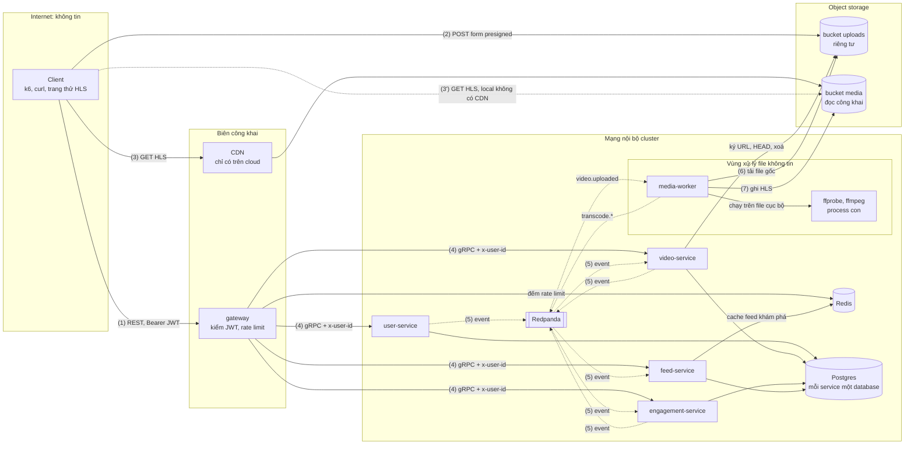

# Threat model (STRIDE, bản nhẹ)

> Trạng thái: giai đoạn 0, viết ngày 2026-10-11 cho thiết kế ở [`architecture.md`](architecture.md) và ADR 0001–0006.
> Cập nhật ngày 2026-10-17 theo giai đoạn 3 (observability, [ADR-0011](adr/0011-observability-stage3.md)): JWT-8, UP-8,
> RL-2, OPS-1, OPS-2, FF-5 và hàng giai đoạn 3 ở [mục 5](#5-tổng-hợp-theo-giai-đoạn).
> Cập nhật ngày 2026-10-19 theo giai đoạn 4 (Kubernetes local trên k3d, [ADR-0014](adr/0014-kubernetes-local-stage4.md)):
> FF-3 tới FF-6, IN-2, IN-4, IN-7, IN-9, RL-1, OPS-2, hàng giai đoạn 4 ở mục 5 và các dòng mới ở
> [mục 6](#6-rủi-ro-chấp-nhận).
> Cập nhật và xét lại ngày 2026-10-21 theo giai đoạn 5 (CI/CD và chuỗi cung ứng,
> [ADR-0015](adr/0015-cicd-devsecops-stage5.md)): FF-8, SC-1, SC-2, SEC-1, SEC-2, JWT-10, bề mặt mới SC-3 tới SC-9 ở
> [4.8](#48-bề-mặt-khác), hàng giai đoạn 5 ở mục 5 và các dòng mới ở mục 6. Phần chạy trên GitHub (workflow, chữ ký thật,
> cài đặt repo) và cluster GitOps ghi "kiểm sau push"; kiểm ngày 2026-10-21, kết quả ở hàng giai đoạn 5 của mục 5. Cùng ngày
> thêm đường nhánh khác `main` vào SC-4, SC-8 và một dòng ở mục 6.
> Cập nhật ngày 2026-10-21 theo giai đoạn 5b (web client, [ADR-0016](adr/0016-web-client.md)): JWT-3, JWT-8, JWT-11, bề
> mặt mới WEB-1 tới WEB-11 ở [4.9](#49-web-client), lớp `refresh` trong bảng loại route ở 4.4, hàng 5b ở mục 5, dòng
> JWT-3 và các dòng mới ở mục 6.
> Cập nhật ngày 2026-10-22 sau khi kiểm phần A của giai đoạn 5b: cách kiểm và ngày ở JWT-3, WEB-1, WEB-2, WEB-4, WEB-6,
> WEB-11; dòng mới WEB-12 (liệt kê tài khoản qua web) và WEB-13 (container `web` ở compose), hàng 5b ở mục 5.
> Cập nhật ngày 2026-10-22 theo thiết kế phần B của giai đoạn 5b ([ADR-0018](adr/0018-web-profiles-public-video-upload.md):
> hồ sơ, danh sách video theo tác giả, route công khai, upload từ trình duyệt): UP-3, PG-1, WEB-10, lớp `public` trong bảng
> loại route ở 4.4, dòng mới WEB-14 tới WEB-19 ở 4.9, hàng 5b ở mục 5 và các dòng mới ở mục 6.
> Cập nhật ngày 2026-10-22 sau khi kiểm phần B: cách kiểm và ngày ở UP-3, PG-1, WEB-10, WEB-14 tới WEB-19, hàng 5b ở
> mục 5.
> Cập nhật ngày 2026-10-22 theo thiết kế phần C của giai đoạn 5b (web trên k3d, image web qua chuỗi cung ứng, quan sát web,
> [ADR-0019](adr/0019-web-k3d-supply-chain-observability.md)): IN-2, IN-7, WEB-1, WEB-5, WEB-7, WEB-8, WEB-9, WEB-13, dòng mới
> WEB-20 tới WEB-24 ở 4.9, hàng 5b ở mục 5 và các dòng mới ở mục 6. Phần chạy ở giai đoạn 7 ghi "kiểm ở giai đoạn 7".
> Cập nhật ngày 2026-10-24 sau khi kiểm phần C trên máy (compose và cluster k3d đường dev): cách kiểm và ngày ở IN-2, WEB-1, WEB-5,
> WEB-6, WEB-9, WEB-10, WEB-13, WEB-20, WEB-21, WEB-24, hàng 5b ở mục 5.
> Cập nhật và xét lại ngày 2026-10-24 theo thiết kế giai đoạn 6 (reliability, [ADR-0020](adr/0020-reliability-stage6.md)): IN-3
> (Istio ambient dời sau giai đoạn 7), tài sản backup ở mục 3, bề mặt mới BAK-1, BAK-2 ở [4.10](#410-backup-và-phục-hồi), RL-7 ở 4.4,
> SC-10 và OPS-4 ở 4.8, hàng giai đoạn 6 và 7 ở mục 5 và các dòng mới ở mục 6. Phần chỉ kiểm được ở buổi k3d, sau push hay trên
> cluster cloud ghi "kiểm sau" kèm tên phép kiểm.
> Cập nhật ngày 2026-10-24 sau buổi k3d giai đoạn 6: BAK-1 (đường mạng thật tới bucket backup; đường leo quyền từ operator
> CloudNativePG sang ServiceAccount của plugin Barman Cloud và cách chặn), hàng giai đoạn 6 ở mục 5, dòng plugin ở mục 6, mục 7.
> Cập nhật ngày 2026-10-24 khi đóng phần local của giai đoạn 6: RL-7, SC-10, OPS-4, BAK-2 đối chiếu với code và cách kiểm đã
> chạy; WEB-7, WEB-8, WEB-13 (ca `drill-k8s-threats` của phần C) đã kiểm ở buổi k3d giai đoạn 6; việc dời "giai đoạn 7" không cần
> dịch vụ cloud (OPS-4, BAK-2 với đích MinIO, `drill-obs-threats` đủ, cluster GitOps với image web đã ký) chuyển sang giai đoạn
> 6b "Kiểm chứng dồn" (runner CI 16 GB hay VM thuê theo giờ); mục 5 thêm hàng 6b.
> Cập nhật ngày 2026-10-24 theo thiết kế giai đoạn 6b (kiểm chứng dồn trên runner GitHub Actions, [ADR-0021](adr/0021-deferred-verification-stage6b.md)): bề mặt
> mới SC-11 (workflow `verify.yml`) và SC-12 (Argo CD đọc repo qua HTTPS ẩn danh) ở 4.8; OPS-4, BAK-2 thêm kiểm soát khi chạy trên
> k3d của runner; hàng 6b ở mục 5, các dòng mới ở mục 6, mục 7. Phần chỉ kiểm được khi chạy ghi "kiểm khi chạy" kèm kịch bản.
> Cập nhật ngày 2026-10-25 sau phần 1 của giai đoạn 6b (lượt `compose-obs`, `dev-k3d` trên runner, mục Kết quả của ADR-0021): kết
> quả của SC-10, SC-11 (thêm lịch hằng tuần trên `main`), OPS-1, WEB-9, WEB-11 (cổng lockfile), RL-2 (điều kiện page mới) và hàng
> 6b ở mục 5; phần GitOps, Chaos Mesh, Velero ghi "phần sau của giai đoạn 6b".
> Cập nhật ngày 2026-10-25 theo phần 2 của giai đoạn 6b (object store local đổi từ MinIO sang RustFS, tên trung tính `s3`,
> [ADR-0022](adr/0022-local-object-store-minio-replacement.md)): tài sản backup ở mục 3, UP-1, UP-5, OPS-1 (7 cổng), WEB-10 (CORS
> theo bucket), WEB-13, BAK-1, BAK-2 (đích ở phần 3), hàng 6b ở mục 5, hai dòng mới ở mục 6 (store trẻ nhiều advisory, health
> không xác thực) và mục 7.
> Cập nhật ngày 2026-10-28 theo phần 3 của giai đoạn 6b (lượt `gitops`, `web-canary`, `k6-cloud-mini`, `velero` trên runner, mục
> "Phần 3 theo dòng dời" của ADR-0021): kết quả của SC-11 (job `gitops`, các kịch bản k3d mới), SC-12 (đã chạy), SC-1 cho web
> (Kyverno từ chối manifest con chưa ký), BAK-2 (đạt trên RustFS), OPS-4, hàng 6b ở mục 5 và mục 7. Cùng ngày, sau đó, thêm kết quả của kịch bản `chaos`
> (OPS-4 đã chạy, SC-11, hàng 6b).
> Cập nhật ngày 2026-10-29 theo phần 3b của giai đoạn 6b (DevSecOps bổ sung, [ADR-0030](adr/0030-devsecops-supplement.md)): dòng
> mới SC-13 (govulncheck) ở 4.8; grype ở SC-1; CodeQL default setup ở SC-3, WEB-1, UP-4, IN-8; DAST Schemathesis ở JWT-1, JWT-3,
> JWT-8, IN-8, WEB-14, gián tiếp ở RL-1, RL-4 và artifact `dast` ở SC-10; target fuzz ở PG-2, JWT-1, JWT-2, JWT-3, JWT-5, JWT-8, RL-1, IN-8, WEB-17,
> WEB-18, FF-6; hàng 6b ở mục 5, dòng job CodeQL ở mục 6, mục 7. Phần chỉ kiểm được trên `main` ghi "kiểm sau push".
> Cập nhật ngày 2026-10-29 sau [ADR-0031](adr/0031-chaos-findings-feed-engagement-tempo.md) (feed-service hai replica, engagement-service
> lỗi nhanh khi Postgres chậm, Tempo tự giới hạn bộ nhớ): thêm lượt chạy lại của OPS-4; ADR-0031 không đổi kiểm soát hay rủi ro nào (thay
> đổi về độ bền, không thêm bề mặt, quyền hay secret). Cùng ngày, mốc push của `measure-gitops` lấy theo `merged_at` của PR promote nên
> job `gitops` của `verify.yml` thêm quyền chỉ đọc `pull-requests: read` (SC-11).
> Cập nhật ngày 2026-10-29 theo phần chuẩn bị của phần 4 giai đoạn 6b: Secret của đường GitOps bằng External Secrets Operator
> ([ADR-0026](adr/0026-secrets-gitops.md)): SEC-3, dòng mới SEC-5, SEC-6, SEC-7 ở 4.7; build provenance
> ([ADR-0027](adr/0027-slsa-build-provenance.md)) ở SC-1; output HLS bất biến ([ADR-0029](adr/0029-immutable-media-versions.md)) ở
> FF-4; hàng 6b ở mục 5, hai dòng mới ở mục 6, mục 7. Phần chỉ kiểm được trên cluster GitOps hay trên `main` ghi "kiểm sau push".
> Cập nhật ngày 2026-10-30 theo phần chuẩn bị ở repo code của phần 4b giai đoạn 6b (web client sang repo `svp-web`,
> [ADR-0033](adr/0033-svp-web-repo.md)): dòng mới SC-14 (hợp đồng API ký), SC-15 (nhiều nguồn phát hành, nguồn chuyển tiếp của
> web), GIT-6 (App thứ hai, luật tác giả PR) ở 4.8; hàng 6b phần 4b ở mục 5, hai dòng mới ở mục 6, mục 7. Phần chỉ kiểm được khi
> `svp-web` có bản phát hành hay trên `main` ghi "kiểm sau push".
> Cập nhật ngày 2026-10-31 theo phần cắt (repo code bỏ `web/`): đường file của WEB-* là của `svp-web` ([4.9](#49-web-client)),
> kết quả sau push của SC-14, SC-15, GIT-6 và hàng 6b phần 4b ở mục 5.
> Cập nhật ngày 2026-10-31 theo [ADR-0035](adr/0035-renovate-automerge.md) (Renovate tự merge bản `patch`, `digest` ở repo code và
> `svp-web`): SC-8 lên ưu tiên Cao, hàng 6b phần 4b ở mục 5, dòng mới ở mục 6, mục 7.
> Cập nhật ngày 2026-10-31 theo đổi tên repo ([ADR-0036](adr/0036-repo-rename.md): `short-video-platform` → `svp-backend`, `svp-web` →
> `svp-frontend`; tên repo ở các dòng dưới là tên mới): SC-12 (URL repo chart), SC-15 (bảng bốn nguồn, nguồn nghỉ hưu), GIT-6 (tiếp
> quản từ nguồn nghỉ hưu), dòng mới ở mục 6.
> Cập nhật ngày 2026-11-01 theo việc gỡ hai nguồn nghỉ hưu `oldbackend`, `oldweb` ([ADR-0036](adr/0036-repo-rename.md) §4 bước 8):
> SC-15, GIT-6, dòng ở mục 6.
> Cập nhật ngày 2026-11-01 theo [ADR-0037](adr/0037-mainpath-standard-tools.md) (promote bằng bước Actions, bỏ bản ghi stg, check `svp-gitops` rút gọn):
> GIT-1, GIT-2 (bỏ), GIT-4, GIT-5, GIT-6 (luật tác giả hẹp), SC-15, hai dòng ở mục 6, mục 7.
> Cập nhật ngày 2026-10-31 theo thiết kế giai đoạn 7 (biến thể AWS, [ADR-0034](adr/0034-aws-stage7.md)): RL-1 (một hop qua NLB L4),
> bề mặt mới AWS-1 tới AWS-7 ở [4.11](#411-biên-aws-giai-đoạn-7), hàng giai đoạn 7 ở mục 5, một dòng ở mục 6. Phần chỉ kiểm được trên
> AWS ghi "kiểm ở buổi AWS".
> Xét lại ở giai đoạn 9 (review bảo mật).

## 1. Phạm vi và cách làm

**STRIDE** là sáu loại mối đe doạ, mỗi loại ứng với một tính chất cần giữ:

| Chữ | Loại | Tính chất bị phá | Ví dụ trong hệ thống này |
| --- | --- | --- | --- |
| S | Spoofing: giả danh | Xác thực | Tự ký JWT, tự đặt `x-user-id` khi gọi thẳng gRPC |
| T | Tampering: sửa dữ liệu | Toàn vẹn | Thay file gốc sau khi đã `CompleteUpload`, phát event giả |
| R | Repudiation: chối bỏ | Truy vết được | Không có log nào cho biết ai đã upload một video |
| I | Information disclosure: lộ thông tin | Bí mật | Email trong log, dò email đã đăng ký |
| D | Denial of service: làm ngừng dịch vụ | Sẵn sàng | File video "bom" làm treo worker, spam đăng nhập |
| E | Elevation of privilege: leo quyền | Phân quyền | Khai thác lỗi ffmpeg để lấy credential của worker |

**"Nhẹ" nghĩa là:** xét theo **bề mặt** (chỗ dữ liệu đi qua một ranh giới tin cậy), không xét từng hàm; mỗi bề mặt liệt kê
các mối đe doạ thấy rõ, biện pháp, giai đoạn sẽ làm và mức ưu tiên. Không chấm điểm định lượng (DREAD, CVSS).

**Cách đọc bảng:**

- **GĐ:** giai đoạn trong [plan](../plans/261004-devops-sa-roadmap/plan.md) sẽ viết code hoặc cấu hình cho biện pháp đó.
  Biện pháp đã có trong thiết kế vẫn ghi giai đoạn hiện thực nó, không ghi 0. Nhiều số nghĩa là làm dần qua các giai đoạn.
- **Ưu tiên:** **Cao** = khai thác dễ, hoặc hậu quả là chiếm tài khoản, lộ dữ liệu cá nhân, chạy code lạ; phải có trước khi
  hệ thống nhận request từ internet (giai đoạn 7). **Vừa** = cần làm nhưng hậu quả có giới hạn. **Thấp** = phòng thêm.
- Dòng ghi **Chấp nhận** là rủi ro không xử lý (hoặc chỉ giảm bớt); lý do và lúc xem lại ở [mục 6](#6-rủi-ro-chấp-nhận).
- Câu "vì sao" của các biện pháp quan trọng nằm ngay dưới mỗi bảng.

## 2. Luồng dữ liệu và ranh giới tin cậy

Dựa trên C4 container ([architecture §5](architecture.md)). Mỗi `subgraph` là một vùng tin cậy; mũi tên đi qua viền
vùng là chỗ phải kiểm.

| Chỗ vượt ranh giới | Ai bên kia | Kiểm ở đâu |
| --- | --- | --- |
| (1) Internet → gateway | Bất kỳ ai | gateway: JWT, rate limit, giới hạn kích thước và thời gian request ([4.1](#41-jwt-và-đăng-nhập), [4.4](#44-rate-limit-ở-gateway)) |
| (2) Internet → bucket `uploads` | Ai đang giữ form presigned | Chính storage, theo policy đã ký ([4.2](#42-presigned-post-và-bucket)) |
| (3) Internet → bucket `media` | Bất kỳ ai | Không kiểm: nội dung công khai, chỉ cho đọc từng object ([4.2](#42-presigned-post-và-bucket)) |
| (4) gateway → service | Hiện tại: mọi thứ vào được mạng nội bộ | `x-user-id` do gateway đặt; NetworkPolicy, mTLS ([4.5](#45-mức-tin-cậy-giữa-các-service)) |
| (5) Service ↔ Redpanda | Hiện tại: mọi thứ vào được mạng nội bộ | ACL theo service; consumer kiểm event ([4.5](#45-mức-tin-cậy-giữa-các-service)) |
| (6), (7) File người dùng → ffmpeg | Nội dung do người dùng tạo | ffprobe, giới hạn định dạng, giao thức, tài nguyên, quyền ([4.3](#43-ffmpeg-đọc-file-người-dùng)) |

## 3. Tài sản cần bảo vệ

| Tài sản | Nằm ở đâu | Tính chất cần giữ | Mất thì sao |
| --- | --- | --- | --- |
| **Khoá ký JWT** (khoá riêng) | Chỉ user-service | Bí mật | Ai có khoá là ký được token của **mọi** người dùng. Tài sản giá trị nhất |
| Hash mật khẩu và email (dữ liệu cá nhân) | `svp_user` | Bí mật | Lộ email là lộ dữ liệu cá nhân; hash bị bẻ offline nếu thuật toán yếu |
| Credential của service (database, object storage, Redpanda) | Biến môi trường, sau là secret store | Bí mật | Mở đường đi tắt qua mọi kiểm tra của API |
| File gốc trong `uploads` | Object storage | Bí mật, toàn vẹn | File chưa phát hành, có thể chứa metadata riêng (vị trí GPS, thiết bị) |
| Bản HLS trong `media` | Object storage, CDN | Toàn vẹn | Công khai theo thiết kế; bị ghi đè là video của người khác bị thay |
| Bộ đếm lượt xem, like | `svp_engagement` | Toàn vẹn | Số sai làm sai mọi thứ xếp hạng dựa trên nó về sau |
| Tính sẵn sàng của feed và upload | gateway, feed-service, video-service | Sẵn sàng | Vi phạm SLO 99,9% ([architecture §2](architecture.md)) |
| Backup Postgres (backup cơ sở và WAL của mọi database) | Bucket `pg-backups` của object store trong cluster k3d (MinIO ở giai đoạn 6, RustFS từ giai đoạn 6b); backup của RDS (giai đoạn 7) | Bí mật, toàn vẹn, sẵn sàng | Bản sao của mọi dữ liệu trên, cả hash mật khẩu và email; mất hay bị sửa thì không phục hồi được |

## 4. Mối đe doạ theo bề mặt

### 4.1 JWT và đăng nhập

**Lựa chọn (quyết định của threat model):**

- **Thuật toán ký: EdDSA với Ed25519** (`alg: "EdDSA"`). user-service giữ khoá riêng, gateway chỉ có khoá công khai
  ([architecture §7.4](architecture.md)).
  - Không chọn **HS256**: khoá đối xứng, bên nào kiểm được token thì cũng ký được token, nên gateway (bề mặt lộ ra internet
    nhiều nhất) sẽ giữ quyền ký cho mọi người dùng.
  - Không chọn **RS256**: chạy được, nhưng chữ ký 2048 bit dài 256 byte làm token phình, ký chậm hơn hẳn.
  - **ES256** là lựa chọn dự phòng, nhưng ECDSA cần số ngẫu nhiên tốt cho từng chữ ký (dùng lại nonce là lộ khoá riêng,
    một lớp lỗi kinh điển). Ed25519 có chữ ký tất định nên không có lớp lỗi đó, khoá 32 byte, chữ ký 64 byte, chỉ có một
    đường cong nên không có tham số để chọn sai, và có sẵn trong thư viện chuẩn Go (`crypto/ed25519`). Nếu về sau phải ký
    bằng dịch vụ quản lý khoá trên cloud mà dịch vụ đó không hỗ trợ Ed25519 thì đổi sang ES256: chỉ đổi cấu hình hai đầu,
    không đổi contract.
- **Claim:** `iss = "svp-user"`, `aud = "svp-api"`, `sub = user_id`, `iat`, `exp`, `jti` (UUIDv7, chưa dùng, để dành cho
  danh sách thu hồi). Header có `kid` để đổi khoá không gián đoạn. **Không** đặt email hay dữ liệu cá nhân vào token.
- **Thời hạn: 1 giờ**, lệch đồng hồ cho phép 30 giây. MVP không có refresh token
  ([ADR-0006](adr/0006-contract-ids-and-event-envelope.md)): hạn ngắn hơn (15 phút) buộc client gửi lại mật khẩu
  thường hơn, tức thêm tải hash và thêm lần mật khẩu đi trên đường truyền; hạn dài hơn kéo dài thời gian một token bị lộ còn
  dùng được. 1 giờ đủ cho một lượt k6 bình thường; bài soak dài hơn thì k6 đăng nhập lại. Từ giai đoạn 5b có refresh token
  ([ADR-0016](adr/0016-web-client.md) §2): access token vẫn 1 giờ, client đổi refresh token lấy access token mới thay vì
  gửi lại mật khẩu.
- **Hash mật khẩu: argon2id**, chuỗi lưu theo định dạng PHC (gồm tham số và salt 16 byte ngẫu nhiên riêng từng người), tham
  số theo khuyến nghị OWASP hiện hành và đo thời gian hash trên máy ở giai đoạn 1. Không chọn bcrypt dù cũng chấp nhận được:
  bcrypt chỉ dùng 72 byte đầu của mật khẩu và không tốn bộ nhớ, nên bẻ bằng GPU rẻ hơn; argon2id tốn cả CPU lẫn RAM theo tham
  số chỉnh được. Cái giá: thêm dependency `golang.org/x/crypto` (ghi lý do khi thêm ở giai đoạn 1), và mỗi lần hash ngốn vài
  chục MiB RAM (xem JWT-9).

| ID | Thành phần | STRIDE | Kịch bản | Biện pháp | GĐ | Ưu tiên |
| --- | --- | --- | --- | --- | --- | --- |
| JWT-1 | gateway kiểm JWT | S, E | Token có `alg: none`, hoặc `alg: HS256` dùng chính khoá công khai làm khoá HMAC (nhầm thuật toán): gateway chấp nhận token tự ký, kẻ tấn công thành người dùng bất kỳ | Gateway chỉ chấp nhận đúng `EdDSA`, khoá lấy theo `kid` từ cấu hình cục bộ, `kid` lạ thì từ chối; bỏ qua `jku`, `x5u`, `jwk` trong header; test cho từng kiểu token giả. Giai đoạn 6b ([ADR-0030](adr/0030-devsecops-supplement.md) §2, §3): fuzz `FuzzVerify` (qua được thì đúng ba đoạn, `alg` `EdDSA`, `kid` đã cấu hình và `ed25519.Verify` đúng; seed `alg: none`, HS256 ký bằng khoá công khai, khoá khác, `kid` lạ, `jku`/`jwk`) và `FuzzRequireAuth`; Schemathesis `ignored_auth` ở job `stack`: mọi operation có `security: bearerAuth` phải trả 401 khi không token hay token sai **Đã kiểm 2026-10-29:** seed trong `make test`, `make fuzz FUZZTIME=60s` không tìm ra lỗi; job `stack` của PR #28 ([40804508919](https://github.com/anhnvcoder/svp-backend/actions/runs/40804508919)) 0 lỗi | 1 | Cao |
| JWT-2 | gateway kiểm JWT | S | Token đúng chữ ký nhưng hết hạn, hoặc của hệ thống khác dùng chung khoá (`iss`/`aud` khác) | Bắt buộc có và kiểm `exp`, `iss`, `aud`; thiếu claim là từ chối. Giai đoạn 6b ([ADR-0030](adr/0030-devsecops-supplement.md) §2): fuzz `FuzzVerify`, seed thiếu `exp`, sai `iss`/`aud` **Đã kiểm 2026-10-29:** seed trong `make test`, `make fuzz FUZZTIME=60s` không tìm ra lỗi | 1 | Cao |
| JWT-3 | Token đã cấp | S | Token bị lộ (log, máy người dùng) còn dùng được tới hết hạn; đổi mật khẩu hay đăng xuất không làm token cũ mất hiệu lực | Hạn 1 giờ; token chỉ đi trong header `Authorization`, không bao giờ trong query string. Giai đoạn 5b ([ADR-0016](adr/0016-web-client.md) §2): refresh token xoay mỗi lần dùng, trình lại token đã dùng thì thu hồi cả họ, logout thu hồi cả họ, nên đăng xuất cắt được phiên; web giữ token ở server (BFF), không bao giờ ở trình duyệt. Access token đã cấp vẫn sống tới hết 1 giờ (chưa có danh sách thu hồi theo `jti`): **chấp nhận** phần đó **Đã kiểm 2026-10-22:** test integration của user-service (xoay, dùng lại token cũ thì token mới nhất của họ cũng bị từ chối, refresh song song, logout), `make smoke` (refresh 200, dùng lại → 401 `INVALID_REFRESH_TOKEN` cho cả token mới nhất, logout 204 hai lần, refresh sau logout 401), e2e WEB-6 (sau logout cookie cũ → 401). Giai đoạn 6b ([ADR-0030](adr/0030-devsecops-supplement.md) §2, §3): fuzz `FuzzRequireAuth` (handler chỉ chạy khi có đúng một header `Authorization`, scheme `Bearer` và token qua `FuzzVerify`; còn lại 401, `WWW-Authenticate: Bearer`, cùng một `detail`), Schemathesis `ignored_auth` ở job `stack` **Đã kiểm 2026-10-29:** seed trong `make test`, `make fuzz FUZZTIME=60s` không tìm ra lỗi | 1, 5b; chấp nhận, xem lại ở 9 | Vừa |
| JWT-4 | `Login` | S | Dò mật khẩu: thử hàng loạt mật khẩu cho một email, hoặc một mật khẩu phổ biến cho nhiều email | Rate limit theo IP và theo cặp (IP, email) ở route login; **không** khoá tài khoản sau N lần sai | 2 | Cao |
| JWT-5 | `Login` | I | Phân biệt "email không tồn tại" với "sai mật khẩu" qua message hoặc qua thời gian phản hồi | Hai trường hợp cùng `UNAUTHENTICATED`, cùng `reason` `INVALID_CREDENTIALS`, cùng message ([ADR-0006](adr/0006-contract-ids-and-event-envelope.md), `proto/svp/user/v1/user_service.proto`); email không tồn tại vẫn chạy so hash với một hash giả để thời gian như nhau. Giai đoạn 6b ([ADR-0030](adr/0030-devsecops-supplement.md) §2): fuzz `FuzzEmail` (email chuẩn hoá luỹ đẳng, chữ thường, không khoảng trắng đầu cuối, đúng một địa chỉ không tên), nên một email không có hai dạng lưu | 1 | Vừa |
| JWT-6 | `Register` | I | Gọi `Register` với email người khác, nhận `ALREADY_EXISTS` là biết email đó có tài khoản | Rate limit theo IP ở route register. **Chấp nhận** ở MVP | 2; chấp nhận | Thấp |
| JWT-7 | `svp_user` | I | Database bị lộ (backup, SQL injection): bẻ hash offline | argon2id có salt riêng; lưu tham số trong chuỗi hash để tăng tham số về sau mà không bắt mọi người đổi mật khẩu (hash lại lúc đăng nhập); mọi câu SQL tham số hoá qua `sqlc` | 1 | Cao |
| JWT-8 | Log, trace, tracker lỗi (GlitchTip, giao thức Sentry) | I | Mật khẩu, token, email bị ghi vào log, attribute của span hay báo lỗi gửi tracker | Log `user_id` thay cho email; kiểu riêng cho mật khẩu và token tự che giá trị khi log; access log không ghi header `Authorization`. Giai đoạn 3 ([ADR-0011](adr/0011-observability-stage3.md) §2, §4, §7): span HTTP không có header, thân hay query; span SQL không có tham số, lỗi Postgres trong span chỉ còn mức và SQLSTATE; span Redis không có lệnh, khoá; span consumer chỉ ghi kiểu lỗi và mã an toàn. Collector xoá `http.request.header.authorization`, `http.request.header.cookie`, `user.email`, `user.name` ở cả attribute và resource (lớp phụ). Tracker chỉ nhận bản ghi ERROR: message hằng trong danh sách cho phép, attribute trong danh sách cho phép, exception chỉ kiểu lỗi và mã an toàn (không `err.Error()`), bỏ `Request`, user chỉ `id`; regex che email và JWT là lớp phụ; tracker chạy local, đổi sang Sentry SaaS chỉ bằng DSN và vẫn giữ các lớp này. Giai đoạn 5b ([ADR-0016](adr/0016-web-client.md) §2, §4): refresh token thô chỉ sống trong `secret.String`, không vào log, span, problem; database chỉ giữ SHA-256; log ghi `token_id`, `family_id`, `user_id`; web không log token, sid hay cookie. Giai đoạn 6b ([ADR-0030](adr/0030-devsecops-supplement.md) §2, §3): fuzz `FuzzEmail`; báo cáo DAST công bố (`report.json`, `summary.json`) và log bước `dast` dò JWT, token, cookie, chữ ký presigned và chính token của lượt trước khi in hay tải (SC-10) | 1, 3, 5b | Cao |
| JWT-9 | user-service | D | Spam đăng nhập: mỗi lần hash argon2id tốn vài chục MiB, vài trăm request cùng lúc làm user-service hết RAM | Rate limit login (JWT-4); giới hạn số phép hash chạy cùng lúc bằng semaphore (bulkhead), quá thì trả `RESOURCE_EXHAUSTED`; giới hạn độ dài mật khẩu (8–128 ký tự) | 1, 2 | Vừa |
| JWT-10 | Khoá ký JWT | I, E | Khoá riêng lộ (commit nhầm, nằm trong image, log): ký được token cho mọi người | Xem [4.7](#47-bí-mật): chỉ user-service đọc được; đổi khoá theo `kid` (gateway giữ cùng lúc khoá cũ và mới trong lúc chuyển). Giai đoạn 5: khoá bị commit thì gitleaks toàn lịch sử của CI làm PR đỏ (SEC-1), file khoá chép vào image thì trivy chặn trước push (SEC-2); khoá nhúng vào binary Go chỉ gitleaks bắt được, ở mã nguồn | 1, 5, 7 | Cao |
| JWT-11 | Refresh token | S | Refresh token bị lộ (đọc được Redis giữ session web, database, log) hay bị dùng lại: kẻ cắp tự đổi lấy access token mới tới hết hạn của họ | Token mờ 32 byte ngẫu nhiên, database chỉ lưu SHA-256; token chỉ ở user-service, gateway (chuyển qua) và BFF/Redis, không bao giờ ở trình duyệt; xoay mỗi lần dùng, trình lại token đã dùng thì thu hồi cả họ, kể cả token vừa cấp; mọi thao tác trên một họ chạy dưới khoá theo họ, nên refresh song song với logout hay với việc dùng lại token tổ tiên không sinh token con sống sót; mọi ca lỗi cùng `INVALID_REFRESH_TOKEN`, cùng message; 14 ngày trượt, trần 30 ngày; logout thu hồi họ; rate limit `refresh` theo IP. Kẻ cắp dùng trước mà client thật không quay lại thì không phát hiện được tới hết trần 30 ngày: **chấp nhận** | 5b | Cao |

**Vì sao:**

- **JWT-1:** chữ ký chỉ có nghĩa khi bên kiểm tự quyết thuật toán. Nếu gateway đọc `alg` từ chính token rồi làm theo, kẻ tấn
  công chọn `none` (không cần chữ ký) hoặc `HS256` với khoá công khai (vốn ai cũng có) làm khoá bí mật. Đây là lỗi thật đã
  xảy ra ở nhiều thư viện JWT; cách chặn duy nhất là cấu hình cứng một thuật toán ở bên kiểm.
- **JWT-4, không khoá tài khoản:** khoá tài khoản sau N lần sai biến chống dò mật khẩu thành công cụ DoS: ai biết email
  của bạn là khoá được bạn khỏi tài khoản. Rate limit theo (IP, email) chặn dò một tài khoản mà không chặn chủ thật đăng nhập
  từ IP khác.
- **JWT-5, so hash giả:** nếu email không tồn tại mà trả lời ngay, còn email có thật mất thêm thời gian hash, thì đo thời gian
  phản hồi là biết email nào đã đăng ký, dù message giống nhau.
- **JWT-8, không đặt email vào token:** JWT chỉ được ký, không được mã hoá; phần payload là base64, ai cầm token cũng đọc
  được.
- **JWT-11, thu hồi cả họ khi dùng lại:** khi một refresh token đã dùng bị trình lại, user-service không biết ai là client
  thật, ai là kẻ cắp (RFC 9700 §4.14.2). Thu hồi cả họ cắt cả hai; client thật đăng nhập lại là xong, kẻ cắp thì mất quyền.
  Cái giá là hai request refresh song song của chính client thật cũng bị coi là dùng lại, nên BFF phải gửi mỗi lúc một
  request refresh cho mỗi phiên, và không có cửa sổ chồng để bù ([ADR-0016](adr/0016-web-client.md) §2, §5).

### 4.2 Presigned POST và bucket

Thiết kế ở [ADR-0004](adr/0004-direct-upload-and-hls.md): video-service ký form POST cho key cố định `uploads/<video_id>`,
policy ép `content-length-range` tối đa 500 MB và content type, hết hạn sau 15 phút; `CompleteUpload` thì `HEAD` kiểm lại.

| ID | Thành phần | STRIDE | Kịch bản | Biện pháp | GĐ | Ưu tiên |
| --- | --- | --- | --- | --- | --- | --- |
| UP-1 | Form presigned | T, D | Client sửa form để ghi vào key khác (đè file người khác), gửi file vượt 500 MB, hoặc đổi content type | Policy ký điều kiện **khớp chính xác** key `uploads/<video_id>`, `content-length-range` [1, `size` đã khai], `Content-Type` đúng giá trị đã khai; storage tự từ chối nếu sai. Từ giai đoạn 6b (RustFS, [ADR-0022](adr/0022-local-object-store-minio-replacement.md)) test tích hợp kiểm thêm form có policy sửa sau khi ký (nới `content-length-range`, đổi key) và form không có trường chữ ký; RustFS từ chối form đổi key hay bucket bằng 400 `InvalidPolicyDocument` (MinIO, S3: 403), nên test đòi một mã 4xx và không object nào được ghi, không đòi mã riêng của store. **Đã kiểm 2026-10-25** trên RustFS: `make test-stack PKGS=./internal/objstore/...` trên máy và trên runner (`compose-obs` [40203123781](https://github.com/anhnvcoder/svp-backend/actions/runs/40203123781)), 39 PASS, 0 SKIP | 2 | Cao |
| UP-2 | Form presigned | T | Form lộ (log proxy, máy người dùng): trong 15 phút ai cũng gửi được file vào key đó, kể cả **sau** khi tác giả đã `CompleteUpload`, nên file worker đọc có thể khác file đã `HEAD` | Hạn 15 phút; không log URL và field của form; `CompleteUpload` chỉ chuyển trạng thái từ `UPLOADING`. Phần còn lại **chấp nhận** (xem đề xuất ở [mục 7](#7-đề-xuất-xem-lại)) | 2; chấp nhận | Thấp |
| UP-3 | `CompleteUpload`, `GetVideo`, `ListAuthorVideos`, `GetPublicVideo` | S, I | Người dùng A gọi `CompleteUpload` hoặc `GetVideo` với `video_id` của B; từ 5b, A xem danh sách video của B, hay khách đọc video qua route công khai, để thấy video chưa `READY` của B | video-service so `x-user-id` với `author_id`: `CompleteUpload` của người khác bị từ chối; `GetVideo` video chưa `READY` mà không phải tác giả thì `NOT_FOUND` ([ADR-0006](adr/0006-contract-ids-and-event-envelope.md), `proto/svp/video/v1/video_service.proto`). Giai đoạn 5b phần B ([ADR-0018](adr/0018-web-profiles-public-video-upload.md) §4, §6): `ListAuthorVideos` trả video chưa `READY` chỉ khi caller là tác giả, lọc theo caller chứ không theo cursor; `GetPublicVideo` không có caller nên chỉ trả `READY`, mọi ca khác cùng `VIDEO_NOT_FOUND` (WEB-14) **Đã kiểm 2026-10-22** (phần B): test video-service (danh sách của người khác chỉ `READY` qua nhiều trang, kể cả khi dùng cursor của tác giả; `GetPublicVideo` không caller hay caller rác → `NOT_FOUND`); `make smoke` (`GET /me/videos` thấy video `UPLOADING` của mình, danh sách của người khác chỉ `READY`, `GET /public/videos/{id}` 404 với video `UPLOADING`); e2e `/v/{id}` của video chưa `READY` → cùng 404 với id ngẫu nhiên | 1, 2, 5b (B) | Cao |
| UP-4 | Credential ký URL | E | Lỗi trong code ký (key ghép từ input) sinh được form ghi vào `media/` hoặc key tuỳ ý | Form presigned mang quyền của credential đã ký nó: credential của video-service chỉ được `PutObject` dưới `uploads/*`, đọc `HEAD`, và xoá (dọn upload bỏ dở, video `FAILED`); key luôn ghép từ `video_id` do server sinh. Giai đoạn 6b ([ADR-0030](adr/0030-devsecops-supplement.md) §4): CodeQL default setup (`go`, chỉ báo) theo luồng dữ liệu từ input tới key | 2, 7 | Vừa |
| UP-5 | Bucket `uploads` | I | Bucket để lộ công khai, file chưa phát hành bị tải về | Bucket riêng tư, chặn truy cập công khai ở mức bucket; object store local (RustFS từ giai đoạn 6b, trước là MinIO) tạo user riêng cho từng service với policy theo bucket và tiền tố, không dùng tài khoản root trong service (root chỉ ở container store và job init `s3-init`). **Đã kiểm 2026-10-25** trên RustFS: `make smoke` (đọc ẩn danh `uploads` 403) trên máy và ở job `stack` ([40203127200](https://github.com/anhnvcoder/svp-backend/actions/runs/40203127200)), `TestIntegrationWorkerPermissions`, `TestIntegrationVideoServicePermissions` của `make test-stack` | 2, 7 | Cao |
| UP-6 | Bucket `media` | I | Ai có link đều xem được video; cho phép `ListBucket` thì liệt kê được mọi video, kể cả bản HLS ghi dở của video chưa `READY` hoặc `FAILED` | Đọc công khai là **chấp nhận** (nền tảng công khai, chưa có video riêng tư hay xoá video). Chỉ mở đọc từng object, **không** mở liệt kê; trên cloud chỉ CDN đọc được bucket; video `FAILED` bị dọn file (ADR-0004) | 2, 7; chấp nhận | Vừa |
| UP-7 | `InitUpload` | D | Một tài khoản gọi `InitUpload` liên tục, mỗi lần được quyền đẩy 500 MB: đầy storage, tốn tiền | Rate limit theo user ở route init upload; mỗi user tối đa vài video `UPLOADING` cùng lúc; job dọn upload bỏ dở quá 1 giờ (ADR-0004) | 2 | Vừa |
| UP-8 | Upload | R | Video vi phạm được đưa lên, không ai biết ai upload | `author_id` gắn với video từ `InitUpload`; log có cấu trúc ghi `user_id`, `video_id`, `trace_id` ở `InitUpload`, `CompleteUpload` (video-service `video created`, `upload completed`); access log của gateway cùng `trace_id` ghi `user_id`. Giai đoạn 3: log đi OTLP vào Loki, tra theo `trace_id` | 1, 3 | Thấp |

**Vì sao:**

- **UP-1:** giới hạn phải nằm ở chỗ nhận file. Kiểm `size` ở `InitUpload` chỉ là kiểm con số client khai; chính policy đã ký
  mới buộc storage từ chối byte thứ 500 MB + 1. Content type trong policy chỉ giữ metadata nhất quán, **không** chứng minh
  file là video: nội dung thật chỉ được kiểm ở worker bằng `ffprobe` (FF-1).
- **UP-4:** URL presigned không có quyền riêng, nó mượn quyền của credential đã ký. Credential có quyền ghi cả bucket thì một
  lỗi ghép key là đủ để ghi đè video công khai của người khác.
- **UP-6, không mở liệt kê:** đọc công khai từng object chỉ lộ video mà người xem đã biết `video_id`; mở liệt kê thì lộ toàn bộ,
  kể cả thứ chưa phát hành.

### 4.3 ffmpeg đọc file người dùng

Bề mặt tấn công lớn nhất ([ADR-0004](adr/0004-direct-upload-and-hls.md)): một chương trình C rất lớn, hàng trăm demuxer và
decoder, chạy trên byte do người lạ chọn. Coi như **sẽ có** lỗi bị khai thác; thiết kế để khi đó thiệt hại nhỏ nhất.

| ID | Thành phần | STRIDE | Kịch bản | Biện pháp | GĐ | Ưu tiên |
| --- | --- | --- | --- | --- | --- | --- |
| FF-1 | ffprobe, ffmpeg | E | File được dựng để khai thác lỗi bộ nhớ trong demuxer hoặc decoder ít dùng, chạy code trong container worker | `ffprobe` (cũng chạy trong vùng cô lập) kiểm trước: chỉ nhận container MP4/MOV, WebM/Matroska và codec trong danh sách; ffmpeg chỉ mở demuxer và decoder trong danh sách (tuỳ chọn whitelist định dạng và codec của ffmpeg, tên chính xác kiểm ở giai đoạn 2); file khác thì `transcode.failed` | 2 | Cao |
| FF-2 | ffmpeg | I, S | File là playlist hoặc định dạng tham chiếu tới file/URL khác (HLS, concat và họ hàng): ffmpeg đọc file cục bộ (vd. `/proc/self/environ` chứa credential) hoặc gọi URL nội bộ (SSRF), rồi **nhúng nội dung vào video đầu ra** vốn công khai | Worker tải file gốc về file tạm rồi chạy ffmpeg trên đường dẫn cục bộ, chỉ mở giao thức `file` (whitelist giao thức); các demuxer playlist/tham chiếu không có trong whitelist ở FF-1; ffmpeg chạy với biến môi trường rỗng | 2 | Cao |
| FF-3 | ffmpeg | D | "Bom" tài nguyên: độ phân giải khổng lồ, thời lượng dài hơn 3 phút trong file nhỏ, frame rate hay số stream bất thường; worker treo hoặc hết RAM, hàng chờ nghẽn, SLO 2 phút vỡ cho mọi người | `ffprobe` kiểm cạnh dài, thời lượng ≤ 180 s (có dung sai), frame rate, số stream; ffmpeg vẫn ép `-t` vì metadata thời lượng có thể nói dối; timeout thời gian thực cho cả job (`exec.CommandContext`); giới hạn CPU/RAM của container (compose ở 2; k3d ở 4: media-worker `limits` 2 CPU / 2 GiB, mọi container của project có `requests`/`limits`, kubelet `pod-max-pids=512` cho mọi pod thay `pids_limit` của compose, [ADR-0014](adr/0014-kubernetes-local-stage4.md) §2, §10) | 2, 4 | Cao |
| FF-4 | Container worker | E | Đã chạy được code trong worker (FF-1): đọc credential, lấn sang node, gọi service khác | Chạy không phải root, root filesystem chỉ đọc (thư mục tạm riêng), bỏ mọi capability, cấm leo quyền, seccomp mặc định; credential object storage chỉ đọc `uploads/*`, ghi `media/*`, từ giai đoạn 6b ([ADR-0029](adr/0029-immutable-media-versions.md)) thêm đọc `media/media/*` và liệt kê bucket `media` chỉ theo tiền tố `media/*` (kiểm master của version, đọc lại playlist), vẫn không xoá; output đã công khai không bị ghi lại vì mỗi lần thử ghi thư mục riêng và master chỉ tạo một lần bằng `If-None-Match: *`; không gọi gRPC, không có Postgres hay Redis. k3d: namespace `svp` enforce PSA `restricted` v1.36 (API server từ chối pod chạy root, privileged, có hostPath hay host namespace), không mount token ServiceAccount, user Kafka riêng có ACL (IN-4) | 2, 4 | Cao |
| FF-5 | Mạng của worker | E, I | Code lạ trong worker quét mạng nội bộ, gọi gRPC giả `x-user-id`, gửi dữ liệu ra internet | NetworkPolicy egress: worker chỉ tới object storage, Redpanda, Collector telemetry và DNS; trên cloud object storage nằm ngoài cluster nên chặn theo VPC endpoint hoặc dải địa chỉ. Compose (giai đoạn 3, [ADR-0011](adr/0011-observability-stage3.md) §1, §7): mạng `worker` internal, không route ra ngoài, chỉ có Redpanda, object store (`s3`) và Collector `otelcol` (nhận OTLP gRPC ở 4317, không làm proxy hay router); worker không gửi lỗi tới GlitchTip, không đẩy profile. k3d (giai đoạn 4, [ADR-0014](adr/0014-kubernetes-local-stage4.md) §3): NetworkPolicy `default-deny` hai chiều ở `svp`, egress của media-worker chỉ tới object store (`s3`) 9000, Redpanda 9092, Collector 4317 và DNS, không pod nào vào được worker. Rule NetworkPolicy của kube-router chỉ chặn kết nối mới, kết nối mở trước khi siết policy vẫn đi tiếp (thấy ở diễn tập canary chặn Prometheus): siết policy trên pod đang chạy thì restart pod đó. **Giai đoạn 7, chốt 2026-10-31** ([ADR-0034](adr/0034-aws-stage7.md) §10): trên EKS egress S3 của media-worker và video-service theo dải địa chỉ, TCP 443 tới từng dải S3 AWS công bố cho region của cluster (khoá `s3Cidrs` của `cluster.*`, đọc lúc `apply` Terraform), cộng agent Pod Identity `169.254.170.23/32` TCP 80, không bao giờ `0.0.0.0/0`; S3 đi qua gateway endpoint của VPC, **chưa có endpoint policy**. Rủi ro còn lại, **chấp nhận ở stg** (mục 6): NetworkPolicy theo địa chỉ không phân biệt bucket, nên worker đã bị chiếm (FF-1, qua được FF-4) vẫn gọi được mọi bucket S3 của region: chép file gốc của `uploads` (role của nó đọc được) sang một bucket lạ nhận ghi (bucket của kẻ tấn công với credential của họ, hay bucket ghi công khai). Điều kiện đóng, việc trước prd: endpoint policy của gateway endpoint chỉ cho bucket `uploads`, `media` của env cộng bucket layer ECR của region (node kéo image addon của EKS qua đó), kiểm trong một buổi stg (dựng đủ, smoke qua) rồi áp cho prd | 3, 4, 7; S3 theo bucket chấp nhận ở stg | Cao |
| FF-6 | Worker → Redpanda | T | Worker bị chiếm phát `transcode.completed` giả cho video khác, trỏ playlist tới key tuỳ ý | video-service chỉ nhận `transcode.*` cho video đang `PROCESSING`, chỉ chấp nhận key nằm dưới `media/<video_id>/`; ACL Redpanda (IN-4): ở k3d user `svp-media-worker` chỉ ghi `media.transcodes.v1` và `video.lifecycle.v1.dlq`, ghi `video.lifecycle.v1` hay `user.follows.v1` bị broker từ chối; compose không có ACL. Giai đoạn 6b ([ADR-0030](adr/0030-devsecops-supplement.md) §2): fuzz `FuzzIsMediaKey` (key được nhận khi và chỉ khi nằm dưới `media/<video_id>/`, mỗi đoạn chỉ `[A-Za-z0-9._-]`, không đoạn `.` hay `..`, đã ở dạng `path.Clean`) **Đã kiểm 2026-10-29:** seed trong `make test`, `make fuzz FUZZTIME=60s` không tìm ra lỗi | 2, 4 | Vừa |
| FF-7 | Bản HLS | I | Metadata của file gốc (vị trí GPS, thiết bị, tên người quay) bị chép sang bản HLS công khai | Bỏ metadata khi transcode (`-map_metadata -1`); luôn mã hoá lại, không chép thẳng stream (`-c copy`) từ file gốc | 2 | Vừa |
| FF-8 | Image ffmpeg | E | Bản ffmpeg trong image có lỗ hổng đã công bố | trivy quét image trong CI, chặn lỗ hổng nghiêm trọng; Renovate cập nhật base image; Kyverno chỉ cho chạy image đã quét và ký. Giai đoạn 5 ([ADR-0015](adr/0015-cicd-devsecops-stage5.md) §4, §6–8): trivy quét từng kiến trúc (amd64, arm64) trên tar cục bộ, CRITICAL (kể cả chưa có bản vá) chặn push, ký và promote, HIGH chỉ báo (SARIF, job summary); rescan hằng ngày bằng DB mới ghi lại attestation `vuln`, nên CRITICAL công bố sau khi phát hành cũng chặn pod mới; Kyverno ở `svp` từ chối pod có CRITICAL trong attestation hay attestation quá 72 giờ; ngoại lệ chỉ qua `.trivyignore.yaml` có lý do, tối đa 30 ngày, kiểm ở mọi PR; base image ghim digest, Renovate đề xuất bản mới; gói `ffmpeg` của Alpine không ghim version nên build lại (dispatch `services`) lấy bản vá | 5 | Cao |
| FF-9 | Transcode trên cloud | E | Như FF-1 nhưng trên EKS/GKE | Trên cloud media-worker gọi MediaConvert / Transcoder API (ADR-0004) để transcode. **FF-3 vẫn phải giữ phần thời lượng:** cả hai dịch vụ tính tiền theo phút đầu ra, file nhỏ mà thời lượng thật hàng giờ sẽ thành hoá đơn. **Bắt buộc** kiểm thời lượng trước khi tạo job, theo một trong hai nhánh. (a) Dùng thời lượng đầu vào nhà cung cấp báo: file người dùng không chạy trong cluster của mình nữa, rủi ro FF-1, FF-2, FF-4, FF-5 chuyển sang nhà cung cấp; worker chỉ còn quyền gọi dịch vụ đó. (b) Dùng `ffprobe` trong cluster: worker vẫn đọc file người dùng, nên vẫn cần quyền đọc `uploads/*` và vẫn gánh FF-1 tới FF-4 cho bước này (whitelist định dạng và giao thức, giới hạn tài nguyên, container không quyền). Chọn (a) nếu dịch vụ có báo thời lượng đầu vào, không thì (b); kiểm điều đó ở giai đoạn 7. Quá 3 phút thì `transcode.failed` với lý do `DURATION_EXCEEDED` (`proto/svp/media/v1/events.proto`), giống local. Cấu hình job cắt đầu vào tại 3 phút giữ lại làm **trần chi phí** phòng khi kiểm sai (metadata thời lượng có thể nói dối), không phải biện pháp chính | 7, 8 | Vừa |

**Vì sao:**

- **FF-1, kiểm trước bằng `ffprobe` và whitelist:** phần lớn lỗ hổng của ffmpeg nằm ở demuxer và decoder ít ai dùng; video
  từ điện thoại chỉ cần vài định dạng. Mỗi định dạng bỏ khỏi danh sách là một khối code kẻ tấn công không chạm tới được.
  `ffprobe` cũng đọc file nên cũng là bề mặt tấn công: nó chạy với cùng giới hạn như ffmpeg, chỉ khác là dừng sớm hơn.
- **FF-2, file cục bộ + chỉ giao thức `file`:** lỗi kinh điển của ffmpeg là playlist trong file upload trỏ tới file cục bộ
  hoặc URL nội bộ, nội dung đọc được bị vẽ vào khung hình video, và video đó lại được phát công khai. Đưa ffmpeg một file cục
  bộ và chỉ mở giao thức `file` cắt đường gọi ra mạng; bỏ demuxer playlist cắt đường đọc file khác; môi trường rỗng làm
  `/proc/self/environ` của process ffmpeg không chứa credential. Lớp cuối này chỉ phụ: process cha (worker) cùng user vẫn
  có `/proc/<pid>/environ` của nó, nên lớp chính vẫn là hai whitelist.
- **FF-3, ép `-t` dù đã kiểm:** thời lượng `ffprobe` báo đọc từ header, header do người upload viết. Giới hạn phải áp lên
  việc thật sự xảy ra (số giây được giải mã, thời gian chạy, RAM), không áp lên lời khai.
- **FF-4, FF-5:** lớp phòng thủ khi FF-1 thất bại. Credential của worker được giới hạn tới mức tệ nhất chỉ là đọc file gốc và
  ghi đè HLS; không có đường mạng thì không lấn sang service khác được.
- **FF-7, luôn mã hoá lại:** chép thẳng stream đưa nguyên byte do người lạ chọn tới trình phát của người xem; mã hoá lại thì
  thứ người xem nhận là byte do encoder của mình sinh ra.

### 4.4 Rate limit ở gateway

Ngưỡng cụ thể chốt bằng đo ở lab `rate-limiter` (giai đoạn 2). Lab đó không làm: ngưỡng chốt ở
[ADR-0010](adr/0010-redis-ratelimit-cache-resilience-stage2c.md) mục 2, chọn bằng lập luận, xem lại bằng k6 ở giai đoạn 6.
Route chưa đăng nhập giới hạn theo IP; route đã đăng nhập giới hạn theo `user_id`, nên k6 chạy từ một máy phải dùng nhiều
tài khoản thử, không phải nới ngưỡng theo IP.

| Loại route | Khoá đếm | Redis lỗi thì | Lý do |
| --- | --- | --- | --- |
| `login`, `register` | IP; login thêm cặp (IP, email) | **Đóng mềm:** chuyển sang bộ đếm trong bộ nhớ của từng instance gateway, ngưỡng thấp hơn | Thứ cần bảo vệ là mật khẩu; không bao giờ để route này không giới hạn. Đếm cục bộ chỉ lỏng đi N lần (N = số instance) nhưng người dùng thật vẫn đăng nhập được |
| `refresh` (`POST /auth/refresh`, `POST /auth/logout`, từ 5b) | IP | **Đóng mềm**, như trên | Route xác thực, không bao giờ để không giới hạn; mỗi lần gọi là một transaction ở user-service. Token 256 bit nên giới hạn này chống tải, không chống dò ([ADR-0016](adr/0016-web-client.md) §4) |
| `public` (`GET /public/videos/{video_id}`, từ 5b phần B) | IP (120/phút, burst 60) | **Đóng mềm** (60/phút, burst 30) | Route không xác thực: không có `user_id` để đếm và không bao giờ để không giới hạn; mỗi lần gọi chạm video-service, user-service, engagement-service. Kiểm trước mọi lời gọi service ([ADR-0018](adr/0018-web-profiles-public-video-upload.md) §6, WEB-15) |
| `POST /videos` (init upload) | `user_id` | **Đóng mềm**, như trên | Mỗi lần gọi mở quyền ghi 500 MB vào storage (UP-7); vẫn phải giữ SLO khởi tạo upload 99,9% nên không chặn hẳn |
| Ghi lượt xem, like | `user_id`; lượt xem thêm cặp (`user_id`, `video_id`) | **Mở** | Tệ nhất là bộ đếm bị đẩy lên trong lúc Redis lỗi; like vốn idempotent; chặn thì người dùng thật mất chức năng vì lỗi của mình |
| Đọc (feed, video, số đếm) | `user_id` | **Mở** | Feed là SLO quan trọng nhất; chống quá tải ở đây do timeout, bulkhead và cache, không do rate limit |

| ID | Thành phần | STRIDE | Kịch bản | Biện pháp | GĐ | Ưu tiên |
| --- | --- | --- | --- | --- | --- | --- |
| RL-1 | Rate limit theo IP | S, D | Kẻ tấn công tự đặt header `X-Forwarded-For` khác nhau ở mỗi request, mỗi lần được tính là một IP mới, vượt mọi giới hạn | Chỉ đọc IP client từ header do proxy tin cậy đặt (Envoy Gateway ở 4, load balancer ở 7), lấy đúng một bước; local dùng địa chỉ kết nối. Số hop proxy tin cậy khi đọc `X-Forwarded-For` phụ thuộc môi trường: có L7 load balancer đứng trước Envoy Gateway thì là 2. Đếm thiếu hop thì mọi client chung một bucket IP (địa chỉ của load balancer); đếm thừa hop thì đọc phải phần client tự ghi vào `X-Forwarded-For`, tức giả mạo IP quay lại; chốt theo môi trường ở giai đoạn 7. Gateway đọc `TRUSTED_PROXY_HOPS`, `TRUSTED_PROXY_CIDRS`: compose 0 hop (địa chỉ kết nối, mặc định); k3d 1 hop, chỉ tin kết nối từ dải pod `10.42.0.0/16` (Envoy). Ở k3d, Envoy thấy địa chỉ mạng pod của node nhận kết nối (serverlb và svclb đổi nguồn), nên mọi client trên máy rơi vào tối đa hai bucket ([ADR-0014](adr/0014-kubernetes-local-stage4.md) §9): **chấp nhận** ở local, diễn tập chỉ kiểm được "`X-Forwarded-For` giả không đổi bucket". Giai đoạn 6b ([ADR-0030](adr/0030-devsecops-supplement.md) §2, §3): fuzz `FuzzClientAddr` (0 hop hay kết nối ngoài dải tin cậy thì luôn địa chỉ kết nối; kết quả khác là IP dạng chuẩn; thêm một `X-Forwarded-For` tuỳ ý trước các header có sẵn không đổi kết quả); Schemathesis ở job `stack` kiểm gián tiếp: 429 là status đã khai và `Retry-After` (khi có) đúng schema của spec (số nguyên ≥ 1) **Đã kiểm 2026-10-29:** seed trong `make test`, `make fuzz FUZZTIME=60s` không tìm ra lỗi; job `stack` của PR #28 ([40804508919](https://github.com/anhnvcoder/svp-backend/actions/runs/40804508919)): 119 response 429, không check nào trượt. **Giai đoạn 7, chốt 2026-10-31** ([ADR-0034](adr/0034-aws-stage7.md) §5): trước Envoy là NLB L4 (TCP, target `ip`, bật giữ IP client), không có load balancer L7, nên EKS vẫn **1 hop**: `TRUSTED_PROXY_HOPS=1`, `TRUSTED_PROXY_CIDRS` là CIDR của VPC (VPC CNI cấp IP pod từ subnet của VPC, Envoy là pod); Envoy thấy IP client thật nên mỗi client một bucket, không còn bucket chung như k3d. Dải tin cậy rộng hơn dải của Envoy, nên NetworkPolicy của gateway (chỉ nhận từ Envoy và web) là thứ giữ cho pod khác không tự làm hop tin cậy. ALB (2 hop) không dùng; Job k6 tới Envoy bằng ClusterIP với IP pod của nó, không ghi `X-Forwarded-For` (RL-7). Kiểm ở buổi AWS: smoke từ máy người học, access log gateway có IP công khai của máy, hai request với `X-Forwarded-For` giả rơi cùng một khoá | 2, 4, 7; bucket chung ở k3d chấp nhận | Cao |
| RL-2 | Redis của rate limit | D | Redis lỗi: hoặc mọi request bị chặn (feed sập theo Redis), hoặc mọi giới hạn biến mất | Theo bảng trên, chốt từng loại route; metric và cảnh báo khi gateway đang chạy bộ đếm dự phòng: counter `svp_ratelimit_decisions_total` có label `store="redis\|fallback"`, cảnh báo `RateLimitFallbackActive` (page) khi phần `fallback` tăng ([ADR-0011](adr/0011-observability-stage3.md) §5, §8). Từ giai đoạn 6b ([ADR-0021](adr/0021-deferred-verification-stage6b.md) §11): page theo từng instance khi quyết định dự phòng chiếm ≥ 0,5 và ≥ 3 quyết định trong 2 phút (hay series mới sinh đã như vậy), `for: 1m`, nên vài lệnh Redis quá hạn dưới tải không page; ticket `RateLimitFallbackElevated` khi ≥ 1% và ≥ 30 quyết định trong 30 phút. **Đã kiểm:** tám ca promtool của `make slo-check` trong job `config`; trên runner `drill-obs-threats` (Redis không tới được) page 81 và 91 s sau login đầu (hạn 240 s), `make load-local` không page (0 quyết định dự phòng) ([40129183687](https://github.com/anhnvcoder/svp-backend/actions/runs/40129183687), [40132157276](https://github.com/anhnvcoder/svp-backend/actions/runs/40132157276)) | 2, 3, 6b | Vừa |
| RL-3 | Lượt xem | T | Một tài khoản gọi ghi lượt xem liên tục cho một video, đẩy số xem lên | Mỗi cặp (`user_id`, `video_id`) chỉ được tính một lượt trong một khoảng thời gian (khoá đếm riêng ở gateway). Nhiều tài khoản giả cùng đẩy: **chấp nhận** | 2; chấp nhận | Thấp |
| RL-4 | gateway HTTP | D | Request thân rất lớn, hoặc client gửi header thật chậm giữ kết nối (slowloris) | `http.Server` đặt `ReadHeaderTimeout`, `ReadTimeout`, `WriteTimeout`, `IdleTimeout`; `http.MaxBytesReader` cho thân request (JSON nhỏ, file không đi qua gateway). Giai đoạn 6b ([ADR-0030](adr/0030-devsecops-supplement.md) §3): Schemathesis ở job `stack` kiểm gián tiếp: input sai schema dừng ở 4xx đã khai, không 5xx, 429 có `Retry-After` đúng spec; nó không gửi thân lớn hay header chậm, nên không thay các giới hạn trên **Đã kiểm 2026-10-29:** job `stack` của PR #28 ([40804508919](https://github.com/anhnvcoder/svp-backend/actions/runs/40804508919)): 1 007 request, không check nào trượt | 1 | Cao |
| RL-5 | Giai đoạn 1 | S, D | Giai đoạn 1 đã có login nhưng chưa có rate limit | Giai đoạn 1 chỉ chạy local, không mở ra internet: **chấp nhận** khoảng trống tới giai đoạn 2 | 1; chấp nhận | Thấp |
| RL-6 | Ghi like, lượt xem | D | `Like` / `RecordView` nhận `video_id` bất kỳ: engagement-service không sở hữu video và không kiểm video có tồn tại (comment đầu `proto/svp/engagement/v1/engagement_service.proto`). Gửi id ngẫu nhiên tạo dòng like và bộ đếm mới mỗi lần, chỉ bị chặn bởi rate limit theo user (mà route này fail **mở** khi Redis lỗi, bảng trên), nên `svp_engagement` phình dần | Rate limit theo `user_id` ở route ghi (bảng trên), rate limit register làm tạo tài khoản chậm. Phần còn lại **chấp nhận** có điều kiện, xem lại trước khi mở ra internet ở giai đoạn 7 | 2; chấp nhận, xem lại ở 7 | Thấp |
| RL-7 | Rate limit khi đo tải (k6) | S, D | Kịch bản tải chạy từ ít địa chỉ chạm các giới hạn theo IP (`register`, `login-ip`, `public`) trước khi chạm hệ thống, nên phải xoá khoá rate limit, ghi `X-Forwarded-For` hay dựng pool user giả: trỏ nhầm vào stack dùng chung hay môi trường thật thì tắt được chống đăng ký hàng loạt và dò mật khẩu; token, cookie của pool user lọt vào kết quả hay artifact công khai | Gateway không có cờ tắt rate limit. `make load-local`, `make load-ci` chỉ xoá `svp:gw:rl:register:*` ở Redis native db 10 trên `127.0.0.1:6379` (`SCAN` + `DEL`, **LOCAL LAB ONLY**, như `make smoke`) và từ chối khi stack không chạy; cloud không xoá khoá nào: mỗi pod k6 một IP, và chỉ khi giai đoạn 7 chốt 2 hop thì pod ghi IP của chính nó vào `X-Forwarded-For` ([ADR-0020](adr/0020-reliability-stage6.md) §2). Mật khẩu của user giả sinh ngẫu nhiên mỗi lượt; token, cookie chỉ trong bộ nhớ của k6; kết quả không có `setup_data`, không `--summary-export`, `--out json`. Với 2 hop, mọi pod tới được Envoy trong cluster đều ghi được hop đó: chốt cùng RL-1 ở giai đoạn 7 (Envoy chỉ nhận `X-Forwarded-For` từ load balancer). `make gameday` (tải nền k6 cùng profile `local`) cũng chỉ xoá đúng khoá đó. Job `stack` của CI chạy `make load-ci` trên runner dùng một lần; artifact `k6-summary` chỉ có `summary.json` sau khi grep lại cùng mẫu (SC-10). Đã kiểm (2026-10-24): lượt `make load-local` và `make load-ci` đầu, grep `.k6/` không ra file nào; `load.sh` từ chối khi container gateway, web của compose không chạy hay cluster k3d đang chạy. Kiểm sau: giai đoạn 7 (số khoá `svp:gw:rl:register:*` bằng số pod k6) | 6, 7 | Thấp |

**Vì sao:**

- **RL-1:** `X-Forwarded-For` là header client tự viết được. Chỉ phần do proxy của mình nối thêm mới đáng tin, nên gateway
  phải biết trước có bao nhiêu proxy đứng trước nó và lấy đúng địa chỉ do proxy gần nhất ghi.
- **RL-4:** `http.Server` của Go mặc định **không có** timeout nào (giá trị 0 nghĩa là chờ mãi). Đây là chỗ khác NestJS/Node,
  nơi server có sẵn timeout mặc định: trong Go phải tự đặt.
- **RL-6, chấp nhận thay vì kiểm video tồn tại:** muốn từ chối `video_id` lạ, engagement-service có hai cách. Một là dựng
  bản sao danh sách video từ `video.ready` (thêm consumer, đổi contract và danh mục event ở architecture §6); job dọn dòng của
  video không tồn tại cũng cần chính bản sao đó. Hai là gọi đồng bộ `GetVideo` của video-service để kiểm video tồn tại
  (`AGENTS.md` cho phép gọi API của service khác), cái giá là thêm một lời gọi đồng bộ trên đường ghi nóng của lượt xem: độ
  trễ cộng thêm và lượt xem lỗi theo video-service. Cách hai còn nới ranh giới tin cậy ở §4.5: IN-2, IN-3 hiện chỉ cho
  gateway gọi cổng gRPC, nay phải mở cổng gRPC của video-service cho engagement-service, và engagement-service phải tự đặt
  `x-user-id`. NetworkPolicy (IN-2) mở theo cổng, không theo method, nên engagement-service bị chiếm là gọi được **mọi**
  RPC của video-service dưới danh tính bất kỳ, không chỉ `GetVideo`: `InitUpload` (tạo form upload 500 MB, bỏ qua rate
  limit ở gateway, xem UP-7) và `CompleteUpload` video của người khác. Chỉ AuthorizationPolicy theo method (IN-3, tuỳ chọn
  ở giai đoạn 6) mới thu hẹp được về `GetVideo`. Rate limit theo user không phải lúc nào cũng chặn: route like/view fail
  **mở** khi Redis lỗi (bảng ở đầu mục), nên trong lúc Redis lỗi id ngẫu nhiên không bị giới hạn. Vẫn giữ mức
  Thấp vì hậu quả chỉ là database lớn dần, không lộ hay sai dữ liệu người khác: id lạ chỉ tạo bộ đếm không feed nào đọc.
  Lúc còn chạy local thì cái giá của cả hai cách đều không đáng. Nếu sau này phải chặn id lạ thì **ưu tiên cách một**
  (bản sao từ `video.ready`): event đi qua Redpanda đã có ACL (IN-4), nên không thêm đường gọi gRPC nào ngoài gateway và
  ranh giới tin cậy giữ nguyên.

### 4.5 Mức tin cậy giữa các service

Quyết định ở [ADR-0006](adr/0006-contract-ids-and-event-envelope.md) mục 5: gRPC request không mang danh tính người gọi;
gateway đặt `user_id` đã xác thực vào metadata `x-user-id`, service tin giá trị đó. Hệ quả: **ai gửi được gRPC tới service
là giả được bất kỳ người dùng nào**. An toàn của cả hệ thống dựa vào việc chỉ gateway tới được cổng gRPC.

| ID | Thành phần | STRIDE | Kịch bản | Biện pháp | GĐ | Ưu tiên |
| --- | --- | --- | --- | --- | --- | --- |
| IN-1 | gateway → service | S | Client gửi header `x-user-id` (hoặc header bất kỳ) mong gateway chuyển nguyên xuống metadata | gateway dựng metadata gRPC từ đầu, chỉ gồm giá trị nó đặt; không chép header của client sang metadata; test: request có header `x-user-id` giả vẫn mang `user_id` từ JWT | 1 | Cao |
| IN-2 | Cổng gRPC | S, E | Thứ gì đó trong mạng nội bộ (pod bị chiếm, worker ở FF-4) gọi thẳng gRPC với `x-user-id` của nạn nhân | Local: cổng gRPC không publish ra máy (compose chỉ publish gateway; chạy native thì bind `127.0.0.1`). k3d ([ADR-0014](adr/0014-kubernetes-local-stage4.md) §3): NetworkPolicy `default-deny` cả Ingress lẫn Egress ở `svp`, `svp-data`, `svp-obs`, `svp-edge`, mỗi luồng một policy theo label pod; chỉ gateway (cả pod canary) vào được cổng gRPC 9101–9104, chỉ Envoy vào được cổng 8080 của gateway (từ giai đoạn 5b phần C: Envoy và pod web, [ADR-0019](adr/0019-web-k3d-supply-chain-observability.md) §4; đã kiểm 2026-10-24 từ container web: cổng gRPC 9101 của user-service đóng, gateway 8080 mở). Thiếu hoặc sai `x-user-id` thì `UNAUTHENTICATED` | 1, 4 | Cao |
| IN-3 | gateway → service | S, T | Như IN-2 nhưng kẻ tấn công đứng được ở chỗ NetworkPolicy cho phép, hoặc nghe lén mạng nội bộ | mTLS bằng Istio ambient + AuthorizationPolicy theo danh tính service (chỉ service account của gateway gọi được). Giai đoạn 6 dời Istio ambient tới sau giai đoạn 7 (máy 16 GB không đủ RAM; [ADR-0020](adr/0020-reliability-stage6.md) §16): **chấp nhận** tới đó, NetworkPolicy là lớp duy nhất | Sau 7; chấp nhận tới đó | Vừa |
| IN-4 | Redpanda | S, T | Ai vào được Redpanda là produce được vào mọi topic: `transcode.completed` giả đánh video `READY`, `video.ready` giả chèn video vào feed mọi người, `view.recorded` giả, `user.followed` giả làm sai bản sao follow | SASL (SCRAM) cho từng service; ACL: chỉ service sở hữu event được ghi topic của nó (ADR-0001 luật 3), consumer chỉ đọc topic mình nghe; NetworkPolicy chỉ cho các service liên quan tới cổng Redpanda. k3d ([ADR-0014](adr/0014-kubernetes-local-stage4.md) §5): SASL SCRAM-SHA-256 mỗi service một user (`KAFKA_SASL_USERNAME`/`KAFKA_SASL_PASSWORD`), ACL `literal`: ghi topic mình sở hữu và DLQ của topic mình đọc, đọc topic và group của mình, KEDA chỉ `DESCRIBE` topic và group của media-worker; superuser duy nhất `svp-admin` chỉ Job init dùng; Admin API bắt buộc xác thực (`admin_api_require_auth`); cổng 9092 chỉ mở cho 5 service có Kafka, KEDA và Job init. Compose không bật SASL: **chấp nhận** ở local (broker trong mạng compose, publish chỉ trên `127.0.0.1:19092`). Trên cloud dùng quyền IAM của dịch vụ tương ứng | 4, 7, 8; compose chấp nhận | Vừa |
| IN-5 | Consumer | D, T | Event hỏng hoặc sai schema (poison pill) làm consumer lỗi mãi, chặn cả partition | Consumer parse và kiểm field bắt buộc, lỗi vĩnh viễn thì sang DLQ (ADR-0003); kiểm ngữ nghĩa (FF-6) | 2 | Vừa |
| IN-6 | Postgres | E | Service bị chiếm đọc database của service khác, hoặc chạy lệnh quản trị | Mỗi service một role Postgres chỉ có quyền trên database của mình (ADR-0001), không dùng superuser trong service; migration chạy bằng role riêng | 1, 7 | Vừa |
| IN-7 | Redis | E, T | Số db của Redis (10–14) **không** phải ranh giới quyền: client nào kết nối được cũng `SELECT` sang db khác, kể cả xoá bộ đếm rate limit | Local: **chấp nhận** (một máy, một người), cả Redis native của compose lẫn Valkey trong cluster k3d (không mật khẩu; NetworkPolicy chỉ cho gateway, feed-service và từ giai đoạn 5b phần C web vào 6379, nên chỉ ba service đó với tới db của nhau; db 9 của web giữ session có token, xem WEB-22). Cloud: tách instance hoặc ACL của Redis theo tiền tố key | 7, 8; chấp nhận ở local | Thấp |
| IN-8 | Lỗi trả về client | I | Message lỗi nội bộ (câu SQL, tên host, stack) lộ ra client | Với mã 5xx gateway không trả message gốc, chỉ `trace_id` ([architecture §8](architecture.md)). Giai đoạn 6b ([ADR-0030](adr/0030-devsecops-supplement.md) §2–§4): fuzz `FuzzValidUTF8` (middleware chặn chuỗi không UTF-8 trước khi proto3 biến nó thành 500); Schemathesis ở job `stack`: không 5xx, lỗi đúng schema problem của spec, input sai schema dừng ở 4xx (`negative_data_rejection`; lượt đầu trên máy tìm ra `null` được nhận như vắng, body `null`, `page_size` rỗng, đã sửa); CodeQL default setup (chỉ báo) **Đã kiểm 2026-10-29:** seed trong `make test`, `make fuzz FUZZTIME=60s` không tìm ra lỗi; job `stack` của PR #28 ([40804508919](https://github.com/anhnvcoder/svp-backend/actions/runs/40804508919)) 0 lỗi trên 20 operation | 1 | Vừa |
| IN-9 | Postgres local | S, E | `pg_hba` của Postgres native là `trust` cho `127.0.0.1`/`::1`, và container tới Postgres được thấy như loopback: container bị chiếm đăng nhập được `postgres` (superuser) không cần mật khẩu, vượt qua IN-6, đọc được cả database của project khác trên cùng máy | Local: **chấp nhận** (Postgres dùng chung với project khác, không sửa cấu hình; compose chỉ publish gateway, IN-2). Giai đoạn 4 ([ADR-0014](adr/0014-kubernetes-local-stage4.md) §4): k3d dùng Postgres trong cluster (CloudNativePG `svp-pg`, không đụng Postgres native); mọi rule TCP của `pg_hba` là `scram-sha-256` hay `cert`, không `trust` (cả loopback trong pod); role ứng dụng không CONNECT được `postgres`, `app`, `template1` hay database của service khác; NetworkPolicy chỉ cho 4 service có database, Job migrate, GlitchTip và Job init vào 5432. Compose vẫn **chấp nhận** như trên. Giai đoạn 7: RDS, xác thực thật | 4, 7; chấp nhận ở compose | Thấp |

**Vì sao:**

- **IN-1, dựng metadata từ đầu:** cách an toàn là danh sách cho phép (chỉ gửi những gì mình đặt), không phải danh sách chặn
  (xoá `x-user-id` rồi chép phần còn lại). Danh sách chặn hỏng ngay khi có header mới mà mình quên chặn, hoặc khác chữ
  hoa/thường.
- **IN-2 trước IN-3:** NetworkPolicy chặn **đường đi**, mTLS chứng minh **ai** đang gọi. Với hệ thống nhỏ, chặn đường đi đã bỏ
  phần lớn rủi ro, nên nó bắt buộc còn mTLS là lớp thêm. Cách khác đã cân nhắc: gateway chuyển nguyên JWT xuống để từng service
  tự kiểm. Không chọn vì mọi service phải giữ khoá công khai và code kiểm JWT, mà vẫn không chặn được kẻ đã lấy được một token
  hợp lệ; mTLS giải quyết cho mọi đường gọi một lần.
- **IN-4:** luật "event về một thực thể chỉ do service sở hữu nó phát" (ADR-0001) đang chỉ là quy ước trong code. ACL của
  Redpanda biến quy ước đó thành thứ broker ép buộc.

### 4.6 Phân trang

`page_token` ([architecture §8](architecture.md)) là base64url của (`published_at`, `video_id`) của item cuối trang,
**không ký**.

| ID | Thành phần | STRIDE | Kịch bản | Biện pháp | GĐ | Ưu tiên |
| --- | --- | --- | --- | --- | --- | --- |
| PG-1 | `page_token` | T | Client sửa token để đọc thứ không được đọc | **Không phải mối đe doạ:** feed "đang theo dõi" luôn lọc theo `user_id` lấy từ metadata, không lấy từ token; feed khám phá là danh sách công khai. Sửa token chỉ đổi vị trí đọc trong dữ liệu người gọi vốn được xem. Từ 5b phần B, danh sách video theo tác giả cũng vậy: token chỉ mang (`created_at`, `video_id`), video chưa `READY` chỉ hiện khi caller là tác giả, luật lấy từ `author_id` của request và `x-user-id`, nên token của tác giả đưa cho người khác không mở thêm video nào ([ADR-0018](adr/0018-web-profiles-public-video-upload.md) §4) **Đã kiểm 2026-10-22:** test video-service với token của tác giả và token tự tạo đưa cho người khác: không lộ video chưa `READY` | 2, 5b (B) | Thấp |
| PG-2 | `page_token` | D | Token hỏng, quá dài hoặc giải mã ra giá trị vô lý | Giới hạn độ dài trước khi giải mã; token hỏng → `INVALID_ARGUMENT`; `page_size` tối đa 50 nên mỗi request đọc có giới hạn. Giai đoạn 6b ([ADR-0030](adr/0030-devsecops-supplement.md) §2): fuzz `FuzzDecode` (quá `MaxLen` luôn `ErrInvalid`, mọi lỗi là `ErrInvalid`, giải mã được thì năm 1–9999, UTC và mã hoá lại ra đúng cursor) và `FuzzRoundTrip` (mọi cursor mã hoá không quá `MaxLen`) **Đã kiểm 2026-10-29:** seed trong `make test`, `make fuzz FUZZTIME=60s` không tìm ra lỗi | 2 | Thấp |

**Vì sao không ký:** ký HMAC chỉ cần khi token mang thứ quyết định **quyền** (ví dụ `user_id` của timeline). Ở đây token chỉ
mang vị trí. Nếu sau này token mang bộ lọc hay danh tính, phải ký và ghi lại ở đây.

### 4.7 Bí mật

| ID | Thành phần | STRIDE | Kịch bản | Biện pháp | GĐ | Ưu tiên |
| --- | --- | --- | --- | --- | --- | --- |
| SEC-1 | Repo | I | Khoá ký JWT, mật khẩu database, key object storage bị commit | Local đọc từ `.env` (đã gitignore), `.env.example` chỉ có tên biến; gitleaks trong CI và git hook. Giai đoạn 5: job `gitleaks` của `ci.yml` quét **toàn lịch sử** mọi ref ở mọi PR và push `main` (`--redact`: log và SARIF của repo public không chứa giá trị), phát hiện nào cũng đỏ, phát hiện giả chỉ loại bằng allowlist hẹp có lý do; `pre-commit` quét thay đổi đã stage; secret scanning + push protection của GitHub chặn ngay lúc push (người học bật ngày 2026-10-21, đọc lại bằng `gh api`) | 1, 5 | Cao |
| SEC-2 | Image | I | Bí mật bị chép vào image lúc build | Bí mật chỉ đưa vào lúc chạy (biến môi trường, file mount), không có trong Dockerfile hay build arg; trivy quét bí mật trong image. Giai đoạn 5 (ADR-0015 §4, §6): trivy `--scanners secret` trên tar cục bộ **trước** push, mọi phát hiện chặn ở mọi severity, không đường bỏ qua (`.trivyignore.yaml` chỉ nhận lỗ hổng), vì package public và chữ ký không thu hồi được thứ đã đẩy lên; rescan gặp bí mật thì không attest; báo cáo chỉ có mã quy tắc, file, dòng. trivy bỏ qua file nhị phân, khoá nhúng vào binary Go do gitleaks bắt ở mã nguồn | 1, 5 | Cao |
| SEC-3 | Cloud | I, E | Bí mật để trong manifest, Helm values hoặc biến môi trường cố định | AWS Secrets Manager + External Secrets; GCP Secret Manager; quyền cloud của pod qua Pod Identity / Workload Identity (credential ngắn hạn, không có key dài hạn). Hiện thực bằng External Secrets Operator theo [ADR-0026](adr/0026-secrets-gitops.md): từ giai đoạn 6b phần 4 đường GitOps (stg trên k3d) đã dựng 28 Secret từ ExternalSecret của chart `svp-cluster`, repo chỉ có tên, key và nguồn, không giá trị hay ciphertext; overlay prd render store `aws` (`svp/prd/<entry>`, role mỗi namespace, giá trị giữ chỗ), chạy thật ở giai đoạn 7 | 6b, 7, 8 | Cao |
| SEC-5 | Controller External Secrets Operator (đường GitOps, giai đoạn 6b phần 4) | I, T, E | Controller bị chiếm: đọc, ghi Secret của mọi namespace, xin token cho ServiceAccount khác (controller của Argo CD) rồi leo quyền | Chỉ controller (không webhook, không cert-controller có ClusterRole đọc Secret mọi namespace); `serviceAccountTokenCreate: false`, token chỉ cho ServiceAccount của store qua Role theo tên ở từng namespace đích; ghi Secret giới hạn bằng ValidatingAdmissionPolicy `svp-external-secrets-writes` (chỉ bốn namespace đích, không bao giờ Secret token); không kind cluster-scoped của ESO; PSA `restricted`, NetworkPolicy không ingress, image ghim digest. **Ngoại lệ:** controller v2.14.0 luôn watch Secret toàn cluster, nên giữ quyền đọc mọi Secret của chart (ngang controller của Argo CD), `make drill-k8s-threats` in ngoại lệ kèm lý do (mục 6). Kiểm bằng `drill-k8s-threats` SEC-5 (dry run dưới tên controller, `kubectl auth can-i`, mỗi ca có đối chứng): **đã kiểm** 2026-10-29, kịch bản `gitops` [40873382301](https://github.com/anhnvcoder/svp-backend/actions/runs/40873382301) (chỉ `drill-k8s-threats`) PASS gồm đối chứng, sau tách repo [40954609229](https://github.com/anhnvcoder/svp-backend/actions/runs/40954609229) 16/16 mục PASS | 6b | Cao |
| SEC-6 | Kho nguồn của ExternalSecret | I | Store của một namespace đọc entry không phải của nó (store của `svp` đọc mật khẩu superuser Postgres); store của env này đọc kho của env khác | stg: mỗi namespace một SecretStore `svp-store` với ServiceAccount `svp-secrets-reader`, Role ở `svp-secrets` chỉ `get` với `resourceNames` là entry namespace đó đọc (lấy từ `files/external-secrets.yaml` của chart), không list/watch; không `ClusterSecretStore`; không pod nào chạy dưới `svp-secrets-reader` (cờ `automountServiceAccountToken: false` của ServiceAccount chỉ là mặc định, pod spec hay projected token volume ghi đè được, pod như vậy đọc mọi entry nguồn của namespace): ValidatingAdmissionPolicy `svp-store-serviceaccount-pods` từ chối pod chạy dưới nó ở mọi namespace (mọi workload đều tạo pod qua đó), `svp-store-serviceaccount-tokens` từ chối Secret token của nó, controller lấy token bằng TokenRequest nên không bị chặn; prd: mỗi store assume một role chỉ `GetSecretValue` trên `svp/prd/<entry>` cần, mỗi cluster chỉ đường env mình ([ADR-0024](adr/0024-multi-environment.md) §9). Secret nguồn ở `svp-secrets` được `verify-mask.sh` mask. Kiểm bằng `drill-k8s-threats` SEC-6 (store của `svp` không lấy được `pg-superuser`, đối chứng lấy được `pg-roles`) và mục `SEC-6-reader` (dry run ở `svp-data`: pod chạy dưới `svp-secrets-reader` và Secret token của nó bị hai policy từ chối đúng message, đối chứng với `default` được nhận): **đã kiểm** 2026-10-29, kịch bản `gitops` [40873382301](https://github.com/anhnvcoder/svp-backend/actions/runs/40873382301) và sau tách repo [40954609229](https://github.com/anhnvcoder/svp-backend/actions/runs/40954609229) PASS gồm đối chứng, 28 ExternalSecret vẫn `Ready`; prd ở giai đoạn 7 | 6b, 7 | Cao |
| SEC-7 | Quyền tạo ExternalSecret | I, E | Ai tạo được ExternalSecret hay SecretStore trong một namespace thì đọc được mọi thứ store của namespace đó đọc | Chỉ Argo CD (AppProject `svp`, Application `svp-cluster`) tạo; aggregate vào ClusterRole `view`/`edit`/`admin` tắt. Kiểm bằng `drill-k8s-threats` SEC-7 (không ServiceAccount nào của `svp` tạo được hai kind đó, ba ClusterRole không cấp gì trên `external-secrets.io`): **đã kiểm** 2026-10-29, kịch bản `gitops` [40873382301](https://github.com/anhnvcoder/svp-backend/actions/runs/40873382301) và sau tách repo [40954609229](https://github.com/anhnvcoder/svp-backend/actions/runs/40954609229) PASS | 6b | Vừa |
| SEC-4 | Khoá ký JWT | I | Khoá dùng mãi, lộ lúc nào không biết | Đổi khoá theo `kid`: user-service ký bằng khoá mới, gateway chấp nhận cả hai trong một khoảng bằng thời hạn token rồi bỏ khoá cũ; quy trình viết thành runbook | 6, 7 | Vừa |

### 4.8 Bề mặt khác

| ID | Thành phần | STRIDE | Kịch bản | Biện pháp | GĐ | Ưu tiên |
| --- | --- | --- | --- | --- | --- | --- |
| SC-1 | Chuỗi cung ứng | T, E | Image bị thay trên registry, hoặc chạy image không rõ nguồn trong cluster | SBOM bằng syft, ký image bằng cosign, Kyverno chỉ cho chạy image đã ký và không có lỗ hổng nghiêm trọng; Renovate cập nhật dependency; `go.sum` khoá checksum module. Giai đoạn 5 ([ADR-0015](adr/0015-cicd-devsecops-stage5.md) §5, §7, §8): image 6 service build trên runner GitHub, ký keyless bằng cosign (OIDC → Fulcio, ghi Rekor, không khoá dài hạn) theo digest index với identity `images.yml@refs/heads/main`, attestation `vuln` gộp kết quả quét hai nền tảng, SBOM SPDX mỗi nền tảng; values và Pod trỏ digest, không tag. Kyverno `ImageValidatingPolicy` cho Pod ở `svp` (containers, initContainers, ephemeralContainers, CREATE và UPDATE): chỉ prefix GHCR của repo có digest, chữ ký và attestation đúng identity, đủ hai nền tảng, không CRITICAL, không quá 72 giờ; Enforce + `failurePolicy: Fail` trên đường GitOps, Audit trên đường dev. Image bên thứ ba ghim digest, kiểm tĩnh trong CI (`deploy/k8s/check-image-digests.sh`). Giai đoạn 6b ([ADR-0030](adr/0030-devsecops-supplement.md) §6): grype quét SBOM syft của mỗi chân image trước push, cùng cổng CRITICAL và ngoại lệ `.trivyignore.yaml` (mục hết hạn làm cổng đỏ), bắt runtime cài ngoài trình quản lý gói mà trivy không thấy (`node` của image web); giới hạn: attestation `vuln`, Kyverno và rescan hằng ngày chỉ đọc trivy. **Đã kiểm 2026-10-29:** `images.yml` của PR #28 ([40804508815](https://github.com/anhnvcoder/svp-backend/actions/runs/40804508815)) 14 chân qua cổng grype, 0 CRITICAL, chân web liệt kê `node@26.12.0`; ca âm SBOM log4j-core 2.14.1 bị chặn trên máy; SARIF grype lên tab Security kiểm sau push. Giai đoạn 6b phần 4 ([ADR-0027](adr/0027-slsa-build-provenance.md)): mỗi bản phát hành (không image diễn tập) mang attestation build provenance SLSA v1 (`slsaprovenance1`, định dạng cũ, trên digest index, sau `vuln`) nêu workflow, ref, commit, lượt chạy; predicate dựng chỉ từ ngữ cảnh của lượt chạy và chỉ được ký khi `builder.id` bằng identity ký; khi `svp-policy` bật `requireProvenance` (overlay `envs/<env>/svp-policy.yaml` của `svp-gitops`; bật ở cả stg và prd từ commit khởi tạo của repo đó, đường dev tắt) Kyverno từ chối image thiếu provenance đúng identity, sai `builder.id`, repository hay ref, và `verify-release.sh` đối chiếu commit của predicate với chứng chỉ của chữ ký. Mức ghi trung thực là SLSA Build L1 (mục 6). **Đã kiểm 2026-10-29:** `gitops` [40954609229](https://github.com/anhnvcoder/svp-backend/actions/runs/40954609229) (nhánh tách repo, policy `Deny` có kiểm provenance): `verify-release.sh` qua 7/7 bản phát hành của `envs/stg/images/`, mỗi bản đúng một provenance của `6ca2d8a`; ca (a) của `make drill-k8s-supplychain` được nhận, ca (l) (bản web không provenance) bị từ chối đúng message của phép provenance | 5, 6b | Vừa |
| SC-2 | CI | E | Action bên thứ ba bị chiếm, đọc được secret của CI | Ghim action theo commit SHA; quyền `GITHUB_TOKEN` tối thiểu; đăng nhập cloud bằng OIDC, không lưu key cloud trong CI. Giai đoạn 5 (ADR-0015 §1, §11): mọi `uses:` ghim SHA commit, nền tảng ép thêm (`sha_pinning_required`, `allowed_actions: selected` chỉ action của GitHub và `sigstore/cosign-installer`, người học bật, đọc lại bằng `gh api` ngày 2026-10-21); không action tiện ích bên thứ ba, trivy và syft chạy bằng image ghim digest; `permissions: {}` ở đầu mỗi workflow, quyền khai theo job; repo không có secret nào cho CI đọc (ký keyless, GHCR bằng `GITHUB_TOKEN`); `persist-credentials: false` trừ job promote; cosign tải qua installer có kiểm sha256 và chữ ký | 5, 7 | Vừa |
| SC-3 | Workflow chạy code của PR | E, I | PR từ fork (hay PR Renovate đổi SHA action) chạy code và script của chính nó trong job trước khi ai đọc; tiêu đề PR, tên nhánh, input dispatch được chèn vào lệnh shell (script injection, như vụ nx 8/2025) để lấy token | Mọi job của lượt `pull_request` chỉ `contents: read`, GitHub không truyền secret và cho token chỉ đọc với PR từ fork; không `pull_request_target`, `workflow_run`; workflow của PR từ mọi người ngoài chờ duyệt (`all_external_contributors`, bật và đọc lại ngày 2026-10-21); input không tin cậy chỉ vào script qua `env:`, không nội suy `${{ }}` trong `run:`; `actionlint` trong `make check`. Giai đoạn 6b ([ADR-0030](adr/0030-devsecops-supplement.md) §4): CodeQL default setup quét workflow (`actions`: script injection, checkout code không tin cậy). Job CodeQL do GitHub quản, có `security-events: write`, chạy `make` không đối số của commit được quét (autobuild Go), chỉ với PR từ nhánh của repo (chủ repo, Renovate SC-8, `bot/promote`): một PR nội bộ sửa `Makefile` chạy lệnh của nó ở đó trước khi duyệt; **chấp nhận** ở lab (mục 6). **Đã kiểm 2026-10-29:** quyền token ở đầu log lượt [40804504269](https://github.com/anhnvcoder/svp-backend/actions/runs/40804504269) chỉ `Actions`, `Contents`, `Metadata`, `Packages` đọc và `SecurityEvents: write` | 5 | Cao |
| SC-4 | Job có quyền ghi | T, E | Code chạy trong job `build`, `merge`, `sign`, `rescan`, `promote` (`packages: write`, `id-token: write`, `contents: write`) bị đổi: đẩy image lạ lên GHCR, ký nó bằng identity của repo, ghi digest lạ vào nhánh promote | Job ghi chỉ chạy trên `refs/heads/main` khi sự kiện khác `pull_request`, nên chỉ chạy code đã qua PR có `ci-ok`, `images-ok` (ruleset, không ai bypass, cấm force push và xoá `main`; áp ngày 2026-10-21, mọi thay đổi sau đó vào `main` qua PR); code Go và lệnh `RUN` chạy trong BuildKit, không thấy token; từ giai đoạn 6b phần 4 `promote` không còn quyền ghi repo này (`GITHUB_TOKEN` của job chỉ `contents: read`), chỉ ghi nhánh `bot/promote-stg` của repo cấu hình `svp-gitops` bằng token GitHub App (`--force-with-lease`, GIT-1); digest tới stg sau check `gitops-ok` của `svp-gitops`, tới prd sau duyệt của Code Owner (GIT-4). Quy tắc này chỉ phủ workflow trên `main`: ai có quyền ghi nội dung và workflow đẩy được một nhánh khác có workflow `on: push` của chính họ, xin `packages: write`, `id-token: write`, không qua PR (xem SC-8) | 5 | Cao |
| SC-5 | Cache của Actions | T | Lượt PR ghi cache (module Go, GOBIN, DB trivy) để lượt `main` đọc lại: công cụ hay DB lạ trong job build hoặc quét | Cache do lượt PR tạo chỉ nằm ở ref `refs/pull/.../merge`, lượt `main` không đọc được; job có `id-token` (ký, rescan, ký image diễn tập) không dùng cache nào; GOBIN cache khoá theo hash của `Makefile`; trivy tải DB mới khi DB trong cache cũ, không tải được thì job đỏ | 5 | Vừa |
| SC-6 | GHCR | T, I, D | Tag bị đẩy lại sang nội dung khác, package bị xoá; package public cho ai cũng kéo image về đọc | Mọi chỗ triển khai trỏ digest (`image.digest` trong values; Kyverno từ chối image không digest), tag chỉ để người đọc; image không chứa bí mật (SEC-2) nên public không lộ gì ngoài code vốn public; package bị xoá thì pod mới không kéo được image và `make k8s-gitops-up` dừng trước khi tạo cluster | 5 | Vừa |
| SC-7 | Sigstore công khai (Fulcio, Rekor, TUF) | D, S | Sigstore không tới được: không ký được, Kyverno không xác minh được; gốc tin cậy TUF bị chiếm thì chữ ký giả được nhận | Đóng khi lỗi: ký lỗi thì không phát hành gì; Kyverno `Deny` + `Fail` từ chối pod `svp` mới khi không tới được TUF hay GHCR (namespace khác không qua webhook); kết quả xác minh cache 60 phút giảm số lần gọi; gốc tin cậy là TUF của Sigstore (rủi ro chung của mọi người dùng Sigstore) | 5 | Vừa |
| SC-8 | GitHub App Renovate | T, E, D | App bên thứ ba có quyền ghi nội dung, PR, workflow bị chiếm, hoặc bản dependency vừa phát hành bị chiếm: PR đổi SHA action, digest, version sang bản độc hại. Hoặc App bị chiếm (như mọi ai có quyền ghi nội dung + workflow) đẩy một nhánh khác `main` có workflow `on: push` xin `packages: write`, `id-token: write`: workflow chạy ngay, không qua PR, vì ruleset chỉ bảo vệ `main` | App chỉ cài cho ba repo của lab (repo này, `svp-gitops`, `svp-frontend`); PR qua `ci-ok`, `images-ok`; `minimumReleaseAge` 3 ngày (bản bị chiếm thường bị gỡ trong vài giờ; Renovate không tạo nhánh trước hạn đó, `internalChecksFilter` mặc định `strict` cả với update `digest`, nên auto-merge của GitHub không merge sớm được); App không bypass ruleset; tag action đẩy lại vẫn đổi SHA nên PR lộ ra. Người học review rồi merge: action (cả action ký và action lấy token App), nhóm `tools` (công cụ ký, đẩy, quét bản phát hành), `cosign`, `.backend-commit` và `api/contract.json` của `svp-frontend`, mọi `minor`, `major`. Từ 2026-10-31 ([ADR-0035](adr/0035-renovate-automerge.md)) bản `patch`, `digest` của Go module, gói npm, base image và image dịch vụ (compose, CI, chart của repo) **tự merge** khi hai check xanh, không ai đọc: bản vá bị chiếm mà qua 3 ngày và CI (trivy, grype chỉ bắt lỗ hổng đã công bố, không bắt mã độc) được build, ký bằng identity `images.yml@refs/heads/main` mà Kyverno tin và tự vào stg qua PR promote. Tuổi mà 3 ngày đo là giờ của registry với gói npm và image Docker Hub (`tag_last_pushed`), còn với Go module là giờ commit do người phát hành tự đặt (`Time` của goproxy, ngày của tag GitHub; chỉ ngày của GitHub Release, do GitHub ghi, thay được khi muộn hơn): tag Go bị chiếm trỏ commit lùi ngày qua hạn 3 ngày ngay, chỉ còn CI chặn. PR `vulnerabilityAlerts` không chờ 3 ngày nhưng đề xuất bản sửa thấp nhất của advisory (`vulnerabilityFixStrategy` mặc định `lowest`), thường phát hành trước advisory. Lớp còn lại trên đường tự merge: `go.sum` và checksum database của Go (nội dung một version không đổi được sau khi phát hành), chính sách pnpm của WEB-11, prd chỉ đổi qua PR promote prd có người duyệt; **chấp nhận** (mục 6). Đường nhánh khác `main`: chữ ký từ đó mang subject `…@refs/heads/<nhánh>`, Kyverno chỉ nhận `images.yml@refs/heads/main`, nên không image lạ nào chạy; nhưng token ghi được package của repo, nên đè được tag `.att`, `.sig` của digest đã phát hành (vd. `cosign attest --replace --type vuln` bằng identity của nhánh đó): hết cache 60 phút thì Kyverno từ chối mọi pod `svp` mới (DoS; pod đang chạy không bị đụng). `.att` bị đè được lượt rescan kế (hằng ngày hay dispatch `rescan=true`) đặt lại; `.sig` bị đè chỉ hết khi phát hành lại service đó (dispatch `services=<svc>`, merge PR promote). Mất sẵn sàng, không mất toàn vẹn; chưa có biện pháp chặn trên nền tảng, ghi ở mục 6 | 5, 6b | Cao |
| SC-9 | Repo public | I | Mọi thứ được commit, log, artifact, SARIF của mọi lượt Actions ai cũng đọc; bí mật bị commit hay push lên | gitleaks toàn lịch sử ở mọi PR (SEC-1), `--redact` cho log và SARIF; secret scanning + push protection của GitHub (bật ngày 2026-10-21); `.env` gitignore, `make env` sinh secret ngẫu nhiên trên máy; `.env` của job `config` sinh trên runner, không in, không upload; trivy che giá trị bí mật trong báo cáo | 5 | Cao |
| SC-10 | Job `stack` của CI | I, E | Job dựng cả stack, chạy smoke, e2e, k6 bằng code của PR (cả PR fork) trên runner; artifact của repo công khai ai cũng tải: trace, video, HAR, báo cáo HTML của Playwright, log mang cookie, token hay `.env`; Postgres, Redis của job mở ra ngoài runner | Job chỉ `contents: read`, không secret (PR fork không nhận secret), không `pull_request_target`, input không tin cậy chỉ qua `env:`, action ghim SHA; `.env` sinh bằng `make env` trên runner, không in, không upload; artifact chỉ báo cáo Lighthouse đã lọc cookie (`lighthouse/run.sh` của `svp-frontend`; `*.html`, `*.json` của `test-results/lighthouse/` trong bản clone `svp-frontend` của job, không thư mục ẩn) tên `lighthouse` và `summary.json` của k6 tên `k6-summary` (RL-7), cả hai chỉ khi bước tương ứng chạy xong; job đỏ chỉ in trạng thái container (`make ps`), không in log của service vào log công khai; Postgres, Redis là service container publish trên `127.0.0.1` và IP bridge `docker0` `172.17.0.1` (`make ci-bridge-check` dừng job khi bridge khác địa chỉ đó), không trên mọi interface; job không thuộc `ci-ok` nên không thêm đường merge nào ([ADR-0020](adr/0020-reliability-stage6.md) §15). Trên máy (2026-10-24): `make actionlint` sạch, `make ci-bridge-check` in gateway `172.17.0.1`. **Đã kiểm sau push** (2026-10-24, lượt PR [40133806424](https://github.com/anhnvcoder/svp-backend/actions/runs/40133806424), ba lần chạy liền xanh): quyền token ở đầu log chỉ `Contents: read` (cùng `Metadata: read` GitHub luôn cấp), danh sách artifact chỉ `lighthouse`, `k6-summary`. Giai đoạn 6b ([ADR-0030](adr/0030-devsecops-supplement.md) §3): bước `make dast` (cuối job, chỉ báo) và artifact `dast` chỉ `report.json`, `summary.json`, dò bí mật lại trước khi chép; output thô của Schemathesis (body của response, có token của user thử) chỉ nằm trên runner, log bước chỉ có tóm tắt in từ hai tệp đã dò. **Đã kiểm 2026-10-29** (lượt PR [40804508919](https://github.com/anhnvcoder/svp-backend/actions/runs/40804508919)): artifact `dast` và log bước không khớp mẫu bí mật nào | 6 | Vừa |
| SC-11 | Workflow kiểm chứng `verify.yml` (giai đoạn 6b) | I, E, D | Lượt dispatch hay lượt lịch dựng cả stack hay cluster k3d, chạy diễn tập (cả Chaos Mesh, Velero, driver CSI chạy đặc quyền) bằng code của ref được dispatch trên runner GitHub; log và artifact của repo công khai ai cũng đọc, kể cả khi job đỏ: giá trị của `.env`, Secret trong cluster, cookie, token, kubeconfig hay CA lọt vào log hay artifact là lộ vĩnh viễn; dispatch từ nhánh chưa review; job treo hay đĩa đầy giữa chừng làm mất kết quả mà vẫn công khai phần đã in | Chỉ `workflow_dispatch` (chỉ người có quyền ghi; không bao giờ chạy code của PR fork) và, từ 2026-10-25, lịch hằng tuần (`schedule`: code của `main`, không input, cùng quyền và cùng bộ lọc artifact; GitHub tắt lịch sau 60 ngày repo không hoạt động), không `pull_request_target`, `workflow_run`; `permissions: {}` đầu file, `contents: read` (job `gitops` thêm `actions: read` để tải artifact source map và, từ 2026-10-29, `pull-requests: read` để đọc `merged_at` của PR promote làm mốc push của `measure-gitops`: chỉ đọc PR của repo vốn công khai, không ghi PR, nhãn hay review nào; `GH_TOKEN` vẫn chỉ ở bước tìm source map và bước chờ phát hành), **không secret, không environment** (kể cả đường GitOps, SC-12); input `scenario` kiểu choice chỉ qua `env:`, script kiểm lại; bước đầu dừng khi ref không phải `main` hay `feat/stage6b-*` (lượt lịch: chỉ `main`; chặn tai nạn, không phải ranh giới: ai có quyền ghi đẩy được nhánh có bản workflow của họ, như SC-8); action ghim SHA, `persist-credentials: false`; `concurrency` một lượt mỗi kịch bản (từ 2026-10-25; trước đó một lượt mỗi lúc). Log: không script nào in giá trị bí mật (không `set -x`, `env`, `kubectl get secret` ra stdout, `make logs`); `::add-mask::` cho giá trị bí mật của `.env` ngay sau `make env` và lại sau mỗi target `make` (target như `make up OBS=lgtm` thêm token GlitchTip vào `.env` giữa chừng), và cho mọi giá trị Secret của cluster sau khi nó lên (lớp thứ hai). Artifact: chỉ danh sách cho phép (đầu ra của từng target `logs/NN-<target>.log`, JSON và bảng của diễn tập, `summary.json` của k6, mẫu RAM, đĩa, `k8s-status`), cấm `.env`, kubeconfig, `.k8s/ca.*`, trace, video, HAR, báo cáo HTML của Playwright, log của service; đầu ra của target bỏ dòng log JSON, dòng trích access log và dòng log container (dạng `    [<namespace>] …`) của namespace ngoài `log_tail_namespaces` của `deploy/k8s/lib.sh`: chỉ đuôi log của server và operator bên thứ ba (`svp-data` trừ Postgres, `svp-obs` trừ GlitchTip, namespace của operator), không bao giờ `svp` hay proxy Envoy (`make k8s-up` không in log của container nào của chúng, trừ log của Job migrate thất bại, mang dấu `[svp]`: nó chỉ nằm trong file đầu ra thô trên VM của runner, artifact và log job bỏ); một luật cho artifact và log job (log job chỉ in đuôi bản đã lọc); mỗi file quét theo giá trị (`.env`, Secret của cluster, dạng thô và base64) và mẫu (JWT theo hình `eyJ….eyJ….`, để base64 của ảnh chụp không khớp oan; `svp_sid`, `Bearer`, `Set-Cookie`, khoá PEM), khớp thì bỏ file và ghi `::warning::` không kèm đoạn khớp; không đọc được giá trị của cluster thì chỉ tải file do runner ghi; bước gom, lọc, tải `if: always()` với hạn bước để lại 25 phút; cổng đĩa trước mọi build. Mọi thứ kịch bản tạo nằm trên VM của runner, bị huỷ cùng job; script cloud chỉ mở cho `k3d-svp` khi chạy trong runner GitHub ([ADR-0021](adr/0021-deferred-verification-stage6b.md) §3, §4, §7). **Đã kiểm** (2026-10-24 đến 2026-10-25, hai lượt `compose-obs`, bảy lượt `dev-k3d`): log thô có `mask-check: ***` và không dòng `::add-mask::` nào, kể cả sau `verify-mask.sh cluster` (317 giá trị); không mẫu JWT, `Bearer`, `Set-Cookie`, `svp_sid`, khoá riêng nào trong log và artifact; `files.txt` chỉ bỏ file `not-allowed` (một lần bộ lọc bỏ oan dòng phán quyết của `drill-k8s-threats` vì câu nêu tên cookie, đã sửa luật, giá trị cookie vẫn làm bỏ file); bước gom, lọc, tải chạy sau bước kịch bản đỏ; `verify-collect-test.sh` xanh ([40129183687](https://github.com/anhnvcoder/svp-backend/actions/runs/40129183687), [40145677985](https://github.com/anhnvcoder/svp-backend/actions/runs/40145677985), [40160414327](https://github.com/anhnvcoder/svp-backend/actions/runs/40160414327)). Lượt lịch, bước `verify-collect-test.sh` của job `config` (mọi PR, từ 2026-10-25) và luật đuôi log hạ tầng trên lượt `dev-k3d` thật: kiểm sau push. Phần 3 (2026-10-26 đến 2026-10-28): job `gitops` chỉ có `contents: read`, `actions: read` (từ 2026-10-29 thêm `pull-requests: read`, kiểm sau push), `GH_TOKEN` chỉ ở bước tìm artifact source map (trước kịch bản) và bước chờ phát hành (sau kịch bản), bước kịch bản không giữ token; adapter `ci_artifact_fetch` tắt debug log của `gh` và cắt URL tải có chữ ký khỏi lỗi trước khi in (test với `gh` thật trên host giả); `verify-mask.sh cluster` thêm namespace `chaos-mesh`, `svp-load` (cạnh `velero`), khoá của user `svp-velero` vào danh sách mask trước khi dùng; `files.txt` của các lượt `gitops` [40620627534](https://github.com/anhnvcoder/svp-backend/actions/runs/40620627534), `web-canary` [40641057955](https://github.com/anhnvcoder/svp-backend/actions/runs/40641057955), `k6-cloud-mini` [40620333867](https://github.com/anhnvcoder/svp-backend/actions/runs/40620333867), `velero` [40626700272](https://github.com/anhnvcoder/svp-backend/actions/runs/40626700272) chỉ bỏ file `not-allowed`, không file nào bị bỏ vì khớp giá trị bí mật; `drill-k8s-threats` trên cluster GitOps không in giá trị nào của 10 Secret đã đọc. Driver CSI và Velero chỉ sống trong cluster tạm của job, gỡ sạch (BAK-2). Chaos Mesh: `files.txt` của `chaos` [40691107770](https://github.com/anhnvcoder/svp-backend/actions/runs/40691107770), [40712072895](https://github.com/anhnvcoder/svp-backend/actions/runs/40712072895) chỉ bỏ file `not-allowed`; chẩn đoán của namespace `chaos-mesh` (pod, log controller và chaos-daemon, trạng thái thí nghiệm) chỉ nằm trong JSON của `.k8s/drills/` qua cùng bộ quét, không in vào log job (OPS-4) | 6b | Cao |
| SC-12 | Argo CD đọc repo qua HTTPS ẩn danh (từ phần 3 của giai đoạn 6b) | T, D | Argo CD kéo manifest từ `https://github.com/anhnvcoder/svp-backend.git` không xác thực: ai giả được GitHub (DNS, TLS) đưa manifest lạ vào cluster; GitHub chặn hay giới hạn git ẩn danh thì sync dừng; repo thành private thì GitOps hỏng | Thay deploy key SSH (một credential bỏ đi ở cả máy lẫn runner): Argo CD kiểm chứng chỉ TLS của `github.com` bằng CA hệ thống, như `known_hosts` của SSH trước đây; Argo CD chỉ đọc, không ghi được repo; AppProject `svp` chỉ nhận đúng URL đó; mọi thay đổi vào `main` vẫn qua PR và ruleset (SC-4); image vẫn phải qua Kyverno (SC-1) dù manifest đến từ đâu; poll 60 s có cache nên khoảng 60 lần `ls-remote` mỗi giờ. Repo thành private hay GitHub giới hạn git ẩn danh: quay lại deploy key, khi đó là secret của environment được bảo vệ ([ADR-0021](adr/0021-deferred-verification-stage6b.md) §6). Hiện thực 2026-10-26: một URL HTTPS ở `repoURL`, `sourceRepos` và `gitops.sh` (từ đổi tên repo 2026-10-31 là URL `svp-backend.git` ở `chartRepoURL`, `sourceRepos`, `gitops.sh`, không giữ URL cũ song song, [ADR-0036](adr/0036-repo-rename.md)), `gitops.sh` không tạo Secret repo, `make k8s-gitops-up` không nhận deploy key. **Đã chạy** (2026-10-28, kịch bản `gitops` [40620627534](https://github.com/anhnvcoder/svp-backend/actions/runs/40620627534)): 25/25 Application Synced/Healthy, sync cuối Succeeded, root đọc HTTPS không credential; không Secret repo theo cách dựng (cluster mới, values Argo CD không có `repositories` hay `credentialTemplates`), phép đếm Secret repo tường minh thêm ở lượt `gitops` trên `main`. Người học xoá deploy key cũ trên GitHub. Từ giai đoạn 6b phần 4 ([ADR-0025](adr/0025-gitops-config-repo.md) §8) root `svp-root` và nguồn values đọc repo thứ hai `https://github.com/anhnvcoder/svp-gitops.git` cũng ẩn danh, chart đọc repo code chỉ ở SHA 40 hex do `envs/<env>/charts.yaml` ghim; `sourceRepos` của AppProject `svp` có đúng hai URL đó cộng repo chart upstream; mọi `targetRevision` vào `svp-gitops` là tên đầy đủ `refs/heads/<nhánh>` hay SHA (tên ngắn có thể phân giải sang tag cùng tên), `gitops-check.sh` từ chối tên ngắn. **Đã chạy** 2026-10-29 (kịch bản `gitops` [40954609229](https://github.com/anhnvcoder/svp-backend/actions/runs/40954609229)): root theo `refs/heads/main` của `svp-gitops` qua HTTPS không credential, chart ở `c59c7426663d`, 26/26 Application Synced/Healthy | 6b | Vừa |
| GIT-1 | Khoá GitHub App `svp-gitops-promoter` (environment `promote` của repo code, giai đoạn 6b phần 4) | S, T, E | Khoá riêng dài hạn lộ (log, một job trên `main` bị sửa để khai `promote` và in khoá): kẻ có khoá xin token ghi `svp-gitops`, đẩy nhánh, mở PR, đẩy tag hay release; tag `main` có thể bị Argo CD đọc thay nhánh | Khoá chỉ ở environment `promote` (deployment branch "Selected branches" = `main`), không job `pull_request` nào khai nó, chỉ hai job trên `main` (`promote`, `promote-prd` của `images.yml`) không chạy kịch bản hay build; mỗi job đổi khoá thành token 1 giờ bằng `actions/create-github-app-token` ghim SHA, chỉ repo `svp-gitops`, chỉ `contents` + `pull_requests` write, thu hồi cuối job; bước promote clone ẩn danh, token chỉ tới `gh` và push qua `gh auth setup-git` (không vào URL, `.git/config`); App không có `workflows`, `actions`, `administration`, `checks` (quyền `deployments` của bản ghi stg nay thừa, gỡ theo [`runbooks/svp-gitops-setup.md`](runbooks/svp-gitops-setup.md)), cài "Only select repositories" = `svp-gitops`; `main` của `svp-gitops` chỉ đổi qua PR có `gitops-ok` (ruleset `main`, không ai bypass, cấm force push và xoá), file ngoài `envs/stg/` cần Code Owner (ruleset `owners`), ruleset `tags` cấm tạo, sửa, xoá tag (chỉ admin bypass), `targetRevision` luôn tên đầy đủ (SC-12); luật tác giả hẹp của check (GIT-6) giới hạn PR của bot này ở file image và `charts.yaml`; xoay và gỡ khẩn cấp (Suspend, Uninstall) theo runbook. Còn lại khi khoá lộ: PR chỉ đổi `envs/stg/` tự merge, nên stg chạy được một bộ digest khác của nguồn `backend`, cả bản cũ hơn, và `charts.yaml` trỏ được một commit bất kỳ trên `main` repo code (từ [ADR-0037](adr/0037-mainpath-standard-tools.md) §6 check không còn đòi tag image là tổ tiên của `revision`; guard tổ tiên chỉ ở bước promote, khoá lộ đi vòng được), nhưng vẫn chỉ image ký bởi `images.yml@refs/heads/main`, `vuln` sạch, có provenance (Kyverno Enforce, SC-1); overlay stg không đổi được (luật tác giả) | 6b | Cao |
| GIT-2 | Bản ghi triển khai stg (Deployment `stg` trên `svp-gitops`) | S, T | Token App lộ tạo bản ghi `success` giả mang một bộ tuỳ chọn, rồi PR prd chép bộ đó | **Kiểm soát đã bỏ** ([ADR-0037](adr/0037-mainpath-standard-tools.md) §6, 2026-11-01): không còn bản ghi stg (job `record-stg`, `release-set.sh`), check PR prd không còn so bản ghi (bước 1b), nên tài sản này không còn. Thay bằng: promote prd chép `envs/stg/` của một commit trên `main` của `svp-gitops` (`stg_ref`) và duyệt của Code Owner (GIT-4). Rủi ro còn lại ghi ở GIT-4 và mục 6. Quyền `deployments` của App gỡ theo runbook | 6b | — |
| GIT-3 | Tách quyền merge code khỏi quyền deploy | E, T | Ai merge được vào `main` của repo code đổi thứ đang chạy ở stg, prd (một PR code đổi cả values) | Từ giai đoạn 6b phần 4 values, overlay, digest và Argo CD ở `svp-gitops`; push vào `main` repo code không đổi cluster nào (Argo CD đọc chart ở SHA ghim, không theo `main`); commit chart mới chỉ tới stg qua PR promote (`charts.yaml`), tới prd qua PR prd có Code Owner. Lab một người: người học tự merge thay đổi file chung bằng bypass ruleset `owners` (chế độ `pull_request`, có bản ghi bypass, `gitops-ok` của ruleset `main` vẫn bắt buộc): tách quyền là mô phỏng (mục 6) | 6b | Vừa |
| GIT-4 | Cổng prd | T, E | Một bộ chưa từng chạy cùng nhau ở stg lên prd: ghép digest từ nhiều commit của `envs/stg/`, bộ đã merge vào `envs/stg/images/` mà chưa qua kịch bản `gitops`, digest đúng mà chart khác | **Kiểm soát đã đổi** ([ADR-0037](adr/0037-mainpath-standard-tools.md) §6, 2026-11-01): promote prd (job `promote-prd` của `images.yml`, chỉ dispatch trên `main`) chép giá trị `image` của cả bảy file và ba khoá `charts.yaml` của `envs/stg/` ở `stg_ref`; guard `promote_stg_ref` chỉ nhận `main` hay SHA đủ 40 hex của một commit trên `main` của `svp-gitops` (nhánh bot, SHA ngắn, commit ngoài `main` bị từ chối); PR prd không auto-merge, `envs/prd/` có Code Owner: **duyệt của Code Owner là cổng duy nhất** (đọc `stg_ref` trong mô tả PR, so với lượt `verify.yml gitops` gần nhất). Check không còn đòi cả bộ bằng một bản ghi stg (bước 1b đã bỏ). Còn lại: `stg_ref` chỉ bảo đảm bộ từng nằm trên `main` của `envs/stg/`, không bảo đảm stg đã đồng bộ và smoke qua với đúng bộ đó; PR prd do người hay bot `backend` sửa tay ghép được bộ khác, chỉ duyệt chặn. Cổng tự động trở lại khi có Argo CD Notifications ([ADR-0032](adr/0032-argocd-deploy-status.md) A, B). Prd chưa có cluster chạy lâu dài (giai đoạn 7): cổng này chỉ giữ nội dung `envs/prd/` | 6b | Vừa |
| GIT-5 | Check `gitops-ok` của `svp-gitops` | T, E | PR vào `svp-gitops` sửa bộ kiểm để qua check, hay chạy với quyền ghi | `check.yml` checkout repo code ở `CHECKER_COMMIT` (SHA đủ, một chỗ trong workflow) và chạy `gitops-check.sh` của commit đó, không của PR; PR sửa workflow chạy bản sửa của chính nó (đặc tính của `pull_request`), nên `.github/` có Code Owner và App không có quyền `workflows`; job chỉ quyền đọc (`contents: read`; `deployments: read` và `GH_TOKEN` chỉ cho bước so bản ghi đã bỏ, gỡ cùng PR nâng `CHECKER_COMMIT` lên bản rút gọn), không secret, không `pull_request_target`, action ghim SHA; duyệt workflow PR fork cho mọi người ngoài. Lượt đầu trên `main` [40902199532](https://github.com/anhnvcoder/svp-gitops/actions/runs/40902199532) (2026-10-29): token chỉ `Contents: read` | 6b | Vừa |
| SC-14 | Hợp đồng API của gateway phát hành cho repo khác (giai đoạn 6b phần 4b, [ADR-0033](adr/0033-svp-web-repo.md) §1) | S, T | Web client ở repo `svp-frontend` sinh type từ hợp đồng tải về từ GHCR: ai đẩy được một version giả, hay đẩy lại tag sang nội dung khác, đưa type sai vào bản build của web (BFF gọi sai route, bỏ kiểm field); một job khác của repo code đẩy và ký một hợp đồng chưa qua luật version | Chỉ job `contract` của `images.yml` trên `main` đẩy (`packages: write`, `id-token: write`, cùng nhóm concurrency không huỷ với build nên hai lượt không cùng kiểm và đẩy một tag); `deploy/ci/contract.sh publish` đòi lượt ký được bằng identity của nguồn `backend` (`ci_builder_id` bằng `subject` của `deploy/helm/svp-policy/files/sources.json`) trước khi đẩy gì, rồi ký keyless digest đó định dạng cũ; tag đã có với cùng layer thì để nguyên (chỉ ký bù khi thiếu chữ ký), tag có nội dung khác thì đỏ, không ghi đè; mọi thay đổi của spec qua `make api-contract-check` (job `api-contract` trong `ci-ok`) trước khi merge. Đường `api/gateway` không thuộc `services` của nguồn nào nên Kyverno không cho pod nào chạy nó. Tag trên GHCR không bất biến (job nào có `packages: write` của repo vẫn đẩy lại được), nên phía tải phải ghim digest và kiểm chữ ký: `svp-frontend` kéo theo digest ghim rồi `cosign verify` với identity của nguồn `backend` trước khi sinh `gen/api.d.ts` (ADR-0033 §1): `scripts/contract.sh` của `svp-frontend` (`make generate`, `make generate-check`) kiểm manifest băm đúng digest ghim ở `api/contract.json`, `artifactType`, layer, version, tag trỏ đúng digest, `cosign verify` với identity của nguồn `backend` đọc từ `sources.json` ở `.backend-commit`; sai một điều thì `gen/` không đổi. Đã kiểm trên máy 2026-10-30: `deploy/ci/contract-test.sh` (registry và cosign giả: sai identity không đẩy, cùng nội dung bỏ qua, khác nội dung đỏ kể cả dry run); ca âm của `scripts/contract.sh` (subject sai, digest khác, version lệch digest, repository dưới prefix `svp-frontend`: đều đỏ, `gen/api.d.ts` không đổi). Đã kiểm sau push: lượt `contract` đầu ([41079830814](https://github.com/anhnvcoder/svp-backend/actions/runs/41079830814)) phát hành `api/gateway:1.0.0`, kéo ẩn danh 200; `make generate-check` của `svp-frontend` (CI PR #1, [41108867928](https://github.com/anhnvcoder/svp-frontend/actions/runs/41108867928)) kiểm chữ ký thật | 6b | Vừa |
| SC-15 | Nhiều nguồn phát hành image (giai đoạn 6b phần 4b, [ADR-0033](adr/0033-svp-web-repo.md) §2) | S, T, E | Hai repo cùng phát hành image cho cluster: workflow của repo này ký được image của `svp-frontend` hay ngược lại; một nguồn đẩy image của service không phải của nó; một nguồn mới được thêm âm thầm qua overlay của một env; trong lúc chuyển, web đến từ hai nguồn nên bản cũ hay bản lạ lọt qua | Mọi nguồn khai một chỗ, `deploy/helm/svp-policy/files/sources.json` của chart: chỉ đổi bằng PR repo code, đi stg trước prd theo `revision` của `charts.yaml`, overlay của `svp-gitops` không đổi được. `svp-images` một attestor mỗi nguồn, chọn theo prefix của image; phép 1 chỉ nhận `<imagePrefix><tên>@sha256:…` với `<tên>` thuộc `services`/`drillImages` của nguồn có prefix đó, nên identity của `svp-frontend` chỉ ký được image dưới `ghcr.io/anhnvcoder/svp-frontend/` và ngược lại; provenance so `subject`, `repository`, `provenanceRef` của chính nguồn. Template từ chối bảng có prefix lồng nhau hay thiếu `/`, tên hay `promoter` trùng, `promoter` rỗng hay sai kiểu, service ở hơn hai nguồn, giá trị có nháy, `\`, khoảng trắng (vào CEL). Script đọc cùng bảng: `sign-image.sh` từ chối image ngoài prefix hay ngoài `services` của nguồn của lượt và `builder.id` khác `subject` của nguồn đó; nguồn của lượt là nguồn có `repository` bằng repo của job (`use_build_source`), repo không có trong bảng thì không đẩy, ký gì; `verify-release.sh`, `values-check.sh`, `gitops-check.sh` kiểm identity theo nguồn ở `revision` của env. **Nguồn chuyển tiếp** (tách web, tới đổi tên repo): `web` có trong `services` của cả `backend` (bản cũ `ghcr.io/anhnvcoder/short-video-platform/web`) và `web`; mỗi bản vẫn chỉ qua với identity của nguồn có prefix của nó; tiếp quản chỉ một chiều `backend` → nguồn khác (promote của repo này để nguyên file của nguồn đang hoạt động khác; luật tác giả PR, GIT-6; phép tiếp quản bỏ ở [ADR-0037](adr/0037-mainpath-standard-tools.md) §6). Bảng của bản đổi tên đã bỏ `web` khỏi nguồn code (prd chạy web của `svp-frontend` từ PR #29 của `svp-gitops`); rollback về `short-video-platform/web` bị phép 1 từ chối. **Nguồn nghỉ hưu** (đổi tên repo, [ADR-0036](adr/0036-repo-rename.md) §3): identity và prefix mang tên repo, nên bảng của bản chuyển có bốn nguồn, `backend` và `web` theo tên mới, `oldbackend` và `oldweb` giữ URL, prefix, subject cũ, không `promoter`; bản của nguồn nghỉ hưu được nhận với identity cũ của nó, không lượt CI nào là của nó (`use_build_source` từ chối, `rescan.sh --source` từ chối), attestation không được làm mới nên bản cũ tự hết hạn (48 giờ ở check, 72 giờ ở Kyverno); hai nguồn gỡ khi mọi env chạy bản dưới prefix mới. Đã gỡ ngày 2026-11-01: bảng còn `backend`, `web`, mọi nguồn có `promoter` (`deploy/ci/sources-test.sh` đỏ khi một nguồn của bảng thiếu nó); từ chart đó bản dưới prefix cũ bị phép 1 từ chối, check của `svp-gitops` đỏ khi một file image dưới prefix không thuộc nguồn nào; template và `_release_sources_jq` vẫn đọc bảng có nguồn không `promoter` vì prd còn ghim commit merge của PR đổi tên (bảng bốn nguồn) tới lần promote prd sau. Repo mới mang tên cũ ký được đúng subject cũ mà bảng ở mọi revision trước khi gỡ còn nhận: không tạo lại repo nào tên `short-video-platform` hay `svp-web` (ADR-0036 §10, dòng ở mục 6). `matchImageReferences` một glob mỗi tên được phát hành (`<prefix><tên>@*`, `<prefix><tên>:*`), không glob cả prefix: Kyverno kéo từ registry mọi image khớp glob trước mọi phép, nên tên lạ dưới một prefix phải không khớp glob để phép 1 từ chối mà không hỏi registry (lượt `verify.yml` 41081463084: glob mỗi prefix làm ca (m) bị từ chối bằng lỗi GHCR `DENIED`, `deploy/ci/sources-test.sh` kiểm tập glob của bản render). Đã kiểm trên máy 2026-10-30: render stg/prd (hai attestor), 32 biểu thức CEL parse sạch, phép 1 trên 10 image, 14 ca bảng sai của template, `platform-test.sh`, `provenance-predicate-test.sh` (prefix chéo hai chiều bị từ chối, builder sai nguồn bị từ chối), `verify-release.sh` trên bảy bản stg thật qua đường lùi (commit trước bảng; đường đó bỏ ở [ADR-0037](adr/0037-mainpath-standard-tools.md) §4: commit trước bảng nay dừng). Đã kiểm sau push: lượt `verify.yml` `gitops` trên `main` [41112757906](https://github.com/anhnvcoder/svp-backend/actions/runs/41112757906) (stg chạy web `ghcr.io/anhnvcoder/svp-web/web` dưới Enforce): ca (m) của `drill-k8s-supplychain`: tên lạ dưới prefix của nguồn web bị phép 1 từ chối, hai chiều đổi chéo identity bị phép chữ ký từ chối nêu đúng nguồn, bản web đang chạy được nhận; `cosign verify` ẩn danh với identity `backend` trên bản web `svp-frontend` bị từ chối | 6b | Cao |
| GIT-6 | Khoá GitHub App thứ hai `svp-web-promoter` và tác giả PR ở `svp-gitops` (giai đoạn 6b phần 4b, [ADR-0033](adr/0033-svp-web-repo.md) §3, §4) | S, T, E | Khoá của App thứ hai (environment `promote` của `svp-frontend`) lộ: kẻ có khoá mở PR chỉ đổi `envs/stg/`, PR đó tự merge, nên đổi được image backend, `charts.yaml` hay overlay của stg; bot của một nguồn sửa file của nguồn khác; bot khác (Renovate) sửa `envs/` | App riêng mỗi nguồn (`promoter` trong bảng nguồn), quyền `contents`, `pull_requests` write, không `deployments`, cài chỉ `svp-gitops` (quy trình ở [`runbooks/svp-frontend-setup.md`](runbooks/svp-frontend-setup.md)). **Luật tác giả hẹp** của `gitops-check.sh` (bước 1 khi có base; dạng cũ 1c bỏ, viết lại từ bảng nguồn theo [ADR-0037](adr/0037-mainpath-standard-tools.md) §6, 2026-11-01): tác giả `pull_request.user.login` và người gửi `sender.login` đọc thẳng từ `GITHUB_EVENT_PATH` (không qua adapter, không đọc tên nhánh), không đọc được thì đỏ; người gửi là bot khác tác giả thì đỏ (bot không push được lên PR của bot khác); bot `<promoter>[bot]` của nguồn N chỉ đổi `envs/{stg,prd}/images/<svc>.yaml` với `<svc>` thuộc `services` của N (bảng ở `revision` env ghim sau thay đổi); bot của `backend` đổi thêm `envs/{stg,prd}/charts.yaml` và mọi file `envs/prd/images/` (promote prd chép cả bộ; prd có Code Owner); không bot nào xoá file; bot không đổi gì khác; bot `[bot]` không phải promoter (Renovate) không đổi gì dưới `envs/`; PR của người không bị giới hạn. Đã bỏ: phép "image trước thuộc N hay `backend`" (tiếp quản) và luật tổ tiên (tag nguồn khác là commit trên `main` repo nguồn). Còn lại khi khoá lộ: stg chạy được một bản web bất kỳ đã ký bởi `svp-frontend` với `vuln` sạch, cả bản cũ hơn (Kyverno, SC-15; guard tổ tiên chỉ ở bước promote của `svp-frontend`), như GIT-1 với backend; không đổi được image backend, `charts.yaml` hay overlay. Đã kiểm trên máy 2026-11-01: `gitops-check-test.sh` 32 ca âm/dương của luật hẹp (gồm bot web đổi `charts.yaml`, bot backend đổi hay thêm overlay stg: đỏ). Có hiệu lực khi `CHECKER_COMMIT` nâng lên commit có luật hẹp (trước đó checker cũ áp 1c dạng cũ). Đã kiểm sau push với 1c dạng cũ: PR #22 của `svp-gitops` (tác giả `svp-web-promoter[bot]`, chỉ `envs/stg/images/web.yaml`) qua `gitops-ok` và tự merge. Kiểm sau push: PR thử của bot web đổi `envs/stg/charts.yaml` đỏ | 6b | Cao |
| SC-13 | Dependency Go và thư viện chuẩn (từ phần 3b của giai đoạn 6b) | T, E, I | Module hay thư viện chuẩn có lỗ hổng đã công bố mà code gọi tới vào image phát hành; hay image Go build bằng bản Go khác bản đã quét, nên lỗ hổng của bản đó lọt (đã xảy ra: GO-2026-6809 của `crypto/x509` trong image build bằng go1.27.2 khi CI chạy go1.27.3) | govulncheck trong `make check-go` (`ci-ok`) chặn lỗ hổng mức symbol, quét bằng đúng Go của directive `go` có số patch; gate `tools/vulngate` đòi mọi dòng `FROM golang:` của `deploy/docker/` cùng bản đó; ngoại lệ chỉ ở `.govulncheck-ignore.json`, có lý do, tối đa 30 ngày, chỉ khi chưa có bản vá; mức module và package chỉ báo, Renovate nâng, trivy và grype quét image ([ADR-0030](adr/0030-devsecops-supplement.md) §1). Giới hạn: phân tích tĩnh, gọi qua `reflect` hay chỉ qua interface có thể lọt; cần mạng tới `vuln.go.dev`. **Đã kiểm 2026-10-29:** trên máy GO-2026-6809 bị chặn với go1.27.2 và với Dockerfile lệch bản, xanh sau khi nâng go1.27.3; job `check` của PR #28 ([40804508919](https://github.com/anhnvcoder/svp-backend/actions/runs/40804508919)) không lỗ hổng mức symbol, ba lỗ hổng mức module chỉ đếm | 6b | Cao |
| OPS-1 | Cổng debug và metric | I, D | `net/http/pprof` gắn vào mux mặc định nên lộ ra cùng cổng API qua gateway; `/metrics` lộ thông tin nội bộ | Không service nào import `net/http/pprof` hay có `/metrics`: metric đẩy OTLP qua Collector, profile đẩy tới Pyroscope bằng `pyroscope-go`, nên không cần cổng quản trị ([ADR-0011](adr/0011-observability-stage3.md) §5, §6); không dùng `http.DefaultServeMux` cho API; `/debug/pprof/` và `/metrics` qua gateway trả 404. Từ giai đoạn 5b compose publish 8 cổng `127.0.0.1` khi bật `obs` (thêm `web` 3001, `drill-obs-threats` mong đợi đúng 8): kiểm tĩnh ngày 2026-10-22 bằng `docker compose config` của `core` + `obs`, khớp danh sách của drill; drill chạy lại ở giai đoạn 6b: **đạt** trên runner (2026-10-24, `compose-obs`, [40129183687](https://github.com/anhnvcoder/svp-backend/actions/runs/40129183687), [40132157276](https://github.com/anhnvcoder/svp-backend/actions/runs/40132157276)): `/debug/pprof/`, `/metrics` 404, project publish đúng 8 cổng, mọi cổng trên `127.0.0.1`; OPS-1 của `drill-k8s-threats` PASS trên cluster dev của runner ([40157833740](https://github.com/anhnvcoder/svp-backend/actions/runs/40157833740)). Từ giai đoạn 6b phần 2 ([ADR-0022](adr/0022-local-object-store-minio-replacement.md) Quyết định 7) console của object store tắt và cổng `9001` bỏ, nên compose `core` + `obs` publish **7** cổng và `drill-obs-threats` mong đợi đúng 7: **đạt** trên runner (2026-10-25, `compose-obs` [40203123781](https://github.com/anhnvcoder/svp-backend/actions/runs/40203123781)): alertmanager, gateway, glitchtip, lgtm, redpanda, `s3` (`127.0.0.1:9000`), web | 1, 3 | Vừa |
| OPS-2 | Grafana, Alertmanager, GlitchTip, Kibana, Argo CD | S, E | Giao diện vận hành mở ra ngoài với mật khẩu mặc định | Local (giai đoạn 3): Grafana (anonymous Admin của image LGTM), Alertmanager, GlitchTip (admin mật khẩu ngẫu nhiên, tắt tự đăng ký) và Kibana (security tắt) chỉ publish trên `127.0.0.1`; Collector, Prometheus, Tempo, Loki, Pyroscope không publish. k3d (giai đoạn 4, ADR-0014 §11): không HTTPRoute, Ingress, LoadBalancer hay NodePort nào cho UI, chỉ `kubectl port-forward` trên `127.0.0.1` (`make k8s-ui-*`) trong lúc lệnh chạy; Grafana tắt anonymous, đăng nhập `admin` với mật khẩu ngẫu nhiên từ `.env`; GlitchTip admin như compose; Argo CD (đường GitOps) `admin` với mật khẩu khởi tạo ngẫu nhiên; Prometheus và Alertmanager không có đăng nhập, chỉ tới được khi forward đang chạy. Trên cloud không mở công khai, có đăng nhập | 3, 4, 7 | Vừa |
| OPS-3 | Dữ liệu chữ của người dùng | T | `title` chứa HTML/script, trang thử HLS hiển thị như HTML | Giới hạn độ dài `title` ở video-service; trang thử chỉ gán bằng text, không gán HTML | 1, 2 | Thấp |
| OPS-4 | Chaos Mesh (cluster đo của giai đoạn 6b) | E, D, T | chaos-daemon chạy privileged, `hostPID`, mount socket containerd của mọi node: chiếm được nó là root trên node; controller đọc, sửa Secret và pod (mặc định ở mọi namespace); dashboard mở (mặc định NodePort) thì ai vào cũng tạo được thí nghiệm; thí nghiệm quên dừng hay selector quá rộng làm sập cả cluster | Không cài trên cluster k3d của máy; chỉ trên cluster đo (giai đoạn 6b: runner CI hay VM thuê theo giờ), cài và gỡ trong cùng buổi; namespace `chaos-mesh` PSA `privileged` riêng; `clusterScoped: false`: RBAC của controller là RoleBinding ở đúng một namespace đích (`svp`, rồi `svp-data`); `dashboard.create: false`, `securityMode: true`, `enableProfiling: false`, `dnsServer.create: false`; image ghim digest; mọi thí nghiệm có `duration` và `selector.namespaces` (`make cloud-check`); xoá object là hồi ngay ([ADR-0020](adr/0020-reliability-stage6.md) §7). Đã kiểm tĩnh (2026-10-24): `make cloud-check` sạch, 4 thí nghiệm có `duration` ≤ 30 phút, `metadata.namespace` là `svp` hay `svp-data` và `selector.namespaces` đúng namespace đó, mọi image ghim digest; kubeconform `-strict` bắt field sai (ca cố ý hỏng FAIL). Giai đoạn 6b ([ADR-0021](adr/0021-deferred-verification-stage6b.md) §7): cluster đo là k3d trong VM của runner GitHub (kịch bản `chaos` của `verify.yml`), bị huỷ cùng job, không tenant khác; chaos-daemon dùng socket containerd của k3s trong container node, nên `hostPID` và privileged là của container node trên VM tạm, không của máy nào sống lâu; namespace `chaos-mesh` mang nhãn PSA `privileged` chỉ trong job; ba thí nghiệm vẫn có `duration`, đích một namespace; cuối kịch bản chạy đúng lệnh gỡ của buổi cloud và kiểm không còn namespace, CRD `chaos-mesh.org`. Hiện thực (2026-10-28): values phủ `deploy/k8s/cloud/runner/chaos-mesh/values.yaml` (socket containerd của k3s; chaos-daemon privileged với `hostPID` trên node k3d cũng privileged nên có root của VM runner, chấp nhận vì VM dùng một lần), controller namespaced trên `svp` ở cả hai bản render (`make cloud-check`), mỗi thí nghiệm một lượt k6 riêng, trap đợi thí nghiệm xoá xong rồi mới gỡ controller. Ngoại lệ cấu hình (2026-10-28): values chung (cloud và runner) liệt kê `controllerManager.enabledControllers` thay mặc định `*`, bỏ `remotecluster` và 14 `<kind>-remote-apply` (multi-cluster): ở chế độ namespaced chart không cấp quyền đọc `RemoteCluster` cấp cluster nên controller khởi động lại liên tục; tắt các controller này **không thêm quyền nào**, chỉ bỏ watch (kể cả watch Secret của namespace đích do controller `RemoteCluster` mở; quyền của chart vẫn còn) và tắt đường đẩy thí nghiệm sang cluster khác; `make cloud-check` kiểm cả hai bản render không có `*` hay controller multi-cluster. Quyền của controller là của chart ở chế độ namespaced: ClusterRole `cluster-level` (get/list/watch node, PV, PVC; tạo SubjectAccessReview), ClusterRole `target-namespace` gắn bằng RoleBinding chỉ ở namespace đích (pod, ConfigMap, Secret get/list/watch/update/patch/delete, tạo pod, `pods/log`, event, mọi kind `chaos-mesh.org`), Role `control-plane` trong `chaos-mesh`. **Đã chạy** (2026-10-28, [40691107770](https://github.com/anhnvcoder/svp-backend/actions/runs/40691107770), [40712072895](https://github.com/anhnvcoder/svp-backend/actions/runs/40712072895)): bước cài kiểm controller giữ cùng pod, 0 restart, 0 dòng `is forbidden` trong 150 s sau Ready; ba thí nghiệm và bản thử chỉ chạm pod của namespace đích (pod-kill chọn `app.kubernetes.io/component: server`, không trúng pod Job migrate); cuối kịch bản lệnh gỡ của buổi cloud chạy và không còn thí nghiệm, CRD `chaos-mesh.org`, webhook hay namespace (`uninstall.left` rỗng). Kết quả của thí nghiệm (hai phát hiện về độ bền, không về bảo mật) ở ADR-0021 mục "Thí nghiệm `chaos`". **Chạy lại** (2026-10-29, [40810755085](https://github.com/anhnvcoder/svp-backend/actions/runs/40810755085), sau [ADR-0031](adr/0031-chaos-findings-feed-engagement-tempo.md)): cùng values, cùng quyền; controller giữ cùng pod, 0 restart, 0 dòng `is forbidden`; gỡ sạch (`uninstall.left` rỗng); hai phát hiện đã sửa và đạt. Step mới `tempo-ingest-chaos-*` chỉ mở port-forward loopback tới Prometheus, Tempo trên VM runner và ghi số, id trace, tên service vào artifact (qua cùng bộ lọc của SC-11): không thêm quyền, không đổi kiểm soát | 6b | Vừa |

**Vì sao OPS-1:** chỉ cần import gói `net/http/pprof` là nó tự đăng ký handler vào `http.DefaultServeMux`. Nếu API cũng dùng
mux mặc định thì endpoint profiling (lộ cấu trúc bộ nhớ, và chạy profile tốn CPU theo yêu cầu) ra internet mà không ai viết
dòng nào cho nó.

**Vì sao SC-3, SC-4 tách đường PR và đường `main`:** quyền của `GITHUB_TOKEN` khai tĩnh theo job, không theo bước. Một job
build chung cho PR và `main` mà chỉ bỏ qua bước push ở PR vẫn chạy code của PR với token ghi được mọi package của repo (đẩy
lại tag, đè attestation bằng kết quả quét cũ). Vì vậy đường PR và đường `main` là hai job khác nhau gọi chung một script,
và quyền ghi chỉ tới tay code đã được review và merge.

**Vì sao SC-7 đóng khi lỗi:** mở khi lỗi nghĩa là ai làm Sigstore hay GHCR không tới được (chặn mạng, DNS) là chạy được
image chưa xác minh. Cái giá là trong lúc đó pod `svp` mới (scale, restart, rollout) không lên; pod đang chạy không bị đụng.

### 4.9 Web client

Từ giai đoạn 5b ([ADR-0016](adr/0016-web-client.md)) trình duyệt không gọi thẳng gateway: nó gọi web (Next.js, BFF), web giữ
session ở Redis/Valkey db 9 và gọi gateway bằng Bearer. Ranh giới mới là trình duyệt → web; web → gateway nằm trong vùng
tin cậy như Envoy → gateway. Phát HLS và (phần B) upload vẫn đi thẳng từ trình duyệt tới object storage. Phần B
([ADR-0018](adr/0018-web-profiles-public-video-upload.md)) thêm route đầu tiên ngoài `/auth/*` không cần đăng nhập
(`GET /public/videos/{video_id}` và trang `/v/{id}` của web) và dữ liệu hồ sơ do người dùng đặt (handle, tên hiển thị). Từ giai đoạn 6b phần 4b mã web ở repo `svp-frontend` ([ADR-0033](adr/0033-svp-web-repo.md)): đường file trong các dòng dưới
là của cây đó (gốc repo là web, `server/`, `e2e/`, `Dockerfile`); repo này còn chạy web trên stack và cluster của nó (`make up`,
`make k8s-up`, các target `web-*`, `k8s-web-*` gọi `Makefile` của bản clone).

| ID | Thành phần | STRIDE | Kịch bản | Biện pháp | GĐ | Ưu tiên |
| --- | --- | --- | --- | --- | --- | --- |
| WEB-1 | Trang HTML do web render | T, I, E | XSS: `title` video hay tham số URL chứa HTML/script chạy trong trang, gọi `/api/*` dưới phiên của nạn nhân | React chỉ render text; lint cấm `dangerouslySetInnerHTML`; CSP nonce (đặt cả vào request cho renderer của Next và vào response) + `'strict-dynamic'`, bản build không `'unsafe-inline'` hay `'unsafe-eval'` (hai thứ đó chỉ có thể có ở `next dev`); `object-src 'none'`, `base-uri 'none'`; Trusted Types (report-only) dời khỏi phần C ([ADR-0019](adr/0019-web-k3d-supply-chain-observability.md) §12: cần đường nhận báo cáo CSP riêng). **Đã kiểm 2026-10-22** (e2e Chromium và WebKit trên compose): video có title `` đứng đầu Khám phá, HTML thô chứa title đã escape, trang hydrate và phát video, không có `img[src=x]`, `window.__xss` không tồn tại; header CSP có nonce, `'strict-dynamic'`, `object-src 'none'`, `base-uri 'none'`, `frame-ancestors 'none'`, không `unsafe-inline`/`unsafe-eval`; HTML thô của `/login`, `/register`, `/`, `/following` có `nonce` trên mọi thẻ `<script>` bằng đúng nonce của header, nonce đổi mỗi response; mọi test e2e (trừ spec chụp ảnh chứng cứ) fail khi có vi phạm CSP nào. **Đã kiểm 2026-10-24** ở k3d (`https://svp.localhost:8443`): cùng các e2e xanh trên Chromium và WebKit; `curl -sI /login` có CSP nonce, `'strict-dynamic'`, `object-src 'none'`, `base-uri 'none'`, `frame-ancestors 'none'`, không `unsafe-inline`/`unsafe-eval`. Giai đoạn 6b ([ADR-0030](adr/0030-devsecops-supplement.md) §4): CodeQL default setup (`javascript-typescript`, chỉ báo) theo luồng dữ liệu ở `web/` (từ giai đoạn 6b phần 4b mã đó ở `svp-frontend`, cài đặt CodeQL của repo đó ở [`runbooks/svp-frontend-setup.md`](runbooks/svp-frontend-setup.md)); cảnh báo đầu tiên của nó là regex tìm thẻ `<script>` thiếu cờ `i` trong chính test CSP (#36, sửa 2026-10-29) | 5b | Cao |
| WEB-2 | Server Action, Route Handler, `/api/*` | T | CSRF: trang của site khác, hay file HTML phục vụ từ `s3.svp.localhost` (cùng site), gửi POST kèm cookie phiên để like, follow, logout | `proxy.ts` kiểm mọi method trừ `GET`/`HEAD`: `Sec-Fetch-Site` phải đúng `same-origin`, vắng thì `Origin` bằng đúng origin của app, thiếu cả hai → 403; `SameSite=Lax`; không CORS; không `GET` nào đổi trạng thái. **Đã kiểm 2026-10-22** (e2e hai trình duyệt): POST `/api/videos/<id>/views` cùng origin → 202; `Origin: http://evil.example`, `Sec-Fetch-Site: cross-site`, `same-site`, `Origin: null`, thiếu cả hai → 403 `CSRF_REJECTED`; form thật từ trang `http://evil.example` POST tới web → 403 | 5b | Cao |
| WEB-3 | Mọi trang | T | Clickjacking: trang nhúng web vào iframe vô hình, lừa bấm like, follow, upload | `frame-ancestors 'none'`; `Cross-Origin-Opener-Policy: same-origin` | 5b | Vừa |
| WEB-4 | `/login?next=` | S | Open redirect: link đăng nhập thật đưa người dùng sang trang giả sau khi login | `next` phải bắt đầu bằng `/`, không bắt đầu bằng `//` hay `/\`, và `new URL(next, origin).origin` bằng origin của app; sai thì về `/`. **Đã kiểm 2026-10-22:** e2e `next=//evil.example` → về `/`, `next=/following` được giữ; unit test các dạng `/a/..//`, `%2e%2e`, `/\`, ký tự điều khiển | 5b | Vừa |
| WEB-5 | Bundle JS | I | Bí mật lọt vào bundle (biến môi trường inline lúc build), source map lộ code | Chỉ biến `NEXT_PUBLIC_*` (từ môi trường hay `.env`) và mọi giá trị ở khoá `env` của `next.config` (bất kể tên) được inline vào bundle client: phần A không có biến `NEXT_PUBLIC_*` nào và `next.config` không dùng khoá `env`; module đọc biến server có `import 'server-only'`. Phần C ([ADR-0019](adr/0019-web-k3d-supply-chain-observability.md) §9): source map trình duyệt sinh kèm debug ID, chuyển ra stage `sourcemaps` riêng của Dockerfile web (`Dockerfile` ở gốc `svp-frontend`, trước là `deploy/docker/web.Dockerfile`), bundle bỏ dòng `sourceMappingURL` (map "hidden"), image runtime không có file `.map` nào, map chỉ tải lên GlitchTip bằng `make web-sourcemaps`/`make k8s-web-sourcemaps` với token ghi riêng (bản phát hành của `svp-frontend`: image `web-sourcemaps` cạnh image trên GHCR, cùng nội dung công khai như repo); `SVP_BUILD_ID` là id commit hay hash nội dung, không bí mật. Repo và image GHCR đều public nên lộ code chỉ là mức thấp; khoá lúc build trong image ở WEB-23. **Đã kiểm 2026-10-22:** một chân image thật (`deploy/ci/build-image.sh web arm64`) không có file `.map` nào (`docker export` của container, liệt kê bằng `tar -t`), `.next/static` của image không có `sourceMappingURL`. **Đã kiểm 2026-10-24** ở k3d: asset `/_next/static/…` không có `sourceMappingURL`, `<asset>.map` trả 404; map chỉ tới GlitchTip bằng `make k8s-web-sourcemaps` (token `svp-sourcemaps` của Secret `svp-obs/glitchtip-sourcemaps`) | 5b | Vừa |
| WEB-6 | Session | S | Cookie phiên bị lấy (máy dùng chung, mạng), session fixation, phiên sống mãi | Cookie chỉ mang sid 32 byte ngẫu nhiên; `HttpOnly`, `SameSite=Lax`, `Path=/`; trên https thêm `Secure` và tiền tố `__Host-Http-` (không `Domain`, site anh em không ghi đè được); Redis chỉ giữ `sha256(sid)`; sid mới mỗi lần login; idle 14 ngày, hạn tuyệt đối 30 ngày; logout xoá session ở server và thu hồi họ refresh token. Origin `http://localhost` (compose, `make dev` của `svp-frontend`): cookie `svp_sid` không `Secure`, không tiền tố, vì WebKit bỏ cookie `Secure` đặt từ `http://localhost` (WebKit bug 232088), và cookie không cách ly theo cổng (RFC 6265 §8.5) nên `svp_sid` đi kèm mọi cổng khác của `localhost` và server trên cổng khác ghi đè được nó: **chấp nhận** ở lab loopback; ca đầy đủ kiểm ở k3d qua `https://svp.localhost:8443` (phần C). **Đã kiểm 2026-10-22** cho dạng compose (e2e Chromium và WebKit 27.2 trên `http://localhost:3001`): sid cài sẵn trước login bị thay bằng sid mới; cookie `svp_sid` `HttpOnly`, `SameSite=Lax`, `Path=/`, không `Secure`, WebKit nhận và gửi lại; sau logout cookie bị xoá và gửi lại sid cũ từ context khác → 401. **Đã kiểm 2026-10-24** dạng https (k3d, `https://svp.localhost:8443`, Chromium và WebKit): cùng các e2e với cookie `__Host-Http-svp_sid` có `Secure`; form `/register` gửi không JavaScript (`curl`) trả 303 kèm `Set-Cookie: __Host-Http-svp_sid=…; Path=/; …; Secure; HttpOnly; SameSite=lax`, không `Domain`; HSTS `max-age=63072000; includeSubDomains` | 5b | Cao |
| WEB-7 | Proxy `/api/*`, render ở server | E, I | BFF thành open proxy (SSRF tới dịch vụ nội bộ); access hay refresh token rò vào HTML, payload RSC hay response | Danh sách route cho phép khớp `openapi.yaml`, segment id kiểm UUID, host gateway cố định từ cấu hình; bỏ `Cookie`/`Authorization` của trình duyệt; token chỉ trong module `server/` (của `svp-frontend`) có `server-only`, không bao giờ vào props của component client hay response. Phần C: `drill-k8s-threats` thêm ca WEB-7 qua `https://svp.localhost:8443` (path lạ, `..`, `%2F`, host nội bộ bị từ chối; HTML và payload RSC của trang đã đăng nhập không có chuỗi dạng JWT, đối chứng bằng response của gateway gọi thẳng): script viết ở phần C, **đã kiểm** ngày 2026-10-24 trên cluster dev (buổi k3d giai đoạn 6: `make drill-k8s-threats` 16/16 mục PASS ở hai lượt) | 5b | Cao |
| WEB-8 | Rate limit qua BFF | S, D | Mọi người dùng web chung một bucket IP ở gateway, hoặc `X-Forwarded-For` giả qua web đổi được bucket | BFF chuyển nguyên `X-Forwarded-For` mà Envoy đặt, không thêm hop; gateway giữ 1 hop tin cậy (pod web nằm trong dải tin cậy) và đọc đúng phần tử Envoy ghi. Ở k3d chỉ Envoy và pod web vào được gateway (IN-2), nên web là hop tin cậy duy nhất ngoài Envoy. Compose (gateway 0 hop) chung bucket theo IP: **chấp nhận** ở lab (mục 6). Phần C: `drill-k8s-threats` thêm ca WEB-8 (login sai qua web với `X-Forwarded-For` giả bị 429 theo IP mà Envoy ghi, khoá `login-ip` không có địa chỉ giả): script viết ở phần C, **đã kiểm** ngày 2026-10-24 trên cluster dev (buổi k3d giai đoạn 6: `make drill-k8s-threats` 16/16 mục PASS ở hai lượt) | 5b (C ở k3d) | Vừa |
| WEB-9 | Telemetry của web (GlitchTip, trace, RUM) | I | Email, mật khẩu, token, sid, URL form presigned vào báo lỗi, trace hay RUM | [ADR-0019](adr/0019-web-k3d-supply-chain-observability.md) §8, §10, §11: trình duyệt không có SDK Sentry, chỉ gửi báo cáo JSON đóng (tên, message, stack, pathname, debug ID) tới `/monitoring`; server dựng event, mọi lỗi (server và trình duyệt) qua một `beforeSend`: bỏ `request` trừ URL không query, bỏ `user`, header, cookie, thân; che email, JWT, chuỗi base64url 43 ký tự (sid, refresh token) và query của mọi URL (gồm chữ ký presigned); không Session Replay, không session, không tracing của Sentry. Span OTel không ghi header, bỏ query khỏi mọi thuộc tính URL, không id người dùng. RUM chỉ có tên metric, giá trị và route template trong danh sách đóng. Như JWT-8. Phần C: unit test luật che (bảng ca) và schema (**đã kiểm 2026-10-24**, Vitest, cả SDK server thật với transport trong bộ nhớ: event không có cookie, email, query); `drill-obs-threats` thêm ca WEB-9 (không event, trace hay series nào của `service.name=web` chứa các giá trị trên, đối chứng có dữ liệu của web): script viết ở phần C, kiểm ở giai đoạn 6b: **đạt** trên runner (2026-10-24, `compose-obs` lượt 2, [40132157276](https://github.com/anhnvcoder/svp-backend/actions/runs/40132157276)): đối chứng có dữ liệu của web (GlitchTip 1 event, Tempo 18 trace, Prometheus 216 series; Loki chỉ có log của service Go vì web log ra stdout), không email, token, sid, `?next=` hay chữ ký presigned nào từ form của web ở cả bốn. Lượt 1 dừng giữa mục vì thiếu hàm đối chứng của drill, đã sửa | 5b (C) | Cao |
| WEB-10 | CORS của object store | I, T | CORS mở cho mọi origin (`MINIO_API_CORS_ALLOW_ORIGIN=*` là mặc định của MinIO): trang bất kỳ gửi form presigned bị lộ từ origin của nó bằng XHR | Từ giai đoạn 6b phần 2 (RustFS, [ADR-0022](adr/0022-local-object-store-minio-replacement.md) Quyết định 3): CORS **theo bucket** do job `s3-init` đặt bằng `PutBucketCors`: `uploads` chỉ `POST`, `media` chỉ `GET`, `HEAD`, từ origin của web (compose `http://localhost:3001`, `http://localhost:3002`; k3d `https://svp.localhost:8443`); danh sách toàn cục `RUSTFS_CORS_ALLOWED_ORIGINS` rỗng, nên bucket không có cấu hình (`pg-backups`, `objstore-probe`) không trả header CORS nào. Chặt hơn MinIO: preflight `POST` vào `media` hay `GET` ở `uploads` từ chính origin web cũng không có header. **Đã kiểm 2026-10-25** trên RustFS: compose trên máy `curl -si -X OPTIONS` sáu ca (`POST /uploads`, `GET /media/…` từ `http://evil.example` → không `Access-Control-Allow-Origin`; từ `http://localhost:3001` → đúng origin đó; `POST /media`, `GET /uploads/…` từ `http://localhost:3001` → không header), cùng sáu ca trong e2e WEB-10 ở job `stack` ([40203127200](https://github.com/anhnvcoder/svp-backend/actions/runs/40203127200)) trên Chromium và WebKit, upload và phát qua web xanh; k3d WEB-10 của `drill-k8s-threats` trên runner (`dev-k3d` [40202083397](https://github.com/anhnvcoder/svp-backend/actions/runs/40202083397)): origin lạ và `localhost` → không header, `https://svp.localhost:8443` → đúng origin, hai ca mới không header. Trước đó, với MinIO ([ADR-0018](adr/0018-web-profiles-public-video-upload.md) §9): compose `MINIO_API_CORS_ALLOW_ORIGIN=http://localhost:3001,http://localhost:3002` (web, `web-dev`; dấu phẩy, không khoảng trắng); biến toàn cục cho mọi bucket (MinIO community không có CORS theo bucket), nên áp cho cả upload lẫn phát HLS; mở web bằng `http://127.0.0.1:3001` thì phát và tải lên bị chặn (chấp nhận, origin chuẩn là `localhost`); k3d (phần C, [ADR-0019](adr/0019-web-k3d-supply-chain-observability.md) §6) chỉ `https://svp.localhost:8443`. Kiểm: `OPTIONS` với `Origin` lạ và `Access-Control-Request-Method: POST` không có `Access-Control-Allow-Origin`, với `Origin: http://localhost:3001` có đúng origin đó **Đã kiểm 2026-10-22** ở compose: `curl -si -X OPTIONS` tới `/media/...` (GET) và `/uploads` (POST) với `Origin: http://evil.example` → 204 không có `Access-Control-Allow-Origin`, với `Origin: http://localhost:3001` → có đúng origin đó; e2e WEB-10 kiểm cùng preflight trên Chromium và WebKit, upload và phát từ `http://localhost:3001` chạy. **Đã kiểm 2026-10-24** ở k3d: `OPTIONS` tới `https://s3.svp.localhost:8443` (GET `/media/…`, POST `/uploads`) với `Origin: https://evil.example` → 204 không có `Access-Control-Allow-Origin`, với `https://svp.localhost:8443` → đúng origin đó; e2e WEB-10, upload tới `READY` và phát qua `https://svp.localhost:8443` xanh trên Chromium và WebKit | 5b (B; C ở k3d), 6b | Thấp |
| WEB-11 | Dependency npm | T, E | Gói bị chiếm chạy script cài đặt (Shai-Hulud 2025), bản vừa phát hành độc hại | pnpm `minimumReleaseAge` 3 ngày, `strictDepBuilds` + `allowBuilds` chỉ gói có lý do, `trustPolicy: no-downgrade`, `blockExoticSubdeps`; cài bằng `--frozen-lockfile`, version ghim chính xác, danh sách gói ở ADR-0016 §10; Renovate chờ 3 ngày và trivy quét `node_modules` trong image (phần C). Ngoại lệ ghim đúng version, mỗi cái có lý do: `trustPolicyExclude: [semver@6.3.1]` (bản backport vá ReDoS đăng không provenance sau 7.x có provenance; `eslint-plugin-import` cần `^6.3.1`); bản vá CVE mới hơn 3 ngày (pnpm kiểm tuổi cả lúc `--frozen-lockfile`, nên chặn cả CI và Dockerfile) vào bằng `minimumReleaseAgeExclude: [<gói>@<version>]` trong PR vá kèm lý do và link advisory, xoá ở PR Renovate kế tiếp sau 3 ngày (ADR-0016 §10); quy tắc chung không nới. **Đã kiểm 2026-10-22:** `make web-install` (`--frozen-lockfile`, pnpm báo lockfile qua chính sách chuỗi cung ứng), `package.json` không có `^`/`~`; job CI `web` chạy cùng lệnh (kiểm sau push). Từ giai đoạn 6b ([ADR-0021](adr/0021-deferred-verification-stage6b.md) §10): cổng lockfile (`make web-lockfile-scan` ở job `web` của repo này; từ giai đoạn 6b phần 4b `make lockfile-scan` ở job `check` của `svp-frontend`, trong `ci-ok` của nó, cùng `scan-gate.sh --fs` của backend) quét mọi gói của `pnpm-lock.yaml`, cả dev dependency, CRITICAL chặn merge, HIGH vào SARIF `trivy-lockfile-web`; bỏ qua chỉ qua `.trivyignore.yaml` (của `svp-frontend`) theo `purls` đúng gói@version, tối đa 30 ngày. **Đã kiểm:** ca âm `minimist` 1.2.5 (CRITICAL) làm target exit 2; job `web` trên runner đọc 997 gói npm, CRITICAL 0 ([40157835981](https://github.com/anhnvcoder/svp-backend/actions/runs/40157835981)); HIGH của cây dev `@lhci/cli` xử lý bằng `overrides` và mục bỏ qua có hạn ([ADR-0016](adr/0016-web-client.md) §10) | 5b, 6b | Cao |
| WEB-12 | Đăng ký, đăng nhập qua web | I | Liệt kê tài khoản: form đăng ký báo "Email này đã được dùng" (khung M19 của thiết kế, gateway trả 409 `EMAIL_ALREADY_REGISTERED`) nên ai cũng dò được email nào có tài khoản; dò bằng login qua thông báo hay thời gian trả lời | Login trả **một** lỗi chung cho email không tồn tại và sai mật khẩu (JWT-5) và user-service so hash giả (`VerifyDummy`) khi không thấy email. Đo 2026-10-22 qua gateway (compose, ngay sau smoke; 20 mẫu 401 `INVALID_CREDENTIALS` mỗi ca, xen kẽ, cách 1,1 s; sai mật khẩu chia trên 5 tài khoản): sai mật khẩu p50 58,7 ms, p95 61,0 ms; email không tồn tại p50 59,9 ms, p95 64,8 ms, chênh lệch trong nhiễu. Đường đăng ký: rate limit `register` theo IP (60/giờ, burst 20; Redis lỗi 30/giờ, burst 10), login thêm `login-ip` 60/phút burst 30 và `login-email` 10/giờ burst 5 theo (IP, email). **Chấp nhận** dò qua đăng ký như JWT-6 (MVP không xác thực email); ở compose mọi người dùng web chung một bucket IP (WEB-8) | 5b | Thấp |
| WEB-13 | Container `web` ở compose | E, I | Code chạy được trong server Next (lớp RCE của RSC, mục 1 của ADR-0016) đi tiếp từ container `web` | Mạng compose riêng `web` chỉ chung với gateway: không tới service gRPC (IN-2), Redpanda, object store (`s3`) theo tên compose; container chỉ đọc, `cap_drop: ALL`, non-root, `no-new-privileges`, 256 MB, 64 pid. Nhưng `web` cần `host.docker.internal` để tới Redis db 9 của máy, và tên đó mở **mọi cổng trên loopback của máy**: Redpanda `19092` không xác thực (IN-4), object store `9000` (console `9001` của MinIO không còn từ giai đoạn 6b), Redis native mọi db (gồm db 10 rate limit, IN-7), Postgres native với `trust` (IN-9), và khi bật `obs` Grafana anonymous Admin, Alertmanager, GlitchTip: **chấp nhận** ở compose (Redis còn native, một máy một người); phần C thêm `otelcol` và `glitchtip` vào mạng `web` (vốn đã tới được qua loopback). k3d ([ADR-0019](adr/0019-web-k3d-supply-chain-observability.md) §4) đóng bằng NetworkPolicy: pod web chỉ nhận từ Envoy cổng 3001, chỉ ra gateway 8080, Valkey 6379, Collector 4317, GlitchTip 8000 và DNS; không Postgres, Redpanda, object store, cổng gRPC, API server, internet; root fs chỉ đọc, non-root, không token ServiceAccount như sáu service (FF-4). **Đã kiểm 2026-10-24** ở k3d (mở TCP trong 3 s từ container web bằng `node -e` qua `kubectl exec`): Postgres `svp-pg-rw.svp-data:5432`, user-service 9101, Redpanda 9092, MinIO 9000, API server 443 và `1.1.1.1:443` đóng; gateway 8080, Valkey 6379, Collector 4317, GlitchTip 8000 mở; pod `automountServiceAccountToken: false` (không có file token), uid/gid 65532, `readOnlyRootFilesystem` (ghi vào `/` → `EROFS`), drop ALL, seccomp `RuntimeDefault`, namespace PSA `restricted`. Ca WEB-13 đủ của `drill-k8s-threats` (mọi đích đóng và mở có đối chứng, pod thử ở `svp-probe` không tới web) **đã kiểm** ngày 2026-10-24 trên cluster dev (buổi k3d giai đoạn 6: `make drill-k8s-threats` 16/16 mục PASS ở hai lượt); từ giai đoạn 6b đích object store là `s3.svp-data:9000` (RustFS), ca WEB-13 PASS trên runner ngày 2026-10-25 (`dev-k3d` [40202083397](https://github.com/anhnvcoder/svp-backend/actions/runs/40202083397)) | 5b (C ở k3d) | Vừa |
| WEB-14 | Route công khai `GET /public/videos/{video_id}`, trang `/v/{id}` | I | Khách (không đăng nhập) đọc được video chưa `READY`, hay phân biệt được "không có" với "chưa phát hành" qua mã lỗi, message, `stats` | RPC riêng `GetPublicVideo` không có caller nên chỉ trả `READY`; id sai dạng, không có video, video `UPLOADING`/`PROCESSING`/`FAILED` cùng 404 `VIDEO_NOT_FOUND`, cùng `detail` (id sai dạng bị từ chối trước khi chạm database, không thành 400); luật `GET /videos/{id}` của người đã đăng nhập không đổi (UP-3); response không có `liked_by_me` và `GetStats` không nhận `x-user-id`; trang `/v/{id}` khi có phiên cũng chỉ hiện video `READY`. RPC không cần caller (`GetPublicVideo`, `GetProfiles`, `GetStats` không caller) chỉ trả thứ ai cũng xem được qua route này, nên không nới IN-2 ([ADR-0018](adr/0018-web-profiles-public-video-upload.md) §6) **Đã kiểm 2026-10-22:** test video-service (`GetPublicVideo` chỉ `READY`, id sai dạng không chạm database, cùng `VIDEO_NOT_FOUND`), engagement-service (`GetStats` không caller: `liked_by_me` false, không đọc `likes`), gateway (bỏ qua `Authorization`, không gửi `x-user-id`); `make smoke` (200 không token có `author` và số đếm không `liked_by_me`; 404 cho video `UPLOADING` và id ngẫu nhiên); e2e: khách xem `/v/{id}` không nhận cookie, id ngẫu nhiên và video chưa `READY` cùng một trang 404. Giai đoạn 6b ([ADR-0030](adr/0030-devsecops-supplement.md) §3): Schemathesis ở job `stack` gọi route công khai với input sai schema và không token, đòi status đã khai (404 nằm trong danh sách status nhận cho input sai) | 5b (B) | Cao |
| WEB-15 | Route công khai | D, I | Không xác thực nên ai cũng gọi được: cào hàng loạt video `READY`, dò id, đẩy tải lên video-service, user-service, engagement-service; ở compose một người xem chiếm hết bucket của mọi khách | Lớp rate limit `public` theo IP 120/phút, burst 60, kiểm **trước** mọi lời gọi service, Redis lỗi thì đóng mềm 60/phút, burst 30 (4.4); hai lời gọi ghép có hạn 100 ms, không retry; `Cache-Control: public, max-age=30` cho 200 để cache chung (CDN ở giai đoạn 7) đỡ đợt mở link, `no-store` cho 404, 429, 5xx; id là UUIDv7 có 62 bit ngẫu nhiên (phần còn lại là thời điểm tạo, đoán được) nên dò id vô vọng. Cào video `READY` đã biết id: **chấp nhận** (nền tảng công khai, UP-6). Compose (gateway 0 hop) mọi khách qua web chung một bucket IP: **chấp nhận** như WEB-8 **Đã kiểm 2026-10-22:** test gateway (lớp `public` kiểm trước mọi lời gọi service, 429 có `Retry-After` và `no-store` mà không gọi service, Redis lỗi thì đóng mềm, metric `class="public"`, 200 `public, max-age=30`, 404 và 5xx `no-store`, hai lời gọi ghép chạy song song với hạn riêng) | 5b (B); cào chấp nhận | Vừa |
| WEB-16 | Handle | I | Liệt kê người dùng: `POST /auth/register` trả 409 `HANDLE_ALREADY_TAKEN`, `GET /profiles/{handle}` trả 200 hay 404, nên dò được handle nào có chủ | **Chấp nhận:** handle là định danh công khai theo thiết kế (link hồ sơ `/u/{handle}`, `@handle` cạnh mọi video), không phải bí mật; không lộ email (hồ sơ không bao giờ có email). Rate limit `register` theo IP, `read` theo user (hồ sơ cần đăng nhập) làm việc dò chậm **Đã kiểm 2026-10-22:** `make smoke` (trùng handle 409 `HANDLE_ALREADY_TAKEN`, `GET /me` không có email) | 5b (B); chấp nhận | Thấp |
| WEB-17 | Tên hiển thị, handle | S | Mạo danh: đặt tên hiển thị giống người khác (kể cả bằng ký tự trông giống nhau), hay lấy handle như `admin`, `support` | Handle duy nhất, không đổi được, chỉ ASCII chữ thường (không có ký tự trông giống nhau ngoài cặp như `l`/`1`), luôn hiện cạnh tên hiển thị; handle sinh tự động có dạng riêng mà người dùng không chọn được. Tên hiển thị trùng, ký tự Unicode trông giống nhau và không có danh sách handle cấm: **chấp nhận** ở lab (chưa có xác minh tài khoản) **Đã kiểm 2026-10-22:** test user-service (handle chỉ ASCII, chỉ hạ `A`–`Z` nên dấu Kelvin không thành `k`, dạng `u_` + 12 hex người dùng không chọn được, hai đăng ký song song cùng handle chỉ một thành công). Giai đoạn 6b ([ADR-0030](adr/0030-devsecops-supplement.md) §2): fuzz `FuzzHandle` (handle chuẩn hoá luỹ đẳng, không còn `A`–`Z`, hợp lệ khi và chỉ khi khớp `^[a-z][a-z0-9_]{2,29}$` và không khớp `^u_[0-9a-f]{12}$`) **Đã kiểm 2026-10-29:** seed trong `make test`, `make fuzz FUZZTIME=60s` không tìm ra lỗi | 5b (B); chấp nhận | Thấp |
| WEB-18 | Tên hiển thị trong HTML, thẻ meta, log | T, I | Tên có HTML/script (XSS), xuống dòng hay ký tự đảo chiều bidi (U+202E) làm lệch giao diện, đảo `@handle` đứng sau, giả dòng log | user-service kiểm: UTF-8 hợp lệ, 1–50 rune sau trim, không ký tự điều khiển Cc, không U+2028/U+2029, không ký tự định dạng Cf (gồm ký tự định hướng bidi, U+200B, U+FEFF và tag character, nên cờ vùng dạng chuỗi tag bị từ chối), không code point default-ignorable khác (Hangul filler) và U+2800; ZWJ U+200D và variation selector được nhận cho emoji ghép nhưng không tính là ký tự hiện, tên phải có ít nhất một ký tự hiện; handle chỉ `[a-z0-9_]`; web render tên chỉ như text, thẻ meta Open Graph của `/v/{id}` do Next escape, không `dangerouslySetInnerHTML` (WEB-1); tên không vào log (chỉ `user_id`), log là JSON có cấu trúc ([ADR-0018](adr/0018-web-profiles-public-video-upload.md) §1, §2) **Đã kiểm 2026-10-22:** test user-service (Cc, U+2028, U+202E, U+200B, U+2800, Hangul filler bị từ chối; emoji ghép ZWJ được nhận, tên chỉ có ZWJ bị từ chối; log không có tên hiển thị); e2e: tên hiển thị chứa HTML hiện như text ở `/me` và feed, title HTML escape trong trang và thẻ meta của `/v/{id}`. Giai đoạn 6b ([ADR-0030](adr/0030-devsecops-supplement.md) §2): fuzz `FuzzDisplayName`, oracle là bảng `unicode` viết lại trong test (Cc, Cf, default-ignorable, U+2028, U+2029, U+2800; ZWJ và variation selector không tính là ký tự hiện) **Đã kiểm 2026-10-29:** seed trong `make test`, `make fuzz FUZZTIME=60s` không tìm ra lỗi | 5b (B) | Vừa |
| WEB-19 | Upload trên trình duyệt | I, T | `upload_url`/`form_fields` (credential 15 phút, UP-2) lộ qua log, toast, message lỗi, telemetry; response bị sửa hay lỗi cấu hình làm `upload_url` trỏ host lạ, trình duyệt gửi file người dùng tới đó | `upload_url`, `form_fields` không vào log, toast, message lỗi, telemetry, `localStorage` (cùng WEB-9); trước khi gửi, origin của `upload_url` phải bằng đúng `UPLOAD_ORIGIN` của web, sai thì không gửi byte nào; CSP `connect-src` chỉ `'self'`, `MEDIA_ORIGIN`, `UPLOAD_ORIGIN` là lớp thứ hai; XHR không `withCredentials`, không header thêm ([ADR-0018](adr/0018-web-profiles-public-video-upload.md) §8) **Đã kiểm 2026-10-22:** unit test web (`upload_url` khác `UPLOAD_ORIGIN` bị từ chối trước khi gửi byte nào; store và DOM không chứa URL hay field của form); e2e: `connect-src` của `/upload` có origin upload, upload clip 60 s 1080p tới `READY` và gửi lại sau khi mất mạng trên Chromium và WebKit. Chưa có e2e cho `upload_url` lạ origin | 5b (B) | Vừa |
| WEB-20 | Route báo lỗi `POST /monitoring` (không xác thực) | S, T, D, I | Ai mở được trang đều gửi báo cáo giả hay rất lớn: tạo issue giả, làm ngập GlitchTip và Postgres của nó, chiếm hết ngân sách gửi lỗi để lỗi server của web bị bỏ, hay đẩy dữ liệu tuỳ ý vào tracker; route bị dùng để gọi host khác (SSRF qua DSN) | [ADR-0019](adr/0019-web-k3d-supply-chain-observability.md) §8: chỉ `POST`, qua CSRF của proxy (`Sec-Fetch-Site: same-origin`); thân ≤ 32 KiB, schema zod đóng (`name`, `message`, `stack`, `path`, `debug_ids` có giới hạn độ dài và số mục); server dựng event từ các trường đó, không chuyển envelope hay header nào của trình duyệt; DSN và đích chỉ từ cấu hình (`SENTRY_DSN`), không bao giờ từ request; luật che của WEB-9; 20 báo cáo/phút mỗi tiến trình (429), ngân sách riêng không chung với 60 event/phút của lỗi server; trả 202 không chờ GlitchTip; client tối đa 10 báo cáo mỗi trang. Báo cáo giả trong giới hạn: **chấp nhận** (như DSN công khai của Sentry), mục 6. **Đã kiểm 2026-10-24:** unit test route (tắt DSN 404, thân quá 32 KiB theo header và theo luồng 413, JSON hay schema sai 400, quá ngân sách 429, GlitchTip treo vẫn 202 dưới 500 ms); trên k3d lỗi trình duyệt cố ý gửi `/monitoring` → 202 và thành event GlitchTip có frame đã map (`glitchtip.e2e.ts`) | 5b (C) | Vừa |
| WEB-21 | Route RUM `POST /rum` (không xác thực) | T, D | Bơm số đo giả kéo lệch p75 trên dashboard; tên metric, route hay giá trị lạ tạo series mới làm nổ cardinality của Prometheus | [ADR-0019](adr/0019-web-k3d-supply-chain-observability.md) §11: qua CSRF của proxy; thân ≤ 4 KiB, 1–5 mục, tên trong `LCP`, `INP`, `CLS`, `FCP`, `TTFB`; route map sang 8 template cố định, không khớp thì bỏ cả beacon (không có nhãn `other`); giá trị âm hay vượt trần bị bỏ; nhãn duy nhất là `route` (không `rating`, không id người dùng); 600 beacon/phút mỗi tiến trình. Số giả trong khoảng hợp lệ: **chấp nhận**, dashboard chỉ là chỉ báo, chưa có SLO INP (mục 6). **Đã kiểm 2026-10-24:** unit test route (beacon hợp lệ 204 và mọi ca bỏ, 400, 413, 429, CSRF); trên k3d mọi series `svp_web_vital_*` của `service_name="web"` chỉ có nhãn `route` trong 8 template (`make drill-k8s-web-obs`) | 5b (C) | Thấp |
| WEB-22 | Session của web trong Valkey của cluster | I, S | Valkey không mật khẩu; pod nào tới được 6379 (gateway, feed-service, web) đọc được giá trị session (có access token và refresh token của người dùng) và ghi đè được nó. Pod feed-service bị chiếm không dùng được token từ chính nó (không tới gateway, user-service, internet), nhưng chép được token của người khác vào phiên mà kẻ tấn công tự tạo bằng trình duyệt (biết sid của mình, tức biết khoá) rồi dùng web như người đó | Khoá là `sha256(sid)` nên đọc Valkey không dựng lại cookie; NetworkPolicy chỉ cho ba service vào 6379; gateway bị chiếm vốn đã giả được mọi người dùng qua gRPC (IN-2). **Chấp nhận** ở lab như IN-7 ([ADR-0019](adr/0019-web-k3d-supply-chain-observability.md) §5), mục 6 | 7 (AUTH, ACL theo client hay instance riêng cho session); chấp nhận ở local | Vừa |
| WEB-23 | Khoá lúc build trong image web công khai | I | Image trên GHCR mang khoá Server Action ngẫu nhiên của lúc build (`server-reference-manifest`) và khoá preview mode (`prerender-manifest`); ai kéo image về đọc được | Server đọc `NEXT_SERVER_ACTIONS_ENCRYPTION_KEY` lúc chạy (Secret `svp/web-env` ở k3d, `.env` ở compose), biến này thắng khoá trong image (Next 16.4.2), nên khoá thật không vào image. App không có Server Action bắt biến (chỉ hai module `"use server"`), nên khoá chỉ còn làm muối cho id action, mà id action không phải bí mật (trình duyệt nhận id của mọi form, mỗi action tự kiểm phiên). App không dùng draft mode và mọi trang render động, nên cookie bypass từ khoá preview không đổi được gì. **Chấp nhận** phần còn lại (mục 6) | 5b (C) | Thấp |
| WEB-24 | Trace context tới gateway | S, T | Client tự đặt `traceparent` để chọn trace id, gắn request của mình vào trace của người khác hay làm nhiễu việc tra sự cố theo `trace_id`; đặt cờ sampled = 0 để tắt trace | Gateway chỉ đọc trace context khi `TRUST_TRACE_CONTEXT=true`, không bao giờ đọc `baggage`, và không để cờ sampled của request quyết việc ghi span. k3d: Envoy bỏ `traceparent`, `tracestate`, `baggage`, `sentry-trace` trên mọi HTTPRoute của chart `svp-service`; chỉ Envoy và web vào được gateway (IN-2); web chỉ inject context của chính nó, không đọc context đến. Compose bật: gateway chỉ publish trên `127.0.0.1:8080`, tiến trình trên máy chọn được trace id của request mình gửi: **chấp nhận** ở lab (mục 6). Cloud chỉ bật khi biên vào bỏ các header này ([ADR-0019](adr/0019-web-k3d-supply-chain-observability.md) §7). **Đã kiểm 2026-10-24:** unit test gateway (bật thì tiếp trace đến, cờ sampled `00` vẫn ghi span, context sai dạng thì trace gốc mới; tắt thì bỏ) và web (request có `traceparent` mở trace gốc mới); ở k3d `traceparent` với trace id tự chọn gửi tới `https://api.svp.localhost:8443/feed/following` → 401 với `trace_id` khác, tới `https://svp.localhost:8443/` và `/api/feed/explore` có phiên → 200 mà id đã chọn không có trong dòng log nào của gateway | 5b (C) | Vừa |

**Vì sao:**

- **WEB-2, `same-origin` chứ không `same-site`:** `SameSite` xét theo site (tên miền đăng ký được), không theo origin.
  `s3.svp.localhost` phục vụ file do người dùng upload và cùng site với `svp.localhost`, nên một file HTML ở đó gửi POST tới
  web thì cookie `SameSite=Lax` vẫn đi kèm. Chỉ đòi `Sec-Fetch-Site: same-origin` (hay `Origin` đúng bằng origin của app)
  mới chặn được đường này.
- **WEB-6, hai dạng cookie:** tiền tố `__Host-` bắt buộc `Secure`, mà WebKit/Safari không lưu cookie `Secure` từ
  `http://localhost`. Dùng một dạng cho mọi nơi thì hoặc e2e WebKit trên compose không đăng nhập được, hoặc https mất
  `Secure`. Dạng không tiền tố chỉ chạy trên loopback, nơi không ai đứng giữa đường truyền. Loopback không cách ly theo
  cổng (RFC 6265 §8.5): cookie của `localhost` đi kèm request tới Grafana, GlitchTip khi mở bằng `localhost`, `web-dev`
  3002, và một server trên cổng khác đặt được cookie cùng tên. Chấp nhận vì các cổng đó là service của chính project trên
  máy một người; cookie bị cài sẵn mất tác dụng vì login luôn cấp sid mới.
- **WEB-7, token không ra trình duyệt:** XSS lấy được token thì dùng được ở bất kỳ đâu tới hết hạn; XSS chỉ có cookie
  `HttpOnly` thì chỉ hành động được trong lúc trang đang mở, và logout cắt được.
- **WEB-14, một 404:** khách không có danh tính để so với `author_id`, nên câu trả lời duy nhất an toàn là "chỉ
  `READY`", và mọi ca còn lại phải giống hệt nhau. Trả 400 cho id sai dạng không lộ gì thêm (dạng id vốn công khai), nhưng
  một mã cho mọi ca "không xem được" làm trang `/v/{id}` và client khác chỉ có một nhánh để xử lý.
- **WEB-18, ký tự bidi:** U+202E đảo chiều mọi chữ đứng sau nó trong cùng đoạn, nên một tên bắt đầu bằng ký tự đó làm
  `@handle` và thời gian hiện cạnh tên đọc ngược, giả được tên của người khác. React render nó như text nhưng trình duyệt
  vẫn áp quy tắc bidi; chặn ở nơi nhận dữ liệu là cách duy nhất không phụ thuộc vào mọi chỗ hiển thị.
- **WEB-24, bỏ header ở Envoy chứ không tin theo dải nguồn:** pod Envoy và pod web cùng dải `10.42.0.0/16`, IP pod đổi mỗi lần
  tạo, nên gateway không phân biệt được hai nguồn bằng địa chỉ. Bỏ trace context ở mọi route của Envoy làm mọi đường vào gateway
  từ ngoài cluster không còn mang context của client; NetworkPolicy để lại web là nguồn duy nhất, và web chỉ ghi context của
  chính nó.

### 4.10 Backup và phục hồi

| ID | Thành phần | STRIDE | Kịch bản | Biện pháp | GĐ | Ưu tiên |
| --- | --- | --- | --- | --- | --- | --- |
| BAK-1 | Backup Postgres (bucket `pg-backups`, plugin Barman Cloud) | I, T, D | Backup cơ sở và WAL chứa cả 5 database: hash mật khẩu argon2id, email, hash refresh token, dữ liệu GlitchTip. Ai đọc được bucket hay credential của nó có bản sao mọi dữ liệu; ai ghi, xoá được thì sửa hay xoá backup, mất khả năng phục hồi. Plugin có ClusterRole đọc, tạo, xoá mọi Secret (cả khoá ký JWT ở `svp`): token của nó bị lấy là lộ mọi Secret. Plugin chạy ở `cnpg-system`, nơi operator CloudNativePG cũng có quyền: với `commonRules` của chart ở đó (tạo pod, `pods/exec`, sửa Deployment, tạo Secret), token operator bị lấy exec vào pod plugin, chạy pod hay sửa Deployment bằng ServiceAccount của plugin, hay tạo Secret kiểu `kubernetes.io/service-account-token` cho ServiceAccount đó, rồi đọc mọi Secret. Backup cùng cluster, cùng ổ với dữ liệu | Bucket riêng; user `svp-pg-backup` của object store (RustFS từ giai đoạn 6b, trước là MinIO) chỉ có quyền bucket đó (policy theo user), không service nào có; secret key sinh bằng `make env`, vào Secret `svp-data/pg-backup-s3` bằng `secrets.sh`, không in. Đường mạng tới bucket **không** riêng: NetworkPolicy của object store `s3` nhận pod `cnpg.io/cluster: svp-pg` (instance và Job phục hồi), video-service, media-worker, Job `s3-init` và Envoy, mà HTTPRoute `s3` (`svp-data/templates/s3.yaml`) chuyển mọi path, gồm `pg-backups`, từ listener `127.0.0.1:8443`; chốt chặn thật là policy theo user của store và listener chỉ trên loopback. Diễn tập không bao giờ xoá backup; image plugin và sidecar ghim digest, PSA `restricted`. Đường leo quyền từ operator (sửa 2026-10-24, [ADR-0014](adr/0014-kubernetes-local-stage4.md) §12, [ADR-0020](adr/0020-reliability-stage6.md) §5): Role của operator ở `cnpg-system` chỉ đọc mọi kind mà informer cần, ghi Secret (không xoá), event và Lease, không pod, `pods/exec`, Deployment, Job, PVC, ServiceAccount, Role; RBAC không giới hạn `create` theo tên, nên ValidatingAdmissionPolicy `svp-cnpg-operator-secrets` (trong API server, `failurePolicy: Fail`) chỉ cho operator tạo hay sửa `cnpg-ca-secret` kiểu `Opaque` và sửa `cnpg-webhook-cert` kiểu `kubernetes.io/tls` ở đó, nên không tạo được Secret token cho ServiceAccount của plugin. Còn lại khi token operator bị lấy: đọc Secret của `cnpg-system` (gồm Secret TLS của plugin), ghi hai Secret trên, và quyền ở `svp-data` như ADR-0014 §12. RBAC rộng của plugin, cùng miền lỗi và không mã hoá lúc nghỉ: **chấp nhận** ở lab (mục 6); cloud dùng RDS automated backup + PITR (mã hoá KMS, không plugin) ([ADR-0020](adr/0020-reliability-stage6.md) §5). Đã kiểm ở buổi k3d giai đoạn 6 (2026-10-24): `make drill-k8s-threats` (user `svp-pg-backup` không đọc được `uploads`, `media`; user của video-service, media-worker không đọc được `pg-backups`; pod khác không tới được MinIO; ngoại lệ RBAC của plugin in kèm lý do; quyền của operator: tạo pod, exec, sửa Deployment, tạo ServiceAccount, xoá Secret chỉ ở `svp-data`, `serviceaccounts/token` không ở đâu; dưới tên operator, tạo Secret token cho ServiceAccount của plugin (cả khi đặt tên `cnpg-ca-secret`) hay Secret `Opaque` tên khác, và sửa (gắn nhãn) Secret TLS có sẵn `barman-cloud-client-tls` của plugin đều bị policy từ chối; mỗi ca có đối chứng; 16/16 mục PASS), `make drill-k8s-backup` (`latest`, `pitr`) PASS, không xoá backup. **Đã kiểm lại 2026-10-25** trên RustFS ([ADR-0022](adr/0022-local-object-store-minio-replacement.md)), runner `dev-k3d` [40202083397](https://github.com/anhnvcoder/svp-backend/actions/runs/40202083397): `drill-k8s-threats` 16/16 PASS, `svp-pg-backup` liệt kê được `pg-backups` và bị 403 `AccessDenied` ở `uploads`, `media`, user của video-service, media-worker bị 403 ở `pg-backups` (mã lỗi trùng MinIO); ca đọc `media` của `svp-pg-backup` đổi sang key ngoài tiền tố công khai `media/…`, vì RustFS áp bucket policy ẩn danh cho cả request có ký nên mọi user đọc được object dưới `media/media/*` như khách (UP-6); `drill-k8s-backup` hai chế độ PASS, WAL lưu liên tục không lỗi checksum | 6, 7 | Vừa |
| BAK-2 | Velero (cluster đo: giai đoạn 6b đích object store trong cluster, RustFS, giai đoạn 7 đích S3) | I, E, T | ServiceAccount của Velero bind `cluster-admin`: token bị lấy là toàn quyền cluster; backup mặc định chứa mọi Secret của namespace, nên ai đọc được bucket là có credential; restore đưa lại trạng thái cũ (image đã hết hạn attestation, cấu hình cũ) | Chỉ trên cluster cloud, cài và gỡ trong cùng buổi; backup loại Secret (`excludedResources: [secrets]`; Secret tạo lại từ Secrets Manager qua External Secrets); bucket S3 riêng, chặn public, SSE-KMS; quyền IAM qua Pod Identity chỉ bucket đó và lệnh snapshot EBS, không key dài hạn; không node-agent (không pod root, không hostPath); pod `svp` phục hồi vẫn qua Kyverno; `cluster-admin` trong buổi: **chấp nhận** (mục 6) ([ADR-0020](adr/0020-reliability-stage6.md) §6). Đã kiểm tĩnh (2026-10-24): `make cloud-check` (chart Velero, BackupStorageLocation, Schedule, template Backup/Restore của diễn tập hợp schema `-strict`, image ghim digest). Giai đoạn 6b ([ADR-0021](adr/0021-deferred-verification-stage6b.md) §7), trên k3d của runner GitHub (kịch bản `velero`), đích là object store trong cluster: bucket `velero` và user `svp-velero` riêng, policy chỉ bucket đó, không user service nào tới được bucket (kiểm như BAK-1); khoá của user sinh ngẫu nhiên trong job, mask ngay, chỉ ở Secret `velero/velero-s3`, không vào `.env`; backup loại Secret và diễn tập dừng trước khi xoá gì nếu danh sách resource trong bucket có Secret; namespace `velero` không nằm trong backup; diễn tập chỉ xoá và phục hồi Redpanda (object store giữ backup nằm cùng `svp-data`); `drill-restore.sh` chỉ nhận `k3d-svp` khi chạy trong runner GitHub (chặn tai nạn, không phải ranh giới); `cluster-admin` của Velero và driver CSI hostpath (privileged) chỉ sống trong cluster tạm của job, gỡ bằng lệnh của buổi cloud cuối kịch bản. Thêm một NetworkPolicy ở `svp-data` chỉ cho pod server Velero vào pod `s3` TCP 9000. **Đã kiểm** (2026-10-28, kịch bản `velero` [40620319661](https://github.com/anhnvcoder/svp-backend/actions/runs/40620319661), [40626700272](https://github.com/anhnvcoder/svp-backend/actions/runs/40626700272), trên RustFS, mục 12 của kế hoạch kiểm [ADR-0022](adr/0022-local-object-store-minio-replacement.md)): `svp-velero` list/PUT/GET/DELETE được ở `velero`, 403 ở `uploads`, `media`, `pg-backups`; `svp-video-service`, `svp-media-worker`, `svp-pg-backup` 403 ở `velero`, mỗi user vẫn tới bucket của mình (25 PASS mỗi lượt); pod không mang nhãn của Velero bị chặn tới `s3:9000` trong khi DNS vẫn mở; backup có 17 kind, không Secret; upload multipart có CRC32 của plugin AWS qua; offset giữ nguyên, RTO 58 s / 57 s; gỡ xong không còn CRD `*.velero.io`, webhook, cluster RBAC, namespace, NetworkPolicy. "pod `svp` phục hồi qua Kyverno" và S3, Pod Identity, SSE-KMS ở giai đoạn 7 | 6b, 7 | Vừa |

**Vì sao:**

- **BAK-1:** backup là bản sao của thứ đáng bảo vệ nhất trong database, nên quyền đọc bucket ngang quyền đọc database của mọi
  service cộng lại. Bảo vệ nó như chính Postgres: credential riêng không ai khác có, và quyền ghi không ở tay service nào
  (service bị chiếm không xoá được đường lui). Đường mạng thì không riêng (object store là một server cho cả video lẫn backup,
  sau cùng một listener của Envoy), nên ranh giới là policy theo user của store, không phải NetworkPolicy. Plugin đọc được mọi
  Secret, nên mọi quyền chạy code bằng ServiceAccount của nó (pod, exec, token ở `cnpg-system`) cũng phải giữ hẹp như chính
  quyền đó.
- **BAK-2, loại Secret khỏi backup:** trên cloud mọi Secret đã có nguồn ngoài cluster (Secrets Manager qua External Secrets,
  cert-manager), nên giữ thêm một bản trong bucket backup chỉ thêm một chỗ lộ. Secret nào không tạo lại được từ nguồn là lỗi thiết
  kế cần sửa, không phải lý do giữ Secret trong backup.

### 4.11 Biên AWS (giai đoạn 7)

Thiết kế ở [ADR-0034](adr/0034-aws-stage7.md): EKS stg ở `ap-southeast-1`, NLB công khai trước Envoy, RDS PostgreSQL, S3 + CloudFront, quyền
AWS của pod qua EKS Pod Identity, Terraform ở repo `svp-infra` do người học chạy. Biên mới so với k3d: Internet tới NLB thật, tài khoản
AWS (IAM của pod và controller, state Terraform), dịch vụ managed ngoài cluster, DNS công khai. Chưa dựng: mọi dòng "kiểm ở buổi AWS".

| ID | Thành phần | STRIDE | Kịch bản | Biện pháp | GĐ | Ưu tiên |
| --- | --- | --- | --- | --- | --- | --- |
| AWS-1 | Quyền AWS của pod (EKS Pod Identity) | I, T, E | Pod bị chiếm dùng role của nó (ghi đè `media/`, đọc file gốc trong `uploads`); workload khác chạy dưới ServiceAccount có association để lấy role; pod đọc credential của node qua IMDS (node role có quyền ECR, ENI, EBS) | Mỗi role một ServiceAccount (`svp/video-service`, `svp/media-worker`, LBC, ExternalDNS, cert-manager, EBS CSI), policy hẹp: hai service dịch đúng policy theo tiền tố của store local (UP-4), ExternalDNS và cert-manager chỉ zone của lab, LBC theo policy chính thức ghim version; không khoá dài hạn (credential tạm qua agent `169.254.170.23`); association theo namespace + ServiceAccount, workload ở `svp` chỉ do Argo CD tạo (AppProject), PSA `restricted`; node bắt buộc IMDSv2 với hop limit 1, NetworkPolicy chặn egress mặc định và chỉ mở `169.254.170.23/32` TCP 80 cho pod cần credential (không mở `169.254.0.0/16`). Kiểm ở buổi AWS: pod thử không tới IMDS, video-service không đọc được object ngoài tiền tố của nó | 7 | Cao |
| AWS-2 | Bucket `uploads`, `media` sau CloudFront OAC | I, T | Đọc thẳng bucket từ Internet (file gốc chưa phát hành, bản HLS của video chưa `READY`), liệt kê bucket, hay distribution CloudFront của account khác đọc bucket qua OAC | Block Public Access cả hai bucket, `BucketOwnerEnforced`, SSE-S3; policy của `media` chỉ cho `s3:GetObject` với principal `cloudfront.amazonaws.com` và `AWS:SourceArn` đúng distribution này, không `ListBucket`; `uploads` chỉ ghi được bằng form presigned của video-service (UP-1), CORS theo bucket như local (WEB-10); viewer chỉ HTTPS. Kiểm ở buổi AWS: GET thẳng object của `media` qua endpoint S3 bị 403, qua CloudFront 200 (dòng giai đoạn 7 của mục 5) | 7 | Cao |
| AWS-3 | Endpoint API của EKS | S, E, D | API server công khai bị dò hay khai thác lỗ hổng chưa vá; credential kube bị dùng từ nơi khác | Endpoint public chỉ nhận CIDR của người học (biến không commit, không bao giờ `0.0.0.0/0`), endpoint private luôn bật để node và pod đi đường trong VPC; `authentication_mode = API` (access entry, không ConfigMap `aws-auth`), quyền admin chỉ cho người tạo; credential kube là token ngắn hạn từ phiên SSO của người học. Endpoint public thay vì chỉ private: **chấp nhận** (mục 6) | 7 | Cao |
| AWS-4 | NLB công khai | D, I, S | Quét cổng, tràn kết nối, đẩy tiền (NLCU, dữ liệu ra) bằng tải giả; lộ giao diện vận hành | Listener chỉ TCP 443 tới Envoy (TLS ở Envoy, không HTTP rõ); không route nào cho UI (OPS-2); rate limit theo IP thật ở gateway (RL-1); NetworkPolicy của Envoy chỉ mở cổng listener cho Internet và health check từ CIDR VPC; cluster chỉ sống trong buổi, budget tháng cảnh báo email. NLB không gắn được WAF: DoS tầng ứng dụng chỉ có rate limit của gateway (chấp nhận ở stg lab) | 7 | Vừa |
| AWS-5 | RDS PostgreSQL | I, T, E | Postgres lộ ra Internet; pod bất kỳ trên node nối 5432; mật khẩu master lộ thì đọc mọi database | `publicly_accessible = false`, subnet group private, security group chỉ nhận 5432 từ security group của node và cluster; NetworkPolicy egress 5432 chỉ tới subnet của RDS và chỉ cho pod cần (service có database, Job bootstrap, GlitchTip); `rds.force_ssl = 1`, Job bootstrap `PGSSLMODE=require`; mật khẩu master do RDS giữ ở Secrets Manager (không vào state Terraform), chỉ Job bootstrap dùng (master là `rds_superuser`, không superuser), service dùng role riêng mỗi database như local (IN-6); mã hoá lưu trữ, backup tự động. Kiểm ở buổi AWS: pod thử không label không tới 5432 | 7 | Cao |
| AWS-6 | State Terraform và quyền chạy Terraform | I, T, D | State lộ (endpoint, ARN, cấu trúc mạng) hay bị sửa, xoá; CI của repo public chạy được lệnh vào account; account ID, IP, email bị commit | Bucket state chặn public, versioning, SSE-S3, chỉ TLS, `prevent_destroy`, khoá native `use_lockfile`; không commit state, `backend.hcl`, `*.auto.tfvars`; mật khẩu không vào state; CI của `svp-infra` ở 7a không có credential AWS, environment hay OIDC, chỉ kiểm tĩnh (OIDC ở 7c, SC-2); `plan`, `apply` chỉ người học chạy từ máy bằng SSO, kiểm account trước mọi lệnh ghi; gitleaks, secret scanning và push protection như hai repo kia ([runbook](runbooks/svp-infra-setup.md)) | 7 | Cao |
| AWS-7 | Uỷ quyền subdomain `aws.<miền>` sang Route 53 | S, T | Zone Route 53 bị xoá mà bốn bản ghi `NS` ở DNS của domain còn: người khác tạo zone cùng tên trong account của họ tới khi trùng name server, chiếm subdomain (xin chứng chỉ, phát nội dung dưới tên của lab); hay controller ghi bản ghi ngoài phần của nó | Zone giữ suốt giai đoạn 7–9 (root `aws/bootstrap`, không nằm trong buổi); khi bỏ: gỡ bản ghi `NS` ở DNS của domain **trước** rồi mới xoá zone; ExternalDNS chỉ zone của lab với `txtOwnerId` là tên cluster, cert-manager chỉ ghi TXT DNS-01; `sweep.sh` liệt kê bản ghi sót | 7 | Vừa |
| AWS-8 | Webhook của Kyverno (cổng 9443) trên EKS | T, D | NetworkPolicy `allow-webhook-from-api-server` của `svp-cluster` nhận nguồn theo `nodeSubnet`; trên EKS đó là CIDR của VPC, và VPC CNI cấp cho pod địa chỉ trong VPC, nên mọi pod của cluster (không chỉ API server) tới được 9443 của Kyverno: gửi request admission giả, dò lỗi hay làm webhook bận | Ngoại lệ có chủ đích, ghi ở comment của policy: ENI của control plane EKS nằm chung subnet private với node, không có CIDR hẹp hơn chỉ chứa API server; các namespace của project (`svp`, `svp-data`, `svp-obs`) chặn egress mặc định nên pod của service không tới được, chỉ pod ở namespace nền tảng (gồm Envoy) có thêm đường này; webhook vẫn xác thực TLS và chỉ xử lý `AdmissionReview` | 7 | Thấp |

**Vì sao AWS-1 chặn cả IMDS:** Pod Identity cho pod credential của riêng nó, nhưng không lấy đi đường cũ: pod vẫn hỏi được IMDS của node như
mọi process trên máy, và node role có quyền ở mức cả cluster. Hop limit 1 làm phản hồi IMDSv2 không qua được bước mạng của pod; NetworkPolicy
chặn egress mặc định là lớp thứ hai. Controller cần region, VPC thì nhận qua values, không qua IMDS.

**Vì sao AWS-7 gỡ NS trước:** bản ghi `NS` ở DNS của domain là lời hứa "zone này ở Route 53". Zone mất mà lời hứa còn thì ai tạo được zone
trùng tên với đúng name server được hứa sẽ nắm subdomain; gỡ lời hứa trước thì không còn gì để chiếm.

## 5. Tổng hợp theo giai đoạn

Dùng làm checklist: tới giai đoạn nào thì mở mục đó, mỗi biện pháp có test hoặc lệnh kiểm.

| GĐ | Biện pháp | Kiểm bằng |
| --- | --- | --- |
| 1 | JWT-1, JWT-2 (EdDSA, kiểm `exp`/`iss`/`aud`, `kid`), JWT-3 (hạn 1 giờ, chỉ header), JWT-5, JWT-7 (argon2id), JWT-8 (log không có mật khẩu/token/email), JWT-9 (semaphore hash, độ dài mật khẩu), JWT-10, UP-3 (`GetVideo`), UP-8 (log), RL-4 (timeout server, giới hạn thân), RL-5 (chỉ chạy local, chưa rate limit), IN-1, IN-2 (chỉ publish gateway), IN-6 (role Postgres riêng), IN-8, SEC-1, SEC-2, OPS-1, OPS-3 | Test: token `alg: none`, `HS256` bằng khoá công khai, hết hạn, sai `aud` đều bị từ chối; header `x-user-id` giả bị bỏ; login sai email và sai mật khẩu cùng `UNAUTHENTICATED`, cùng `reason` `INVALID_CREDENTIALS`, cùng message; grep log test không có mật khẩu/email |
| 2 | JWT-4, JWT-6, JWT-9 (rate limit login/register), UP-1 tới UP-7 (presigned, bucket, quyền ký), FF-1 tới FF-3, FF-4 (image không root), FF-6, FF-7, RL-1 tới RL-3, RL-6 (rate limit ghi like/xem theo user), IN-5, PG-1, PG-2, OPS-3 (trang thử HLS hiển thị `title` chỉ bằng text, không HTML) | Test: form bị sửa key/kích thước bị storage từ chối; file không phải video, playlist trỏ file cục bộ, video quá dài đều thành `transcode.failed` trong thời hạn; Redis tắt thì login vẫn bị giới hạn, feed vẫn chạy |
| 3 | JWT-8 (span, log OTLP, tracker lỗi GlitchTip), UP-8 (log có `user_id`, `video_id`, `trace_id`), RL-2 (metric và cảnh báo bộ đếm dự phòng), OPS-1 (không pprof, không `/metrics`, Pyroscope đẩy), OPS-2 (UI chỉ trên loopback), FF-5 (mạng worker chỉ thêm Collector) | `make drill-obs-threats` trên stack `make up OBS=lgtm`: trace (Tempo), mọi dòng log (Loki) và event GlitchTip của đăng ký, login, feed có token, login sai mật khẩu, và login, follow có token lúc user-service tắt (5xx) không có email, hai mật khẩu, access token, header `Authorization` hay `Bearer`; log `video created`, `upload completed` có `user_id`, `video_id`, `trace_id`; `/debug/pprof/`, `/metrics` qua gateway trả 404 và project publish đúng 7 cổng `127.0.0.1`; gateway trỏ Redis không tới được thì counter `store="fallback"` > 0 và cảnh báo `RateLimitFallbackActive` trong 4 phút. Test gateway kiểm 404 của pprof/metrics, test `internal/sentryx` kiểm event không lộ mật khẩu, email, JWT, header |
| 4 | FF-3 (resource limit, `pod-max-pids`), FF-4 (securityContext, PSA `restricted`), FF-5, FF-6, IN-2 (NetworkPolicy), IN-4 (SASL + ACL Redpanda, Admin API bắt buộc xác thực), IN-9 (Postgres trong cluster, không `trust`), RL-1 (một hop tin cậy), OPS-1 (qua Envoy), OPS-2 (port-forward, đăng nhập); thêm RBAC của ServiceAccount và mức PSA mặc định của cluster | `make drill-k8s-threats` (mỗi mục có ca đối chứng), 10/10 mục PASS ở hai lượt liên tiếp ngày 2026-10-19: IN-2/IN-4 (pod thử ở namespace `svp-probe` không mở được 4 cổng gRPC, gateway, Redpanda 9092 và 9644, Postgres, Valkey, MinIO, trong khi phân giải được cả 10 tên), IN-4/FF-6 (mỗi user Kafka chỉ ghi topic của mình và DLQ, không đọc được group của service khác, Admin API không thông tin đăng nhập trả 403), FF-5 (media-worker không tới `1.1.1.1`, `example.com`, gateway, gRPC, Postgres, Valkey, API server; tới MinIO, Redpanda, Collector), FF-3/FF-4 (mọi container của `svp` có `requests`/`limits`, non-root, root fs chỉ đọc, drop ALL, không token; pod chạy root bị PSA từ chối; kubelet `podPidsLimit` 512), IN-9 (không rule `trust`, đăng nhập không mật khẩu bị từ chối cả trên loopback trong pod), RBAC (814 lần kiểm: không ServiceAccount nào của `svp` đọc Secret hay pod ở namespace nào; CloudNativePG, Envoy Gateway chỉ có quyền ở namespace đã thu hẹp), OPS-1 (`/debug/pprof/`, `/metrics` qua Envoy 404), OPS-2 (chỉ HTTPRoute `api`, `s3`, một Service LoadBalancer của Envoy, Grafana không đăng nhập 401), RL-1 (40 login với `X-Forwarded-For` giả: 31 qua, 9 bị 429, một bucket của địa chỉ node, không bucket nào cho địa chỉ giả), PSA-platform (pod privileged bị từ chối ở `default`, `kube-public`, `kube-node-lease`). Canary của gateway không lên 100% khi controller Rollouts không tới được Prometheus |
| 5 | FF-8, SC-1, SC-2, SEC-1 (gitleaks), SEC-2 (trivy quét bí mật), JWT-10 (gitleaks, trivy bắt khoá ký trong repo và image). **Xét lại threat model**: SC-3 tới SC-9 (code của PR, job có quyền ghi, cache Actions, GHCR, Sigstore, App Renovate, repo public) | Cluster từ chối image chưa ký hoặc có lỗ hổng nghiêm trọng (tiêu chí xong của giai đoạn 5): **đạt** ngày 2026-10-21. **CI** (`ci.yml`, `images.yml`, sau push): job `gitleaks` toàn lịch sử đỏ khi có phát hiện (SEC-1, JWT-10); cổng trivy chặn bí mật và CRITICAL trước push ở từng kiến trúc, rescan hằng ngày (FF-8, SEC-2); chữ ký, attestation `vuln` và SBOM đọc lại ẩn danh bằng `cosign verify`, `verify-attestation` với đúng identity (SC-1); quyền của token ở đầu log từng job, lượt PR chỉ `contents: read`, check bắt buộc của ruleset (SC-2 tới SC-4). Kết quả (2026-10-21): `gitleaks` xanh ở mọi lượt từ `b7b7cbc`, SARIF của gitleaks 0 kết quả; 12 chân build qua cổng trivy rồi push đúng bản đã quét (config digest = `ImageID`); 6 image đọc ẩn danh có đúng 1 chữ ký, 1 `vuln` đủ hai nền tảng (0 CRITICAL), SBOM mỗi nền tảng, đúng identity `images.yml@refs/heads/main`; hai rescan vẫn để 1 `vuln` mỗi image; mọi job của lượt PR (PR promote và PR thường, cả `build-nopush`) chỉ `Contents: read`, `Metadata: read`; ruleset `main` active, mọi thay đổi sau đó vào qua PR có `ci-ok`, `images-ok` xanh; năm cài đặt repo của ADR-0015 §11 đọc lại bằng `gh api`. **`make drill-k8s-supplychain`** trên cluster GitOps (ba lượt trên hai cluster dựng từ GitHub, 2026-10-21: lượt đầu 05:32Z rc 2 vì nửa nhận của ca h FAIL do phép kiểm của script, đã sửa; hai lượt sau 06:17Z và 13:21Z rc 0): bản phát hành đã ký, sạch được nhận; chưa ký (Deployment thật có `FailedCreate`), CRITICAL, ngoài prefix (78–315 ms), không digest, attestation quá hạn, ephemeral container và UPDATE sang image chưa ký bị từ chối, mỗi ca đúng message của rule; ephemeral đã ký được nhận; Kyverno không lịch được thì pod `svp` bị từ chối, `svp-probe` vẫn tạo được, webhook trở lại như trước. `make drill-k8s-threats` 10/10 trên cluster GitOps có Kyverno Enforce. **Trước push** (2026-10-21): mọi lệnh của `ci.yml` chạy trên máy đều xanh (`make check`, ba lượt `make test TESTFLAGS=-count=1`, `make generate-check`, `buf breaking`, `slo-check`, `otelcol-validate`, `compose-config`, `helm-check`, `check-image-digests.sh`: 38/38 image bên thứ ba ghim digest), logic `ci-ok`, `images-ok` đúng 19/19 ca giả; trên cluster dev với policy Enforce tạm, mọi ca chạy được trước push PASS: image registry k3d, Docker Hub và image không digest bị từ chối trong < 100 ms, ephemeral container và UPDATE sang image registry k3d bị từ chối, admission controller không lịch được thì pod `svp` bị từ chối còn pod ở `svp-probe` được nhận, đường keyless với image đã ký của nhà cung cấp khác nhận đúng identity và từ chối sai subject; `make drill-k8s-threats` vẫn 10/10 khi đã có Kyverno |
| 5b | JWT-3, JWT-8, JWT-11 (refresh token xoay, thu hồi cả họ khi dùng lại, logout thu hồi, rate limit `refresh`); phần A (compose): WEB-1, WEB-2, WEB-3, WEB-4, WEB-6 dạng `svp_sid`, WEB-11, WEB-12, WEB-13 (chấp nhận); phần B: WEB-10, WEB-14, WEB-15, WEB-16 và WEB-17 (chấp nhận), WEB-18, WEB-19, UP-3 (danh sách theo tác giả, route công khai), PG-1 (cursor của danh sách); phần C (k3d, [ADR-0019](adr/0019-web-k3d-supply-chain-observability.md)): WEB-5, WEB-7 (diễn tập đầy đủ), WEB-6 dạng `__Host-Http-` + `Secure`, WEB-8, WEB-9, WEB-10 ở k3d, WEB-13 (NetworkPolicy), IN-2 và IN-7 có thêm web, WEB-20, WEB-21, WEB-24; WEB-22, WEB-23 (chấp nhận) | **Đã kiểm ở phần A, ngày 2026-10-22** (stack compose `core`, Chromium và WebKit): test integration của user-service (xoay; dùng lại token cũ thì token mới nhất cũng bị từ chối; refresh song song chỉ một thành công; refresh song song với logout hay với dùng lại token tổ tiên không để lại token con dùng được; hết hạn; logout token lạ vẫn thành công; database không có token thô; log không có token); test gateway (401 `INVALID_REFRESH_TOKEN`, 204 logout, 429 class `refresh`, access log và span không có refresh token); `make smoke` 45 bước có refresh, dùng lại và logout; e2e Playwright 32/32: WEB-1 (title `` không chạy, HTML thô escape), CSP (header đủ chỉ thị, `frame-ancestors 'none'` của WEB-3, `nonce` trên mọi thẻ `<script>` của HTML thô bằng đúng nonce của header, đổi mỗi response, console không vi phạm), WEB-2 (`Origin` lạ, `null`, `Sec-Fetch-Site: cross-site`/`same-site`, thiếu cả hai, form thật từ site khác → 403), WEB-4 (`next` trỏ ra ngoài về `/`), WEB-6 dạng compose (sid đổi sau login, sau logout cookie cũ → 401, WebKit nhận cookie không `Secure`), axe không lỗi serious/critical; unit test proxy (path ngoài danh sách → 404, `..`/`%2F` bị từ chối, response không có `eyJ`) và single-flight (10 request đồng thời, một hay hai replica, một lần refresh); `make web-install` `--frozen-lockfile` với setting của WEB-11; WEB-12 đo thời gian login (4.9); WEB-13 kiểm tĩnh mạng compose. **Đã kiểm ở phần B, ngày 2026-10-22** (cùng stack, cùng hai trình duyệt): WEB-10 ở compose (`OPTIONS` tới MinIO với origin lạ không có `Access-Control-Allow-Origin`, với `http://localhost:3001` có); `make smoke` 58 bước (đăng ký có handle, trùng handle 409, `GET`/`PATCH /me` không email, handle sinh, `followed_by_me` trước và sau follow, `GET /me/videos` thấy video chưa `READY` của mình, người khác chỉ thấy `READY`, `GET /public/videos/{id}` không Bearer 200 với video `READY` và không có `liked_by_me`, 404 với video chưa `READY` và id ngẫu nhiên, item feed có `author`); test của user-service (luật handle, tên hiển thị gồm bidi, Cf, ký tự vô hình, backfill và trigger rollout, log không có tên), video-service (danh sách chỉ `READY` cho người khác qua nhiều trang, cursor của tác giả dùng cho người khác), engagement-service (`GetStats` không caller), gateway (lớp `public` trước mọi lời gọi service, đóng mềm, cùng một 404, `Cache-Control`); e2e Playwright 68/68: upload tới `READY` và gửi lại sau khi mất mạng, `/v/{id}` không cookie có Open Graph (và `curl` không cookie thấy `og:title`, `og:image`, `og:video`), một 404, tên có HTML render như text, CSP `connect-src` có origin upload, axe ở các màn mới; unit test web: `upload_url` lạ origin không được gửi. Kết quả và số đo ở mục "Kết quả phần B" của [ADR-0018](adr/0018-web-profiles-public-video-upload.md). **Đã kiểm ở phần C, ngày 2026-10-23 và 2026-10-24** ([ADR-0019](adr/0019-web-k3d-supply-chain-observability.md), mục Kết quả phần C; compose `core` và cluster k3d đường dev, Chromium và WebKit): unit test luật che WEB-9 (bảng ca, SDK server thật với transport trong bộ nhớ), schema và giới hạn của `/monitoring` (WEB-20) và `/rum` (WEB-21), gateway bật và tắt `TRUST_TRACE_CONTEXT`, cờ sampled `00` vẫn ghi span, web không đọc `traceparent` đến (WEB-24); một chân image web thật không có file `.map`, `.next/static` không có `sourceMappingURL` (WEB-5); `make helm-check` render NetworkPolicy web và gateway; e2e Playwright 70/70 qua `https://svp.localhost:8443` (WEB-1, WEB-2, WEB-4, WEB-6 dạng `__Host-Http-` + `Secure`, WEB-10 ở k3d, CSP, axe, upload tới `READY`); kiểm tay qua Envoy: header CSP và HSTS, asset `immutable` và `.map` 404, cookie của form `/register` không JavaScript, `traceparent` của client không tới gateway (WEB-24), từ container web Postgres, gRPC, Redpanda, MinIO, API server, internet đóng còn gateway, Valkey, Collector, GlitchTip mở, pod chỉ đọc, non-root, không token (WEB-13, IN-2), CORS MinIO chỉ `https://svp.localhost:8443` (WEB-10); lỗi trình duyệt cố ý tới `/monitoring` thành event GlitchTip có frame đã map; series RUM chỉ có nhãn `route` đóng (WEB-21); một trace có span web và gateway trong Tempo; PolicyReport Kyverno (Audit) ghi image web dev chưa ký như sáu image kia. **Đã kiểm ở buổi k3d giai đoạn 6, ngày 2026-10-24** (cluster dev): `drill-k8s-threats` với WEB-2, WEB-7, WEB-8, WEB-10, WEB-13, 16/16 mục PASS ở hai lượt. **Kiểm ở giai đoạn 6b:** `drill-obs-threats` với WEB-9 và refresh token (script viết ở phần C), cluster GitOps chạy image web đã ký và từ chối image web chưa ký. Còn từ phần B: e2e cho `upload_url` lạ origin. `make up OBS=lgtm` + `drill-obs-threats` (OPS-1 với 8 cổng) chạy lại ở giai đoạn 6b |
| 6 | BAK-1 (bucket, user, NetworkPolicy của backup Postgres), RL-7 (xoá khoá chỉ ở lab, kết quả k6 không có bí mật), SC-10 (job `stack`), SEC-4 (runbook đổi khoá ký JWT `docs/runbooks/jwt-key-rotation.md`; diễn tập đổi khoá ở giai đoạn 7); IN-3 dời sau giai đoạn 7 (chấp nhận tới đó); thiết kế BAK-2, OPS-4 để chạy ở giai đoạn 6b (BAK-2 với S3 ở giai đoạn 7). **Xét lại threat model** ([ADR-0020](adr/0020-reliability-stage6.md)) | Buổi k3d: `make drill-k8s-threats` có các ca BAK-1, mỗi ca có đối chứng; `make drill-k8s-backup` không xoá backup. `make load-local`: grep `.k6/` không có token, cookie, mật khẩu. Kiểm sau push: lượt PR đầu của job `stack` chỉ `Contents: read`, artifact chỉ `lighthouse`, `k6-summary`. `make cloud-check`: mọi thí nghiệm Chaos Mesh có `duration`, `selector.namespaces`, mọi image ghim digest. Đã kiểm ở buổi k3d 2026-10-24: `make drill-k8s-threats` 16/16 PASS (gồm BAK-1 và quyền của operator CloudNativePG ở `cnpg-system`), `make drill-k8s-backup` hai chế độ PASS, lượt `pitr` thứ ba PASS sau khi thu hẹp quyền operator; `make load-local`, `make load-ci`: grep `.k6/` không ra file nào; `make cloud-check` sạch. Sau push đã kiểm ngày 2026-10-24: SC-10 (lượt PR [40133806424](https://github.com/anhnvcoder/svp-backend/actions/runs/40133806424)), `make k6-check` và `make cloud-check` trên amd64 ở job `config` ([40098899515](https://github.com/anhnvcoder/svp-backend/actions/runs/40098899515)). Chưa kiểm: phần chạy thật của BAK-2, OPS-4 (phần sau của giai đoạn 6b; đã chạy ngày 2026-10-28, hàng 6b) |
| 6b | SC-11 (workflow `verify.yml`: không secret, log không in giá trị, artifact theo danh sách cho phép và quét giá trị), SC-12 (Argo CD đọc repo qua HTTPS ẩn danh, phần 3), OPS-4 (Chaos Mesh phạm vi một namespace trên k3d của runner, cài và gỡ trong job), BAK-2 (Velero đích object store trong cluster: bucket và user riêng, backup không có Secret, gỡ trong job), WEB-9 và OPS-1 qua `drill-obs-threats`, cluster GitOps với image web đã ký và Enforce từ chối web chưa ký (SC-1 cho web), WEB-11 (cổng CRITICAL cho `web/pnpm-lock.yaml`), RL-2 (page theo tỷ lệ dự phòng của từng instance) ([ADR-0021](adr/0021-deferred-verification-stage6b.md)); phần 2: UP-1, UP-4, UP-5, UP-6, WEB-10, BAK-1, OPS-1 trên object store mới RustFS ([ADR-0022](adr/0022-local-object-store-minio-replacement.md)); phần 3b: SC-13 (govulncheck chặn lỗ hổng Go mà code gọi tới), SC-1 (grype trên SBOM syft), SC-3 (CodeQL default setup), SC-10 (bước và artifact `dast`), target fuzz cho PG-2, JWT-1, JWT-2, JWT-3, JWT-5, JWT-8, RL-1, IN-8, WEB-17, WEB-18, FF-6, Schemathesis cho JWT-1, JWT-3, IN-8, WEB-14, gián tiếp RL-1, RL-4 ([ADR-0030](adr/0030-devsecops-supplement.md)); phần chuẩn bị của phần 4: SEC-3, SEC-5, SEC-6, SEC-7 (External Secrets Operator trên đường GitOps, [ADR-0026](adr/0026-secrets-gitops.md)), SC-1 (build provenance, [ADR-0027](adr/0027-slsa-build-provenance.md)), FF-4 (quyền đọc, liệt kê `media/` của media-worker, [ADR-0029](adr/0029-immutable-media-versions.md)); phần 4 (tách `svp-gitops`, [ADR-0025](adr/0025-gitops-config-repo.md)): GIT-1 tới GIT-5, SC-4 (promote không ghi repo code), SC-12 (hai repo, `targetRevision` tên đầy đủ, ruleset `tags`) | Phần 1, **đã kiểm** 2026-10-24 đến 2026-10-25: `compose-obs` [40132157276](https://github.com/anhnvcoder/svp-backend/actions/runs/40132157276) (`make drill-obs-threats` mọi ca PASS: WEB-9, refresh token, OPS-1 tám cổng, RL-2 page 91 s sau login đầu) và `dev-k3d` [40157833740](https://github.com/anhnvcoder/svp-backend/actions/runs/40157833740) (`make drill-k8s-threats` 16/16 mục PASS trên runner, gồm WEB-7); dòng mask và `files.txt` của artifact (SC-11); test của bộ lọc với giá trị giả xanh; ca âm của `make web-lockfile-scan` (WEB-11); tám ca promtool của rule mới (RL-2). Phần 3, **đã kiểm** 2026-10-28: `gitops` [40620627534](https://github.com/anhnvcoder/svp-backend/actions/runs/40620627534) (`make drill-k8s-supplychain` ca (a)–(i) PASS, manifest con amd64 chưa ký của web bị rule chữ ký từ chối: SC-1 cho web; `make drill-k8s-threats` 16/16 trên cluster GitOps có web; Argo CD sync qua HTTPS ẩn danh: SC-12), `velero` [40620319661](https://github.com/anhnvcoder/svp-backend/actions/runs/40620319661), [40626700272](https://github.com/anhnvcoder/svp-backend/actions/runs/40626700272) (BAK-2: bucket và user riêng, không Secret trong bucket, offset giữ nguyên, gỡ sạch), `web-canary` [40641057955](https://github.com/anhnvcoder/svp-backend/actions/runs/40641057955) (không pod web nào restart, bản lỗi abort). `chaos` [40691107770](https://github.com/anhnvcoder/svp-backend/actions/runs/40691107770), [40712072895](https://github.com/anhnvcoder/svp-backend/actions/runs/40712072895) (OPS-4: controller namespaced ổn định 150 s, không dòng `forbidden`, thí nghiệm chỉ ở namespace đích, gỡ sạch). Chưa kiểm: phép đếm Secret repo của Argo CD và source map của image CI ở lượt `gitops` trên `main` sau merge. Phần 2, **đã kiểm** 2026-10-25 trên RustFS: trên máy `make test-stack PKGS=./internal/objstore/...` (39 PASS, 0 SKIP), `make smoke`, sáu preflight WEB-10; `compose-obs` [40203123781](https://github.com/anhnvcoder/svp-backend/actions/runs/40203123781) (test tích hợp của store, `make drill-obs-threats` với OPS-1 bảy cổng, `make drill-upload-cleanup`); job `stack` [40203127200](https://github.com/anhnvcoder/svp-backend/actions/runs/40203127200) (`make smoke`, e2e WEB-10 sáu ca hai trình duyệt); `dev-k3d` [40202083397](https://github.com/anhnvcoder/svp-backend/actions/runs/40202083397) (`make drill-k8s-threats` 16/16 gồm BAK-1, WEB-10, `make drill-k8s-backup` hai chế độ) Phần 3b, **đã kiểm** 2026-10-29 trên PR #28 (SHA `d58e67d`): `ci.yml` [40804508919](https://github.com/anhnvcoder/svp-backend/actions/runs/40804508919) (govulncheck không lỗ hổng mức symbol; `make dast` 0 lỗi trên 20 operation, artifact `dast` và log bước sạch), `images.yml` [40804508815](https://github.com/anhnvcoder/svp-backend/actions/runs/40804508815) (cổng grype 14 chân, 0 CRITICAL), CodeQL [40804504269](https://github.com/anhnvcoder/svp-backend/actions/runs/40804504269) (token chỉ ghi `security-events`, không cảnh báo mới trên PR); trên máy `make fuzz FUZZTIME=60s` 10 target không lỗi. Kiểm sau push: SARIF grype trên tab Security, cảnh báo CodeQL #36, #37 đóng trên `main`, lượt `stack` và CodeQL trên `main`. Phần chuẩn bị của phần 4, trên máy 2026-10-29: `make helm-check` (render dev không ExternalSecret; stg, prd mỗi env 28 ExternalSecret và 4 SecretStore hợp schema CRD, prd không `svp-secrets`), `deploy/ci/provenance-predicate-test.sh` (predicate và bước attest: không ký gì khi `builder.id` khác identity, image diễn tập không provenance), render `svp-policy` mặc định giống hệt trước; trên runner, **đã kiểm** 2026-10-29: `gitops` [40857855305](https://github.com/anhnvcoder/svp-backend/actions/runs/40857855305) (`gitops-external-secrets` 28 ExternalSecret `Ready`) và [40873382301](https://github.com/anhnvcoder/svp-backend/actions/runs/40873382301) (SEC-5, SEC-6, SEC-7 và `SEC-6-reader` của `make drill-k8s-threats` PASS). Phần 4 trên nhánh tách repo, **đã kiểm** 2026-10-29: `gitops` [40954609229](https://github.com/anhnvcoder/svp-backend/actions/runs/40954609229) (SC-12 hai repo ẩn danh; Kyverno Enforce có kiểm provenance, ca (a) và ca (l) của `make drill-k8s-supplychain` PASS, (l) đúng message của phép provenance: SC-1; `make drill-k8s-threats` 16/16 gồm SEC-5/6/7, `SEC-6-reader`), check đầu của `svp-gitops` [40902199532](https://github.com/anhnvcoder/svp-gitops/actions/runs/40902199532) (GIT-5), ba ruleset `main`, `owners`, `tags` `active` (2026-10-29). **Kiểm sau push** (sau merge PR-B): GIT-1 (token App chỉ ghi `svp-gitops`, lượt `pull_request` không lấy được khoá), auto-merge PR bot, GIT-2 và GIT-4 (job `record-stg`, PR prd khớp bản ghi, ba PR thử đỏ đúng lý do; bỏ, không kiểm nữa: [ADR-0037](adr/0037-mainpath-standard-tools.md) §6 đã bỏ bản ghi stg), GIT-3 (PR file chung chưa duyệt không merge được, bypass có bản ghi), phép đếm Secret repo của Argo CD. |
| 6b phần 4b | Phần chuẩn bị ở repo code ([ADR-0033](adr/0033-svp-web-repo.md)): SC-14 (job `contract` chỉ trên `main`, ký bằng identity của nguồn `backend`, không ghi đè version), SC-15 (bảng nguồn phát hành trong chart, attestor theo prefix, nguồn chuyển tiếp của web), GIT-6 (luật tác giả PR trong `gitops-check.sh`); SC-8 (2026-10-31, [ADR-0035](adr/0035-renovate-automerge.md): Renovate tự merge bản `patch`, `digest` của danh sách cho phép ở repo code và `svp-frontend`, giữ tay action, `tools`, `cosign`, `.backend-commit`, hợp đồng, minor, major) | Trên máy 2026-10-30: `deploy/ci/contract-test.sh`, `deploy/ci/platform-test.sh`, `deploy/ci/provenance-predicate-test.sh`, `deploy/ci/gitops-check-test.sh ../gitops` (gồm 18 ca `author:`), `make helm-check` và render `svp-policy` của stg, prd. Sau push (2026-10-30): lượt `contract` đầu và hợp đồng kéo ẩn danh, `make generate-check` của `svp-frontend` kiểm chữ ký; Kyverno thật với hai attestor và ca chéo hai identity (lượt `gitops` 41112757906); luật tác giả PR trên PR #22 của `svp-gitops`. Phần cắt (2026-10-31, repo code không còn `web/`): đường file của WEB-* là của cây `svp-frontend`; CI, image web, cổng lockfile (WEB-11) ở `svp-frontend` bằng script của repo này ở commit ghim. Trên máy 2026-10-31: `make renovate-check` và `renovate-config-validator --strict` (image `RENOVATE_IMAGE` ghim) cho `renovate.json` của `svp-frontend` (SC-8). **Kiểm sau push:** PR thử của bot web đổi `charts.yaml` (GIT-6); PR Renovate tự merge đầu ở mỗi repo: bản `patch`/`digest` của danh sách cho phép được Renovate bật auto-merge, merge squash khi `ci-ok`, `images-ok` xanh, PR promote stg theo sau; PR minor hay action không được bật auto-merge (SC-8) |
| 7 | AWS-1 tới AWS-7 (Pod Identity, IMDS, bucket sau OAC, endpoint API, NLB, RDS, state Terraform, uỷ quyền DNS; [ADR-0034](adr/0034-aws-stage7.md)), JWT-10 (khoá ký trong secret store, chỉ user-service đọc được), FF-5 (egress tới S3: dải S3 của region trên 443 và agent Pod Identity; gateway endpoint chưa có policy, chấp nhận ở stg, endpoint policy chỉ bucket của lab trước prd), FF-9 (MediaConvert; bắt buộc kiểm thời lượng trước khi tạo job, quá 3 phút thì `DURATION_EXCEEDED`; job cắt đầu vào tại 3 phút làm trần chi phí; nếu kiểm bằng `ffprobe` thì giữ FF-1 tới FF-4 cho bước `ffprobe`), UP-4, UP-5, UP-6 (quyền IAM, chặn công khai, chỉ CDN đọc `media`), RL-1 (NLB L4 giữ IP client, 1 hop từ CIDR VPC), RL-6 (xem lại trước khi mở internet), IN-4, IN-6, IN-7, IN-9 (RDS, xác thực thật), SEC-3, SEC-4, SC-2 (OIDC), OPS-2, BAK-2 (Velero với S3, chỉ trong buổi, backup không có Secret), RL-7 (mỗi pod k6 một khoá theo IP) | Đọc thẳng bucket `media` không qua CDN bị từ chối; liệt kê ẩn danh bucket `media` bị từ chối 403 cả qua gốc CloudFront (`make eks-smoke`) lẫn thẳng endpoint vùng `https://<mediaBucket>.s3.<region>.amazonaws.com/?list-type=2` (bước tay của runbook buổi); pod không có key cloud dài hạn; upload file dài hơn 3 phút thì `transcode.failed` với `DURATION_EXCEEDED`, không có job transcode nào được tạo; file có metadata khai thời lượng ngắn nhưng thật dài hơn 3 phút thì đầu ra không quá 3 phút (lớp cắt, trần chi phí); request có `X-Forwarded-For` giả vẫn bị đếm theo IP thật |
| 8 | FF-9 (Transcoder API; bắt buộc kiểm thời lượng trước khi tạo job, quá 3 phút thì `DURATION_EXCEEDED`; job cắt đầu vào tại 3 phút làm trần chi phí; nếu kiểm bằng `ffprobe` thì giữ FF-1 tới FF-4 cho bước `ffprobe`), IN-4, IN-7, SEC-3 | Như giai đoạn 7, trên GCP |
| 9 | Xét lại mọi rủi ro chấp nhận ở mục 6, trong đó JWT-3 (thu hồi access token theo `jti`). **Xét lại threat model** | Review bảo mật của capstone |

## 6. Rủi ro chấp nhận

| Rủi ro | ID | Vì sao chấp nhận | Xem lại khi |
| --- | --- | --- | --- |
| Dò email đã đăng ký qua `Register` (`ALREADY_EXISTS`) | JWT-6 | MVP không có xác thực email; trả "thành công" giả cho email trùng sẽ cần gửi mail. Rate limit theo IP làm việc dò chậm | Có người dùng thật, hoặc thêm xác thực email (khi đó `Register` luôn trả như nhau và gửi mail) |
| Access token không thu hồi được trước hạn | JWT-3 | Từ giai đoạn 5b logout và việc dùng lại refresh token thu hồi được cả họ refresh token ([ADR-0016](adr/0016-web-client.md) §2), nên phiên bị cắt sau tối đa 1 giờ; thu hồi access token theo `jti` cần gateway tra danh sách thu hồi ở mỗi request (thêm một lần gọi Redis trên mọi route và một điểm lỗi mới) | Thêm đổi mật khẩu hay khoá tài khoản (cần cắt phiên ngay), hoặc review bảo mật giai đoạn 9 |
| Refresh token bị đánh cắp mà client thật không quay lại thì không bị phát hiện | JWT-11 | Phát hiện dùng lại chỉ chạy khi cả hai bên cùng trình token; trần 30 ngày của họ giới hạn thời gian đó; token chỉ nằm ở server (user-service chỉ giữ hash, BFF giữ trong Redis) | Lên cloud (giai đoạn 7): Redis/Valkey của session có xác thực và TLS; có client không giữ token ở server (app di động): xét ràng buộc token theo người gửi (DPoP) |
| Ở compose mọi người dùng web chung bucket rate limit theo IP, cookie phiên không `Secure` và đi kèm mọi cổng của `localhost` | WEB-6, WEB-8 | Gateway ở compose không có proxy tin cậy nên chỉ thấy địa chỉ container web; WebKit không lưu cookie `Secure` từ `http://localhost`; cookie không cách ly theo cổng (RFC 6265 §8.5), mà các cổng khác của `localhost` là service của chính project; một máy, một người, mọi cổng chỉ trên `127.0.0.1` | Compose chạy ở máy dùng chung hay mở ra ngoài máy; WebKit sửa bug 232088 |
| Container `web` của compose tới được mọi cổng trên loopback của máy qua `host.docker.internal` | WEB-13 | `web` cần Redis native (db 9) ở máy, compose không có Redis riêng; các cổng đó vốn đã mở cho mọi container có `host-services`; một máy, một người. Ở k3d đã đóng bằng NetworkPolicy ([ADR-0019](adr/0019-web-k3d-supply-chain-observability.md) §4) | Compose có Redis riêng trong mạng `web`, hay compose chạy ở máy dùng chung |
| Video `READY` đọc được không cần đăng nhập, cào được khi đã biết id; ở compose mọi khách xem qua web chung một bucket rate limit `public` | WEB-15 | Nền tảng công khai (UP-6); id không đoán được, rate limit theo IP giữ mỗi IP ở 2 request/giây, đóng mềm khi Redis lỗi; compose chỉ chạy trên máy một người | Lên cloud (giai đoạn 7): CDN trước route công khai, IP client thật qua load balancer; có video riêng tư |
| Dò được handle nào có chủ | WEB-16 | Handle là định danh công khai theo thiết kế; hồ sơ không có email; rate limit `register` và `read` | Thêm thông tin riêng vào hồ sơ, hay có người dùng thật |
| Mạo danh bằng tên hiển thị hay ký tự trông giống nhau, không có danh sách handle cấm | WEB-17 | Handle duy nhất, chỉ ASCII, không đổi, luôn hiện cạnh tên; lab chưa có xác minh tài khoản | Có người dùng thật: danh sách handle cấm, xác minh tài khoản |
| Ai có link đều xem được video | UP-6 | Nền tảng công khai; chưa có video riêng tư, chưa có xoá video | Thêm video riêng tư hoặc xoá video: chuyển sang URL ký có hạn hoặc cookie ký của CDN |
| Form presigned lộ thì file gốc bị thay trong 15 phút | UP-2 | Form chỉ trả cho tác giả qua HTTPS; hậu quả giới hạn ở một video; người thay file cũng phải qua toàn bộ kiểm tra của worker | Thấy dấu hiệu bị lạm dụng, hoặc làm đề xuất ở mục 7 |
| Nhiều tài khoản giả cùng đẩy lượt xem | RL-3 | Lượt xem chưa gắn với tiền hay xếp hạng; rate limit register làm tạo tài khoản chậm | Lượt xem dùng để xếp hạng (feed gợi ý, xu hướng) |
| Không có mTLS giữa gateway và service gRPC: Istio ambient dời sau giai đoạn 7 | IN-3 | NetworkPolicy + ACL Redpanda đã chặn đường đi; đường tới Postgres đã có TLS và SCRAM, Redpanda có SASL; mTLS là lớp thêm, mà máy 16 GB không đủ RAM cho ztunnel và istiod ([ADR-0020](adr/0020-reliability-stage6.md) §16) | Cluster cloud đủ RAM, cluster dùng chung với hệ thống khác, hoặc review bảo mật giai đoạn 9 |
| Plugin Barman Cloud đọc, tạo, xoá được mọi Secret của cluster k3d | BAK-1 | Manager của plugin v0.15.1 dựng cache cho cả cluster và không có cờ giới hạn namespace, nên Role theo namespace làm nó lỗi quyền; pod PSA `restricted`, image ghim digest, ở namespace platform `cnpg-system`; operator CloudNativePG ở cùng namespace không chạy được code bằng ServiceAccount của plugin (Role ở `cnpg-system` thu hẹp, ValidatingAdmissionPolicy chặn Secret token, BAK-1); lab một người; cloud dùng RDS, không có plugin | Plugin có cờ giới hạn namespace (thu hẹp như CloudNativePG), hay cluster dùng chung |
| Backup Postgres ở k3d cùng cluster, cùng ổ với dữ liệu, không mã hoá lúc nghỉ | BAK-1 | Mất ổ hay cluster là mất cả backup; object store của lab (MinIO ở giai đoạn 6, RustFS từ giai đoạn 6b) không có KMS; đủ để diễn tập cách phục hồi (WAL, PITR, thế hệ lưu trữ) và đo RTO, RPO | Giai đoạn 7: RDS automated backup + PITR, AWS giữ, mã hoá KMS |
| Velero và Chaos Mesh cần đặc quyền lớn trong buổi đo (giai đoạn 6b, 7: `cluster-admin`, daemon privileged trên mọi node; giai đoạn 6b thêm driver CSI hostpath privileged) | BAK-2, OPS-4 | Cài và gỡ trong cùng buổi trên cluster lab không có tenant khác; RBAC của controller Chaos Mesh thu về một namespace, Velero không giữ Secret; ở giai đoạn 6b cluster là k3d trong VM của runner GitHub, bị huỷ cùng job ([ADR-0021](adr/0021-deferred-verification-stage6b.md) §7) | Cluster cloud sống lâu hơn một buổi hay có tenant khác: RBAC tự viết cho Velero, Chaos Mesh chỉ cài khi diễn tập |
| Log và artifact của `verify.yml` công khai; bộ lọc theo giá trị và mẫu không bắt được giá trị đã biến đổi (base64 lồng, URL-encode, cắt đôi) | SC-11 | Biện pháp chính là không script nào in giá trị bí mật (quy ước của mọi target, drill tự dò log của chính nó); bộ lọc và mask là lớp thứ hai; mọi giá trị là secret ngẫu nhiên của một lượt chạy, sống tới hết job trên VM bị huỷ, không dùng ở đâu khác | Kịch bản nào cần giữ secret dùng lâu (deploy key khi repo private) hay artifact cần chứa dữ liệu người dùng |
| Số db Redis không cách ly ở local (Redis native của compose, Valkey không mật khẩu ở k3d) | IN-7 | Một máy, một người dùng; ở k3d chỉ gateway, feed-service và web tới được Valkey | Lên cloud (giai đoạn 7, 8) |
| Session web (có access và refresh token) trong Valkey chung không mật khẩu ở k3d: gateway, feed-service, web đọc và ghi được; feed-service bị chiếm cộng phiên web của kẻ tấn công thì giả được người dùng đang đăng nhập; Valkey khởi động lại thì mọi phiên mất | WEB-22 | Gateway bị chiếm vốn đã giả được mọi người dùng (IN-2); feed-service không tới được gateway, user-service hay internet nên chỉ dùng được token qua phiên web của chính kẻ tấn công; một máy, một người như IN-7; ACL hay instance riêng thêm mật khẩu, Secret và đổi diễn tập ([ADR-0019](adr/0019-web-k3d-supply-chain-observability.md) §5) | Lên cloud (giai đoạn 7): Redis/Valkey có AUTH, ACL theo client và TLS, hay instance riêng cho session; feed-service có thêm đường ra |
| Báo cáo lỗi và số đo RUM giả trong giới hạn hợp lệ | WEB-20, WEB-21 | Hai route phải mở cho trình duyệt chưa đăng nhập (trang `/login`, `/v/{id}`); nhãn, kích thước và tốc độ đã bị chặn nên không làm nổ cardinality hay ngập tracker; dashboard RUM chỉ là chỉ báo, chưa có SLO | Đặt SLO trên RUM (giai đoạn 6), hay mở ra internet (giai đoạn 7): rate limit theo IP thật ở biên |
| Image web công khai mang khoá Server Action và khoá preview mode của lúc build | WEB-23 | Khoá đang dùng đặt lúc chạy từ Secret và thắng khoá trong image; app không có action bắt biến, id action không phải bí mật, không dùng draft mode | Thêm Server Action nội tuyến bắt biến (khoá lúc chạy vẫn che), hay dùng draft mode |
| Compose bật `TRUST_TRACE_CONTEXT`: tiến trình trên máy gửi `traceparent` tới `127.0.0.1:8080` chọn được trace id của request đó | WEB-24 | Gateway compose chỉ publish trên loopback; web chỉ inject context của chính nó; đổi lại có trace web → gateway ở compose | Compose chạy ở máy dùng chung hay mở ra ngoài máy |
| Postgres native `trust` cho loopback ở compose: container bị chiếm đăng nhập được superuser không mật khẩu | IN-9 | Postgres native dùng chung với project khác nên không sửa cấu hình; một máy, một người dùng; cổng gRPC và database không mở ra ngoài máy. k3d đã đóng ở giai đoạn 4: Postgres trong cluster, SCRAM, không `trust` | Giai đoạn 7 (RDS, xác thực thật) |
| Redpanda của compose không xác thực, không ACL | IN-4 | Dev nhanh, diễn tập giai đoạn 2–3 giữ nguyên; broker chỉ trong mạng compose và publish trên `127.0.0.1:19092`; k3d có SASL + ACL | Compose chạy ở máy dùng chung hay ngoài máy cá nhân |
| Ở k3d mọi client trên máy chung tối đa hai bucket rate limit theo IP | RL-1 | Load balancer và svclb của k3d đổi địa chỉ nguồn thành địa chỉ mạng pod của node; một máy, một người; `X-Forwarded-For` giả vẫn không đổi bucket | Lên cloud (giai đoạn 7): load balancer có proxy protocol hay L7, số hop theo môi trường |
| Controller cert-manager tạo được pod ở mọi namespace, `kube-system` miễn trừ PSA: token của nó bị lấy thì chạy được pod privileged ở `kube-system`, tới root trên node | — (nền tảng, [ADR-0014](adr/0014-kubernetes-local-stage4.md) §3, §12) | `kube-system` phải miễn trừ vì pod `svclb-*` cần `NET_ADMIN`; quyền tạo pod là của solver ACME trong chart; lab không có tenant khác | Trước giai đoạn 7, hoặc khi cluster dùng chung: bỏ quyền tạo pod của controller (RBAC tự viết không có solver) hay ValidatingAdmissionPolicy chặn pod do ServiceAccount đó tạo |
| Argo CD ở đường GitOps có quyền trên mọi resource, kể cả Secret | — (nền tảng, ADR-0014 §12) | Nó áp mọi chart của `components.json`; AppProject `svp` khoá repo và đích, AppProject `default` khoá rỗng; deploy key chỉ đọc (từ phần 3 của giai đoạn 6b không còn deploy key: repo đọc qua HTTPS ẩn danh, SC-12) | Thêm người hay repo vào GitOps: tách AppProject platform khỏi ứng dụng |
| Trên EKS stg egress S3 của media-worker theo dải địa chỉ, không theo bucket: gateway endpoint S3 chưa có endpoint policy, worker bị chiếm chép được file gốc của `uploads` sang bucket S3 bất kỳ của region nhận ghi | FF-5 | Cần chạy được code trong worker trước (FF-1), qua FF-4; stg chỉ có dữ liệu thử, cluster chỉ sống trong buổi; endpoint policy thiếu một bucket mà node cần (bucket layer ECR của region) thì node không kéo được image và buổi đo tính tiền hỏng, nên thử ở một buổi stg riêng trước | Trước prd (giai đoạn 7b): endpoint policy chỉ bucket của lab cộng bucket layer ECR, đã kiểm ở một buổi stg |
| Siết NetworkPolicy không cắt kết nối đang mở | IN-2, FF-5 | `default-deny` có từ wave 1, trước mọi workload, nên luồng bị chặn chưa từng được mở; chỉ đáng kể khi siết policy trên pod đang chạy | Siết policy trên cluster đang chạy: restart pod liên quan |
| Like, lượt xem cho `video_id` không tồn tại làm `svp_engagement` phình dần | RL-6 | Chặn cần bản sao video ở engagement-service (thêm consumer, đổi contract) hoặc gọi đồng bộ video-service trên đường ghi lượt xem (thêm độ trễ, và phải mở cổng gRPC của video-service cho engagement-service, nới IN-2/IN-3: engagement-service tự đặt `x-user-id`, mà NetworkPolicy mở theo cổng chứ không theo method nên engagement-service bị chiếm gọi được mọi RPC của video-service dưới danh tính bất kỳ, kể cả `InitUpload` (form upload 500 MB, bỏ qua rate limit ở gateway, UP-7) và `CompleteUpload` video của người khác; chỉ AuthorizationPolicy theo method ở IN-3, tuỳ chọn ở giai đoạn 6, mới thu hẹp được về `GetVideo`); hậu quả chỉ là dung lượng database; rate limit theo user giới hạn tốc độ, trừ lúc Redis lỗi (route này fail **mở**, §4.4) thì id ngẫu nhiên không bị giới hạn | Trước khi mở ra internet (giai đoạn 7), hoặc khi số dòng của video không tồn tại đo được là đáng kể; khi phải chặn thì ưu tiên bản sao từ `video.ready` vì không nới ranh giới tin cậy (§4.4) |
| Giai đoạn 1 có login mà chưa có rate limit | RL-5 | Chỉ chạy local | Tự hết ở giai đoạn 2 |
| Môi trường local: HTTP không TLS ở compose, object store mở đọc `media`, credential trong `.env`, Grafana anonymous Admin, Elasticsearch và Kibana không đăng nhập; ở k3d Prometheus và Alertmanager không đăng nhập | OPS-2 | Chỉ chạy trên máy cá nhân, không mở ra mạng; mọi cổng chỉ publish trên `127.0.0.1`; ở k3d UI chỉ tới được qua port-forward trên loopback, Grafana, GlitchTip và Argo CD có đăng nhập | Bất kỳ khi nào một cổng local được mở ra ngoài máy; lên cloud (giai đoạn 7): mọi UI vận hành sau đăng nhập |
| Object store local là dự án trẻ có lịch sử advisory dày: RustFS có 43 advisory, 42 trong năm 2026, nhiều cái về policy và xác thực, đúng phần lab dựa vào; CLA cho phép công ty đổi giấy phép | UP-1, UP-4, UP-5, UP-6, WEB-10, BAK-1 | MinIO community đã ngừng, bản thay đủ mọi hợp đồng của lab chỉ có RustFS ([ADR-0022](adr/0022-local-object-store-minio-replacement.md)); store chỉ nghe trên loopback (compose `127.0.0.1:9000`) hay sau Envoy trên loopback (k3d), console tắt, image ghim version và digest (Renovate theo version), non-root, root fs chỉ đọc, drop ALL, không tự kiểm bản mới; mỗi kiểm soát lab dựa vào được kiểm lại trên đúng bản ghim (test tích hợp của store, `make smoke`, e2e WEB-10, `drill-k8s-threats`, mục Kết quả của ADR-0022); MinIO Chainguard ghim digest và `make object-store-copy TO=minio` là đường quay lại | Theo "Xem lại khi" của ADR-0022: advisory critical hay high chạm POST policy, policy IAM, bucket policy, CORS hay chữ ký chưa có bản vá sau 30 ngày; RustFS đổi giấy phép khỏi Apache-2.0, ngừng phát hành quá 6 tháng hay archive; image mất một kiến trúc hay không chạy non-root; một mục của kế hoạch kiểm trượt ở bản mới |
| Health của object store (`/health/live`, `/health/ready`) trả lời không xác thực, body JSON có version và uptime của RustFS | OPS-2 | Probe, healthcheck và `drill-k8s-threats` cần endpoint không xác thực; chỉ tới được trên loopback (compose) hay qua Envoy trên loopback (k3d), không có dữ liệu người dùng; biết version chỉ giúp người đã ở trên máy | Bất kỳ khi nào cổng của store mở ra ngoài máy; lên cloud store là S3/R2/GCS, không có endpoint này |
| Không có audit log chống sửa | UP-8 | Log có cấu trúc kèm `user_id` và `trace_id` đủ để truy vết ở quy mô lab | Có kiểm duyệt nội dung hoặc yêu cầu pháp lý |
| Chữ ký của nhà cung cấp image bên thứ ba (operator, dữ liệu, observability, Argo CD, Kyverno) chưa kiểm | SC-1 | Mọi image đó ghim digest và kiểm tĩnh trong CI, nên nội dung cố định từ lúc ghim; kiểm chữ ký ở admission cần một identity hay khoá theo từng nhà cung cấp và từng version, và thêm phụ thuộc Sigstore lúc platform khởi động ([ADR-0015](adr/0015-cicd-devsecops-stage5.md) §8, §12) | Lên cluster cloud (giai đoạn 7) hay review bảo mật giai đoạn 9 |
| Kyverno một replica, chỉ kiểm namespace `svp` | SC-1, SC-7 | Kyverno chết (crash, không lịch được, mất node) thì webhook `Fail` từ chối mọi pod `svp` mới tới khi nó lên lại; namespace khác không qua webhook nên platform không phụ thuộc Kyverno; một replica cho vừa RAM của máy. Ngược lại, scale admission controller về 0 hay gỡ Kyverno thì Kyverno v1.19.1 tự xoá webhook (`IsGoingDown`) và pod `svp` được nhận không kiểm: chỉ ai sửa được Deployment ở namespace `kyverno` (cluster-admin, Argo CD) làm được, và trên đường GitOps Argo CD self-heal trả `replicas` về | Lên cloud (giai đoạn 7): 2 replica trở lên với PDB; cluster dùng chung: policy cho namespace platform |
| Identity ký nhận mọi trigger của `images.yml` trên `main` | SC-1, SC-4 | Push, lịch (rescan) và dispatch trên `main` có cùng subject `images.yml@refs/heads/main`; chỉ chạy được code đã qua PR và ruleset, và chỉ người có quyền ghi repo dispatch được; lượt PR không có `id-token` | Có thêm người có quyền ghi, hay cần tách quyền phát hành khỏi rescan (workflow riêng cho từng việc) |
| Ai có quyền ghi nội dung + workflow (người học, App Renovate) đẩy được nhánh khác `main` có workflow xin quyền ghi package, không qua PR | SC-4, SC-8 | Không image lạ nào chạy (subject của chữ ký không phải `images.yml@refs/heads/main`); hậu quả là mất sẵn sàng: đè `.att`, `.sig` của digest đã phát hành thì pod `svp` mới bị từ chối tới lượt rescan kế (`.att`) hay lần phát hành lại (`.sig`), pod đang chạy không bị đụng; repo có một collaborator (người học), cộng App Renovate | Có thêm người hay App có quyền ghi repo, hay review bảo mật giai đoạn 9 |
| Bản `patch`, `digest` do Renovate mở (Go module, gói npm, base image, image dịch vụ của compose, CI và chart của repo) tự merge vào `main` khi `ci-ok`, `images-ok` xanh, không ai đọc; lượt merge đó build, ký bằng identity Kyverno tin và tự đưa image (cùng chart) vào stg | SC-8, WEB-11 | Đọc PR bản vá (diff chỉ là version hay digest) không thêm gì so với CI, nên lớp chặn thật vẫn là 3 ngày chờ (gói npm, image; Go module bị chiếm qua được bằng commit lùi ngày, xem SC-8), CI và cổng quét; người học phải duyệt tay 16 PR một lần ([ADR-0035](adr/0035-renovate-automerge.md)); giữ tay mọi update đổi được cách ký, đẩy hay quét bản phát hành (action, `tools`, `cosign`, `.backend-commit`, hợp đồng API) và mọi minor, major; prd vẫn chỉ đổi qua PR có người duyệt | Một bản tự merge làm đỏ `main`, hỏng stg hay mang mã độc (thu danh sách lại); stg phục vụ người dùng thật; job `stack` vào `ci-ok` |
| Job CodeQL của default setup chạy `make` không đối số của commit được quét (autobuild Go) với token ghi được tab Security, trước khi ai duyệt PR | SC-3 | Chỉ PR từ nhánh của repo được quét (chủ repo, App Renovate, `bot/promote`), và những người đó vốn đã chạy được code trong mọi job lượt PR của `ci.yml`, `images.yml`; token chỉ có quyền ghi `security-events` (đọc ở đầu log ngày 2026-10-29); CodeQL chỉ báo, không là check bắt buộc, nên làm nhiễu nó không mở đường merge ([ADR-0030](adr/0030-devsecops-supplement.md) §4) | Có collaborator hay app mới có quyền ghi nội dung, CodeQL thành check bắt buộc, hay token có quyền ngoài `security-events`: advanced setup `build-mode: manual` với lệnh build cố định |
| Image diễn tập công khai trên GHCR | — (ADR-0015 §7) | `drill-vulnerable` (CRITICAL thật, `ENTRYPOINT /bin/false`) và `drill-unsigned` chỉ để chứng minh cluster từ chối chúng; không chart nào trỏ tới; package đã public thì không đổi lại private được | Xoá hai package khi giai đoạn 5 xong (người học) |
| GitHub tắt `schedule` sau 60 ngày repo không hoạt động | SC-1, FF-8 | Khi đó rescan hằng ngày dừng, attestation `vuln` quá 72 giờ và mọi pod `svp` mới (scale KEDA, restart, `make k8s-gitops-up`) bị từ chối tới khi bật lại workflow (`gh workflow enable images.yml`) và dispatch rescan (`gh workflow run images.yml --ref main -f rescan=true`); đóng khi lỗi, không chạy image chưa quét lại | Repo không còn được làm hằng tuần |
| Kyverno không tự đối chiếu hai digest con trong predicate `vuln` với index | SC-1 | Hai digest con nằm bất biến trong index đã ký, predicate do chính workflow ký sau khi kiểm index có đúng hai manifest đó; ai cũng đối chiếu lại được bằng cosign | Kyverno có cách đối chiếu trong policy, hay review bảo mật giai đoạn 9 |
| Kết quả xác minh của Kyverno được cache 60 phút | SC-1, SC-7 | Attestation được nhận có thể cũ tới 72 giờ + 60 phút, và Sigstore lỗi sau khi kết quả đã vào cache vẫn nhận pod tới hết hạn cache; đổi lại mỗi pod mới không phải gọi TUF và GHCR | Hạ ngưỡng tuổi hay TTL khi cần chặt hơn |
| Controller External Secrets Operator đọc được mọi Secret của cluster GitOps | SEC-5 | Controller v2.14.0 luôn watch Secret toàn cluster (bất kể cờ cache), nên Role theo namespace không đủ; ghi Secret đã giới hạn bằng ValidatingAdmissionPolicy `svp-external-secrets-writes`, token chỉ cho ServiceAccount của store; ngang quyền controller của Argo CD vốn có trên cùng cluster; cluster stg lab dựng và xoá trong buổi | ESO hỗ trợ cache theo nhiều namespace; trước khi chạy prd thật (giai đoạn 7) |
| Build provenance chỉ đạt SLSA Build L1 | SC-1, SC-4 | Predicate do script của repo dựng trong job `sign` (vốn có `id-token: write`): ai merge được vào `main` và sửa script ký thì ký được provenance tuỳ ý dưới identity đúng, như với `vuln` hiện nay; bên kiểm so `builder.id`, repository, ref (Kyverno) và commit (`verify-release.sh`) với chứng chỉ, nên provenance không khai khác lượt chạy đã ký mà không bị phát hiện | Kyverno có bản phát hành đọc attestation mới nhất mỗi loại: xét `actions/attest` định dạng bundle (L2); có reusable workflow ở repo riêng: xét L3 ([ADR-0027](adr/0027-slsa-build-provenance.md) mục 3) |
| Người học tự merge thay đổi file chung của `svp-gitops` bằng bypass ruleset `owners` | GIT-3 | Lab một người; tài khoản thứ hai để "duyệt" trái điều khoản GitHub (một tài khoản miễn phí mỗi người) và là duyệt giả; bypass chỉ ở chế độ `pull_request` nên mỗi lần có bản ghi bypass, check `gitops-ok` vẫn bắt buộc ([ADR-0025](adr/0025-gitops-config-repo.md) §7) | Có người thứ hai: bỏ bypass, bắt duyệt thật |
| Token App bị lộ đưa được một bộ digest đã ký bất kỳ của nguồn của App lên stg, cả bản cũ hơn, và (App backend) `charts.yaml` về một commit cũ trên `main` | GIT-1, GIT-6 | PR chỉ đổi `envs/stg/` tự merge theo thiết kế (stg tự động); luật tác giả hẹp giữ PR của bot ở file image (và `charts.yaml` cho backend); mọi image vẫn qua Kyverno Enforce (chữ ký `images.yml@main`, `vuln`, provenance); prd vẫn cần Code Owner; khoá chỉ ở environment `promote` của `main` | Khoá App lộ (xoay theo runbook), hay stg phục vụ người dùng thật |
| Trong lúc chuyển web sang `svp-frontend`, identity của repo code vẫn ký được bản web được nhận | SC-15 | `web` ở `services` của cả hai nguồn để không lúc nào cluster từ chối bản đang chạy và có đường lùi về bản cũ ([ADR-0033](adr/0033-svp-web-repo.md) §9); bản cũ vẫn qua đủ chữ ký, `vuln`, provenance của nguồn `backend` như trước khi tách | prd chạy web của `svp-frontend`: PR bỏ `web` khỏi nguồn `backend` |
| Không có cổng tự động "bộ prd = bộ stg đã kiểm": `stg_ref` chỉ bảo đảm bộ từng nằm trên `main` của `envs/stg/`, không bảo đảm stg đã chạy và smoke qua với đúng bộ đó | GIT-4 | Bản ghi stg tự dựng (~1 300 dòng script, bản ghi do chính token App ghi nên chỉ chặn nhầm lẫn) bỏ ở [ADR-0037](adr/0037-mainpath-standard-tools.md) §6; stg dựng và xoá mỗi lượt `verify.yml`, không Argo CD nào sống đủ lâu để báo trạng thái; cổng tạm là duyệt của Code Owner trên PR prd; prd chưa chạy lâu dài | Có EKS stg chạy suốt buổi: Argo CD Notifications ghi commit status/Deployment ([ADR-0032](adr/0032-argocd-deploy-status.md) A, B), cân nhắc lại cổng prd tự động |
| Không phép kiểm nào của check `svp-gitops` chặn image mới hơn chart hay tag lùi (luật tổ tiên bỏ ở [ADR-0037](adr/0037-mainpath-standard-tools.md) §6); web của `svp-frontend` chưa bao giờ có phép "image không mới hơn chart" | SC-15, GIT-1 | Guard tổ tiên còn ở bước promote stg của backend (lượt cũ hơn `revision` của stg bị từ chối) và của web (cũ hơn tag web ở `main`, ở PR đang mở); tag của web là commit của repo khác, không có quan hệ tổ tiên với `revision` của chart; cấu hình của web đi qua values của `svp-gitops`, thứ tự cấu hình trước code của web chỉ là quy ước ([ADR-0033](adr/0033-svp-web-repo.md) §3) | Web cần chart riêng, hay một lần triển khai hỏng vì thứ tự đó |
| Trong lúc đổi tên repo, bảng nguồn nhận cả identity cũ (`oldbackend`, `oldweb`) lẫn mới; GitHub chuyển hướng tên cũ sang repo mới | SC-15, GIT-6 | Không ký lại được bản cũ bằng identity mới, mà stg, prd chỉ đổi qua PR promote nên phải có lúc bảng nhận cả hai ([ADR-0036](adr/0036-repo-rename.md) §1); nguồn nghỉ hưu không `promoter` nên không bot nào ghi image của nó, không lượt CI nào là của nó, attestation của nó không được làm mới (bản cũ tự hết hạn, muộn nhất khoảng 2026-11-03 08:57 UTC không bản identity cũ nào qua check hay Kyverno); repo mới mang tên cũ sẽ ký được subject cũ và làm GitHub thôi chuyển hướng, nên không tạo lại hai tên đó (ADR-0036 §10) | Đã gỡ `oldbackend`, `oldweb` ngày 2026-11-01 (ADR-0036 §4 bước 8, mọi file `envs/*/images/` dưới prefix mới); prd còn ghim commit có bảng bốn nguồn tới lần promote prd sau; vẫn không dùng lại hai tên cũ vì revision cũ còn nhận subject cũ |
| Endpoint API của EKS stg công khai (giới hạn CIDR) thay vì chỉ private kèm đường vào riêng | AWS-3 | Cluster chỉ sống trong buổi và chỉ người học gọi API từ máy; đường vào riêng (VPN, bastion qua SSM) thêm tài nguyên và thời gian dựng mỗi buổi; CIDR không bao giờ `0.0.0.0/0`, private luôn bật, xác thực bằng access entry và token ngắn hạn ([ADR-0034](adr/0034-aws-stage7.md) §5) | prd ở 7b (xét chỉ private), hay có người thứ hai cần quyền vào cluster |

## 7. Đề xuất xem lại

- **Không ADR nào cần đổi.** Các biện pháp ở trên khớp với ADR 0001–0006 và contract ở [architecture §8](architecture.md).
- **Giai đoạn 5 (2026-10-21):** xét lại theo bề mặt mới (CI, GHCR, Sigstore, Renovate, repo public), không ADR nào cần
  đổi; các biện pháp khớp với [ADR-0015](adr/0015-cicd-devsecops-stage5.md). Việc để sau đã có lịch ở ADR-0015 §12: kiểm
  chữ ký nhà cung cấp image bên thứ ba, SLSA provenance, lint bảo mật workflow (zizmor), đăng nhập cloud bằng OIDC (SC-2
  phần cloud, giai đoạn 7). Đề xuất (không bắt buộc) trước giai đoạn 7: Kyverno 2 replica có PDB (dòng Kyverno ở mục 6),
  vì một replica vừa là điểm từ chối mọi pod `svp` mới khi nó chết, vừa tắt được bằng một lệnh scale.
- **Giai đoạn 5b (2026-10-21):** bề mặt mới là trình duyệt → web và refresh token (JWT-11, 4.9). ADR-0011 (gateway bỏ
  `traceparent` của client) sẽ được chỉnh ở phần C, khi gateway tin `traceparent` chỉ từ pod web; các biện pháp khác khớp
  với [ADR-0016](adr/0016-web-client.md).
- **Giai đoạn 5b phần B (2026-10-22):** bề mặt mới là route không xác thực (WEB-14, WEB-15), dữ liệu hồ sơ do người dùng
  đặt (WEB-16 tới WEB-18) và upload từ trình duyệt (WEB-19, WEB-10). [ADR-0018](adr/0018-web-profiles-public-video-upload.md)
  chỉnh ADR-0009 §9 (ghép thêm tác giả), ADR-0010 §2 (lớp `public`) và chi tiết phần B của ADR-0016; không ADR nào khác cần
  đổi. `GetStats` thành caller tuỳ chọn và hai RPC không cần caller không nới IN-2 (WEB-14).
- **Giai đoạn 5b phần C (2026-10-22):** bề mặt mới là hai route không xác thực của web (`/monitoring`, `/rum`: WEB-20, WEB-21),
  session trong Valkey của cluster (WEB-22), image web công khai (WEB-23) và trace context tới gateway (WEB-24).
  [ADR-0019](adr/0019-web-k3d-supply-chain-observability.md) chỉnh ADR-0011 §3 (gateway nhận trace context khi bật
  `TRUST_TRACE_CONTEXT`) và thay cơ chế "tin theo dải nguồn" của ADR-0016 §11, vì pod Envoy và pod web cùng dải pod: Envoy bỏ
  trace context của client, NetworkPolicy chỉ cho Envoy và web vào gateway, web chỉ inject. Nó cũng chỉnh ADR-0014 §3, §9,
  §10, §13 và ADR-0015 §3–§9 cho release và image thứ bảy; không ADR nào khác cần đổi.
- **Giai đoạn 6 (2026-10-24):** bề mặt mới là backup Postgres trong cluster (BAK-1), công cụ tải và job CI dựng stack (RL-7,
  SC-10), và công cụ có đặc quyền của buổi cloud (BAK-2, OPS-4). [ADR-0020](adr/0020-reliability-stage6.md) chỉnh ADR-0014 §10
  (thời hạn probe), ADR-0014 §12 (operator CloudNativePG watch thêm `cnpg-system`; Role của nó ở đó thu hẹp và
  ValidatingAdmissionPolicy cho Secret của nó, vì plugin Barman Cloud chạy ở đó) và ADR-0011 §11 (mở pool Postgres lúc khởi động
  thử lại lỗi mạng trong 30 s thay vì một lần). Istio ambient dời nên IN-3 chấp nhận tới sau giai đoạn 7.
- **Giai đoạn 6b (2026-10-24):** bề mặt mới là workflow kiểm chứng trên runner công khai (SC-11) và Argo CD đọc repo không xác thực (SC-12); Chaos Mesh, Velero chạy trên k3d của runner (OPS-4, BAK-2). [ADR-0021](adr/0021-deferred-verification-stage6b.md) chỉnh ADR-0011 §8 (điều kiện của `RateLimitFallbackActive`, thêm `RateLimitFallbackElevated`), ADR-0014 §12 (repo qua HTTPS ẩn danh thay deploy key), ADR-0015 §1 (workflow thứ ba `verify.yml`), §2, §6 (tệp bỏ qua có hạn cho misconfig của `trivy-config`; cổng CRITICAL cho `web/pnpm-lock.yaml`), ADR-0019 §9 (source map của image CI kéo về giai đoạn 6b, `images.yml` xuất artifact) và cách chạy phần đo thật của ADR-0020 §2, §6, §7 trên runner; danh sách đủ ở mục Hệ quả của ADR-0021.
- **Giai đoạn 6b, phần 1 (2026-10-25):** không bề mặt mới ngoài lịch hằng tuần của `verify.yml` (SC-11: code của `main`, không
  input, cùng quyền và bộ lọc). CI trung lập nền tảng ([ADR-0023](adr/0023-ci-platform-neutral.md)) gom mọi chỗ đọc ngữ cảnh CI
  hay gọi API của GitHub vào `deploy/ci/platform.sh` (từ [ADR-0037](adr/0037-mainpath-standard-tools.md) §2 adapter đóng băng và không còn job chặn script khác làm việc đó), nên quyền của từng job vẫn là
  thứ quyết định script làm được gì; script promote chạy trên máy không gọi API và không push lên origin mạng (script đó đã xoá, promote là bước của CI, [ADR-0037](adr/0037-mainpath-standard-tools.md) §6).
- **Giai đoạn 6b, phần 3 (2026-10-28):** không bề mặt mới ngoài những gì 2026-10-24 đã dự kiến (SC-11 job `gitops`, SC-12, OPS-4,
  BAK-2). Đáng xem lại: (1) HTTPRoute `s3` chuyển mọi đường dẫn nên API quản trị `/rustfs/admin/v3` của RustFS cũng tới được qua
  Envoy (vẫn cần chữ ký root); thu hẹp route về đường dẫn S3 khi xét lại WEB-10/BAK-1; (2) digest image của driver CSI dưới
  `deploy/k8s/cloud/runner/` chưa có manager Renovate nào đọc (ghim tay, chỉ dùng trong job); (3) tỷ lệ Server Action 409 trong
  canary web 22,6 % là chuyện ổn định, không phải bảo mật, nhưng khoá Server Action cố định không bí mật (ADR-0019 §1) sẽ đổi tài
  sản WEB-23 nếu được chọn; (4) Chaos Mesh (OPS-4): danh sách controller không multi-cluster thay `*` không thêm quyền;
  hai phát hiện của thí nghiệm (feed-service một replica, like hết hạn khi engagement-service chậm) là độ sẵn sàng (D của STRIDE ở
  mức vận hành), sửa trước buổi chaos của giai đoạn 7, không đổi dòng đe doạ nào.
- **Giai đoạn 6b, phần 2 (2026-10-25):** object store local đổi từ MinIO sang RustFS
  ([ADR-0022](adr/0022-local-object-store-minio-replacement.md)), không bề mặt mới: cùng bucket, user, policy theo user và tiền
  tố, bucket policy ẩn danh của `media`; CORS theo bucket thay biến toàn cục (WEB-10 chặt hơn), console tắt (OPS-1 còn 7 cổng),
  user thử `svp-objstore-probe` chỉ ở compose, chỉ bucket `objstore-probe`. Cái giá là phụ thuộc một dự án trẻ (dòng mới ở mục
  6); không ADR nào khác cần đổi ngoài các mục ADR-0022 ghi "bị thay một phần".
- **Giai đoạn 6b, phần 3b (2026-10-29):** thêm lớp phát hiện, không thêm đường dữ liệu nào; bề mặt mới duy nhất là job CodeQL do
  GitHub quản chạy `make` của commit được quét (SC-3, chấp nhận ở mục 6). Đe doạ đã có trong thực tế: image phát hành mang
  GO-2026-6809 vì Dockerfile build bằng Go khác CI, nên thêm SC-13. [ADR-0030](adr/0030-devsecops-supplement.md) chỉnh ADR-0007 phần module (directive `go` có số patch)
  và ADR-0015 §3, §6, §12. Đáng xem lại: (1) grype chỉ ở lúc build, rescan và attestation vẫn chỉ trivy, nên lỗ hổng `node` công bố
  sau khi phát hành chờ tới lần build `web` kế; (2) DAST chưa phủ `object_level_authorization` (cần hai danh tính; UP-3 dựa vào test
  của service) và mất độ phủ ở route có rate limit chặt (`register`, `upload`: trên 50 % request là 429 ở lượt đo trên máy).
- **Giai đoạn 6b, phần chuẩn bị của phần 4 (2026-10-29):** bề mặt mới là controller External Secrets Operator và kho nguồn
  `svp-secrets` trên đường GitOps (SEC-5 tới SEC-7, ngoại lệ đọc Secret ở mục 6). Build provenance không thêm quyền (job `sign` đã có
  `id-token: write`) hay đường dữ liệu, chỉ thêm một attestation và phép kiểm (SC-1, mức L1 ở mục 6). media-worker được thêm đọc và
  liệt kê theo tiền tố trong `media` (FF-4); đọc công khai `media` không đổi (UP-6). [ADR-0026](adr/0026-secrets-gitops.md) chỉnh
  ADR-0014 §8, ADR-0024 §9 và kịch bản `gitops` của ADR-0021; [ADR-0027](adr/0027-slsa-build-provenance.md) chỉnh ADR-0015 §7, §8;
  [ADR-0029](adr/0029-immutable-media-versions.md) chỉnh ADR-0004 (Phát), ADR-0008 §6, §8, §10. Đáng xem lại: (1) Kyverno v1.19.2 vá
  nhóm advisory về xác minh image và attestation, repo còn ghim v1.19.1: nâng trước khi bật provenance trên stg; (2) danh sách 28
  Secret nằm hai chỗ (`secrets.sh` của đường dev và `files/external-secrets.yaml` của chart), chỉ bước `gitops-external-secrets`
  trên runner bắt lệch; (3) object mồ côi dưới `media/` (lần thử chết giữa chừng) đọc công khai được khi biết đường dẫn, không trỏ
  từ đâu và có UUIDv7 khó đoán; job dọn chưa có.
- **Giai đoạn 6b, phần 4: tách repo cấu hình `svp-gitops` (2026-10-30):** bề mặt mới là khoá GitHub App dài hạn ở environment
  `promote` (GIT-1), bản ghi triển khai stg làm đầu vào của cổng prd (GIT-2, GIT-4), repo cấu hình với check chạy script của repo
  code (GIT-5) và Argo CD đọc hai repo (SC-12). Thu hẹp được: job `promote` không còn quyền ghi repo code (SC-4), push vào `main`
  repo code không đổi cluster nào (GIT-3), stg bỏ cú bấm "Approve workflows to run" của PR do `GITHUB_TOKEN` mở. Cái giá: lại có
  một khoá dài hạn (ADR-0015 §9 từng loại App vì lý do đó; nay cần vì ghi chéo repo) và tách quyền ở lab một người là mô phỏng
  (mục 6). [ADR-0025](adr/0025-gitops-config-repo.md) chỉnh ADR-0014 §12, ADR-0015 §9–§11, ADR-0021 §6, ADR-0023, ADR-0024 §8.
  Đáng xem lại: (1) cài đặt squash của `svp-gitops` còn mặc định của GitHub, nên PR revert không chắc giữ dòng `This reverts commit`
  trong commit trên `main` (dòng đó là dữ liệu cho bài lab `dora/` của `svp-labs`, nhận ra rollback, [ADR-0037](adr/0037-mainpath-standard-tools.md) §1): đổi trước PR revert đầu
  tiên; (2) `CHECKER_COMMIT` còn ghim checker trước khi tách, chưa có bước so bản ghi prd: bump sau merge kèm `GH_TOKEN` cho bước
  check; (3) GitLab không có tương đương miễn phí cho Code Owner (Premium, ADR-0024 §8).
- **Giai đoạn 6b, phần 4b, phần chuẩn bị ở repo code (2026-10-30):** bề mặt mới là hợp đồng API phát hành có chữ ký cho repo khác
  (SC-14), nguồn phát hành thứ hai với identity ký riêng (SC-15) và khoá App thứ hai cùng luật tác giả PR ở `svp-gitops` (GIT-6).
  [ADR-0033](adr/0033-svp-web-repo.md) chỉnh ADR-0015, 0016, 0019, 0021, 0023, 0025, 0027, 0028 (trạng thái của chúng ghi "chỉnh
  bởi 0033" từ khi repo code bỏ `web/`, 2026-10-31). Đáng xem lại: (1) phía tải của hợp đồng (kéo theo digest, `cosign verify`) và luật tác giả PR chỉ có
  hiệu lực khi `svp-frontend` có `make generate` và `svp-gitops` nâng `CHECKER_COMMIT`; (2) tag của hợp đồng trên GHCR đẩy lại được bởi job
  có `packages: write` của repo code, nên client không bao giờ được tin tag; (3) Kyverno chưa có tài liệu cho nhiều attestor trong
  một policy: ca chéo hai identity trên cluster quyết giữ một policy hay tách mỗi nguồn một policy.
- **Renovate tự merge bản vá (2026-10-31):** không bề mặt mới; [ADR-0035](adr/0035-renovate-automerge.md) bỏ lớp người đọc PR cho
  bản `patch`, `digest` ở repo code và `svp-frontend` (chỉnh ADR-0015 §10, ADR-0033 §10), nên SC-8 lên ưu tiên Cao và có dòng mới ở mục 6.
  Đáng xem lại: (1) job `stack` ngoài `ci-ok`, nên patch của image compose hỏng lúc chạy chỉ lộ ở `verify.yml` hằng tuần; (2) PR tự
  merge đầu tiên ở mỗi repo (squash, commit `chore(deps)`/`fix(deps)`, PR promote stg theo sau) kiểm sau merge.
- **Đường chính một đường thẳng (2026-11-01):** [ADR-0037](adr/0037-mainpath-standard-tools.md) bỏ ba kiểm soát và thu một: bản ghi stg (GIT-2, bỏ), phép "bộ prd = một
  bản ghi" (GIT-4: cổng còn là duyệt của Code Owner, dòng mới ở mục 6), luật tổ tiên của check (GIT-1, GIT-6: tag lùi và chart cũ
  qua check, guard chỉ ở bước promote, dòng ở mục 6); luật tác giả PR giữ ở dạng hẹp viết từ bảng nguồn (GIT-6), nên bot vẫn không đổi
  được overlay stg. Bề mặt nhỏ lại: environment `promote` còn hai job, App không cần `deployments`, script promote (đọc token, push) thành
  bước `yq` (image ghim `YQ_IMAGE`, không mạng) + `gh pr` trong YAML. Luật trên manifest đã render (image ghim digest, không
  `svp.localhost` ở nền tảng thật) thành policy Kyverno CLI (`deploy/ci/gitops-policies/`), không đổi điều được kiểm. Đáng xem lại:
  (1) gỡ quyền `deployments` của App `svp-gitops-promoter` (bước tay ở runbook); (2) `CHECKER_COMMIT` còn ghim checker có bước 1b, nên
  PR prd đỏ và luật hẹp chưa có hiệu lực cho tới khi nâng; (3) Argo CD Notifications để có lại cổng prd tự động.
- **Đề xuất (không bắt buộc), giai đoạn 2:** thêm `etag` (hoặc checksum) của file gốc vào `VideoUploaded`, lấy từ lần `HEAD`
  ở `CompleteUpload`; worker tải file với điều kiện `If-Match` theo giá trị đó. Đóng được UP-2 (file bị thay giữa lúc kiểm và
  lúc đọc). Đây là thêm field nên không phá contract (quy tắc versioning ở
  [ADR-0006](adr/0006-contract-ids-and-event-envelope.md) mục 4); chỉ làm nếu UP-2 được đánh giá lại lên mức Vừa.
